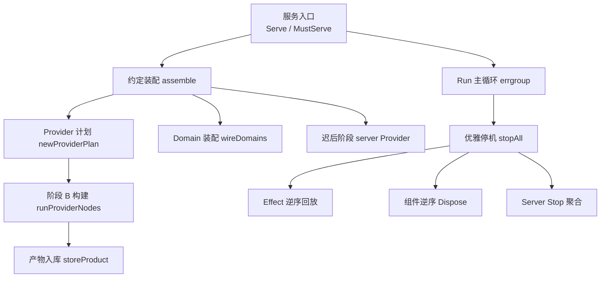
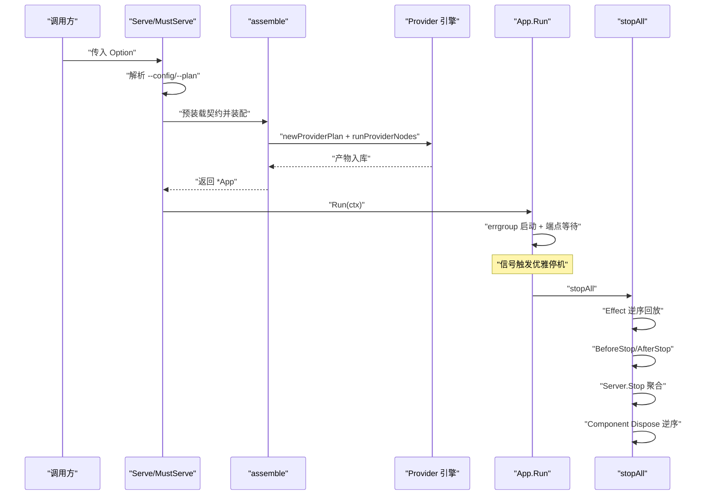
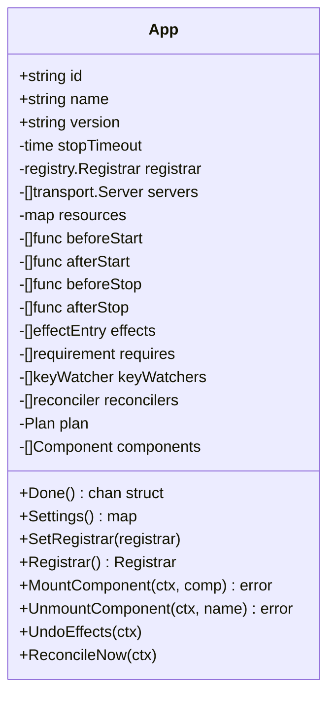
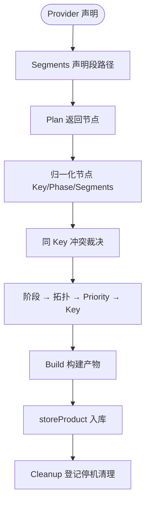
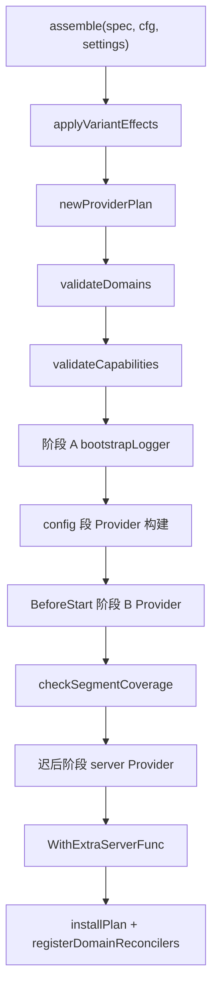
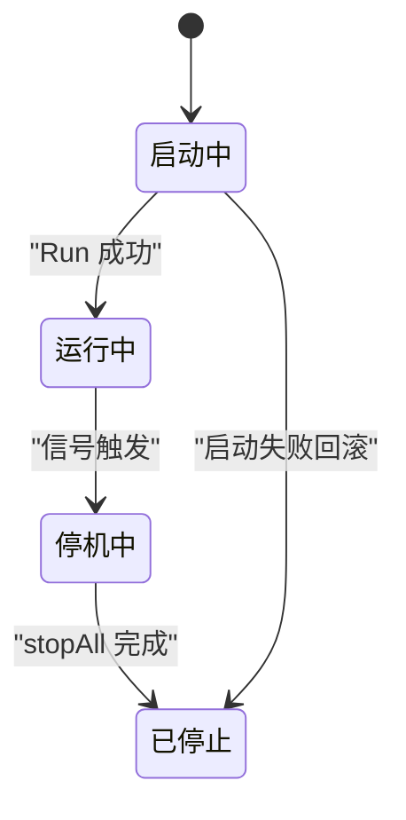
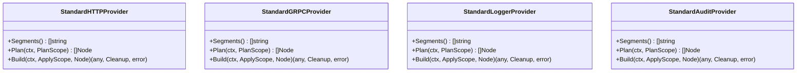
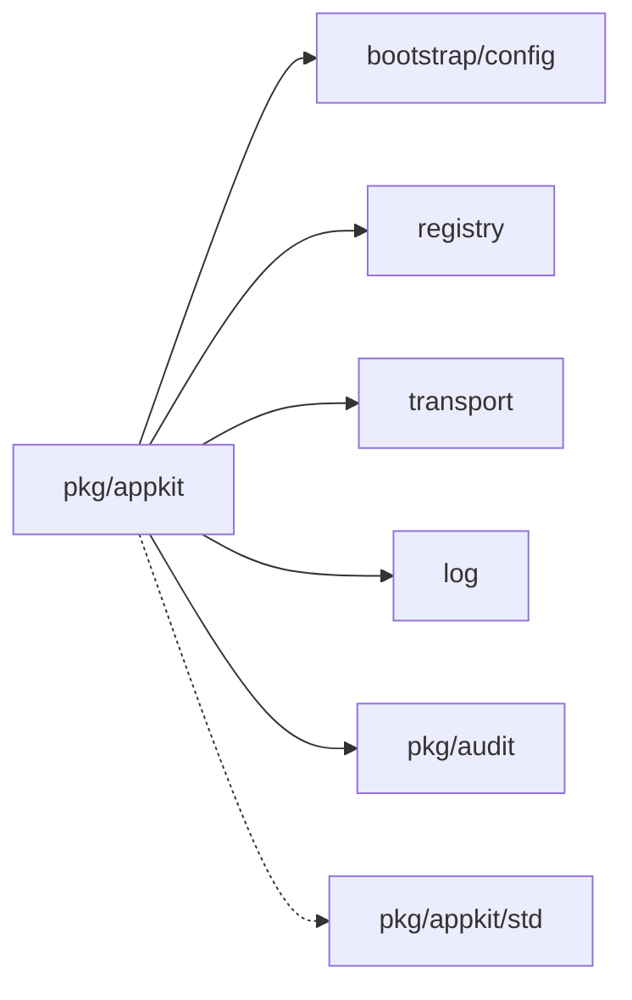

# 应用框架核心

<cite>
**本文引用的文件**   
- [pkg/appkit/appkit.go](file://pkg/appkit/appkit.go)
- [pkg/appkit/provider.go](file://pkg/appkit/provider.go)
- [pkg/appkit/bootstrap.go](file://pkg/appkit/bootstrap.go)
- [pkg/appkit/serve.go](file://pkg/appkit/serve.go)
- [pkg/appkit/types.go](file://pkg/appkit/types.go)
- [pkg/appkit/domain.go](file://pkg/appkit/domain.go)
- [pkg/appkit/capability.go](file://pkg/appkit/capability.go)
- [pkg/appkit/standard.go](file://pkg/appkit/standard.go)
- [pkg/appkit/mount.go](file://pkg/appkit/mount.go)
- [pkg/appkit/effect.go](file://pkg/appkit/effect.go)
- [pkg/appkit/reconcile.go](file://pkg/appkit/reconcile.go)
- [pkg/appkit/keywatch.go](file://pkg/appkit/keywatch.go)
- [pkg/appkit/component.go](file://pkg/appkit/component.go)
- [pkg/appkit/health.go](file://pkg/appkit/health.go)
- [_example/bald/appspec.json](file://_example/bald/appspec.json)
- [_example/bald/user/provider_mem.go](file://_example/bald/user/provider_mem.go)
</cite>

## 目录
1. [简介](#简介)
2. [项目结构](#项目结构)
3. [核心组件](#核心组件)
4. [架构总览](#架构总览)
5. [详细组件分析](#详细组件分析)
6. [依赖关系分析](#依赖关系分析)
7. [性能与可扩展性](#性能与可扩展性)
8. [故障排查指南](#故障排查指南)
9. [结论](#结论)
10. [附录：使用案例](#附录使用案例)

## 简介
Bald 应用框架的核心在 `pkg/appkit`，它提供「配置驱动 + Provider 装配 + 段契约」的应用编排层。其设计目标是：

- 把可配置的启动参数（地址、日志、注册中心、TLS）收敛到 Bootstrap 契约；
- 把代码侧能力（HTTP handler、gRPC service、业务域、拦截器链序）留在 Option/Provider/Domains；
- 用段路径做装配声明，通过 Provider.Plan/Build 两阶段实现纯函数计划与受控副作用构建；
- 用 errgroup 管理并发任务、统一优雅停机预算、逆序效应回放与组件销毁；
- 用 Reconcile 机制实现期望态驱动的运行时收敛（如审计后端热切换）。

## 项目结构
`pkg/appkit` 是 Bald 的 AppKit 装配层，围绕以下文件组织：

- 应用入口与生命周期：[appkit.go](file://pkg/appkit/appkit.go)、[serve.go](file://pkg/appkit/serve.go)
- Provider 装配引擎：[provider.go](file://pkg/appkit/provider.go)、[bootstrap.go](file://pkg/appkit/bootstrap.go)
- 内置标准实现：[standard.go](file://pkg/appkit/standard.go)
- 业务域与装配槽位：[domain.go](file://pkg/appkit/domain.go)
- 能力声明与解析：[capability.go](file://pkg/appkit/capability.go)
- 运行期扩展：[mount.go](file://pkg/appkit/mount.go)、[component.go](file://pkg/appkit/component.go)、[effect.go](file://pkg/appkit/effect.go)
- 协调与配置订阅：[reconcile.go](file://pkg/appkit/reconcile.go)、[keywatch.go](file://pkg/appkit/keywatch.go)
- 健康检查：[health.go](file://pkg/appkit/health.go)
- 配置常量：[types.go](file://pkg/appkit/types.go)
- 示例装配契约：[_example/bald/appspec.json](file://_example/bald/appspec.json)
- 示例 Provider 形态：[_example/bald/user/provider_mem.go](file://_example/bald/user/provider_mem.go)

**图示来源**  
- [serve.go:1-180](file://pkg/appkit/serve.go#L1-L180)
- [bootstrap.go:201-545](file://pkg/appkit/bootstrap.go#L201-L545)
- [provider.go:201-620](file://pkg/appkit/provider.go#L201-L620)
- [appkit.go:201-543](file://pkg/appkit/appkit.go#L201-L543)

**章节来源**  
- [pkg/appkit/appkit.go:1-200](file://pkg/appkit/appkit.go#L1-L200)
- [pkg/appkit/serve.go:1-180](file://pkg/appkit/serve.go#L1-L180)

## 核心组件
AppKit 的核心由以下概念组成：

| 概念 | 职责 | 关键文件 |
|---|---|---|
| `App` | 应用编排主体：配置装载、errgroup 管理、钩子执行、资源收集、优雅停机 | [appkit.go](file://pkg/appkit/appkit.go) |
| `Option` | 装配期纯数据声明接口，所有 With*/Bind/Registrar 等最终写入 Decl | [appkit.go](file://pkg/appkit/appkit.go) |
| `Provider` | 段驱动装配抽象：Segments/Plan/Build/Cleanup | [provider.go](file://pkg/appkit/provider.go) |
| `Domain` | 业务域一等对象：Declare/Wire/Routes/Services/ApplyNode/Reconcile | [domain.go](file://pkg/appkit/domain.go) |
| `Component` | 进程内基础设施生命周期：Start/Dispose | [component.go](file://pkg/appkit/component.go) |
| `Reconcile` | 期望态 diff-apply 协调器：Mount/Unmount 收敛 | [reconcile.go](file://pkg/appkit/reconcile.go) |
| `Health` | HTTP/gRPC 健康检查装配 | [health.go](file://pkg/appkit/health.go) |
| `Effect` | 全局逆操作账本：undo 逆序回放 | [effect.go](file://pkg/appkit/effect.go) |

**章节来源**  
- [pkg/appkit/appkit.go:1-200](file://pkg/appkit/appkit.go#L1-L200)
- [pkg/appkit/provider.go:1-200](file://pkg/appkit/provider.go#L1-L200)
- [pkg/appkit/domain.go:1-200](file://pkg/appkit/domain.go#L1-L200)
- [pkg/appkit/component.go:1-106](file://pkg/appkit/component.go#L1-L106)
- [pkg/appkit/reconcile.go:1-200](file://pkg/appkit/reconcile.go#L1-L200)
- [pkg/appkit/health.go:1-80](file://pkg/appkit/health.go#L1-L80)
- [pkg/appkit/effect.go:1-91](file://pkg/appkit/effect.go#L1-L91)

## 架构总览
AppKit 的运行分为三个层次：

1. **装配层**：`Serve` → 预装载契约 → `assemble` → Provider 计划 → Domain 校验 → 构造 `App`。
2. **运行层**：`Run` → 阶段 A 引导日志 → 阶段 B Provider 构建 → 业务 BeforeStart → Domain 装配 → 迟后阶段 server 构建 → 端点等待。
3. **停机层**：信号触发 → 取消 ctx → Effect 逆序回放 → BeforeStop → Server 停止 → AfterStop → Component Dispose。

**图示来源**  
- [serve.go:1-180](file://pkg/appkit/serve.go#L1-L180)
- [bootstrap.go:201-545](file://pkg/appkit/bootstrap.go#L201-L545)
- [provider.go:201-620](file://pkg/appkit/provider.go#L201-L620)
- [appkit.go:201-543](file://pkg/appkit/appkit.go#L201-L543)

## 详细组件分析

### App 结构与 errgroup 管理
`App` 是 Bald 应用编排的核心结构体，承载：

- 应用元数据：id、name、version、配置命名空间；
- 生命周期：beforeStart/afterStart/beforeStop/afterStop 钩子；
- 资源面：按契约段路径存储 Provider 产物；
- 可观察性：running、done、startedCh；
- 运行期状态：注册中心、servers、组件、审计、协调器、计划快照。

优雅停机通过统一的 `stopTimeout` 派生各阶段预算，并由 `phaseBudgetFor` 控制每个阶段的超时上限，避免慢监听或慢钩子导致停机不可控。

**图示来源**  
- [appkit.go:1-200](file://pkg/appkit/appkit.go#L1-L200)
- [appkit.go:201-543](file://pkg/appkit/appkit.go#L201-L543)

**章节来源**  
- [pkg/appkit/appkit.go:1-200](file://pkg/appkit/appkit.go#L1-L200)
- [pkg/appkit/types.go:1-22](file://pkg/appkit/types.go#L1-L22)

### Provider 驱动的生命周期
Provider 是段驱动的装配抽象，定义四个关键语义：

1. `Segments()`：声明消费或归属的契约段路径；
2. `Plan(ctx, PlanScope)`：纯函数，返回节点，不产生副作用；
3. `Build(ctx, ApplyScope, Node)`：唯一允许副作用的构建入口；
4. `Cleanup(context.Context) error`：停机时释放资源。

Provider 计划被归一为节点，按阶段排序、拓扑排序、优先级与 Key 排序，再逐项 Build，产物存入 App 的资源面。

**图示来源**  
- [provider.go:1-200](file://pkg/appkit/provider.go#L1-L200)
- [provider.go:201-620](file://pkg/appkit/provider.go#L201-L620)
- [bootstrap.go:201-545](file://pkg/appkit/bootstrap.go#L201-L545)

**章节来源**  
- [pkg/appkit/provider.go:1-200](file://pkg/appkit/provider.go#L1-L200)
- [pkg/appkit/provider.go:201-620](file://pkg/appkit/provider.go#L201-L620)

### 段装配系统工作原理
段装配由 `assemble` 驱动，核心流程如下：

1. 应用变体补丁；
2. Provider 计划解析；
3. Domain 声明校验；
4. 能力声明校验；
5. 阶段 A 引导 Logger；
6. config 段 Provider 产出配置层；
7. BeforeStart 阶段 B Provider 构建；
8. L3 段覆盖检查；
9. 迟后阶段 server Provider；
10. 额外服务器工厂；
11. 安装计划与协调器。

**图示来源**  
- [bootstrap.go:201-545](file://pkg/appkit/bootstrap.go#L201-L545)

**章节来源**  
- [pkg/appkit/bootstrap.go:201-545](file://pkg/appkit/bootstrap.go#L201-L545)

### App 启动与优雅停机
`Serve` 是唯一装配入口，内部完成：

- `--config` 解析；
- 契约两遍预装载；
- 约定装配；
- `Run` 阻塞运行到优雅停机。

`MustServe` 是 main 使用的薄壳：失败记日志并以非零码退出。

优雅停机由 `stopAll` 负责，顺序为：

1. Effect 逆序回放；
2. BeforeStop 钩子；
3. Server 停止；
4. AfterStop 钩子；
5. Component Dispose。

**图示来源**  
- [serve.go:1-180](file://pkg/appkit/serve.go#L1-L180)
- [appkit.go:201-543](file://pkg/appkit/appkit.go#L201-L543)

**章节来源**  
- [pkg/appkit/serve.go:1-180](file://pkg/appkit/serve.go#L1-L180)
- [pkg/appkit/appkit.go:201-543](file://pkg/appkit/appkit.go#L201-L543)

### Bootstrap 层的 ServerProvider 工厂模式
内置标准 Provider 在 `standard.go` 中提供：

- `StandardHTTPProvider`：消费 `server.http` 段；
- `StandardGRPCProvider`：消费 `server.grpc` 段；
- `StandardAuditProvider`：消费 `audit.backends`；
- `StandardLoggerProvider`：消费 `logger` 段。

这些 Provider 作为 `std.Standard()` 成员注入，可被用户 Provider 按段路径末者胜规则覆盖。

**图示来源**  
- [standard.go:1-200](file://pkg/appkit/standard.go#L1-L200)

**章节来源**  
- [pkg/appkit/standard.go:1-200](file://pkg/appkit/standard.go#L1-L200)

### 自定义 Provider 扩展方式
扩展自定义基础设施的步骤：

1. 实现 `Provider` 接口；
2. 在 `Segments()` 声明契约段路径；
3. 在 `Plan()` 返回节点；
4. 在 `Build()` 构建产物并返回 cleanup；
5. 通过 `Providers(...)` 或 `std.Standard()` 追加。

例如内存数据库 Provider 形态见示例模块。

**章节来源**  
- [pkg/appkit/provider.go:1-200](file://pkg/appkit/provider.go#L1-L200)
- [_example/bald/user/provider_mem.go:1-16](file://_example/bald/user/provider_mem.go#L1-L16)

### 生命周期钩子使用方法
生命周期钩子包括：

- `BeforeStart`：阶段 B Provider 之后、Domain 之前；
- `AfterStart`：所有服务启动完成后；
- `BeforeStop`：优雅停机开始；
- `AfterStop`：所有资源释放后。

钩子用于业务初始化、运行期资源建立、停机收尾。

**章节来源**  
- [pkg/appkit/appkit.go:201-543](file://pkg/appkit/appkit.go#L201-L543)
- [pkg/appkit/bootstrap.go:201-545](file://pkg/appkit/bootstrap.go#L201-L545)

### 错误处理与恢复策略
框架的错误处理策略：

- 启动期 fail-fast：配置缺失、段未消费、能力未满足直接报错；
- 阶段隔离：单个 Provider/组件/Effect 失败不影响其余回收；
- 幂等清理：cleanup、Dispose、UndoEffects 保证重复调用无副作用；
- 旁路审计：挂载/卸载/协调失败仍记录审计事件；
- 超时保护：每个阶段有独立超时预算，避免无限等待。

**章节来源**  
- [pkg/appkit/effect.go:1-91](file://pkg/appkit/effect.go#L1-L91)
- [pkg/appkit/component.go:1-106](file://pkg/appkit/component.go#L1-L106)
- [pkg/appkit/reconcile.go:1-200](file://pkg/appkit/reconcile.go#L1-L200)

### 配置装载、依赖注入与健康检查集成
配置装载由 `loadConfig` 负责，支持：

- 本地配置文件；
- 环境变量；
- flag 覆盖；
- 远程配置中心；
- 严格契约校验。

依赖注入通过 `Provides`/`Requires` 声明，`Resolve` 在启动早期校验一致性。

健康检查通过 `WithHealth` 装配 HTTP/gRPC 探针，默认路径 `/healthz` 与 `/readyz`。

**章节来源**  
- [pkg/appkit/appkit.go:201-543](file://pkg/appkit/appkit.go#L201-L543)
- [pkg/appkit/capability.go:1-100](file://pkg/appkit/capability.go#L1-L100)
- [pkg/appkit/health.go:1-80](file://pkg/appkit/health.go#L1-L80)

## 依赖关系分析
AppKit 的依赖方向是单向的：

- `appkit` 不 import 具体适配器；
- 契约包只放装配逻辑；
- 具体后端在适配器包；
- 根 module 不得 require 任何适配器，避免模块环。

**图示来源**  
- [pkg/appkit/appkit.go:1-200](file://pkg/appkit/appkit.go#L1-L200)
- [pkg/appkit/standard.go:1-200](file://pkg/appkit/standard.go#L1-L200)

**章节来源**  
- [pkg/appkit/appkit.go:1-200](file://pkg/appkit/appkit.go#L1-L200)
- [pkg/appkit/standard.go:1-200](file://pkg/appkit/standard.go#L1-L200)

## 性能与可扩展性
AppKit 的性能特性：

- Provider 计划是纯函数，可缓存；
- 节点排序基于拓扑与优先级，避免手工维护顺序；
- 阶段预算限制单阶段耗时，防止慢组件拖垮整体停机；
- 协调器采用 diff-apply，避免全量重建；
- Key 级订阅减少无关变更回调。

可扩展性体现在：

- Provider 可替换任意段；
- Domain 可声明自有机构；
- Component 可封装进程内基础设施；
- Reconcile 可实现运行时收敛；
- Effect 可记录全局逆操作。

**章节来源**  
- [pkg/appkit/provider.go:201-620](file://pkg/appkit/provider.go#L201-L620)
- [pkg/appkit/types.go:1-22](file://pkg/appkit/types.go#L1-L22)
- [pkg/appkit/keywatch.go:1-93](file://pkg/appkit/keywatch.go#L1-L93)

## 故障排查指南
常见故障与定位方式：

| 现象 | 可能原因 | 排查建议 |
|---|---|---|
| 启动时报段未消费 | L3 段覆盖检查失败 | 检查是否有 Provider 消费该段，或使用 `WithUnimplementedSegments` |
| Provider 未构建 | 段不存在或 Provider 未触发 | 检查 `Segments()` 是否与契约匹配 |
| 能力未解析 | `Requires` 未对应 `Provides` | 检查 `Resolve` 错误信息 |
| 优雅停机卡住 | 某个阶段超时 | 调整 `StopTimeout` 或检查钩子/组件 Dispose |
| 配置热更不生效 | 未启用 WatchConfigFile 或 Remote | 检查 `WatchConfigFile` 与远程配置源 |
| 健康检查未暴露 | 未声明 `WithHealth` | 检查是否调用 `WithHealth` 或手动包装 |

**章节来源**  
- [pkg/appkit/provider.go:201-620](file://pkg/appkit/provider.go#L201-L620)
- [pkg/appkit/capability.go:1-100](file://pkg/appkit/capability.go#L1-L100)
- [pkg/appkit/health.go:1-80](file://pkg/appkit/health.go#L1-L80)

## 结论
Bald 应用框架核心通过 AppKit 实现了配置驱动与 Provider 装配的统一模型。它以段路径为装配声明，以 Provider 为扩展点，以 Domain 为业务边界，以 Reconcile 为运行时收敛机制。App 结构体统一管理生命周期、errgroup、资源与停机，使复杂应用的启动、运行与优雅停机具备一致性与可观测性。

## 附录：使用案例

### 简单案例：最小应用
使用 `appkit.MustServe` 启动一个最小应用，仅声明 HTTP handler。

参考入口：
- [serve.go:1-180](file://pkg/appkit/serve.go#L1-L180)

### 中等案例：带 Provider 与 Domain
引入数据库 Provider 与业务域，展示段装配与域接线。

参考示例：
- [_example/bald/appspec.json:1-81](file://_example/bald/appspec.json#L1-L81)
- [_example/bald/user/provider_mem.go:1-16](file://_example/bald/user/provider_mem.go#L1-L16)

### 复杂案例：自定义基础设施与协调器
实现自定义 Provider，配合 Reconcile 实现运行时收敛，结合 Component 管理进程内资源。

参考实现：
- [pkg/appkit/provider.go:1-200](file://pkg/appkit/provider.go#L1-L200)
- [pkg/appkit/reconcile.go:1-200](file://pkg/appkit/reconcile.go#L1-L200)
- [pkg/appkit/component.go:1-106](file://pkg/appkit/component.go#L1-L106)