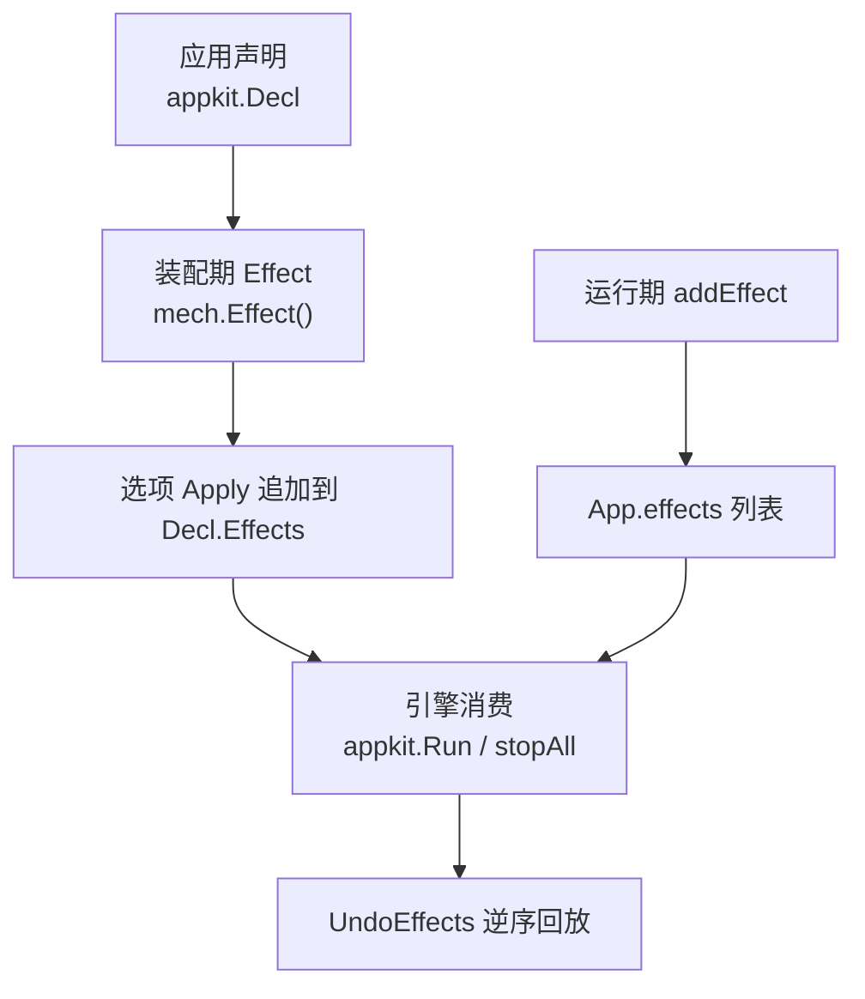
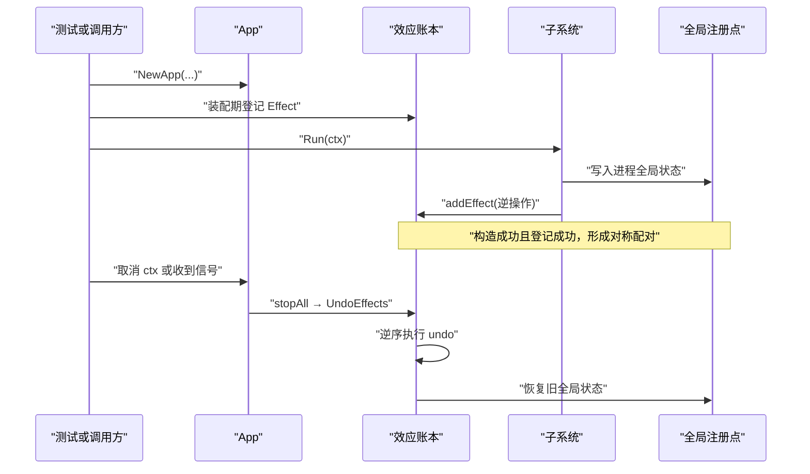
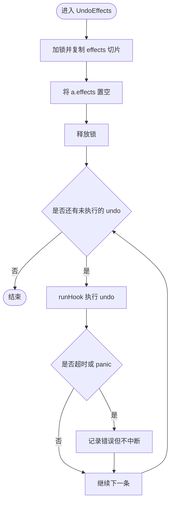
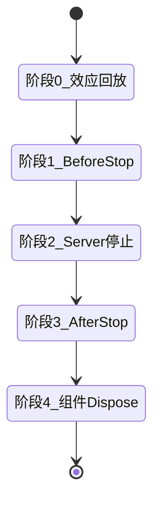
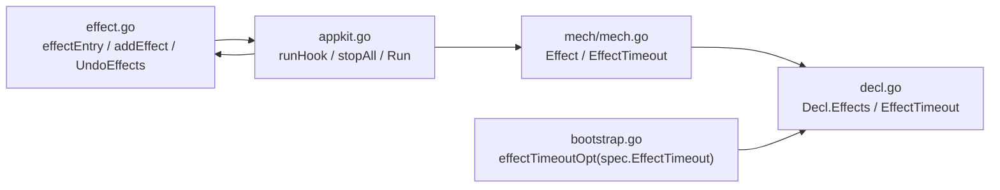

# 效应账本（Effect Ledger）

<cite>
**本文引用的文件**   
- [pkg/appkit/effect.go](file://pkg/appkit/effect.go)
- [pkg/appkit/effect_test.go](file://pkg/appkit/effect_test.go)
- [pkg/appkit/mech/mech.go](file://pkg/appkit/mech/mech.go)
- [pkg/appkit/appkit.go](file://pkg/appkit/appkit.go)
- [pkg/appkit/decl.go](file://pkg/appkit/decl.go)
- [pkg/appkit/bootstrap.go](file://pkg/appkit/bootstrap.go)
- [pkg/store/scope_disposer_test.go](file://pkg/store/scope_disposer_test.go)
</cite>

## 目录
1. [引言](#引言)
2. [项目结构](#项目结构)
3. [核心组件](#核心组件)
4. [架构总览](#架构总览)
5. [详细组件分析](#详细组件分析)
6. [依赖关系分析](#依赖关系分析)
7. [性能与并发特性](#性能与并发特性)
8. [故障排查指南](#故障排查指南)
9. [结论](#结论)
10. [附录：全局状态恢复示例](#附录全局状态恢复示例)

## 引言
效应账本是 appkit 的进程级副作用治理机制，用于解决「全局注册点不可逆」的问题。仓库中多处全局写入——例如 `store.RegisterTenant`、`log.SetLogger`——会覆盖进程级共享状态，旧值一旦覆盖即丢失；若没有对应逆操作，e2e 测试之间会产生全局污染，重复注册语义只能靠调用约定维持。

效应账本把这些约定升级为结构保证：任何对进程全局状态的写入都配套登记一条可撤销的逆操作；在优雅停机或启动失败回滚时，按「后注册的先撤销」顺序回放，最终把进程状态恢复到装配前。它同时提供独立超时、panic 隔离旁路以及幂等清空能力，并让 e2e 测试无需跑完整 `Run` 也能安全清理全局状态。

## 项目结构
效应账本由三层协作完成：

- **数据模型层**：`effectEntry` 保存每条效应的名称与逆操作函数。
- **装配期入口层**：`appkit.Option` 版 `Effect` 通过 `mech.Effect` 追加到 `Decl.Effects`，由引擎在构建阶段消费。
- **运行期登记层**：`App.addEffect` 供 Run 期构造出的服务器等资源直接入账，避免「构造成功但注册失败」的资源泄漏窗口。
- **引擎调度层**：`UndoEffects` 在 `stopAll` 阶段 0 自动调用，也可被测试通过 `t.Cleanup` 显式调用。



**图示来源**
- [pkg/appkit/mech/mech.go:18-44](file://pkg/appkit/mech/mech.go#L18-L44)
- [pkg/appkit/effect.go:28-44](file://pkg/appkit/effect.go#L28-L44)
- [pkg/appkit/appkit.go:729-740](file://pkg/appkit/appkit.go#L729-L740)

**章节来源**
- [pkg/appkit/effect.go:1-91](file://pkg/appkit/effect.go#L1-L91)
- [pkg/appkit/mech/mech.go:1-153](file://pkg/appkit/mech/mech.go#L1-L153)

## 核心组件
### effectEntry 结构体
`effectEntry` 是账本的最小单位，包含两个字段：

| 字段 | 类型 | 职责 |
|---|---|---|
| `name` | `string` | 日志定位标识，用于区分不同全局写入 |
| `undo` | `func(ctx context.Context) error` | 逆操作函数，接收上下文并返回错误 |

该结构不持有锁，只承载数据；加锁和生命周期控制由 `App` 的 `effects` 切片及 `effectsMu` 承担。

**章节来源**
- [pkg/appkit/effect.go:28-32](file://pkg/appkit/effect.go#L28-L32)

### Option 版 Effect 与 mech.Effect
`Option` 版的 `effectOpt` 是 appkit 包内部实现，负责把 `(name, undo)` 包装成 `EffectDecl{Name, Undo}` 并追加到 `Decl.Effects`。对外暴露的是 `mech.Effect`，其返回自持 option 类型，`Apply` 直写 `Decl.Effects`，从而与 appkit 内建选项共用同一份声明载体。

两者语义完全一致：都是「装配期登记」，即遍历选项时写入声明结构，而不是在运行时才入账。

**章节来源**
- [pkg/appkit/effect.go:34-44](file://pkg/appkit/effect.go#L34-L44)
- [pkg/appkit/mech/mech.go:18-44](file://pkg/appkit/mech/mech.go#L18-L44)
- [pkg/appkit/mech/mech.go:87-94](file://pkg/appkit/mech/mech.go#L87-L94)

### 运行期 addEffect
`App.addEffect(name, undo)` 是运行期专用登记方法。它的典型用途是：某个服务器在 `Start` 或 Run 期才真正创建出资源，而该资源的清理逻辑必须在创建成功时立刻入账。

之所以不能沿用装配期 `Effect`，是因为装配期选项在 `Run` 之前已经遍历完毕；如果服务器构造失败发生在 Run 期，装配期登记不会感知这次失败，也就无法形成「构造成功才入账」的约束。

**章节来源**
- [pkg/appkit/effect.go:56-67](file://pkg/appkit/effect.go#L56-L67)

### 超时配置 effectTimeoutOpt
`effectTimeoutOpt` 设置每条 `undo` 的独立超时时间。未显式设置时，默认值为阶段预算，即 `phaseBudgetFor(stopTimeout)`，等价于 `stopTimeout` 的一半。

这个预算不是整条账本的总超时，而是每条逆操作的独立超时；某条 `undo` 卡死只会触发自身超时，不会阻塞后续其他效应的撤销。

**章节来源**
- [pkg/appkit/effect.go:49-55](file://pkg/appkit/effect.go#L49-L55)
- [pkg/appkit/decl.go:236](file://pkg/appkit/decl.go#L236)

## 架构总览
效应账本的生命周期贯穿装配、运行、优雅停机与启动失败回滚四个阶段：



**图示来源**
- [pkg/appkit/appkit.go:573-733](file://pkg/appkit/appkit.go#L573-L733)
- [pkg/appkit/effect.go:70-91](file://pkg/appkit/effect.go#L70-L91)

### 关键契约
- 逆序回放：后注册的先撤销，与依赖建立顺序对称。
- 幂等清空：执行后 `effects` 切片被置空，重复调用无副作用。
- 独立超时：每条 `undo` 使用相同超时预算，但互不影响。
- panic 隔离旁路：单条 `undo` panic 被 `runHook` 捕获，继续回放其余效应。
- 错误记录：`undo` 返回错误仅记日志，不中断其他效应回放。

**章节来源**
- [pkg/appkit/effect.go:40-48](file://pkg/appkit/effect.go#L40-L48)
- [pkg/appkit/effect.go:70-91](file://pkg/appkit/effect.go#L70-L91)
- [pkg/appkit/appkit.go:768-781](file://pkg/appkit/appkit.go#L768-L781)

## 详细组件分析

### 全局注册点不可逆效应的风险
仓库文档明确指出：bald 的全局注册点如 `store.RegisterTenant`、`log.SetLogger` 属于进程级写入，覆盖即丢弃旧值。若无逆操作记录，这些写入就是不可逆效应，导致两类问题：

1. **e2e 测试全局污染**：一个测试修改了全局 logger 或租户注册表，另一个测试读到被覆盖的状态。
2. **重复注册语义依赖约定**：例如 `InitBridges` 必须实现幂等，否则重复启动可能产生二次注册。

效应账本的作用是把这类「约定」变成「结构保证」：只要对全局状态做了写入，就登记逆操作；停机或回滚时统一逆序回放，系统回到装配前的干净状态。

**章节来源**
- [pkg/appkit/effect.go:6-26](file://pkg/appkit/effect.go#L6-L26)

### addEffect 的运行期登记机制
`App.addEffect` 的实现非常薄：获取 `effectsMu` 写锁，把 `effectEntry` 追加到 `a.effects`，然后释放锁。

它的关键设计在于「时机」：

| 登记方式 | 时机 | 适用场景 |
|---|---|---|
| `mech.Effect` / `effectOpt` | 装配期选项遍历 | 可在 `NewApp` 阶段确定的副作用 |
| `addEffect` | 运行期构造成功后 | 服务器、连接池、监听器等延迟创建的资源 |

如果服务器构造成功但没有在同一时刻调用 `addEffect`，就会留下「构造成功但注册失败」的窗口：外部已拿到服务器实例，但进程不知道如何回收它。

**章节来源**
- [pkg/appkit/effect.go:56-67](file://pkg/appkit/effect.go#L56-L67)

### UndoEffects 的逆序回放实现
`UndoEffects` 的流程如下：

1. 加锁复制当前 `effects` 切片。
2. 将 `a.effects` 置为空切片，实现幂等。
3. 从末尾向前遍历，依次执行每个 `undo`。
4. 每条 `undo` 通过 `runHook` 执行，自带超时和 panic 隔离。
5. 返回错误仅记录日志，不终止后续回放。



**图示来源**
- [pkg/appkit/effect.go:76-91](file://pkg/appkit/effect.go#L76-L91)
- [pkg/appkit/appkit.go:768-781](file://pkg/appkit/appkit.go#L768-L781)

### 与审计一致的容错策略
效应账本的错误处理与审计子系统保持一致：单个副作用失败不应阻断整机卸载。因此：

- `undo` 返回错误 → 记日志，继续回放。
- `undo` panic → 被 `runHook` 捕获为错误，继续回放。
- `undo` 超时 → 上下文取消，继续回放。
- 重复调用 `UndoEffects` → 第一次清空账本后，第二次为空操作。

这一策略避免了「某个第三方库的清理逻辑异常拖垮整个进程停机流程」。

**章节来源**
- [pkg/appkit/effect.go:40-48](file://pkg/appkit/effect.go#L40-L48)
- [pkg/appkit/effect.go:70-91](file://pkg/appkit/effect.go#L70-L91)
- [pkg/appkit/appkit.go:768-781](file://pkg/appkit/appkit.go#L768-L781)

### 与 stopAll 五阶段的配合
`stopAll` 的第一阶段就是效应账本逆序回放，早于 BeforeStop、Server.Stop、AfterStop 和组件 Dispose。这意味着：

- 装配期全局状态最先恢复。
- BeforeStop 钩子可以安全地读取已被恢复的全局状态。
- Server.Stop 和 AfterStop 不会依赖尚未撤销的进程级全局变量。
- 组件 Dispose 放在最后，便于钩子在仍有组件可用时做收尾工作。



**图示来源**
- [pkg/appkit/appkit.go:717-767](file://pkg/appkit/appkit.go#L717-L767)

### 启动失败回滚路径
除了正常优雅停机，`Run` 的多个失败分支也会立即调用 `UndoEffects`：

| 失败位置 | 行为 |
|---|---|
| `loadConfig` 失败 | 回滚装配期全局写入，返回错误 |
| `Resolve` 失败 | 能力解析失败，回滚装配期全局写入 |
| `beforeStart` 钩子失败 | 未到 stopAll，仍需回滚账本 |
| 组件启动失败 | 走 `stopAll`，由阶段 0 统一回放 |
| 等待端点失败 | 走 `stopAll` |
| 服务注册失败 | 走 `stopAll` |
| `afterStart` 钩子失败 | 走 `stopAll` |

这保证了无论启动走到哪一步，已登记的效应都能被回收。

**章节来源**
- [pkg/appkit/appkit.go:590-628](file://pkg/appkit/appkit.go#L590-L628)
- [pkg/appkit/appkit.go:648-672](file://pkg/appkit/appkit.go#L648-L672)
- [pkg/appkit/appkit.go:705-706](file://pkg/appkit/appkit.go#L705-L706)

### e2e 测试隔离模式
效应账本专为 e2e 测试提供免跑 `Run` 的隔离能力：

```text
app := appkit.NewApp(mech.Effect("..."))
t.Cleanup(func() { app.UndoEffects(context.Background()) })
```

这种方式适合需要直接构造 App、注入 Effect 但不希望触发完整启动流程的场景。不过需要注意：`UndoEffects` 本身不关闭 `done` channel，也不归还 `running` 状态；它只清账本。若测试需要完整生命周期语义，仍应调用 `Run` 或在合适位置补齐清理。

**章节来源**
- [pkg/appkit/effect.go:18-26](file://pkg/appkit/effect.go#L18-L26)
- [pkg/appkit/effect.go:70-75](file://pkg/appkit/effect.go#L70-L75)

## 依赖关系分析



**图示来源**
- [pkg/appkit/effect.go:34-91](file://pkg/appkit/effect.go#L34-L91)
- [pkg/appkit/mech/mech.go:18-94](file://pkg/appkit/mech/mech.go#L18-L94)
- [pkg/appkit/decl.go:236](file://pkg/appkit/decl.go#L236)
- [pkg/appkit/bootstrap.go:451](file://pkg/appkit/bootstrap.go#L451)
- [pkg/appkit/appkit.go:573-781](file://pkg/appkit/appkit.go#L573-L781)

### 模块边界
- `mech` 单向 import `appkit`，不反向依赖。
- `appkit` 包内的 `optionFunc` 与 `mech` 的自持 option 类型共同维护 `Decl` 字段。
- 运行期登记路径（`addEffect`）不走 `Decl`，直接操作 `App` 的 `effects` 切片，保持原样低耦合。
- `bootstrap.go` 把 spec 中的 `EffectTimeout` 转为 `effectTimeoutOpt`，注入到 kit 选项。

**章节来源**
- [pkg/appkit/mech/mech.go:1-17](file://pkg/appkit/mech/mech.go#L1-L17)
- [pkg/appkit/bootstrap.go:451](file://pkg/appkit/bootstrap.go#L451)

## 性能与并发特性
- **并发安全**：`addEffect` 使用 `effectsMu` 保护 `effects` 切片追加。
- **幂等清空**：`UndoEffects` 先复制再置空，避免重复执行。
- **逆序回放**：从尾部向前遍历，复杂度 O(n)。
- **独立超时**：每条 `undo` 通过 `runHook` 获得独立上下文超时，不会互相抢占。
- **panic 隔离**：`runHook` 用 defer recover 捕获 panic，并把 panic 转为结构化错误。
- **基准测试覆盖**：bench 用例验证每操作新账本、批量 `addEffect` 与逆序回放的稳定性。

**章节来源**
- [pkg/appkit/effect.go:56-91](file://pkg/appkit/effect.go#L56-L91)
- [pkg/appkit/appkit.go:768-781](file://pkg/appkit/appkit.go#L768-L781)
- [pkg/appkit/bench_test.go:278-289](file://pkg/appkit/bench_test.go#L278-L289)

## 故障排查指南

### 现象：e2e 测试出现全局 logger 或租户状态污染
**原因**：测试中调用了 `log.SetLogger`、`store.RegisterTenant` 等全局写入，但没有登记逆操作，也没有在测试结束时调用 `UndoEffects`。

**处理方法**：
1. 对每次全局写入登记对应的逆操作。
2. 在 `t.Cleanup` 中调用 `app.UndoEffects(context.Background())`。
3. 确认逆操作恢复的是装配前的旧值，而非 nil 或默认值。

**章节来源**
- [pkg/appkit/effect.go:6-26](file://pkg/appkit/effect.go#L6-L26)
- [pkg/store/scope_disposer_test.go:19](file://pkg/store/scope_disposer_test.go#L19)

### 现象：某条 undo 卡住导致整机停机缓慢
**原因**：某条 `undo` 长时间阻塞或死循环，但其他效应仍在继续。

**处理方法**：
1. 检查该效应的 `undo` 是否正确响应上下文取消。
2. 通过 `effectTimeoutOpt` 调整独立超时预算。
3. 查看日志中 `appkit effect undo failed` 条目，定位具体效应名称。

**章节来源**
- [pkg/appkit/effect.go:49-55](file://pkg/appkit/effect.go#L49-L55)
- [pkg/appkit/effect.go:87-91](file://pkg/appkit/effect.go#L87-L91)

### 现象：某条 undo panic 后其余效应仍未执行
**原因**：这不是账本实现问题，应优先检查自定义 `undo` 是否自行传播了 panic，或外层调用链未使用 `UndoEffects`。

正确实现下，`runHook` 会捕获 panic 并继续回放其余效应。

**章节来源**
- [pkg/appkit/appkit.go:768-781](file://pkg/appkit/appkit.go#L768-L781)
- [pkg/appkit/effect_test.go:63-85](file://pkg/appkit/effect_test.go#L63-L85)

### 现象：重复调用 `UndoEffects` 生效两次
**原因**：通常意味着账本没有被正确清空，或者测试中构造了多个 `App` 实例并分别调用。

`UndoEffects` 本身会在执行后置空 `effects` 切片；若出现重复执行，应检查是否在多次 `NewApp` 或多次挂载过程中混入了多条同名效应。

**章节来源**
- [pkg/appkit/effect.go:70-86](file://pkg/appkit/effect.go#L70-L86)
- [pkg/appkit/effect_test.go:50-61](file://pkg/appkit/effect_test.go#L50-L61)

## 结论
效应账本是 bald 框架中面向进程级副作用的结构化保障。它通过 `effectEntry`、`addEffect`、`UndoEffects` 和 `stopAll` 阶段 0 的配合，把原本依赖约定的全局状态管理升级为可逆、可观测、可超时的机制。

正确使用方式是：

- 装配期全局写入走 `mech.Effect`。
- 运行期构造成功的资源通过 `addEffect` 在同一时刻入账。
- 组件 `Start`/`Dispose` 或服务器资源遵循「构造成功即登记、销毁即撤销」的对称原则。
- e2e 测试在 `t.Cleanup` 中调用 `UndoEffects`，确保共享环境不被污染。

这样既能避免全局状态泄漏，又能让启动失败、优雅停机、重试与并行测试共享同一套可靠的生命周期语义。

## 附录：全局状态恢复示例

以下示例以文字步骤描述如何在组件 `Start`/`Dispose` 中配对使用 Effect 与 `addEffect`，不直接粘贴代码。

### 全局 Logger 恢复
1. 在装配期或 `BeforeStart` 中保存旧 logger。
2. 调用 `log.SetLogger` 替换为业务 logger。
3. 使用 `mech.Effect` 登记逆操作，恢复旧 logger。
4. 若 logger 切换发生在运行期，则改用 `addEffect`，确保切换成功时才入账。

### 租户注册表恢复
1. 在装配期或组件初始化时调用 `store.RegisterTenant`。
2. 登记逆操作，移除该租户注册项。
3. 若注册发生在运行期，必须把 `addEffect` 放在注册成功之后。
4. 在测试中使用 `t.Cleanup(app.UndoEffects)` 保证多测试间隔离。

### 服务器资源恢复
1. 服务器 `Start` 成功后创建底层连接或监听器。
2. 立即调用 `addEffect`，登记关闭连接的逆操作。
3. 若 `Start` 失败，不应登记该逆操作，因为不存在成功构造产物。
4. 优雅停机时，`UndoEffects` 会按逆序关闭这些连接。

### 推荐配对模式
- **NewApp 阶段**：`mech.Effect("logger", func(ctx){ log.SetLogger(old); return nil })`
- **Run 阶段**：`server.Start(ctx)` 成功后 `app.addEffect("server-cleanup", func(ctx){ server.Close(); return nil })`
- **测试阶段**：`t.Cleanup(func(){ app.UndoEffects(context.Background()) })`
- **组件阶段**：`Component.Start` 成功后登记 `addEffect`，`Component.Dispose` 中调用对应清理逻辑，由 `stopAll` 阶段 4 统一逆序执行。

**章节来源**
- [pkg/appkit/effect.go:18-26](file://pkg/appkit/effect.go#L18-L26)
- [pkg/appkit/effect.go:56-91](file://pkg/appkit/effect.go#L56-L91)
- [pkg/appkit/appkit.go:717-767](file://pkg/appkit/appkit.go#L717-L767)
- [pkg/appkit/mech/mech.go:87-94](file://pkg/appkit/mech/mech.go#L87-L94)