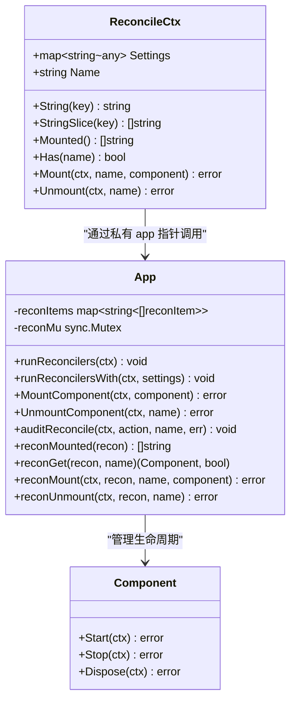
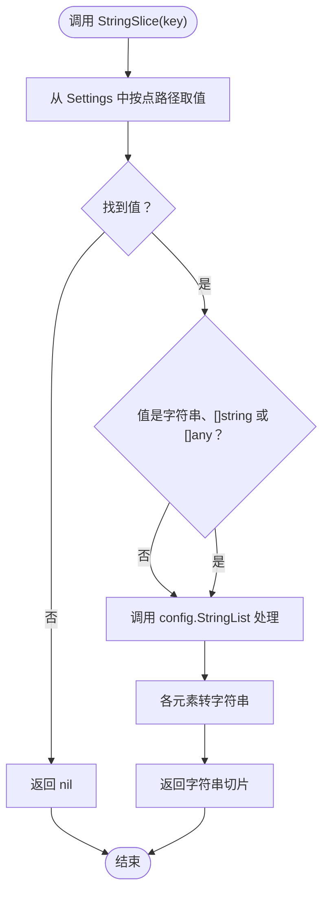
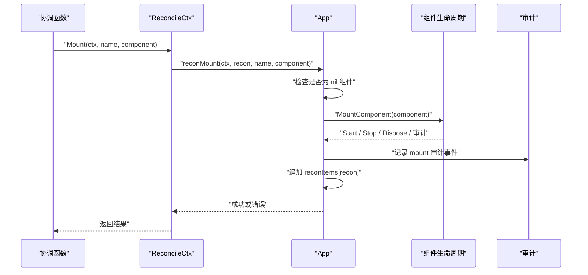
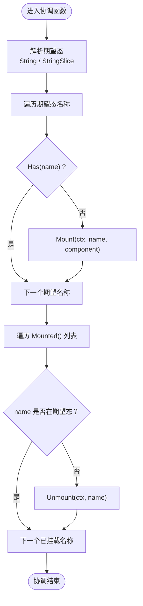
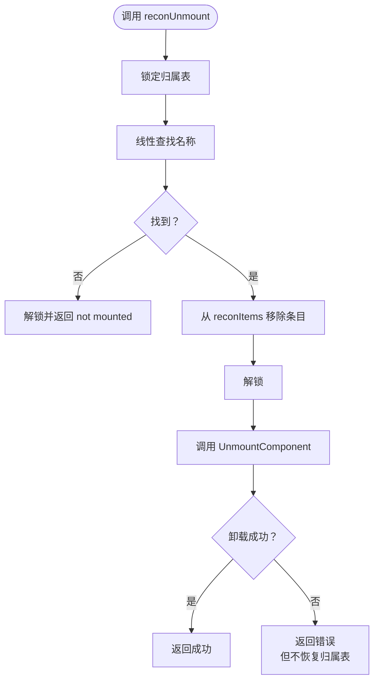
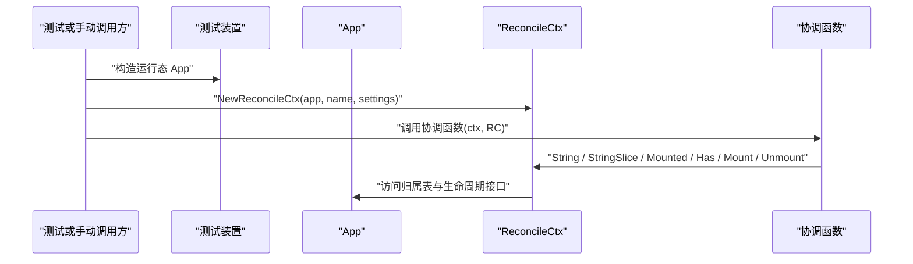
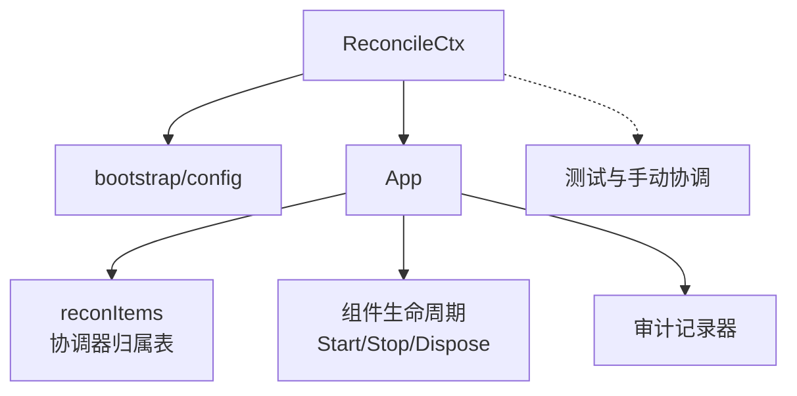

# ReconcileCtx API 详解

<cite>
**本文引用的文件**   
- [pkg/appkit/reconcile.go](file://pkg/appkit/reconcile.go)
- [pkg/appkit/reconcile_test.go](file://pkg/appkit/reconcile_test.go)
</cite>

## 目录
1. [引言](#引言)
2. [ReconcileCtx 概览](#reconcilectx-概览)
3. [Settings 字段：期望态快照语义](#settings-字段期望态快照语义)
4. [配置读取薄委托：String 与 StringSlice](#配置读取薄委托string-与-stringslice)
5. [实际态操作接口](#实际态操作接口)
6. [挂载与卸载协调流程](#挂载与卸载协调流程)
7. [NewReconcileCtx 构造用途](#newreconcilectx-构造用途)
8. [依赖关系图](#依赖关系图)
9. [故障排查](#故障排查)
10. [结论](#结论)

## 引言
`ReconcileCtx` 是应用框架中「期望态协调器」在执行一次协调时拿到的上下文对象。它把两类信息统一暴露给业务回调：

- **期望态**：通过 `Settings` 以及 `String` / `StringSlice` 读取；
- **实际态**：通过 `Mounted`、`Has`、`Mount`、`Unmount` 读写当前由该协调器管理的组件集合。

协调器的职责不是直接维护运行时状态，而是声明「期望是什么样」，然后调用框架提供的挂载/卸载接口让系统收敛到终态。失败不会回滚，下一次协调会重新读两端并补齐差异。

## ReconcileCtx 概览
`ReconcileCtx` 是一个简单结构体，核心成员只有三个：

| 字段或方法 | 类型 / 签名 | 职责 |
|---|---|---|
| `Settings` | `map[string]any` | 本次协调开始时的期望态深拷贝只读快照 |
| `Name` | `string` | 本协调器的注册名，用于日志和审计定位 |
| `app` | 私有指针 | 指向所属 `App`，用于访问内部归属表和生命周期接口 |

对外暴露的公共接口分为两组：

- **期望态读取**：`String(key)`、`StringSlice(key)`；
- **实际态操作**：`Mounted()`、`Has(name)`、`Mount(ctx, name, component)`、`Unmount(ctx, name)`。

**图表来源**   
- [pkg/appkit/reconcile.go:65-118](file://pkg/appkit/reconcile.go#L65-L118)
- [pkg/appkit/reconcile.go:172-262](file://pkg/appkit/reconcile.go#L172-L262)

**章节来源**   
- [pkg/appkit/reconcile.go:65-118](file://pkg/appkit/reconcile.go#L65-L118)

## Settings 字段：期望态快照语义
`Settings` 是本次协调开始时的配置快照，具有以下关键属性：

1. **深拷贝只读**：框架在每次协调前从配置仓库取一份新快照，协调函数不应修改 `Settings` 的值；
2. **一次协调内取值一致**：`runReconcilers` 先取出全局配置快照，再依次创建每个协调器的 `ReconcileCtx`，因此同一个协调函数多次读取同一 key 的结果一致；
3. **跨协调可变化**：下次协调时框架会取最新配置，所以配置变更可以通过重复协调收敛；
4. **空值行为**：当配置仓库为空或未提供设置时，快照可能为空映射，`String` 与 `StringSlice` 仍按各自默认语义返回空字符串或 `nil`。

这个设计保证协调器可以安全地反复执行：即使外部配置在协调过程中发生变化，当前协调函数看到的仍然是启动那次协调时的稳定视图。

**章节来源**   
- [pkg/appkit/reconcile.go:65-76](file://pkg/appkit/reconcile.go#L65-L76)
- [pkg/appkit/reconcile.go:146-170](file://pkg/appkit/reconcile.go#L146-L170)

## 配置读取薄委托：String 与 StringSlice
`String` 和 `StringSlice` 是薄委托，不实现复杂解析逻辑，而是复用配置装载层的值语义：

### String(key)
- 先从 `r.Settings` 中以点路径查找值；
- 缺失键返回空字符串；
- 值为 `nil` 也视为缺失，返回空字符串；
- 标量值走 `config.String` 进行字符串化；
- 非标量（例如嵌套 map）按配置层定义返回对应字符串表示。

典型用例见测试中的 `str.v`、`num` 与缺失键场景。

### StringSlice(key)
- 支持三种列表形式：
  1. `[]string`；
  2. `[]any`（常见于 YAML 列表被反序列化为任意类型切片）；
  3. 逗号分隔的字符串（例如 `"log, store ,stream"`）。
- 缺失键或 `nil` 值返回 `nil`，而不是空切片；
- 列表元素最终经 `config.String` 统一转换为字符串；
- 空白项会被解析层处理，测试中确认了 `"store "` 等带空格的子项仍能正确拆分。

**图表来源**   
- [pkg/appkit/reconcile.go:84-98](file://pkg/appkit/reconcile.go#L84-L98)
- [pkg/appkit/reconcile_test.go:310-337](file://pkg/appkit/reconcile_test.go#L310-L337)

**章节来源**   
- [pkg/appkit/reconcile.go:78-98](file://pkg/appkit/reconcile.go#L78-L98)
- [pkg/appkit/reconcile_test.go:310-337](file://pkg/appkit/reconcile_test.go#L310-L337)

## 实际态操作接口
实际态指「当前已挂载、并由该协调器负责管理的组件集合」。协调器用期望态与实际态做差集来决定是否需要 `Mount` 或 `Unmount`。

### Mounted()
- 返回当前实际已挂载的组件名列表；
- 顺序与挂载序一致；
- 用于判断「实际有、期望无」的组件，从而决定卸载；
- 底层来自 `a.reconMounted(r.Name)`，遍历 `reconItems[r.Name]` 的顺序输出。

### Has(name)
- 判断指定名称的组件是否已由该协调器挂载；
- 用于判断「期望有、实际无」，从而决定是否挂载；
- 底层通过 `reconGet` 线性查找归属表条目。

### Mount(ctx, name, component)
- 将组件纳入该协调器管理；
- 语义与 `App.MountComponent` 一致，包括启动组件、加入停机序列、记录 mount 审计事件；
- **幂等规则**：同名组件已经挂载时返回错误，避免重复挂载；
- 内部先调用 `a.MountComponent`，成功后才写入归属表，确保归属表与实际挂载一致。

### Unmount(ctx, name)
- 卸载该协调器名下的组件；
- 先移除归属表条目，再调用 `UnmountComponent`（即 `Stop` + `Dispose` + unmount 审计事件）；
- **幂等规则**：如果归属表中不存在该名称，返回「not mounted」错误；
- **失败不回滚归属表**：若卸载失败，归属表已被移除，但组件可能已 `Dispose` 或不可恢复，下次协调会按实际态重新判定。

**图表来源**   
- [pkg/appkit/reconcile.go:112-118](file://pkg/appkit/reconcile.go#L112-L118)
- [pkg/appkit/reconcile.go:195-210](file://pkg/appkit/reconcile.go#L195-L210)

**章节来源**   
- [pkg/appkit/reconcile.go:100-118](file://pkg/appkit/reconcile.go#L100-L118)
- [pkg/appkit/reconcile.go:172-210](file://pkg/appkit/reconcile.go#L172-L210)

## 挂载与卸载协调流程
协调函数的标准模式是：

1. 从 `r.StringSlice(...)` 或 `r.String(...)` 解析期望态；
2. 对期望态中每个名称，若 `!r.Has(name)`，则调用 `r.Mount`；
3. 对 `r.Mounted()` 中每个名称，若不在期望态中，则调用 `r.Unmount`。

**图表来源**   
- [pkg/appkit/reconcile.go:14-34](file://pkg/appkit/reconcile.go#L14-L34)
- [pkg/appkit/reconcile.go:100-118](file://pkg/appkit/reconcile.go#L100-L118)

### reconMount 实现要点
- 接收 `(ctx, recon, name, component)`；
- 首先校验组件不为 `nil`；
- 调用 `a.MountComponent(ctx, c)`，这一步会完成组件启动、停机序列登记和 mount 审计；
- 只有成功后才把 `reconItem{name, comp}` 追加到 `a.reconItems[recon]`；
- 若同名已存在，上层调用者通常通过 `Has` 避免重复调用；若绕过 `Has` 直接再次挂载，则属于重复挂载语义，需要调用方自行保证幂等。

### reconUnmount 实现要点
- 先锁定归属表；
- 线性查找 `reconItems[recon]` 中匹配的名称；
- 找不到时立即解锁并返回「not mounted」错误；
- 找到时先从切片中移除该条目，再解锁；
- 最后调用 `a.UnmountComponent(ctx, name)`；
- 如果卸载失败，**不恢复归属表**。原因是组件可能已经被释放或处于不一致状态，恢复反而可能导致后续协调误判；框架通过注释明确说明：下次协调会按实际态重新判定。

**图表来源**   
- [pkg/appkit/reconcile.go:210-229](file://pkg/appkit/reconcile.go#L210-L229)

**章节来源**   
- [pkg/appkit/reconcile.go:195-229](file://pkg/appkit/reconcile.go#L195-L229)

## NewReconcileCtx 构造用途
`NewReconcileCtx(app, name, settings)` 构造一个协调上下文，主要用途是：

1. **测试驱动协调逻辑**：测试装置可以先构造运行态 `App`，再用 `NewReconcileCtx` 注入期望态快照，显式触发协调函数验证期望态到实际态的收敛；
2. **手动触发协调**：供测试或特定场景下绕过正常配置 watch 路径，直接执行协调逻辑；
3. **正常路径不由调用方构造**：生产环境中协调器由 `runReconcilers` 内部创建，传入的配置快照来自 `a.cfg.store.Settings()`。

**图表来源**   
- [pkg/appkit/reconcile.go:120-126](file://pkg/appkit/reconcile.go#L120-L126)
- [pkg/appkit/reconcile.go:146-170](file://pkg/appkit/reconcile.go#L146-L170)

**章节来源**   
- [pkg/appkit/reconcile.go:120-126](file://pkg/appkit/reconcile.go#L120-L126)
- [pkg/appkit/reconcile.go:146-170](file://pkg/appkit/reconcile.go#L146-L170)

## 依赖关系图
`ReconcileCtx` 本身不持有组件实例，也不直接启动组件，而是通过内部 `App` 访问：

- 期望态读取委托给 `bootstrap/config` 的 `At` 与 `String` / `StringList`；
- 实际态存储位于 `App.reconItems`，以协调器名为键；
- 生命周期操作委托给 `App.MountComponent` / `App.UnmountComponent`；
- 审计通过 `auditReconcile` 旁路发出，使用统一审计解析器。

**图表来源**   
- [pkg/appkit/reconcile.go:65-126](file://pkg/appkit/reconcile.go#L65-L126)
- [pkg/appkit/reconcile.go:172-262](file://pkg/appkit/reconcile.go#L172-L262)

**章节来源**   
- [pkg/appkit/reconcile.go:65-126](file://pkg/appkit/reconcile.go#L65-L126)
- [pkg/appkit/reconcile.go:172-262](file://pkg/appkit/reconcile.go#L172-L262)

## 故障排查
| 现象 | 可能原因 | 排查建议 |
|---|---|---|
| `String(key)` 返回空字符串 | 键缺失、值为 `nil`、或值无法按预期字符串化 | 检查 `Settings` 快照是否包含该键；确认配置层是否把值序列化为预期类型 |
| `StringSlice(key)` 返回 `nil` | 键缺失或值为 `nil` | 不要把它与空切片混淆；可用 `got == nil` 区分缺失 |
| `StringSlice` 解析出的元素数量异常 | 输入可能是逗号分隔字符串、`[]any` 或 `[]string`，解析方式不同 | 对照测试用例中的逗号分隔、`[]any` 和嵌套路径行为 |
| `Mount` 返回错误且组件未出现在 `Mounted()` | 组件 `Start` 失败或 `MountComponent` 整体失败 | 检查组件实现、依赖资源、日志和 mount 审计事件 |
| 重复 `Mount` 同名组件报错 | 归属表已存在该名称 | 使用 `Has(name)` 保护；协调函数应保持幂等 |
| `Unmount` 返回「not mounted」 | 归属表中没有该名称 | 检查协调函数是否正确根据 `Mounted()` 和期望态决定卸载 |
| `Unmount` 失败后协调仍然认为组件已卸载 | 卸载失败不会恢复归属表 | 这是设计行为：归属表已移除，组件可能已释放；下次协调会重新按实际态判定 |
| 协调不收敛 | 协调函数非幂等，或期望态与实际态持续冲突 | 检查期望态解析逻辑、组件 `Start`/`Stop`/`Dispose` 行为，以及是否有外部副作用 |
| 测试中协调未执行 | 未调用协调函数或 `ReconcileNow` | 测试应显式调用协调函数或使用 `NewHarness` 配合 `ReconcileNow` |

**章节来源**   
- [pkg/appkit/reconcile.go:84-126](file://pkg/appkit/reconcile.go#L84-L126)
- [pkg/appkit/reconcile.go:195-229](file://pkg/appkit/reconcile.go#L195-L229)
- [pkg/appkit/reconcile_test.go:310-337](file://pkg/appkit/reconcile_test.go#L310-L337)

## 结论
`ReconcileCtx` 的核心价值是把「期望态配置」和「实际态组件集合」解耦成两个清晰的视角：

- `Settings` 提供一次协调内稳定的只读快照；
- `String` / `StringSlice` 提供简洁一致的期望态读取语义；
- `Mounted` / `Has` 暴露当前实际态；
- `Mount` / `Unmount` 承担幂等、可观测、可重试的实际态变更；
- `reconMount` 保证「先实际挂载，后写归属表」；
- `reconUnmount` 保证「先摘归属，再释放组件」，并在失败时不把不一致状态回滚回去；
- `NewReconcileCtx` 为测试和手动协调提供入口，而正常路径由 `runReconcilers` 统一管理。

这套设计使协调函数保持幂等：无论执行多少次、无论中间是否失败，最终都能朝同一终态收敛。