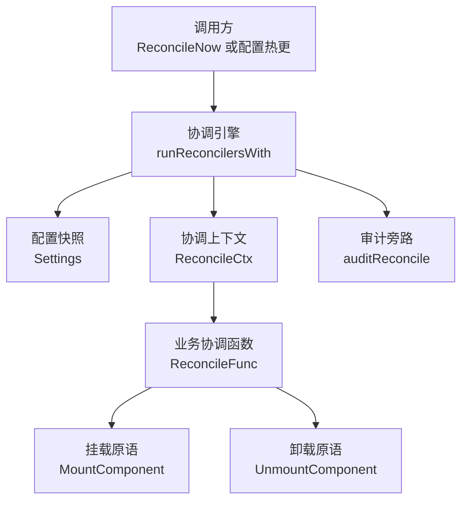
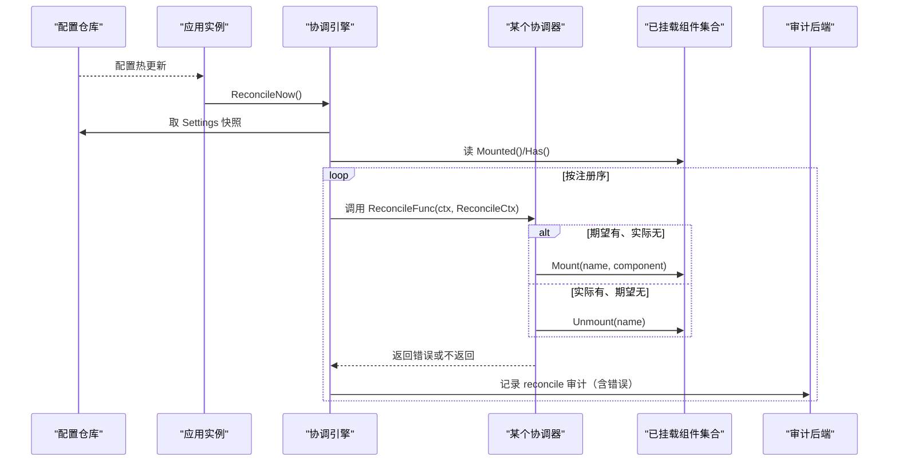
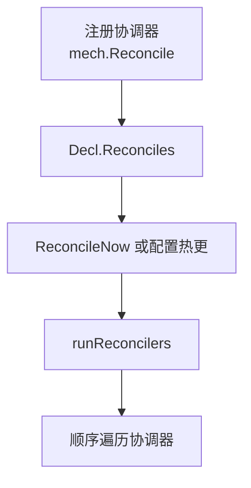
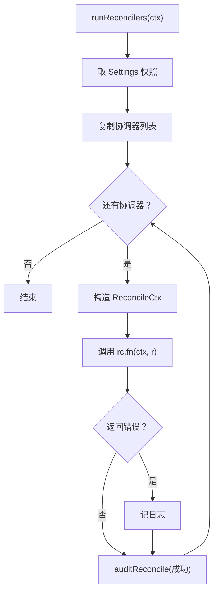
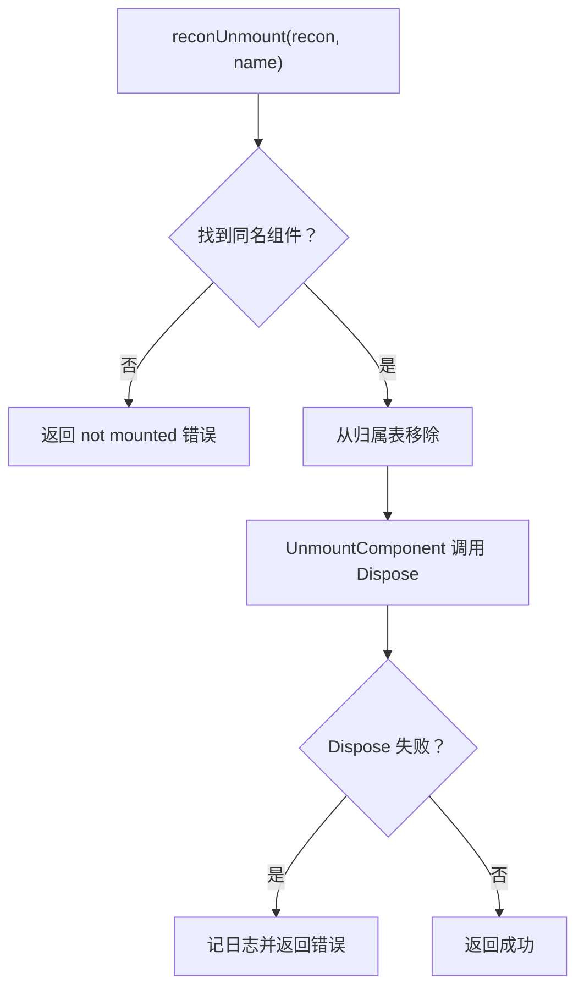
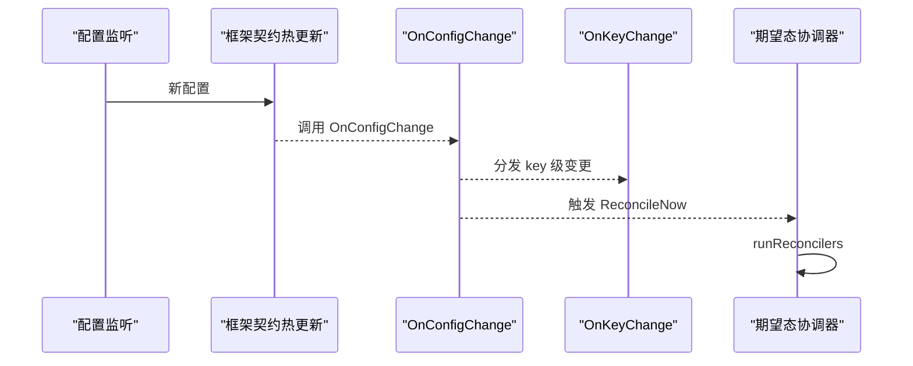
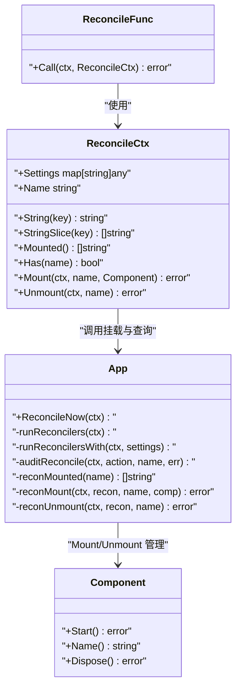

# 协调器核心概念与收敛语义

<cite>
**本文引用的文件**   
- [reconcile.go](file://pkg/appkit/reconcile.go)
- [appkit.go](file://pkg/appkit/appkit.go)
- [mount.go](file://pkg/appkit/mount.go)
- [serve.go](file://pkg/appkit/serve.go)
- [bootstrap.go](file://pkg/appkit/bootstrap.go)
- [decl.go](file://pkg/appkit/decl.go)
- [mech/mech.go](file://pkg/appkit/mech/mech.go)
- [reconcile_test.go](file://pkg/appkit/reconcile_test.go)
</cite>

## 目录
1. [引言](#引言)
2. [项目结构定位](#项目结构定位)
3. [核心组件](#核心组件)
4. [架构总览](#架构总览)
5. [详细组件分析](#详细组件分析)
6. [依赖关系分析](#依赖关系分析)
7. [性能考量](#性能考量)
8. [故障排查指南](#故障排查指南)
9. [结论](#结论)

## 引言
本文聚焦期望态协调器的核心概念与收敛语义，解释框架如何把业务从“连续变更事件处理”中解放出来：业务只声明「期望是什么样」，框架反复对期望态与实际态做差集并应用，直到系统状态收敛。它同时说明为什么失败不回滚、下一次重试自然补齐，以及为什么失败本身也要写入审计——因为失败是可观测状态，是诊断收敛卡住的关键线索。

## 项目结构定位
期望态协调能力集中在 `pkg/appkit` 包中，由三个层次协作：
- 协调接口层：`ReconcileFunc` / `ReconcileCtx` 定义一次协调的输入输出。
- 协调引擎层：`runReconcilers` / `runReconcilersWith` 负责顺序执行、快照取配置、失败记录日志与审计。
- 实际态支撑层：`MountComponent` / `UnmountComponent` 提供运行期可逆挂载，作为协调器 diff-apply 的具体动作。



**图表来源**
- [reconcile.go:141-166](file://pkg/appkit/reconcile.go#L141-L166)
- [mount.go:60-130](file://pkg/appkit/mount.go#L60-L130)

**章节来源**
- [reconcile.go:1-20](file://pkg/appkit/reconcile.go#L1-L20)
- [mount.go:1-30](file://pkg/appkit/mount.go#L1-L30)

## 核心组件
- **ReconcileFunc**：一次协调的幂等函数，读取期望态、比对实际态、调用 Mount/Unmount 收敛。
- **ReconcileCtx**：协调上下文，暴露 Settings（期望态快照）、Mounted/Has（实际态查询）和 Mount/Unmount（实际态操作）。
- **reconciler**：内部协调器注册项，保存名称与函数。
- **App.runReconcilers / runReconcilersWith**：协调调度器，顺序执行全部协调器，单个失败不阻断其余协调器，并为每次协调取一次全局配置快照。
- **MountComponent / UnmountComponent**：运行期组件生命周期原语，协调器通过它们实现「期望有实际无则 Mount、实际有期望无则 Unmount」。

**章节来源**
- [reconcile.go:38-133](file://pkg/appkit/reconcile.go#L38-L133)
- [reconcile.go:141-166](file://pkg/appkit/reconcile.go#L141-L166)
- [mount.go:60-130](file://pkg/appkit/mount.go#L60-L130)

## 架构总览
协调器不是事件驱动回调，而是 Kubernetes controller 风格的声明式控制器：



**图表来源**
- [reconcile.go:141-166](file://pkg/appkit/reconcile.go#L141-L166)
- [mount.go:60-130](file://pkg/appkit/mount.go#L60-L130)
- [reconcile.go:231-262](file://pkg/appkit/reconcile.go#L231-L262)

### 声明式协调与事件驱动的对比
| 维度 | 事件驱动 OnKeyChange | 声明式期望态协调 |
|---|---|---|
| 触发方式 | key 变化时框架通知 old/new | 配置快照 + 全量 diff |
| 责任边界 | 业务自行决定增量响应逻辑 | 业务只写终态，框架负责差异收敛 |
| 部分失败风险 | 连续变更、乱序、局部失败会留下中间态 | 单次失败不回滚，下次重试补齐 |
| 一致性假设 | 回调必须自己兜底乱序与重复 | 任意时刻重复调用朝同一终态收敛 |
| 可观测性 | 需要业务自记变更轨迹 | 每次协调都产生审计痕迹，失败也可观测 |

事件模型的问题是：框架只告诉你 key 从 A 变成 B，但业务要自己判断该删什么、加什么、改什么；如果第二次变更在第一次完成前到达，或者第一次只成功了一半，业务回调里很容易留下不一致中间态。协调器把这种复杂性收敛到「幂等终态」上：无论外部变更多快、多乱，只要业务函数满足幂等收敛语义，框架就能反复 diff-apply 直到稳定。

**章节来源**
- [reconcile.go:1-20](file://pkg/appkit/reconcile.go#L1-L20)
- [mech/mech.go:141-152](file://pkg/appkit/mech/mech.go#L141-L152)

## 详细组件分析

### 协调器注册与入口
协调器通过 `mech.Reconcile` 注册，本质是向 Decl 追加一个协调声明。`App.ReconcileNow` 提供立即执行入口；正常路径下，配置热更新最终也会走到 `runReconcilers`。



**图表来源**
- [mech/mech.go:149-152](file://pkg/appkit/mech/mech.go#L149-L152)
- [reconcile.go:135-148](file://pkg/appkit/reconcile.go#L135-L148)

**章节来源**
- [mech/mech.go:141-152](file://pkg/appkit/mech/mech.go#L141-L152)
- [decl.go:47-66](file://pkg/appkit/decl.go#L47-L66)
- [reconcile.go:135-148](file://pkg/appkit/reconcile.go#L135-L148)

### runReconcilers 执行流程
`runReconcilers` 的执行可以拆成四步：

1. **取期望态快照**：从配置仓库的 store 取 Settings。没有 store 时为空 map。
2. **复制协调器列表**：加锁后拷贝当前 reconciler 切片，避免执行期间注册表变化影响本次迭代。
3. **顺序执行**：为每个协调器构造 `ReconcileCtx`，传入同一个 Settings 快照。
4. **失败隔离与审计**：单个协调器返回 error 仅记日志，不中断后续协调器；成功与失败都会调用 `auditReconcile` 写出审计事件。



**图表来源**
- [reconcile.go:141-166](file://pkg/appkit/reconcile.go#L141-L166)

**章节来源**
- [reconcile.go:141-166](file://pkg/appkit/reconcile.go#L141-L166)

### 收敛性约束
收敛性是期望态协调器的关键契约：

- **幂等性**：对同一期望态重复调用，不能改变终态。同名组件已挂载再 Mount 应视为不应继续添加；不存在组件再 Unmount 应视为不应继续删除。
- **不回滚**：单次协调中途失败不会撤销已经成功的 Mount。
- **自然补齐**：下次协调再次读取 Settings 与实际态，上次失败的缺失项会继续补齐。
- **单协调整体快照一致**：一次协调内所有协调器共享同一个 Settings，避免协调器之间读到不同时间点的配置。

测试用例覆盖了三种典型收敛场景：
- 初始态：期望三个组件，结果三个都被挂载。
- 幂等性：三次相同协调，仍保持两个组件。
- 移除多余组件：期望态缩小后，多余组件被卸载并 Dispose。
- 部分恢复：第一次 log/store 成功、stream 失败；修复后再次协调补齐 stream。

**章节来源**
- [reconcile_test.go:149-180](file://pkg/appkit/reconcile_test.go#L149-L180)
- [reconcile_test.go:186-200](file://pkg/appkit/reconcile_test.go#L186-L200)
- [reconcile_test.go:207-227](file://pkg/appkit/reconcile_test.go#L207-L227)

### 为什么失败也记录审计痕迹
`auditReconcile` 把每次协调结果写成审计事件：成功时 Result 为允许，失败时 Result 为错误并携带错误信息。即使协调失败，也不会阻止其他协调器继续执行。

这样做的原因很直接：**失败本身就是可观测状态**。如果只记录成功，运维只能看到「协调过」，看不到「哪个协调器卡住了、为什么卡住」。把失败写进审计，配合组件 mount/unmount 审计，能拼出完整收敛轨迹。

```mermaid
flowchart TD
    FnReturn["协调函数返回 err"] --> WriteAudit["auditReconcile(action=\\\"reconcile\\\", name, err)"]
    WriteAudit --> SetResult{"err 是否为空？"}
    SetResult -->|是| Allow["Result = allow"]
    SetResult -->|否| Error["Result = error<br/>Error = err.Error()"]
    Allow --> Record["resolveAuditor().Record(...)"]
    Error --> Record
```

**图表来源**
- [reconcile.go:231-262](file://pkg/appkit/reconcile.go#L231-L262)

**章节来源**
- [reconcile.go:161-165](file://pkg/appkit/reconcile.go#L161-L165)
- [reconcile.go:231-262](file://pkg/appkit/reconcile.go#L231-L262)

### 审计后端热切换与 Mount/Unmount 收敛示例
文档注释中给出了审计后端热切换的典型用法模式：业务协调函数解析期望的后端列表，然后对每个期望后端判断是否已挂载；若未挂载则 Mount，若存在但不在期望中则 Unmount。

这个模式的收敛语义等价于：

| 条件 | 动作 |
|---|---|
| 期望有、实际无 | Mount |
| 实际有、期望无 | Unmount |
| 期望有、实际有 | 不操作 |
| 期望无、实际无 | 不操作 |

具体实现要点：
- 用 `r.StringSlice("audit.backends")` 读取期望列表。
- 用 `r.Has(name)` 判断本协调器名下是否已有同名组件。
- 用 `r.Mounted()` 枚举已挂载组件，找出期望集合之外的多余项。
- Mount/Unmount 的错误直接返回，让上层记录日志并由下次协调补齐。

注意：这里展示的是模式与流程，不是源码片段；完整参考见协调器注释中的用法说明。

**章节来源**
- [reconcile.go:10-37](file://pkg/appkit/reconcile.go#L10-L37)
- [reconcile.go:76-133](file://pkg/appkit/reconcile.go#L76-L133)

### 幂等性与错误约定
协调器的幂等性要求落在底层挂载原语上：

- **同名已挂载返回错误**：`reconMount` 先调用 `MountComponent`，成功后才登记归属；同名重复挂载语义由调用方保证，测试覆盖重复协调不再增加组件。
- **不存在组件 Unmount 返回错误**：`reconUnmount` 查找不到条目时直接返回 not mounted 错误，确保「期望无、实际无」不会误删。
- **Unmount 失败不恢复归属**：归属表已在 Unlock 前移除，Dispose 失败只记日志；下次协调会根据实际组件状态重新判定，这是容错设计的一部分。



**图表来源**
- [reconcile.go:209-229](file://pkg/appkit/reconcile.go#L209-L229)

**章节来源**
- [reconcile.go:193-229](file://pkg/appkit/reconcile.go#L193-L229)
- [mount.go:90-130](file://pkg/appkit/mount.go#L90-L130)

### 配置热更新与协调触发链
配置热更新路径如下：

1. 配置仓库发现本地文件或远程配置变化。
2. 框架先执行自身契约热更新：试装载、校验、重建 Logger。
3. 随后调用用户注册的 `OnConfigChange`。
4. 最后分发 `mech.OnKeyChange` 订阅与期望态协调器。

`ReconcileNow` 正是这条链路的集中入口：它直接调用 `runReconcilers`，从而复用统一的快照与审计语义。



**图表来源**
- [appkit.go:407-414](file://pkg/appkit/appkit.go#L407-L414)
- [reconcile.go:135-148](file://pkg/appkit/reconcile.go#L135-L148)

**章节来源**
- [appkit.go:407-414](file://pkg/appkit/appkit.go#L407-L414)
- [reconcile.go:135-148](file://pkg/appkit/reconcile.go#L135-L148)

## 依赖关系分析
协调器对外暴露的依赖清晰且单向：

- `ReconcileFunc` 依赖 `ReconcileCtx`。
- `ReconcileCtx` 依赖 `App` 的内部协调与挂载方法。
- `App.runReconcilers` 依赖配置 store 的 Settings 与审计后端。
- 协调器不直接 import 具体后端实现，而是通过 `MountComponent` / `UnmountComponent` 与组件系统交互。



**图表来源**
- [reconcile.go:38-133](file://pkg/appkit/reconcile.go#L38-L133)
- [reconcile.go:141-262](file://pkg/appkit/reconcile.go#L141-L262)
- [mount.go:60-130](file://pkg/appkit/mount.go#L60-L130)

**章节来源**
- [reconcile.go:38-133](file://pkg/appkit/reconcile.go#L38-L133)
- [reconcile.go:141-262](file://pkg/appkit/reconcile.go#L141-L262)
- [mount.go:60-130](file://pkg/appkit/mount.go#L60-L130)

## 性能考量
- **顺序执行**：所有协调器按注册序串行执行，优点是简单可控、收敛语义清晰；缺点是长协调器会阻塞后续协调器。
- **配置快照**：每次协调整体取一次 Settings，避免协调器之间读到不一致配置，代价是每次热更都要复制一份配置视图。
- **审计旁路**：每次协调都发出审计事件，但采用旁路记录，审计 panic 会被 recover 隔离，不阻断协调主流程。
- **基准测试口径**：`BenchmarkReconcile_DiffApply` 度量稳态热更成本，不含组件 Start/Dispose 的业务成本，只测协调器快照、diff 与审计 Nop.Record。

**章节来源**
- [reconcile.go:141-166](file://pkg/appkit/reconcile.go#L141-L166)
- [reconcile.go:231-262](file://pkg/appkit/reconcile.go#L231-L262)

## 故障排查指南
当协调收敛卡住时，可按以下顺序排查：

1. **确认协调是否被执行**：检查审计事件中是否存在 `Object="reconciler"` 的记录。
2. **检查协调器错误**：失败时 audit 事件的 Result 为错误，Error 字段包含协调函数返回的 message。
3. **检查组件挂载状态**：通过 `Mounted()` 和 `Has()` 的实际行为判断协调器是否把期望态映射到了实际态。
4. **检查幂等性**：同名组件重复 Mount、不存在组件 Unmount 都应给出明确错误，避免协调器误判。
5. **检查配置快照**：确认 `Run` 期配置的 `OnConfigChange` 链路确实触发了 `ReconcileNow`。
6. **检查组件生命周期**：Mount 失败可能来自组件 Start 失败；Unmount 失败可能来自 Dispose 失败，后者不回滚归属但仍会记录日志。

**章节来源**
- [reconcile.go:161-165](file://pkg/appkit/reconcile.go#L161-L165)
- [reconcile.go:231-262](file://pkg/appkit/reconcile.go#L231-L262)
- [mount.go:90-130](file://pkg/appkit/mount.go#L90-L130)

## 结论
期望态协调器把业务从「如何处理每一次键值变化」转移到「最终系统应该是什么样子」。它的收敛语义与 Kubernetes controller 模型一致：任意时刻重复调用朝同一终态收敛，中间失败不回滚，下次重试自然补齐。`runReconcilers` 的顺序执行、整体配置快照、失败日志与审计，共同保证了即使外部变更频繁、部分失败、甚至协调器重启，系统也能稳定回到期望态。

编写协调函数时最重要的约束是幂等性：同名已挂载返回错误、不存在组件 Unmount 返回错误，这样框架才能安全地反复 diff-apply，而业务只需关注「期望有实际无则 Mount、实际有期望无则 Unmount」这一条收敛规则。