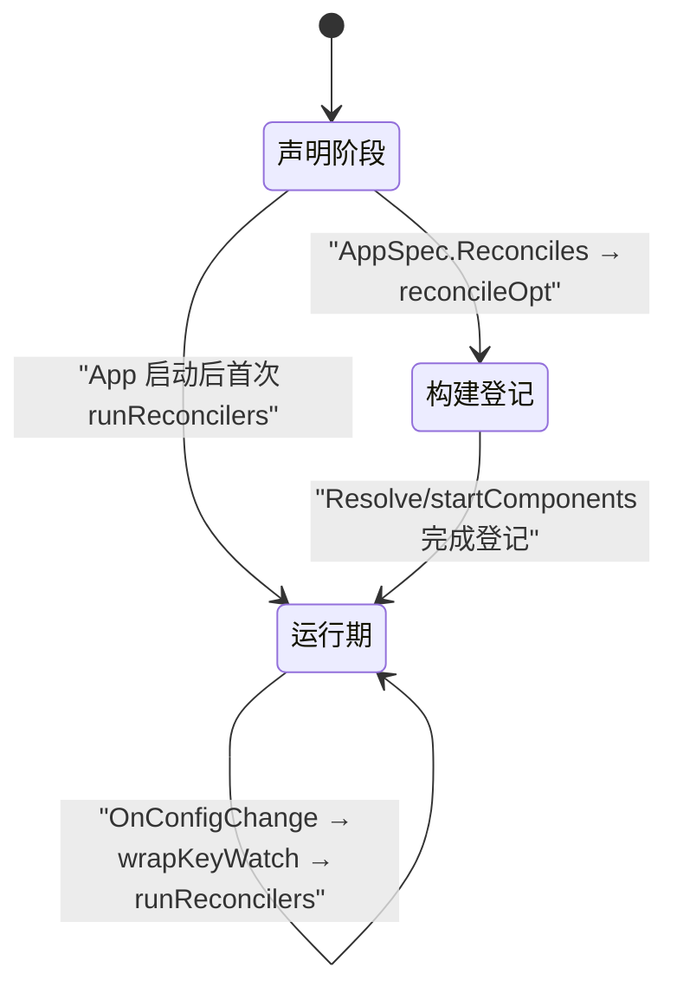
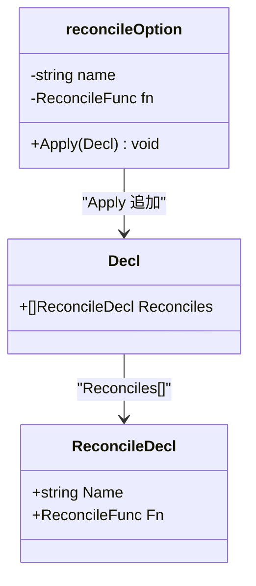
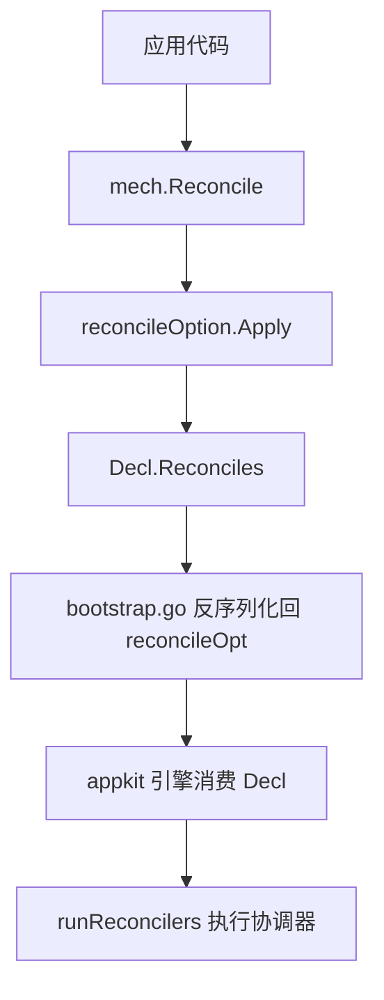
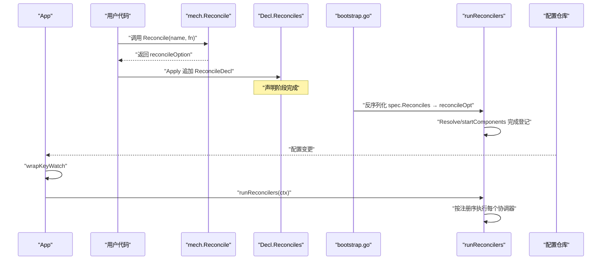
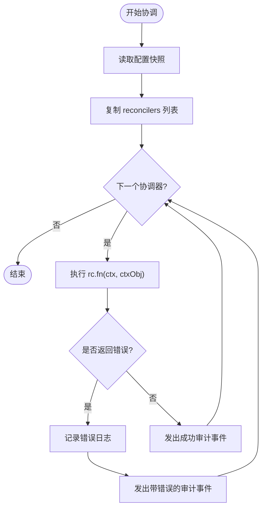
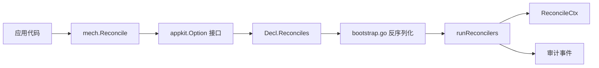

# 协调器注册与 mech 集成

<cite>
**本文引用的文件**   
- [pkg/appkit/mech/mech.go](file://pkg/appkit/mech/mech.go)
- [pkg/appkit/reconcile.go](file://pkg/appkit/reconcile.go)
- [pkg/appkit/decl.go](file://pkg/appkit/decl.go)
- [pkg/appkit/bootstrap.go](file://pkg/appkit/bootstrap.go)
- [pkg/appkit/keywatch.go](file://pkg/appkit/keywatch.go)
- [pkg/appkit/appkit.go](file://pkg/appkit/appkit.go)
</cite>

## 目录
1. [引言](#引言)
2. [项目结构](#项目结构)
3. [核心组件](#核心组件)
4. [架构总览](#架构总览)
5. [详细组件分析](#详细组件分析)
6. [依赖关系分析](#依赖关系分析)
7. [性能考量](#性能考量)
8. [故障排查指南](#故障排查指南)
9. [结论](#结论)

## 引言
本文聚焦于协调器注册机制，解释 `mech.Reconcile(name, fn)` 如何返回一个自持的 `appkit.Option` 类型 `reconcileOption`，并通过其 `Apply(*Decl)` 方法把协调器追加到声明载体 `Decl.Reconciles`。`mech` 包与 `appkit` 包之间存在明确分层契约：`mech` 单向 import `appkit`，`appkit` 不 import `mech`；机制引擎（如 `runReconcilers`、`OnConfigChange` 触发链）始终留在 `appkit`，与 `mech` 中构造器无关。协调器名称在应用内必须唯一，命名应体现协调目标，例如审计后端协调器可命名为 `audit.backends`。

## 项目结构
协调器相关代码分布在两个包：

| 路径 | 职责 |
|---|---|
| `pkg/appkit/mech/mech.go` | 面向应用的装配构造面，导出 `Reconcile` 等 Option 构造器，返回自持 option 并直写 `Decl` |
| `pkg/appkit/reconcile.go` | 协调器运行时：`ReconcileFunc`、`ReconcileCtx`、`runReconcilers`、归属跟踪、`reconcileOpt` 引擎写入面 |
| `pkg/appkit/decl.go` | 声明载体 `Decl` 及其字段，包括 `Reconciles []ReconcileDecl` |
| `pkg/appkit/bootstrap.go` | 从 `AppSpec.Reconciles` 反序列化出的声明转回 `reconcileOpt` 注入 `Decl` |
| `pkg/appkit/keywatch.go` | 配置变更后包装回调，最终调用 `runReconcilers` |
| `pkg/appkit/appkit.go` | 定义 `OnConfigChange` Option，并在启动时执行一次协调 |

```mermaid
graph TB
    subgraph "装配期"
        A["用户代码<br/>调用 mech.Reconcile"] --> B["mech.reconcileOption.Apply"]
        B --> C["Decl.Reconciles 追加 ReconcileDecl"]
    end

    subgraph "构建期"
        D["AppSpec.Reconciles"] --> E["bootstrap.go<br/>reconcileOpt(...)"]
        E --> F["appkit.optionFunc<br/>写入 Decl"]
    end

    subgraph "运行期"
        G["配置变更"] --> H["wrapKeyWatch / OnConfigChange"]
        H --> I["runReconcilers(ctx)"]
        I --> J["逐个执行 reconciler.fn"]
        J --> K["Mount / Unmount 收敛实际态"]
    end
```

**图表来源**
- [pkg/appkit/mech/mech.go:77-86](file://pkg/appkit/mech/mech.go#L77-L86)
- [pkg/appkit/decl.go:109-116](file://pkg/appkit/decl.go#L109-L116)
- [pkg/appkit/bootstrap.go:460-469](file://pkg/appkit/bootstrap.go#L460-L469)
- [pkg/appkit/keywatch.go:68-74](file://pkg/appkit/keywatch.go#L68-L74)
- [pkg/appkit/reconcile.go:137-173](file://pkg/appkit/reconcile.go#L137-L173)

**章节来源**
- [pkg/appkit/mech/mech.go:1-153](file://pkg/appkit/mech/mech.go#L1-L153)
- [pkg/appkit/reconcile.go:1-173](file://pkg/appkit/reconcile.go#L1-L173)
- [pkg/appkit/decl.go:1-116](file://pkg/appkit/decl.go#L1-L116)
- [pkg/appkit/bootstrap.go:450-475](file://pkg/appkit/bootstrap.go#L450-L475)
- [pkg/appkit/keywatch.go:60-74](file://pkg/appkit/keywatch.go#L60-L74)

## 核心组件
- `mech.Reconcile(name string, fn appkit.ReconcileFunc) appkit.Option`：对外暴露的协调器注册函数，返回 `reconcileOption`。
- `reconcileOption`：自持 option 类型，实现 `Apply(*appkit.Decl)`，将 `name` 与 `fn` 追加到 `d.Reconciles`。
- `ReconcileDecl`：`Decl.Reconciles` 中的纯数据条目，仅承载 `Name` 与 `Fn`。
- `reconcileOpt`：`appkit` 内部 Option 适配器，用于测试和 `bootstrap.go` 把声明转回 Option 再写入 `Decl`。
- `ReconcileFunc`：协调函数签名，读期望态、对比实际态、通过 `ReconcileCtx.Mount/Unmount` 收敛。
- `ReconcileCtx`：协调上下文，提供 Settings、Mounted、Has、Mount、Unmount 等接口。
- `runReconcilers` / `runReconcilersWith`：协调引擎，按注册序执行全部协调器，失败只记日志，不阻断整机。
- `wrapKeyWatch` / `OnConfigChange`：配置变更触发协调的主要入口。

**章节来源**
- [pkg/appkit/mech/mech.go:77-86](file://pkg/appkit/mech/mech.go#L77-L86)
- [pkg/appkit/mech/mech.go:151-153](file://pkg/appkit/mech/mech.go#L151-L153)
- [pkg/appkit/decl.go:173-180](file://pkg/appkit/decl.go#L173-L180)
- [pkg/appkit/reconcile.go:39-173](file://pkg/appkit/reconcile.go#L39-L173)

## 架构总览
协调器的生命周期跨越装配期、构建期和运行期三个阶段：

**图表来源**
- [pkg/appkit/decl.go:109-116](file://pkg/appkit/decl.go#L109-L116)
- [pkg/appkit/bootstrap.go:460-469](file://pkg/appkit/bootstrap.go#L460-L469)
- [pkg/appkit/appkit.go:670-685](file://pkg/appkit/appkit.go#L670-L685)
- [pkg/appkit/keywatch.go:68-74](file://pkg/appkit/keywatch.go#L68-L74)
- [pkg/appkit/reconcile.go:137-173](file://pkg/appkit/reconcile.go#L137-L173)

## 详细组件分析

### `mech.Reconcile` 与 `reconcileOption`
`mech.Reconcile` 是应用侧注册协调器的统一入口。它不持有运行期状态，也不直接操作 `App`，而是返回一个实现了 `appkit.Option` 接口的 `reconcileOption`。该 option 的 `Apply(d *appkit.Decl)` 方法采用追加语义，向 `d.Reconciles` 追加一条 `ReconcileDecl{Name: name, Fn: fn}`。这与 `appkit` 包内 `optionFunc` 适配后的行为一致——所有 Option 最终都写入同一份 `Decl`，而不是经过 `App` 的旧式注册表中转。

**图表来源**
- [pkg/appkit/mech/mech.go:77-86](file://pkg/appkit/mech/mech.go#L77-L86)
- [pkg/appkit/mech/mech.go:151-153](file://pkg/appkit/mech/mech.go#L151-L153)
- [pkg/appkit/decl.go:173-180](file://pkg/appkit/decl.go#L173-L180)

**章节来源**
- [pkg/appkit/mech/mech.go:77-86](file://pkg/appkit/mech/mech.go#L77-L86)
- [pkg/appkit/mech/mech.go:151-153](file://pkg/appkit/mech/mech.go#L151-L153)
- [pkg/appkit/decl.go:173-180](file://pkg/appkit/decl.go#L173-L180)

### 分层契约：`mech` 与 `appkit`
文档注释明确约束了本包的边界：

| 方向 | 规则 |
|---|---|
| `mech` → `appkit` | 允许导入，使用 `appkit.Option`、`appkit.Component`、`appkit.ReconcileFunc` 等类型 |
| `appkit` → `mech` | 不允许导入；引擎逻辑保留在 `appkit` |
| Option 语义 | 所有 Option 都通过 `Apply(*Decl)` 直写声明载体，`mech` 与 `appkit` 共享同一份 `Decl` |
| 运行期登记 | `addEffect`、协调执行等持锁路径不经 `Decl`，保持原引擎行为 |

**图表来源**
- [pkg/appkit/mech/mech.go:1-21](file://pkg/appkit/mech/mech.go#L1-L21)
- [pkg/appkit/mech/mech.go:77-86](file://pkg/appkit/mech/mech.go#L77-L86)
- [pkg/appkit/bootstrap.go:460-469](file://pkg/appkit/bootstrap.go#L460-L469)
- [pkg/appkit/reconcile.go:137-173](file://pkg/appkit/reconcile.go#L137-L173)

**章节来源**
- [pkg/appkit/mech/mech.go:1-21](file://pkg/appkit/mech/mech.go#L1-L21)
- [pkg/appkit/reconcile.go:120-173](file://pkg/appkit/reconcile.go#L120-L173)

### 协调器声明的生命周期
协调器声明经历以下阶段：

1. **装配期**：应用调用 `mech.Reconcile(name, fn)`，生成 `reconcileOption`，`Apply` 追加到 `Decl.Reconciles`。
2. **构建期**：若通过 `AppSpec` 加载，`bootstrap.go` 遍历 `spec.Reconciles`，为每条记录调用 `reconcileOpt(r.Name, r.Fn)`，再由 `optionFunc` 写入 `Decl`。
3. **运行期登记**：`Resolve` / `startComponents` 阶段完成后，`App` 持有已解析的协调器列表，等待配置或手动触发。
4. **运行期执行**：`OnConfigChange` 被调用时，`wrapKeyWatch` 先执行用户回调、分发 key 订阅，再调用 `runReconcilers(context.Background())`。每次协调取一次配置快照，按注册序依次执行每个协调器。

**图表来源**
- [pkg/appkit/mech/mech.go:151-153](file://pkg/appkit/mech/mech.go#L151-L153)
- [pkg/appkit/decl.go:109-116](file://pkg/appkit/decl.go#L109-L116)
- [pkg/appkit/bootstrap.go:460-469](file://pkg/appkit/bootstrap.go#L460-L469)
- [pkg/appkit/keywatch.go:68-74](file://pkg/appkit/keywatch.go#L68-L74)
- [pkg/appkit/reconcile.go:137-173](file://pkg/appkit/reconcile.go#L137-L173)

**章节来源**
- [pkg/appkit/mech/mech.go:151-153](file://pkg/appkit/mech/mech.go#L151-L153)
- [pkg/appkit/decl.go:109-116](file://pkg/appkit/decl.go#L109-L116)
- [pkg/appkit/bootstrap.go:460-469](file://pkg/appkit/bootstrap.go#L460-L469)
- [pkg/appkit/keywatch.go:68-74](file://pkg/appkit/keywatch.go#L68-L74)
- [pkg/appkit/appkit.go:670-685](file://pkg/appkit/appkit.go#L670-L685)

### 协调器执行语义与错误处理
`runReconcilers` 的行为可以概括为“顺序执行、局部失败、整体收敛”：

**图表来源**
- [pkg/appkit/reconcile.go:141-173](file://pkg/appkit/reconcile.go#L141-L173)
- [pkg/appkit/reconcile.go:229-262](file://pkg/appkit/reconcile.go#L229-L262)

关键点：
- 多个协调器按注册序依次执行。
- 单个协调器返回 error 时不会中断后续协调器，仅记录日志。
- 成功与失败都会发出协调审计事件，便于观测收敛过程。
- 协调器必须是幂等的：任意时刻重复调用都应朝同一终态收敛，中间失败后再次协调能补齐差异。

**章节来源**
- [pkg/appkit/reconcile.go:141-173](file://pkg/appkit/reconcile.go#L141-L173)
- [pkg/appkit/reconcile.go:229-262](file://pkg/appkit/reconcile.go#L229-L262)

### 协调器名称的唯一性与命名约定
`ReconcileDecl` 仅包含 `Name` 与 `Fn`，没有内置去重逻辑。因此：

- 同一应用中注册的协调器名称应唯一。
- 重复名称会追加多条 `ReconcileDecl`，导致同一个协调函数被多次执行。
- 建议命名遵循“模块域 + 资源语义”的点式风格，例如审计后端协调器命名为 `audit.backends`，与示例注释中的用法保持一致。
- 如果需要通过 `AppSpec` 反序列化注册，同样要求 `spec.Reconciles` 中同名项不应重复。

**章节来源**
- [pkg/appkit/decl.go:173-180](file://pkg/appkit/decl.go#L173-L180)
- [pkg/appkit/reconcile.go:1-41](file://pkg/appkit/reconcile.go#L1-L41)
- [pkg/appkit/bootstrap.go:460-469](file://pkg/appkit/bootstrap.go#L460-L469)

### 完整代码示例：注册审计后端协调器
下面给出一个在应用启动时通过 `mech.Reconcile` 注册审计后端协调器的完整示例说明。由于文档规范要求不直接粘贴源码片段，这里以步骤形式描述，并给出对应源码位置。

1. **在应用初始化处注册协调器**  
   调用 `mech.Reconcile("audit.backends", func(ctx context.Context, r *appkit.ReconcileCtx) error { ... })`，并将该 Option 传给 `appkit.NewApp`。  
   参考路径：[pkg/appkit/reconcile.go:1-41](file://pkg/appkit/reconcile.go#L1-L41)、[pkg/appkit/mech/mech.go:151-153](file://pkg/appkit/mech/mech.go#L151-L153)。

2. **在协调函数中读取期望态**  
   通过 `r.StringSlice("audit.backends")` 获取期望的后端名列表；缺失键返回空值，由协调器判定为无后端。  
   参考路径：[pkg/appkit/reconcile.go:67-80](file://pkg/appkit/reconcile.go#L67-L80)。

3. **新增期望中存在但实际未挂载的后端**  
   遍历期望列表，用 `r.Has(name)` 判断是否已挂载，未挂载则调用 `r.Mount(ctx, name, factory(name))`。  
   参考路径：[pkg/appkit/reconcile.go:87-98](file://pkg/appkit/reconcile.go#L87-L98)。

4. **移除实际存在但期望中已删除的后端**  
   遍历 `r.Mounted()`，对不在期望集合中的名称调用 `r.Unmount(ctx, name)`。  
   参考路径：[pkg/appkit/reconcile.go:81-86](file://pkg/appkit/reconcile.go#L81-L86)。

5. **处理失败与收敛**  
   协调器返回 error 不会阻断其他协调器，也不会自动回滚本次协调；框架会在下次配置变更或手动协调时重试补齐。  
   参考路径：[pkg/appkit/reconcile.go:141-173](file://pkg/appkit/reconcile.go#L141-L173)。

6. **可选：手动触发协调**  
   测试或调试场景可通过 `app.ReconcileNow(ctx)` 立即执行全量协调。  
   参考路径：[pkg/appkit/reconcile.go:135-139](file://pkg/appkit/reconcile.go#L135-L139)。

**章节来源**
- [pkg/appkit/reconcile.go:1-41](file://pkg/appkit/reconcile.go#L1-L41)
- [pkg/appkit/reconcile.go:67-98](file://pkg/appkit/reconcile.go#L67-L98)
- [pkg/appkit/reconcile.go:135-139](file://pkg/appkit/reconcile.go#L135-L139)
- [pkg/appkit/reconcile.go:141-173](file://pkg/appkit/reconcile.go#L141-L173)
- [pkg/appkit/mech/mech.go:151-153](file://pkg/appkit/mech/mech.go#L151-L153)

## 依赖关系分析
协调器相关依赖呈单向分层：

- `mech` 依赖 `appkit` 的导出类型，但不反向依赖。
- `Decl` 是装配期纯数据载体，`bootstrap.go` 与其解耦地通过 `reconcileOpt` 恢复 Option。
- `runReconcilers` 依赖 `App` 的内部状态（协调器列表、归属表、配置仓库），这些属于 `appkit` 引擎层。

**图表来源**
- [pkg/appkit/mech/mech.go:1-21](file://pkg/appkit/mech/mech.go#L1-L21)
- [pkg/appkit/decl.go:1-116](file://pkg/appkit/decl.go#L1-L116)
- [pkg/appkit/bootstrap.go:460-469](file://pkg/appkit/bootstrap.go#L460-L469)
- [pkg/appkit/reconcile.go:137-173](file://pkg/appkit/reconcile.go#L137-L173)

**章节来源**
- [pkg/appkit/mech/mech.go:1-21](file://pkg/appkit/mech/mech.go#L1-L21)
- [pkg/appkit/decl.go:1-116](file://pkg/appkit/decl.go#L1-L116)
- [pkg/appkit/bootstrap.go:460-469](file://pkg/appkit/bootstrap.go#L460-L469)
- [pkg/appkit/reconcile.go:137-173](file://pkg/appkit/reconcile.go#L137-L173)

## 性能考量
- 协调器执行顺序固定为注册序，时间复杂度近似 O(N)，N 为已登记的协调器数量。
- 每次协调会拷贝当前 `reconcilers` 列表，避免在执行期间修改引发竞态。
- 配置快照取自 `a.cfg.store.Settings()`，保证单个协调整体看到一致的期望态。
- 协调器内部的 `Mounted()` 与 `Has()` 需要遍历归属表，应避免在高频热路径中做昂贵计算。
- 单个协调器失败不影响其余协调器，但会增加日志与审计开销；协调器应尽量幂等、快速收敛。

[本节为通用性能讨论，不直接分析具体代码行]

## 故障排查指南
常见问题及定位方式：

| 现象 | 可能原因 | 排查要点 |
|---|---|---|
| 协调器未执行 | 未在 `NewApp` 传入 `mech.Reconcile` 返回的 Option | 检查应用初始化处是否调用 `mech.Reconcile` |
| 协调器执行多次 | 同一名称被多次注册 | 检查 `Decl.Reconciles` 是否存在重复 `ReconcileDecl` |
| 协调器失败但未停止整机 | 正常收敛语义 | 查看协调器日志，确认下次协调是否补齐 |
| 配置变更后未触发协调 | `OnConfigChange` 未被调用或未进入 `wrapKeyWatch` | 检查配置源是否推送变更、`OnConfigChange` 是否注册 |
| 挂载后 `Has` 仍返回 false | 协调器未正确调用 `Mount` 或名称不一致 | 检查 `ReconcileCtx.Mount` 调用与名称约定 |
| 卸载时报错 | 组件不存在或已被卸载 | 检查 `Unmount` 调用时机与归属表一致性 |

**章节来源**
- [pkg/appkit/reconcile.go:141-173](file://pkg/appkit/reconcile.go#L141-L173)
- [pkg/appkit/reconcile.go:201-228](file://pkg/appkit/reconcile.go#L201-L228)
- [pkg/appkit/keywatch.go:68-74](file://pkg/appkit/keywatch.go#L68-L74)

## 结论
`mech.Reconcile` 是应用侧注册期望态协调器的简洁入口，其返回值 `reconcileOption` 通过 `Apply` 直写 `Decl.Reconciles`，与 `appkit` 内部 Option 机制完全对齐。`mech` 与 `appkit` 的分层契约保证了机制构造面与运行机制解耦：`mech` 只提供装配选项，`appkit` 负责协调引擎、配置触发、归属跟踪和审计。协调器按注册序执行，失败隔离且支持收敛重试，适合用于审计后端、动态组件、热更新资源等场景。协调器名称应唯一，命名建议采用点式语义，例如 `audit.backends`，以便在日志、审计和配置中清晰定位。