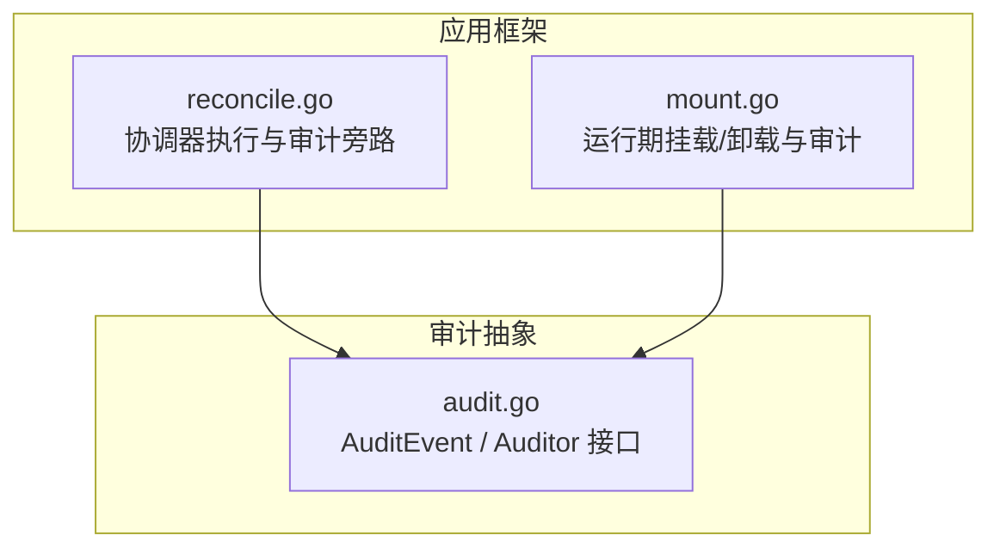
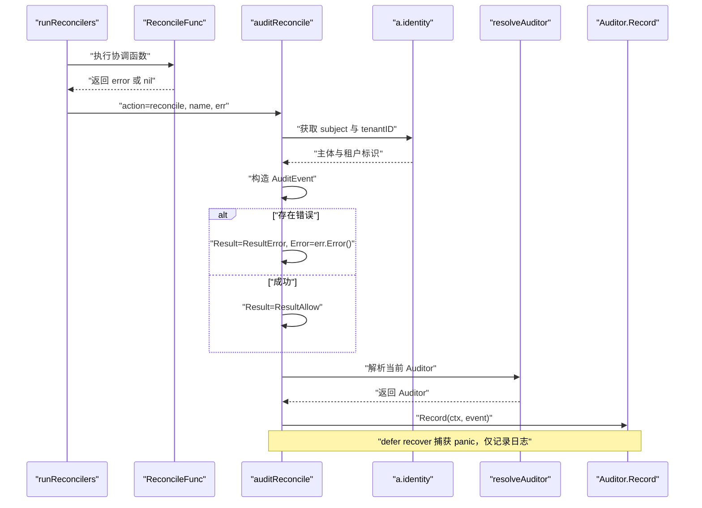
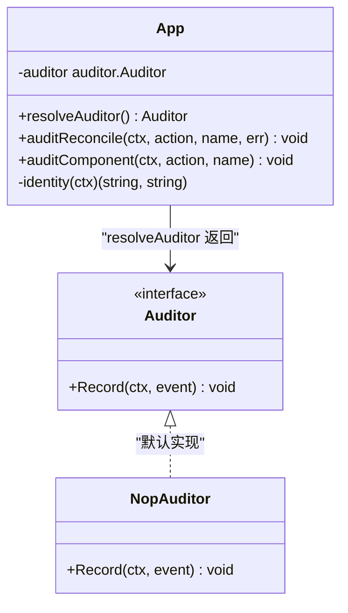
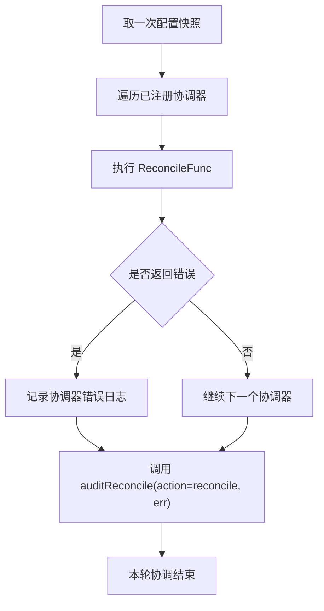
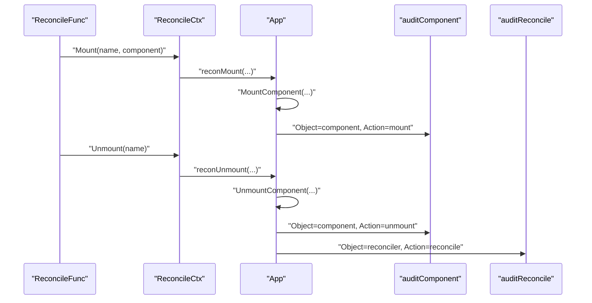
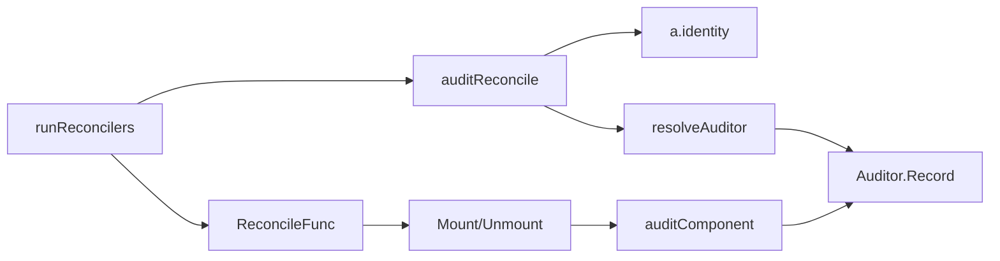
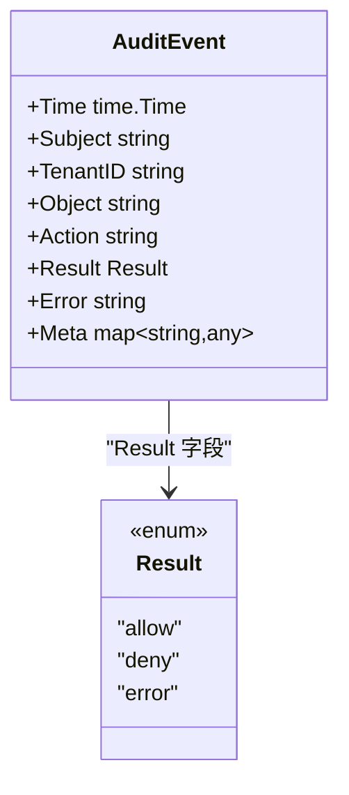

# 协调审计与可观测性

<cite>
**本文引用的文件**   
- [reconcile.go](file://pkg/appkit/reconcile.go)
- [mount.go](file://pkg/appkit/mount.go)
- [audit.go](file://pkg/audit/audit.go)
- [reconcile_test.go](file://pkg/appkit/reconcile_test.go)
</cite>

## 目录
1. [引言](#引言)
2. [项目结构](#项目结构)
3. [核心组件](#核心组件)
4. [架构总览](#架构总览)
5. [详细组件分析](#详细组件分析)
6. [依赖关系分析](#依赖关系分析)
7. [性能考虑](#性能考虑)
8. [故障诊断指南](#故障诊断指南)
9. [结论](#结论)
10. [附录：审计事件模型](#附录审计事件模型)

## 引言
本文面向协调器的审计集成，聚焦 `auditReconcile` 如何旁路发出协调审计事件，并说明其与运行期挂载/卸载审计共享的解析、身份注入和 panic 隔离机制。文档覆盖以下要点：

- 协调审计事件的语义：`Object="reconciler"`、`Action="reconcile"`，成功时 `Result=ResultAllow`，失败时 `Result=ResultError` 并携带错误信息。
- Panic 隔离：`defer recover` 确保审计后端异常不会阻断主流程，只记录日志。
- 身份注入：通过 `a.identity(ctx)` 获取 `subject` 与 `tenantID`，与请求级审计同源。
- 单一解析：协调审计与运行期挂载/卸载审计都经 `resolveAuditor` 解析，保证审计后端热切换一致性。
- 外部追踪：给出审计事件结构示例，用于在外部系统中观察协调器收敛过程，包括成功协调、失败协调（后续重试补齐）等场景。
- 卡住诊断：利用审计数据判断是否因幂等性破坏导致反复 `Mount/Unmount`。

## 项目结构
协调审计相关代码集中在三个层次：

- 应用层协调器：`pkg/appkit/reconcile.go` 定义协调器执行与审计旁路。
- 应用层运行时挂载：`pkg/appkit/mount.go` 定义运行期组件挂载/卸载及同源审计。
- 审计抽象层：`pkg/audit/audit.go` 定义审计事件结构、结果分类与后端接口。



**图示来源**
- [reconcile.go:231-255](file://pkg/appkit/reconcile.go#L231-L255)
- [mount.go:125-184](file://pkg/appkit/mount.go#L125-L184)
- [audit.go:21-83](file://pkg/audit/audit.go#L21-L83)

**章节来源**
- [reconcile.go:1-60](file://pkg/appkit/reconcile.go#L1-L60)
- [mount.go:1-30](file://pkg/appkit/mount.go#L1-L30)
- [audit.go:1-20](file://pkg/audit/audit.go#L1-L20)

## 核心组件
- **协调器上下文**：`ReconcileCtx` 暴露期望态读取与实际态操作，如 `Mounted()`、`Has()`、`Mount()`、`Unmount()`。
- **协调执行器**：`runReconcilers` 顺序执行所有协调器；单个协调器失败仅记日志，不阻断其他协调器，且无论成功或失败都会触发一次协调审计。
- **协调审计旁路**：`auditReconcile` 构造 `AuditEvent`，设置 `Object="reconciler"`、`Action="reconcile"`、`Meta["reconciler"]=name`，并根据错误设置 `Result`。
- **审计后端解析**：`resolveAuditor` 返回当前生效的后端，永不返回 nil；业务侧与框架侧统一走该入口。
- **运行时挂载审计**：`auditComponent` 产生 `Object="component"`、`Action="mount"/"unmount"` 的事件，采用相同身份注入与 panic 隔离纪律。

**章节来源**
- [reconcile.go:61-119](file://pkg/appkit/reconcile.go#L61-L119)
- [reconcile.go:155-172](file://pkg/appkit/reconcile.go#L155-L172)
- [reconcile.go:231-255](file://pkg/appkit/reconcile.go#L231-L255)
- [mount.go:125-184](file://pkg/appkit/mount.go#L125-L184)

## 架构总览
协调审计不是直接调用具体存储，而是先构造结构化事件，再交给 `resolveAuditor` 返回的 `Auditor`。这样既能支持进程内无副作用的 `NopAuditor`，也能在部署时注入数据库、消息总线或其他审计 sink，并在运行期替换。



**图示来源**
- [reconcile.go:155-172](file://pkg/appkit/reconcile.go#L155-L172)
- [reconcile.go:231-255](file://pkg/appkit/reconcile.go#L231-L255)
- [mount.go:125-184](file://pkg/appkit/mount.go#L125-L184)
- [audit.go:21-83](file://pkg/audit/audit.go#L21-L83)

## 详细组件分析

### 协调审计旁路 `auditReconcile`
`auditReconcile` 是协调器收敛过程的“可见面”。它不改变协调状态，也不影响协调器执行；即使审计后端崩溃，协调循环也会继续执行下一次协调。

关键行为如下：

| 维度 | 行为 |
| --- | --- |
| 对象类型 | `Object="reconciler"` |
| 动作类型 | `Action="reconcile"` |
| 成功结果 | `Result=ResultAllow` |
| 失败结果 | `Result=ResultError`，同时 `Error` 字段填充错误信息 |
| 元数据 | `Meta["reconciler"]=name`，用于区分不同协调器 |
| 身份注入 | 通过 `a.identity(ctx)` 取 `subject` 与 `tenantID`；未配置时为两个空串 |
| 后端解析 | 通过 `resolveAuditor()` 获取 `Auditor`，避免使用全局单例 |
| 异常隔离 | `defer recover` 捕获审计后端的 panic，仅记录日志 |

```mermaid
flowchart TD
    Start(["进入 auditReconcile"]) --> Recover["defer recover 注册 panic 捕获"]
    Recover --> Identity{"a.identity 是否存在"}
    Identity -->|是| GetIdentity["读取 subject 与 tenantID"]
    Identity -->|否| EmptyIdentity["subject=\"\", tenantID=\"\""]
    GetIdentity --> BuildEvent["构造 AuditEvent<br/>Object=reconciler<br/>Action=reconcile<br/>Meta.reconciler=name"]
    EmptyIdentity --> BuildEvent
    BuildEvent --> HasError{"协调函数是否返回错误"}
    HasError -->|是| SetError["Result=ResultError<br/>Error=err.Error()"]
    HasError -->|否| Allow["Result=ResultAllow"]
    SetError --> Resolve["resolveAuditor() 解析后端"]
    Allow --> Resolve
    Resolve --> Record["Auditor.Record(ctx, event)"]
    Record --> End(["退出"])
```

**图示来源**
- [reconcile.go:231-255](file://pkg/appkit/reconcile.go#L231-L255)

**章节来源**
- [reconcile.go:231-255](file://pkg/appkit/reconcile.go#L231-L255)

### 身份注入：与请求级审计同源
协调器没有 HTTP 或 gRPC 请求上下文，但协调循环仍会尝试从 `a.identity` 中取出主体和租户。如果应用通过 `Identity` Option 注入身份解析器，协调审计就能与请求级审计共享同一份身份来源；否则 `subject` 与 `tenantID` 均为空串。

这意味着：

- 多租户场景中，如果协调器修改的是某租户的资源，应确保身份注入能拿到对应租户。
- 若协调器由系统内部定时任务或配置变更触发，`TenantID` 为空串是预期行为，消费方应按审计抽象中的空值语义处理。
- 诊断时不能把 `Subject` 或 `TenantID` 为空理解为“没有发生协调”，只能理解为“无法确定主体或租户”。

**章节来源**
- [reconcile.go:231-255](file://pkg/appkit/reconcile.go#L231-L255)
- [mount.go:163-184](file://pkg/appkit/mount.go#L163-L184)
- [audit.go:31-67](file://pkg/audit/audit.go#L31-L67)

### 单一解析 `resolveAuditor` 与热切换一致性
`auditReconcile` 和 `auditComponent` 都调用 `resolveAuditor`，而不是各自维护一个后端引用。其解析顺序为：

1. 显式注入的 `auditor`。
2. 契约 `audit` 段产物。
3. 默认 `NopAuditor`。

因此，协调审计与运行期挂载/卸载审计始终指向同一个后端实例。当应用通过装配或配置替换审计 sink 时，不需要分别更新协调器和挂载路径。



**图示来源**
- [mount.go:125-184](file://pkg/appkit/mount.go#L125-L184)
- [reconcile.go:231-255](file://pkg/appkit/reconcile.go#L231-L255)
- [audit.go:21-83](file://pkg/audit/audit.go#L21-L83)

**章节来源**
- [mount.go:125-184](file://pkg/appkit/mount.go#L125-L184)

### 协调器执行与收敛语义
`runReconcilers` 按注册顺序执行每个协调器。单个协调器出错不会中断其余协调器；错误会被记录，并且仍然产生一次协调审计。这是声明式协调的核心：失败不回滚，下一次协调重新读取期望态与实际态，自然补齐差异。



**图示来源**
- [reconcile.go:155-172](file://pkg/appkit/reconcile.go#L155-L172)

**章节来源**
- [reconcile.go:155-172](file://pkg/appkit/reconcile.go#L155-L172)

### 与运行期挂载/卸载审计的关系
协调器通常通过 `ReconcileCtx.Mount` 与 `ReconcileCtx.Unmount` 驱动组件生命周期。这两个方法最终落到 `App.MountComponent` 与 `App.UnmountComponent`，后者会产生 `Object="component"` 的挂载或卸载审计事件。

因此，外部系统可以组合两类事件还原完整收敛过程：

- `Object="reconciler", Action="reconcile"`：协调器被调度执行。
- `Object="component", Action="mount"`：协调器认为期望态需要新增组件。
- `Object="component", Action="unmount"`：协调器认为期望态需要移除组件。



**图示来源**
- [reconcile.go:89-119](file://pkg/appkit/reconcile.go#L89-L119)
- [reconcile.go:201-230](file://pkg/appkit/reconcile.go#L201-L230)
- [mount.go:63-123](file://pkg/appkit/mount.go#L63-L123)
- [mount.go:163-184](file://pkg/appkit/mount.go#L163-L184)

**章节来源**
- [reconcile.go:89-119](file://pkg/appkit/reconcile.go#L89-L119)
- [mount.go:63-123](file://pkg/appkit/mount.go#L63-L123)

### 测试证据
`TestReconcile_AuditEvent` 验证了协调器会产生 `Object="reconciler"` 且 `Action="reconcile"` 的审计事件，并通过 `Meta["reconciler"]` 确认事件来自指定协调器。该用例通过显式设置 `app.auditor` 注入内存审计收集器，证明协调审计与全局审计后端无关，而是由应用自身持有的后端接收。

**章节来源**
- [reconcile_test.go:280-310](file://pkg/appkit/reconcile_test.go#L280-L310)

## 依赖关系分析
协调审计依赖三条主线：

1. **协调执行流**：`runReconcilers` → 协调器函数 → 可能调用 `Mount/Unmount`。
2. **审计事件流**：`auditReconcile` → `resolveAuditor` → `Auditor.Record`。
3. **身份流**：`a.identity(ctx)` → `AuditEvent.Subject` / `AuditEvent.TenantID`。



**图示来源**
- [reconcile.go:155-172](file://pkg/appkit/reconcile.go#L155-L172)
- [reconcile.go:231-255](file://pkg/appkit/reconcile.go#L231-L255)
- [mount.go:163-184](file://pkg/appkit/mount.go#L163-L184)

**章节来源**
- [reconcile.go:155-172](file://pkg/appkit/reconcile.go#L155-L172)
- [reconcile.go:231-255](file://pkg/appkit/reconcile.go#L231-L255)
- [mount.go:163-184](file://pkg/appkit/mount.go#L163-L184)

## 性能考虑
- 协调审计是旁路操作，不应成为协调循环的性能瓶颈。审计后端必须快速失败，不得阻塞主流程。
- `auditReconcile` 使用 `defer recover` 隔离 panic，避免审计后端崩溃影响收敛。
- `resolveAuditor` 通过读写锁保护当前后端字段，读路径开销很小；写路径仅在装配或配置注入时发生。
- 协调器本身必须是幂等的，因为每次协调都会重新读取期望态与实际态；幂等性是收敛正确性的前提，而不是审计层面的优化。

[本节为通用指导，不直接分析具体代码行]

## 故障诊断指南

### 如何利用审计数据诊断协调器卡住
协调器“卡住”通常表现为期望态与实际态长期不一致。可通过以下审计线索定位：

| 现象 | 应检查的审计事件 | 可能原因 |
| --- | --- | --- |
| 协调器频繁执行但没有稳定收敛 | `Object="reconciler", Action="reconcile"` 持续出现 | 协调函数非幂等，或期望态与实际态判定不稳定 |
| 同一组件反复 `mount` 与 `unmount` | `Object="component", Action="mount"` 与 `Action="unmount"` 交替出现 | 协调逻辑对“已存在”状态判断错误，或下游组件启动/销毁不稳定 |
| 协调一直失败 | `Object="reconciler", Action="reconcile"` 的 `Result=ResultError` | 协调函数返回错误；需结合 `Error` 字段查看根因 |
| 有协调事件但没有组件事件 | 只有 `Object="reconciler"`，没有 `Object="component"` | 协调函数未调用 `Mount/Unmount`，或提前返回 |

#### 典型场景一：成功协调
协调函数完成期望态收敛，返回 `nil`。审计事件为：

- `Object="reconciler"`
- `Action="reconcile"`
- `Result="allow"`
- `Meta["reconciler"]="协调器名"`

外部系统可用该事件标记一次协调周期完成。

#### 典型场景二：失败协调（后续重试补齐）
协调函数在执行 `Mount` 或 `Unmount` 时返回错误。审计事件为：

- `Object="reconciler"`
- `Action="reconcile"`
- `Result="error"`
- `Error` 字段包含错误信息
- `Meta["reconciler"]="协调器名"`

由于协调器下次会重新 diff，只要根因修复，后续协调会补齐缺失操作。

#### 典型场景三：幂等性破坏导致反复挂载卸载
如果协调函数没有正确判断组件是否已挂载，例如把“期望存在”写成无条件 `Mount`，就会看到：

- 多次 `Object="component", Action="mount"`
- 随后又出现 `Object="component", Action="unmount"`
- 伴随多条 `Object="reconciler", Action="reconcile"`

诊断时应检查协调函数是否正确使用 `ReconcileCtx.Has` 或 `Mounted` 做幂等判断，并确保下游组件的 `Start`/`Dispose` 也是幂等的。

**章节来源**
- [reconcile.go:155-172](file://pkg/appkit/reconcile.go#L155-L172)
- [reconcile.go:231-255](file://pkg/appkit/reconcile.go#L231-L255)
- [mount.go:63-123](file://pkg/appkit/mount.go#L63-L123)

## 结论
协调审计是协调器收敛过程的可观测面。`auditReconcile` 通过固定语义输出 `Object="reconciler"`、`Action="reconcile"` 的审计事件，并结合 `Result` 与 `Error` 表达成功与失败；同时通过 `a.identity(ctx)` 注入身份，通过 `resolveAuditor` 复用当前审计后端。它与运行期挂载/卸载审计共享身份与后端解析逻辑，使外部系统能够跨请求、跨组件、跨协调周期追踪应用的收敛状态。

对于运维与排障而言，最关键的判断标准是：

- 协调事件是否持续产生。
- 失败协调是否带有错误信息。
- 组件挂载/卸载事件是否与协调事件一致。
- 是否出现重复挂载或卸载，暗示幂等性破坏。

**章节来源**
- [reconcile.go:155-172](file://pkg/appkit/reconcile.go#L155-L172)
- [reconcile.go:231-255](file://pkg/appkit/reconcile.go#L231-L255)
- [mount.go:125-184](file://pkg/appkit/mount.go#L125-L184)
- [audit.go:21-83](file://pkg/audit/audit.go#L21-L83)

## 附录：审计事件模型
协调审计使用的审计事件遵循 `pkg/audit/audit.go` 定义的 `AuditEvent`。协调场景下关键字段如下：

| 字段 | 协调审计取值 | 说明 |
| --- | --- | --- |
| `Subject` | `a.identity(ctx)` 返回值 | 与请求级审计同源；未注入身份时空串 |
| `TenantID` | `a.identity(ctx)` 返回值 | 多租户协调事件可能为空串，属预期语义 |
| `Object` | `"reconciler"` | 表示事件来自协调器收敛过程 |
| `Action` | `"reconcile"` | 表示一次协调执行 |
| `Result` | `"allow"` 或 `"error"` | 成功为允许，失败为错误 |
| `Error` | 空或错误字符串 | 仅 `Result="error"` 时填充 |
| `Meta` | `{"reconciler": name}` | 标识具体协调器名称 |



**图示来源**
- [audit.go:21-83](file://pkg/audit/audit.go#L21-L83)

**章节来源**
- [audit.go:21-83](file://pkg/audit/audit.go#L21-L83)