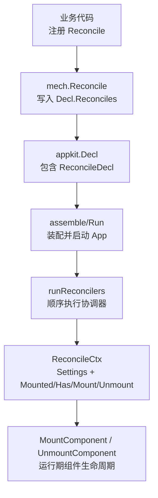
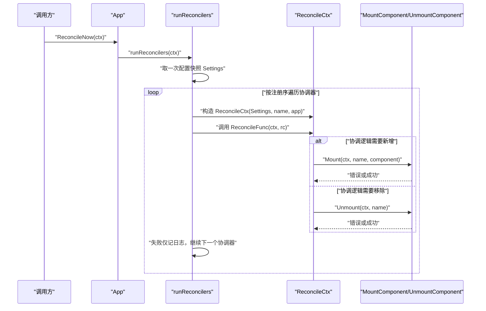
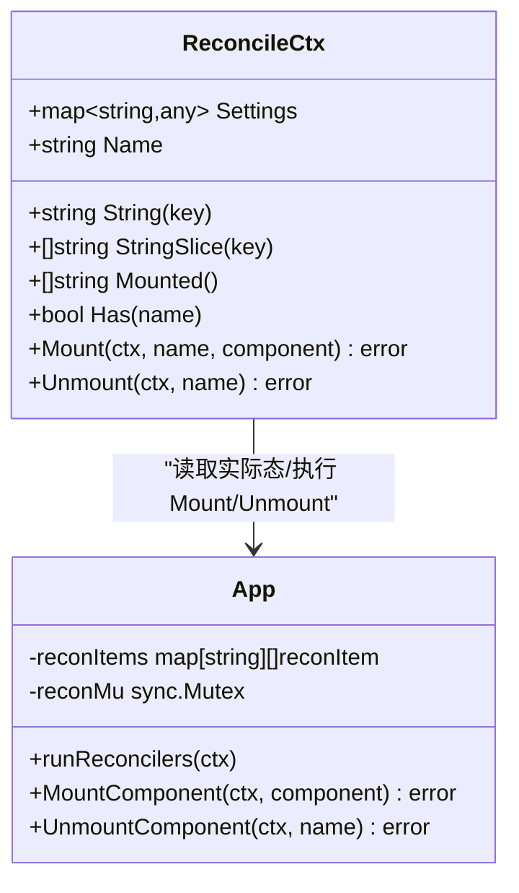
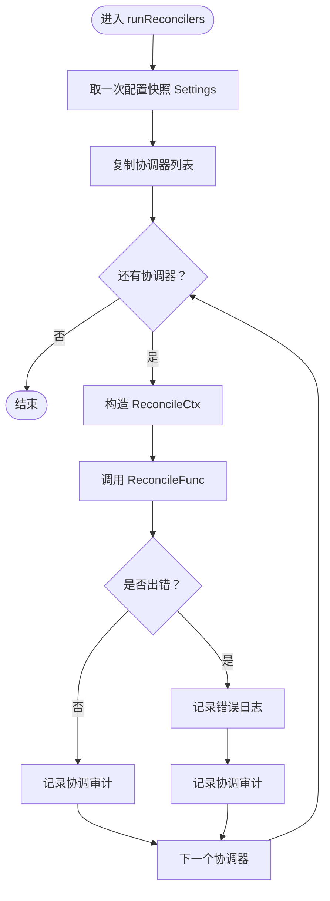
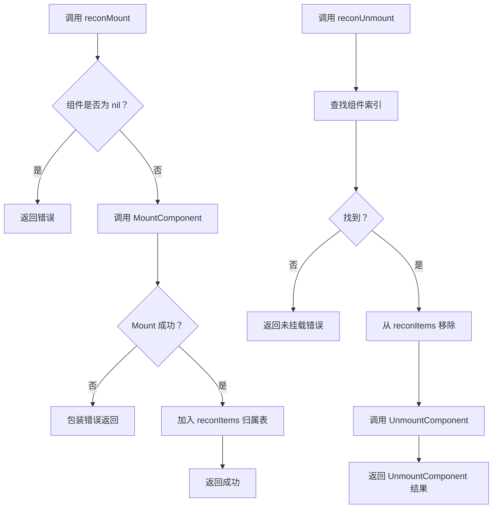
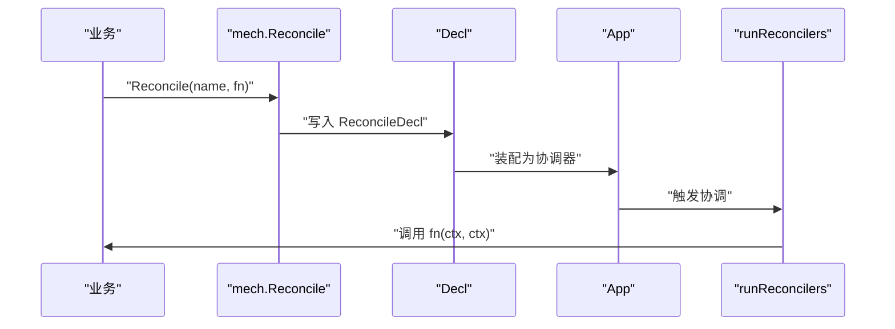
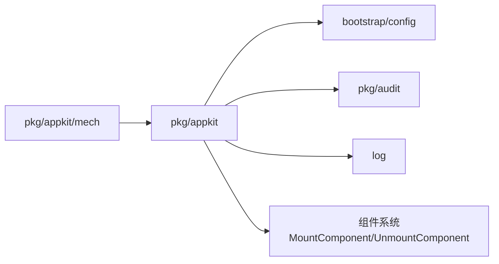
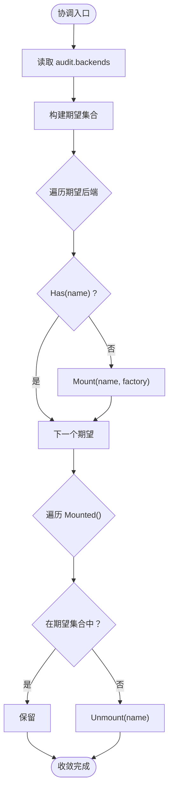

# 期望态协调器（Reconciler）

<cite>
**本文引用的文件**   
- [reconcile.go](file://pkg/appkit/reconcile.go)
- [mount.go](file://pkg/appkit/mount.go)
- [mech.go](file://pkg/appkit/mech/mech.go)
- [bootstrap.go](file://pkg/appkit/bootstrap.go)
- [domain_reconcile_test.go](file://pkg/appkit/domain_reconcile_test.go)
- [appkit.go](file://pkg/appkit/appkit.go)
</cite>

## 目录
1. [引言](#引言)
2. [项目结构定位](#项目结构定位)
3. [核心组件](#核心组件)
4. [架构总览](#架构总览)
5. [详细组件分析](#详细组件分析)
6. [依赖关系分析](#依赖关系分析)
7. [性能与收敛特性](#性能与收敛特性)
8. [故障排查指南](#故障排查指南)
9. [结论](#结论)
10. [附录：审计后端热切换用例](#附录审计后端热切换用例)

## 引言
期望态协调子系统把「业务只声明期望」与「框架负责差集收敛」解耦。它不是事件驱动模型中“收到 key 从 A 变 B，回调自行决定如何响应”的连续变更流；而是每次协调都重新读取配置快照与实际挂载集合，计算期望态与实际态的差异，执行 Mount/Unmount，直到两者一致。这样即使中间失败、协程被抢占、或控制器重启，下一次协调也能自然补齐缺失动作，实现 Kubernetes controller 同型的幂等收敛语义。

典型场景是审计后端热切换：业务把 `audit.backends` 写成期望列表，协调器遍历期望新增、遍历实际移除，最终进程内只保留期望中的后端。

## 项目结构定位
期望态协调位于 `pkg/appkit`，属于应用框架的高级机制层：
- `pkg/appkit/reconcile.go` 定义 `ReconcileCtx`、`ReconcileFunc`、协调调度 `runReconcilers`、协调器归属表读写。
- `pkg/appkit/mount.go` 提供运行期组件 Mount/Unmount 原语，作为协调器的实际态操作底座。
- `pkg/appkit/mech/mech.go` 暴露 `mech.Reconcile`，供业务在 `appkit.NewApp` 时注册协调器。
- `pkg/appkit/bootstrap.go` 描述约定装配流程，协调器通过 Decl 装配进 App。
- `pkg/appkit/appkit.go` 持有协调器注册表与 `reconItems` 实际态映射。

**图表来源**
- [mech.go:128-153](file://pkg/appkit/mech/mech.go#L128-L153)
- [bootstrap.go:1-80](file://pkg/appkit/bootstrap.go#L1-L80)
- [reconcile.go:139-170](file://pkg/appkit/reconcile.go#L139-L170)
- [mount.go:58-120](file://pkg/appkit/mount.go#L58-L120)

**章节来源**
- [reconcile.go:1-35](file://pkg/appkit/reconcile.go#L1-L35)
- [mech.go:1-35](file://pkg/appkit/mech/mech.go#L1-L35)

## 核心组件
| 组件 | 职责 | 关键约束 |
|---|---|---|
| `ReconcileFunc` | 一次协调函数：读期望态、比对实际态、调用 Mount/Unmount | 必须幂等；任意时刻重复调用朝同一终态收敛 |
| `ReconcileCtx` | 协调上下文：只读 Settings 快照 + String/StringSlice 薄委托 + Mounted/Has/Mount/Unmount | Settings 是一次协调内的稳定快照 |
| `reconciler` | 内部协调器记录：name 与 fn | 由 mech 写入 Decl.Reconciles |
| `runReconcilers` | 顺序执行全部协调器，单个失败仅记日志 | 每次整体取一次配置快照 |
| `reconItems` | 协调器名到已挂载组件的实际态映射 | 由 reconMount/reconUnmount 维护 |
| `MountComponent` / `UnmountComponent` | 运行期组件 Start/Dispose 与停机序列管理 | 产生 mount/unmount 审计事件 |

**章节来源**
- [reconcile.go:45-120](file://pkg/appkit/reconcile.go#L45-L120)
- [reconcile.go:143-170](file://pkg/appkit/reconcile.go#L143-L170)
- [reconcile.go:171-227](file://pkg/appkit/reconcile.go#L171-L227)
- [mount.go:58-120](file://pkg/appkit/mount.go#L58-L120)

## 架构总览
期望态协调的核心循环如下：

**图表来源**
- [reconcile.go:143-170](file://pkg/appkit/reconcile.go#L143-L170)
- [mount.go:58-120](file://pkg/appkit/mount.go#L58-L120)

## 详细组件分析

### 声明式协调与事件驱动的区别
事件驱动模型以 key 变更通知为驱动：框架告诉业务“key 从 A 变 B”，业务自行决定增量更新。这种模型的难点在于连续变更、部分失败和乱序可能留下中间态，业务回调必须自己兜底一致性。

期望态协调则是状态驱动：
1. 业务只声明期望态。
2. 框架读取当前实际态。
3. 计算差集并执行 Mount/Unmount。
4. 下次协调再读两边，直到无差异。

这意味着协调函数不需要处理“上一次没完成怎么办”，因为下一次协调会再次检查期望与实际，补齐缺失项。这正是 Kubernetes controller 能够容忍重启和中断的原因。

**章节来源**
- [reconcile.go:1-35](file://pkg/appkit/reconcile.go#L1-L35)

### ReconcileCtx 设计
`ReconcileCtx` 把协调函数需要的能力拆成两类：

#### 期望态读取
- `Settings map[string]any`：本次协调开始时的配置深拷贝快照。一次协调内取值稳定；跨协调由框架重新取最新快照。
- `String(key string) string`：薄委托 `config.At` + `config.String`，缺失返回空字符串，标量转为字符串。
- `StringSlice(key string) []string`：薄委托 `config.At` + `config.StringList`，支持切片、任意类型列表与逗号分隔字符串。

这些方法不直接耦合配置装载实现，只承担接收者访问职责，具体解析语义落在 `bootstrap/config`。

#### 实际态操作
- `Mounted() []string`：返回本协调器名下已挂载组件名，顺序与挂载序一致。
- `Has(name string) bool`：判断是否已由本协调器挂载。
- `Mount(ctx, name, component)`：挂载组件，成功后记入协调器归属表。
- `Unmount(ctx, name)`：卸载组件并从归属表中移除。

**图表来源**
- [reconcile.go:58-120](file://pkg/appkit/reconcile.go#L58-L120)
- [reconcile.go:171-227](file://pkg/appkit/reconcile.go#L171-L227)
- [mount.go:58-120](file://pkg/appkit/mount.go#L58-L120)

**章节来源**
- [reconcile.go:58-120](file://pkg/appkit/reconcile.go#L58-L120)

### 协调器幂等性要求
协调函数必须是幂等的：对相同期望态和实际态重复调用，结果应收敛到同一终态。这个约束来自以下事实：
- 单次协调失败不会回滚已经成功的 Mount/Unmount。
- 失败只记录日志，其他协调器继续执行。
- 下次协调会重新 diff，补齐上次未完成的部分。

因此，协调逻辑不能假设“第一次一定成功”，也不能假设“第二次一定能看到上次中间状态”。正确写法是：
- “期望有、实际无”则 Mount。
- “实际有、期望无”则 Unmount。
- 对同名组件避免重复 Mount。

**章节来源**
- [reconcile.go:36-44](file://pkg/appkit/reconcile.go#L36-L44)
- [reconcile.go:143-170](file://pkg/appkit/reconcile.go#L143-L170)

### runReconcilers 执行流程
`runReconcilers` 的执行语义非常克制：
1. 从配置仓库取一次 Settings 快照。
2. 复制协调器列表。
3. 对每个协调器构造 `ReconcileCtx`。
4. 调用协调函数。
5. 无论成功还是失败，都记录协调审计事件。
6. 单个协调器失败仅记日志，不阻断其余协调器。

**图表来源**
- [reconcile.go:143-170](file://pkg/appkit/reconcile.go#L143-L170)

**章节来源**
- [reconcile.go:143-170](file://pkg/appkit/reconcile.go#L143-L170)

### 实际态管理与 Mount/Unmount 语义
协调器管理的实际态保存在 `App.reconItems` 中，键是协调器名，值是该协调器挂载过的组件序列。`Mounted()` 按顺序返回名称，`Has()` 做存在性判断。

`Mount` 的流程是先调用 `MountComponent`，成功后才加入归属表，保证归属表与实际挂载一致。`Unmount` 先从归属表删除对应条目，再调用 `UnmountComponent`；如果底层 Dispose 失败，也不会恢复归属表，因为组件可能已经销毁或未挂载，下次协调会重新判定。

**图表来源**
- [reconcile.go:194-227](file://pkg/appkit/reconcile.go#L194-L227)
- [mount.go:58-120](file://pkg/appkit/mount.go#L58-L120)

**章节来源**
- [reconcile.go:194-227](file://pkg/appkit/reconcile.go#L194-L227)
- [mount.go:58-120](file://pkg/appkit/mount.go#L58-L120)

### 配置与装配路径
业务通过 `mech.Reconcile` 注册协调器，最终写入 `Decl.Reconciles`。装配阶段由 appkit 的约定装配流程消费 Decl，并在运行时执行协调。Domain 层面的声明式协调也有类似校验：若节点标记 `ReloadReconcile`，则必须有 `Wire` 和 `Reconcile`，否则编译期 fail-fast。

**图表来源**
- [mech.go:128-153](file://pkg/appkit/mech/mech.go#L128-L153)
- [domain_reconcile_test.go:1-40](file://pkg/appkit/domain_reconcile_test.go#L1-L40)

**章节来源**
- [mech.go:128-153](file://pkg/appkit/mech/mech.go#L128-L153)
- [domain_reconcile_test.go:1-40](file://pkg/appkit/domain_reconcile_test.go#L1-L40)

## 依赖关系分析
期望态协调的依赖方向很明确：
- `mech` 单向 import `appkit`，只写 Decl，不持有运行期状态。
- `appkit` 持有协调器列表、Settings 快照、`reconItems` 实际态映射。
- 协调函数通过 `ReconcileCtx` 访问配置和组件生命周期，不直接依赖外部装配细节。
- 实际态变化通过 `MountComponent` / `UnmountComponent` 落到底层组件系统，并产生审计事件。

**图表来源**
- [mech.go:1-35](file://pkg/appkit/mech/mech.go#L1-L35)
- [reconcile.go:10-25](file://pkg/appkit/reconcile.go#L10-L25)
- [mount.go:1-35](file://pkg/appkit/mount.go#L1-L35)

**章节来源**
- [appkit.go:114-115](file://pkg/appkit/appkit.go#L114-L115)
- [reconcile.go:10-25](file://pkg/appkit/reconcile.go#L10-L25)

## 性能与收敛特性
- **顺序执行**：所有协调器按注册序依次执行，没有并发并行。简单可靠，但协调器之间不能互相竞争共享可变状态。
- **单次配置快照**：每次 `runReconcilers` 只取一次 Settings，保证同一个协调批次内期望态一致。
- **失败不阻断**：单个协调器失败只记日志，不影响其他协调器收敛，也便于逐步迁移。
- **归属表 O(n)**：`Mounted()` 扫描协调器下的组件列表；`Has()` 线性查找。对于少量组件足够，大量动态组件时应注意规模。
- **幂等收敛优于快速路径优化**：优先保证“重复调用收敛”，而不是在协调函数里维护复杂增量状态。

**章节来源**
- [reconcile.go:143-170](file://pkg/appkit/reconcile.go#L143-L170)
- [reconcile.go:171-227](file://pkg/appkit/reconcile.go#L171-L227)

## 故障排查指南
| 现象 | 可能原因 | 排查建议 |
|---|---|---|
| 协调器一直反复 Mount | 协调函数未检查 `Has` 或期望态不稳定 | 确保“期望有、实际无”才 Mount |
| 组件始终不卸载 | 协调函数缺少“实际有、期望无”的 Unmount 分支 | 遍历 `Mounted()` 对比期望集合 |
| 协调报错但不影响其他协调器 | 这是预期行为 | 查看协调审计日志和错误字段 |
| 某次协调后状态不一致 | 协调函数非幂等或副作用不完整 | 检查 Mount/Unmount 是否都有幂等保护 |
| 审计事件缺失 | 审计后端异常或 panic | 审计异常会被 recover 并记日志，不阻断协调 |
| 多次协调后 `Mounted()` 数量增长 | 外部直接修改 `reconItems` 或重订阅覆盖未清理旧条目 | 使用协调器提供的 Mount/Unmount，不要直写归属表 |

**章节来源**
- [reconcile.go:143-170](file://pkg/appkit/reconcile.go#L143-L170)
- [reconcile.go:228-262](file://pkg/appkit/reconcile.go#L228-L262)
- [mount.go:121-184](file://pkg/appkit/mount.go#L121-L184)

## 结论
期望态协调器用声明式替代命令式：业务只关心“期望是什么样”，框架负责 diff-apply 直到收敛。它的关键优势是容错性和可恢复性——中间失败不破坏全局状态，下次重试自然补齐；相比事件驱动的连续变更模型，更适合长期运行的服务治理场景。`ReconcileCtx` 把期望态读取与实际态操作清晰分离，`runReconcilers` 保证顺序、快照一致性和失败隔离。配合 `MountComponent` / `UnmountComponent` 的组件生命周期与审计事件，系统可以在不重启的情况下安全地调整运行时能力，例如审计后端热切换。

## 附录：审计后端热切换用例
审计后端热切换是最典型的协调器用例。业务把后端列表写在配置中，协调器根据期望与实际差异进行 Mount/Unmount。

### 用例步骤
1. 从 `audit.backends` 读取期望后端列表。
2. 构建期望集合。
3. 遍历期望：若 `r.Has(name)` 为假，则 `r.Mount(ctx, name, factory(name))`。
4. 遍历实际：若不在期望集合中，则 `r.Unmount(ctx, name)`。
5. 返回错误或 nil；错误会被记录，下次协调继续收敛。

### 收敛语义
- 新增后端：期望有、实际无 → Mount。
- 移除后端：实际有、期望无 → Unmount。
- 不变后端：期望有、实际也有 → 不调用。
- 配置变更后：再次协调，直到实际集合等于期望集合。

**图表来源**
- [reconcile.go:15-35](file://pkg/appkit/reconcile.go#L15-L35)
- [reconcile.go:85-120](file://pkg/appkit/reconcile.go#L85-L120)

**章节来源**
- [reconcile.go:15-35](file://pkg/appkit/reconcile.go#L15-L35)
- [reconcile.go:85-120](file://pkg/appkit/reconcile.go#L85-L120)