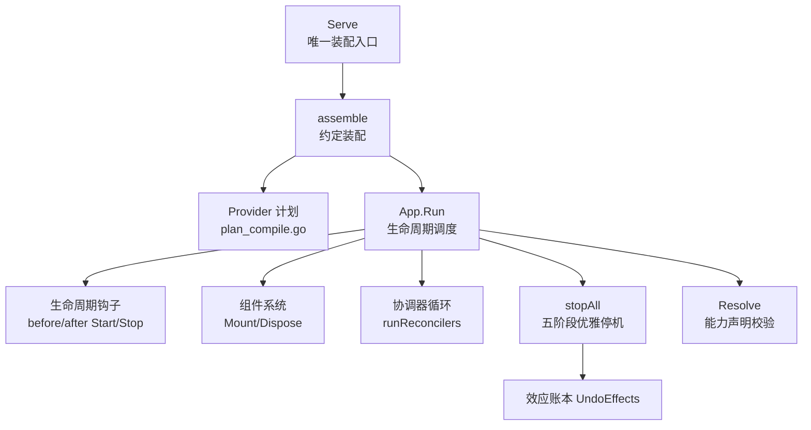
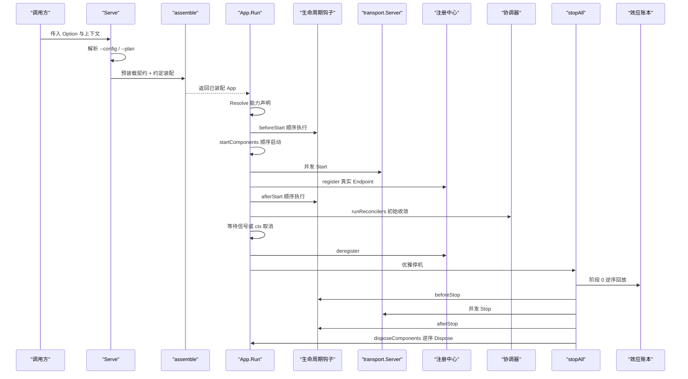
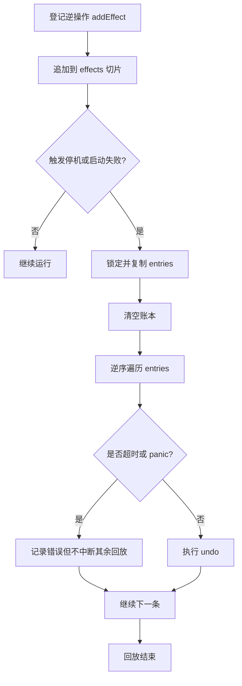
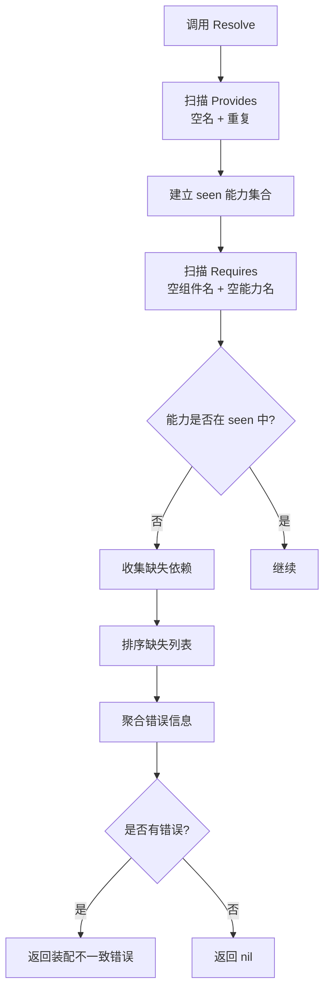
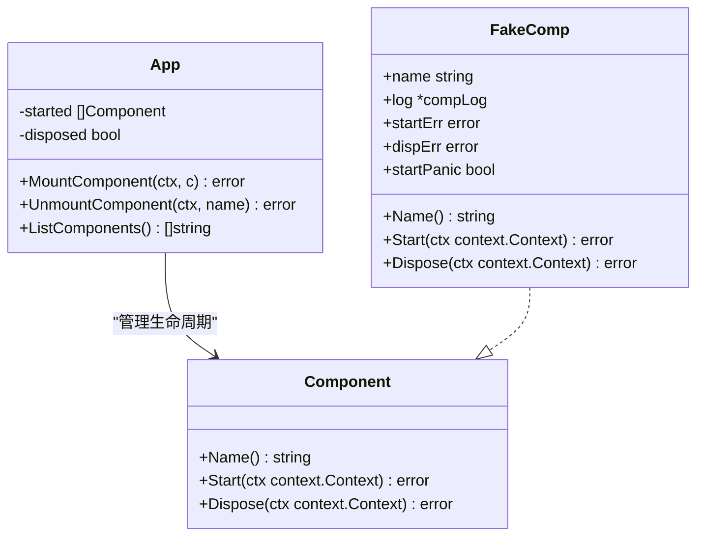
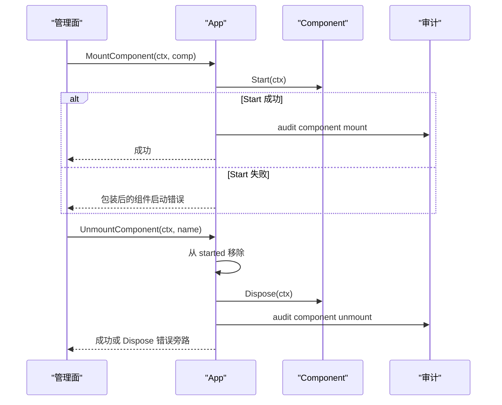
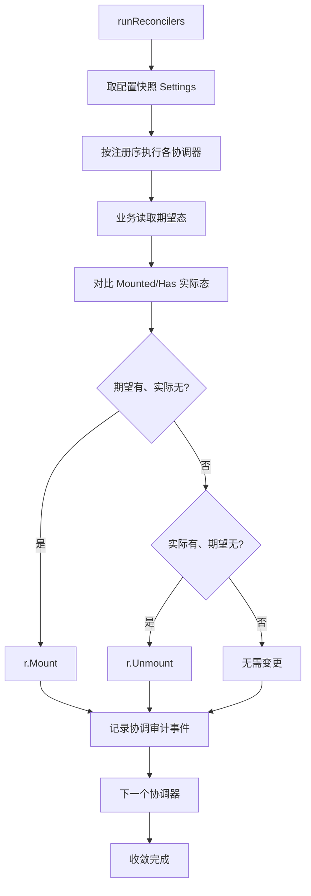
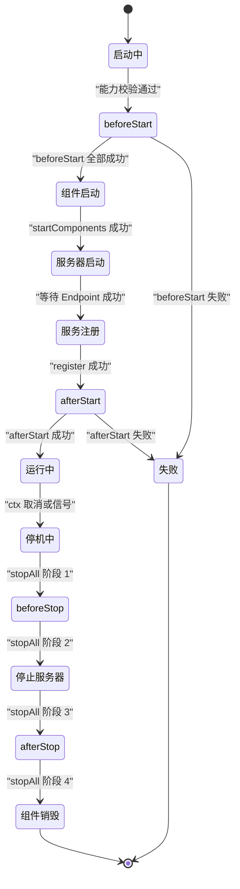
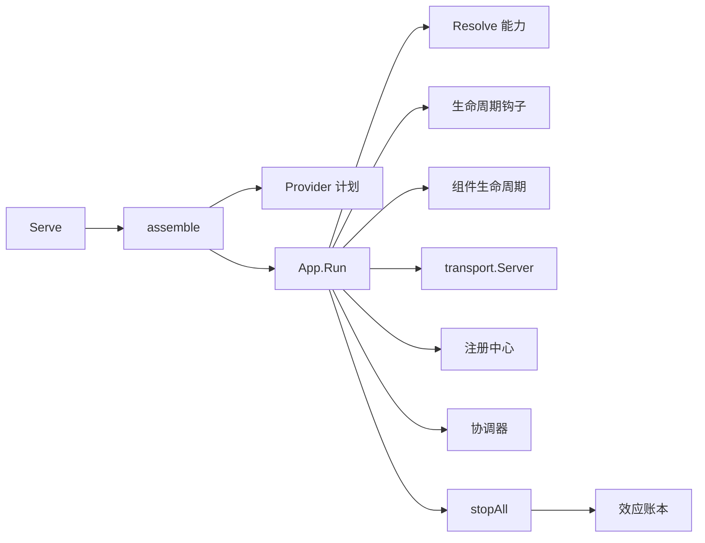
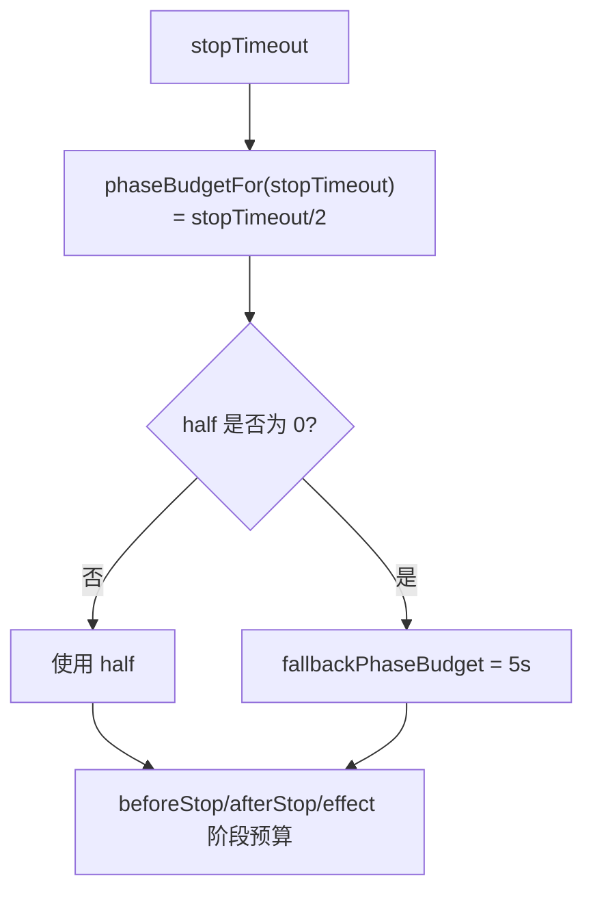

# 生命周期管理

<cite>
**本文引用的文件**   
- [serve.go](file://pkg/appkit/serve.go)
- [bootstrap.go](file://pkg/appkit/bootstrap.go)
- [provider.go](file://pkg/appkit/provider.go)
- [plan_compile.go](file://pkg/appkit/plan_compile.go)
- [effect.go](file://pkg/appkit/effect.go)
- [capability.go](file://pkg/appkit/capability.go)
- [reconcile.go](file://pkg/appkit/reconcile.go)
- [mount.go](file://pkg/appkit/mount.go)
- [appkit.go](file://pkg/appkit/appkit.go)
- [types.go](file://pkg/appkit/types.go)
- [harness.go](file://pkg/appkit/harness.go)
- [component_test.go](file://pkg/appkit/component_test.go)
- [effect_test.go](file://pkg/appkit/effect_test.go)
</cite>

## 目录

1. [引言](#引言)
2. [项目结构](#项目结构)
3. [核心组件](#核心组件)
4. [架构总览](#架构总览)
5. [详细组件分析](#详细组件分析)
6. [依赖关系分析](#依赖关系分析)
7. [性能与预算](#性能与预算)
8. [故障排查指南](#故障排查指南)
9. [结论](#结论)

## 引言

本仓库是一个多模块 Go 工程，围绕 `pkg/appkit` 提供应用生命周期管理、装配计划、能力声明、效应账本、协调器与运行时热插拔等基础设施。文档聚焦三个主题：

- **T1 效应账本**：进程级全局注册的逆操作登记处、停机与启动失败回滚时的逆序回放机制、Effect 与钩子的职责边界。
- **S1 能力声明系统**：Provides/Requires 装配校验、依赖符号化、一致性检查。
- **R1-2 期望态协调器**：配置声明与实际态 diff、收敛过程、典型场景如审计后端热切换。

同时覆盖组件系统的统一生命周期、`beforeStart/afterStart/beforeStop/afterStop` 钩子执行时机与错误处理、各阶段超时预算分配、并行优化与故障隔离策略，并在编排示例中展示依赖与资源管理的正确组织方式。

## 项目结构

生命周期相关代码集中在 `pkg/appkit`，按职责拆分为若干文件：

**图表来源**
- [serve.go:28-100](file://pkg/appkit/serve.go#L28-L100)
- [bootstrap.go:200-538](file://pkg/appkit/bootstrap.go#L200-L538)
- [appkit.go:573-729](file://pkg/appkit/appkit.go#L573-L729)
- [reconcile.go:120-200](file://pkg/appkit/reconcile.go#L120-L200)
- [effect.go:20-91](file://pkg/appkit/effect.go#L20-L91)

**章节来源**
- [serve.go:28-100](file://pkg/appkit/serve.go#L28-L100)
- [bootstrap.go:200-538](file://pkg/appkit/bootstrap.go#L200-L538)
- [appkit.go:573-729](file://pkg/appkit/appkit.go#L573-L729)

## 核心组件

| 概念 | 责任 | 关键实现位置 |
|---|---|---|
| T1 效应账本 | 登记进程级全局写入的逆操作，在停机或启动失败时逆序回放，保证「卸载零残骸」 | [effect.go](file://pkg/appkit/effect.go), [appkit.go](file://pkg/appkit/appkit.go) |
| S1 能力声明 | Provides/Requires 符号化装配期校验，缺失依赖 fail-fast | [capability.go](file://pkg/appkit/capability.go), [appkit.go](file://pkg/appkit/appkit.go) |
| 组件系统 | Component 接口统一 Start/Dispose，支持运行期 Mount/Unmount 热插拔 | [mount.go](file://pkg/appkit/mount.go), [component_test.go](file://pkg/appkit/component_test.go) |
| R1-2 协调器 | 读取期望态 Settings，对实际挂载集合做 diff，幂等收敛 | [reconcile.go](file://pkg/appkit/reconcile.go) |
| Provider 装配 | 段驱动 Plan/Build 分离，节点拓扑排序，阶段 A/B/late 构建 | [provider.go](file://pkg/appkit/provider.go), [plan_compile.go](file://pkg/appkit/plan_compile.go) |
| 生命周期调度 | Run/stopAll 调度钩子、服务器启停、组件销毁、效应回放 | [appkit.go](file://pkg/appkit/appkit.go), [types.go](file://pkg/appkit/types.go) |
| 装配入口 | --config/--plan 解析、契约两遍预装载、约定装配、Run | [serve.go](file://pkg/appkit/serve.go) |

**章节来源**
- [effect.go:20-91](file://pkg/appkit/effect.go#L20-L91)
- [capability.go:1-100](file://pkg/appkit/capability.go#L1-L100)
- [mount.go:1-184](file://pkg/appkit/mount.go#L1-L184)
- [reconcile.go:1-200](file://pkg/appkit/reconcile.go#L1-L200)
- [provider.go:1-200](file://pkg/appkit/provider.go#L1-L200)
- [plan_compile.go:1-200](file://pkg/appkit/plan_compile.go#L1-L200)
- [appkit.go:573-729](file://pkg/appkit/appkit.go#L573-L729)
- [serve.go:28-100](file://pkg/appkit/serve.go#L28-L100)

## 架构总览

生命周期主流程从 `Serve` 进入，完成 flag 解析、契约预装载、约定装配，再交给 `App.Run`；`Run` 负责能力校验、钩子执行、组件启动、服务器并发启动、服务注册、协调器收敛，最终由 `stopAll` 五阶段优雅停机。

**图表来源**
- [serve.go:28-100](file://pkg/appkit/serve.go#L28-L100)
- [appkit.go:573-729](file://pkg/appkit/appkit.go#L573-L729)
- [reconcile.go:120-200](file://pkg/appkit/reconcile.go#L120-L200)
- [effect.go:60-91](file://pkg/appkit/effect.go#L60-L91)

## 详细组件分析

### T1 效应账本

效应账本解决的是进程级全局注册点（例如日志全局 Logger、租户注册表）的「可逆副作用」问题。普通 `Option` 是装配期值对象，不适合承载运行期才构造出的清理逻辑；`addEffect` 则供运行期钩子在构造产物后立即登记 undo。

#### 数据结构与行为

| 字段/方法 | 语义 | 约束 |
|---|---|---|
| `effectEntry.name` | 定位日志中的逆操作 | 仅用于诊断 |
| `effectEntry.undo` | 恢复装配前状态 | 独立超时、panic 隔离 |
| `addEffect` | 运行期追加逆操作 | 并发安全、幂等追加 |
| `UndoEffects` | 逆序回放全部已登记项并清空 | 幂等、旁路不阻断 |
| `effectTimeoutOpt` | 设置每条 undo 的独立超时 | 未声明时继承阶段预算 |

**图表来源**
- [effect.go:35-91](file://pkg/appkit/effect.go#L35-L91)
- [effect_test.go:1-181](file://pkg/appkit/effect_test.go#L1-L181)

#### 执行时机与职责边界

- **装配期 Effect**：通过 `effectOpt` 在选项遍历时登记，适合已知装配期副作用。
- **运行期 Effect**：通过 `addEffect` 在运行期钩子内登记，适合 `Run` 期间才创建的服务器或连接。
- **与钩子的区别**：Hook 是业务或框架阶段回调；Effect 是资源清理原语。Hook 失败会阻断当前阶段，Effect 失败只记录日志，继续回放其余条目。
- **幂等性**：`UndoEffects` 回放后清空账本，重复调用无副作用，便于 e2e 测试隔离。

#### 典型用例

- 替换全局 Logger 后登记恢复旧 Logger 的 undo。
- e2e 测试用 `t.Cleanup(app.UndoEffects)` 避免全局污染。
- 启动失败路径也调用 `UndoEffects`，确保 beforeStart 之前登记的装配期副作用被撤销。

**章节来源**
- [effect.go:20-91](file://pkg/appkit/effect.go#L20-L91)
- [effect_test.go:1-181](file://pkg/appkit/effect_test.go#L1-L181)
- [appkit.go:600-680](file://pkg/appkit/appkit.go#L600-L680)

### S1 能力声明系统

能力是纯声明符号，不负责实例管理；实例管理归 Component 和 Provider。`Resolve` 只做装配一致性检查，缺依赖直接 fail-fast。

#### 核心类型

| 类型 | 用途 |
|---|---|
| `requirement` | 记录组件对能力的依赖 |
| `providesOpt` | 声明本进程提供的能力 |
| `requiresOpt` | 声明某组件依赖的能力 |
| `Resolve` | 校验 Provides/Requires 一致性 |

#### 校验规则

1. 所有 Requires 的能力必须被 Provides 覆盖。
2. Provides 不允许重复声明。
3. 能力名与组件名不能为空。
4. 缺失能力聚合报错，一次列出所有缺失项，并按字符串排序稳定输出。

**图表来源**
- [capability.go:20-100](file://pkg/appkit/capability.go#L20-L100)

#### 集成点

- `App.Run` 在配置加载后、beforeStart 前调用 `Resolve`。
- 若失败，先记录错误，再调用 `UndoEffects` 回滚装配期全局写入，最后返回错误。
- 测试可用 `Resolve` 单独断言装配一致性，无需完整运行应用。

**章节来源**
- [capability.go:1-100](file://pkg/appkit/capability.go#L1-L100)
- [appkit.go:600-640](file://pkg/appkit/appkit.go#L600-L640)

### 组件系统：Component 接口与统一生命周期

组件通过 `Name/Start/Dispose` 暴露统一生命周期。框架保证：

- 启动顺序为注册序。
- 停机顺序为逆序。
- Start 失败回滚已启动组件。
- Dispose 错误旁路记录，不阻断其余组件销毁。
- 每个组件 Start/Dispose 有独立超时。

**图表来源**
- [component_test.go:1-180](file://pkg/appkit/component_test.go#L1-L180)
- [mount.go:60-184](file://pkg/appkit/mount.go#L60-L184)

#### 运行期热插拔

- `MountComponent`：立即调用 `Start`，成功后加入停机序列，产生 mount 审计事件。
- `UnmountComponent`：移除组件并立即 `Dispose`，产生 unmount 审计事件。
- 竞态保护：`stopAll` 阶段 4 开始后拒绝新挂载；若销毁与挂载竞争，挂载方的 `Start` 失败后会回滚 `Dispose`，保持「挂载失败 = 无副作用」。
- `ListComponents`：供观测面查看当前纳入停机序列的组件名。

**图表来源**
- [mount.go:60-184](file://pkg/appkit/mount.go#L60-L184)

**章节来源**
- [mount.go:1-184](file://pkg/appkit/mount.go#L1-L184)
- [component_test.go:1-180](file://pkg/appkit/component_test.go#L1-L180)

### R1-2 期望态协调器

协调器是状态驱动模型：业务只声明「期望是什么样」，框架每次协调都重读期望态与实际态，再做 diff，只增删改差异部分。失败不回滚，下次重试自然补齐，具备 Kubernetes controller 同型的收敛性质。

#### 协调上下文

| 字段/方法 | 含义 |
|---|---|
| `Settings` | 本次协调开始时的配置快照，只读 |
| `Mounted()` | 当前已挂载组件名 |
| `Has(name)` | 判断是否已挂载 |
| `Mount(ctx, name, c)` | 挂载组件并记入归属 |
| `Unmount(ctx, name)` | 卸载组件并从归属移除 |

#### 收敛流程

**图表来源**
- [reconcile.go:1-200](file://pkg/appkit/reconcile.go#L1-L200)
- [reconcile.go:200-262](file://pkg/appkit/reconcile.go#L200-L262)

#### 典型场景：审计后端热切换

协调器读取 `audit.backends` 作为期望态，对每个期望名称：

- 若尚未挂载，则调用 `Mount` 创建并启动后端。
- 若已从期望中移除，则调用 `Unmount` 停止并释放。
- 单个协调器失败仅记录日志，不会阻断整机；下一次配置变更或手动 `ReconcileNow` 会补齐。

**章节来源**
- [reconcile.go:1-262](file://pkg/appkit/reconcile.go#L1-L262)

### 生命周期钩子：beforeStart/afterStart/beforeStop/afterStop

| 钩子 | 执行时机 | 错误处理 |
|---|---|---|
| beforeStart | 能力校验后、组件启动前 | 任一失败即停止启动，回滚 Effect |
| afterStart | 服务注册后、协调器收敛前 | 失败会反注册、stopAll，并记录错误 |
| beforeStop | stopAll 阶段 1 | 独立超时，panic 隔离，仅记录错误 |
| afterStop | 服务器停止后、组件 Dispose 前 | 独立超时，panic 隔离，仅记录错误 |

**图表来源**
- [appkit.go:573-729](file://pkg/appkit/appkit.go#L573-L729)

**章节来源**
- [appkit.go:573-729](file://pkg/appkit/appkit.go#L573-L729)

### Provider 装配与计划

Provider 抽象把「计划」与「构建」拆开：

- `Segments`：声明消费契约段路径，末者胜。
- `Plan`：纯函数，返回带 Phase/Priority/DependsOn 的节点。
- `Build`：唯一允许副作用的入口，失败即 fail-fast。

计划编译阶段还会：

- 合并变体声明。
- 校验域与服务。
- 校验能力声明。
- 检查段覆盖。
- 投影 Imperative 不可分析项（effect/keyWatch/reconcile/hook/serverFunc）。
- 生成期望摘要，供 drift 与协调使用。

**章节来源**
- [provider.go:1-200](file://pkg/appkit/provider.go#L1-L200)
- [plan_compile.go:1-200](file://pkg/appkit/plan_compile.go#L1-L200)
- [plan_compile.go:200-359](file://pkg/appkit/plan_compile.go#L200-L359)

### 装配入口与配置命名空间

`Serve` 是唯一装配入口，内部顺序为：

1. 解析 `--config` 与 `--plan`。
2. 若启用 `--plan`，走 `compileDecl` 打印计划并退出。
3. 两遍预装载契约：第一遍解析 `app.name`，第二遍挂 env 层。
4. 调用 `assemble` 进行约定装配。
5. 记录计划缓存。
6. 调用 `App.Run`。

**章节来源**
- [serve.go:28-180](file://pkg/appkit/serve.go#L28-L180)

## 依赖关系分析

**图表来源**
- [serve.go:28-180](file://pkg/appkit/serve.go#L28-L180)
- [bootstrap.go:200-538](file://pkg/appkit/bootstrap.go#L200-L538)
- [appkit.go:573-729](file://pkg/appkit/appkit.go#L573-L729)

### 耦合与内聚

- `serve.go` 高内聚于装配入口与 flag 解析。
- `bootstrap.go` 高内聚于约定装配与 kitOpts 组装。
- `appkit.go` 高内聚于生命周期调度与优雅停机。
- `provider.go` 与 `plan_compile.go` 共同表达 Provider 抽象与计划推导。
- `effect.go`、`capability.go`、`reconcile.go`、`mount.go` 各自专注单一生命周期子领域。
- 根模块不得 require 适配器包，避免模块环；适配器通过相对 replace 组成可编译闭包。

**章节来源**
- [serve.go:28-180](file://pkg/appkit/serve.go#L28-L180)
- [bootstrap.go:200-538](file://pkg/appkit/bootstrap.go#L200-L538)
- [provider.go:1-200](file://pkg/appkit/provider.go#L1-L200)
- [plan_compile.go:1-200](file://pkg/appkit/plan_compile.go#L1-L200)

## 性能与预算

### 超时预算分配

默认停机总预算为 10 秒，可通过契约 `app.stop_timeout` 或 `StopTimeout` Option 调整。单阶段预算为总预算的一半，不足时回退到 5 秒。

| 阶段 | 预算来源 | 说明 |
|---|---|---|
| 效应回放 | 每条 undo 独立超时，默认等于阶段预算 | 防止慢 undo 拖垮整机 |
| beforeStop | 阶段预算 | 钩子独立超时 |
| 服务器停止 | 共享 stopTimeout | 并发 Stop |
| afterStop | 阶段预算 | 钩子独立超时 |
| 组件 Dispose | 每个组件独立超时 | 卡死组件被收口 |
| 效应撤销 | effectTimeoutOpt 可覆盖 | 与阶段预算解耦 |

**图表来源**
- [types.go:1-22](file://pkg/appkit/types.go#L1-L22)
- [appkit.go:680-760](file://pkg/appkit/appkit.go#L680-L760)

### 并行执行优化

- 服务器启动：使用 `errgroup.WithContext` 并发启动，任一失败级联取消其余。
- 服务器停止：`stopAll` 阶段 2 并发调用 `server.Stop`。
- 协调器：按注册序顺序执行，单个失败仅记录日志，不阻塞其他协调器。
- 效应回放：逆序串行，但每条 undo 独立超时、panic 隔离。

### 故障隔离策略

- Hook panic 转为错误，不击穿 Run。
- Effect undo panic 被 recover 隔离，不影响其余回放。
- Component Dispose 错误旁路记录，不阻断其余销毁。
- Reconciler 失败仅记录日志，下次协调补齐。
- 审计事件异常旁路，绝不阻断挂载/卸载或协调收敛。

**章节来源**
- [types.go:1-22](file://pkg/appkit/types.go#L1-L22)
- [appkit.go:573-760](file://pkg/appkit/appkit.go#L573-L760)
- [effect_test.go:1-181](file://pkg/appkit/effect_test.go#L1-L181)
- [component_test.go:1-180](file://pkg/appkit/component_test.go#L1-L180)

## 故障排查指南

### 启动失败但未看到日志

`reportServeFailure` 会在日志后端未启用 Error 级时兜底写 stderr。装配期失败可能发生在日志后端注入之前，因此不能假定日志一定可见。

**建议**

- 先用 `--plan` 验证装配计划。
- 检查配置文件 `app.name` 是否必填。
- 确认 logger Provider 或内置日志后端可用。

**章节来源**
- [serve.go:100-180](file://pkg/appkit/serve.go#L100-L180)

### 能力缺失导致运行时崩溃

若忘记声明 `Provides`，`Resolve` 会在启动早期报出缺失能力，而不是等到第 N 个请求才出现 nil panic。

**建议**

- 显式声明稳定短标识能力名。
- 可选依赖降级时不要声明 Requires。
- 用测试直接调用 `Resolve` 断言装配一致性。

**章节来源**
- [capability.go:20-100](file://pkg/appkit/capability.go#L20-L100)
- [appkit.go:600-640](file://pkg/appkit/appkit.go#L600-L640)

### 协调器看似“静默绿”

协调器失败只记录日志，不阻断整机；`ReconcileNow` 本身也不要求所有协调器成功。

**建议**

- 检查日志中是否出现协调器错误。
- 检查期望态 Settings 是否更新。
- 手动调用 `ReconcileNow` 触发一次全量协调。
- 使用 `NewHarness` 构造运行态 App，配合 `NewReconcileCtx` 注入快照调试。

**章节来源**
- [reconcile.go:120-200](file://pkg/appkit/reconcile.go#L120-L200)
- [harness.go:1-19](file://pkg/appkit/harness.go#L1-L19)

### 组件热插拔抛出未运行错误

`MountComponent` 与 `UnmountComponent` 仅在 `running` 为真且组件未进入销毁阶段时有效。

**建议**

- 不要在 `Run` 之前调用运行期原语。
- 不要在 `stopAll` 阶段 4 之后挂载组件。
- 管理面应结合身份端口与审计事件追踪操作主体。

**章节来源**
- [mount.go:1-184](file://pkg/appkit/mount.go#L1-L184)

### 停机时间过长

如果 broker 或其他传输层初始化大量连接，慢监听可能导致启动或停机压力增大。应优先调整 `app.stop_timeout`，并注意阶段预算是总预算的一半，不是每个阶段额外叠加。

**章节来源**
- [types.go:1-22](file://pkg/appkit/types.go#L1-L22)
- [appkit.go:680-760](file://pkg/appkit/appkit.go#L680-L760)

## 结论

该生命周期管理系统以 `pkg/appkit` 为核心，将进程级全局副作用、装配一致性、组件生命周期、服务器启停、服务注册与期望态协调收敛统一到一套可观测、可测试、可热更新的框架中。

关键设计原则包括：

- **T1 效应账本**：任何全局写入配套逆操作，停机与启动失败回滚均逆序回放。
- **S1 能力声明**：依赖符号化，装配期 fail-fast，避免运行时隐式崩溃。
- **组件统一生命周期**：Start/Dispose 成对，运行期热插拔受时序与审计约束。
- **R1-2 协调器**：状态驱动、幂等收敛、失败不阻断、重启可恢复。
- **五阶段优雅停机**：效应回放、BeforeStop、服务器停止、AfterStop、组件 Dispose，逐阶段隔离与超时。
- **Provider 计划**：Plan/Build 分离，节点拓扑排序，Opaque 项如实可见。

复杂应用中，推荐按以下顺序组织：

1. 通过 Provider 声明数据库、缓存、存储、审计等基础能力。
2. 通过 Provides/Requires 显式表达组件间依赖。
3. 通过 BeforeStart 建立运行期资源，并通过 Effect 登记清理。
4. 通过 Component 封装可启停的业务组件。
5. 通过 Reconcile 声明期望态，让配置变更驱动后端热切换。
6. 通过 AfterStart 完成健康就绪检查，通过 BeforeStop/AfterStop 做收尾观察。
7. 通过 `stopTimeout` 控制整体停机预算，避免慢组件拖垮优雅停机。