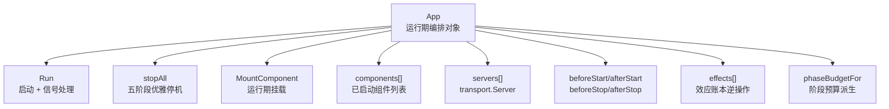
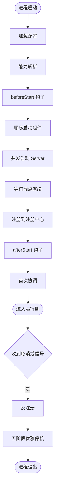
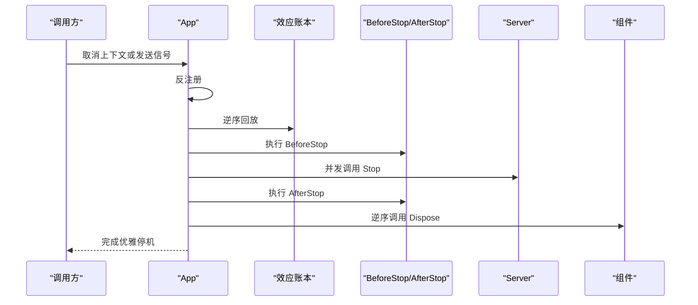
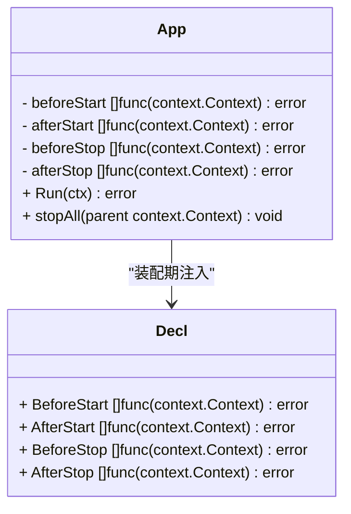
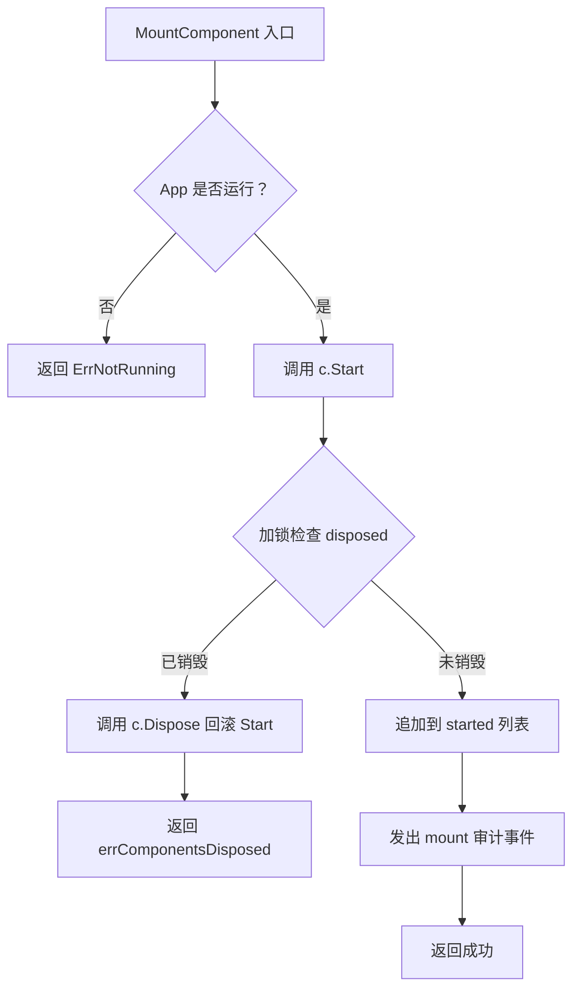
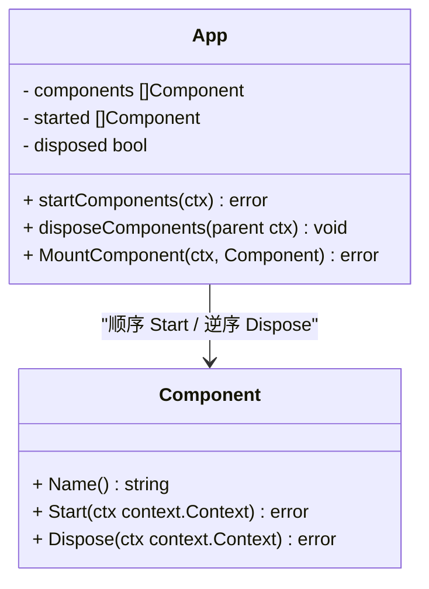
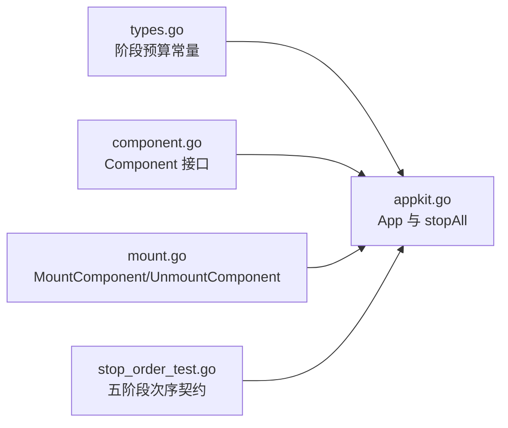

# 生命周期阶段与钩子

<cite>
**本文引用的文件**
- [appkit.go](file://pkg/appkit/appkit.go)
- [stop_order_test.go](file://pkg/appkit/stop_order_test.go)
- [mount.go](file://pkg/appkit/mount.go)
- [component.go](file://pkg/appkit/component.go)
- [types.go](file://pkg/appkit/types.go)
</cite>

## 目录
1. [引言](#引言)
2. [项目结构定位](#项目结构定位)
3. [核心组件](#核心组件)
4. [架构总览](#架构总览)
5. [详细组件分析](#详细组件分析)
6. [依赖关系分析](#依赖关系分析)
7. [性能与预算](#性能与预算)
8. [故障排查指南](#故障排查指南)
9. [结论](#结论)

## 引言
本文围绕应用生命周期各阶段的权威语义展开，以 `TestStopAll_PhaseOrder` 测试钉住的五阶段停机序列为约束：效应账本逆序回放 → BeforeStop → Server.Stop → AfterStop → 组件 Dispose。文档说明每个阶段的职责边界、执行时机、错误传播方式，并解释运行期挂载的竞态闭环：在 `disposed` 标志位置位后才快照销毁；若 `MountComponent` 在销毁窗口内竞争到 Start，框架会拒绝后续注册并回滚其 Start，从而保证“销毁后不再有组件逃逸”。

此外，文档给出 `beforeStart` / `afterStart` / `beforeStop` / `afterStop` 钩子的注册方式、错误传播机制，并提供复杂生命周期编排示例，展示如何正确利用这些钩子和组件契约进行资源管理与故障恢复。

## 项目结构定位
生命周期控制集中在 `pkg/appkit` 包中：
- `App` 是编排主对象，持有启动状态、服务器集合、组件列表、钩子切片和效应账本。
- `Run` 负责启动流程与优雅停机触发。
- `stopAll` 是五阶段停机实现。
- `Component` 接口抽象进程内基础设施的生命周期。
- `MountComponent` / `UnmountComponent` 提供运行期热插拔能力。
- `phaseBudgetFor` 派生各阶段的独立时间预算。

**图表来源**
- [appkit.go:80-160](file://pkg/appkit/appkit.go#L80-L160)
- [appkit.go:570-835](file://pkg/appkit/appkit.go#L570-L835)
- [component.go:38-106](file://pkg/appkit/component.go#L38-L106)
- [mount.go:43-104](file://pkg/appkit/mount.go#L43-L104)
- [types.go:5-22](file://pkg/appkit/types.go#L5-L22)

**章节来源**
- [appkit.go:80-160](file://pkg/appkit/appkit.go#L80-L160)
- [types.go:5-22](file://pkg/appkit/types.go#L5-L22)

## 核心组件
- `App`：装配入口、配置加载、能力解析、服务器启动、服务注册、钩子调度、优雅停机。
- `Component`：进程内可管理资源的抽象，包含 `Name`、`Start`、`Dispose`。
- `transport.Server`：网络监听抽象，被 `App` 并发启动、并发停止。
- 效应账本：记录全局副作用的逆操作，停机时先逆序回放，避免遗留全局注册表。
- 生命周期钩子：`beforeStart`、`afterStart`、`beforeStop`、`afterStop`，由声明层注入。

**章节来源**
- [component.go:38-106](file://pkg/appkit/component.go#L38-L106)
- [appkit.go:570-835](file://pkg/appkit/appkit.go#L570-L835)

## 架构总览
生命周期分为两个大阶段：启动与停机。

**图表来源**
- [appkit.go:570-705](file://pkg/appkit/appkit.go#L570-L705)
- [appkit.go:717-764](file://pkg/appkit/appkit.go#L717-L764)

**章节来源**
- [appkit.go:570-705](file://pkg/appkit/appkit.go#L570-L705)

## 详细组件分析

### 五阶段停机序列
`TestStopAll_PhaseOrder` 断言以下顺序不可变：
1. 效应账本逆序回放。
2. BeforeStop 钩子。
3. Server.Stop。
4. AfterStop 钩子。
5. 组件 Dispose。

**图表来源**
- [stop_order_test.go:63-107](file://pkg/appkit/stop_order_test.go#L63-L107)
- [appkit.go:717-764](file://pkg/appkit/appkit.go#L717-L764)

#### 阶段 0：效应账本逆序回放
- 作用：撤销装配期写入的全局副作用，例如全局注册表、全局中间件、全局监控探针等。
- 时序：最先执行，早于任何业务钩子。
- 幂等：已回放过则无操作。
- 失败路径保护：`beforeStart` 失败、`Resolve` 失败、`loadConfig` 失败都会直接调用 `UndoEffects`，确保装配期副作用不泄漏。

**章节来源**
- [appkit.go:580-625](file://pkg/appkit/appkit.go#L580-L625)
- [appkit.go:717-735](file://pkg/appkit/appkit.go#L717-L735)

#### 阶段 1：BeforeStop 钩子
- 作用：让业务保存关键状态、提交事务、刷新日志缓冲、关闭外部客户端连接等。
- 执行：按注册顺序串行执行。
- 超时：使用 `phaseBudgetFor(stopTimeout)` 作为独立预算。
- 错误传播：单个钩子失败仅记录日志，不中断其他 BeforeStop 钩子，也不阻止后续阶段。
- 典型用途：把仍在运行的组件暴露的状态落盘；不要在 BeforeStop 里做长期阻塞任务。

**章节来源**
- [appkit.go:735-748](file://pkg/appkit/appkit.go#L735-L748)
- [appkit.go:810-825](file://pkg/appkit/appkit.go#L810-L825)

#### 阶段 2：Server.Stop
- 作用：关闭 HTTP、gRPC、WebSocket、TCP、WebRTC 等所有协议监听。
- 并发：所有 `transport.Server` 的 `Stop` 并发执行。
- 超时：共享一个基于 `stopTimeout` 的上下文；任一 `Stop` 报错只记日志。
- 设计原因：网络层停止可能涉及连接 draining、TLS 握手关闭、长轮询释放等，需要允许并发缩短整体停机时间。

**章节来源**
- [appkit.go:748-758](file://pkg/appkit/appkit.go#L748-L758)

#### 阶段 3：AfterStop 钩子
- 作用：访问仍在运行但即将失效的基础设施，例如读取内存指标、收集最后一段链路追踪、向健康检查写最终状态。
- 时序：在 Server 全部停止之后，但在组件 Dispose 之前。
- 错误传播：同 BeforeStop，单钩子失败仅记录日志。
- 关键约束：此阶段仍可安全访问组件实例，因为组件尚未 Dispose。

**章节来源**
- [appkit.go:758-764](file://pkg/appkit/appkit.go#L758-L764)

#### 阶段 4：组件 Dispose
- 作用：收尾进程内资源，如关闭 tracing provider、metrics exporter、缓存池、数据库连接、定时任务。
- 顺序：逆序调用，与启动顺序对称。
- 幂等：清空 `started` 列表后重复调用无副作用。
- 错误传播：单个组件 Dispose 失败只记日志，不阻断其余组件销毁。
- 运行时挂载：运行期通过 `MountComponent` 加入的组件也进入该序列，并按挂载顺序参与逆序销毁。

**章节来源**
- [component.go:83-106](file://pkg/appkit/component.go#L83-L106)
- [mount.go:43-104](file://pkg/appkit/mount.go#L43-L104)

### 生命周期钩子的注册方式与错误传播
钩子通过声明选项注册，保存在 `App` 的切片字段中：
- `BeforeStart(fn)`：注册到 `Decl.BeforeStart`。
- `AfterStart(fn)`：注册到 `Decl.AfterStart`。
- `BeforeStop(fn)`：注册到 `Decl.BeforeStop`。
- `AfterStop(fn)`：注册到 `Decl.AfterStop`。

**图表来源**
- [appkit.go:87-90](file://pkg/appkit/appkit.go#L87-L90)
- [appkit.go:432-443](file://pkg/appkit/appkit.go#L432-L443)

错误传播规则如下：
- `beforeStart` 失败：回滚效应账本，返回错误，不调用 `stopAll`（因为尚未进入完整运行期）。
- `startComponents` 失败：调用 `stopAll`，由 `disposeComponents` 逆序销毁已启动组件。
- `waitForEndpoints` 失败：调用 `stopAll`。
- `register` 失败：调用 `stopAll`。
- `afterStart` 失败：先反注册，再调用 `stopAll`。
- `beforeStop` / `afterStop` 失败：仅记录日志，继续执行后续阶段。
- `Server.Stop` 失败：仅记录日志。
- `Component.Dispose` 失败：仅记录日志。

**章节来源**
- [appkit.go:615-674](file://pkg/appkit/appkit.go#L615-L674)
- [appkit.go:735-764](file://pkg/appkit/appkit.go#L735-L764)
- [appkit.go:810-825](file://pkg/appkit/appkit.go#L810-L825)

### 运行期挂载的竞态闭环
`MountComponent` 不是简单地把组件追加到列表，而是实现了一个严格的竞态闭环：

**图表来源**
- [mount.go:56-88](file://pkg/appkit/mount.go#L56-L88)

关键点：
1. `MountComponent` 先调用 `c.Start`。
2. 随后加锁检查 `a.disposed`。
3. 如果销毁已开始，立即调用 `c.Dispose` 回滚本次 Start。
4. 只有未被销毁时才加入 `started` 列表。
5. `disposeComponents` 在持有锁的情况下设置 `a.disposed = true`，然后取出快照并清空原列表，再解锁执行逆序销毁。
6. 这样保证：一旦销毁开始，新挂载要么在 `disposed` 置位前成功加入，要么在 `disposed` 置位后被拒绝并回滚，不会逃逸出停机序列。

**章节来源**
- [mount.go:56-88](file://pkg/appkit/mount.go#L56-L88)
- [component.go:83-106](file://pkg/appkit/component.go#L83-L106)

### 组件接口与生命周期语义
`Component` 是进程内基础设施的抽象，适合封装 tracing、metrics、缓存、存储连接等需要显式初始化和清理的资源。

**图表来源**
- [component.go:38-106](file://pkg/appkit/component.go#L38-L106)
- [mount.go:43-104](file://pkg/appkit/mount.go#L43-L104)

**章节来源**
- [component.go:38-106](file://pkg/appkit/component.go#L38-L106)

### 复杂生命周期编排示例
下面给出一个面向真实业务的编排思路，不粘贴代码，仅描述阶段职责：

1. **beforeStart**
   - 初始化命令行参数校验。
   - 建立与配置系统的早期连接。
   - 注册全局日志或审计中间件。
   - 注意：若此处失败，框架会调用 `UndoEffects` 撤销装配期副作用。

2. **组件 Start**
   - 启动 tracing provider，使其能捕获后续请求链路。
   - 启动 metrics exporter，使指标采集可用。
   - 初始化缓存连接池、数据库连接。
   - 组件 Start 失败时，已启动组件会通过 `stopAll` 逆序 Dispose。

3. **Server.Start**
   - 启动 HTTP、gRPC 或其他协议监听。
   - 框架等待所有 Server 的 Endpoint 解析出真实端口后再注册。

4. **register**
   - 将真实地址注册到注册中心。
   - 若注册失败，框架会反注册并调用 `stopAll`。

5. **afterStart**
   - 确认自身健康状态。
   - 启动后台协程，例如延迟初始化、预热缓存、发送存活心跳。
   - 若 `afterStart` 失败，框架先反注册，再调用 `stopAll`。

6. **运行期热插拔**
   - 管理面通过 `MountComponent` 动态启用新功能模块。
   - 卸载通过 `UnmountComponent` 移除并立即 Dispose。
   - 若销毁已在进行，挂载会被拒绝并回滚 Start。

7. **beforeStop**
   - 停止接受新请求的业务逻辑。
   - 提交未完成的事务。
   - 刷新日志、指标、追踪尾批数据。
   - 不要在此阶段阻塞等待外部响应。

8. **Server.Stop**
   - 框架并发关闭所有监听。
   - 单个监听失败不影响其他监听关闭。

9. **afterStop**
   - 读取组件保留的最终指标。
   - 写出停机报告。
   - 仍可使用组件实例，但不应再发起新的外部请求。

10. **组件 Dispose**
    - 关闭 tracing provider。
    - 关闭 metrics exporter。
    - 释放缓存连接、数据库连接。
    - 逆序执行，保证依赖倒置的销毁顺序。

**章节来源**
- [appkit.go:615-705](file://pkg/appkit/appkit.go#L615-L705)
- [appkit.go:717-764](file://pkg/appkit/appkit.go#L717-L764)
- [mount.go:56-104](file://pkg/appkit/mount.go#L56-L104)

## 依赖关系分析
生命周期相关的主要依赖如下：

**图表来源**
- [types.go:5-22](file://pkg/appkit/types.go#L5-L22)
- [appkit.go:570-835](file://pkg/appkit/appkit.go#L570-L835)
- [component.go:38-106](file://pkg/appkit/component.go#L38-L106)
- [mount.go:43-104](file://pkg/appkit/mount.go#L43-L104)
- [stop_order_test.go:63-107](file://pkg/appkit/stop_order_test.go#L63-L107)

**章节来源**
- [types.go:5-22](file://pkg/appkit/types.go#L5-L22)
- [appkit.go:570-835](file://pkg/appkit/appkit.go#L570-L835)

## 性能与预算
- 总停机预算来自 `stopTimeout`（契约或 `StopTimeout` Option）。
- 每个生命周期阶段使用 `phaseBudgetFor(stopTimeout)` 派生的独立预算，默认取 `stopTimeout` 的一半，最小兜底值为固定常量。
- 钩子、效应回放、组件启停共用同一预算派生函数，避免过去“每阶段硬编码 5 秒”导致的慢场景无法调优。
- 服务器停止使用单独的 `stopTimeout` 上下文，允许网络层更长时间地 drain 连接。
- 钩子执行带 `recover`，单个钩子 panic 不会拖垮整机，而是转换为错误日志。

**章节来源**
- [types.go:5-22](file://pkg/appkit/types.go#L5-L22)
- [appkit.go:717-764](file://pkg/appkit/appkit.go#L717-L764)
- [appkit.go:810-825](file://pkg/appkit/appkit.go#L810-L825)

## 故障排查指南

### 停机顺序不符合预期
- 首先检查是否自定义了全局副作用注册逻辑，并确保它通过效应账本登记逆操作。
- 确认没有绕过 `App.stopAll` 自行关闭资源。
- 参考 `TestStopAll_PhaseOrder` 的期望事件顺序：效应回放 → BeforeStop → Server.Stop → AfterStop → 组件 Dispose。

**章节来源**
- [stop_order_test.go:63-107](file://pkg/appkit/stop_order_test.go#L63-L107)
- [appkit.go:717-764](file://pkg/appkit/appkit.go#L717-L764)

### BeforeStop 或 AfterStop 卡住
- 检查钩子内部是否存在无限等待、未带超时的外部 RPC 或阻塞 I/O。
- 钩子本身受 `phaseBudgetFor(stopTimeout)` 限制，但外层 `parent` 取消仍会影响整体。
- 不要把网络监听关闭放在 BeforeStop；应留给 Server.Stop。

**章节来源**
- [appkit.go:735-764](file://pkg/appkit/appkit.go#L735-L764)

### 运行期挂载后未销毁
- 确认组件是通过 `MountComponent` 挂载，而不是直接调用 `Start`。
- 如果销毁过程中出现竞态，框架会在 `disposed` 置位后拒绝新挂载并回滚其 Start。
- 使用 `ListComponents` 观察当前纳入停机序列的组件名。

**章节来源**
- [mount.go:56-104](file://pkg/appkit/mount.go#L56-L104)
- [component.go:83-106](file://pkg/appkit/component.go#L83-L106)

### 钩子 panic 导致进程异常
- 钩子执行被 `recover` 包裹，panic 会转为错误日志，不会自动终止其他阶段。
- 若业务希望 panic 直接标记启动失败，应在钩子内部显式返回错误，而不是依赖 panic。

**章节来源**
- [appkit.go:810-825](file://pkg/appkit/appkit.go#L810-L825)

### 组件 Dispose 顺序错乱
- 组件按启动顺序存入 `started`，Dispose 按逆序执行。
- 运行期挂载的组件按挂载顺序追加，因此也会参与逆序销毁。
- 不要手动维护组件销毁顺序；交给 `disposeComponents`。

**章节来源**
- [component.go:83-106](file://pkg/appkit/component.go#L83-L106)
- [mount.go:56-104](file://pkg/appkit/mount.go#L56-L104)

## 结论
Bald 应用框架的生命周期以 `App.stopAll` 为核心，严格钉住五阶段停机顺序：效应账本逆序回放、BeforeStop、Server.Stop、AfterStop、组件 Dispose。钩子用于表达业务时机，组件用于表达结构化资源，效应账本用于兜底全局副作用。运行期挂载通过 `disposed` 标志和 Start 回滚形成竞态闭环，保证销毁期间不再产生逃逸组件。正确使用这些机制，可以把“忘记 flush 追踪、丢事务、留全局句柄”等常见运维问题从文档约定转化为框架结构保障。