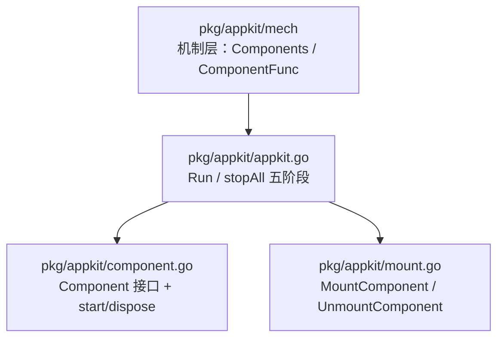
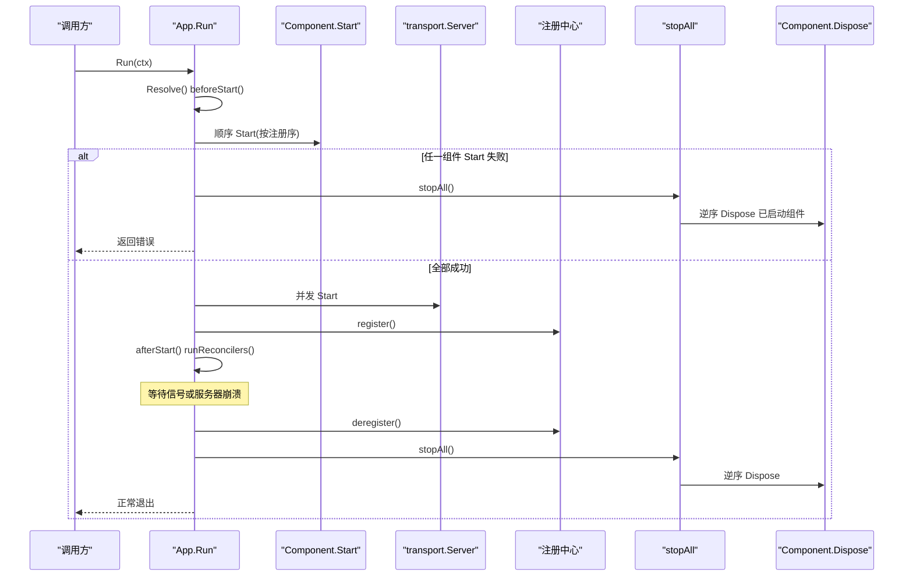
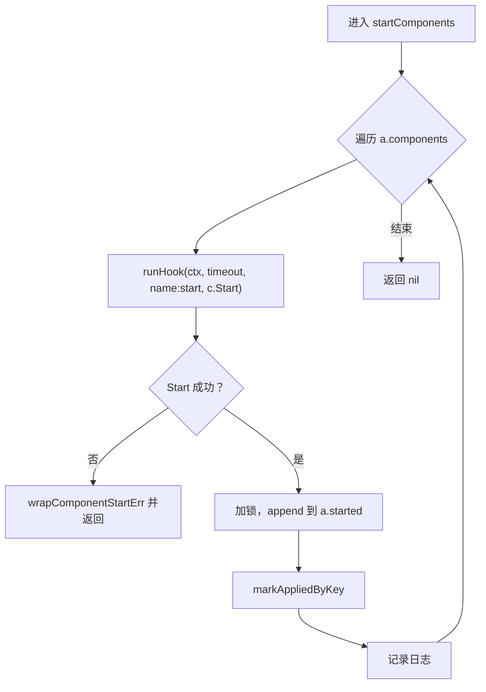
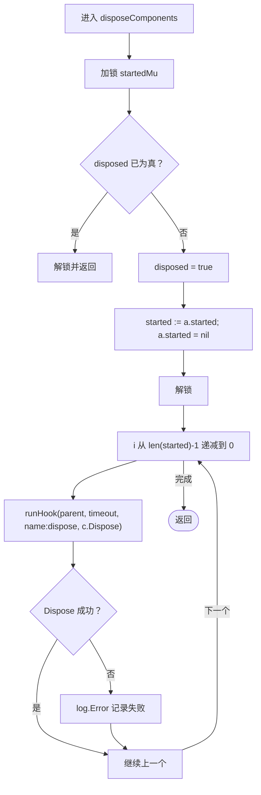
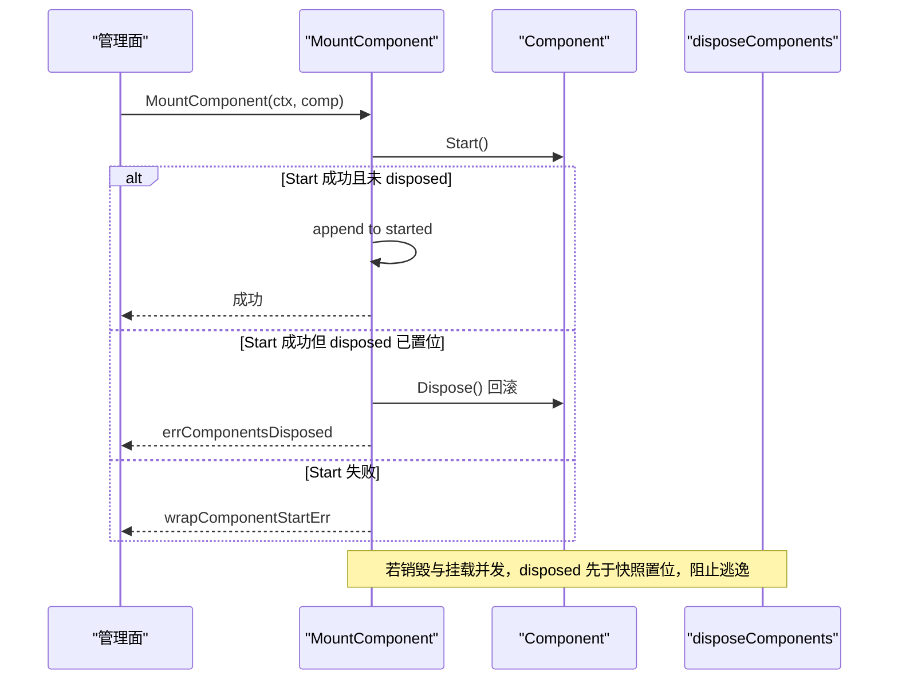
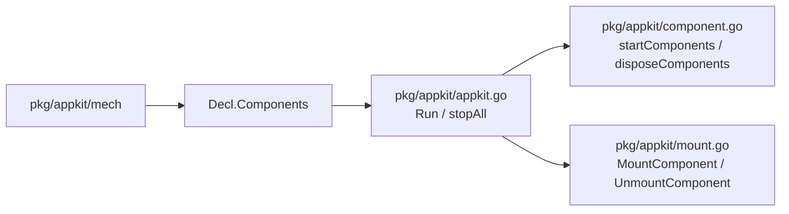

# 组件系统（Component）

<cite>
**本文引用的文件**   
- [component.go](file://pkg/appkit/component.go)
- [appkit.go](file://pkg/appkit/appkit.go)
- [mount.go](file://pkg/appkit/mount.go)
- [mech.go](file://pkg/appkit/mech/mech.go)
- [component_test.go](file://pkg/appkit/component_test.go)
</cite>

## 目录
1. [引言](#引言)
2. [项目结构](#项目结构)
3. [核心组件](#核心组件)
4. [架构总览](#架构总览)
5. [详细组件分析](#详细组件分析)
6. [依赖关系分析](#依赖关系分析)
7. [性能与可靠性特征](#性能与可靠性特征)
8. [故障排查指南](#故障排查指南)
9. [结论](#结论)

## 引言
本仓的进程内基础设施（如跟踪提供者、指标导出器、审计后端、缓存连接池等）通过 `pkg/appkit` 中的 `Component` 接口统一为带生命周期的实体，不再散落在全局 `Setup` + 手工 `BeforeStop` 中。这样做的直接收益是：**启动顺序即依赖建立顺序，停机对称逆序销毁，单个钩子 panic 或超时不会拖垮整机，且失败路径由调用方经统一的优雅停机流程回滚已生效状态**。

`Component` 抽象仅定义三件事：名称、启动、释放；真正的装配入口在 `pkg/appkit/mech`，引擎编排逻辑在 `pkg/appkit/appkit.go`。二者解耦后，适配器只需实现接口，无需感知 `App` 内部字段。

## 项目结构
与本主题直接相关的源码集中在 `pkg/appkit` 及其机制子包：

**图示来源**
- [mech.go:87-153](file://pkg/appkit/mech/mech.go#L87-L153)
- [appkit.go:600-780](file://pkg/appkit/appkit.go#L600-L780)
- [component.go:1-106](file://pkg/appkit/component.go#L1-L106)
- [mount.go:1-184](file://pkg/appkit/mount.go#L1-L184)

**章节来源**
- [component.go:1-106](file://pkg/appkit/component.go#L1-L106)
- [appkit.go:600-780](file://pkg/appkit/appkit.go#L600-L780)

## 核心组件
### Component 接口
`Component` 是 Server 生命周期抽象的细化，面向进程内基础设施而非对外服务面：

| 方法 | 职责 | 执行时机 |
|---|---|---|
| `Name() string` | 日志与报错定位名，建议 `<领域>.<组件名>` | 每次启停都使用 |
| `Start(ctx context.Context) error` | 建立连接、初始化资源 | 所有 `beforeStart` 钩子之后、Server 启动之前，按注册序顺序执行 |
| `Dispose(ctx context.Context) error` | 释放资源，语义与效应账本的 `undo` 对称 | `AfterStop` 之后，按已启动顺序逆序执行 |

设计动机来自包注释：把 trace provider、metrics exporter、审计后端、缓存连接池从“散装全局 Setup + BeforeStop”模式收口为有生命周期的对象，使“忘记 flush 丢尾批 span”从文档风险变成结构保证。

**章节来源**
- [component.go:1-43](file://pkg/appkit/component.go#L1-L43)
- [component.go:45-57](file://pkg/appkit/component.go#L45-L57)

### 装配入口
业务代码不直接操作 `App.components`，而是通过 `pkg/appkit/mech`：

- `Components(...Component)`：追加组件声明，最终写入 `Decl.Components`。
- `ComponentFunc(name, dispose)`：把仅有清理逻辑的函数适配成 `Component`，`Start` 返回 nil，适合 `TracerProvider.Shutdown`、数据库连接池关闭等场景。
- `ComponentTimeout(d)`：覆盖该声明下组件 Start/Dispose 的独立超时；未设置时退化为阶段预算。

**章节来源**
- [mech.go:87-153](file://pkg/appkit/mech/mech.go#L87-L153)

## 架构总览
`Component` 的生命周期嵌入 `App.Run` 和 `stopAll` 五阶段停机流程中：

**图示来源**
- [appkit.go:600-780](file://pkg/appkit/appkit.go#L600-L780)
- [component.go:67-106](file://pkg/appkit/component.go#L67-L106)

## 详细组件分析

### 顺序启动：`startComponents`
`startComponents` 对 `a.components` 逐个调用 `c.Start`，并通过 `runHook` 包装超时与 panic：

1. 按注册顺序执行，因此**注册序即依赖建立序**。
2. 每个 `Start` 成功后立即把组件追加到 `a.started`。
3. 若某个组件 `Start` 返回错误，函数立即返回；调用方随后调用 `stopAll`，由 `disposeComponents` 逆序销毁 `a.started` 中已成功启动的组件。
4. 同时标记资源键，便于协调器观测。

**图示来源**
- [component.go:67-87](file://pkg/appkit/component.go#L67-L87)

关键语义：
- 失败路径由调用方经 `stopAll` 逆序 Dispose，而不是在 `startComponents` 内自行回滚——避免重复实现补偿逻辑。
- `started` 只保存成功 `Start` 过的实例，保证后续销毁幂等。

**章节来源**
- [component.go:67-87](file://pkg/appkit/component.go#L67-L87)
- [component.go:89-92](file://pkg/appkit/component.go#L89-L92)
- [component_test.go:54-75](file://pkg/appkit/component_test.go#L54-L75)

### 逆序销毁：`disposeComponents`
`disposeComponents` 负责 `stopAll` 第四阶段：

1. 持有 `startedMu`，先检查 `disposed` 标志位；若已销毁则直接返回。
2. 置位 `disposed = true`，再快照 `started` 列表并清空原切片。
3. 释放锁后，从末尾向前遍历，逐个调用 `c.Dispose`。
4. 单个组件超时或 panic 仅记日志，**不中断其余销毁**。

**图示来源**
- [component.go:94-106](file://pkg/appkit/component.go#L94-L106)

要点：
- **幂等**：`disposed` 标志位防止重复执行。
- **安全快照**：先复制 `started` 再清空，避免并发挂载竞争。
- **旁路语义**：与效应撤销一致，单点失败不影响整体回收。

**章节来源**
- [component.go:94-106](file://pkg/appkit/component.go#L94-L106)
- [component_test.go:110-131](file://pkg/appkit/component_test.go#L110-L131)

### 与效应账本的关系
组件系统与效应账本是互补的两层：

| 维度 | 效应账本 | 组件系统 |
|---|---|---|
| 粒度 | 全局注册表的细粒度逆操作 | 实例级别的粗粒度生命周期 |
| 执行阶段 | `stopAll` 阶段 0，最先回放 | `stopAll` 阶段 4，最后销毁 |
| 典型用途 | 全局中间件注册、全局配置注入、低层级副作用 | 进程内基础设施：trace、指标、审计后端、缓存池 |
| 失败策略 | 每条 undo 独立超时、panic 隔离、幂等 | 单组件超时/panic 仅记日志，不阻断其他组件 |
| 启动期回滚 | `Resolve`、`beforeStart` 失败直接 `UndoEffects` | 组件 `Start` 失败后走 `stopAll` 逆序 Dispose |

典型组合写法是把外部库的 shutdown 函数包装为 `ComponentFunc`，交给 `mech.Components` 登记，从而获得与服务器一致的启停编排。

**章节来源**
- [component.go:1-36](file://pkg/appkit/component.go#L1-L36)
- [appkit.go:600-640](file://pkg/appkit/appkit.go#L600-L640)
- [appkit.go:717-750](file://pkg/appkit/appkit.go#L717-L750)

### 运行期热插拔：MountComponent / UnmountComponent
组件生命周期不仅用于装配期静态声明，还支持运行期动态挂载：

- `MountComponent`：立即执行 `Start`；成功后加入 `started` 序列，纳入后续 `stopAll` 阶段 4 的逆序销毁。
- `UnmountComponent`：从 `started` 移除最新同名组件，并立即 `Dispose`；`Dispose` 失败仅记日志，因为组件已从序列移除。
- 竞态闭环：当 `disposeComponents` 开始执行时，会先置位 `disposed`，此时 `MountComponent` 会拒绝新挂载并回滚本次 `Start`，保证“挂载失败 = 无副作用”。

**图示来源**
- [mount.go:56-103](file://pkg/appkit/mount.go#L56-L103)
- [component.go:94-106](file://pkg/appkit/component.go#L94-L106)

**章节来源**
- [mount.go:56-131](file://pkg/appkit/mount.go#L56-L131)

## 依赖关系分析
- `pkg/appkit/mech` 单向 import `pkg/appkit`，提供 `Components`、`ComponentFunc`、`ComponentTimeout` 等 Option。
- `pkg/appkit/component.go` 定义 `Component` 接口及 `startComponents`、`disposeComponents`，被 `App.Run` 与 `MountComponent` 共用。
- `pkg/appkit/appkit.go` 的 `Run` 在 `beforeStart` 之后调用 `startComponents`，在 `stopAll` 第四阶段调用 `disposeComponents`。
- `pkg/appkit/mount.go` 扩展运行时挂载能力，复用 `runHook`、`componentTimeout`、`wrappedComponentStartErr` 等内部逻辑。

**图示来源**
- [mech.go:87-153](file://pkg/appkit/mech/mech.go#L87-L153)
- [appkit.go:600-780](file://pkg/appkit/appkit.go#L600-L780)
- [component.go:67-106](file://pkg/appkit/component.go#L67-L106)
- [mount.go:56-131](file://pkg/appkit/mount.go#L56-L131)

**章节来源**
- [mech.go:1-36](file://pkg/appkit/mech/mech.go#L1-L36)
- [component.go:1-106](file://pkg/appkit/component.go#L1-L106)
- [appkit.go:600-780](file://pkg/appkit/appkit.go#L600-L780)
- [mount.go:1-184](file://pkg/appkit/mount.go#L1-L184)

## 性能与可靠性特征
- **顺序启动**：时间复杂度与组件数线性相关，但每个 `Start` 可能涉及网络握手、连接池预热等外部开销，应放在 `beforeStart` 之后、Server 启动之前，避免阻塞监听端口。
- **并发停止 Server**：`stopAll` 第二阶段对所有 Server 并发调用 `Stop`，用 WaitGroup 聚合，缩短整体停机时间。
- **组件销毁串行化**：`disposeComponents` 逐组件调用 `Dispose`，原因是多个组件可能共享同一底层连接或全局句柄，需要按逆序保证依赖关系。
- **panic 隔离**：`runHook` 统一 recover，单个组件钩子 panic 转为错误日志，不击穿 `Run` 或 `stopAll`。
- **独立超时**：组件 Start/Dispose 使用 `componentTimeout`；未显式设置时退化为阶段预算，避免卡死组件拖累整机。
- **幂等与可重入**：`disposed` 标志位、清空后的 `started` 列表、以及 `UnmountComponent` 的移除语义共同保证多次销毁、卸载、热插拔不会产生重复副作用。

**章节来源**
- [appkit.go:717-780](file://pkg/appkit/appkit.go#L717-L780)
- [component.go:67-106](file://pkg/appkit/component.go#L67-L106)

## 故障排查指南

### 组件 Start 失败
现象：`Run` 返回错误，日志中出现 `appkit component ... start` 包裹的错误。  
原因：某个组件 `Start` 返回非 nil，或 `runHook` 捕获到 panic。  
处理：
1. 检查组件 `Name` 是否唯一且可读。
2. 确认其依赖的其他组件已在前序位置注册。
3. 不需要手动回滚已启动组件——调用方已调用 `stopAll`，由 `disposeComponents` 逆序释放。

**章节来源**
- [component.go:89-92](file://pkg/appkit/component.go#L89-L92)
- [component_test.go:76-97](file://pkg/appkit/component_test.go#L76-L97)

### 组件 Dispose 失败
现象：优雅停机期间出现 `appkit component dispose failed` 日志，但进程仍可正常退出。  
原因：组件 `Dispose` 超时、panic 或返回错误。  
处理：
- 这是预期旁路语义：单组件失败不中断其余销毁。
- 检查是否遗漏关闭底层连接、flush 尾批 span、取消 watcher 等。
- 若 `Dispose` 本身可能阻塞，确保它响应 ctx 取消或使用合理超时。

**章节来源**
- [component.go:94-106](file://pkg/appkit/component.go#L94-L106)
- [component_test.go:110-131](file://pkg/appkit/component_test.go#L110-L131)

### 未启动组件仍被销毁
现象：`beforeStart` 失败后，日志中未见组件 `Dispose`。  
原因：组件尚未成功 `Start`，未被加入 `started` 列表。  
处理：确认失败发生在 `startComponents` 之前还是之后；前者不应销毁，后者由 `stopAll` 处理。

**章节来源**
- [component_test.go:166-176](file://pkg/appkit/component_test.go#L166-L176)

### 运行期挂载返回 `errComponentsDisposed`
现象：管理面调用 `MountComponent` 时返回“components already disposed”。  
原因：`stopAll` 已进入阶段 4，`disposed` 已置位。  
处理：
- 管理面应检测该错误并拒绝继续挂载。
- 若并发竞争，框架会回滚本次 `Start`，保证挂载失败无副作用。

**章节来源**
- [mount.go:28-33](file://pkg/appkit/mount.go#L28-L33)
- [mount.go:56-86](file://pkg/appkit/mount.go#L56-L86)

## 结论
`Component` 接口把进程内基础设施从“全局函数 + 手工清理”的松散模式升级为结构化生命周期对象。`startComponents` 以注册序建立依赖，`disposeComponents` 以逆序回收资源；两者配合 `stopAll` 五阶段、效应账本、Server 并发停止和 panic 隔离，形成一条从启动到优雅停机的完整闭环。对于典型场景，优先使用 `mech.ComponentFunc` 包装外部库的 shutdown 函数，让框架承担顺序、超时、重试与回滚责任，业务代码专注资源语义本身。