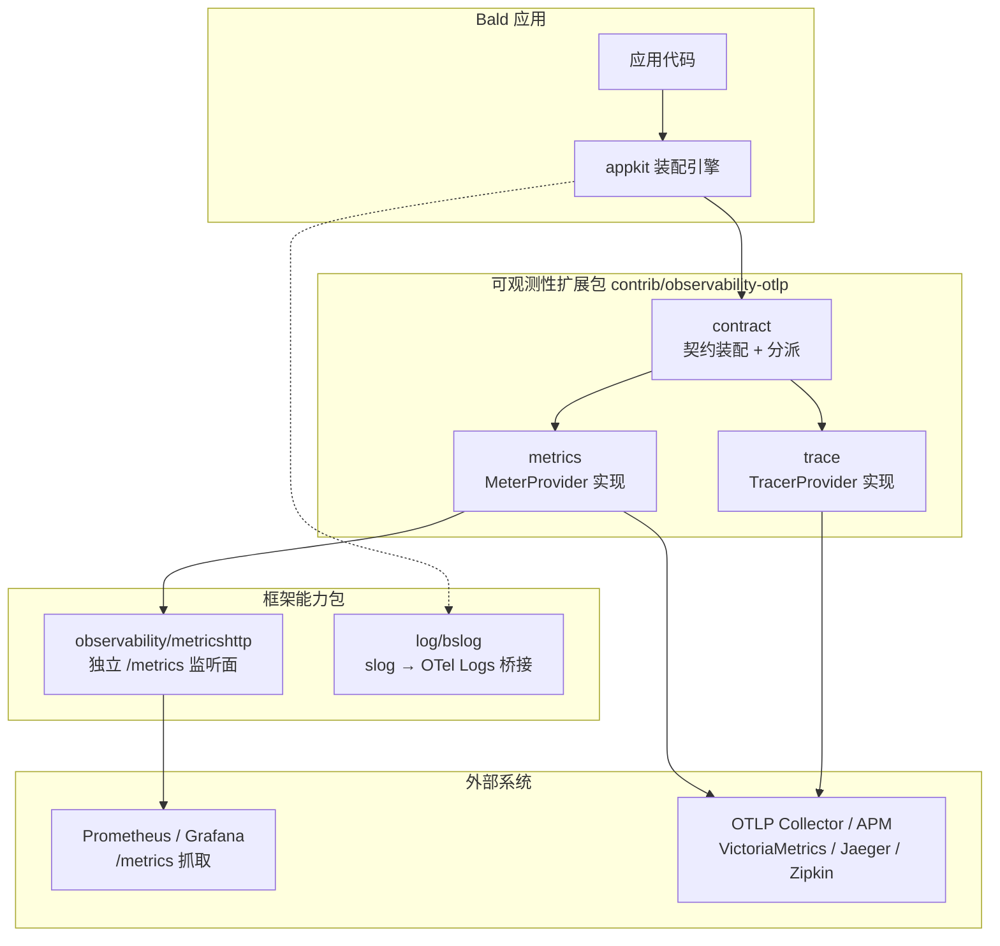
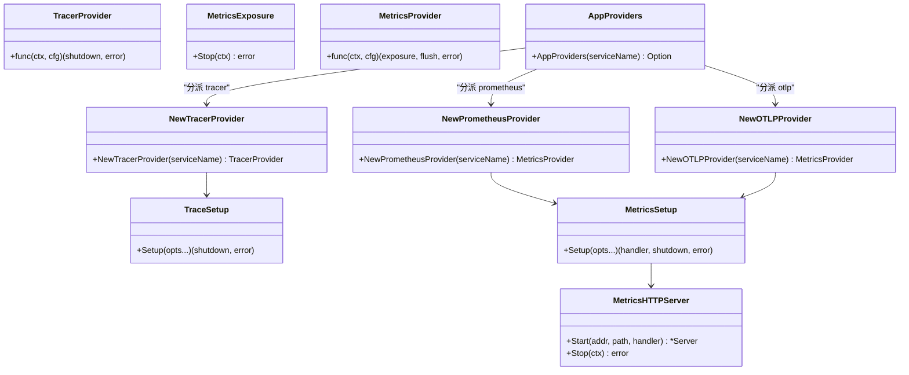
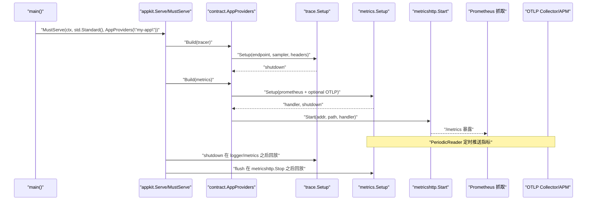
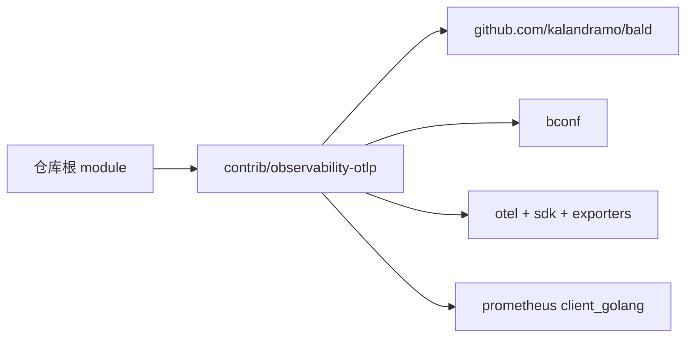

# 可观测性扩展包

<cite>
**本文引用的文件**   
- [go.mod](file://contrib/observability-otlp/go.mod)
- [contract.go](file://contrib/observability-otlp/contract/contract.go)
- [app_providers.go](file://contrib/observability-otlp/contract/app_providers.go)
- [metrics.go](file://contrib/observability-otlp/metrics/metrics.go)
- [trace.go](file://contrib/observability-otlp/trace/trace.go)
- [metricshttp.go](file://observability/metricshttp/metricshttp.go)
- [observability.go](file://pkg/appkit/observability.go)
- [standard.go](file://pkg/appkit/standard.go)
- [serve.go](file://pkg/appkit/serve.go)
- [otel.go](file://log/bslog/otel.go)
- [bald-demo-api.yaml](file://_example/bald/configs/bald-demo-api.yaml)
</cite>

## 目录
1. [简介](#简介)
2. [项目结构](#项目结构)
3. [核心组件](#核心组件)
4. [架构总览](#架构总览)
5. [详细组件分析](#详细组件分析)
6. [依赖关系分析](#依赖关系分析)
7. [性能与资源管理](#性能与资源管理)
8. [故障排查指南](#故障排查指南)
9. [结论](#结论)

## 简介
本扩展包 `contrib/observability-otlp` 为 Bald 框架提供 OpenTelemetry 可观测能力，覆盖指标收集、分布式追踪与日志关联。其设计遵循 Bald“核心零后端耦合”原则：框架核心不引入 OTel SDK，所有 OTLP 直推逻辑由该贡献包承担，通过 appkit 的段驱动 Provider 装配到应用启动流程中。

它支持三种使用形态：
- 开箱：通过 `AppProviders("服务名")` 同时注册 tracer 与 metrics 段 Provider；
- 函数式构造：分别调用 `NewTracerProvider`、`NewPrometheusProvider`、`NewOTLPProvider`；
- 自写 Provider：在自定义 Provider 的 Build 内按契约 type 分派到上述构造函数。

当前支持的契约类型：
- tracer.type = "otlp"（唯一值）；
- metrics.type ∈ {"prometheus", "otlp"}。

默认行为：
- tracer 段不存在 → no-op trace；
- metrics 段不存在 → 不装配指标暴露端点。

**章节来源**
- [observability.go:1-55](file://pkg/appkit/observability.go#L1-L55)
- [contract.go:1-111](file://contrib/observability-otlp/contract/contract.go#L1-L111)

## 项目结构
`contrib/observability-otlp` 是独立的 Go module，通过相对 replace 指向仓库根及兄弟模块。它包含三个职责清晰的子包：

| 路径 | 职责 |
|---|---|
| `contract/` | 契约装配层：把 bootstrapv1 配置映射为 appkit.TracerProvider / MetricsProvider，并处理 fail-fast 校验 |
| `trace/` | 实现 TracerProvider：根据地址开启 OTLP HTTP 导出器，设置采样策略与 service.name |
| `metrics/` | 实现 MetricsProvider：以多 Reader 模式同时挂 Prometheus 本地抓取与可选 OTLP 直推 |

此外，`observability/metricshttp` 是框架侧的能力包，负责独立监听 Prometheus 抓取端口；`log/bslog/otel.go` 提供日志与 OTel Logs 的可选桥接入口。

**图表来源**
- [contract.go:1-111](file://contrib/observability-otlp/contract/contract.go#L1-L111)
- [metrics.go:1-158](file://contrib/observability-otlp/metrics/metrics.go#L1-L158)
- [trace.go:1-136](file://contrib/observability-otlp/trace/trace.go#L1-L136)
- [metricshttp.go:1-60](file://observability/metricshttp/metricshttp.go#L1-L60)
- [otel.go:1-26](file://log/bslog/otel.go#L1-L26)

**章节来源**
- [go.mod:1-193](file://contrib/observability-otlp/go.mod#L1-L193)
- [standard.go:1-200](file://pkg/appkit/standard.go#L1-L200)

## 核心组件
本节聚焦四个关键类型和它们之间的协作关系。

### 契约装配层（contract）
- `TracerType = "otlp"`
- `TypePrometheus = "prometheus"`
- `TypeOTLP = "otlp"`
- `NewTracerProvider(serviceName)`：校验 `tracer.otlp.endpoint` 非空，返回 TracerProvider。
- `NewPrometheusProvider(serviceName)`：要求 `metrics.otlp.endpoint` 为空，否则报错；返回 Prometheus 本地抓取暴露端与 flush。
- `NewOTLPProvider(serviceName)`：要求 `metrics.otlp.endpoint` 非空；同时启用 Prometheus 抓取与 OTLP 指标直推。
- `AppProviders(serviceName)`：一次性注册 tracer 与 metrics 两个节点，内部按 type 分派。

### 追踪实现（trace）
- `Setup(...Option)`：若未设置 OTLP 地址则返回 no-op shutdown；否则创建 OTLP HTTP 导出器、设置全局 TracerProvider，返回 Shutdown。
- 支持采样器：`always_on`、`always_off`、`parent_based`、`trace_id_ratio`；未知值 WARN 并回退到 ParentBased(AlwaysSample)。
- 地址解析与 insecure 三态与 metrics 保持一致。

### 指标实现（metrics）
- `Setup(...Option)`：始终挂 Prometheus exporter；若传入 OTLP 地址则额外挂 PeriodicReader 直推远端。
- 返回 Prometheus `/metrics` handler 与 MeterProvider.Shutdown。
- `Recorder(scope)`：基于全局 MeterProvider 创建真实 Recorder，输出 semconv v1.43.0 指标。

### 指标暴露端（metricshttp）
- `Start(addr, path, handler)`：在独立 http.Server 上起 `/metrics`，失败异步记日志不 panic。
- `Stop(ctx)`：优雅停机，不执行指标 flush——flush 归 Provider 返回的 shutdown，由 appkit 保证顺序。

**图表来源**
- [observability.go:20-55](file://pkg/appkit/observability.go#L20-L55)
- [contract.go:39-111](file://contrib/observability-otlp/contract/contract.go#L39-L111)
- [metrics.go:66-158](file://contrib/observability-otlp/metrics/metrics.go#L66-L158)
- [metricshttp.go:28-60](file://observability/metricshttp/metricshttp.go#L28-L60)

**章节来源**
- [contract.go:1-111](file://contrib/observability-otlp/contract/contract.go#L1-L111)
- [trace.go:1-136](file://contrib/observability-otlp/trace/trace.go#L1-L136)
- [metrics.go:1-158](file://contrib/observability-otlp/metrics/metrics.go#L1-L158)
- [metricshttp.go:1-60](file://observability/metricshttp/metricshttp.go#L1-L60)

## 架构总览
从应用启动到数据落盘的整体流程如下：

**图表来源**
- [serve.go:1-180](file://pkg/appkit/serve.go#L1-L180)
- [app_providers.go:1-117](file://contrib/observability-otlp/contract/app_providers.go#L1-L117)
- [trace.go:70-136](file://contrib/observability-otlp/trace/trace.go#L70-L136)
- [metrics.go:96-158](file://contrib/observability-otlp/metrics/metrics.go#L96-L158)
- [metricshttp.go:28-60](file://observability/metricshttp/metricshttp.go#L28-L60)

**章节来源**
- [serve.go:1-180](file://pkg/appkit/serve.go#L1-L180)
- [app_providers.go:1-117](file://contrib/observability-otlp/contract/app_providers.go#L1-L117)

## 详细组件分析

### 初始化与装配流程
应用推荐用法是在 `main` 中调用 `appkit.MustServe`，并传入 `std.Standard()` 与 `otlpcontract.AppProviders("服务名")`。框架会：

1. 解析 `--config` 与 `--plan`；
2. 两遍预装载 bootstrap 契约；
3. 组装 Provider 计划；
4. 在阶段 B（BeforeStart）构建 tracer 与 metrics；
5. 在进程退出时按逆序回放 cleanup：先停 metricshttp 暴露端，再 flush OTLP 直推通道。

如果 tracer 或 metrics 段未声明，对应 Provider 直接返回 nil，不会报错；只有段存在但没有 Provider 才会触发 L3 覆盖检查报错。

**章节来源**
- [serve.go:1-180](file://pkg/appkit/serve.go#L1-L180)
- [observability.go:1-55](file://pkg/appkit/observability.go#L1-L55)
- [app_providers.go:28-117](file://contrib/observability-otlp/contract/app_providers.go#L28-L117)

### 追踪配置与采样策略
tracer 段必须设置 `type=otlp` 且 `endpoint` 非空，否则会 fail-fast。支持以下选项：

| 字段 | 含义 | 缺省 |
|---|---|---|
| `endpoint` | OTLP trace HTTP 地址 | 必填 |
| `insecure` | 强制 insecure/TLS，或未显式时按地址前缀推断 | nil |
| `headers` | 远端鉴权请求头 | 空 |
| `sampler` | 采样策略名称 | 空 → parent_based(always_on) |
| `sampleRatio` | trace_id_ratio 比率 | ≤0 → 1.0 |

采样器解析规则：
- 空串或 `parent_based` → `ParentBased(AlwaysSample)`；
- `always_on` → 全量采样；
- `always_off` → 关闭采样；
- `trace_id_ratio` → 按比例随机采样；
- 未知值 → WARN 并回退到 parent_based。

**章节来源**
- [contract.go:43-61](file://contrib/observability-otlp/contract/contract.go#L43-L61)
- [trace.go:24-136](file://contrib/observability-otlp/trace/trace.go#L24-L136)

### 指标配置与双通道导出
metrics 支持两种模式：

| metrics.type | 行为 | endpoint 要求 |
|---|---|---|
| `prometheus` | 仅本地 `/metrics` 抓取 | `metrics.otlp.endpoint` 必须为空 |
| `otlp` | 本地抓取 + OTLP 指标直推 | `metrics.otlp.endpoint` 必填 |

指标 Setup 的内部步骤：
1. 创建 Prometheus exporter；
2. 若配置了 OTLP 地址，创建 OTLP metric HTTP exporter 并加入 PeriodicReader；
3. 合并 resource（service.name）；
4. 逐项追加 Reader；
5. 设置全局 MeterProvider；
6. 返回 Prometheus handler 与 Shutdown。

默认指标周期为 15 秒，可通过 `WithInterval` 调整。

**章节来源**
- [contract.go:63-111](file://contrib/observability-otlp/contract/contract.go#L63-L111)
- [metrics.go:24-158](file://contrib/observability-otlp/metrics/metrics.go#L24-L158)

### 日志与 OTel Logs 关联
日志核心不引入 OTel 依赖。`log/bslog/otel.go` 提供 `WithOTelHandler`，用于把 OTel 的 slog.Handler 注入 bslog。这样日志记录可以桥接到 OTel Logs，与 trace/span 共享上下文。

典型接入方式：
- 用户模块自行引入 `go.opentelemetry.io/contrib/bridges/otelslog` 与 `otel/sdk/log`；
- 构造 LoggerProvider 和 otelslog.Handler；
- 通过 `bslog.WithOTelHandler(h)` 注入。

级别与属性映射走 slog.Record → OTel log.Record 的常规转换。

**章节来源**
- [otel.go:1-26](file://log/bslog/otel.go#L1-L26)

### 与 AppKit 的集成方式
appkit 对可观测性的抽象集中在两个接口：

- `TracerProvider`：返回 shutdown，由引擎挂停机 Effect 回放；
- `MetricsProvider`：返回 exposure 与 flush，引擎保证「先 Stop 暴露端，再 flush」。

标准日志 Provider 由 `standard.go` 提供，阶段 A 产出引导 bslog，阶段 B 按契约后端列表构造 MultiLogger。可观测性扩展包通过 Provider 机制替换 tracer/metrics 段，而不是侵入核心埋点。

自动埋点方面，框架核心已在 gRPC/gin 中间件中起 span 并注入 trace_id/span_id；当全局 TracerProvider 未设置时，otel.Tracer 返回 no-op，零配置即可运行。

**章节来源**
- [observability.go:1-55](file://pkg/appkit/observability.go#L1-L55)
- [standard.go:1-200](file://pkg/appkit/standard.go#L1-L200)
- [trace.go:1-23](file://contrib/observability-otlp/trace/trace.go#L1-L23)

### 监控系统对接示例

#### Prometheus
- 使用 `metrics.type=prometheus` 或 `metrics.type=otlp`；
- 默认监听 `:9091`，路径 `/metrics`；
- 可在 Prometheus 配置中抓取该端点；
- 指标包含 OTel semconv v1.43.0 协议指标以及审计指标。

#### Jaeger / Zipkin
Jaeger 与 Zipkin 作为 OTLP Collector 的后端时，可直接消费 OTLP trace 与指标流。需要：
- 配置 `tracer.otlp.endpoint` 指向 Jaeger Collector 或 Zipkin OTLP 接收端；
- 如远端需要鉴权，通过 `headers` 传入 Authorization 等头；
- 使用 `metrics.type=otlp` 将指标也发送到同一 OTLP 后端或 Collector。

由于仓库未包含 Jaeger/Zipkin 的具体集成测试，生产接入应先在本地验证 Collector 能收到 trace 与指标。

**章节来源**
- [metricshttp.go:14-60](file://observability/metricshttp/metricshttp.go#L14-L60)
- [metrics.go:96-158](file://contrib/observability-otlp/metrics/metrics.go#L96-L158)
- [trace.go:70-136](file://contrib/observability-otlp/trace/trace.go#L70-L136)

### 自定义指标与 Span
- 自定义指标：在 `metrics.Setup` 之后调用 `obmetrics.Recorder("服务名")`，按 OTel meter API 创建 Counter/Gauge/Histogram 等 instrument；
- 自定义 Span：通过 `otel.Tracer("服务名").Start(ctx, spanName)` 创建业务 span；
- 上下文传播：框架中间件已注入 trace_id/span_id，业务代码无需手动传递；如需跨 goroutine 传播，使用 context.Context。

注意：指标 instrument 是惰性创建的，即使埋点在 Provider 之前写入也不会丢失数据，但建议仍在装配期完成初始化以便观察资源占用。

**章节来源**
- [metrics.go:144-158](file://contrib/observability-otlp/metrics/metrics.go#L144-L158)
- [trace.go:70-136](file://contrib/observability-otlp/trace/trace.go#L70-L136)

## 依赖关系分析
`contrib/observability-otlp` 的 go.mod 显示它直接依赖：
- `github.com/kalandramo/bald`（通过 replace 指向仓库根）；
- `github.com/kalandramo/bald/bconf`；
- `github.com/prometheus/client_golang`；
- `go.opentelemetry.io/otel` 及其 SDK、exporters；
- `go.opentelemetry.io/otel/exporters/prometheus`。

模块通过相对 replace 组成可编译闭包，根 module 不得 require 任何适配器，避免模块环。

**图表来源**
- [go.mod:1-193](file://contrib/observability-otlp/go.mod#L1-L193)

**章节来源**
- [go.mod:1-193](file://contrib/observability-otlp/go.mod#L1-L193)

## 性能与资源管理

### 性能影响
- 追踪：启用 OTLP 后，span 通过 Batcher 批量导出，减少网络请求频率；采样可降低高负载场景下的开销。
- 指标：Prometheus exporter 常驻内存，OTLP PeriodicReader 定时上报；间隔越短 CPU 与带宽越高。
- 日志：OTel Logs 桥接会增加 slog.Handler 链长度，但属于可选接入。

### 资源泄漏防护
- TracerProvider.Shutdown 必须调用，否则缓冲 span 可能丢失；
- MeterProvider.Shutdown 必须调用，否则 OTLP 直推缓冲可能丢失；
- metricshttp.Server.Stop 必须调用，优雅关闭监听面；
- appkit 引擎已将 tracer 与 metrics 的 cleanup 合成到停机序列，确保先停暴露端再 flush。

### 生产环境调优建议
1. 明确设置 `tracer.otlp.sampler`，生产建议使用 `trace_id_ratio` 控制采样率；
2. 为 `metrics.otlp.push_interval` 设置合理值，避免过于频繁导致 APM 背压；
3. 通过 `insecure=false` 启用 TLS，配合证书管理；
4. 使用 `headers` 承载远端鉴权信息，不要硬编码到环境变量；
5. 监控 OTLP 导出错误日志，区分网络不可达与认证失败；
6. 指标与追踪使用相同 `service.name`，便于链路关联。

**章节来源**
- [trace.go:70-136](file://contrib/observability-otlp/trace/trace.go#L70-L136)
- [metrics.go:96-158](file://contrib/observability-otlp/metrics/metrics.go#L96-L158)
- [metricshttp.go:28-60](file://observability/metricshttp/metricshttp.go#L28-L60)
- [app_providers.go:39-117](file://contrib/observability-otlp/contract/app_providers.go#L39-L117)

## 故障排查指南

### 常见错误
| 现象 | 原因 | 处理方式 |
|---|---|---|
| 启动时报 `tracer.type="otlp" requires tracer.otlp.endpoint` | 未配置 trace endpoint | 配置 `tracer.otlp.endpoint` |
| 启动时报 `metrics.type="prometheus" conflicts with metrics.otlp.endpoint` | 同时声明 prometheus 与 OTLP endpoint | 改用 `metrics.type=otlp` |
| 启动时报 `metrics.type="otlp" requires metrics.otlp.endpoint` | 未配置 OTLP endpoint | 配置 `metrics.otlp.endpoint` |
| 未知 tracer.type 或 metrics.type | 使用了不支持的值 | 改为 "otlp"、"prometheus" |
| 指标面板无数据 | 未启用 metrics 段或暴露端未启动 | 检查 metrics 配置与 `:9091` |
| 链路未上报 | OTLP endpoint 不可达或采样关闭 | 检查网络、鉴权、sampler |
| 日志未关联 trace | 未注入 OTel slog.Handler | 通过 `bslog.WithOTelHandler` 接入 |

### 诊断步骤
1. 使用 `appkit.Serve --plan` 查看装配计划，确认 tracer 与 metrics 节点是否生成；
2. 检查 `tracer.otlp.endpoint`、`metrics.otlp.endpoint` 是否为空；
3. 确认 Prometheus 能访问 `:9091/metrics`；
4. 检查 OTLP Collector 是否能收到 trace 与指标；
5. 若使用 Jaeger/Zipkin，确认 Collector 已转发到对应后端；
6. 查看日志中是否有 metrics server 启动错误或 OTLP 导出错误。

**章节来源**
- [contract.go:43-111](file://contrib/observability-otlp/contract/contract.go#L43-L111)
- [metricshttp.go:28-60](file://observability/metricshttp/metricshttp.go#L28-L60)
- [serve.go:1-180](file://pkg/appkit/serve.go#L1-L180)

## 结论
`contrib/observability-otlp` 为 Bald 提供了标准化的 OpenTelemetry 接入能力。它通过 contract 层统一契约装配，trace 与 metrics 各自专注一个导出方向，metricshttp 解耦指标暴露端生命周期，bslog 提供日志桥接入口。生产使用时应重点关注采样策略、OTLP 地址与鉴权、Shutdown 调用以及 Prometheus 抓取端口可达性。