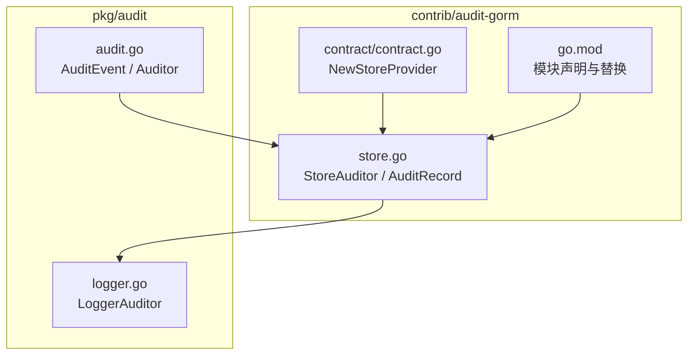
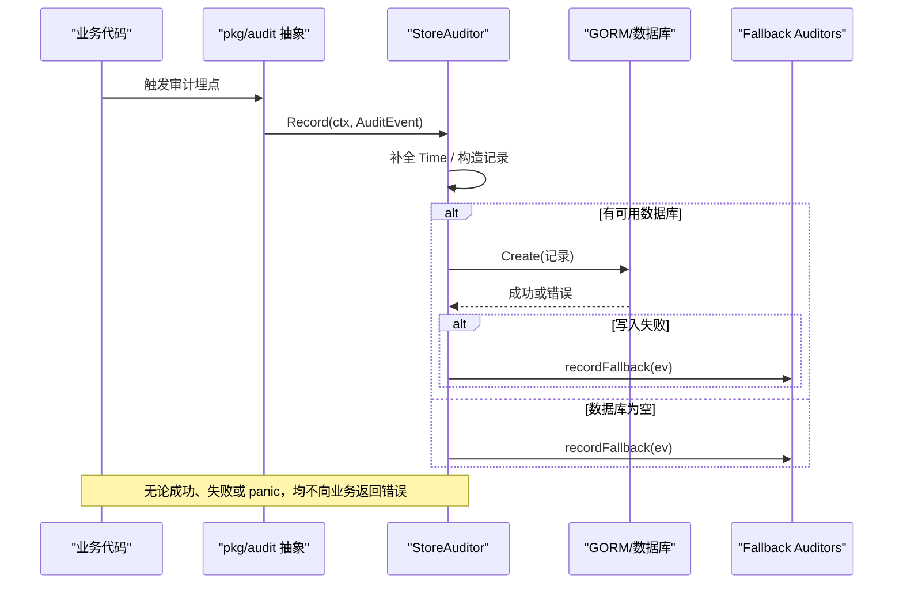
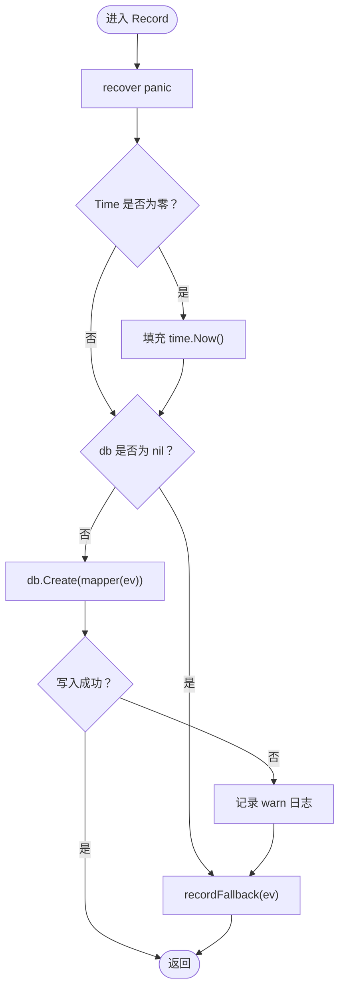
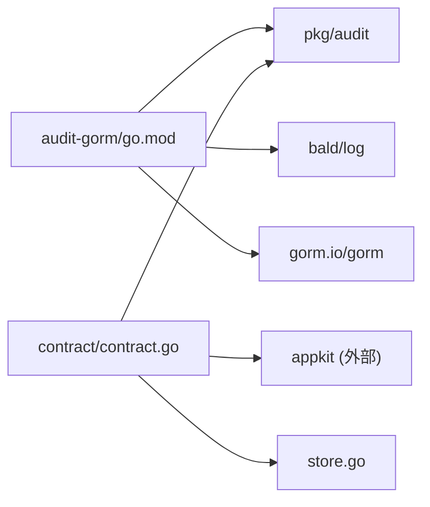

# GORM 审计日志持久化包

<cite>
**本文引用的文件**   
- [store.go](file://contrib/audit-gorm/store.go)
- [store_test.go](file://contrib/audit-gorm/store_test.go)
- [contract.go](file://contrib/audit-gorm/contract/contract.go)
- [go.mod](file://contrib/audit-gorm/go.mod)
- [audit.go](file://pkg/audit/audit.go)
- [logger.go](file://pkg/audit/logger.go)
</cite>

## 目录
1. [简介](#简介)
2. [项目结构](#项目结构)
3. [核心组件](#核心组件)
4. [架构总览](#架构总览)
5. [详细组件分析](#详细组件分析)
6. [依赖关系分析](#依赖关系分析)
7. [性能与批量写入](#性能与批量写入)
8. [配置与初始化](#配置与初始化)
9. [事务与错误处理](#事务与错误处理)
10. [业务集成示例](#业务集成示例)
11. [审计数据查询与分析](#审计数据查询与分析)
12. [生产归档、清理与合规](#生产归档清理与合规)
13. [故障排查指南](#故障排查指南)
14. [结论](#结论)

## 简介
`audit-gorm` 是 bald 框架中基于 GORM 的审计日志持久化桥接模块。它实现 `pkg/audit.Auditor` 接口，将结构化审计事件落库到一张全量审计表；当数据库不可用或写入失败时，自动降级到可配置的 fallback 后端（默认写结构化日志），保证审计旁路语义：**绝不向上游返回错误、不阻断业务请求**。

该模块遵循“零后端耦合”的设计：核心抽象在 `pkg/audit`，具体存储实现在 contrib 子模块；契约装配单独放在 `contract` 包，使根实现保持对 bconf/appkit 无依赖，业务按需引入。

## 项目结构


**图表来源**
- [store.go:1-145](file://contrib/audit-gorm/store.go#L1-L145)
- [contract.go:1-46](file://contrib/audit-gorm/contract/contract.go#L1-L46)
- [go.mod:1-190](file://contrib/audit-gorm/go.mod#L1-L190)
- [audit.go:1-83](file://pkg/audit/audit.go#L1-L83)
- [logger.go:1-45](file://pkg/audit/logger.go#L1-L45)

**章节来源**
- [store.go:1-145](file://contrib/audit-gorm/store.go#L1-L145)
- [contract.go:1-46](file://contrib/audit-gorm/contract/contract.go#L1-L46)
- [go.mod:1-190](file://contrib/audit-gorm/go.mod#L1-L190)
- [audit.go:1-83](file://pkg/audit/audit.go#L1-L83)
- [logger.go:1-45](file://pkg/audit/logger.go#L1-L45)

## 核心组件
- **AuditRecord**：默认审计表模型，包含租户、时间戳、主体、对象、动作、结果、错误以及从 `Meta` 提取的分类、IP、UA、请求 ID、链路 ID 等扩展列。
- **StoreAuditor**：实现 `audit.Auditor.Record`，负责把 `AuditEvent` 映射为记录并调用 GORM 写入；失败时降级到 fallback。
- **Option 与构造器**：`WithRecordMapper` 支持自定义表结构映射；`WithFallback` 指定降级后端；`DefaultModel` 提供默认表模型供迁移。
- **Contract Provider**：`contract.NewStoreProvider` 把 gorm 连接注入应用审计能力，并可按配置自动迁移默认审计表。

**章节来源**
- [store.go:21-145](file://contrib/audit-gorm/store.go#L21-L145)
- [contract.go:17-46](file://contrib/audit-gorm/contract/contract.go#L17-L46)

## 架构总览


**图表来源**
- [store.go:76-117](file://contrib/audit-gorm/store.go#L76-L117)
- [audit.go:64-83](file://pkg/audit/audit.go#L64-L83)
- [logger.go:20-45](file://pkg/audit/logger.go#L20-L45)

## 详细组件分析

### 数据模型：AuditRecord
默认审计表字段如下：

| 字段 | 类型 | 说明 | 索引 |
|---|---|---|---|
| ID | uint | 自增主键 | 主键 |
| TenantID | string | 租户标识 | 普通索引 |
| Time | int64 | UnixNano 时间戳 | 普通索引 |
| Subject | string | 操作主体 | 无 |
| Object | string | 资源对象 | 无 |
| Action | string | 操作动作 | 无 |
| Result | string | allow/deny/error | 无 |
| Error | string | 错误详情 | 无 |
| Category | string | operation/login 分类 | 普通索引 |
| IPAddress | string | 客户端 IP | 无 |
| UserAgent | string | 客户端 UA | 无 |
| RequestID | string | 全局请求 ID | 无 |
| TraceID | string | W3C 链路 ID | 无 |

设计要点：
- 表刻意采用“全量记录”，不启用读隔离语义；`TenantID` 仅作为列存储，由审计查询方按需过滤。
- 扩展字段来自 `AuditEvent.Meta`，缺键时使用默认值（如 `category` 默认为 `operation`）。

**章节来源**
- [store.go:21-44](file://contrib/audit-gorm/store.go#L21-L44)
- [store.go:118-145](file://contrib/audit-gorm/store.go#L118-L145)
- [store_test.go:43-80](file://contrib/audit-gorm/store_test.go#L43-L80)

### StoreAuditor 与审计事件写入流程
`StoreAuditor.Record` 的处理路径非常明确：

1. panic 防护：使用 defer recover 捕获异常并记 warn 日志，确保审计侧不会让上层业务 panic。
2. 时间兜底：若 `AuditEvent.Time` 为零值，则填充当前时间，避免零值 UnixNano。
3. 空数据库旁路：若构造时传入的 gorm.DB 为 nil，直接走 fallback。
4. 正常落库：通过 mapper 构造记录，调用 `db.WithContext(ctx).Create(...)`。
5. 失败降级：创建出错时记录 warn 日志，再调用 `recordFallback`。
6. fallback 双写：若 fallback 非空，再次调用其 `Record`，保证审计痕迹不丢失。



**图表来源**
- [store.go:76-117](file://contrib/audit-gorm/store.go#L76-L117)

**章节来源**
- [store.go:76-117](file://contrib/audit-gorm/store.go#L76-L117)
- [store_test.go:82-110](file://contrib/audit-gorm/store_test.go#L82-L110)
- [store_test.go:112-136](file://contrib/audit-gorm/store_test.go#L112-L136)
- [store_test.go:138-165](file://contrib/audit-gorm/store_test.go#L138-L165)

### 事件映射机制：defaultRecord 与 WithRecordMapper
默认映射函数 `defaultRecord` 把 `AuditEvent` 转换为 `AuditRecord`，其中：
- 基础字段直接对应：Subject、Object、Action、Result、Error、TenantID。
- Time 转为 `UnixNano`。
- Meta 中的 `category`、`client_ip`、`user_agent`、`request_id`、`trace_id` 被抽取到扩展列；缺失时按默认规则处理。

如果业务审计表结构与默认模型不一致，可通过 `WithRecordMapper` 提供自定义映射函数，返回值直接传给 GORM 的 `Create`。测试用例展示了只保留少量字段的 slimRecord 场景。

**章节来源**
- [store.go:99-145](file://contrib/audit-gorm/store.go#L99-L145)
- [store_test.go:167-197](file://contrib/audit-gorm/store_test.go#L167-L197)

### Contract 装配：NewStoreProvider
`contract.NewStoreProvider(db *gorm.DB)` 返回一个 `appkit.AuditProvider`。它在构建阶段：
- 根据配置决定是否执行 `db.AutoMigrate(DefaultModel())`。
- 返回 `auditgorm.New(db)` 作为实际 auditor。

这种方式把“配置驱动参数”和“代码声明能力”分离：gorm 连接由业务代码注入，而 audit 段通过 provider 接入应用生命周期。

**章节来源**
- [contract.go:1-46](file://contrib/audit-gorm/contract/contract.go#L1-L46)

### 与 pkg/audit 的关系
`audit-gorm` 并不定义新的审计协议，而是实现 `pkg/audit.Auditor`。核心包定义了：
- `AuditEvent`：subject/object/action/result/meta 等扁平字段。
- `Auditor` 接口：`Record(ctx, event)`。
- `LoggerAuditor`：最小真实实现，输出结构化日志，用作默认 fallback。

因此，`audit-gorm` 是“抽象到落库”的具体桥接，而不是替代抽象。

**章节来源**
- [audit.go:1-83](file://pkg/audit/audit.go#L1-L83)
- [logger.go:1-45](file://pkg/audit/logger.go#L1-L45)
- [store.go:1-17](file://contrib/audit-gorm/store.go#L1-L17)

## 依赖关系分析


关键事实：
- 模块依赖 `gorm.io/gorm v1.25.12`。
- 模块依赖本仓库其他模块：通过 go.mod 中的 replace 指向父仓库。
- contract 包额外依赖 bconf/appkit，用于装配；store 根包本身保持纯 gorm 实现。

**图表来源**
- [go.mod:1-190](file://contrib/audit-gorm/go.mod#L1-L190)
- [contract.go:17-46](file://contrib/audit-gorm/contract/contract.go#L17-L46)

**章节来源**
- [go.mod:1-190](file://contrib/audit-gorm/go.mod#L1-L190)
- [contract.go:1-46](file://contrib/audit-gorm/contract/contract.go#L1-L46)

## 性能与批量写入
当前 `StoreAuditor.Record` 每次调用都执行一次 GORM `Create`，没有内部批量缓冲、队列或异步 goroutine。这意味着：

- 单条写入延迟由 GORM 和数据库决定。
- 高吞吐场景下，应在上游做批量化或聚合，例如在事务内统一提交多条业务变更后再集中触发审计。
- 由于审计是旁路，不应为了追求审计吞吐而阻塞主请求；更合适的优化是把审计事件合并后批量写入，或通过消息总线异步消费。
- 默认表已对 `TenantID`、`Time`、`Category` 建索引，适合常见过滤维度；但审计表是全量追加表，长期增长需配合归档与分区策略。

目前仓库中没有内置批量写入实现，也不应简单理解为“已经支持批量优化”。

**章节来源**
- [store.go:76-117](file://contrib/audit-gorm/store.go#L76-L117)
- [store.go:21-44](file://contrib/audit-gorm/store.go#L21-L44)

## 配置与初始化
### 基本初始化
```text
步骤：
1. 准备 gorm.DB 连接。
2. 调用 New(db, options...) 构造 StoreAuditor。
3. 可选：使用 WithFallback 设置 fallback；传 nil 表示关闭 fallback。
4. 可选：使用 WithRecordMapper 替换默认表结构。
5. 将 StoreAuditor 注入到业务审计埋点处，或通过 contract.Provider 接入 appkit。
```

### 通过 contract 装配
- 使用 `contract.NewStoreProvider(db)` 得到 `appkit.AuditProvider`。
- 在应用启动时注册该 provider。
- 若配置开启 migrate，会自动迁移默认审计表。

**章节来源**
- [store.go:64-98](file://contrib/audit-gorm/store.go#L64-L98)
- [contract.go:29-46](file://contrib/audit-gorm/contract/contract.go#L29-L46)

## 事务与错误处理

### 事务语义
- `StoreAuditor.Record` 自身不主动开启事务。
- 如果业务希望在同一个数据库事务中同时写入业务数据和审计数据，应由业务层在同一事务上下文调用审计；审计写入会复用该上下文。
- 如果审计写入失败，`StoreAuditor` 不会向上抛错，也不会回滚业务事务；这是审计旁路的既定纪律。

### 错误处理
- panic：defer recover 捕获后记 warn 日志，不传播。
- 数据库写入错误：记 warn 日志，然后尝试 fallback。
- db 为 nil：全部走 fallback。
- fallback 为 nil：静默丢弃，不报错。

这些行为由测试覆盖：nil db、数据库连接关闭、Meta 默认值、ZeroTime 回填、自定义映射。

**章节来源**
- [store.go:76-117](file://contrib/audit-gorm/store.go#L76-L117)
- [store_test.go:82-197](file://contrib/audit-gorm/store_test.go#L82-L197)

## 业务集成示例

### 插入操作的自动审计
典型模式：
1. 在用户管理、密钥管理等服务的插入逻辑完成后，构造 `AuditEvent`。
2. 设置 Subject、Object、Action、Result、TenantID、Meta。
3. 调用注入的 `Auditor.Record`。
4. 若审计失败，业务仍继续正常返回。

参考用例名：
- [TestStoreAuditor_PersistsEvent](file://contrib/audit-gorm/store_test.go#L43-L80)

### 更新操作的自动审计
更新通常也使用 `update` 或 `write` 类 action，并在 Result 中区分 allow/deny/error。Meta 中补充 client_ip、request_id、trace_id 等上下文，便于审计追踪。

参考用例名：
- [TestStoreAuditor_MetaDefaults](file://contrib/audit-gorm/store_test.go#L112-L136)

### 删除操作的自动审计
删除是最常见的审计场景之一。测试中使用了 delete 动作并验证 Result 为 error 时的 Error 字段写入。

参考用例名：
- [TestStoreAuditor_PersistsEvent](file://contrib/audit-gorm/store_test.go#L43-L80)

### 使用自定义表结构的审计
当业务已有不同审计表时，使用 `WithRecordMapper` 返回自定义结构体指针，并在测试中完成 AutoMigrate。

参考用例名：
- [TestStoreAuditor_WithRecordMapper](file://contrib/audit-gorm/store_test.go#L167-L197)

**章节来源**
- [store_test.go:43-80](file://contrib/audit-gorm/store_test.go#L43-L80)
- [store_test.go:112-136](file://contrib/audit-gorm/store_test.go#L112-L136)
- [store_test.go:167-197](file://contrib/audit-gorm/store_test.go#L167-L197)

## 审计数据查询与分析
默认表适合按以下维度查询：
- 按租户过滤：`TenantID`。
- 按时间范围过滤：`Time`（UnixNano）。
- 按操作分类过滤：`Category`。
- 按主体、对象、动作组合过滤：Subject/Object/Action。
- 按错误筛选：Result=error 且 Error 非空。
- 按请求链路追踪：RequestID、TraceID。

建议：
- 对高频查询条件建立复合索引，例如 `(TenantID, Time)`、`(TenantID, Category, Time)`。
- 避免在审计查询中做跨租户扫描；多租户系统应按租户维度归档或分库。
- 审计表是全量追加表，不适合频繁 UPDATE；新增列或新字段应评估迁移成本。

**章节来源**
- [store.go:21-44](file://contrib/audit-gorm/store.go#L21-L44)
- [store_test.go:43-80](file://contrib/audit-gorm/store_test.go#L43-L80)

## 生产归档、清理与合规

### 数据归档
- 审计表是“全量记录”，随时间单调增长，必须规划归档策略。
- 常见做法：按月或按年归档历史表，或将冷数据迁移到低成本存储。
- 归档时应保留 TenantID、Time、Subject、Object、Action、Result、Error、RequestID、TraceID 等关键字段，以维持审计可追溯性。

### 数据清理
- 不要无条件 truncate 审计表。
- 清理前需结合法规、合同、合规要求确定保留周期。
- 建议先归档再清理，保留原始证据链。

### 合规性要求
- 审计旁路语义保证业务可用性，但合规关注的是“是否完整记录了访问行为”。
- 对于认证失败、限流、熔断等拿不到 TenantID 的事件，应保持事件不落空；框架文档明确指出这些是审计最需要的线索。
- 如果需要平台级统一归属，应在 RecordMapper 或汇聚层做统一兜底，而不是丢弃空租户事件。

**章节来源**
- [store.go:1-17](file://contrib/audit-gorm/store.go#L1-L17)
- [audit.go:35-62](file://pkg/audit/audit.go#L35-L62)

## 故障排查指南

| 现象 | 可能原因 | 排查方式 |
|---|---|---|
| 审计未落库但业务正常 | 数据库不可用，已降级到 fallback | 检查 fallback 是否写入日志或下游 sink |
| 调用 Record 后 panic | 极端情况下 mapper 或底层实现 panic | 查看 warn 日志中的 panic 信息 |
| Time 字段异常 | 调用方未设置 Time，或时间解析异常 | 确认 `AuditEvent.Time` 是否零值；测试已覆盖零值回填 |
| Meta 扩展字段为空 | Meta 缺键或类型不是 string | 检查拦截器是否正确注入 client_ip、request_id、trace_id 等 |
| 自定义表写入失败 | 未迁移自定义表或 mapper 返回类型不对 | 确认 AutoMigrate 与 WithRecordMapper 返回的模型一致 |
| 审计数据查不到 | 租户为空或查询条件不完整 | 注意空 TenantID 表示“无法确定租户”，不是平台事件 |

相关测试用例可作为行为契约参考：
- [TestStoreAuditor_ZeroTimeBackfillsNow](file://contrib/audit-gorm/store_test.go#L82-L110)
- [TestStoreAuditor_FallbackOnDBFailure](file://contrib/audit-gorm/store_test.go#L138-L165)
- [TestStoreAuditor_NilDBFallsBack](file://contrib/audit-gorm/store_test.go#L149-L165)

**章节来源**
- [store_test.go:82-165](file://contrib/audit-gorm/store_test.go#L82-L165)

## 结论
`audit-gorm` 提供了一个简洁、可靠、低侵入的审计落库实现：它以 `pkg/audit.Auditor` 为入口，把结构化审计事件写入 GORM 管理的审计表，并通过 fallback 机制保证旁路安全。其优势在于：
- 实现清晰：Record 路径短、panic 防护、失败降级。
- 可扩展：支持自定义记录映射和自定义 fallback。
- 可装配：contract 包把 gorm 连接与 appkit 审计能力解耦。

需要注意的限制包括：
- 当前没有内置批量写入或异步队列。
- 默认表是全量追加表，需要业务自行规划归档、清理和索引策略。
- 审计旁路意味着写入失败不会阻止业务，但也会带来“审计可见性下降”的风险，生产应监控 fallback 输出。

对于生产环境，建议：
- 明确审计表保留周期与归档流程。
- 在 RecordMapper 中统一处理空租户、敏感字段脱敏等策略。
- 监控 fallback 写入情况，确保数据库不可用时仍能获得审计线索。
- 在高吞吐场景评估批量写入方案，但不破坏旁路语义。