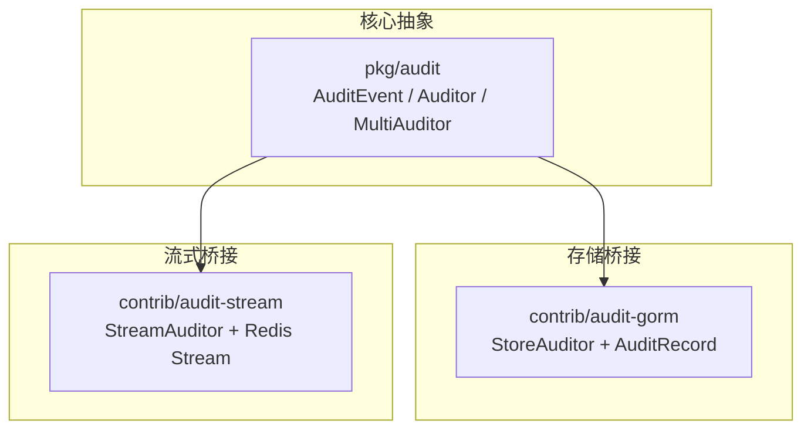
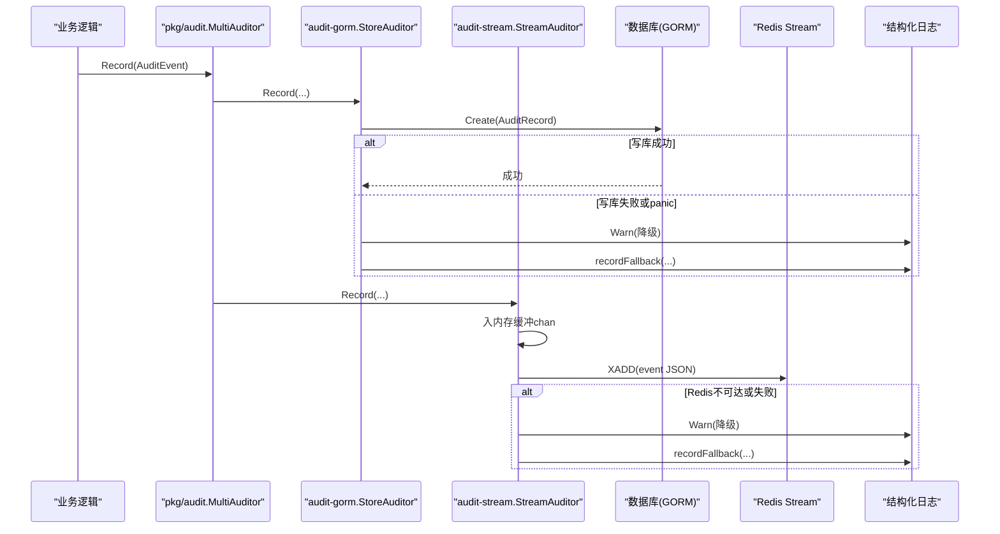
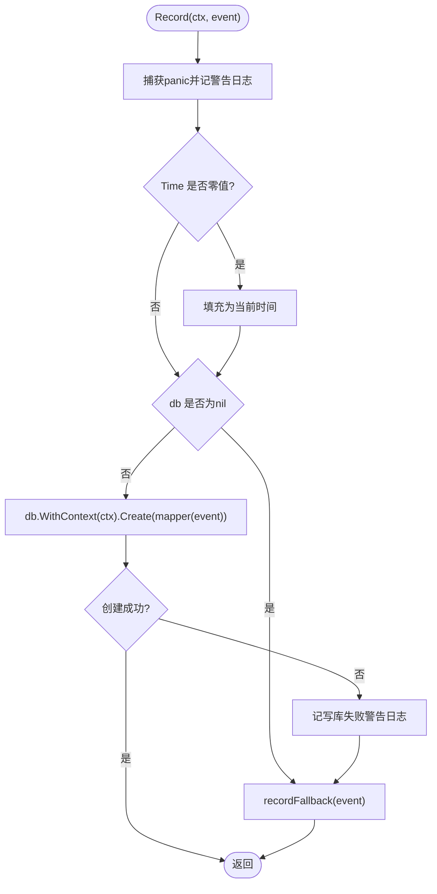
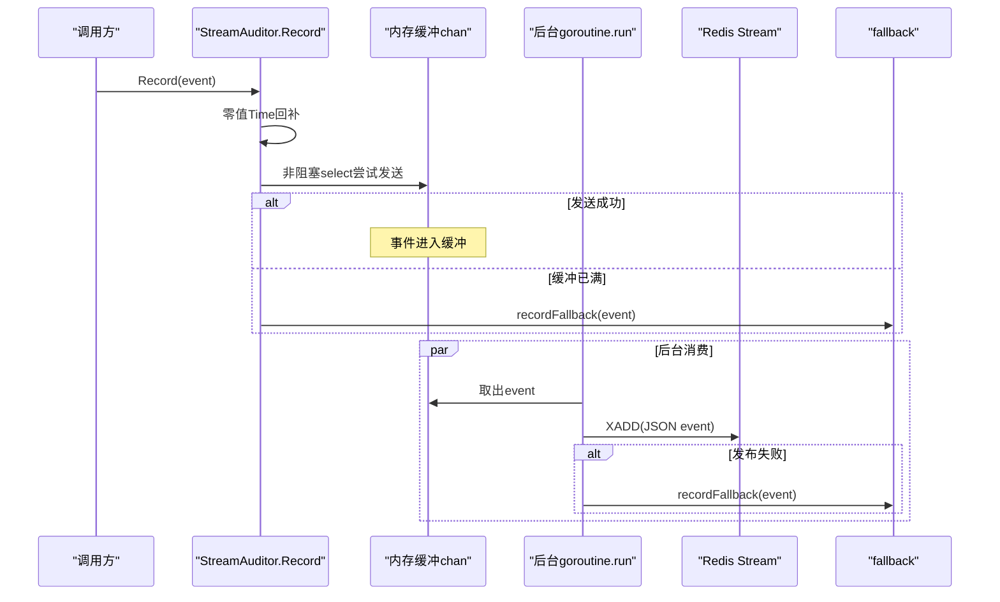
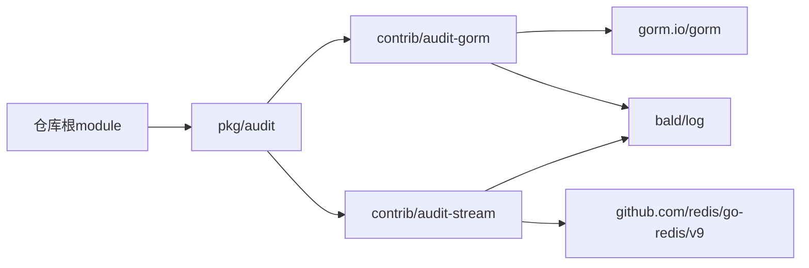

# 审计日志扩展包

<cite>
**本文引用的文件**   
- [store.go](file://contrib/audit-gorm/store.go)
- [store_test.go](file://contrib/audit-gorm/store_test.go)
- [go.mod（audit-gorm）](file://contrib/audit-gorm/go.mod)
- [stream.go](file://contrib/audit-stream/stream.go)
- [stream_test.go](file://contrib/audit-stream/stream_test.go)
- [go.mod（audit-stream）](file://contrib/audit-stream/go.mod)
- [audit.go](file://pkg/audit/audit.go)
- [logger.go](file://pkg/audit/logger.go)
- [compose.go](file://pkg/audit/compose.go)
- [multi.go](file://pkg/audit/multi.go)
</cite>

## 目录
1. [引言](#引言)
2. [项目结构](#项目结构)
3. [核心组件](#核心组件)
4. [架构总览](#架构总览)
5. [详细组件分析](#详细组件分析)
6. [依赖关系分析](#依赖关系分析)
7. [性能与背压特性](#性能与背压特性)
8. [生产最佳实践](#生产最佳实践)
9. [故障排查指南](#故障排查指南)
10. [结论](#结论)

## 引言
本仓库包含 Bald 框架的审计扩展能力。`pkg/audit` 定义统一的审计抽象与广播机制；`contrib/audit-gorm` 把审计事件持久化到 GORM 表；`contrib/audit-stream` 通过 Redis Stream 做异步流式输出。两者都遵循“审计旁路不阻断业务”的设计原则：写入失败、降级或 panic 不会向调用方返回错误，而是降级到 fallback（默认结构化日志）。

需要特别说明的是：当前实现并未提供批量写入优化、数据脱敏、合规归档等高级能力。文档中涉及这些主题的部分仅给出基于现有结构的建议，不宣称已内置。

## 项目结构
审计相关代码分布在两个 contrib 子模块和 core audit 包中：

**图示来源**
- [audit.go:1-83](file://pkg/audit/audit.go#L1-L83)
- [store.go:1-145](file://contrib/audit-gorm/store.go#L1-L145)
- [stream.go:1-177](file://contrib/audit-stream/stream.go#L1-L177)

### 模块边界
- `pkg/audit` 是纯抽象层，不依赖数据库或消息中间件。
- `contrib/audit-gorm` 依赖 `gorm.io/gorm` 与 `bald/log`，实现 `audit.Auditor`。
- `contrib/audit-stream` 依赖 `redis/go-redis/v9` 与 `bald/log`，同样实现 `audit.Auditor`。
- 两个 contrib 模块通过相对 replace 组合进主仓库可编译闭包，但根 module 不得依赖适配器（避免模块环），审计装配由上层按声明构造。

**章节来源**
- [go.mod（audit-gorm）:1-10](file://contrib/audit-gorm/go.mod#L1-L10)
- [go.mod（audit-stream）:1-10](file://contrib/audit-stream/go.mod#L1-L10)
- [compose.go:1-106](file://pkg/audit/compose.go#L1-L106)

## 核心组件
本节先说明审计抽象，再分别解释两个实现。

### 审计事件与接口
`AuditEvent` 是扁平的结构化记录，包含主体、租户、资源、动作、结果、错误描述与任意元数据。`Auditor` 只暴露一个 `Record(ctx, event)` 方法。`MultiAuditor` 按构造顺序广播事件；`Compose` 支持多后端惰性构造、重复名检测与逆序清理。

关键语义：
- `Result` 分为 allow、deny、error。
- `TenantID` 空串表示“无法确定归属租户”，不是平台级事件，落库不应丢弃。
- `Time` 缺省时由实现兜底为记录时刻，避免零值时间污染。
- `Record` 必须非阻塞或快速失败，不得向上游抛错。

**章节来源**
- [audit.go:25-83](file://pkg/audit/audit.go#L25-L83)
- [multi.go:1-36](file://pkg/audit/multi.go#L1-L36)
- [compose.go:20-106](file://pkg/audit/compose.go#L20-L106)

### 默认日志审计器
`LoggerAuditor` 是最小真实实现：按 result 分 info/error 级别输出固定字段，再把 Meta 键值追加。它没有外部 I/O 错误，因此本身不需要重试或降级。

**章节来源**
- [logger.go:1-45](file://pkg/audit/logger.go#L1-L45)

## 架构总览
审计链路采用“抽象 + 桥接 + 广播”模式：

**图示来源**
- [store.go:78-145](file://contrib/audit-gorm/store.go#L78-L145)
- [stream.go:72-177](file://contrib/audit-stream/stream.go#L72-L177)
- [multi.go:23-36](file://pkg/audit/multi.go#L23-L36)

## 详细组件分析

### GORM 审计持久化：`contrib/audit-gorm`

#### 设计目标
- 把 `AuditEvent` 转换成 GORM 模型并写入数据库。
- 写库失败或 panic 时降级到 fallback（默认结构化日志），绝不向上游报错。
- 表结构通过 `DefaultModel()` 提供默认模型，也允许 `WithRecordMapper` 自定义映射。
- 审计表全量记录，不走读隔离；`TenantID` 仅作为列存储，由查询方过滤。

#### 数据模型
默认表模型 `AuditRecord` 包含以下字段：
- 自增主键 ID。
- 索引字段：`TenantID`、`Time`、`Category`。
- 业务字段：`Subject`、`Object`、`Action`、`Result`、`Error`。
- 扩展字段：从 `Meta` 提取 `category`、`client_ip`、`user_agent`、`request_id`、`trace_id`。

| 字段 | 类型 | 索引 | 默认值/来源 | 说明 |
|---|---|---:|---|---|
| ID | uint | 否 | 自增 | 主键 |
| TenantID | string | 是 | `AuditEvent.TenantID` | 租户标识 |
| Time | int64 | 是 | UnixNano | 事件时间 |
| Subject | string | 否 | `AuditEvent.Subject` | 操作主体 |
| Object | string | 否 | `AuditEvent.Object` | 资源对象 |
| Action | string | 否 | `AuditEvent.Action` | 操作动作 |
| Result | string | 否 | `AuditEvent.Result` 字符串化 | allow/deny/error |
| Error | string | 否 | `AuditEvent.Error` | 错误详情 |
| Category | string | 是 | Meta.category，缺省 operation | 分类 |
| IPAddress | string | 否 | Meta.client_ip | 客户端 IP |
| UserAgent | string | 否 | Meta.user_agent | 用户代理 |
| RequestID | string | 否 | Meta.request_id | 请求 ID |
| TraceID | string | 否 | Meta.trace_id | W3C 链路 ID |

#### 构造与配置
- `New(db, opts...)`：db 为 nil 时全部走 fallback；表迁移由业务负责，通常调用 `AutoMigrate(DefaultModel())`。
- `WithRecordMapper(fn)`：替换默认事件到记录的转换函数，返回值直接传给 `gorm.Create`。
- `WithFallback(a)`：设置写库失败时的备用审计器；传 `audit.NopAuditor()` 关闭降级。

#### 写入流程

**图示来源**
- [store.go:78-145](file://contrib/audit-gorm/store.go#L78-L145)

#### 变更捕获与批量写入
当前 `Record` 每次调用直接执行一次 `Create`，没有批处理聚合、没有延迟合并、没有内存队列。因此：
- **不支持批量写入优化。**
- 高吞吐场景下，每个审计事件都会产生一次独立写库调用。
- 若需批量写入，应在调用方封装批量处理器，或在 mapper 层配合应用自身的批写策略，而不是假设该包已内置。

#### 错误处理与降级
- 捕获 panic，记警告日志后继续。
- db 为 nil 时直接 fallback。
- `Create` 出错时记警告日志并 fallback。
- fallback 为 nil 时静默丢弃。

#### 测试契约
测试覆盖的关键契约包括：
- 全字段落库，包括 Meta 提取的扩展列。
- Time 零值回补为邻近 now 的 UnixNano。
- Meta 缺键时 Category 默认 operation，其余为空。
- 连接关闭后降级 fallback。
- nil db 全部走 fallback。
- 自定义 RecordMapper 生效。
- DefaultModel 可直接迁移。

**章节来源**
- [store.go:1-145](file://contrib/audit-gorm/store.go#L1-L145)
- [store_test.go:1-198](file://contrib/audit-gorm/store_test.go#L1-L198)

### 流式审计日志：`contrib/audit-stream`

#### 设计目标
- 把 `AuditEvent` 以 JSON 形式发布到 Redis Stream。
- 使用内存缓冲 chan 做异步解耦，保证请求链路不被阻塞。
- 缓冲满或发布失败时降级到 fallback。
- Close 停止后台 goroutine 并 drain 剩余缓冲，不丢弃已入队事件。
- New 返回 nil 时调用方可跳过装配，与 go-bald-admin 同语义。

#### 配置项
| 选项 | 默认值 | 含义 |
|---|---:|---|
| WithStream(name) | `"audit.events"` | Redis Stream 名称 |
| WithBuffer(n) | 1024 | 内存缓冲大小；<=0 时回退到 1024 |
| WithFallback(a) | LoggerAuditor | 降级后端；传 NopAuditor() 关闭降级 |

#### 数据结构
`StreamAuditor` 内部持有：
- Redis 客户端。
- Stream 名称。
- fallback 审计器。
- 带缓冲的 chan。
- stop channel。
- sync.Once 防止重复 close。
- WaitGroup 等待后台 goroutine 退出。

#### 异步处理与背压控制

**图示来源**
- [stream.go:72-177](file://contrib/audit-stream/stream.go#L72-L177)

#### 生命周期
- `New(rdb, opts...)`：rdb 为 nil 返回 nil；否则启动后台 goroutine。
- `Close()`：关闭 stop channel，WaitGroup 等待 worker 退出，然后 drain 剩余 chan；幂等。
- 适配 `appkit.ComponentFunc` 的 dispose 签名，便于纳入组件生命周期。

#### 错误处理与重试策略
当前实现没有指数退避、重试计数、死信队列等重试机制：
- Redis 发布失败记警告日志并 fallback。
- 缓冲满时直接 fallback。
- Close 期间仍尝试 publish，失败同样 fallback。
- 因此，严格来说：**没有显式重试策略**。

#### 测试契约
- 事件经后台 XADD 发布到 stream，载荷为 JSON。
- Time 零值回补，JSON 中不再出现零时间。
- 缓冲满时 fallback。
- Close flushes buffer，不丢已入队事件。
- Close 幂等。
- Redis 不可达时 fallback。
- New(nil) 返回 nil。
- WithBuffer(0) 不会让 stream 静默失效，因为 New 对 <=0 缓冲做了默认值兜底。

**章节来源**
- [stream.go:1-177](file://contrib/audit-stream/stream.go#L1-L177)
- [stream_test.go:1-229](file://contrib/audit-stream/stream_test.go#L1-L229)

### 审计组装与广播
`pkg/audit/compose.go` 提供声明式多后端组装：
- 按声明顺序构造各后端，顺序即广播顺序。
- 重复后端名返回 `ComposeError`。
- 任一后端构造失败时逆序清理已构造单元。
- 单后端直接返回实例；多后端用 `MultiAuditor` 合并。
- cleanup 聚合为逆序回放，使用 `errors.Join` 汇总错误。

`pkg/audit/multi.go` 中的 `MultiAuditor` 按列表顺序遍历非 nil 成员并依次调用 `Record`。单个成员 panic 不在本层 recover，由调用方统一兜底。

**章节来源**
- [compose.go:1-106](file://pkg/audit/compose.go#L1-L106)
- [multi.go:1-36](file://pkg/audit/multi.go#L1-L36)

## 依赖关系分析
两个审计扩展包都依赖 `bald/pkg/audit` 抽象，并通过相对 replace 指向仓库根。

**图示来源**
- [go.mod（audit-gorm）:1-10](file://contrib/audit-gorm/go.mod#L1-L10)
- [go.mod（audit-stream）:1-10](file://contrib/audit-stream/go.mod#L1-L10)
- [audit.go:1-24](file://pkg/audit/audit.go#L1-L24)

### 耦合与内聚
- 高内聚：每个后端实现只关注自身持久化方式。
- 低耦合：对外只暴露 `audit.Auditor` 接口。
- 风险点：两个实现都把 `AuditEvent` 直接序列化或映射，未对敏感字段做脱敏；Meta 内容完全由上游决定。

**章节来源**
- [store.go:1-24](file://contrib/audit-gorm/store.go#L1-L24)
- [stream.go:1-24](file://contrib/audit-stream/stream.go#L1-L24)
- [audit.go:1-24](file://pkg/audit/audit.go#L1-L24)

## 性能与背压特性

### 吞吐量与延迟
- `StoreAuditor.Record` 同步写库，延迟取决于数据库响应；无批处理。
- `StreamAuditor.Record` 非阻塞入队，请求侧延迟接近 O(1)，但存在后台发布延迟。
- 多后端广播会串行调用各后端，增加总体广播耗时。

### 背压与限流
- `audit-gorm`：无内存缓冲，不存在缓冲型背压；主要压力在数据库端。
- `audit-stream`：使用有界 chan 作为缓冲，达到容量时 Record 直接 fallback，属于“拒绝即降级”的背压策略，而非排队限速。
- 两者都没有全局限流器、采样率、采样哈希等节流能力。

### 资源占用
- `StreamAuditor` 会为每个待发布事件分配 Go 对象并在 chan 中暂存。
- `StoreAuditor` 主要占用数据库连接池与事务资源。
- 两个实现都通过 fallback 降低极端情况下的数据丢失风险，但 fallback 本身也可能成为瓶颈。

[本节为通用性能讨论，不直接分析具体代码片段]

## 生产最佳实践

### 审计日志设计模式
- 使用 `AuditEvent` 三元组 subject/object/action 表达“谁对什么资源做了什么”。
- 利用 Meta 携带 request_id、trace_id、client_ip、user_agent 等上下文。
- 通过 `MultiAuditor` 同时落地多个后端，例如既落库又发流。
- 使用 `Compose` 声明后端列表，避免运行时拼装混乱。

### 与业务操作关联
- 在认证拦截器中注入 subject、tenant_id、trace_id、request_id。
- 在权限校验失败时记录 deny，在 handler 异常时记录 error。
- 在 ORM 或领域层埋点记录数据访问审计。
- 对于协调器或定时任务，注意 TenantID 可能为空，应保留而非丢弃。

### 合规性要求
当前实现未内置合规开关：
- 没有审计开关、采样率、保留期、脱敏规则。
- 没有字段白名单或黑名单。
- 没有审计数据导出、归档、销毁策略。
- 如果合规要求“禁止记录密码、身份证号、手机号等”，必须在上游构造 `AuditEvent` 前脱敏，或在 mapper 层过滤。

### 数据脱敏
推荐做法：
- 在审计事件构造处集中脱敏，不要依赖下游实现自行判断。
- 对 Meta 中可能携带的请求体、响应体进行二次清洗。
- 对 `Error` 字段做敏感信息检查，避免堆栈泄露密钥。
- 若使用 `WithRecordMapper`，可在 mapper 中统一抹除敏感字段。

### 日志归档
当前包不提供归档：
- `audit-gorm` 只负责写库，不负责分区、冷热分离、TTL 或归档。
- `audit-stream` 只负责发布，不负责消费者侧归档。
- 归档应由数据库运维策略、CDC、ETL 或专用归档服务完成。

### 安全与可观测性
- 审计失败应通过 fallback 结构化日志暴露，便于监控告警。
- 建议对 fallback 输出接入统一日志采集系统。
- 建议在业务指标中统计审计降级次数，识别 Redis 或数据库不稳定。

[本节为通用生产建议，不直接分析具体代码片段]

## 故障排查指南

### 审计事件没有落库
可能原因：
- 未调用 `AutoMigrate(DefaultModel())` 建表。
- db 传入 nil，导致全部走 fallback。
- 写库失败且 fallback 被关闭或未接入采集。
- 使用了自定义 RecordMapper 但目标表未迁移。

排查步骤：
1. 确认数据库连接非 nil。
2. 确认已迁移默认模型或自定义模型。
3. 检查 fallback 是否接入结构化日志。
4. 若使用 mapper，确认 mapper 返回的模型指针对应已迁移表。

**章节来源**
- [store.go:64-76](file://contrib/audit-gorm/store.go#L64-L76)
- [store.go:96-145](file://contrib/audit-gorm/store.go#L96-L145)
- [store_test.go:15-44](file://contrib/audit-gorm/store_test.go#L15-L44)

### Redis Stream 没有事件
可能原因：
- rdb 传入 nil，New 返回 nil，调用方跳过装配。
- 缓冲太小，Record 频繁 fallback。
- Redis 不可达，发布失败 fallback。
- 进程关闭但未调用 Close，导致部分事件仍在缓冲中。

排查步骤：
1. 确认 New 返回值非 nil。
2. 调整 WithBuffer 大小。
3. 检查 Redis 连通性与权限。
4. 确保组件生命周期中调用 Close。
5. 检查 fallback 是否收到事件。

**章节来源**
- [stream.go:58-71](file://contrib/audit-stream/stream.go#L58-L71)
- [stream.go:120-177](file://contrib/audit-stream/stream.go#L120-L177)
- [stream_test.go:120-199](file://contrib/audit-stream/stream_test.go#L120-L199)

### 审计降级过多
说明后端不稳定或流量突增：
- audit-gorm：数据库慢、连接池耗尽、写锁竞争。
- audit-stream：Redis 慢、网络抖动、缓冲不足。
- 多后端：某个后端特别慢导致广播整体变慢。

建议：
- 监控 fallback 日志数量。
- 对数据库与 Redis 做健康检查与告警。
- 合理调大 redis stream 缓冲。
- 考虑对审计事件采样或分流。

**章节来源**
- [store.go:96-118](file://contrib/audit-gorm/store.go#L96-L118)
- [stream.go:120-177](file://contrib/audit-stream/stream.go#L120-L177)
- [multi.go:23-36](file://pkg/audit/multi.go#L23-L36)

### 审计时间出现零值
虽然实现会对零值 Time 回补为当前时间，但若观察到异常，请检查：
- 是否在 Record 之前修改了事件 Time。
- 是否绕过 auditor 直接序列化事件。
- 是否自定义 mapper 覆盖了时间字段。

**章节来源**
- [store.go:96-104](file://contrib/audit-gorm/store.go#L96-L104)
- [stream.go:136-144](file://contrib/audit-stream/stream.go#L136-L144)
- [store_test.go:89-114](file://contrib/audit-gorm/store_test.go#L89-L114)
- [stream_test.go:80-118](file://contrib/audit-stream/stream_test.go#L80-L118)

## 结论
`contrib/audit-gorm` 与 `contrib/audit-stream` 提供了 Bald 审计系统的两种典型后端：结构化持久化与异步流式输出。两者共享 `pkg/audit` 的抽象与广播语义，并通过 fallback 保障“审计旁路不阻断业务”的生产纪律。

它们的明确边界是：
- 支持事件持久化与异步发布。
- 支持多后端广播与声明式组装。
- 支持 fallback 降级。
- 支持零值时间回补与基础 Meta 提取。

它们明确不支持：
- 批量写入优化。
- 显式重试策略。
- 数据脱敏。
- 审计归档与保留策略。
- 审计采样与限流。

生产环境应把这些缺失能力放在上游 mapper、业务埋点层或外部归档系统中补齐，并配合监控与告警观察 fallback 行为。

[本节为总结性内容，不直接分析具体代码片段]