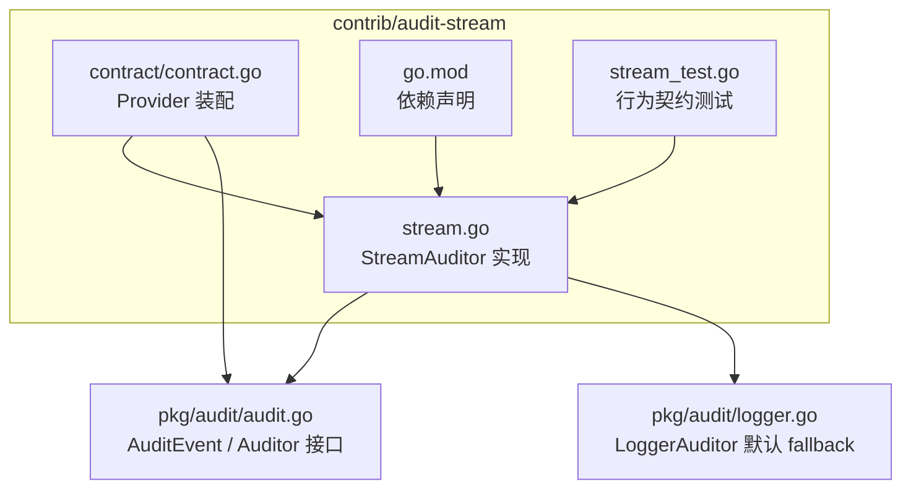
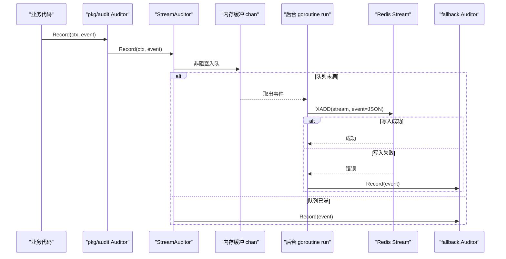
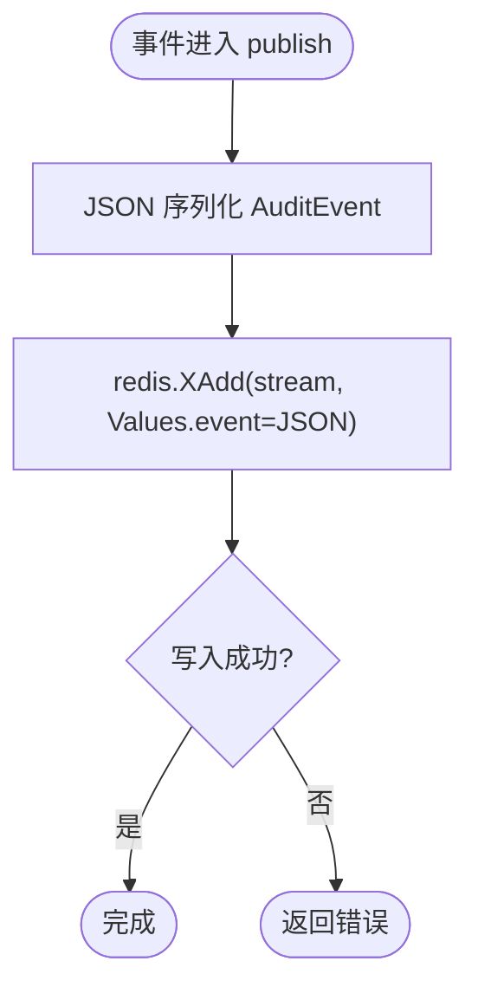
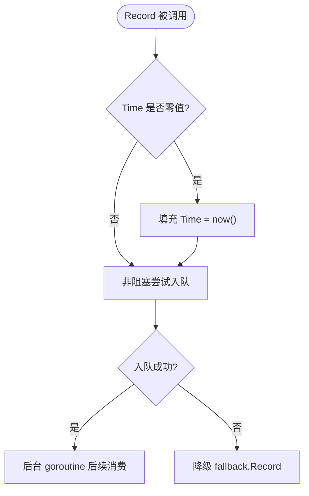
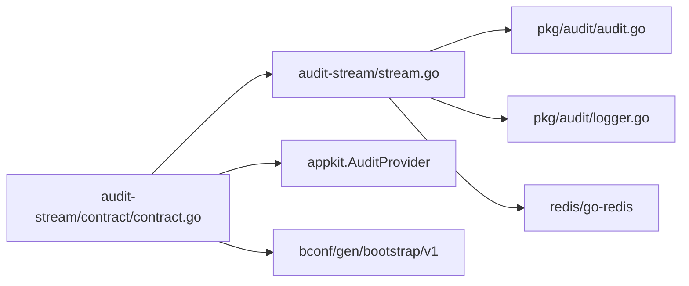

# 流式审计日志输出包

<cite>
**本文引用的文件**
- [contrib/audit-stream/stream.go](file://contrib/audit-stream/stream.go)
- [contrib/audit-stream/stream_test.go](file://contrib/audit-stream/stream_test.go)
- [contrib/audit-stream/go.mod](file://contrib/audit-stream/go.mod)
- [contrib/audit-stream/contract/contract.go](file://contrib/audit-stream/contract/contract.go)
- [pkg/audit/audit.go](file://pkg/audit/audit.go)
- [pkg/audit/logger.go](file://pkg/audit/logger.go)
</cite>

## 目录
1. [简介](#简介)
2. [项目结构](#项目结构)
3. [核心组件](#核心组件)
4. [架构总览](#架构总览)
5. [详细组件分析](#详细组件分析)
6. [依赖关系分析](#依赖关系分析)
7. [性能与背压特性](#性能与背压特性)
8. [使用示例](#使用示例)
9. [故障恢复与一致性](#故障恢复与一致性)
10. [生产部署建议](#生产部署建议)
11. [常见问题排查](#常见问题排查)
12. [结论](#结论)

## 简介
`contrib/audit-stream` 是 bald 生态中的流式审计日志桥接子模块，把 `pkg/audit` 的审计事件异步发布到 Redis Stream。它遵循“审计旁路不阻断业务”的设计原则：`Record` 仅做非阻塞入队，后台 goroutine 负责序列化并通过 `XADD` 写入；当 Redis 不可达或内存缓冲满时，事件自动降级到可配置的 fallback（默认结构化日志），确保请求链路不被阻塞、审计事件不丢失。

该包同时提供契约装配层，将 `bconf` 的 `audit.stream` 配置映射为 `appkit.AuditProvider`，并与框架的审计注册表、生命周期管理对接。

## 项目结构


**图表来源**
- [contrib/audit-stream/stream.go:1-177](file://contrib/audit-stream/stream.go#L1-L177)
- [contrib/audit-stream/contract/contract.go:1-54](file://contrib/audit-stream/contract/contract.go#L1-L54)
- [pkg/audit/audit.go:1-83](file://pkg/audit/audit.go#L1-L83)
- [pkg/audit/logger.go:1-45](file://pkg/audit/logger.go#L1-L45)
- [contrib/audit-stream/go.mod:1-20](file://contrib/audit-stream/go.mod#L1-L20)

**章节来源**
- [contrib/audit-stream/stream.go:1-40](file://contrib/audit-stream/stream.go#L1-L40)
- [contrib/audit-stream/contract/contract.go:1-20](file://contrib/audit-stream/contract/contract.go#L1-L20)
- [contrib/audit-stream/go.mod:1-10](file://contrib/audit-stream/go.mod#L1-L10)

## 核心组件
- **StreamAuditor**：实现 `pkg/audit.Auditor`，持有 Redis 客户端、Stream 名称、fallback、带缓冲通道 `ch`、停止信号 `stop`、等待组 `wg` 和一次型关闭锁。
- **后台发布器 run**：从 `ch` 消费事件，调用 `publish` 执行 `XADD`；失败时记录警告并调用 `recordFallback`。
- **publish**：将 `AuditEvent` JSON 序列化后通过 `redis.UniversalClient.XAdd` 写入指定 stream，字段名为 `event`。
- **Record**：零值时间兜底为当前时间，非阻塞尝试入队；缓冲满时直接走 fallback。
- **Close**：关闭 stop 通道，等待后台 goroutine 退出，然后 drain 剩余缓冲；已入队事件不会丢弃，失败同样降级 fallback。
- **NewStreamProvider**：契约装配函数，把 `bootstrapv1.Audit` 下的 `stream.stream`、`stream.buffer` 参数传给 `auditstream.New`，并以 `StreamAuditor.Close` 作为清理回调。

**章节来源**
- [contrib/audit-stream/stream.go:41-177](file://contrib/audit-stream/stream.go#L41-L177)
- [contrib/audit-stream/contract/contract.go:21-54](file://contrib/audit-stream/contract/contract.go#L21-L54)

## 架构总览


**图表来源**
- [contrib/audit-stream/stream.go:94-177](file://contrib/audit-stream/stream.go#L94-L177)

## 详细组件分析

### StreamAuditor 状态与并发模型
- **缓冲通道**：容量由 `WithBuffer` 决定，缺省 1024；若传入值 ≤ 0，构造时回退为 1024，避免“配置存在但静默失效”。
- **后台 goroutine**：构造时启动一个 `run()`；`Close` 通过 `sync.Once` 保证幂等关闭，并用 `sync.WaitGroup` 等待其退出。
- **安全兜底**：`Record` 包裹 panic 捕获，防止上游埋点异常污染业务堆栈。
- **Time 语义**：`AuditEvent.Time` 为零值时填充为记录时刻，避免流载荷出现零时间戳。

```mermaid
classDiagram
    class StreamAuditor {
        -rdb redis.UniversalClient
        -stream string
        -fallback audit.Auditor
        -ch chan audit.AuditEvent
        -stop chan struct{}
        -closeOnce sync.Once
        -wg sync.WaitGroup
        +Record(ctx, event) void
        +Close() error
        -run() void
        -publish(ctx, event) error
        -recordFallback(ctx, event) void
    }

    class Auditor {
        <<interface>>
        +Record(ctx, event) void
    }

    StreamAuditor ..|> Auditor : "实现"
```

**图表来源**
- [contrib/audit-stream/stream.go:57-177](file://contrib/audit-stream/stream.go#L57-L177)
- [pkg/audit/audit.go:64-83](file://pkg/audit/audit.go#L64-L83)

**章节来源**
- [contrib/audit-stream/stream.go:57-177](file://contrib/audit-stream/stream.go#L57-L177)

### 消息队列集成与数据格式
- **传输介质**：Redis Stream，通过 `redis/go-redis/v9` 的 `UniversalClient.XAdd` 写入。
- **Stream 名称**：缺省 `audit.events`，可通过 `WithStream` 覆盖。
- **消息负载**：`XAddArgs.Values` 中唯一键 `event` 存放 `json.Marshal(AuditEvent)` 的结果；下游 consumer group 消费后反序列化为 `AuditEvent`。
- **ID 分配**：使用 Redis 自增 ID（`*`），由 Redis 保障单调递增。



**图表来源**
- [contrib/audit-stream/stream.go:119-133](file://contrib/audit-stream/stream.go#L119-L133)

**章节来源**
- [contrib/audit-stream/stream.go:119-133](file://contrib/audit-stream/stream.go#L119-L133)

### 背压控制策略
- **入队策略**：`select` 非阻塞写入缓冲通道；无缓冲空间时立即降级 fallback，不阻塞调用方。
- **关闭阶段 Drain**：`Close` 关闭后台 goroutine 后继续 drain 缓冲，再次尝试 `publish`，失败则 fallback。
- **设计权衡**：背压表现为“拒绝写入 Redis → 降级 fallback”，而非“阻塞上游业务线程”。这是一种有损优先级的侧路保护：主路径可用性高于流式持久化。



**图表来源**
- [contrib/audit-stream/stream.go:135-156](file://contrib/audit-stream/stream.go#L135-L156)

**章节来源**
- [contrib/audit-stream/stream.go:135-156](file://contrib/audit-stream/stream.go#L135-L156)

### 错误重试机制
- **单条失败降级**：`run` 中 `publish` 失败只记录警告并调用 fallback，不做指数退避或重放。
- **关闭期重试**：drain 会再次尝试 `publish`，仍失败则 fallback。
- **无持久化重放队列**：本包不在进程内维护独立持久队列；可靠性主要依赖 Redis Stream 本身和下游消费者。

因此，重试语义是“尽力重试一次（关闭阶段）+ 降级”，不是完整的重试队列。

**章节来源**
- [contrib/audit-stream/stream.go:100-117](file://contrib/audit-stream/stream.go#L100-L117)
- [contrib/audit-stream/stream.go:158-171](file://contrib/audit-stream/stream.go#L158-L171)

### 并发安全保证
- **通道安全**：所有写入通过 Go channel；`Close` 先关 stop 再 wait，避免与后台 goroutine 竞态。
- **幂等关闭**：`sync.Once` 防止重复 close 导致 panic。
- **panic 防护**：`Record` 内部 recover，避免审计埋点异常影响业务。
- **测试契约**：
  - 正常发布到 Redis Stream。
  - 零值 Time 回填为接近 now 的时间。
  - 缓冲满时 fallback 正确触发。
  - Close 能 flush 缓冲且事件不丢。
  - 重复 Close 不 panic。
  - Redis 不可达时 fallback 生效。
  - `New(nil)` 返回 nil。
  - `WithBuffer(0)` 不静默失效，仍走默认 1024。

**章节来源**
- [contrib/audit-stream/stream_test.go:21-229](file://contrib/audit-stream/stream_test.go#L21-L229)

## 依赖关系分析


**图表来源**
- [contrib/audit-stream/stream.go:1-40](file://contrib/audit-stream/stream.go#L1-L40)
- [contrib/audit-stream/contract/contract.go:1-20](file://contrib/audit-stream/contract/contract.go#L1-L20)
- [contrib/audit-stream/go.mod:1-18](file://contrib/audit-stream/go.mod#L1-L18)

**章节来源**
- [contrib/audit-stream/go.mod:1-18](file://contrib/audit-stream/go.mod#L1-L18)
- [contrib/audit-stream/contract/contract.go:1-20](file://contrib/audit-stream/contract/contract.go#L1-L20)

## 性能与背压特性
- **异步解耦**：`Record` 仅做内存入队，主线程开销极小。
- **内存缓冲**：默认 1024，可自定义；适合突发写入场景，避免每次落 Redis 的网络抖动放大。
- **背压表现**：高吞吐下 Redis 延迟或宕机会导致缓冲满，进而走 fallback；这是有意设计的“可用性优先”策略。
- **序列化成本**：每条事件 JSON 序列化一次，发生在后台 goroutine，不影响业务线程。
- **与传统持久化对比**：
  - 直写数据库：同步 I/O、强一致但可能阻塞请求；适合对一致性要求极高且 QPS 较低的场景。
  - 流式 Redis Stream：异步、削峰、容错更好，适合高并发审计旁路；最终一致性，需配合下游消费者处理顺序与重放。
  - 日志后端：最简单、零外部依赖，但缺少跨进程/跨实例共享能力。

[本节为通用性能讨论，不直接分析具体代码行]

## 使用示例

### 基础用法：直接构造 StreamAuditor
适用场景：应用自行管理 Redis 客户端，希望最小化装配复杂度。

步骤：
1. 创建 `redis.UniversalClient`。
2. 调用 `auditstream.New(rdb, ...Option...)`。
3. 在需要记录审计的地方注入并使用 `pkg/audit.Auditor`。
4. 在应用关闭流程调用 `Close()`。

关键选项：
- `WithStream(name)`：设置 Redis Stream 名，缺省 `audit.events`。
- `WithBuffer(n)`：设置内存缓冲大小，缺省 1024；≤ 0 时回退为 1024。
- `WithFallback(a)`：设置降级 Auditor，缺省 `audit.NewLoggerAuditor()`；传 `audit.NopAuditor()` 可关闭降级。

参考实现位置：
- [构造与选项](file://contrib/audit-stream/stream.go:41-93)
- [Record 非阻塞入队](file://contrib/audit-stream/stream.go:135-156)
- [Close 幂等关闭与 drain](file://contrib/audit-stream/stream.go:158-171)

### 配置驱动装配：通过 bconf 启用 stream 后端
适用场景：在生产环境中通过配置启用流式审计，并与其他审计后端组合。

步骤：
1. 准备 `redis.UniversalClient` 实例。
2. 使用 `contract.NewStreamProvider(rdb)` 生成 `appkit.AuditProvider`。
3. 在 `appkit.MustServe` 中将该 Provider 加入 `std.Standard()` 之后的审计 provider 列表，使 `audit.stream` 段生效。
4. 配置项路径为 `audit.stream.stream` 与 `audit.stream.buffer`。

Provider 行为：
- 读取 `cfg.GetStream()` 与 `cfg.GetBuffer()`。
- 若 Redis 客户端为 nil，Build 时报错 fail-fast。
- 清理回调即 `StreamAuditor.Close`，随 appkit 生命周期逆序执行。

参考实现位置：
- [NewStreamProvider 装配逻辑](file://contrib/audit-stream/contract/contract.go:21-54)

### 自定义输出处理器与监控告警
由于 `StreamAuditor` 实现的是 `pkg/audit.Auditor`，你可以：
- 用 `audit.Compose` 组合多个 Auditor，例如同时写入日志、指标、远程服务。
- 自定义 fallback：实现 `AuditEvent` 到 Prometheus metrics、Sentry、告警系统的转换。
- 在下游 Redis Stream consumer 中接入监控：统计 `XLEN`、消费延迟、失败率，并在超过阈值时告警。

注意：
- 本包不内置指标采集；监控应放在调用方或下游消费端。
- fallback 默认是结构化日志，便于接入现有日志平台。

参考实现位置：
- [LoggerAuditor 结构化日志](file://pkg/audit/logger.go:1-45)
- [AuditEvent 定义](file://pkg/audit/audit.go:20-63)

### 流式处理优势场景
- 高并发 API 网关审计：主路径不阻塞，Redis Stream 削峰。
- 多租户审计汇聚：下游按 tenant_id 分流、聚合。
- 离线分析与合规归档：consumer group 批量消费、转存列存或对象存储。
- 可观测性增强：结合 trace_id、request_id 做端到端审计追踪。

[本节为概念说明，不直接分析具体代码行]

## 故障恢复与一致性

### Redis 不可达
- 后台 goroutine 捕获 `publish` 错误，记录警告并降级 fallback。
- 如果 Redis 一直不可达，所有事件将走 fallback；可通过 fallback 的日志或指标发现异常。

参考：
- [run 中失败降级](file://contrib/audit-stream/stream.go:100-117)

### 缓冲溢出
- 当 `ch` 满时，`Record` 直接 fallback，不阻塞上游。
- 调大 `WithBuffer` 可降低溢出概率，但不能消除极端峰值风险。

参考：
- [Record 非阻塞入队与 fallback](file://contrib/audit-stream/stream.go:135-156)

### 优雅停机
- `Close` 先停后台 goroutine，再 drain 缓冲；已入队事件尽量写出，失败则 fallback。
- 幂等关闭防止重复调用引发 panic。

参考：
- [Close 实现](file://contrib/audit-stream/stream.go:158-171)

### 数据一致性边界
- 本包不提供事务性写入或本地持久化队列；一致性边界是“Redis Stream 成功”或“fallback 成功”。
- 下游消费者需自行处理去重、顺序、重放；Redis Stream 的 ID 单调递增有助于消费进度管理。
- `AuditEvent.Time` 零值会被填充为记录时刻，避免流载荷出现零时间。

参考：
- [ZeroTime 回填](file://contrib/audit-stream/stream.go:135-147)
- [XAdd 负载格式](file://contrib/audit-stream/stream.go:119-133)

**章节来源**
- [contrib/audit-stream/stream.go:100-171](file://contrib/audit-stream/stream.go#L100-L171)

## 生产部署建议

### 资源调优参数
- `stream`：建议按环境或租户命名，例如 `audit.events.prod`、`audit.events.tenant-a`。
- `buffer`：根据 QPS 与 Redis P99 延迟估算；一般 1024~8192；过高会增加内存占用。
- fallback：生产建议保留 `LoggerAuditor` 或自定义 fallback，用于 Redis 故障时的兜底审计。

参考：
- [配置选项定义](file://contrib/audit-stream/stream.go:41-56)

### 监控方案
- 应用侧：
  - 监控 fallback 调用次数（可通过自定义 fallback 上报）。
  - 监控 `Close` 耗时，判断 drain 是否正常。
- Redis 侧：
  - 监控目标 Stream 长度 `XLEN`。
  - 监控 Redis CPU、内存、网络延迟。
- 消费侧：
  - 监控 consumer group 消费延迟、失败数、重放次数。
  - 对异常结果 `Result=error` 的事件单独计数与告警。

[本节为通用运维建议，不直接分析具体代码行]

### 日志格式标准化
- 流载荷固定为 `event` 字段的 JSON，包含 `Time`、`Subject`、`TenantID`、`Object`、`Action`、`Result`、`Error`、`Meta`。
- 下游消费时应统一反序列化为 `AuditEvent`，并按租户、对象、动作维度建立索引。
- 对于空 `TenantID`，消费端应按应用策略做兜底（如全局租户或未知租户），不应直接丢弃。

参考：
- [AuditEvent 字段语义](file://pkg/audit/audit.go:20-63)

## 常见问题排查

### 问题：Redis 连接断开后审计未落库
- 现象：Stream 长度不再增长，fallback 日志增多。
- 原因：`publish` 失败后降级 fallback，本包没有本地持久化队列。
- 处理：修复 Redis 连接；检查 fallback 是否开启；确认下游 consumer 是否正常消费历史数据。

参考：
- [Redis 不可达测试](file://contrib/audit-stream/stream_test.go:158-176)

### 问题：配置了 buffer 但 stream 没有事件
- 现象：配置存在，但事件全部走 fallback。
- 原因：若 `buffer` 为 0，会回退为 1024；但若实际业务 QPS 极低且 Redis 正常，应检查是否误配其他 fallback 或下游消费端过滤。
- 验证：查看 fallback 事件数量与 stream 长度。

参考：
- [零缓冲回退默认值测试](file://contrib/audit-stream/stream_test.go:198-229)

### 问题：重复调用 Close 导致 panic
- 现象：多次 shutdown 触发异常。
- 原因：旧实现未保证幂等。
- 现状：当前实现使用 `sync.Once` 保证幂等。

参考：
- [Close 幂等测试](file://contrib/audit-stream/stream_test.go:148-157)

**章节来源**
- [contrib/audit-stream/stream_test.go:148-229](file://contrib/audit-stream/stream_test.go#L148-L229)

## 结论
`contrib/audit-stream` 以 Redis Stream 为异步总线，为 bald 审计子系统提供了高可用、低侵入的流式输出能力。它通过内存缓冲与 fallback 机制实现明确的背压策略，确保业务链路不被审计副作用阻塞；通过 `AuditEvent` 标准结构和 JSON 负载实现下游可扩展的消费生态。生产部署时应重点关注 Redis 可用性、缓冲容量、fallback 可见性以及下游消费端的延迟与重放能力。

[本节为总结性内容，不直接分析具体代码行]