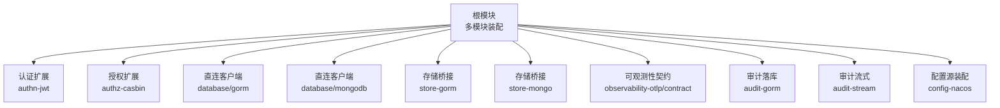
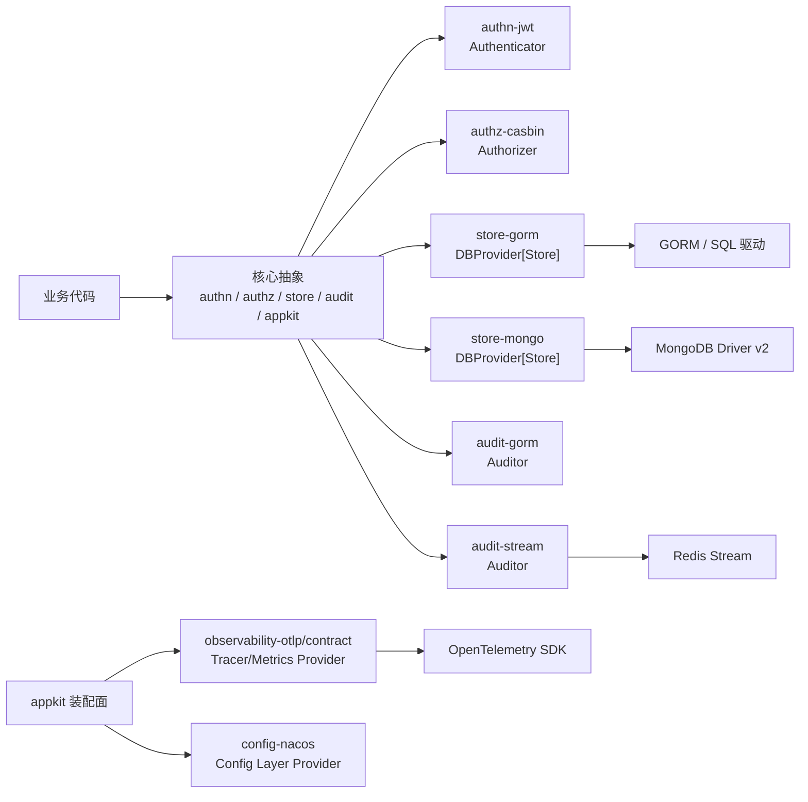
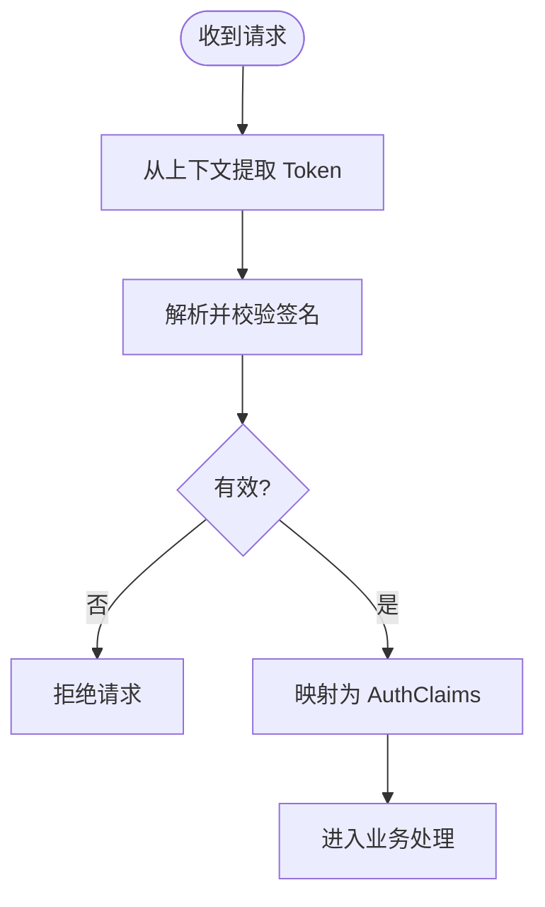
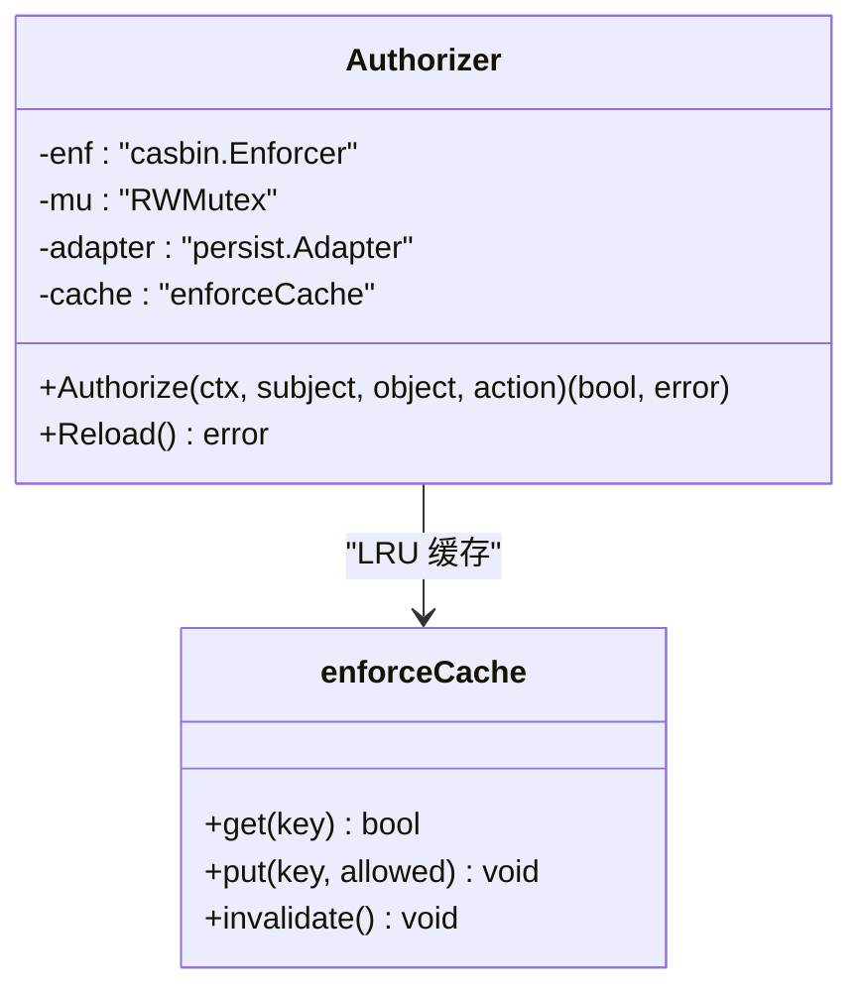
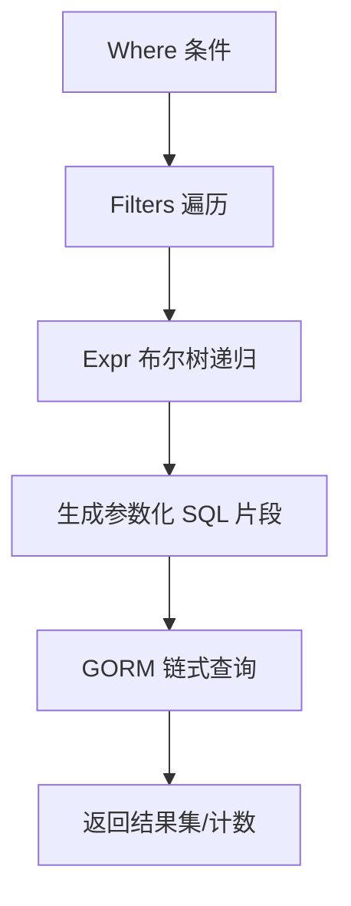
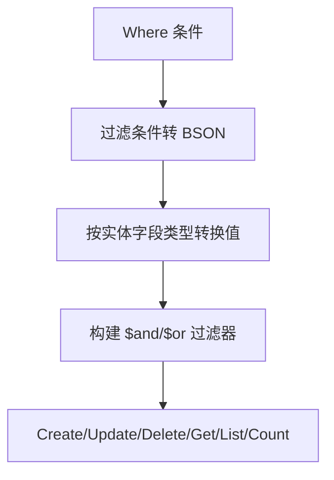
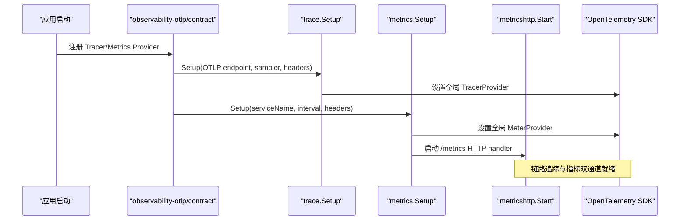
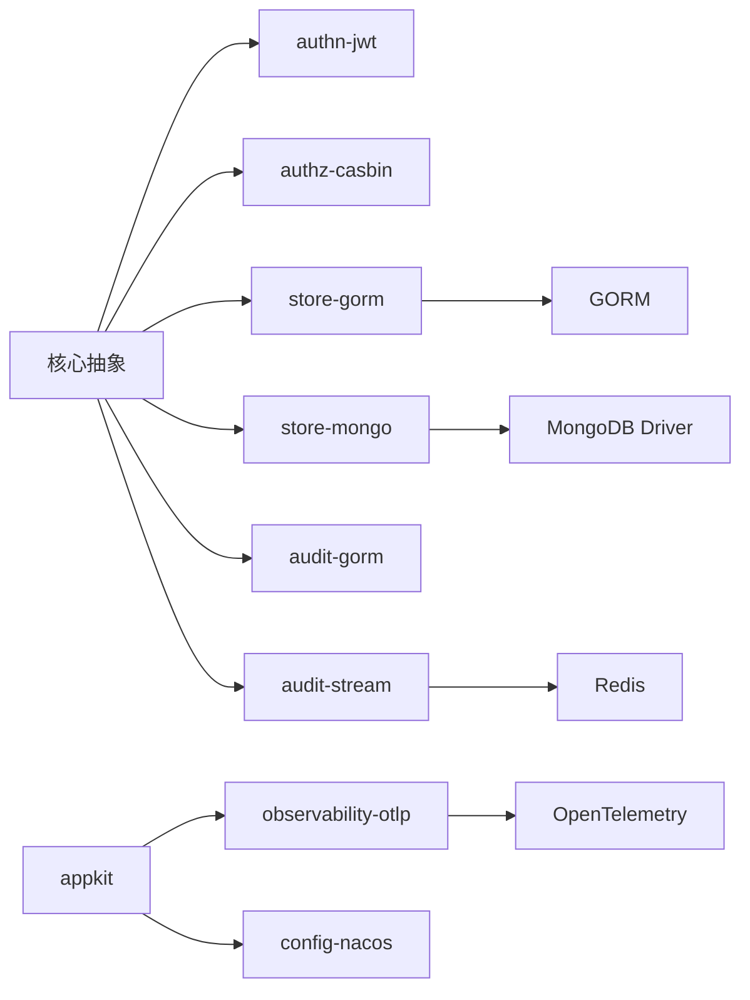
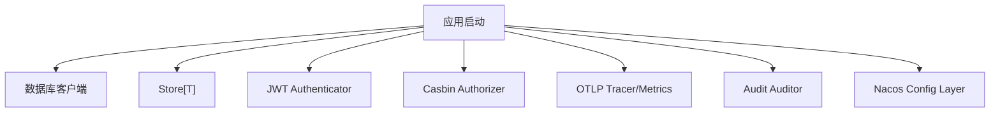

# 扩展包生态

<cite>
**本文引用的文件**   
- [go.mod](file://go.mod)
- [scripts/list-modules.sh](file://scripts/list-modules.sh)
- [.github/workflows/ci.yml](file://.github/workflows/ci.yml)
- [contrib/authn-jwt/jwt.go](file://contrib/authn-jwt/jwt.go)
- [contrib/authz-casbin/casbin.go](file://contrib/authz-casbin/casbin.go)
- [contrib/database/gorm/client.go](file://contrib/database/gorm/client.go)
- [contrib/database/mongodb/client.go](file://contrib/database/mongodb/client.go)
- [contrib/store-gorm/gorm.go](file://contrib/store-gorm/gorm.go)
- [contrib/store-mongo/mongo.go](file://contrib/store-mongo/mongo.go)
- [contrib/observability-otlp/contract/contract.go](file://contrib/observability-otlp/contract/contract.go)
- [contrib/observability-otlp/metrics/metrics.go](file://contrib/observability-otlp/metrics/metrics.go)
- [contrib/observability-otlp/trace/trace.go](file://contrib/observability-otlp/trace/trace.go)
- [contrib/audit-gorm/store.go](file://contrib/audit-gorm/store.go)
- [contrib/audit-stream/stream.go](file://contrib/audit-stream/stream.go)
- [contrib/config-nacos/provider.go](file://contrib/config-nacos/provider.go)
</cite>

## 目录
1. [引言](#引言)
2. [项目结构](#项目结构)
3. [核心组件](#核心组件)
4. [架构总览](#架构总览)
5. [详细组件分析](#详细组件分析)
6. [依赖关系分析](#依赖关系分析)
7. [性能与限制](#性能与限制)
8. [故障排查指南](#故障排查指南)
9. [结论](#结论)
10. [附录：组合集成示例与迁移路径](#附录组合集成示例与迁移路径)

## 引言
本仓库是 93 个 Go module 的多模块工程，`contrib` 目录提供第三方能力扩展。本文聚焦认证授权、数据库访问、可观测性、审计日志和配置中心五类扩展包，说明其初始化流程、配置选项、与 Bald 核心契约的对接方式，并给出选型建议、版本兼容性、迁移路径、性能特征与排障方法。文末附录展示如何在实际业务中组合多个扩展包。

## 项目结构
`contrib` 下的扩展包按职责分目录组织，每个扩展包独立 `go.mod`，通过相对 replace 被根模块拼装；根模块不得直接 require 适配器或后端实现，避免模块环。CI 使用 `scripts/list-modules.sh` 派生模块清单，保证本地与 CI 覆盖一致。



**图示来源**
- [go.mod:1-60](file://go.mod#L1-L60)
- [scripts/list-modules.sh:1-24](file://scripts/list-modules.sh#L1-L24)

**章节来源**
- [go.mod:1-60](file://go.mod#L1-L60)
- [scripts/list-modules.sh:1-24](file://scripts/list-modules.sh#L1-L24)

## 核心组件
本节概览各扩展包在 Bald 体系中的角色：

| 扩展包 | 核心契约 | 作用 | 典型输入 | 关键行为 |
|---|---|---|---|---|
| `authn-jwt` | `pkg/authn.Authenticator` | 签发与校验 Bearer Token | HMAC/RSA/ECDSA 密钥、算法白名单、签发者 | 对称与非对称签名；claims 双向映射；支持 issuer 校验与时钟漂移容忍 |
| `authz-casbin` | `pkg/authz.Authorizer` / `ReloadableAuthorizer` | RBAC 策略判定与运行期重载 | casbin 模型文本、策略 CSV 或自定义 Adapter | 失败关闭；LRU 缓存无错误判定；并发安全 Reload |
| `database/gorm` | bald-crud/gorm Client | SQL 直连客户端包装 | SQL DSN、自动迁移开关等 | 类型别名透传，零契约耦合 |
| `database/mongodb` | bald-crud/mongodb Client | MongoDB 直连客户端包装 | MongoDB URI、连接选项 | 惰性建连，构造不阻塞 |
| `store-gorm` | `pkg/store.DBProvider[T]` / `Queryable[T]` | GORM 适配统一 Store 接口 | `*gorm.DB`、主键提取函数 | Where→SQL、幂等 Update/Delete、唯一冲突转 `ErrConflict` |
| `store-mongo` | `pkg/store.DBProvider[T]` / `Queryable[T]` | MongoDB 适配统一 Store 接口 | `*mongo.Database`、集合名、主键提取函数 | Where→BSON、按字段类型转换比较值、更新返回匹配数 |
| `observability-otlp` | `pkg/appkit.TracerProvider` / `MetricsProvider` | OTLP 链路追踪与指标双通道 | 服务名、OTLP endpoint、采样器、Prometheus 暴露端点 | Tracer/Metrics Provider 工厂；Prometheus 本地抓取 + OTLP 直推 |
| `audit-gorm` | `pkg/audit.Auditor` | 审计事件落库 | `*gorm.DB`、可选记录映射、降级 Auditor | 写库失败降级 fallback；panic 不传播 |
| `audit-stream` | `pkg/audit.Auditor` | 审计事件写入 Redis Stream | `redis.UniversalClient`、缓冲大小、降级 Auditor | 非阻塞入队；缓冲满降级；Close drain 剩余事件 |
| `config-nacos` | `bootstrap.NacosProvider` → `appkit.Provider` | Nacos 配置层装配 | `config.nacos` 段 | 热更新；构造期订阅，换源需重启 |

**章节来源**
- [contrib/authn-jwt/jwt.go:1-120](file://contrib/authn-jwt/jwt.go#L1-L120)
- [contrib/authz-casbin/casbin.go:1-120](file://contrib/authz-casbin/casbin.go#L1-L120)
- [contrib/database/gorm/client.go:1-33](file://contrib/database/gorm/client.go#L1-L33)
- [contrib/database/mongodb/client.go:1-19](file://contrib/database/mongodb/client.go#L1-L19)
- [contrib/store-gorm/gorm.go:1-60](file://contrib/store-gorm/gorm.go#L1-L60)
- [contrib/store-mongo/mongo.go:1-60](file://contrib/store-mongo/mongo.go#L1-L60)
- [contrib/observability-otlp/contract/contract.go:1-111](file://contrib/observability-otlp/contract/contract.go#L1-L111)
- [contrib/audit-gorm/store.go:1-60](file://contrib/audit-gorm/store.go#L1-L60)
- [contrib/audit-stream/stream.go:1-60](file://contrib/audit-stream/stream.go#L1-L60)
- [contrib/config-nacos/provider.go:1-59](file://contrib/config-nacos/provider.go#L1-L59)

## 架构总览
扩展包围绕 Bald 核心契约分层：业务侧仅依赖核心抽象，具体后端以独立 module 接入。可观测性与配置中心通过 `appkit` Provider 机制装配，认证授权直接实现核心拦截器契约。



**图示来源**
- [contrib/observability-otlp/contract/contract.go:1-111](file://contrib/observability-otlp/contract/contract.go#L1-L111)
- [contrib/authn-jwt/jwt.go:1-120](file://contrib/authn-jwt/jwt.go#L1-L120)
- [contrib/authz-casbin/casbin.go:1-120](file://contrib/authz-casbin/casbin.go#L1-L120)
- [contrib/store-gorm/gorm.go:1-60](file://contrib/store-gorm/gorm.go#L1-L60)
- [contrib/store-mongo/mongo.go:1-60](file://contrib/store-mongo/mongo.go#L1-L60)
- [contrib/audit-gorm/store.go:1-60](file://contrib/audit-gorm/store.go#L1-L60)
- [contrib/audit-stream/stream.go:1-60](file://contrib/audit-stream/stream.go#L1-L60)
- [contrib/config-nacos/provider.go:1-59](file://contrib/config-nacos/provider.go#L1-L59)

## 详细组件分析

### 认证扩展：authn-jwt
- **契约**：实现 `pkg/authn.Authenticator`，并提供 `Signer` 接口供业务签发 token。
- **密钥与算法**：支持 HMAC（HS256）、RSA（RS256/RS384/RS512）、ECDSA（ES256/ES384/ES512）；未注入私钥时作为验签方。
- **Claims 映射**：核心声明与 jwt.RegisteredClaims 双向转换，新增字段必须同步，测试锁定不变量。
- **签发语义**：默认 TTL 2 小时；jti 随机唯一，防止同秒重复 token；支持 issuer 强制匹配与时钟漂移 leeway。
- **鉴权入口**：`AuthenticateToken` 解析字符串；`Authenticate` 从上下文取 Bearer Token。



**图示来源**
- [contrib/authn-jwt/jwt.go:120-200](file://contrib/authn-jwt/jwt.go#L120-L200)
- [contrib/authn-jwt/jwt.go:201-367](file://contrib/authn-jwt/jwt.go#L201-L367)

**章节来源**
- [contrib/authn-jwt/jwt.go:1-120](file://contrib/authn-jwt/jwt.go#L1-L120)
- [contrib/authn-jwt/jwt.go:201-367](file://contrib/authn-jwt/jwt.go#L201-L367)

### 授权扩展：authz-casbin
- **契约**：实现 `pkg/authz.Authorizer` 与 `ReloadableAuthorizer`；RBAC 模型内嵌，策略由调用方注入。
- **归一化职责**：对象/动作已由核心中间件归一化，本包只做 Enforce，不再重复命名空间翻译。
- **并发安全**：`Authorize` 读锁；`Reload` 写锁独占；LRU 缓存只缓存无错误判定，Reload 整体失效。
- **失败关闭**：空策略初始态、Enforce false、subject 为空均拒绝。



**图示来源**
- [contrib/authz-casbin/casbin.go:1-187](file://contrib/authz-casbin/casbin.go#L1-L187)

**章节来源**
- [contrib/authz-casbin/casbin.go:1-187](file://contrib/authz-casbin/casbin.go#L1-L187)

### 数据库直连客户端：database/gorm 与 database/mongodb
- **设计原则**：零契约依赖，仅提供类型别名与构造透传；迁移模型由业务以 `WithAutoMigrate` 或 mixin 追加。
- **GORM 客户端**：`New(opts...)` 返回 `bald-crud/gorm.Client`；`Close` 关闭底层 `sql.DB`。
- **MongoDB 客户端**：`New(opts...)` 返回 `bald-crud/mongodb.Client`；driver v2 惰性建连，构造不阻塞。

**章节来源**
- [contrib/database/gorm/client.go:1-33](file://contrib/database/gorm/client.go#L1-L33)
- [contrib/database/mongodb/client.go:1-19](file://contrib/database/mongodb/client.go#L1-L19)

### 存储桥接：store-gorm 与 store-mongo
两者将不同后端适配为统一的 `store.DBProvider[T]` / `store.Queryable[T]`，使业务以泛型 `Store[T]` 访问数据。

#### store-gorm
- **Provider**：绑定 `*gorm.DB` 与主键提取函数；`DB(ctx)` 返回会话级 Queryable。
- **字段映射**：优先 Go 字段名与 `gorm:"column"`，再回退 snake_case；嵌入结构体展开。
- **更新语义**：使用 map 更新，排除主键列，零值也写入；返回 RowsAffected，不能把 0 行视为不存在。
- **Where 翻译**：Filters 扁平 AND，Expr 布尔树递归；LIKE/ILIKE/BETWEEN/REGEXP 等映射为参数化 SQL；未知操作符恒真。
- **错误映射**：唯一约束冲突转为 `store.ErrConflict`；找不到记录转 `store.ErrNotFound`。



**图示来源**
- [contrib/store-gorm/gorm.go:201-572](file://contrib/store-gorm/gorm.go#L201-L572)

**章节来源**
- [contrib/store-gorm/gorm.go:1-200](file://contrib/store-gorm/gorm.go#L1-L200)
- [contrib/store-gorm/gorm.go:201-572](file://contrib/store-gorm/gorm.go#L201-L572)

#### store-mongo
- **Provider**：绑定 `*mongo.Database`、集合名与主键提取函数；可设置 BSON 主键字段名。
- **字段映射**：Go 字段名经 snake_case 转 BSON 字段名；bson tag 为 `-` 跳过。
- **Where 翻译**：Filters AND 聚合，Expr OR/AND 树；支持 ARRAY_CONTAINS、JSON_CONTAINS、EXISTS；SEARCH 未实现（保守恒真）。
- **类型转换**：按实体字段类型把字符串值转换为 int/float/bool，确保跨后端 Where 语义一致。
- **更新语义**：`$set` 全字段更新，排除主键；返回 MatchedCount，Mongo 下 0 行可表示记录不存在（与 GORM 差异）。



**图示来源**
- [contrib/store-mongo/mongo.go:1-200](file://contrib/store-mongo/mongo.go#L1-L200)
- [contrib/store-mongo/mongo.go:201-526](file://contrib/store-mongo/mongo.go#L201-L526)

**章节来源**
- [contrib/store-mongo/mongo.go:1-200](file://contrib/store-mongo/mongo.go#L1-L200)
- [contrib/store-mongo/mongo.go:201-526](file://contrib/store-mongo/mongo.go#L201-L526)

### 可观测性：observability-otlp
- **契约装配**：`contract` 包导出 `NewTracerProvider`、`NewPrometheusProvider`、`NewOTLPProvider`，将 `bootstrapv1` 配置映射为 `appkit` Provider。
- **链路追踪**：`trace.Setup` 设置全局 TracerProvider；支持 always_on/off、trace_id_ratio、parent_based 采样；地址支持 http(s):// 前缀与裸 host:port。
- **指标采集**：`metrics.Setup` 同时挂 Prometheus exporter 与可选 OTLP metric exporter；返回 `/metrics` handler 与 shutdown。
- **暴露端点**：Prometheus 暴露由 `metricshttp.Start` 管理，端口与路径来自契约；shutdown 顺序先停暴露端再 flush。



**图示来源**
- [contrib/observability-otlp/contract/contract.go:1-111](file://contrib/observability-otlp/contract/contract.go#L1-L111)
- [contrib/observability-otlp/trace/trace.go:1-136](file://contrib/observability-otlp/trace/trace.go#L1-L136)
- [contrib/observability-otlp/metrics/metrics.go:1-158](file://contrib/observability-otlp/metrics/metrics.go#L1-L158)

**章节来源**
- [contrib/observability-otlp/contract/contract.go:1-111](file://contrib/observability-otlp/contract/contract.go#L1-L111)
- [contrib/observability-otlp/trace/trace.go:1-136](file://contrib/observability-otlp/trace/trace.go#L1-L136)
- [contrib/observability-otlp/metrics/metrics.go:1-158](file://contrib/observability-otlp/metrics/metrics.go#L1-L158)

### 审计日志：audit-gorm 与 audit-stream
- **audit-gorm**：把 `AuditEvent` 写入 GORM 表；默认模型与既有系统对齐；支持自定义记录映射；写库失败降级到 fallback（默认结构化日志）；panic 不传播。
- **audit-stream**：异步写入 Redis Stream；内存缓冲非阻塞；缓冲满或发布失败降级 fallback；Close drain 剩余事件；生命周期适配 `appkit.ComponentFunc`。

```mermaid
stateDiagram-v2
    [*] --> Record
    Record --> WriteDB["audit-gorm: 写库"]
    Record --> Queue["audit-stream: 入缓冲队列"]
    WriteDB --> Fallback{"失败?"}
    Queue --> Publish["后台 goroutine XADD"]
    Publish --> Fallback
    Fallback -->|是| FallbackHandler["降级到 fallback"]
    Fallback -->|否| Done["完成"]
    FallbackHandler --> Done
```

**图示来源**
- [contrib/audit-gorm/store.go:1-145](file://contrib/audit-gorm/store.go#L1-L145)
- [contrib/audit-stream/stream.go:1-177](file://contrib/audit-stream/stream.go#L1-L177)

**章节来源**
- [contrib/audit-gorm/store.go:1-145](file://contrib/audit-gorm/store.go#L1-L145)
- [contrib/audit-stream/stream.go:1-177](file://contrib/audit-stream/stream.go#L1-L177)

### 配置中心：config-nacos
- **契约装配**：`AppProvider()` 返回 `appkit.Provider`，对应 `config` 段；构造期订阅 Nacos，支持热更新。
- **生命周期**：换源需重启进程；远端层在构造期已订阅，不能原地替换。
- **解耦原因**：避免 bootstrap/bconfig 与 appkit 之间形成模块环。

**章节来源**
- [contrib/config-nacos/provider.go:1-59](file://contrib/config-nacos/provider.go#L1-L59)

## 依赖关系分析
- **模块边界**：根模块通过相对 replace 组合子模块；`scripts/list-modules.sh` 是模块清单唯一派生源，排除 `_example`。
- **扩展包依赖**：
  - `authn-jwt` 依赖 `golang-jwt/jwt/v5` 与核心 `pkg/authn`。
  - `authz-casbin` 依赖 `casbin/v2` 与核心 `pkg/authz`。
  - `store-gorm` 依赖 `gorm.io/gorm` 与核心 `pkg/store`。
  - `store-mongo` 依赖 `mongo-driver/v2` 与核心 `pkg/store`。
  - `observability-otlp` 依赖 OpenTelemetry SDK 与核心 `pkg/appkit`。
  - `audit-gorm` / `audit-stream` 依赖各自后端与核心 `pkg/audit`。
  - `config-nacos` 依赖 `bootstrap`、`bconf` 与 `appkit`。



**图示来源**
- [go.mod:1-60](file://go.mod#L1-L60)
- [contrib/authn-jwt/jwt.go:1-120](file://contrib/authn-jwt/jwt.go#L1-L120)
- [contrib/authz-casbin/casbin.go:1-120](file://contrib/authz-casbin/casbin.go#L1-L120)
- [contrib/store-gorm/gorm.go:1-60](file://contrib/store-gorm/gorm.go#L1-L60)
- [contrib/store-mongo/mongo.go:1-60](file://contrib/store-mongo/mongo.go#L1-L60)
- [contrib/observability-otlp/contract/contract.go:1-111](file://contrib/observability-otlp/contract/contract.go#L1-L111)
- [contrib/audit-gorm/store.go:1-60](file://contrib/audit-gorm/store.go#L1-L60)
- [contrib/audit-stream/stream.go:1-60](file://contrib/audit-stream/stream.go#L1-L60)
- [contrib/config-nacos/provider.go:1-59](file://contrib/config-nacos/provider.go#L1-L59)

**章节来源**
- [scripts/list-modules.sh:1-24](file://scripts/list-modules.sh#L1-L24)
- [go.mod:1-60](file://go.mod#L1-L60)

## 性能与限制
- **JWT 签发**：jti 随机唯一，避免同秒重复 token；issuer 校验防越权；leeway 控制时钟漂移。
- **Casbin 授权**：LRU 缓存命中路径零引擎调用；Reload 串行化且缓存整体失效；fail-closed 初始态。
- **GORM 更新**：map 更新避免零值跳过；RowsAffected 不等于匹配行数；唯一冲突转 `ErrConflict`。
- **MongoDB 更新**：MatchedCount 语义不同于 GORM；按实体字段类型转换比较值，减少隐式转换风险。
- **可观测性**：Prometheus 本地抓取与 OTLP 直推共用 MeterProvider；shutdown 顺序先暴露端后 flush。
- **审计旁路**：写库失败或 Redis 发布失败降级 fallback，绝不阻断主链路；stream Close drain 不丢已入队事件。
- **配置热更新**：Nacos 层参与热更新，但构造期订阅，换源需重启。

**章节来源**
- [contrib/authn-jwt/jwt.go:201-367](file://contrib/authn-jwt/jwt.go#L201-L367)
- [contrib/authz-casbin/casbin.go:1-187](file://contrib/authz-casbin/casbin.go#L1-L187)
- [contrib/store-gorm/gorm.go:201-572](file://contrib/store-gorm/gorm.go#L201-L572)
- [contrib/store-mongo/mongo.go:201-526](file://contrib/store-mongo/mongo.go#L201-L526)
- [contrib/observability-otlp/metrics/metrics.go:1-158](file://contrib/observability-otlp/metrics/metrics.go#L1-L158)
- [contrib/audit-gorm/store.go:1-145](file://contrib/audit-gorm/store.go#L1-L145)
- [contrib/audit-stream/stream.go:1-177](file://contrib/audit-stream/stream.go#L1-L177)
- [contrib/config-nacos/provider.go:1-59](file://contrib/config-nacos/provider.go#L1-L59)

## 故障排查指南
- **JWT 解析失败**：检查密钥是否匹配、算法是否在允许列表、issuer 是否一致、token 是否为空。
- **授权全部拒绝**：确认策略 CSV 已加载、subject 非空、模型名称与动作与策略一致；查看 Reload 是否成功。
- **GORM 唯一冲突**：`ErrConflict` 可能来自 Create/Update；检查业务是否重复提交或唯一索引定义。
- **MongoDB 查询无结果**：注意字段类型转换，字符串值需与实体字段类型一致；检查 `$regex` 元字符是否转义。
- **可观测性无数据**：确认 OTLP endpoint 非空、headers/insecure 配置正确；shutdown 是否调用。
- **审计事件丢失**：检查 fallback 是否启用；Redis stream 是否可用；缓冲大小是否过小导致频繁降级。
- **配置未热更新**：确认 Nacos 配置段存在、Watch 开启；换源需重启进程。

**章节来源**
- [contrib/authn-jwt/jwt.go:201-367](file://contrib/authn-jwt/jwt.go#L201-L367)
- [contrib/authz-casbin/casbin.go:1-187](file://contrib/authz-casbin/casbin.go#L1-L187)
- [contrib/store-gorm/gorm.go:201-572](file://contrib/store-gorm/gorm.go#L201-L572)
- [contrib/store-mongo/mongo.go:201-526](file://contrib/store-mongo/mongo.go#L201-L526)
- [contrib/observability-otlp/contract/contract.go:1-111](file://contrib/observability-otlp/contract/contract.go#L1-L111)
- [contrib/audit-gorm/store.go:1-145](file://contrib/audit-gorm/store.go#L1-L145)
- [contrib/audit-stream/stream.go:1-177](file://contrib/audit-stream/stream.go#L1-L177)
- [contrib/config-nacos/provider.go:1-59](file://contrib/config-nacos/provider.go#L1-L59)

## 结论
Bald 扩展包以契约解耦为核心，认证授权、数据存储、可观测性、审计与配置均以独立 module 接入，保持核心零后端耦合。开发者可按业务场景选择合适后端，并通过 appkit Provider 机制统一装配。CI 通过短测与集成作业分层保障质量，扩展包遵循失败关闭、旁路降级与并发安全的既定模式。

## 附录：组合集成示例与迁移路径

### 业务集成示例
以下示例展示如何在一个服务中组合多个扩展包（伪代码描述，不含具体实现）：

1. **初始化数据库**
   - 使用 `database/gorm` 或 `database/mongodb` 创建直连客户端。
   - 使用 `store-gorm` 或 `store-mongo` 构造 `DBProvider[T]`，并注册 `Store[T]`。

2. **配置认证与授权**
   - 使用 `authn-jwt` 创建 `Authenticator`，注入密钥与算法。
   - 使用 `authz-casbin` 创建 `Authorizer`，加载 RBAC 模型与策略。

3. **接入可观测性**
   - 使用 `observability-otlp/contract` 注册 Tracer 与 Metrics Provider。
   - 配置 OTLP endpoint 与 Prometheus 暴露端点。

4. **启用审计日志**
   - 根据需求选择 `audit-gorm` 或 `audit-stream` 作为 `Auditor`。
   - 将 Auditor 注入业务拦截器或协调器。

5. **加载远程配置**
   - 使用 `config-nacos` 装配 Nacos 配置层，支持热更新。



**图示来源**
- [contrib/database/gorm/client.go:1-33](file://contrib/database/gorm/client.go#L1-L33)
- [contrib/store-gorm/gorm.go:1-60](file://contrib/store-gorm/gorm.go#L1-L60)
- [contrib/authn-jwt/jwt.go:1-120](file://contrib/authn-jwt/jwt.go#L1-L120)
- [contrib/authz-casbin/casbin.go:1-120](file://contrib/authz-casbin/casbin.go#L1-L120)
- [contrib/observability-otlp/contract/contract.go:1-111](file://contrib/observability-otlp/contract/contract.go#L1-L111)
- [contrib/audit-gorm/store.go:1-60](file://contrib/audit-gorm/store.go#L1-L60)
- [contrib/config-nacos/provider.go:1-59](file://contrib/config-nacos/provider.go#L1-L59)

### 版本兼容性矩阵
- **Go 工具链**：本地 1.27.1，CI 1.27.3。
- **核心依赖**：gin、grpc、protobuf、otel、uuid、cobra 等。
- **扩展包依赖**：
  - `authn-jwt`：jwt/v5。
  - `authz-casbin`：casbin/v2。
  - `store-gorm`：gorm.io/gorm。
  - `store-mongo`：mongo-driver/v2。
  - `observability-otlp`：otel/sdk。
  - `audit-stream`：redis/go-redis/v9。
  - `config-nacos`：bootstrap/nacos。

**章节来源**
- [go.mod:1-60](file://go.mod#L1-L60)

### 迁移路径
- **从单机配置到 Nacos**：启用 `config-nacos`，迁移配置到远端，注意换源需重启。
- **从内存存储到持久化**：替换 `store-inmemory` 为 `store-gorm` 或 `store-mongo`，调整字段映射与主键定义。
- **从本地日志审计到 Redis Stream**：切换到 `audit-stream`，配置 Redis 地址与缓冲大小。
- **从本地指标到 OTLP**：启用 `observability-otlp`，配置 endpoint 与采样策略。

**章节来源**
- [contrib/config-nacos/provider.go:1-59](file://contrib/config-nacos/provider.go#L1-L59)
- [contrib/store-gorm/gorm.go:1-60](file://contrib/store-gorm/gorm.go#L1-L60)
- [contrib/store-mongo/mongo.go:1-60](file://contrib/store-mongo/mongo.go#L1-L60)
- [contrib/audit-stream/stream.go:1-60](file://contrib/audit-stream/stream.go#L1-L60)
- [contrib/observability-otlp/contract/contract.go:1-111](file://contrib/observability-otlp/contract/contract.go#L1-L111)