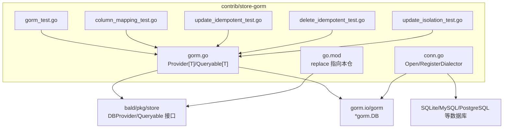
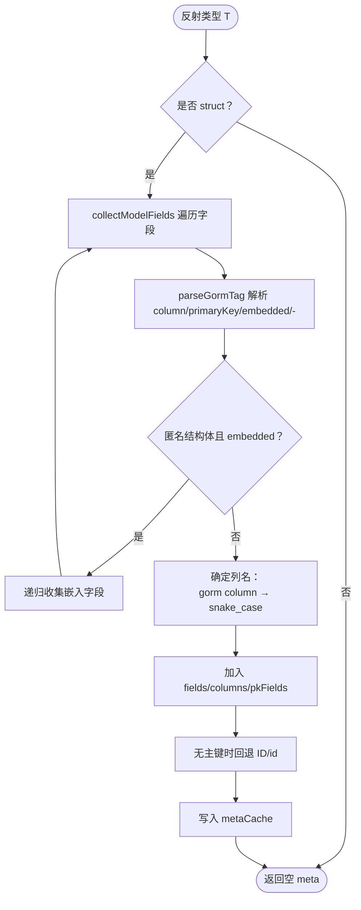
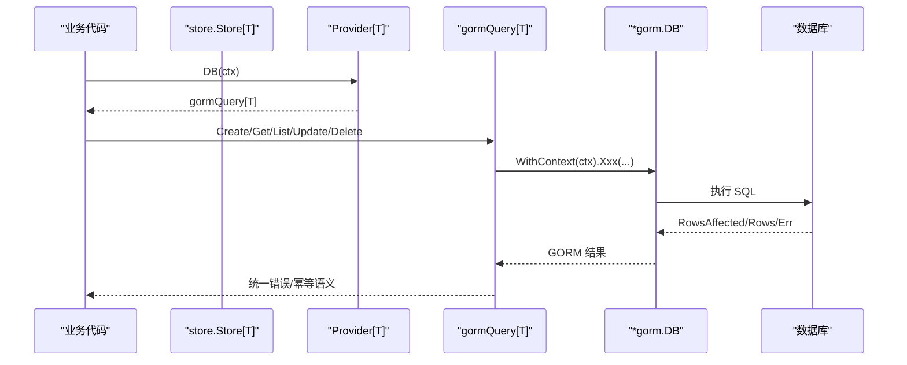
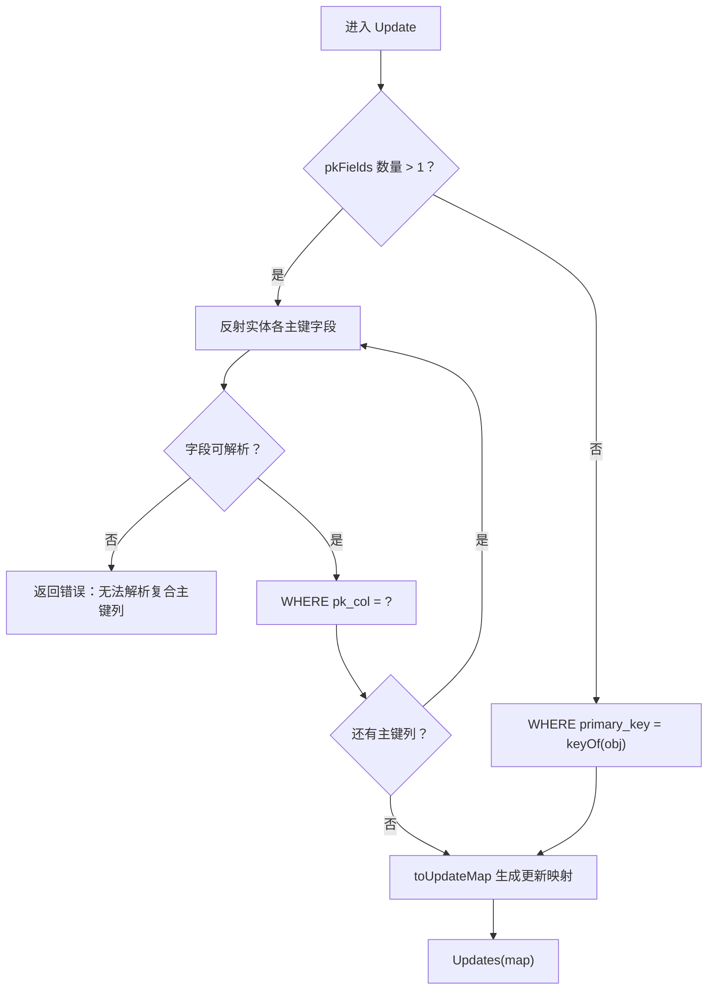
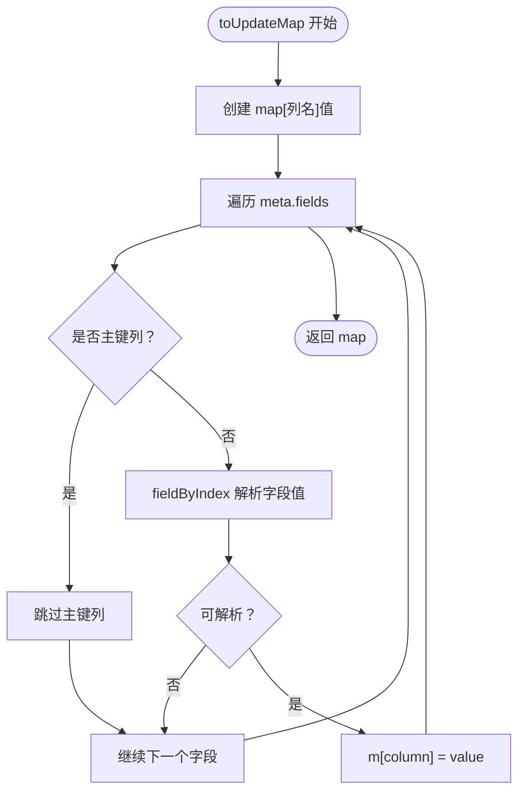
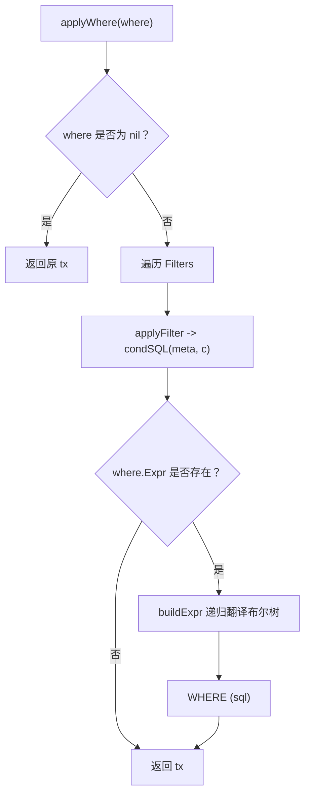
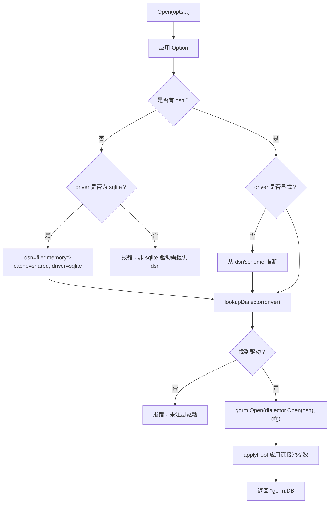
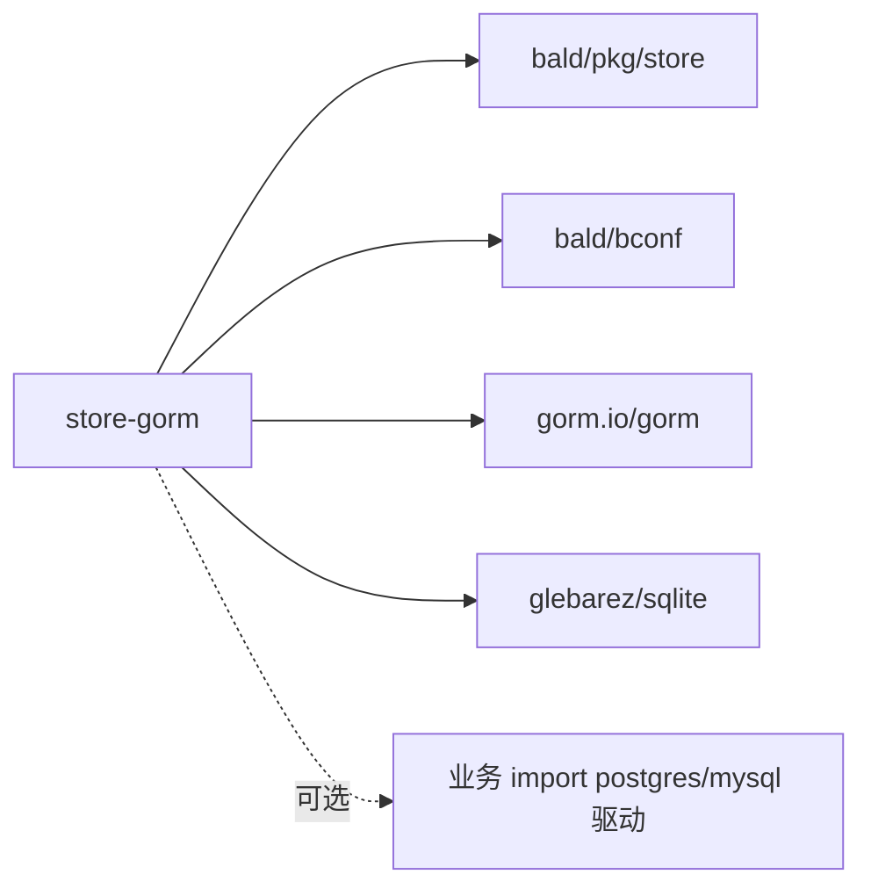

# GORM Store 后端实现

<cite>
**本文引用的文件**   
- [gorm.go](file://contrib/store-gorm/gorm.go)
- [conn.go](file://contrib/store-gorm/conn.go)
- [go.mod](file://contrib/store-gorm/go.mod)
- [gorm_test.go](file://contrib/store-gorm/gorm_test.go)
- [column_mapping_test.go](file://contrib/store-gorm/column_mapping_test.go)
- [update_idempotent_test.go](file://contrib/store-gorm/update_idempotent_test.go)
- [delete_idempotent_test.go](file://contrib/store-gorm/delete_idempotent_test.go)
- [update_isolation_test.go](file://contrib/store-gorm/update_isolation_test.go)
</cite>

## 目录
1. [简介](#简介)
2. [项目结构](#项目结构)
3. [核心组件](#核心组件)
4. [架构总览](#架构总览)
5. [详细组件分析](#详细组件分析)
6. [依赖分析](#依赖分析)
7. [性能考量](#性能考量)
8. [故障排查指南](#故障排查指南)
9. [结论](#结论)

## 简介
`contrib/store-gorm` 是 bald 存储层对 GORM 的桥接子模块。它把 `*gorm.DB` 适配为 bald 核心的 `store.DBProvider[T]` 与 `store.Queryable[T]`，让业务以统一的泛型 `Store[T]` 访问 MySQL、PostgreSQL、SQLite 等 GORM 支持的数据库，而 bald 核心不引入任何 GORM 依赖。

该模块同时提供：
- `Open(...Option)`：装配 `*gorm.DB`，内置 SQLite 内存库快速开发模式，并支持通过 bconf `database.sql`、环境变量或显式 DSN 注入连接。
- `RegisterDialector(name, open)`：按驱动名注册 GORM 方言工厂（sqlite 预注册，其他驱动需业务侧显式注册）。
- `NewGormProvider[T](db, keyOf)`：实体级 Provider，持有 `*gorm.DB` 与主键提取函数；`DB(ctx)` 返回绑定到请求上下文和实体表的 `gormQuery[T]`。

## 项目结构
本仓是 93 个 go.mod 的多模块仓库，`contrib/store-gorm` 是一个独立模块，通过相对 replace 指向本仓根 module 与相关 contrib 包。模块入口集中在两个文件：

| 文件 | 职责 |
|---|---|
| [gorm.go](file://contrib/store-gorm/gorm.go) | Provider / Queryable 接口实现、字段映射、Where 翻译、排序分页、幂等语义 |
| [conn.go](file://contrib/store-gorm/conn.go) | `Open`、`RegisterDialector`、驱动解析、连接池参数应用 |
| [go.mod](file://contrib/store-gorm/go.mod) | 模块声明、直接依赖（bald core、bconf、gorm、glebarez/sqlite）与 replace 规则 |
| 测试文件 | 覆盖列映射、幂等更新/删除、租户隔离、Provider 选项、连接与上下文行为 |



**图示来源**
- [gorm.go:1-100](file://contrib/store-gorm/gorm.go#L1-L100)
- [conn.go:1-100](file://contrib/store-gorm/conn.go#L1-L100)
- [go.mod:1-30](file://contrib/store-gorm/go.mod#L1-L30)

**章节来源**
- [go.mod:1-30](file://contrib/store-gorm/go.mod#L1-L30)

## 核心组件
本节聚焦 Provider、Queryable、模型元数据与会话绑定机制。

### Provider[T] 与 DB() 会话绑定
`Provider[T]` 保存 `*gorm.DB` 与 `keyOf func(*T) string`。调用 `DB(ctx)` 时，使用 `p.db.WithContext(ctx)` 创建会话级 gorm.DB，再封装成 `gormQuery[T]`。这样，后续所有 Create/Get/List/Delete/Update 操作都会继承该 ctx，使请求取消与超时能传播到底层数据库驱动。

- `keyOf` 是必填项：用于 Get/Update/Delete 的单列主键定位，避免全表扫描。
- `Close()` 为空实现：连接池生命周期由调用方管理。
- `Migrate(ctx, models...)` 委托给会话级 AutoMigrate；若未传模型则默认迁移 `T`。

```mermaid
classDiagram
    class Provider_T {
        -db : "*gorm.DB"
        -keyOf : "func(*T) string"
        +DB(ctx) store.Queryable[T]
        +Close() error
        +Migrate(ctx, models...) error
    }

    class gormQuery_T {
        -db : "*gorm.DB"
        -keyOf : "func(*T) string"
        -meta : "*modelMeta"
        +Create(ctx, obj) error
        +Get(ctx, where) *T
        +List(ctx, where) []*T
        +Count(ctx, where) int64
        +Update(ctx, obj, where) int64
        +Delete(ctx, where) int64
        +Migrate(ctx, models...) error
    }

    Provider_T --> gormQuery_T : "DB() 返回"
    gormQuery_T --> "*gorm.DB" : "WithContext(ctx)"
```

**图示来源**
- [gorm.go:28-78](file://contrib/store-gorm/gorm.go#L28-L78)

**章节来源**
- [gorm.go:28-78](file://contrib/store-gorm/gorm.go#L28-L78)

### 主键与模型元数据缓存
`modelMeta` 在首次使用时反射实体类型，构建 Go 字段到列名的映射、主键集合与字段索引链，并缓存在全局 `sync.Map` 中，避免重复反射。

- 优先从 `gorm:"primaryKey"` 识别复合主键；没有主键信息时回退到 `ID` 字段；仍无主键则约定列名为 `id`。
- 字段列表会展开匿名嵌入结构体，支持 `embedded` 与 `embeddedPrefix`。
- `columns` 映射将 Go 字段名指向对应的列名与字段索引链，供 Where 与 Update 复用。



**图示来源**
- [gorm.go:201-315](file://contrib/store-gorm/gorm.go#L201-L315)

**章节来源**
- [gorm.go:201-315](file://contrib/store-gorm/gorm.go#L201-L315)

## 架构总览
下图展示 bald 业务代码通过 `Store[T]` 访问 GORM 后端的典型路径：



**图示来源**
- [gorm.go:52-78](file://contrib/store-gorm/gorm.go#L52-L78)
- [gorm.go:113-178](file://contrib/store-gorm/gorm.go#L113-L178)

## 详细组件分析

### 字段映射策略
字段映射贯穿 Where、排序、更新与模型元数据构建三个环节，优先级如下：

1. **显式列名优先**：`gorm:"column:uid"` 指定列名。
2. **snake_case 约定兜底**：Go 字段名经 `toColumn` 转为下划线小写，例如 `UserID` → `user_id`、`HTTPServer` → `http_server`。
3. **Where.Field 可接受原始列名**：若传入字符串不是 Go 字段名，`modelMeta.column` 会直接走 `toColumn`，因此可直接写数据库列名。
4. **嵌入字段展开**：`embedded` 与 `embeddedPrefix` 允许跨嵌入结构体拼接列名前缀。
5. **排除字段**：`gorm:"-"`、`gorm:"-:migration"` 等以 `-` 开头的 tag 被标记为 ignore，不会进入 `fields` 与 `columns`，也不会被写入数据库。

| 场景 | 行为 |
|---|---|
| `gorm:"column:name"` | 列名固定为 `name` |
| 无 column tag | 按 `toColumn(字段名)` 转 snake_case |
| `gorm:"-"` | 完全忽略，不参与持久化 |
| 匿名嵌入 + `embedded;embeddedPrefix:org_` | 字段列名带前缀，如 `org_name` |
| Where 传入非 Go 字段名 | 当作原始列名再次 snake_case 兜底 |

**章节来源**
- [gorm.go:226-315](file://contrib/store-gorm/gorm.go#L226-L315)
- [gorm.go:347-380](file://contrib/store-gorm/gorm.go#L347-L380)
- [gorm.go:528-572](file://contrib/store-gorm/gorm.go#L528-L572)
- [column_mapping_test.go](file://contrib/store-gorm/column_mapping_test.go)

### 复合主键处理
当实体声明多个 `gorm:"primaryKey"` 字段时，`pkFields` 长度大于 1。此时 `Update` 不再依赖单一的 `keyOf`，而是逐个取实体主键字段的值构造条件：



**图示来源**
- [gorm.go:113-153](file://contrib/store-gorm/gorm.go#L113-L153)

**章节来源**
- [gorm.go:113-153](file://contrib/store-gorm/gorm.go#L113-L153)

### Update 的幂等语义与 toUpdateMap
`Update` 的返回值是 `RowsAffected`，即受影响行数，而非匹配行数。这是 GORM 直接透传的驱动语义，不能把它等同于「记录不存在」。

特别注意 MySQL 默认行为：如果 UPDATE 把列更新为与原值相同的值，驱动可能返回 0 行受影响。因此 `rows == 0` 不能作为「记录不存在」的判据；需要「必须存在才能更新」的业务逻辑应自行判断。

`toUpdateMap` 将对象反射为列名到值的 map，并剔除全部主键列：
- 主键不可变：防止误改主键导致行错位。
- 零值字段会被写入：GORM 的 struct 更新会跳过零值字段，但 map 形式的 Updates 会把 map 中的键都写入，从而正确更新 `""`、`0`、`false` 等零值。
- `gorm:"-"` 字段不在 `meta.fields` 中，不会被写入，避免 SQLite/PG 报 no such column。



**图示来源**
- [gorm.go:155-178](file://contrib/store-gorm/gorm.go#L155-L178)

**章节来源**
- [gorm.go:113-178](file://contrib/store-gorm/gorm.go#L113-L178)
- [update_idempotent_test.go](file://contrib/store-gorm/update_idempotent_test.go)

### Where 谓词翻译与租户隔离
`applyWhere` 把 `store.Where` 翻译为 GORM 查询作用域：
- `Filters` 扁平条件之间用 AND 连接。
- `Expr` 布尔树递归翻译为参数化 SQL 片段，AND/OR 嵌套。
- 空 AND 节点恒真（`1 = 1`），空 OR 节点恒假（`1 = 0`），与 inmemory 后端一致。
- 租户隔离和数据范围过滤通过 `store.Where.Filters` 注入（例如 `tenant_id = ?`、`data_scope IN (...)`），再由 `condSQL` 统一生成 SQL。

`condSQL` 支持的操作符包括相等、不等、比较、LIKE/ILIKE、IN/NIN、IS NULL、BETWEEN、REGEXP 等；未知操作符返回恒真，保证方言无关且安全。



**图示来源**
- [gorm.go:382-440](file://contrib/store-gorm/gorm.go#L382-L440)
- [gorm.go:442-527](file://contrib/store-gorm/gorm.go#L442-L527)

**章节来源**
- [gorm.go:382-527](file://contrib/store-gorm/gorm.go#L382-L527)
- [update_isolation_test.go](file://contrib/store-gorm/update_isolation_test.go)

### Delete 的幂等语义
`Delete` 同样遵循幂等语义：0 行匹配返回 `(0, nil)`，不报错。删除不存在的资源是合法结果；若调用方要求「必须存在才能删」，应自行判断 `rows == 0`。

**章节来源**
- [gorm.go:365-380](file://contrib/store-gorm/gorm.go#L365-L380)
- [delete_idempotent_test.go](file://contrib/store-gorm/delete_idempotent_test.go)

### Open 与驱动注册
`Open` 负责组装 `*gorm.DB`，连接串解析优先级为：

1. `WithEnv("APP_DB_DSN")` 指定的环境变量。
2. `WithDSN("...")`。
3. `WithConfig(cfg)` 中的 `Database_SQL.Source`。
4. 缺省 SQLite 共享内存库 `file::memory:?cache=shared`。

驱动解析优先级为：
1. `WithDriver("postgres")`。
2. `WithConfig(cfg)` 中的 `Database_SQL.Driver`。
3. 从 DSN scheme 推断（如 `postgres://`、`mysql://`）。
4. 若 DSN 为空且 driver 不是 sqlite，直接报错。

已注册驱动查找失败时返回明确错误，不静默降级。sqlite 驱动在 init 中预注册别名 `sqlite`、`sqlite3`、`file`；PostgreSQL、MySQL 等需业务侧 import 对应驱动包后调用 `RegisterDialector`。

连接池参数来自 bconf `Database_SQL`：仅当值大于 0 时才设置 MaxIdleConns、MaxOpenConns、ConnMaxLifetime。



**图示来源**
- [conn.go:100-193](file://contrib/store-gorm/conn.go#L100-L193)

**章节来源**
- [conn.go:1-100](file://contrib/store-gorm/conn.go#L1-L100)
- [conn.go:100-203](file://contrib/store-gorm/conn.go#L100-L203)

### 完整用法示例

#### 实体定义
```go
type User struct {
    ID        string `gorm:"primaryKey;column:user_id"`
    Name      string `gorm:"column:name"`
    Email     string
    TenantID  string `gorm:"column:tenant_id"`
    DeletedAt time.Time
}
```

要点：
- 单列主键：`gorm:"primaryKey;column:user_id"`。
- 自定义列名：`gorm:"column:..."`。
- 租户字段：配合 `store.Where` 注入 `tenant_id` 过滤。
- 软删除字段可由上层逻辑或审计扩展处理，本桥接只关心可持久化字段。

#### Provider 初始化
```go
db, err := baldgorm.Open(
    baldgorm.WithEnv("APP_DB_DSN"),
    baldgorm.WithConfig(cfg.GetDatabase().GetSql()),
)
provider := baldgorm.NewGormProvider[User](db, func(u *User) string { return u.ID })
repo := store.NewStore[User](provider)
```

生产环境建议先注册驱动：
```go
import _ "gorm.io/driver/postgres"
// 或使用显式注册：
baldgorm.RegisterDialector("postgres", postgres.Open)
```

#### CRUD 操作
- 创建：`repo.Create(ctx, &user)`
- 获取：`repo.Get(ctx, store.Eq("user_id", id))`
- 列出：`repo.List(ctx, store.And(store.Tenant(tenantID), store.Like("name", "%a%")))`
- 计数：`repo.Count(ctx, store.In("tenant_id", tenants))`
- 更新：`rows, err := repo.Update(ctx, &updatedUser, store.Eq("user_id", id))`
- 删除：`rows, err := repo.Delete(ctx, store.Eq("user_id", id))`

#### 事务用法
通过 `provider.DB(ctx)` 获得会话级 `Queryable[T]`，再用 `tx.Begin()/Commit()/Rollback()`：

```go
tx, err := provider.DB(ctx).Begin()
if err != nil { ... }
defer tx.Rollback()

err = tx.Create(&userA)
if err != nil { return err }

_, err = tx.Update(&userB, store.Eq("user_id", userB.ID))
if err != nil { return err }

return tx.Commit()
```

由于 `DB(ctx)` 已通过 `WithContext(ctx)` 绑定会话，事务内所有操作继承同一 ctx 与数据库连接。

**章节来源**
- [gorm.go:28-78](file://contrib/store-gorm/gorm.go#L28-L78)
- [gorm_test.go](file://contrib/store-gorm/gorm_test.go)

## 依赖分析
`contrib/store-gorm` 的直接依赖很少，保持了对 bald core 的单向依赖：

| 依赖 | 用途 |
|---|---|
| `github.com/kalandramo/bald` | 核心 `pkg/store` 接口与 `bconf/gen/go/bald/store/v1` 的 Filter 协议 |
| `github.com/kalandramo/bald/bconf` | `bootstrapv1.Database_SQL` 配置段 |
| `gorm.io/gorm` | ORM 抽象与 `*gorm.DB` |
| `github.com/glebarez/sqlite` | 缺省 SQLite 驱动 |
| `github.com/stretchr/testify` | 单元测试 |

模块通过 replace 将自身与兄弟模块链接到本地源码，便于多模块开发。根 module 不得 require 适配器，本模块也不反向强耦合具体后端；业务需用的 MySQL/PostgreSQL 驱动通过业务代码 import 并 `RegisterDialector`。



**图示来源**
- [go.mod:1-20](file://contrib/store-gorm/go.mod#L1-L20)

**章节来源**
- [go.mod:1-20](file://contrib/store-gorm/go.mod#L1-L20)

## 性能考量
- **模型元数据缓存**：`modelMeta` 通过 `sync.Map` 按 reflect.Type 缓存，避免每次查询重复反射实体结构。
- **map 更新避免零值跳过**：`toUpdateMap` 使用 map 形式调用 GORM Updates，减少因零值字段被跳过导致的额外 SELECT 或分支。
- **参数化 SQL**：Where 条件统一使用占位符，避免字符串拼接带来的二次解析与 SQL 注入风险。
- **会话级 ctx 绑定**：一次 `DB(ctx)` 即可让后续多次操作共享同一个上下文与底层连接，适合短事务。
- **连接池参数可配**：通过 bconf `Database_SQL` 控制 MaxIdleConns、MaxOpenConns、ConnMaxLifetime，避免连接泄漏与过度打开。

[本节为通用指导，不直接分析具体文件]

## 故障排查指南

| 现象 | 可能原因 | 处理建议 |
|---|---|---|
| `Update` 返回 0 行 | MySQL 默认「更新到相同值」返回 0；或 WHERE 未匹配 | 不要据此断言记录不存在；检查 WHERE 条件与租户隔离 |
| `Delete` 返回 0 行 | 记录不存在 | 属幂等正常结果；需要「必须存在」时自行判 rows |
| 唯一约束冲突 | 插入或更新触发唯一索引 | 错误被转换为 `store.ErrConflict` |
| `baldgorm: unregistered database driver` | 未 import 或未 `RegisterDialector` | 业务侧 import 驱动包并注册 |
| `baldgorm: driver X requires an explicit dsn` | 指定非 sqlite 驱动但未传 DSN | 使用 `WithDSN` 或 `WithConfig` |
| `baldgorm: db must not be nil` | Provider 构造函数收到 nil | 检查 `Open` 返回值 |
| `baldgorm: keyOf must not be nil` | Provider 构造函数未传 keyOf | 提供主键提取函数 |
| `no such column` | 更新包含 `gorm:"-"` 或其他非表字段 | 确认字段未被持久化；检查 tag 与嵌入结构 |
| 正则表达式不生效 | 驱动不支持 REGEXP | SQLite 不支持；MySQL/PG 需确认驱动能力 |
| ILIKE 大小写不区分失效 | 底层驱动不支持 ILIKE | 实现已退化为 `LOWER(col) LIKE LOWER(...)`，但非字符串列需调用方保证 |

**章节来源**
- [gorm.go:113-178](file://contrib/store-gorm/gorm.go#L113-L178)
- [gorm.go:365-380](file://contrib/store-gorm/gorm.go#L365-L380)
- [gorm.go:528-572](file://contrib/store-gorm/gorm.go#L528-L572)
- [conn.go:100-193](file://contrib/store-gorm/conn.go#L100-L193)
- [update_idempotent_test.go](file://contrib/store-gorm/update_idempotent_test.go)
- [delete_idempotent_test.go](file://contrib/store-gorm/delete_idempotent_test.go)
- [update_isolation_test.go](file://contrib/store-gorm/update_isolation_test.go)

## 结论
`contrib/store-gorm` 以极小的适配层把 GORM 暴露为 bald 通用的 `DBProvider[T]` 与 `Queryable[T]`。其关键设计点是：

1. **泛型 Provider[T]**：每个实体类型拥有独立的 Provider，主键提取函数 `keyOf` 确保 Get/Update/Delete 精确定位。
2. **会话绑定**：`DB(ctx)` 通过 `WithContext` 绑定请求上下文，实现取消传播与租户隔离。
3. **字段映射三阶优先级**：`gorm:"column:..."` → snake_case 约定 → 原始列名兜底，并以 `gorm:"-"` 排除内存态字段。
4. **复合主键与零值更新**：复合主键逐字段构造 WHERE；`toUpdateMap` 解决 GORM 零值跳过问题，同时保护主键不被改写。
5. **幂等语义**：Update 与 Delete 返回受影响行数，0 行匹配不视为错误，由调用方决定是否需要强制存在。
6. **Where 翻译**：扁平 Filters 与布尔 Expr 统一参数化为 SQL，租户隔离与数据范围过滤通过过滤器注入。
7. **驱动解耦**：sqlite 预注册，其他驱动通过 `RegisterDialector` 显式注册，未注册驱动 fail-fast。

这些特性使业务可以在不感知 GORM 的情况下，以统一 Store 接口编写跨数据库的领域持久化逻辑。