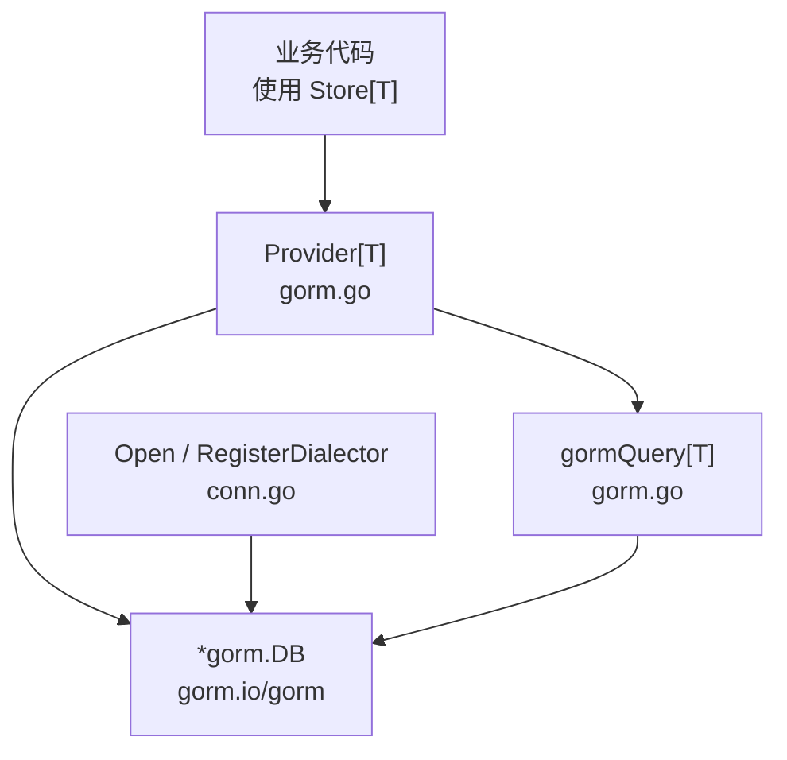
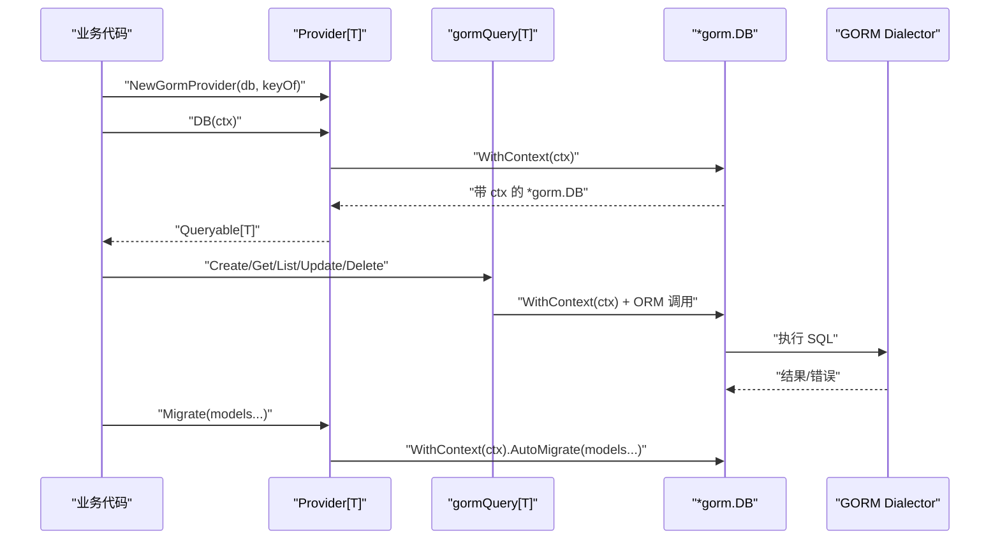
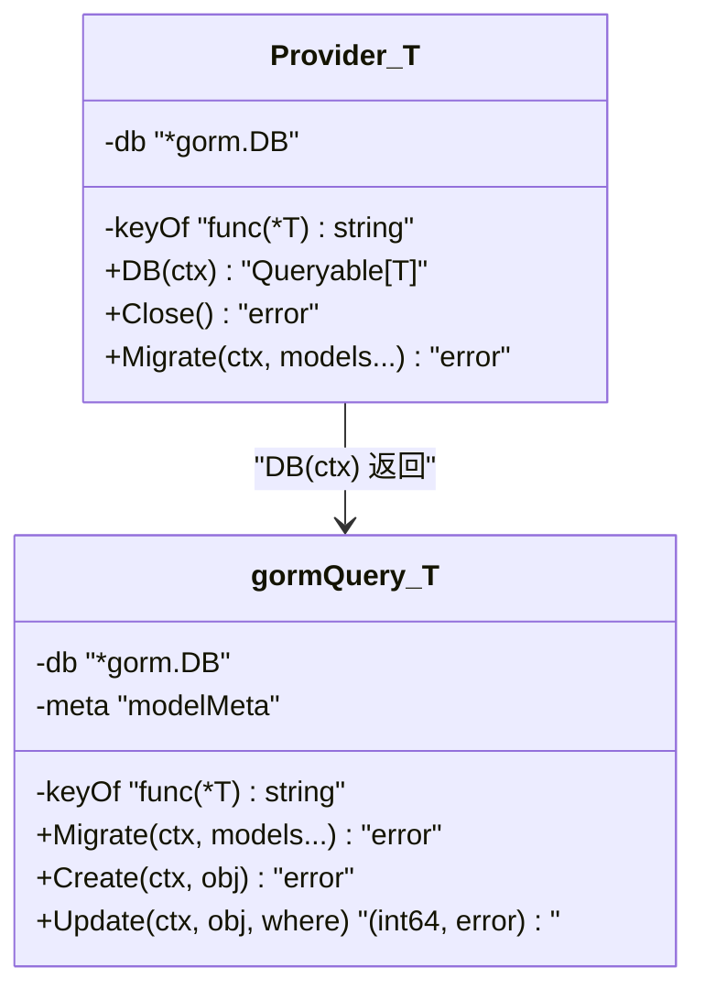
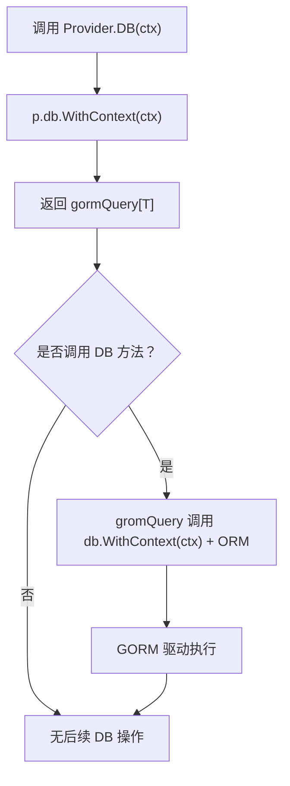
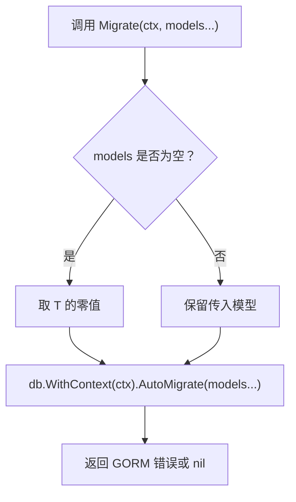
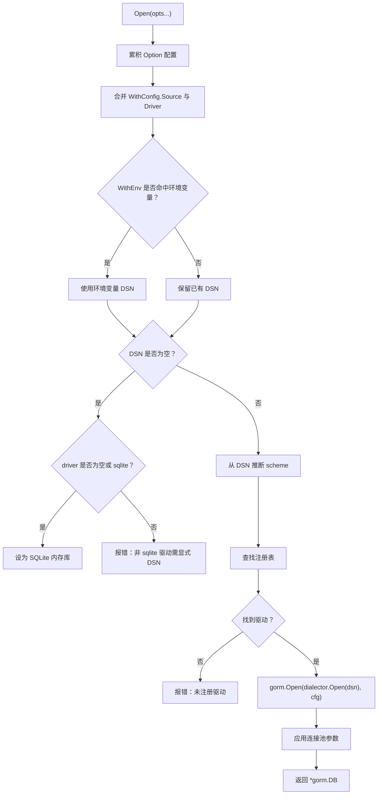
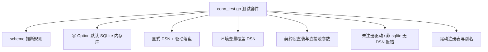
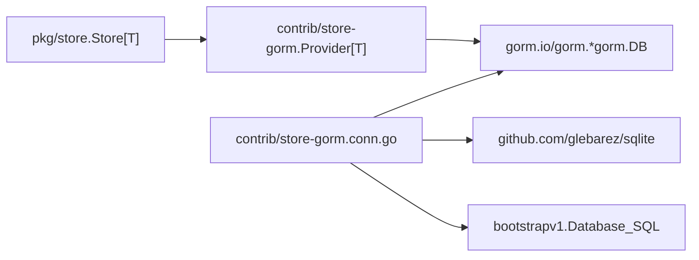

# Provider 生命周期与会话管理

<cite>
**本文引用的文件**
- [contrib/store-gorm/gorm.go](file://contrib/store-gorm/gorm.go)
- [contrib/store-gorm/conn.go](file://contrib/store-gorm/conn.go)
- [contrib/store-gorm/conn_test.go](file://contrib/store-gorm/conn_test.go)
</cite>

## 目录
1. [简介](#简介)
2. [项目结构定位](#项目结构定位)
3. [核心组件总览](#核心组件总览)
4. [架构概览](#架构概览)
5. [详细组件分析](#详细组件分析)
6. [依赖关系分析](#依赖关系分析)
7. [性能与资源特性](#性能与资源特性)
8. [故障排查指南](#故障排查指南)
9. [结论](#结论)

## 简介
本文聚焦 `contrib/store-gorm` 中泛型 `Provider[T]` 的生命周期与会话语义，覆盖以下要点：
- `Provider[T]` 的构造参数、职责边界与空 `Close()` 的设计动机。
- `DB(ctx)` 如何把请求上下文绑定到后续所有 GORM 查询。
- `ctx` 被丢弃时的行为差异，以及为什么不应假设“不传 ctx”会取消请求。
- `Migrate(...models)` 如何委托给 GORM 的 `AutoMigrate`，并支持传入多个模型。
- `conn.go` 中的连接辅助函数（`Open`、`RegisterDialector`、`WithEnv` 等）及其测试用例覆盖的连接场景。

本模块是 Bald 存储层的 GORM 桥接子模块，对外暴露统一的 `store.DBProvider[T]` + `store.Queryable[T]` 接口，使业务以泛型 `Store[T]` 访问任意 GORM 支持的数据库，而 Bald 核心不引入 GORM 依赖。

## 项目结构定位
- `Provider[T]`、`gormQuery[T]`、`Migrate` 实现位于 `contrib/store-gorm/gorm.go`。
- 连接装配、驱动注册表、DSN scheme 推断、连接池参数应用位于 `contrib/store-gorm/conn.go`。
- 连接辅助函数的单元测试位于 `contrib/store-gorm/conn_test.go`。

**图表来源**
- [contrib/store-gorm/gorm.go:33-70](file://contrib/store-gorm/gorm.go#L33-L70)
- [contrib/store-gorm/conn.go:40-70](file://contrib/store-gorm/conn.go#L40-L70)

**章节来源**
- [contrib/store-gorm/gorm.go:1-40](file://contrib/store-gorm/gorm.go#L1-L40)

## 核心组件总览
- `Provider[T]`：持有底层 `*gorm.DB` 和主键提取函数 `keyOf`；提供 `DB(ctx)`、`Close()`、`Migrate(...)`。
- `gormQuery[T]`：实现 `store.Queryable[T]`，把 Where、Create、Update 等转换为 GORM 调用，并把请求 ctx 注入到每个操作。
- `Open(opts...)`：统一装配入口，支持环境变量覆盖、bconf 契约段、显式 DSN/Driver、SQLite 缺省内存库。
- `RegisterDialector(name, factory)`：全局、并发安全的驱动注册表，sqlite 预注册三个别名。
- 连接池参数由 `applyPool` 消费契约段字段，零值保持 database/sql 默认。

**章节来源**
- [contrib/store-gorm/gorm.go:33-70](file://contrib/store-gorm/gorm.go#L33-L70)
- [contrib/store-gorm/conn.go:40-120](file://contrib/store-gorm/conn.go#L40-L120)

## 架构概览
下图展示 Provider 构建、会话获取、迁移与连接装配的整体流程：

**图表来源**
- [contrib/store-gorm/gorm.go:54-70](file://contrib/store-gorm/gorm.go#L54-L70)
- [contrib/store-gorm/gorm.go:78-86](file://contrib/store-gorm/gorm.go#L78-L86)
- [contrib/store-gorm/gorm.go:88-97](file://contrib/store-gorm/gorm.go#L88-L97)

## 详细组件分析

### Provider[T] 的构造与职责
`NewGormProvider[T](db, keyOf)` 接收两个必须非空的参数：
- `db`：已打开的 `*gorm.DB`。文档建议先执行 `AutoMigrate` 或由 `provider.Migrate` 完成建表。
- `keyOf`：从实体指针取主键字符串的函数，用于 Get、Update、Delete 的定位，避免全表扫描。

构造时若任一参数为 nil，直接 panic，属于快速失败策略。Provider 本身只持有连接句柄和主键解析函数，不持有事务状态；真正的会话绑定发生在 `DB(ctx)`。

**图表来源**
- [contrib/store-gorm/gorm.go:33-70](file://contrib/store-gorm/gorm.go#L33-L70)
- [contrib/store-gorm/gorm.go:88-120](file://contrib/store-gorm/gorm.go#L88-L120)

**章节来源**
- [contrib/store-gorm/gorm.go:33-52](file://contrib/store-gorm/gorm.go#L33-L52)

### DB(ctx) 会话传播与 ctx 丢弃语义
`DB(ctx)` 返回的 `gormQuery[T]` 内部保存的是 `p.db.WithContext(ctx)`。这意味着：
- 该 Queryable 上所有后续操作都会继承这个 ctx。
- 当某个操作调用自身再 `WithContext(ctx)` 时，会复用已有请求上下文，而不是重新创建。
- 如果上层把返回值赋值给 `_`，即丢弃 Queryable，则后续不再有任何 DB 操作，自然也不存在“取消未执行请求”的问题。
- 如果业务拿到 Queryable 后仍继续执行业务逻辑但不调用任何 DB 方法，那么 ctx 即使超时也不会影响尚未发生的 DB 调用——因为还没有发起网络或磁盘 IO。

关键语义不是“ctx 被丢弃会导致后续操作被取消”，而是“只有对返回的 Queryable 发起 DB 调用时，才会把 ctx 传给 GORM 驱动”。因此，不要把 Provider 当成自动拦截所有未来操作的网关；它只是把当前请求上下文绑定到本次会话对象。

**图表来源**
- [contrib/store-gorm/gorm.go:54-70](file://contrib/store-gorm/gorm.go#L54-L70)
- [contrib/store-gorm/gorm.go:88-97](file://contrib/store-gorm/gorm.go#L88-L97)

**章节来源**
- [contrib/store-gorm/gorm.go:54-70](file://contrib/store-gorm/gorm.go#L54-L70)

### Close 空实现的设计决策
`Provider[T].Close()` 始终返回 nil。设计原因是：
- Provider 不拥有 `*gorm.DB` 的生命周期；它只是借用调用方已经打开的连接。
- 连接池关闭应由创建 `*gorm.DB` 的业务层负责，例如通过 `Open(opts...)` 或外部框架装配。
- 如果 Provider 自行关闭底层连接，会破坏共享连接池、事务、以及其他基于同一 `*gorm.DB` 的组件。

因此，`Close` 空实现是一种明确的契约声明：**连接生命周期不属于 Provider**。

**章节来源**
- [contrib/store-gorm/gorm.go:72-74](file://contrib/store-gorm/gorm.go#L72-L74)

### Migrate 与 AutoMigrate 的关系
`Provider[T].Migrate(ctx, models ...any)` 的行为如下：
- 如果没有传入模型，会自动取 `T` 的零值作为迁移目标。
- 调用 `p.db.WithContext(ctx).AutoMigrate(models...)`。
- 该方法直接委托给 GORM 的 `AutoMigrate`，不封装额外迁移策略。

`gormQuery[T].Migrate` 也遵循相同规则：若无模型则回退到 `T`，并通过会话级 `db.WithContext(ctx).AutoMigrate` 执行。这使得 Provider 级和 Queryable 级迁移语义一致，但需要注意：
- 多模型迁移应显式传入所有需要迁移的结构体类型。
- 空参调用不会报错，而是按 T 迁移一次。
- 迁移错误直接透传 GORM 的错误，没有二次包装成自定义错误码。

**图表来源**
- [contrib/store-gorm/gorm.go:76-86](file://contrib/store-gorm/gorm.go#L76-L86)
- [contrib/store-gorm/gorm.go:92-97](file://contrib/store-gorm/gorm.go#L92-L97)

**章节来源**
- [contrib/store-gorm/gorm.go:76-97](file://contrib/store-gorm/gorm.go#L76-L97)

### conn.go 连接辅助函数与测试覆盖场景
`conn.go` 主要承担连接装配和驱动发现职责：

#### 驱动注册表
- `dialects` 是全局 map，保护读写使用 `sync.RWMutex`。
- `init()` 预注册 sqlite 的三个别名：`sqlite`、`sqlite3`、`file`。
- `RegisterDialector` 接受 `name` 和 `DialectorFactory`，名称归一化为小写且去除空白；传入 nil factory 会 panic。
- `lookupDialector` 读取时不加写锁，适合高频查找。

#### Open 装配优先级
`Open(opts...)` 的解析顺序明确分层：
1. **连接串 dsn**：`WithEnv` 环境变量 > `WithDSN` > `WithConfig.Source`。
2. **驱动 driver**：`WithDriver` > `WithConfig.Driver` > 从 DSN scheme 推断。
3. **缺省行为**：未设置 dsn 且 driver 为空或 sqlite 系列时，使用 SQLite 共享内存库 `file::memory:?cache=shared`。
4. **未注册驱动**：立即返回错误，提示需要 import 对应驱动并调用 `RegisterDialector`。
5. **gorm.Config**：未显式提供时使用静默 logger。
6. **连接池参数**：仅当契约段字段大于 0 时才设置 idle/open/lifetime。

**图表来源**
- [contrib/store-gorm/conn.go:70-150](file://contrib/store-gorm/conn.go#L70-L150)
- [contrib/store-gorm/conn.go:152-170](file://contrib/store-gorm/conn.go#L152-L170)

#### 测试覆盖的连接场景
`conn_test.go` 覆盖了以下典型场景：
- `TestDSNScheme`：锁定 scheme 推断规则，包括 postgresql、mysql、file、裸 key=value DSN 和空字符串。
- `TestOpen_Default`：零 Option 时获得 SQLite 内存库，可正常建表和读写。
- `TestOpen_ExplicitDriver`：显式 DSN + 驱动落盘，再开新连接验证数据持久化。
- `TestOpen_EnvOverride`：环境变量覆盖 WithDSN，模拟 CI 注入。
- `TestOpen_DSNPriority`：WithDSN 优先于 WithConfig.Source。
- `TestOpen_WithConfig`：契约段 driver/source/连接池参数生效。
- `TestOpen_WithConfigEmptySource`：Source 为空时忽略，回落缺省行为。
- `TestOpen_UnregisteredDriver`：未注册驱动返回错误，并包含注册提示。
- `TestOpen_ExplicitDriverWithoutDSN`：显式非 sqlite 驱动但未给 DSN 时报错。
- `TestOpen_SchemeFallback`：无显式 driver 时按 DSN scheme 推断。
- `TestRegisterDialector`：别名大小写归一、注册 nil 构造器 panic，并通过 Provider + Store 走完整写入读取路径。
- `TestNewTestDB`：测试助手创建独立临时文件库并自动清理连接池。

**图表来源**
- [contrib/store-gorm/conn_test.go:33-181](file://contrib/store-gorm/conn_test.go#L33-L181)

**章节来源**
- [contrib/store-gorm/conn.go:40-170](file://contrib/store-gorm/conn.go#L40-L170)
- [contrib/store-gorm/conn_test.go:21-181](file://contrib/store-gorm/conn_test.go#L21-L181)

## 依赖关系分析
- `Provider[T]` 依赖 `gorm.io/gorm` 的 `*gorm.DB`。
- `gormQuery[T]` 在每次操作中使用 `WithContext(ctx)` 把请求上下文传递给 GORM。
- `conn.go` 依赖 `github.com/glebarez/sqlite` 作为缺省引擎，其他驱动由业务侧通过 `RegisterDialector` 注册。
- 连接池参数消费 `bootstrapv1.Database_SQL`，来自 bconf 生成的契约类型。
- 测试使用 `pkg/store` 的 `Store[T]` 验证 Provider 与 store 层的集成正确性。

**图表来源**
- [contrib/store-gorm/gorm.go:33-70](file://contrib/store-gorm/gorm.go#L33-L70)
- [contrib/store-gorm/conn.go:40-170](file://contrib/store-gorm/conn.go#L40-L170)

**章节来源**
- [contrib/store-gorm/gorm.go:1-40](file://contrib/store-gorm/gorm.go#L1-L40)
- [contrib/store-gorm/conn.go:40-170](file://contrib/store-gorm/conn.go#L40-L170)

## 性能与资源特性
- Provider 不维护连接池，因此不存在 Provider 级别的 GC 压力；连接池由底层 `*gorm.DB` 管理。
- `DB(ctx)` 每次返回新的 `gormQuery[T]`，但底层 `*gorm.DB` 是共享的，不会重复建立物理连接。
- `WithContext` 是轻量操作，真正成本在于后续 SQL 执行。
- `Migrate` 通常只在启动阶段执行，不应放在热路径。
- 连接池空闲连接数、最大打开连接数、连接最大生命周期由契约段控制；未设置时保留 database/sql 默认值，避免过度约束生产环境。

[本节为通用性能说明，不直接分析具体代码行]

## 故障排查指南

### 问题：调用 DB(ctx) 后业务逻辑长时间运行，但 ctx 超时没有取消 DB 请求
原因：`DB(ctx)` 只是把 ctx 绑定到返回的 Queryable；如果业务逻辑在执行 DB 调用之前已经耗时很长，ctx 超时只会让尚未调用的 DB 请求在发起时被取消。若没有发起 DB 调用，就不会触发数据库侧取消。

排查建议：
- 确认是否在正确的 ctx 作用域内调用 Queryable 的方法。
- 不要在拿到 Queryable 后做长时间 CPU 密集或 I/O 阻塞工作而不调用任何 DB 方法。
- 如果需要取消整个处理流程，应在业务逻辑入口处统一判断 ctx.Done，并在调用 DB 前检查。

**章节来源**
- [contrib/store-gorm/gorm.go:54-70](file://contrib/store-gorm/gorm.go#L54-L70)

### 问题：Provider.Close() 不释放连接
这是预期行为。Provider 不拥有连接生命周期；连接应由创建 `*gorm.DB` 的代码关闭。

排查建议：
- 如果使用 `Open(opts...)`，应在应用退出时关闭底层 `sql.DB`。
- 如果是外部框架装配的 `*gorm.DB`，交由框架生命周期管理。

**章节来源**
- [contrib/store-gorm/gorm.go:72-74](file://contrib/store-gorm/gorm.go#L72-L74)

### 问题：Migrate 没有迁移我期望的表
可能原因：
- 忘记传入需要迁移的模型。
- 误以为空参会迁移所有已知模型；实际空参会只迁移 `T`。
- 传入的是指针类型但 GORM 无法识别结构体元信息。

排查建议：
- 显式传入所有需要迁移的结构体类型。
- 确保模型有可识别的主键或结构体标签。
- 检查 `keyOf` 是否能正确取到主键值，否则 Update/Delete 可能定位不到行。

**章节来源**
- [contrib/store-gorm/gorm.go:76-97](file://contrib/store-gorm/gorm.go#L76-L97)

### 问题：Open 报“未注册数据库驱动”
原因：
- 没有 import 对应 GORM 驱动包。
- 没有调用 `RegisterDialector` 注册驱动名。
- 使用了不支持的 DSN scheme 或未显式指定 driver。

排查建议：
- 在 bootstrap 或 init 中注册驱动，例如 postgres、mysql。
- 显式使用 `WithDriver` 指定驱动名。
- 检查 DSN scheme 是否与驱动匹配。

**章节来源**
- [contrib/store-gorm/conn.go:100-150](file://contrib/store-gorm/conn.go#L100-L150)
- [contrib/store-gorm/conn_test.go:135-155](file://contrib/store-gorm/conn_test.go#L135-L155)

### 问题：显式指定非 sqlite 驱动但没有 DSN 就报错
这是故意设计的 fail-fast 行为：只有 sqlite 系列驱动允许省略 DSN 并回落到内存库；其他驱动必须显式提供 DSN。

排查建议：
- 配合 `WithDSN` 或 `WithConfig.Source` 提供连接串。
- 在 CI 中通过 `WithEnv` 注入真实数据库地址。

**章节来源**
- [contrib/store-gorm/conn.go:110-140](file://contrib/store-gorm/conn.go#L110-L140)
- [contrib/store-gorm/conn_test.go:157-165](file://contrib/store-gorm/conn_test.go#L157-L165)

## 结论
`Provider[T]` 是一个轻量桥接器：它持有 `*gorm.DB` 和主键解析函数，把请求上下文绑定到 `DB(ctx)` 返回的会话对象，并通过 `Migrate` 直接委托 GORM 的 `AutoMigrate`。`Close` 空实现明确声明连接所有权不在 Provider，从而避免意外关闭共享连接池。

`conn.go` 的 `Open` 把快速开发态和生产装配态收敛到一个入口：零 Option 即可跑 SQLite 内存库，生产环境可通过环境变量、bconf 契约段或显式 DSN/Driver 装配，并通过注册表机制保持驱动解耦。测试覆盖了 scheme 推断、环境变量覆盖、契约段连接池参数、未注册驱动、显式驱动无 DSN、别名注册等关键分支，形成完整的连接装配验证闭环。