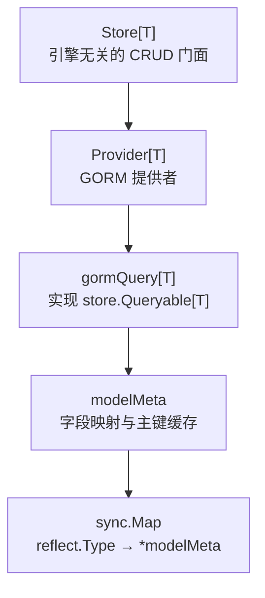
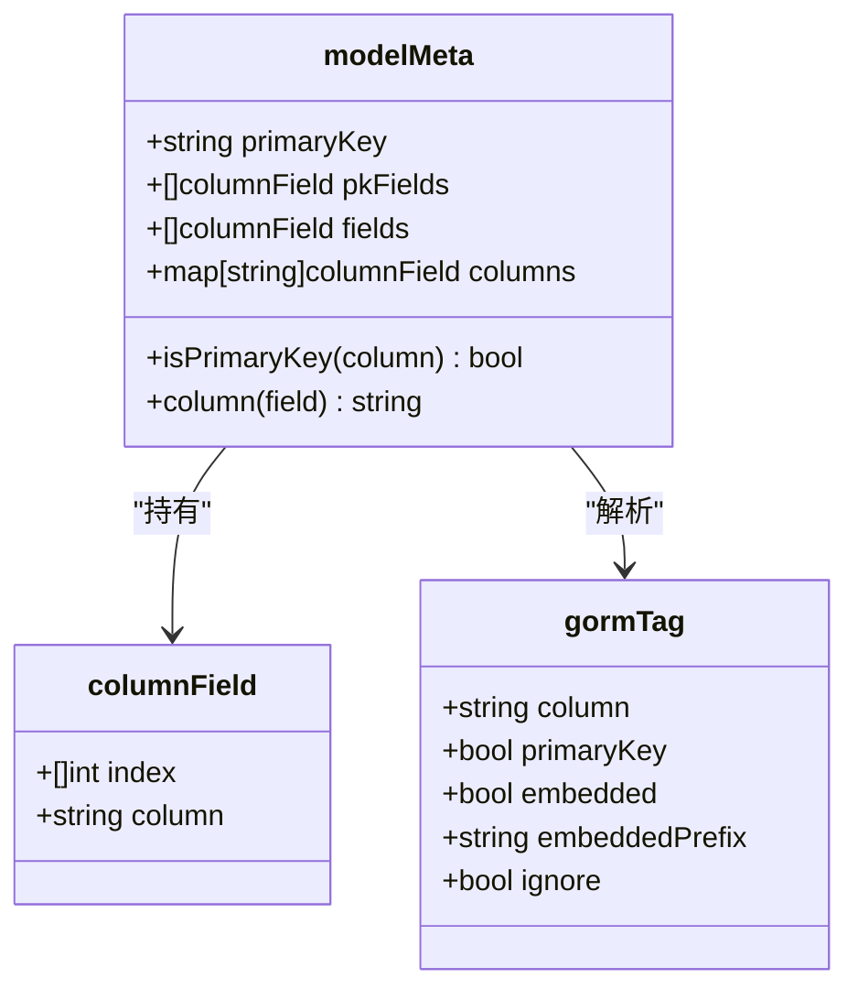
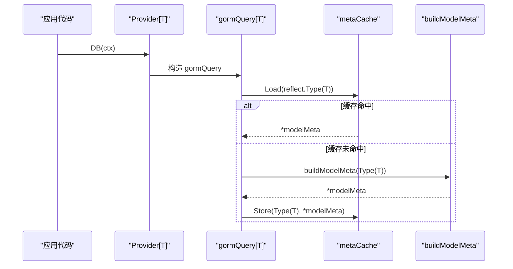
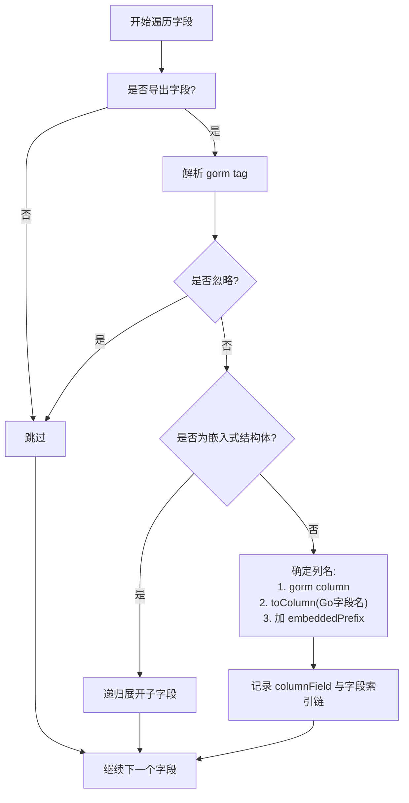
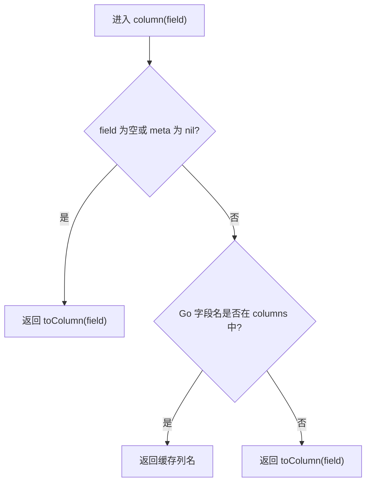
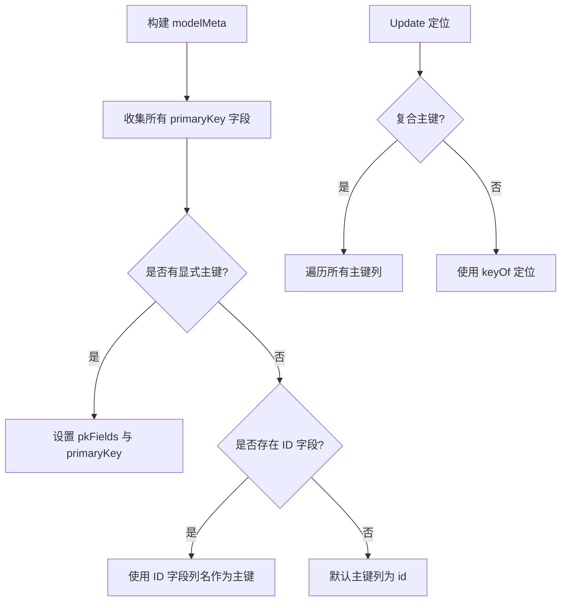
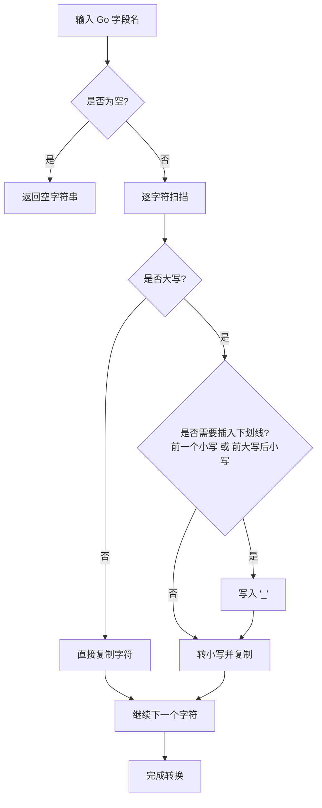
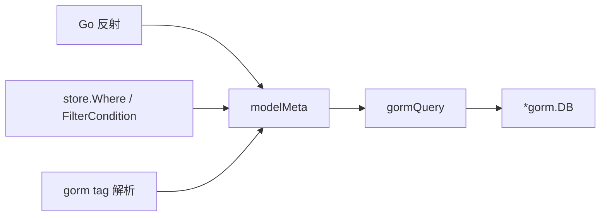

# 字段映射与元数据缓存

<cite>
**本文引用的文件 **
- [contrib/store-gorm/gorm.go](file://contrib/store-gorm/gorm.go)
- [contrib/store-gorm/column_mapping_test.go](file://contrib/store-gorm/column_mapping_test.go)
- [pkg/store/store.go](file://pkg/store/store.go)
</cite>

## 目录
1. [引言](#引言)
2. [项目结构定位](#项目结构定位)
3. [核心数据结构](#核心数据结构)
4. [架构总览](#架构总览)
5. [详细组件分析](#详细组件分析)
6. [依赖关系分析](#依赖关系分析)
7. [性能与并发考虑](#性能与并发考虑)
8. [使用示例](#使用示例)
9. [故障排查](#故障排查)
10. [结论](#结论)

## 引言
本文聚焦 `contrib/store-gorm` 子模块中的 `modelMeta` 结构体及其字段映射机制，解释以下问题：
- Go 结构体如何通过反射解析为数据库列；
- 字段名到列名的解析优先级；
- 主键识别、复合主键处理与嵌入结构体的展开逻辑；
- `sync.Map` 全局缓存对启动期反射开销的影响；
- 自定义列名、复合主键和忽略字段的完整用法。

本主题属于 Bald 框架存储层中「GORM 后端适配器」的模型元数据子系统，不涉及业务 API、注册中心或 Broker 订阅者生命周期。

## 项目结构定位
Bald 的核心 `pkg/store` 只定义引擎无关的 CRUD 接口与 `Store[T]` 门面；GORM 适配在独立模块 `contrib/store-gorm` 中，通过 `Provider[T]` 把 GORM 会话包装成 `Queryable[T]`。`modelMeta` 仅存在于 GORM 适配器内部，是运行时按实体类型构建并缓存的字段元数据。

**图表来源**
- [pkg/store/store.go:25-60](file://pkg/store/store.go#L25-L60)
- [contrib/store-gorm/gorm.go:1-40](file://contrib/store-gorm/gorm.go#L1-L40)
- [contrib/store-gorm/gorm.go:60-110](file://contrib/store-gorm/gorm.go#L60-L110)
- [contrib/store-gorm/gorm.go:150-230](file://contrib/store-gorm/gorm.go#L150-L230)

**章节来源**
- [pkg/store/store.go:1-40](file://pkg/store/store.go#L1-L40)
- [contrib/store-gorm/gorm.go:1-40](file://contrib/store-gorm/gorm.go#L1-L40)

## 核心数据结构
`modelMeta` 是 GORM 实体类型 T 的字段映射缓存，包含三类信息：
- 可持久化字段列表；
- 主键字段列表及主键列名；
- Go 字段名到字段信息的快速查找表。

| 字段 | 类型 | 含义 |
|---|---|---|
| `primaryKey` | `string` | 默认主键列名；无显式 `primaryKey` tag 时回退到 `ID` 字段列名或常量 `id` |
| `pkFields` | `[]columnField` | 所有标记为主键的列；复合主键时长度大于 1 |
| `fields` | `[]columnField` | 参与持久化的全部字段，含嵌入结构体展开后的字段 |
| `columns` | `map[string]columnField` | Go 字段名到 `columnField` 的索引，用于过滤/排序条件解析 |

`columnField` 描述一个可持久化字段：
- `index []int`：从实体根出发的字段索引链，支持嵌套与嵌入结构体；
- `column string`：最终数据库列名。

**图表来源**
- [contrib/store-gorm/gorm.go:140-170](file://contrib/store-gorm/gorm.go#L140-L170)
- [contrib/store-gorm/gorm.go:230-270](file://contrib/store-gorm/gorm.go#L230-L270)

**章节来源**
- [contrib/store-gorm/gorm.go:140-170](file://contrib/store-gorm/gorm.go#L140-L170)
- [contrib/store-gorm/gorm.go:230-270](file://contrib/store-gorm/gorm.go#L230-L270)

## 架构总览
`modelMeta` 的生命周期如下：
1. `Provider.DB(ctx)` 构造 `gormQuery[T]` 时调用 `modelMetaOf[T]()`。
2. `modelMetaOf` 用 `reflect.TypeOf((*T)(nil)).Elem()` 得到实体类型，并在全局 `metaCache` 中查找。
3. 首次访问时调用 `buildModelMeta` 构建元数据，再写入缓存。
4. 后续同类型查询直接复用同一份 `*modelMeta`，避免重复反射。

**图表来源**
- [contrib/store-gorm/gorm.go:45-70](file://contrib/store-gorm/gorm.go#L45-L70)
- [contrib/store-gorm/gorm.go:195-210](file://contrib/store-gorm/gorm.go#L195-L210)
- [contrib/store-gorm/gorm.go:201-240](file://contrib/store-gorm/gorm.go#L201-L240)

**章节来源**
- [contrib/store-gorm/gorm.go:45-70](file://contrib/store-gorm/gorm.go#L45-L70)
- [contrib/store-gorm/gorm.go:195-240](file://contrib/store-gorm/gorm.go#L195-L240)

## 详细组件分析

### 字段索引链与列名解析
`collectModelFields` 遍历结构体字段：
- 跳过未导出字段；
- 解析 `gorm` tag；
- 若字段被标记 `ignore`（tag 以 `-` 开头），直接跳过；
- 若字段是结构体且匿名或显式 `embedded`，则递归展开；
- 否则生成 `columnField`，记录字段索引链和列名。

列名生成优先级：
1. `gorm:"column:..."` 显式指定；
2. 否则使用 `toColumn(f.Name)` 将 Go 字段名转为 snake_case；
3. 若存在 `embeddedPrefix`，前缀会拼接到列名前。

**图表来源**
- [contrib/store-gorm/gorm.go:201-240](file://contrib/store-gorm/gorm.go#L201-L240)
- [contrib/store-gorm/gorm.go:270-310](file://contrib/store-gorm/gorm.go#L270-L310)

**章节来源**
- [contrib/store-gorm/gorm.go:201-240](file://contrib/store-gorm/gorm.go#L201-L240)
- [contrib/store-gorm/gorm.go:270-310](file://contrib/store-gorm/gorm.go#L270-L310)

### `column()` 方法的字段名解析优先级
`modelMeta.column(field string)` 是过滤、排序等路径上把用户传入字段名解析为数据库列名的入口：

1. 空字段或 nil 元数据直接交给 `toColumn(field)`；
2. 若 `field` 能匹配 `m.columns` 中的 Go 字段名，返回其缓存列名；
3. 否则把 `field` 当作原始列名或 Go 字段名，走 `toColumn` 兜底。

这意味着：
- 优先按 Go 字段名查 `gorm:"column:..."`；
- 未命中时允许直接传数据库列名；
- 最末兜底按 snake_case 约定转换。

**图表来源**
- [contrib/store-gorm/gorm.go:170-195](file://contrib/store-gorm/gorm.go#L170-L195)

**章节来源**
- [contrib/store-gorm/gorm.go:170-195](file://contrib/store-gorm/gorm.go#L170-L195)

### 主键识别逻辑
主键识别分三层：

1. 收集阶段：扫描所有带 `primaryKey` tag 的字段，追加到 `pkFields`；首个主键列名设为 `primaryKey`。
2. 回退阶段：若没有显式主键，且结构体有名为 `ID` 的导出字段，则把它作为单主键。
3. 最终回退：仍无主键信息时，硬编码默认主键列为 `toColumn("id")`。

更新操作会根据主键数量选择定位策略：
- 单主键：使用 `keyOf(obj)` 的值；
- 复合主键：遍历 `pkFields`，逐个拼接 `列名 = 值`。

**图表来源**
- [contrib/store-gorm/gorm.go:201-240](file://contrib/store-gorm/gorm.go#L201-L240)
- [contrib/store-gorm/gorm.go:85-120](file://contrib/store-gorm/gorm.go#L85-L120)

**章节来源**
- [contrib/store-gorm/gorm.go:85-120](file://contrib/store-gorm/gorm.go#L85-L120)
- [contrib/store-gorm/gorm.go:201-240](file://contrib/store-gorm/gorm.go#L201-L240)

### 命名转换规则：`toColumn`
`toColumn` 把 Go 字段名转换为 snake_case 列名，关键规则：
- 大写字母转小写；
- 插入下划线的位置遵循驼峰语义；
- 正确处理缩写：`ID` → `id`、`UserID` → `user_id`、`HTTPServer` → `http_server`；
- 空字符串原样返回。

它不是唯一列名来源：真正优先级最高的是 `gorm:"column:..."`，`toColumn` 主要承担默认约定兜底。

**图表来源**
- [contrib/store-gorm/gorm.go:490-535](file://contrib/store-gorm/gorm.go#L490-L535)

**章节来源**
- [contrib/store-gorm/gorm.go:490-535](file://contrib/store-gorm/gorm.go#L490-L535)

### 嵌入结构体的展开逻辑
嵌入结构体不会变成单个列，而是像普通字段一样被“压平”到表列集合中：
- 匿名结构体字段自动展开；
- 非匿名结构体字段需要 `gorm:"embedded"`；
- 可通过 `gorm:"embeddedPrefix:xxx_"` 给展开后的列名加前缀；
- 展开后的字段仍然保留完整的字段索引链，以便读取实体值。

测试用例验证了：
- `AuditFields.CreatedBy` 被展开为 `created_by`；
- 过滤、排序、更新都按展开后的列工作；
- 旧实现若把嵌入结构体当一列会产生 SQL 错误。

**章节来源**
- [contrib/store-gorm/column_mapping_test.go:20-40](file://contrib/store-gorm/column_mapping_test.go#L20-L40)
- [contrib/store-gorm/column_mapping_test.go:80-120](file://contrib/store-gorm/column_mapping_test.go#L80-L120)
- [contrib/store-gorm/gorm.go:201-240](file://contrib/store-gorm/gorm.go#L201-L240)

### `sync.Map` 缓存的性能考虑
`metaCache` 是包级 `sync.Map`，键为 `reflect.Type`，值为 `*modelMeta`。设计要点：
- 每个 Go 类型只构建一次 `modelMeta`；
- 读多写少场景下适合 `sync.Map`；
- 由于类型通常稳定，缓存命中率高；
- 内存代价是每注册一个实体类型就保留一份 `modelMeta`，但字段数有限，成本可控。

需要注意：
- 缓存键是具体类型，指针类型会被 `Elem()` 解引用；
- 同一类型多次调用 `NewGormProvider` 或 `DB(ctx)` 共享同一份元数据；
- 元数据不可变，因此线程安全不需要额外锁。

**章节来源**
- [contrib/store-gorm/gorm.go:195-210](file://contrib/store-gorm/gorm.go#L195-L210)
- [contrib/store-gorm/gorm.go:201-240](file://contrib/store-gorm/gorm.go#L201-L240)

## 依赖关系分析
`modelMeta` 的依赖方向清晰：
- 不依赖外部 ORM 配置；
- 依赖 Go 反射；
- 依赖 `pkg/store` 的 Where/Sor ting 契约；
- 不反向依赖 GORM 的表结构发现逻辑，列名由结构体 tag 和约定决定。

**图表来源**
- [contrib/store-gorm/gorm.go:1-40](file://contrib/store-gorm/gorm.go#L1-L40)
- [contrib/store-gorm/gorm.go:170-195](file://contrib/store-gorm/gorm.go#L170-L195)
- [contrib/store-gorm/gorm.go:350-450](file://contrib/store-gorm/gorm.go#L350-L450)

**章节来源**
- [contrib/store-gorm/gorm.go:1-40](file://contrib/store-gorm/gorm.go#L1-L40)
- [contrib/store-gorm/gorm.go:170-450](file://contrib/store-gorm/gorm.go#L170-L450)

## 性能与并发考虑
- 启动期反射：`modelMetaOf[T]()` 首次访问时会做结构体遍历、tag 解析、主键判断，时间复杂度近似 O(F)，F 为结构体字段数；之后 O(1) 命中缓存。
- 并发安全：`sync.Map` 提供并发读写；`modelMeta` 构建完成后不可变。
- 内存占用：每个实体类型一份 `modelMeta`，字段越多占用越高，但一般远小于连接池与结果集。
- 更新路径优化：`toUpdateMap` 按 `meta.fields` 构造 map，跳过主键列和不可解析字段，减少无效列写入。

**章节来源**
- [contrib/store-gorm/gorm.go:195-240](file://contrib/store-gorm/gorm.go#L195-L240)
- [contrib/store-gorm/gorm.go:120-140](file://contrib/store-gorm/gorm.go#L120-L140)

## 使用示例

### 自定义列名
在结构体字段上使用 `gorm:"column:实际列名"` 覆盖默认 snake_case 转换。例如：
- Go 字段 `Login` 对应列 `login_name`；
- Go 字段 `OrgID` 对应列 `org_id`；
- Go 字段 `UserID` 对应列 `uid`。

过滤和排序时使用 Go 字段名 `Login`、`UserID`，底层会自动解析为对应列名。

**章节来源**
- [contrib/store-gorm/column_mapping_test.go:15-25](file://contrib/store-gorm/column_mapping_test.go#L15-L25)
- [contrib/store-gorm/column_mapping_test.go:40-75](file://contrib/store-gorm/column_mapping_test.go#L40-L75)
- [contrib/store-gorm/gorm.go:170-195](file://contrib/store-gorm/gorm.go#L170-L195)

### 复合主键
使用多个字段同时标记 `primaryKey`，例如 `OrgID` 和 `Seq`：
- `pkFields` 长度为 2；
- `Update` 会同时按两列定位；
- 主键列不会进入 `toUpdateMap`，避免误改主键；
- `keyOf` 在复合主键下不参与定位，只需返回任意值。

**章节来源**
- [contrib/store-gorm/column_mapping_test.go:120-180](file://contrib/store-gorm/column_mapping_test.go#L120-L180)
- [contrib/store-gorm/gorm.go:85-120](file://contrib/store-gorm/gorm.go#L85-L120)
- [contrib/store-gorm/gorm.go:120-140](file://contrib/store-gorm/gorm.go#L120-L140)

### 忽略字段
使用 `gorm:"-"` 标记字段表示该字段不参与持久化：
- 常见用途包括内存态字段、树形子节点、审计辅助字段等；
- `toUpdateMap` 不会写入忽略字段；
- 过滤条件若传忽略字段名，不会命中 `columns`，会落到 `toColumn` 兜底。

测试中 `Ignore` 字段被创建和更新时忽略。

**章节来源**
- [contrib/store-gorm/column_mapping_test.go:15-25](file://contrib/store-gorm/column_mapping_test.go#L15-L25)
- [contrib/store-gorm/gorm.go:201-240](file://contrib/store-gorm/gorm.go#L201-L240)
- [contrib/store-gorm/gorm.go:120-140](file://contrib/store-gorm/gorm.go#L120-L140)

## 故障排查

| 现象 | 可能原因 | 处理方式 |
|---|---|---|
| 过滤条件报 `no such column` | 写了数据库列名而非 Go 字段名，或未使用 `gorm:"column:..."` | 使用 Go 字段名；或显式声明列名 |
| 更新定位不到记录 | 自定义主键列名不是 `id`，但默认行为仍按 `id` 或 `ID` 字段推断 | 显式标记 `primaryKey` |
| 嵌入结构体写入报错 | 嵌入结构体被当成单个列，而不是展开字段 | 确保字段匿名或添加 `embedded` tag |
| 更新时主键被修改 | 使用 map 更新但未排除主键 | 使用 `toUpdateMap`，它会排除所有主键列 |
| 首字母缩写列名异常 | 期望 `HTTP_Server` 之类的 PascalCase 输出 | `toColumn` 输出 snake_case，如 `http_server` |
| 忽略字段出现在 SQL 中 | 手动构造 SQL 而非使用 `toUpdateMap` | 改用框架提供的更新路径 |

**章节来源**
- [contrib/store-gorm/column_mapping_test.go:40-120](file://contrib/store-gorm/column_mapping_test.go#L40-L120)
- [contrib/store-gorm/gorm.go:120-140](file://contrib/store-gorm/gorm.go#L120-L140)
- [contrib/store-gorm/gorm.go:170-195](file://contrib/store-gorm/gorm.go#L170-L195)
- [contrib/store-gorm/gorm.go:201-240](file://contrib/store-gorm/gorm.go#L201-L240)

## 结论
`modelMeta` 是 GORM 适配器中字段映射的核心缓存对象。它通过 Go 反射在首次使用时构建字段索引链、列名映射和主键信息，并用 `sync.Map` 缓存以避免重复计算。字段名解析遵循明确优先级：`gorm:"column:..."` 最高，其次是 Go 字段名查找，最后回退到 snake_case 约定。主键识别支持显式标记、`ID` 字段回退和默认 `id` 列；复合主键在更新路径中被正确定位且不会被写入。嵌入结构体按列展开，忽略字段不参与持久化。对于使用者而言，最稳妥的实践是：
- 自定义列名时显式声明 `gorm:"column:..."`；
- 非 `ID` 主键显式标记 `primaryKey`；
- 非持久化字段使用 `gorm:"-"`；
- 过滤和排序使用 Go 字段名，让 `modelMeta.column()` 完成解析。