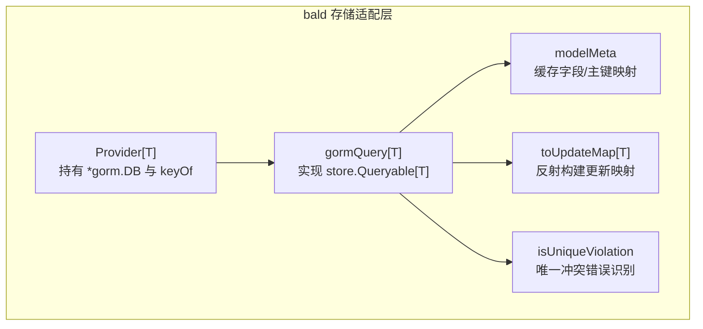
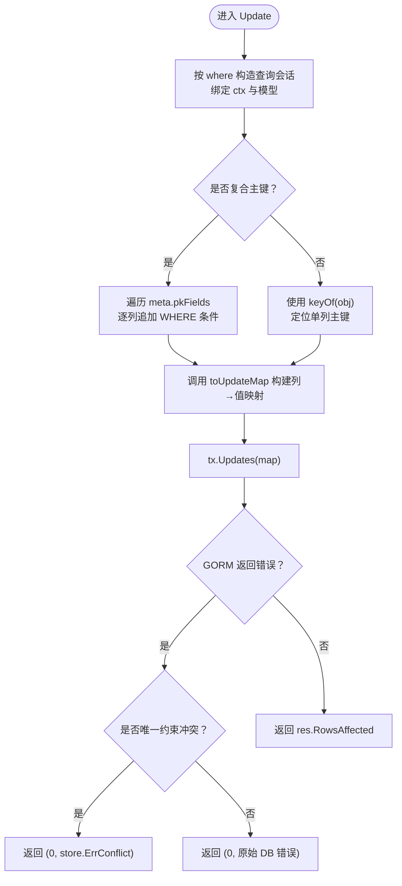
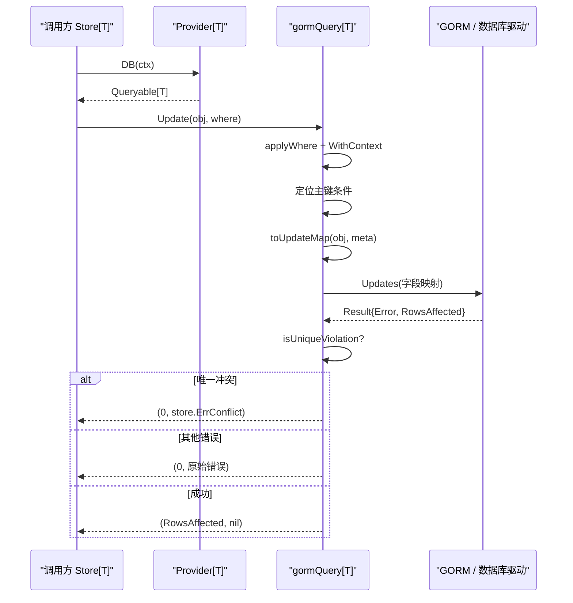
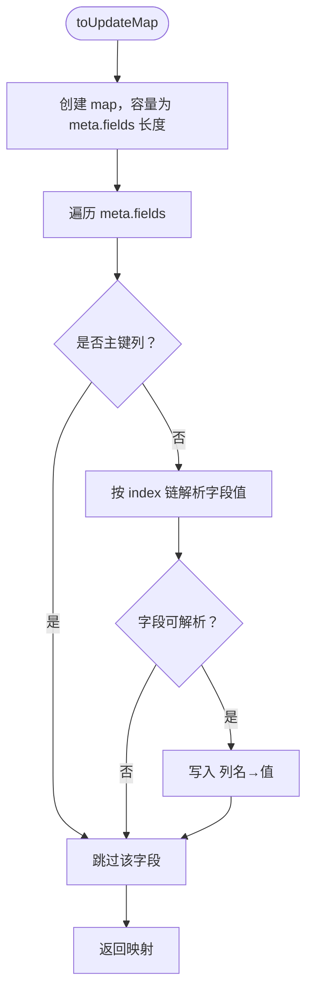
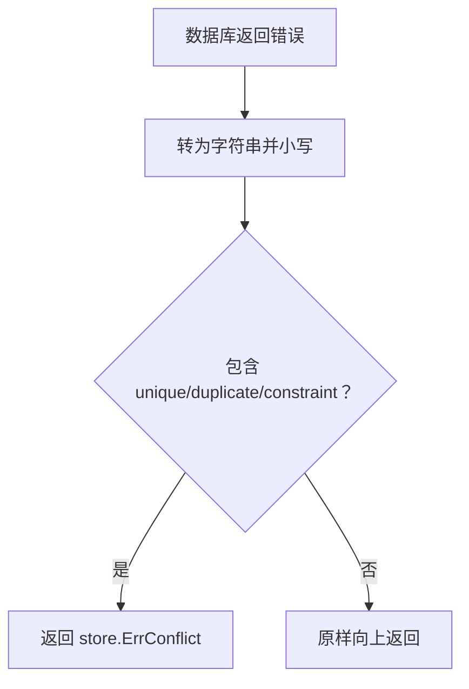
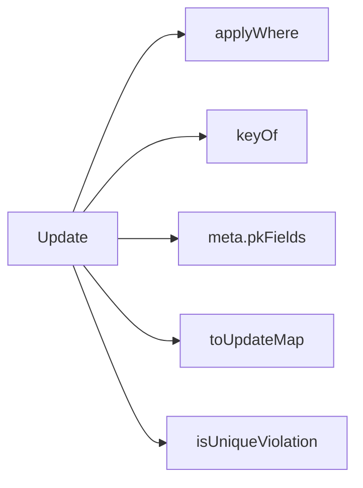

# 更新操作的幂等性与返回值语义

<cite>
**本文引用的文件**   
- [contrib/store-gorm/gorm.go](file://contrib/store-gorm/gorm.go)
- [contrib/store-gorm/update_idempotent_test.go](file://contrib/store-gorm/update_idempotent_test.go)
</cite>

## 目录
1. [引言](#引言)
2. [项目结构定位](#项目结构定位)
3. [核心组件：GORM 查询器与 Update](#核心组件gorm-查询器与-update)
4. [架构总览](#架构总览)
5. [详细组件分析](#详细组件分析)
6. [依赖关系分析](#依赖关系分析)
7. [性能与跨数据库差异](#性能与跨数据库差异)
8. [故障排查指南](#故障排查指南)
9. [结论](#结论)

## 引言
本文聚焦 `contrib/store-gorm` 子模块中 `Update` 方法的幂等设计、返回值语义，以及字段映射实现细节。需要明确的是：本仓库是 93 个 go.mod 的多模块仓库，该文档只讨论与「更新操作」直接相关的 GORM 适配层；仓储的其余主题（服务发现与网关出站、CI 质量闸门、Broker 订阅者生命周期）不在本次分析范围内。

## 项目结构定位
`Update` 相关逻辑集中在 `contrib/store-gorm/gorm.go`，并由 `update_idempotent_test.go` 钉住幂等契约。其职责是把 GORM 的 `*gorm.DB` 适配为 bald 核心的 `store.Queryable[T]`，让业务以统一泛型 `Store[T]` 访问 MySQL、PostgreSQL、SQLite 等后端。

**图表来源**
- [contrib/store-gorm/gorm.go:40-48](file://contrib/store-gorm/gorm.go#L40-L48)
- [contrib/store-gorm/gorm.go:72-82](file://contrib/store-gorm/gorm.go#L72-L82)
- [contrib/store-gorm/gorm.go:113-137](file://contrib/store-gorm/gorm.go#L113-L137)
- [contrib/store-gorm/gorm.go:140-156](file://contrib/store-gorm/gorm.go#L140-L156)
- [contrib/store-gorm/gorm.go:563-572](file://contrib/store-gorm/gorm.go#L563-L572)

**章节来源**
- [contrib/store-gorm/gorm.go:1-15](file://contrib/store-gorm/gorm.go#L1-L15)

## 核心组件：GORM 查询器与 Update
`gormQuery[T]` 是核心执行体，`Update` 方法完成条件拼接、主键保护、字段映射、唯一约束冲突映射，并返回受影响行数。

**图表来源**
- [contrib/store-gorm/gorm.go:113-137](file://contrib/store-gorm/gorm.go#L113-L137)
- [contrib/store-gorm/gorm.go:563-572](file://contrib/store-gorm/gorm.go#L563-L572)

**章节来源**
- [contrib/store-gorm/gorm.go:113-137](file://contrib/store-gorm/gorm.go#L113-L137)

## 架构总览
从调用方视角看，`store.NewStore[T](provider)` 通过 `Provider.DB(ctx)` 获得 `Queryable[T]`，再调用 `Update`。对外暴露的 API 不感知 GORM，仅传递 `*T` 实体和可选 `*store.Where`。

**图表来源**
- [contrib/store-gorm/gorm.go:40-48](file://contrib/store-gorm/gorm.go#L40-L48)
- [contrib/store-gorm/gorm.go:113-137](file://contrib/store-gorm/gorm.go#L113-L137)
- [contrib/store-gorm/gorm.go:563-572](file://contrib/store-gorm/gorm.go#L563-L572)

## 详细组件分析

### 一、幂等语义：为什么 0 行匹配不报错
`Update` 的设计目标是「把数据变成目标状态」，而不是「报告 SQL 执行过程」。因此：

- 未匹配到任何行时，底层 SQL 正常执行，只是影响 0 行；方法返回 `(0, nil)`。
- 已存在记录但值与目标一致时，MySQL 默认可能返回 0 或 1，取决于驱动实现，但不应被视为错误。
- 只有数据库驱动或约束产生错误时，才向上返回错误。

测试用例 `TestGorm_UpdateIdempotent` 明确断言：更新不存在记录应返回 `(0, nil)`，且更新到已是目标值的记录也视为成功。

**章节来源**
- [contrib/store-gorm/gorm.go:107-137](file://contrib/store-gorm/gorm.go#L107-L137)
- [contrib/store-gorm/update_idempotent_test.go:1-48](file://contrib/store-gorm/update_idempotent_test.go#L1-L48)

### 二、为什么返回 `RowsAffected` 而不是匹配行数
`Update` 返回的是 GORM 结果中的 `RowsAffected`，即驱动侧报告的受影响行数，而不是「WHERE 命中了多少行」。这是有意为之：

1. ORM 层没有统一获取「匹配行数」的标准接口。
2. 不同数据库对 UPDATE 的影响行数语义不同。
3. 上层若需要「必须存在才能更新」的强语义，应显式判断 `rows == 0`，而不是由库替业务做决策。

这意味着：**不能把 `RowsAffected == 0` 当作记录不存在**。它既可能是记录不存在，也可能是记录已处于目标值。

**章节来源**
- [contrib/store-gorm/gorm.go:107-137](file://contrib/store-gorm/gorm.go#L107-L137)

### 三、`toUpdateMap` 如何通过反射构建字段映射
`toUpdateMap` 的核心流程如下：

1. 使用 `meta.fields` 作为可持久化字段集合，避免扫描整个 Go 结构体。
2. 跳过所有主键列：调用 `meta.isPrimaryKey(f.column)`。
3. 按字段索引链解析实际字段值：`fieldByIndex(v, f.index)`，遇到 nil 嵌入指针时安全跳过。
4. 将「数据库列名 → 字段值」写入 map，传给 GORM 的 `Updates(map)`。

这保证了：

- 所有导出字段（含零值字段）都会被写入，避免 GORM 对零值字段的跳过行为。
- 主键不会被误写，防止行错位。
- 未导出的字段、nil 嵌入指针不会导致 panic。

**图表来源**
- [contrib/store-gorm/gorm.go:140-156](file://contrib/store-gorm/gorm.go#L140-L156)
- [contrib/store-gorm/gorm.go:257-272](file://contrib/store-gorm/gorm.go#L257-L272)

**章节来源**
- [contrib/store-gorm/gorm.go:140-156](file://contrib/store-gorm/gorm.go#L140-L156)
- [contrib/store-gorm/gorm.go:257-272](file://contrib/store-gorm/gorm.go#L257-L272)

### 四、排除主键列与复合主键处理
`modelMeta` 在初始化阶段收集主键信息：

- 如果结构体有 `primaryKey` tag，则加入 `pkFields`。
- 如果没有显式主键，但有 `ID` 字段，则把 `ID` 作为单列主键。
- 如果仍无主键信息，则回退到约定列 `id`。

`isPrimaryKey` 同时支持：

- 多列主键：遍历 `pkFields` 比较列名。
- 单列主键：比较 `m.primaryKey`。

`Update` 的主键定位逻辑：

- 复合主键：逐个主键列追加 `WHERE column = ?`。
- 单列主键：沿用 `keyOf(obj)`。

需要注意：复合主键场景下，`Update` 用实体各主键字段值拼 WHERE；而 `toUpdateMap` 会排除全部主键列，所以主键不会被改写。

**章节来源**
- [contrib/store-gorm/gorm.go:201-220](file://contrib/store-gorm/gorm.go#L201-L220)
- [contrib/store-gorm/gorm.go:222-255](file://contrib/store-gorm/gorm.go#L222-L255)
- [contrib/store-gorm/gorm.go:113-129](file://contrib/store-gorm/gorm.go#L113-L129)

### 五、处理 `gorm:"-"` 标记字段
`parseGormTag` 会把首段以 `-` 开头的 gorm tag 标记为忽略字段。`collectModelFields` 中，被标记为 ignore 的字段不会进入 `meta.fields`，因此 `toUpdateMap` 根本不会尝试写入它们。

这是关键安全边界：内存态字段、关联态字段（例如树形结构的 `Children`）如果直接透传，会被 GORM 生成无效列名，导致 SQLite 或 PostgreSQL 报「no such column」。通过 gorm tag 控制字段元数据，可以避免这类错误。

**章节来源**
- [contrib/store-gorm/gorm.go:222-255](file://contrib/store-gorm/gorm.go#L222-L255)
- [contrib/store-gorm/gorm.go:274-306](file://contrib/store-gorm/gorm.go#L274-L306)

### 六、唯一约束冲突的错误映射
`isUniqueViolation` 通过检查错误消息中是否包含以下关键字来判断唯一约束冲突：

- `unique`
- `duplicate`
- `constraint`

当 `Create` 或 `Update` 遇到此类错误时，会转换为 `store.ErrConflict`，从而屏蔽底层驱动差异。

**图表来源**
- [contrib/store-gorm/gorm.go:563-572](file://contrib/store-gorm/gorm.go#L563-L572)

**章节来源**
- [contrib/store-gorm/gorm.go:95-96](file://contrib/store-gorm/gorm.go#L95-L96)
- [contrib/store-gorm/gorm.go:130-133](file://contrib/store-gorm/gorm.go#L130-L133)
- [contrib/store-gorm/gorm.go:563-572](file://contrib/store-gorm/gorm.go#L563-L572)

## 依赖关系分析
`Update` 依赖以下内部能力：

| 依赖 | 作用 | 风险点 |
|---|---|---|
| `applyWhere` | 注入租户、数据范围等 WHERE 条件 | 条件过宽会导致影响更多行 |
| `keyOf` | 单列主键定位 | 传入空或错误函数会定位失败 |
| `meta.pkFields` | 复合主键判定与遍历 | 复合主键字段缺失时会报错 |
| `toUpdateMap` | 生成非主键字段映射 | 忘记 gorm tag 可能导致无效列 |
| `isUniqueViolation` | 唯一冲突归一化 | 依赖错误消息文本，属于尽力而为 |

**图表来源**
- [contrib/store-gorm/gorm.go:113-137](file://contrib/store-gorm/gorm.go#L113-L137)

**章节来源**
- [contrib/store-gorm/gorm.go:113-137](file://contrib/store-gorm/gorm.go#L113-L137)

## 性能与跨数据库差异

### 字段映射性能
`toUpdateMap` 使用 `make(map[string]any, len(meta.fields))` 预分配容量，减少扩容开销。字段元数据通过 `modelMetaOf` 缓存于 `sync.Map`，避免每次更新都重复反射结构体。

### MySQL 与 PostgreSQL 的差异
实现注释明确指出：MySQL 默认对「UPDATE 到与现有值相同」的记录可能返回 0。因此：

- `RowsAffected` 不是稳定的「匹配行数」指标。
- 同一语句在不同数据库上可能返回 0、1 或其他值。
- 业务不应根据返回值判断记录是否存在。

### 跨数据库兼容最佳实践
1. **不要依赖 `RowsAffected` 判断记录存在性。** 如果需要强存在语义，先 `Get`，或在业务层判断 `rows == 0` 后走特定分支。
2. **使用统一错误类型。** 唯一约束冲突通过 `store.ErrConflict` 上报，避免在业务层硬编码数据库错误消息。
3. **显式声明主键。** 尽量使用 `primaryKey` tag 或标准 `ID` 字段，避免回退到约定列 `id`。
4. **正确标注 gorm tag。** 非表字段使用 `-` 或忽略策略，避免映射出无效列。
5. **复合主键谨慎使用。** 确保实体每个主键字段都可解析；否则 `Update` 会返回结构化错误。
6. **幂等调用优先。** 更新接口本身应是幂等的；重试时不应因 0 行而失败。

[本节为通用指导，不直接分析具体代码片段]

## 故障排查指南

| 现象 | 可能原因 | 处理建议 |
|---|---|---|
| 更新不存在记录返回 0 行但没有错误 | 符合幂等语义 | 如需「必须存在」，在调用方判 `rows == 0` |
| 更新到目标值返回 0 行 | MySQL 等驱动优化掉重复写入 | 不把它当作错误；业务语义以最终状态为准 |
| 更新时报 no such column | 非表字段未用 gorm tag 排除 | 给内存态/关联态字段加 `gorm:"-"` |
| 唯一插入或更新报冲突 | 违反唯一约束 | 捕获 `store.ErrConflict` 并按业务处理 |
| 复合主键更新报错 | 某个主键字段不可解析 | 检查字段导出性与 gorm tag |
| 主键被意外修改 | 主键未被正确排除 | 确认 `primaryKey` tag 或 `ID` 字段配置 |

**章节来源**
- [contrib/store-gorm/gorm.go:140-156](file://contrib/store-gorm/gorm.go#L140-L156)
- [contrib/store-gorm/gorm.go:222-255](file://contrib/store-gorm/gorm.go#L222-L255)
- [contrib/store-gorm/gorm.go:563-572](file://contrib/store-gorm/gorm.go#L563-L572)

## 结论
`contrib/store-gorm` 的 `Update` 方法把「更新」定义为面向最终状态的幂等操作：

- 0 行匹配不报错，因为 SQL 正常执行，只是没有改变数据。
- 返回值是驱动侧的 `RowsAffected`，不是匹配行数，因此不能用于判断记录是否存在。
- `toUpdateMap` 通过反射和 `modelMeta` 构建字段映射，排除全部主键列，并跳过 gorm 标记为忽略的字段。
- 复合主键通过多列 WHERE 定位，主键列不会被写入。
- 唯一约束冲突统一映射为 `store.ErrConflict`，屏蔽底层驱动差异。
- MySQL 与 PostgreSQL 在 UPDATE 影响行数上存在差异，跨库兼容应以业务语义而非返回值为核心。