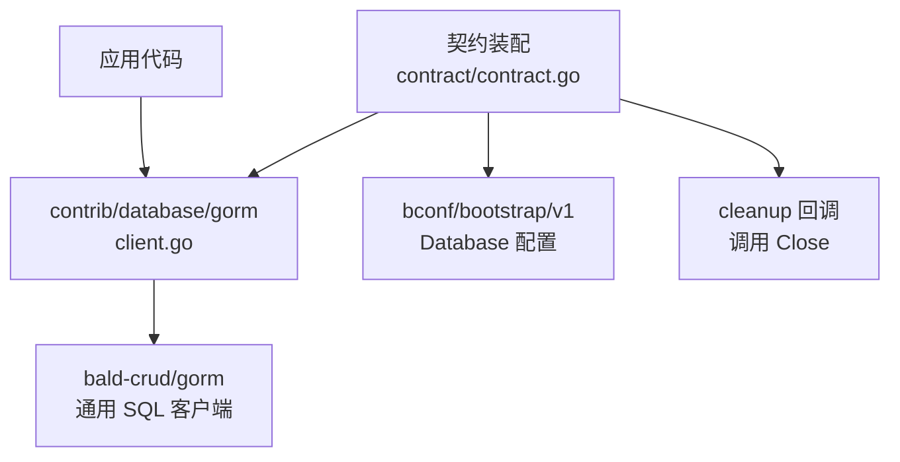
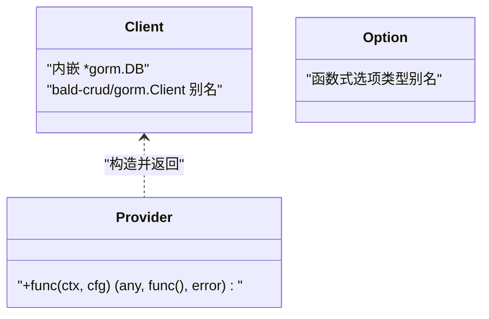
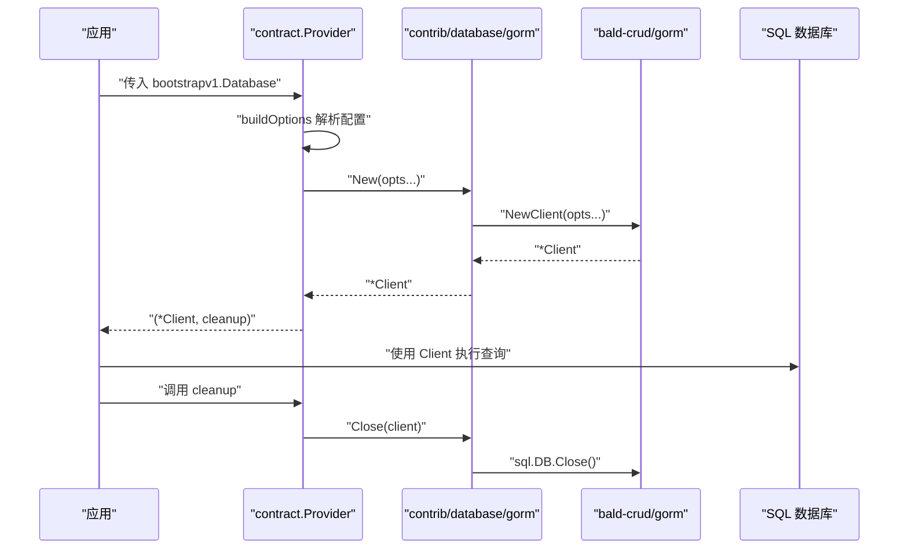
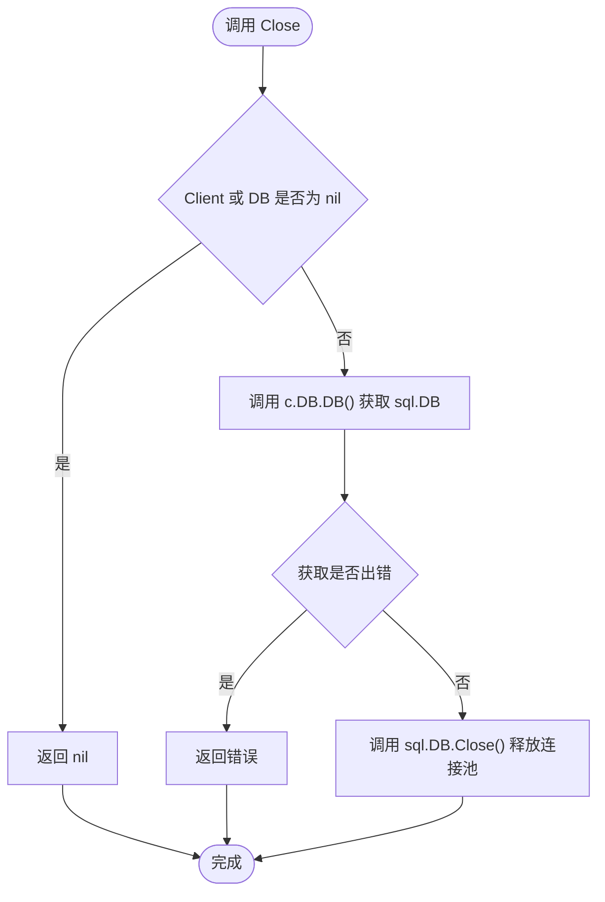
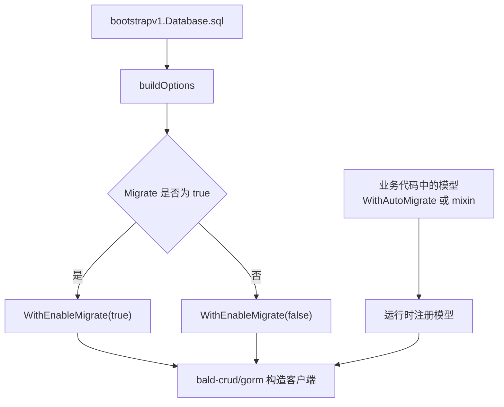
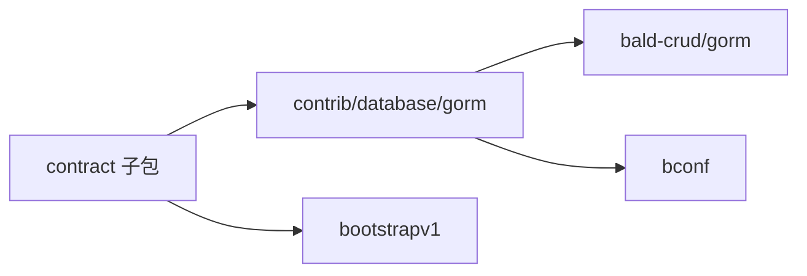
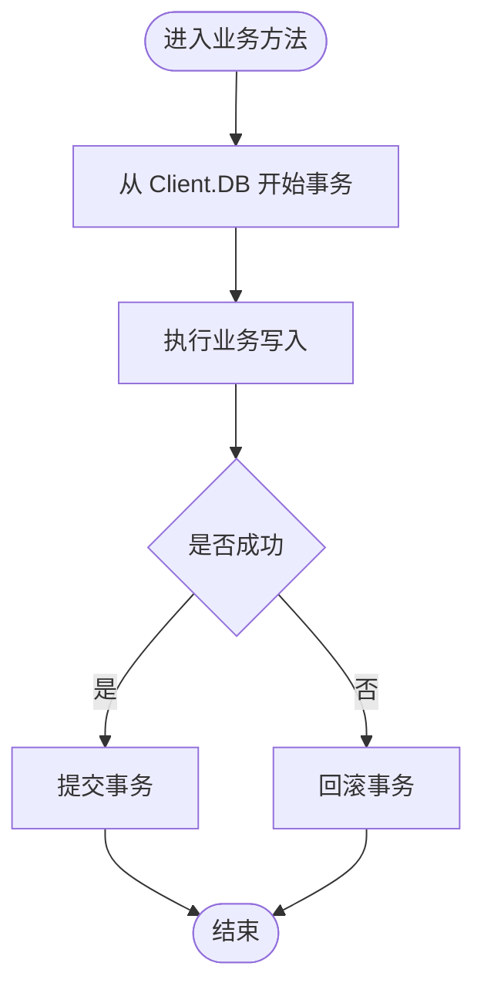

# GORM 数据库客户端封装

<cite>
**本文引用的文件**   
- [contrib/database/gorm/client.go](file://contrib/database/gorm/client.go)
- [contrib/database/gorm/contract/contract.go](file://contrib/database/gorm/contract/contract.go)
- [contrib/database/gorm/contract/contract_test.go](file://contrib/database/gorm/contract/contract_test.go)
- [contrib/database/gorm/go.mod](file://contrib/database/gorm/go.mod)
</cite>

## 目录
1. [简介](#简介)
2. [项目结构](#项目结构)
3. [核心组件](#核心组件)
4. [架构总览](#架构总览)
5. [详细组件分析](#详细组件分析)
6. [依赖关系分析](#依赖关系分析)
7. [性能与连接池配置](#性能与连接池配置)
8. [事务使用模式](#事务使用模式)
9. [错误处理最佳实践](#错误处理最佳实践)
10. [与 bald-crud/gorm 的差异与选型](#与-bald-crudd-gorm-的差异与选型)
11. [故障排查指南](#故障排查指南)
12. [结论](#结论)

## 简介
本包 `contrib/database/gorm` 是 `bald-crud/gorm` 的直连封装层，职责非常克制：

- 暴露 `Client`、`Option` 类型别名和 `New` / `Close` 函数，直接透传到 `github.com/kalandramo/bald-crud/gorm`。
- 根包不引入任何业务契约（如 `bootstrapv1.Database`），保持零契约依赖；契约装配逻辑放在独立的 `contract` 子包中。
- 迁移模型属于代码声明面，不在契约中建模；业务通过 `gormcrud.WithAutoMigrate` 或 mixin 追加模型，由 `contract.Provider` 把契约中的 `migrate` 开关转为 `WithEnableMigrate`。

换言之，本包不是新的数据库抽象，而是面向 SDK 使用者的薄包装：对外只暴露必要入口，把配置映射和生命周期交给 `contract` 子包与底层 `bald-crud/gorm`。

**章节来源**
- [contrib/database/gorm/client.go:1-33](file://contrib/database/gorm/client.go#L1-L33)
- [contrib/database/gorm/contract/contract.go:1-70](file://contrib/database/gorm/contract/contract.go#L1-L70)

## 项目结构
该模块只有四个关键文件：

| 文件 | 职责 |
|---|---|
| `client.go` | 定义 `Client`、`Option` 类型别名，提供 `New`、`Close` |
| `contract/contract.go` | 把 `bootstrapv1.Database.sql` 段映射为 `bald-crud/gorm` 选项并构造客户端 |
| `contract/contract_test.go` | 断言段缺失、DSN 必填、选项数量与单位转换等契约映射行为 |
| `go.mod` | 声明对 `bald-crud/gorm` 与本地化 `bconf` 的依赖 |

**图表来源**
- [contrib/database/gorm/client.go:1-33](file://contrib/database/gorm/client.go#L1-L33)
- [contrib/database/gorm/contract/contract.go:1-70](file://contrib/database/gorm/contract/contract.go#L1-L70)
- [contrib/database/gorm/go.mod:1-10](file://contrib/database/gorm/go.mod#L1-L10)

**章节来源**
- [contrib/database/gorm/go.mod:1-10](file://contrib/database/gorm/go.mod#L1-L10)
- [contrib/database/gorm/client.go:1-33](file://contrib/database/gorm/client.go#L1-L33)
- [contrib/database/gorm/contract/contract.go:1-70](file://contrib/database/gorm/contract/contract.go#L1-L70)

## 核心组件
本包对外仅暴露三类符号：

| 符号 | 含义 | 实现位置 |
|---|---|---|
| `Client` | 内嵌 `*gorm.DB` 的 SQL 客户端类型别名 | `client.go` |
| `Option` | `bald-crud/gorm` 的函数式选项类型别名 | `client.go` |
| `New` | 按选项创建客户端，透传到底层 | `client.go` |
| `Close` | 释放底层连接池，调用后对象不可再用 | `client.go` |
| `Provider` | 从 `bootstrapv1.Database` 构造客户端并返回 cleanup | `contract/contract.go` |

**图表来源**
- [contrib/database/gorm/client.go:9-33](file://contrib/database/gorm/client.go#L9-L33)
- [contrib/database/gorm/contract/contract.go:24-45](file://contrib/database/gorm/contract/contract.go#L24-L45)

**章节来源**
- [contrib/database/gorm/client.go:9-33](file://contrib/database/gorm/client.go#L9-L33)
- [contrib/database/gorm/contract/contract.go:24-45](file://contrib/database/gorm/contract/contract.go#L24-L45)

## 架构总览
本包的架构可以分成三层：

1. **SDK 封装层**：`client.go` 只做类型别名和构造函数转发，避免业务代码直接感知 `bald-crud/gorm` 包路径。
2. **契约装配层**：`contract/contract.go` 把 YAML/Proto 配置转成 `bald-crud/gorm` 的 `Option`，并把 cleanup 回调交给上层框架（例如 appkit）在停机时执行。
3. **底层实现层**：`bald-crud/gorm` 负责真实连接 GORM、驱动、连接池、迁移、追踪与指标。

**图表来源**
- [contrib/database/gorm/contract/contract.go:24-45](file://contrib/database/gorm/contract/contract.go#L24-L45)
- [contrib/database/gorm/client.go:18-33](file://contrib/database/gorm/client.go#L18-L33)

**章节来源**
- [contrib/database/gorm/contract/contract.go:24-45](file://contrib/database/gorm/contract/contract.go#L24-L45)
- [contrib/database/gorm/client.go:18-33](file://contrib/database/gorm/client.go#L18-L33)

## 详细组件分析

### `Client` 结构与生命周期
`Client` 是 `bald-crud/gorm.Client` 的类型别名，注释明确说明它内嵌 `*gorm.DB`。这意味着：

- 业务可以直接访问 `Client.DB` 获取 GORM 实例。
- 真正释放连接是通过 `c.DB.DB()` 拿到标准库 `*sql.DB`，再调用 `Close()`。
- `Close` 对空指针做了防御：`nil Client` 或内嵌 `DB` 为空时直接返回 nil，不会 panic。
- 语义上，`Close` 之后客户端不可复用。

**图表来源**
- [contrib/database/gorm/client.go:24-33](file://contrib/database/gorm/client.go#L24-L33)

**章节来源**
- [contrib/database/gorm/client.go:9-33](file://contrib/database/gorm/client.go#L9-L33)

### `New` 构造函数与选项透传
`New` 不接受连接字符串、驱动名或连接池参数；这些参数通过 `Option` 传入。选项最终调用 `bald-crud/gorm.NewClient`，因此本包没有重新实现连接逻辑。

典型选项来源有两个：

| 来源 | 说明 |
|---|---|
| 业务直接调用 `New` | 业务自行组装 `gormcrud.Option`，例如注入上下文、驱动、DSN、迁移开关 |
| 契约装配调用 `Provider` | `contract.buildOptions` 根据 `bootstrapv1.Database.sql` 生成选项 |

**章节来源**
- [contrib/database/gorm/client.go:18-22](file://contrib/database/gorm/client.go#L18-L22)
- [contrib/database/gorm/contract/contract.go:47-70](file://contrib/database/gorm/contract/contract.go#L47-L70)

### 与 `contract.Provider` 中迁移开关的协作
迁移相关的关键点有三条：

1. 迁移模型清单不属于契约，也不属于本包 API；它是代码声明面，业务需要显式注册模型。
2. `contract.buildOptions` 会读取 `sec.GetMigrate()`，并通过 `WithEnableMigrate` 传给底层。
3. 业务可以通过 `gormcrud.WithAutoMigrate` 或在 mixin 中追加模型，配合迁移开关启用自动迁移。

**图表来源**
- [contrib/database/gorm/contract/contract.go:47-70](file://contrib/database/gorm/contract/contract.go#L47-L70)
- [contrib/database/gorm/client.go:18-22](file://contrib/database/gorm/client.go#L18-L22)

**章节来源**
- [contrib/database/gorm/contract/contract.go:47-70](file://contrib/database/gorm/contract/contract.go#L47-L70)
- [contrib/database/gorm/client.go:18-22](file://contrib/database/gorm/client.go#L18-L22)

### 连接配置示例
由于本包只是透传，实际可用选项来自 `bald-crud/gorm`。结合 `contract.buildOptions`，可以从配置字段得到以下映射：

| 配置字段 | 行为 |
|---|---|
| `source` | 作为 DSN 必填项传入 `WithDSN` |
| `driver` | 非空时传入 `WithDriverName` |
| `migrate` | 控制 `WithEnableMigrate` |
| `enable_trace` | 控制 `WithEnableTrace` |
| `enable_metrics` | 控制 `WithEnableMetrics` |
| `max_idle_connections` | 大于 0 时设置最大空闲连接数 |
| `max_open_connections` | 大于 0 时设置最大打开连接数 |
| `connection_max_lifetime_seconds` | 乘以秒后设置连接生命周期 |

测试中还覆盖了最少字段与全字段的选项数量断言，说明未配置的池参数不会额外追加选项。

**章节来源**
- [contrib/database/gorm/contract/contract.go:47-70](file://contrib/database/gorm/contract/contract.go#L47-L70)
- [contrib/database/gorm/contract/contract_test.go:33-89](file://contrib/database/gorm/contract/contract_test.go#L33-L89)

### 事务使用模式
本包没有提供自定义事务包装器。事务应基于内嵌的 `*gorm.DB` 进行：

1. 从 `Client.DB` 获取 GORM 实例。
2. 在该实例上开启事务。
3. 在事务结束时提交或回滚。
4. 如果事务失败，仍由应用负责关闭整个 `Client`（即调用 `Close`）。

注意：`Close` 释放的是底层连接池，而不是某个事务句柄；事务本身的生命周期应由业务代码管理。

**章节来源**
- [contrib/database/gorm/client.go:9-33](file://contrib/database/gorm/client.go#L9-L33)

### 错误处理最佳实践
从源码可见的错误处理边界如下：

| 场景 | 行为 |
|---|---|
| `Provider` 缺少 `sql` 段 | 返回错误，提示类型与段缺失 |
| `sql.source` 为空 | 返回错误，提示 DSN 必填 |
| `c.DB.DB()` 失败 | `Close` 返回错误 |
| `Client` 或 `Client.DB` 为 nil | `Close` 安全返回 nil |
| 业务侧查询/写入错误 | 由底层 GORM 与驱动返回，本包不吞错 |

建议：

- 启动阶段检查 `Provider` 或 `New` 的返回值，不要忽略构建错误。
- 应用 shutdown 流程必须调用 cleanup 或 `Close`，避免连接泄漏。
- 业务代码中对数据库错误做分类：可重试错误走重试策略，不可恢复错误记录日志并上报。

**章节来源**
- [contrib/database/gorm/contract/contract.go:24-45](file://contrib/database/gorm/contract/contract.go#L24-L45)
- [contrib/database/gorm/contract/contract_test.go:16-31](file://contrib/database/gorm/contract/contract_test.go#L16-L31)
- [contrib/database/gorm/client.go:24-33](file://contrib/database/gorm/client.go#L24-L33)

## 依赖关系分析
模块依赖关系比较清晰：

- `contrib/database/gorm` 依赖 `bald-crud/gorm` 与本地化的 `bconf`。
- `contract` 子包额外依赖 `bootstrapv1` 生成的配置结构。
- 根包 `client.go` 不引用 `bconf`，符合“零契约依赖”设计目标。
- 所有第三方 GORM 驱动与插件由 `bald-crud/gorm` 间接引入，本模块把它们列为间接依赖。

**图表来源**
- [contrib/database/gorm/go.mod:1-10](file://contrib/database/gorm/go.mod#L1-L10)
- [contrib/database/gorm/contract/contract.go:1-22](file://contrib/database/gorm/contract/contract.go#L1-L22)

**章节来源**
- [contrib/database/gorm/go.mod:1-10](file://contrib/database/gorm/go.mod#L1-L10)
- [contrib/database/gorm/contract/contract.go:1-22](file://contrib/database/gorm/contract/contract.go#L1-L22)

## 性能与连接池配置
`Client` 的生命周期最终落到标准库 `*sql.DB` 的连接池。配置重点包括：

| 配置项 | 影响 |
|---|---|
| `max_open_connections` | 限制同时打开的连接数 |
| `max_idle_connections` | 控制空闲连接保留数 |
| `connection_max_lifetime_seconds` | 控制连接存活时间，避免长连接资源老化 |
| `enable_metrics` | 可能接入 Prometheus 指标 |
| `enable_trace` | 可能接入链路追踪 |

注意事项：

- 连接池过大可能压垮数据库；过小则在高并发下出现等待。
- `connection_max_lifetime_seconds` 应小于数据库侧的连接超时配置。
- 生产环境应同时关注指标与追踪开关，避免无监控地运行。
- 应用退出前必须调用 `Close`，否则连接池可能无法及时回收。

**章节来源**
- [contrib/database/gorm/contract/contract.go:47-70](file://contrib/database/gorm/contract/contract.go#L47-L70)
- [contrib/database/gorm/client.go:24-33](file://contrib/database/gorm/client.go#L24-L33)

## 事务使用模式
本包不提供事务包装，事务应基于内嵌的 `*gorm.DB` 管理。推荐模式如下：

1. 在请求或任务作用域内，从 `Client.DB` 开启事务。
2. 将事务句柄传递给数据访问函数。
3. 成功路径提交事务，失败路径回滚。
4. 外层只负责关闭整个 `Client`，不负责单个事务的生命周期。

**图表来源**
- [contrib/database/gorm/client.go:9-33](file://contrib/database/gorm/client.go#L9-L33)

**章节来源**
- [contrib/database/gorm/client.go:9-33](file://contrib/database/gorm/client.go#L9-L33)

## 错误处理最佳实践
结合源码与测试，推荐以下实践：

- **构建阶段**：`Provider` 对缺段和空 DSN 做快速失败；`New` 若底层初始化失败也应被调用方捕获。
- **关闭阶段**：优先使用 `Provider` 返回的 cleanup 回调；若直接持有 `Client`，则在应用退出时调用 `Close`。
- **空值保护**：`Close` 已处理 `nil Client` 与 `nil DB`，但业务不应依赖此行为来掩盖未初始化问题。
- **业务错误**：不要把数据库错误当作普通返回码吞掉；应区分网络错误、认证错误、约束冲突和迁移错误。
- **迁移失败**：当 `migrate=true` 且模型变更不兼容时，应提前评估风险并在部署流程中处理失败。

**章节来源**
- [contrib/database/gorm/contract/contract_test.go:16-31](file://contrib/database/gorm/contract/contract_test.go#L16-L31)
- [contrib/database/gorm/client.go:24-33](file://contrib/database/gorm/client.go#L24-L33)

## 与 bald-crud/gorm 的差异与选型
| 维度 | `contrib/database/gorm` | `bald-crud/gorm` |
|---|---|---|
| 职责 | 面向 SDK 使用的薄封装 + 契约装配 | 通用 SQL 客户端实现 |
| 对外类型 | `Client`、`Option`、`New`、`Close` | 完整的客户端、选项、工具函数 |
| 契约依赖 | 根包无契约依赖，仅在 `contract` 子包引入 | 通常由上层 SDK 消费 |
| 配置来源 | 可通过 `contract.Provider` 从 `bootstrapv1.Database` 构造 | 通过函数式选项构造 |
| 迁移模型 | 由业务代码声明，不在契约中建模 | 通过 `WithAutoMigrate` 等机制注册 |
| 适用场景 | 希望用统一配置入口、统一 shutdown 清理 | 需要直接使用底层能力或扩展更多选项 |

选型建议：

- 如果使用 bald 框架的配置体系，优先通过 `contract.Provider` 获取客户端，获得一致的配置、指标、追踪和清理语义。
- 如果只需要最简封装，可直接使用本包的 `New` 和 `Close`。
- 如果需要更细粒度的底层能力（例如扩展尚未在本包导出的选项），应直接依赖 `bald-crud/gorm`，而不是继续往本包堆功能。
- 不要把本包当成新的数据库抽象层；它只是路径和生命周期的简化包装。

**章节来源**
- [contrib/database/gorm/client.go:1-22](file://contrib/database/gorm/client.go#L1-L22)
- [contrib/database/gorm/contract/contract.go:1-22](file://contrib/database/gorm/contract/contract.go#L1-L22)
- [contrib/database/gorm/go.mod:1-10](file://contrib/database/gorm/go.mod#L1-L10)

## 故障排查指南

| 现象 | 可能原因 | 排查方式 |
|---|---|---|
| 启动时报 `database: type="sql" but sql section is missing` | 配置中声明了 `sql` 类型但没有 `sql` 段 | 检查 `bootstrapv1.Database` 配置 |
| 启动时报 `database: sql.source (DSN) is required` | `sql.source` 为空 | 检查环境变量或配置文件中的 DSN |
| 应用退出后连接未释放 | 未调用 cleanup 或 `Close` | 确认 shutdown 流程 |
| `Close` 返回错误 | `c.DB.DB()` 失败 | 检查底层 GORM 状态和驱动连接 |
| 查询正常但连接数持续增长 | 未正确关闭客户端或连接池配置不当 | 检查 `Close` 调用和连接池参数 |
| 迁移未按预期执行 | `migrate=false` 或模型未注册 | 检查 `WithEnableMigrate` 和 `WithAutoMigrate` / mixin |

**章节来源**
- [contrib/database/gorm/contract/contract_test.go:16-31](file://contrib/database/gorm/contract/contract_test.go#L16-L31)
- [contrib/database/gorm/client.go:24-33](file://contrib/database/gorm/client.go#L24-L33)
- [contrib/database/gorm/contract/contract.go:24-70](file://contrib/database/gorm/contract/contract.go#L24-L70)

## 结论
`contrib/database/gorm` 是一个设计目标清晰的薄封装：

- 对外只暴露 `Client`、`Option`、`New`、`Close`。
- 根包零契约依赖，契约装配放在 `contract` 子包。
- 迁移模型属于代码声明面，由业务通过 `WithAutoMigrate` 或 mixin 追加。
- 生命周期以 `Close` 释放底层连接池为核心，shutdown 流程必须覆盖。
- 对于大多数使用 bald 配置的应用，`contract.Provider` 是首选入口；对于需要更接近底层实现的场景，可直接使用 `bald-crud/gorm`。