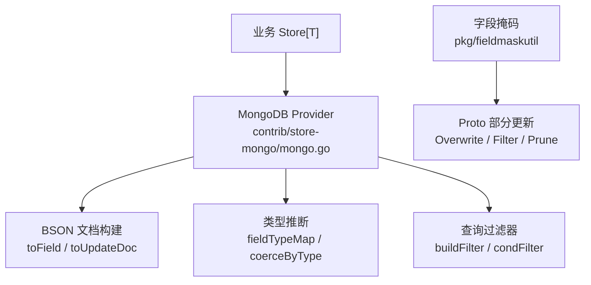
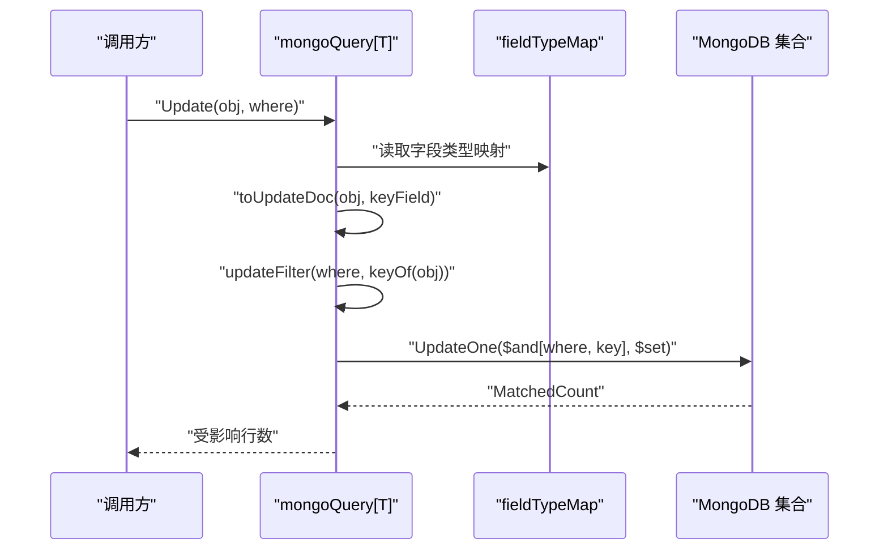
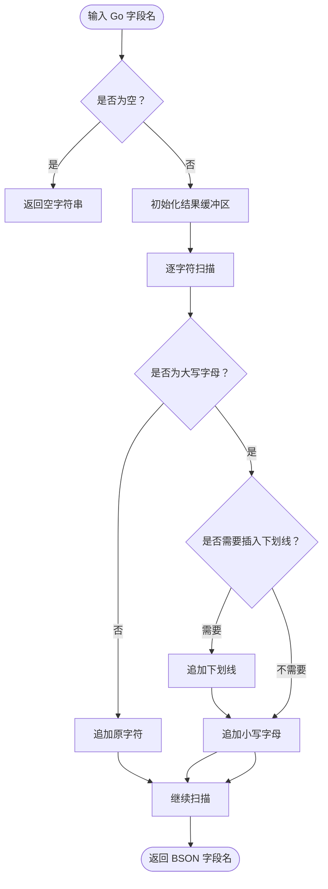
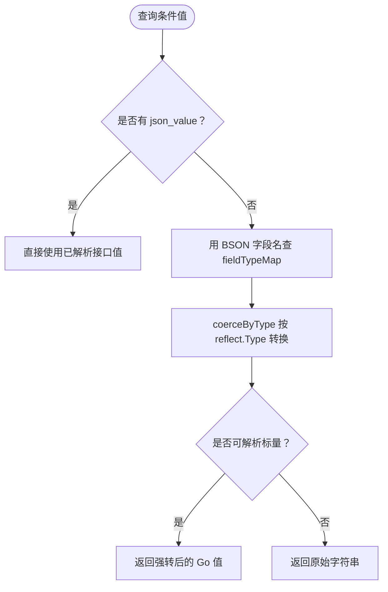
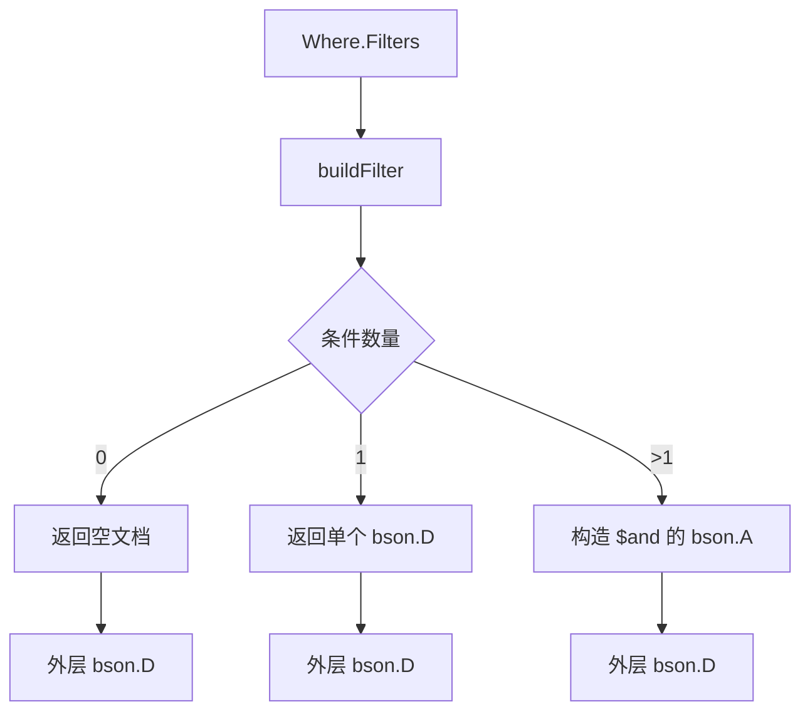
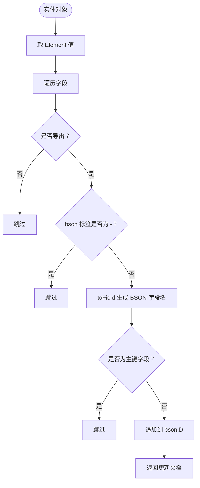
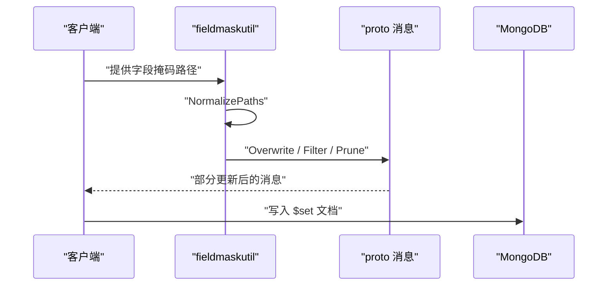
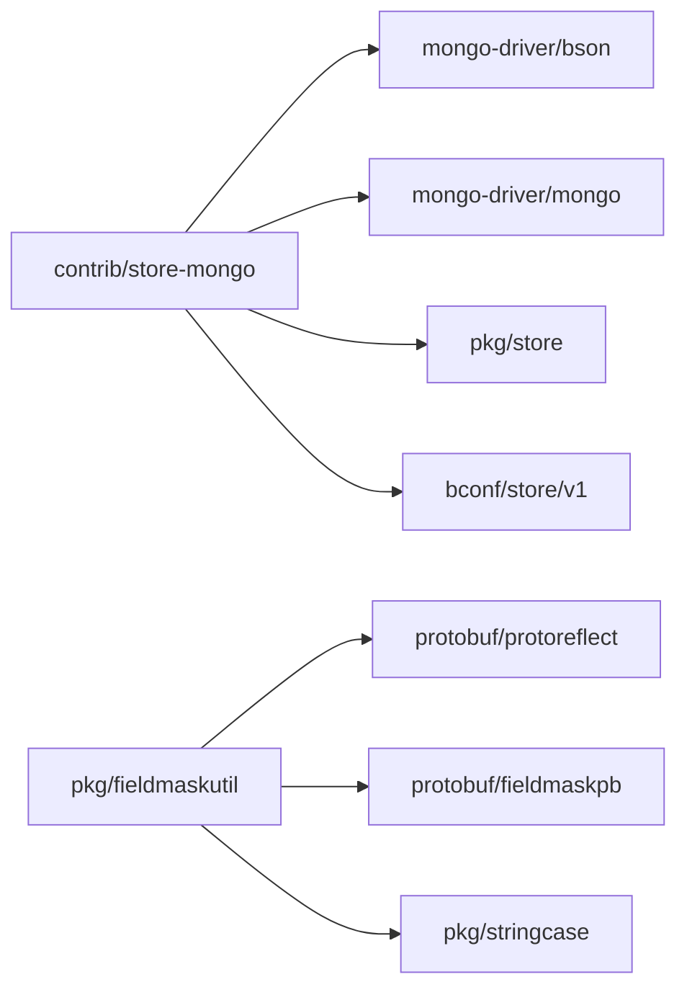

# BSON 字段映射与类型推断

<cite>
**本文引用的文件**
- [mongo.go](file://contrib/store-mongo/mongo.go)
- [fieldmaskutil.go](file://pkg/fieldmaskutil/fieldmaskutil.go)
- [nested_mask.go](file://pkg/fieldmaskutil/nested_mask.go)
- [snake_case.go](file://pkg/stringcase/snake_case.go)
</cite>

## 目录
1. [引言](#引言)
2. [项目结构定位](#项目结构定位)
3. [核心组件总览](#核心组件总览)
4. [架构概览](#架构概览)
5. [toField 字段名转换逻辑](#tofield-字段名转换逻辑)
6. [fieldTypeMap 反射类型推断与 BSON 值转换](#fieldtypemap-反射类型推断与-bson-值转换)
7. [bson.D 与 bson.A 的构建过程](#bosnd-与-bsona-的构建过程)
8. [复杂数据类型处理示例](#复杂数据类型处理示例)
9. [嵌套结构序列化规则](#嵌套结构序列化规则)
10. [fieldmaskutil 字段掩码与增量更新](#fieldmaskutil-字段掩码与增量更新)
11. [依赖关系分析](#依赖关系分析)
12. [故障排查指南](#故障排查指南)
13. [结论](#结论)

## 引言
本文聚焦 MongoDB 存储适配层中的三个关键问题：Go 字段名到 BSON 字段名的转换、基于实体类型推断的值转换，以及字段掩码在增量更新中的作用。这些内容集中体现在 `contrib/store-mongo` 模块的 `toField`、`fieldTypeMap`、`condArg`、`coerceByType`、`toUpdateDoc` 等实现中，并与 `pkg/fieldmaskutil` 提供的 proto FieldMask 能力配合，保证同一查询语义在内存、GORM、MongoDB 三后端保持一致。

## 项目结构定位
本主题涉及两个仓库子模块：
- `contrib/store-mongo`：把 mongo-driver v2 的 `*mongo.Database` 适配为 bald 核心的 `store.DBProvider[T]` + `store.Queryable[T]`，负责 Where 条件翻译、BSON 文档构建和类型转换。
- `pkg/fieldmaskutil`：提供基于 `protoreflect` 的 FieldMask 过滤、剪除、覆写与校验，用于 proto 消息的部分更新。

**图表来源**
- [mongo.go:1-100](file://contrib/store-mongo/mongo.go#L1-L100)
- [fieldmaskutil.go:1-157](file://pkg/fieldmaskutil/fieldmaskutil.go#L1-L157)

**章节来源**
- [mongo.go:1-100](file://contrib/store-mongo/mongo.go#L1-L100)

## 核心组件总览
| 组件 | 位置 | 职责 |
|---|---|---|
| `toField` | `contrib/store-mongo/mongo.go` | Go 字段名转 BSON 字段名，默认 snake_case |
| `fieldTypeMap` | `contrib/store-mongo/mongo.go` | 通过反射构造 BSON 字段名到 Go 类型的映射 |
| `condArg` | `contrib/store-mongo/mongo.go` | 选择 JSON 值或按字段类型转换字符串值 |
| `coerceByType` | `contrib/store-mongo/mongo.go` | 标量类型强转：int、uint、float、bool |
| `toUpdateDoc` | `contrib/store-mongo/mongo.go` | 反射实体生成 `$set` 文档，剔除主键 |
| `NestedMask` | `pkg/fieldmaskutil/nested_mask.go` | 递归路径掩码，支持 Filter、Prune、Overwrite |
| `NormalizePaths` | `pkg/fieldmaskutil/fieldmaskutil.go` | 将字段路径归一化为 snake_case |
| `ToSnakeCase` | `pkg/stringcase/snake_case.go` | 通用 snake_case 转换器 |

**章节来源**
- [mongo.go:201-526](file://contrib/store-mongo/mongo.go#L201-L526)
- [fieldmaskutil.go:1-157](file://pkg/fieldmaskutil/fieldmaskutil.go#L1-L157)
- [nested_mask.go:1-200](file://pkg/fieldmaskutil/nested_mask.go#L1-L200)
- [snake_case.go:1-154](file://pkg/stringcase/snake_case.go#L1-L154)

## 架构概览
MongoDB 适配器把高层 `store.Where` 翻译成 BSON 文档，并在写入时把 Go 实体反射成 `bson.D`。类型推断是桥接层的重点：MongoDB 驱动不执行 SQL 那样的隐式类型转换，因此查询比较值和更新值都需要根据实体 schema 做显式转换。

**图表来源**
- [mongo.go:100-200](file://contrib/store-mongo/mongo.go#L100-L200)
- [mongo.go:400-526](file://contrib/store-mongo/mongo.go#L400-L526)

## toField 字段名转换逻辑
`toField` 的职责是把 Go 导出字段名转换为 BSON 字段名。其默认约定与 store-gorm 的 `toColumn` 一致，都是 snake_case，从而让同一个 `Where` 在内存、GORM、MongoDB 后端得到相同语义。

### 转换规则
- 空字段名直接返回。
- 遍历原始字段名的每个字符。
- 遇到大写字母时判断前一个字符和后一个字符：
  - 如果前一个是小写字母，说明大小写边界在这里，先插入下划线再输出对应小写字母。
  - 如果前一个是连续大写字母且后一个也是小写字母，说明缩写词结尾，同样插入下划线后再转小写。
- 非大写字母原样写出。

这意味着：
- `UserID` → `user_id`
- `HTTPServer` → `http_server`
- `ID` → `id`
- `XMLParser` → `xml_parser`

### 为什么不用 stringcase.ToSnakeCase
`toField` 是自己实现的轻量版本，只服务于 BSON 字段名；而 `pkg/stringcase.ToSnakeCase` 更通用，供 fieldmaskutil 的路径规范化使用。两者都遵循 snake_case，但实现粒度不同。

**图表来源**
- [mongo.go:470-526](file://contrib/store-mongo/mongo.go#L470-L526)

**章节来源**
- [mongo.go:470-526](file://contrib/store-mongo/mongo.go#L470-L526)
- [snake_case.go:1-154](file://pkg/stringcase/snake_case.go#L1-L154)

## fieldTypeMap 反射类型推断与 BSON 值转换
`fieldTypeMap[T]()` 在 Provider 创建 `mongoQuery` 时执行一次，缓存 `map[string]reflect.Type`，键是 BSON 字段名，值是 Go 字段类型。它用于后续把用户传入的字符串条件值转换成 MongoDB 需要的真实类型。

### 推断流程
1. 取泛型参数 `T` 的 `reflect.Type`。
2. 如果 `T` 是指针，解引用到基础类型。
3. 如果不是 struct，直接返回空映射。
4. 遍历所有导出字段。
5. 忽略 `bson:"-"` 字段。
6. 对字段名应用 `toField`，并把字段类型写入映射。

这个映射不是用来做 JSON/BSON 编解码的完整 schema，而是针对查询条件和 IN/NIN 列表的“已知字段类型表”。

### 值转换流程
`condArg` 优先使用 `json_value`（typed value），否则走 `coerceByType`。`coerceByType` 只处理四种标量类型：
- int 系列：尝试 `strconv.ParseInt`
- uint 系列：尝试 `strconv.ParseUint`
- float 系列：尝试 `strconv.ParseFloat`
- bool：尝试 `strconv.ParseBool`

转换失败或类型不在表中时，原样返回字符串。这样能避免 MongoDB 把字符串 `"25"` 当成字符串比较，而不是整数比较。

**图表来源**
- [mongo.go:340-470](file://contrib/store-mongo/mongo.go#L340-L470)

**章节来源**
- [mongo.go:340-470](file://contrib/store-mongo/mongo.go#L340-L470)

## bson.D 与 bson.A 的构建过程
代码中 `bson.D` 表示有序键值文档，`bson.A` 表示有序数组。它们分别承担不同角色：

| 结构 | 用途 | 典型场景 |
|---|---|---|
| `bson.D` | 文档键值对 | 单条过滤条件、排序文档、`$set` 更新文档 |
| `bson.A` | 元素数组 | `$and`、`$or`、`$in`、`$nin` 等操作符的参数 |

### 主要构建点
- `buildFilter`：把所有 `Filters` 和可选 `Expr` 拼成 `$and` 数组。
- `exprFilter`：递归构造布尔树，空 AND 恒真，空 OR 恒假。
- `condFilter`：单条件转 BSON，如 EQ、NEQ、GT、IN、REGEXP 等。
- `coerceSlice`：为 IN/NIN 构建 `bson.A`，逐项按字段类型转换。
- `toUpdateDoc`：反射实体生成 `$set` 的 `bson.D`，并跳过主键。
- `buildSort`：生成排序文档，字段方向为 1 或 -1。

**图表来源**
- [mongo.go:220-340](file://contrib/store-mongo/mongo.go#L220-L340)

**章节来源**
- [mongo.go:220-340](file://contrib/store-mongo/mongo.go#L220-L340)

## 复杂数据类型处理示例
以下示例描述行为，不展示具体源码内容。

### 数组类型
当字段本身是 Go 切片时，MongoDB 的等值匹配天然具有“包含元素”语义。例如 `{tags:"b"}` 会命中 `tags:[a,b]`。因此 `ARRAY_CONTAINS` 操作符直接把标量比较值赋给字段，无需额外 `$elemMatch`。

对于 IN/NIN，`coerceSlice` 会把字符串列表逐项转换为目标字段类型，再放入 `bson.A`。

### 嵌套对象
MongoDB 原生支持点号路径，例如 `meta.role`。`JSON_CONTAINS` 被实现为按点号路径等值匹配，与 Proto 注释中“Postgres/MySQL JSON 包含”的意图对齐。

### 时间类型
`fieldTypeMap` 记录的是 Go 字段类型，但 `coerceByType` 只处理 int、uint、float、bool。若时间字段以字符串形式参与比较，转换失败后会保留字符串。业务应优先使用 `json_value` 传入正确的时间值，或通过实体上的时间字段类型确保 MongoDB 拿到期望类型。

### 指针类型
`fieldTypeMap` 会记录字段的原始类型；如果字段是指针，`reflect.Type.Kind()` 会是指针，不会落入标量分支，因此 `coerceByType` 会回退为字符串。这符合“未知类型透传”的安全策略：MongoDB 驱动会在自身编解码阶段决定指针值的最终形态，查询比较值保持原始输入。

**章节来源**
- [mongo.go:260-470](file://contrib/store-mongo/mongo.go#L260-L470)

## 嵌套结构序列化规则
嵌套结构的序列化主要由 `toUpdateDoc` 负责。它的目标是生成一个 `$set` 文档，覆盖实体的全部导出字段，但不修改主键。

### 规则要点
- 使用 `reflect.ValueOf(obj).Elem()` 取实体值。
- 遍历导出字段。
- 忽略 `bson:"-"`。
- 对字段名应用 `toField`。
- 跳过 `keyField`，防止主键被改写导致文档错位。
- 值直接取 `v.Field(i).Interface()`，不做二次类型转换。

这与 store-gorm 的 `toMapExcludeKey` 语义对齐：写入全部导出字段、零值也写入、只排除主键。

### 注意
`toUpdateDoc` 并不递归展开嵌套结构。嵌套对象会被当作一个整体值写入；真正的嵌套序列化由 mongo-driver 的 BSON 编码器完成。因此，业务侧应保证实体结构上的 BSON 标签与字段命名约定一致。

**图表来源**
- [mongo.go:420-470](file://contrib/store-mongo/mongo.go#L420-L470)

**章节来源**
- [mongo.go:420-470](file://contrib/store-mongo/mongo.go#L420-L470)

## fieldmaskutil 字段掩码与增量更新
`fieldmaskutil` 提供的是 proto 层面的字段掩码能力，与 MongoDB 的 BSON 文档构建是互补关系：前者决定“哪些 proto 字段应该更新”，后者决定“如何把这些字段写到 MongoDB”。

### 核心能力
| API | 作用 |
|---|---|
| `Filter(msg, paths)` | 仅保留指定路径字段，清空其余字段 |
| `Prune(msg, paths)` | 清除指定路径字段，保留其余字段 |
| `Overwrite(src, dest, paths)` | 按路径把 src 的值覆写到 dest |
| `Validate(validationModel, paths)` | 校验路径对模型是否合法 |
| `NormalizePaths(paths)` | 将路径列表归一化为 snake_case，并修正 `id_`/`_id` |

### 增量更新工作流
1. 接收外部请求中的字段掩码路径。
2. 调用 `NormalizeFieldMaskPaths` 或 `NormalizePaths`，统一为 snake_case。
3. 使用 `NestedMaskFromPaths` 构建递归掩码。
4. 调用 `Overwrite` 完成部分更新：未命中的字段不清空，命中的字段按源值设置。
5. 如果需要纯筛选输出，则用 `Filter`；如果需要删除敏感字段，则用 `Prune`。

### 与 MongoDB 的衔接
`Overwrite` 作用于 proto 消息，不直接写 MongoDB。实际写入 MongoDB 时，业务通常会把经过掩码处理的 DTO 转为实体，再由 `toUpdateDoc` 生成 `$set` 文档。由于 `toUpdateDoc` 写入全部导出字段，因此必须先在 proto 层做好掩码控制，避免把不应更新的字段重新写回数据库。

**图表来源**
- [fieldmaskutil.go:1-157](file://pkg/fieldmaskutil/fieldmaskutil.go#L1-L157)
- [nested_mask.go:1-200](file://pkg/fieldmaskutil/nested_mask.go#L1-L200)

**章节来源**
- [fieldmaskutil.go:1-157](file://pkg/fieldmaskutil/fieldmaskutil.go#L1-L157)
- [nested_mask.go:1-200](file://pkg/fieldmaskutil/nested_mask.go#L1-L200)

## 依赖关系分析
MongoDB 适配器依赖：
- `go.mongodb.org/mongo-driver/v2/bson`：构建 BSON 文档。
- `go.mongodb.org/mongo-driver/v2/mongo`：数据库操作。
- `github.com/kalandramo/bald/pkg/store`：抽象查询模型。
- `github.com/kalandramo/bald/bconf/gen/go/bald/store/v1`：Where、FilterExpr、Sorting 等协议定义。

字段掩码模块依赖：
- `google.golang.org/protobuf/proto` 与 `protoreflect`：反射遍历 proto 消息。
- `google.golang.org/protobuf/types/known/fieldmaskpb`：标准 FieldMask。
- `pkg/stringcase`：snake_case 路径规范化。

**图表来源**
- [mongo.go:1-30](file://contrib/store-mongo/mongo.go#L1-L30)
- [fieldmaskutil.go:1-20](file://pkg/fieldmaskutil/fieldmaskutil.go#L1-L20)

**章节来源**
- [mongo.go:1-30](file://contrib/store-mongo/mongo.go#L1-L30)
- [fieldmaskutil.go:1-20](file://pkg/fieldmaskutil/fieldmaskutil.go#L1-L20)

## 故障排查指南
| 现象 | 可能原因 | 处理建议 |
|---|---|---|
| 字符串 `"25"` 无法匹配整数字段 | MongoDB 无隐式类型转换，字符串与整数不等 | 使用 `json_value` 或确保字段类型能被 `coerceByType` 解析 |
| 查询条件没有生效 | Where 字段名与实体 `bson` 标签不一致 | 检查 `toField` 输出是否与 MongoDB 中字段名一致 |
| `bson:"-"` 字段仍出现在更新中 | 误配标签或主键字段被覆盖 | 确认字段标签，并确保 `keyField` 配置正确 |
| 正则匹配异常 | 用户输入包含正则元字符 | 使用 `regexpQuote` 转义，不要直接拼接用户输入 |
| 字段掩码路径无效 | 路径未归一化或与 proto 字段名不匹配 | 调用 `NormalizeFieldMaskPaths` 或 `NormalizePaths` |
| 嵌套字段未更新 | proto 层未纳入掩码，或掩码路径错误 | 检查 `NestedMaskFromPaths` 生成的路径树 |

**章节来源**
- [mongo.go:260-526](file://contrib/store-mongo/mongo.go#L260-L526)
- [fieldmaskutil.go:60-157](file://pkg/fieldmaskutil/fieldmaskutil.go#L60-L157)

## 结论
`toField` 提供 Go 字段名到 BSON 字段名的稳定 snake_case 映射，`fieldTypeMap` 提供查询条件的类型感知转换，二者共同解决 MongoDB 强类型带来的跨后端一致性难题。`bson.D` 和 `bson.A` 分别承担文档与数组语义，贯穿查询、排序、更新和布尔表达式。`fieldmaskutil` 则在 proto 层实现字段级增量更新，与 `toUpdateDoc` 的 `$set` 写入配合，形成从协议到存储的完整增量更新链路。