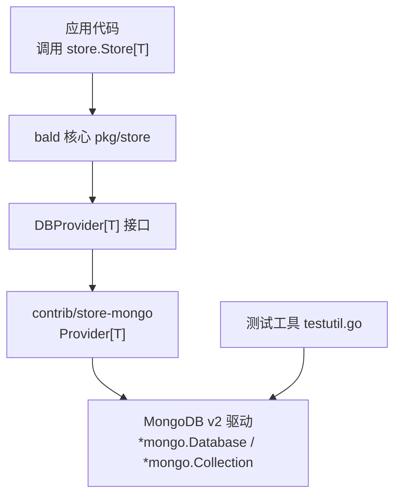
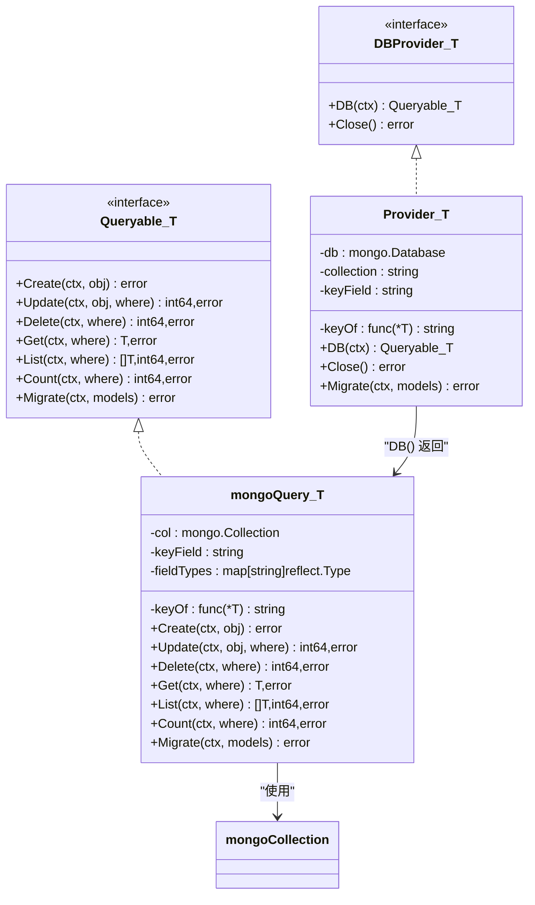
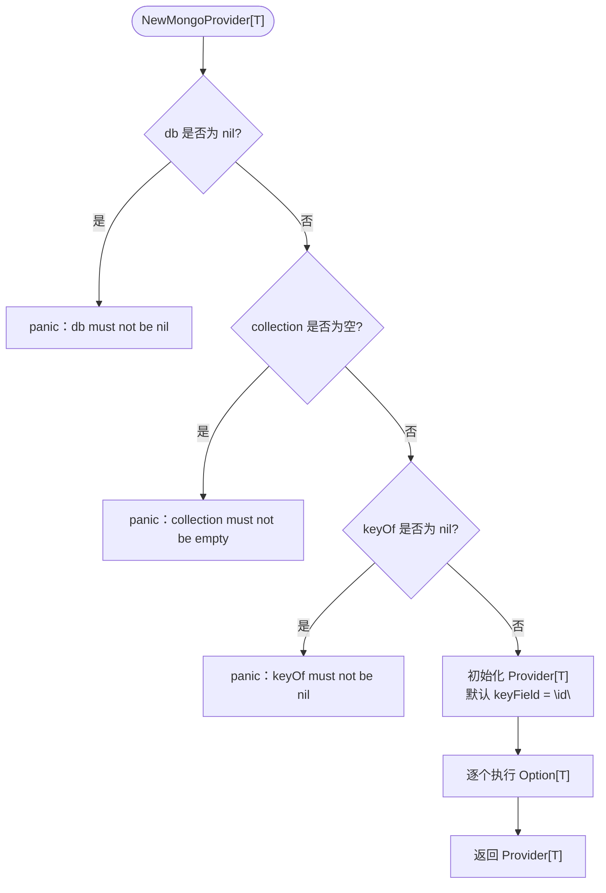
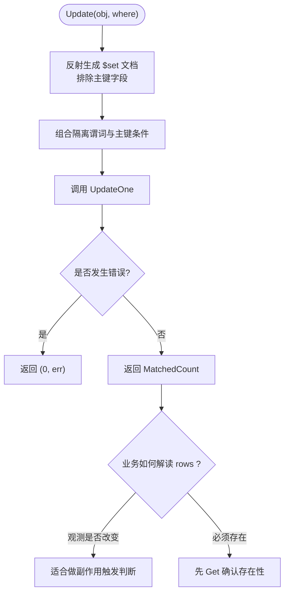
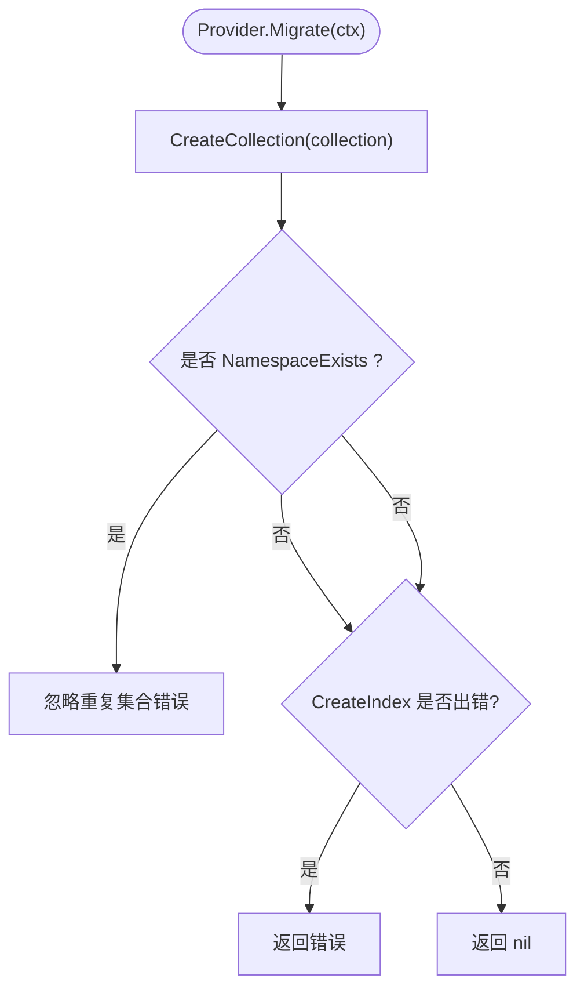
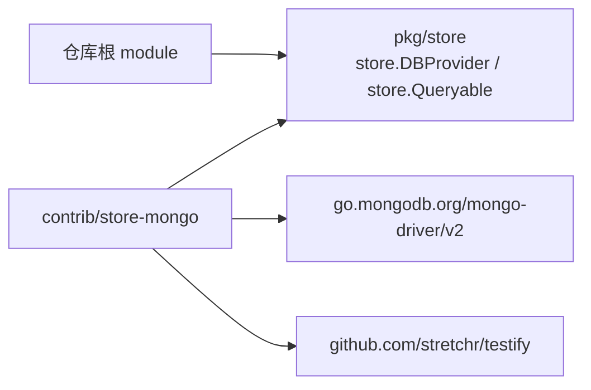

# MongoDB Store 后端实现

<cite>
**本文引用的文件**   
- [mongo.go](file://contrib/store-mongo/mongo.go)
- [README.md](file://contrib/store-mongo/README.md)
- [go.mod](file://contrib/store-mongo/go.mod)
- [testutil.go](file://contrib/store-mongo/testutil.go)
- [operators_test.go](file://contrib/store-mongo/operators_test.go)
- [store.go](file://pkg/store/store.go)
</cite>

## 目录
1. [引言](#引言)
2. [项目结构](#项目结构)
3. [核心组件](#核心组件)
4. [架构总览](#架构总览)
5. [详细组件分析](#详细组件分析)
6. [依赖关系分析](#依赖关系分析)
7. [性能与行为特征](#性能与行为特征)
8. [故障排查指南](#故障排查指南)
9. [结论](#结论)

## 引言
本文件面向 `contrib/store-mongo` 包，目标是说明如何把 MongoDB v2 驱动适配为 bald 核心的 `store.DBProvider[T]` 与 `store.Queryable[T]`。文档重点覆盖：

- `Provider[T]` 的设计职责：持有 `*mongo.Database`、集合名、主键提取函数和主键 BSON 字段名。
- `WithKeyField` 选项的作用及默认值。
- MongoDB 特有的字段映射：Go 字段到 BSON 字段的 `snake_case` 约定、`fieldTypeMap` 的类型推断机制。
- `Update` 返回的 `MatchedCount`（匹配行数）与 GORM 后端的 `RowsAffected`（受影响行数）的根本差异及其业务影响。
- `Migrate` 方法的集合创建与主键唯一索引逻辑。
- 集合定义、Provider 初始化、CRUD 操作以及聚合查询的完整示例路径。

## 项目结构
`contrib/store-mongo` 是一个独立 go.mod 子模块，对外暴露 `baldmongo` 包，通过 replace 指向仓库根作为 bald 核心依赖，从而让核心保持零 MongoDB 耦合。



**图示来源**
- [store.go:40-70](file://pkg/store/store.go#L40-L70)
- [mongo.go:31-90](file://contrib/store-mongo/mongo.go#L31-L90)
- [testutil.go:12-48](file://contrib/store-mongo/testutil.go#L12-L48)

**章节来源**
- [go.mod:1-29](file://contrib/store-mongo/go.mod#L1-L29)
- [README.md:1-30](file://contrib/store-mongo/README.md#L1-L30)

## 核心组件
`contrib/store-mongo` 的核心由以下类型组成：

| 类型 | 职责 | 关键行为 |
|---|---|---|
| `Provider[T]` | 实现 `store.DBProvider[T]` | 持有数据库连接、集合名、主键提取函数、主键 BSON 字段名；提供 `DB`、`Close`、`Migrate`。 |
| `Option[T]` | Provider 配置函数类型 | 目前仅 `WithKeyField`。 |
| `mongoQuery[T]` | 实现 `store.Queryable[T]` | 把 Where 条件翻译成 BSON 过滤文档，执行 CRUD 与聚合查询。 |
| 辅助函数 | 字段映射、类型转换、错误判断 | `toField`、`fieldTypeMap`、`coerceByType`、`isDuplicateKey`、`isNamespaceExists` 等。 |

**章节来源**
- [mongo.go:31-90](file://contrib/store-mongo/mongo.go#L31-L90)
- [mongo.go:92-120](file://contrib/store-mongo/mongo.go#L92-L120)

## 架构总览
bald 存储层采用“核心定契约 + 后端独立实现”的依赖倒置设计。MongoDB 后端不直接出现在核心中，而是通过泛型 Provider 注入。



**图示来源**
- [store.go:40-70](file://pkg/store/store.go#L40-L70)
- [mongo.go:31-120](file://contrib/store-mongo/mongo.go#L31-L120)

## 详细组件分析

### Provider[T] 设计与初始化
`Provider[T]` 是 MongoDB 后端的入口对象，其构造参数决定集合归属与主键定位方式：

| 参数 | 含义 | 约束 |
|---|---|---|
| `db` | 已连接并选定库的 `*mongo.Database` | 不能为 nil，否则构造函数 panic。 |
| `collection` | MongoDB 集合名 | 不能为空字符串，否则构造函数 panic。 |
| `keyOf` | 从实体指针取主键值的函数 | 不能为 nil，否则构造函数 panic。 |
| `opts` | Provider 配置项 | 当前只有 `WithKeyField`。 |

默认主键 BSON 字段名为 `"id"`；如果实体主键不是 Go 字段 `ID`，应显式传入 `WithKeyField[T]("你的主键BSON字段名")`，避免 Get、Update、Delete 查不到数据。



**图示来源**
- [mongo.go:60-90](file://contrib/store-mongo/mongo.go#L60-L90)

`DB(ctx)` 返回一个绑定到具体集合的 `mongoQuery[T]`，同时缓存按实体反射得到的 `fieldTypeMap`，用于后续 Where 条件的值类型转换。

**章节来源**
- [mongo.go:31-90](file://contrib/store-mongo/mongo.go#L31-L90)
- [mongo.go:92-120](file://contrib/store-mongo/mongo.go#L92-L120)

### 集合定义与 Provider 初始化示例
集合定义需要遵循两个约定：

1. 使用 bson 标签声明 BSON 字段名。
2. 主键字段通常命名为 `ID`，或配合 `WithKeyField` 指定其他字段。

参考测试实体：

| 实体 | 用途 | 关键字段 |
|---|---|---|
| `Doc` | 数组与嵌套对象测试 | `ID`、`Tags`、`Meta` |
| `Meta` | 嵌套子文档 | `Role` |

Provider 初始化流程：

1. 使用 MongoDB v2 驱动建立 `*mongo.Client`。
2. 选择目标数据库 `client.Database("demo")`。
3. 调用 `NewMongoProvider[Doc](db, "docs", func(d *Doc) string { return d.ID })`。
4. 可选调用 `provider.Migrate(ctx)` 创建集合与主键唯一索引。
5. 通过 `store.NewStore[Doc](provider)` 获得引擎无关的 Store。

示例路径：

- Provider 用法示例：[README.md:10-27](file://contrib/store-mongo/README.md#L10-L27)
- 测试实体定义与 Provider 构造：[operators_test.go:12-27](file://contrib/store-mongo/operators_test.go#L12-L27)

**章节来源**
- [operators_test.go:12-27](file://contrib/store-mongo/operators_test.go#L12-L27)
- [README.md:10-27](file://contrib/store-mongo/README.md#L10-L27)

### MongoDB 特有字段映射机制

#### snake_case 约定与 BSON 字段名
Where 条件中的 `Field` 是 DTO 或实体的 Go 字段名，内部通过 `toField` 转换为 BSON 字段名。默认转换规则与 `store-gorm` 的列名约定一致，即把驼峰字段转为下划线小写，例如：

- `ID` → `id`
- `TenantID` → `tenant_id`
- `SomeField` → `some_field`

这个约定保证同一 Where 语义在内存、GORM、Mongo 三后端表现一致。

#### fieldTypeMap 的类型推断机制
`fieldTypeMap[T]()` 通过反射扫描 `T` 的导出字段，构建 BSON 字段名到 Go 字段类型的映射：

1. 对 `T` 解引用指针，直到拿到 struct 类型。
2. 遍历每个导出字段。
3. 忽略 bson 标签为 `-` 的字段。
4. 用 `toField(f.Name)` 得到 BSON 字段名。
5. 记录该字段的 Go 类型。

这个映射主要用于 `condArg`：当 Where 的值来自字符串时，按实体 schema 做类型转换，使 MongoDB 强类型比较不会把字符串 `"25"` 当成普通字符串去匹配整数字段。

```mermaid
flowchart TD
    Start(["fieldTypeMap[T]()"]) --> Zero["获取 T 的零值反射类型"]
    Zero --> Dereference["解引用指针直到 struct"]
    Dereference --> IsStruct{"是否为 struct?"}
    IsStruct -->|否| EmptyMap["返回空映射"]
    IsStruct -->|是| Loop["遍历导出字段"]
    Loop --> SkipTag{"bson 标签是否为 \"-\"?"}
    SkipTag -->|是| NextField["跳过该字段"]
    SkipTag -->|否| MapField["toField(字段名) → Go 字段类型"]
    MapField --> NextField
    NextField --> End(["返回字段名到类型的映射"])
```

**图示来源**
- [mongo.go:400-420](file://contrib/store-mongo/mongo.go#L400-L420)

**章节来源**
- [mongo.go:460-500](file://contrib/store-mongo/mongo.go#L460-L500)
- [mongo.go:400-420](file://contrib/store-mongo/mongo.go#L400-L420)

### 条件过滤与操作符支持
`buildFilter` 把 `store.Where` 翻译为 BSON 过滤文档：

- 多个 `Filters` 以 `$and` 组合。
- `where.Expr` 递归处理布尔表达式树，空 AND 恒真、空 OR 恒假。
- 单条条件由 `condFilter` 按操作符生成 BSON。

MongoDB 原生扩展操作符包括：

| 操作符 | MongoDB 表达 | 行为说明 |
|---|---|---|
| `ARRAY_CONTAINS` | 数组字段等值匹配 | `{tags:"b"}` 命中 `tags:[a,b]`。 |
| `JSON_CONTAINS` | 点号路径匹配 | 如 `meta.role` 匹配嵌套子文档。 |
| `EXISTS` | `$exists` | value 为 `"true"` 或 `"false"` 控制正反。 |
| `SEARCH` | 未实现 | 恒真；全文检索需业务自行建 text 索引并使用原生查询。 |

`condArg` 优先使用 `json_value`（typed），否则按实体字段类型把字符串值转换为对应 Go 类型，确保跨后端语义一致。

**章节来源**
- [mongo.go:201-360](file://contrib/store-mongo/mongo.go#L201-L360)
- [README.md:31-75](file://contrib/store-mongo/README.md#L31-L75)

### Update 返回值：MatchedCount 与 RowsAffected 的差异
这是 MongoDB 后端与 GORM 后端最需要注意的业务差异：

| 后端 | Update 返回值 | “更新到相同值”时的结果 | 能否用 `rows == 0` 判「记录不存在」 |
|---|---|---|---|
| GORM / SQL | `RowsAffected`（受影响行数） | MySQL 可能返回 0 | 不可靠；MySQL 下存在记录但值不变也会返回 0。 |
| MongoDB | `MatchedCount`（匹配行数） | 通常返回 1 | 更可靠：匹配到文档即算匹配，即使值未改变。 |

因此，MongoDB 后端下 `rows == 0` 往往确实表示没有匹配到文档；但 core 层 `Store.Update` 明确警告：**不要把 `rows == 0` 当作跨后端通用的「记录不存在」判定**。若需要精确存在性判断，应先 `Get` 或通过事务加锁读取再更新。



**图示来源**
- [mongo.go:122-160](file://contrib/store-mongo/mongo.go#L122-L160)
- [store.go:120-180](file://pkg/store/store.go#L120-L180)

**章节来源**
- [mongo.go:122-160](file://contrib/store-mongo/mongo.go#L122-L160)
- [store.go:120-180](file://pkg/store/store.go#L120-L180)

### Migrate：集合创建与主键唯一索引
`Provider.Migrate` 承担基础设施初始化职责：

1. 调用 `db.CreateCollection` 创建集合。
2. 如果错误是“命名空间已存在”，视为幂等成功。
3. 在集合上创建主键唯一索引：
   - 字段：`keyField`，默认 `"id"`。
   - 方向：升序 `1`。
   - 唯一：`unique=true`。
   - 索引名：`keyField + "_unique"`。

`mongoQuery.Migrate` 是空操作，因为会话级 Queryable 不独立管理集合生命周期。



**图示来源**
- [mongo.go:100-120](file://contrib/store-mongo/mongo.go#L100-L120)
- [mongo.go:490-526](file://contrib/store-mongo/mongo.go#L490-L526)

**章节来源**
- [mongo.go:100-120](file://contrib/store-mongo/mongo.go#L100-L120)

### CRUD 操作语义

| 操作 | 实现细节 | 返回值语义 |
|---|---|---|
| `Create` | 调用 `InsertOne`。 | 无返回值；唯一键冲突返回 `store.ErrConflict`。 |
| `Update` | 反射实体生成 `$set` 文档，排除主键字段；与隔离谓词 AND 组合。 | 返回 `MatchedCount`。 |
| `Delete` | 调用 `DeleteMany`。 | 返回 `DeletedCount`。 |
| `Get` | 调用 `FindOne`。 | 找不到返回 `store.ErrNotFound`。 |
| `List` | 先 `CountDocuments` 得总数，再 `Find` 分页。 | 返回 items 与 total。 |
| `Count` | 直接调用 `CountDocuments`。 | 返回匹配文档数。 |

**章节来源**
- [mongo.go:122-200](file://contrib/store-mongo/mongo.go#L122-L200)
- [mongo.go:201-220](file://contrib/store-mongo/mongo.go#L201-L220)

### 聚合查询示例
聚合查询主要通过 `ListWithPaging` 与 `Count` 完成：

1. 使用 `store.Eq`、`store.Gte`、`store.Like` 等操作符构造 Where。
2. 对数组字段使用 `Operator_ARRAY_CONTAINS`。
3. 对嵌套字段使用 `Operator_JSON_CONTAINS`，字段名用点号路径。
4. 对字段存在性使用 `Operator_EXISTS`。
5. 分页请求由上层 Store 处理 offset、limit、排序。

示例路径：

- 数组包含查询：[operators_test.go:30-65](file://contrib/store-mongo/operators_test.go#L30-L65)
- JSON 包含查询：[operators_test.go:67-96](file://contrib/store-mongo/operators_test.go#L67-L96)
- 字段存在性查询：[operators_test.go:98-L121](file://contrib/store-mongo/operators_test.go#L98-L121)

**章节来源**
- [operators_test.go:12-121](file://contrib/store-mongo/operators_test.go#L12-L121)

## 依赖关系分析
`contrib/store-mongo` 只依赖三个方向的依赖：

1. **bald 核心**：通过 `github.com/kalandramo/bald` 引用 `pkg/store` 的接口定义。
2. **MongoDB v2 驱动**：`go.mongodb.org/mongo-driver/v2`，版本 pin 在 `v2.8.0`。
3. **测试依赖**：`stretchr/testify`。

replace 规则把 bald 核心与其相关子模块替换为仓库内源码，使本模块可编译且与核心同步演进。



**图示来源**
- [go.mod:1-29](file://contrib/store-mongo/go.mod#L1-L29)
- [store.go:1-40](file://pkg/store/store.go#L1-L40)

**章节来源**
- [go.mod:1-29](file://contrib/store-mongo/go.mod#L1-L29)

## 性能与行为特征

### 查询性能
- `List` 会先执行一次 `CountDocuments` 计算总数，再执行一次 `Find` 拉取页面数据。
- 只有在 `where.Sorting` 非空时才设置排序，避免空排序导致驱动序列化失败。
- `offset` 与 `limit` 分别映射为 `skip` 与 `limit`。

### 更新幂等性
- `Update` 对匹配 0 行返回 `(0, nil)`，不抛错。
- `Delete` 对删除 0 行也返回 `(0, nil)`。
- 这符合 core 层的“幂等语义”：缺少目标资源不代表系统错误。

### 类型安全
- MongoDB 是强类型数据库，字符串比较不会自动转成数值。
- `fieldTypeMap` 与 `coerceByType` 在桥接层弥补这一差异，使 Where 语义与 GORM、inmemory 保持一致。
- 对于未在实体上声明的字段，类型映射为空，值回退为原始字符串。

**章节来源**
- [mongo.go:201-220](file://contrib/store-mongo/mongo.go#L201-L220)
- [mongo.go:360-460](file://contrib/store-mongo/mongo.go#L360-L460)

## 故障排查指南

| 现象 | 可能原因 | 处理方式 |
|---|---|---|
| `NewMongoProvider` panic | db、collection 或 keyOf 为 nil/空 | 检查 Provider 初始化参数。 |
| `Get` 找不到记录 | `keyField` 与实体主键不一致 | 使用 `WithKeyField[T]("实际主键BSON字段名")`。 |
| `Update` 返回 0 | 没有匹配到文档，或 MongoDB 后端更新到相同值仍算匹配 | 如需精确存在性判断，先 `Get`。 |
| `Create` 报冲突 | 主键重复，底层错误码 E11000 | 检查唯一索引与业务主键生成逻辑。 |
| `Migrate` 报集合已存在 | 集合已存在 | 属于幂等场景，会被忽略。 |
| 正则查询异常 | 用户输入含正则元字符 | 使用 `regexpQuote` 转义后的值，不要手写危险正则。 |
| 集成测试跳过 | 本地没有 mongod 或 `-short` | 启动真实 MongoDB 或使用 `BALD_MONGO_URI`。 |

测试环境说明：

- 默认 URI：`mongodb://127.0.0.1:27017`。
- 可通过环境变量 `BALD_MONGO_URI` 覆盖。
- 每次测试使用唯一命名的 database，并在结束时 Drop。
- `-short` 下直接跳过；mongod 不可达时也 `t.Skip`，而不是把环境问题误判为实现缺陷。

**章节来源**
- [mongo.go:60-90](file://contrib/store-mongo/mongo.go#L60-L90)
- [mongo.go:490-526](file://contrib/store-mongo/mongo.go#L490-L526)
- [testutil.go:12-48](file://contrib/store-mongo/testutil.go#L12-L48)
- [README.md:77-94](file://contrib/store-mongo/README.md#L77-L94)

## 结论
`contrib/store-mongo` 以最小代价把 MongoDB v2 驱动适配为 bald 核心的 `DBProvider[T]` 与 `Queryable[T]`，并保持核心零后端耦合。它的关键价值在于：

- 统一了 Where 语义与字段映射约定。
- 提供了 MongoDB 原生支持的数组、JSON 路径与字段存在性查询。
- 明确了 `Update` 返回值在不同后端之间的语义差异。
- 通过 `Migrate` 提供集合与主键唯一索引的幂等初始化能力。

在使用时，最重要的是正确配置 `keyField`、理解 `MatchedCount` 的业务含义，并在需要精确存在性判断时显式查询，而不是依赖 `rows == 0` 做跨后端通用判定。