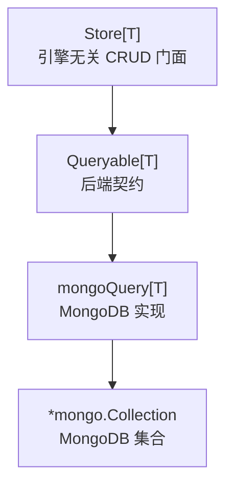
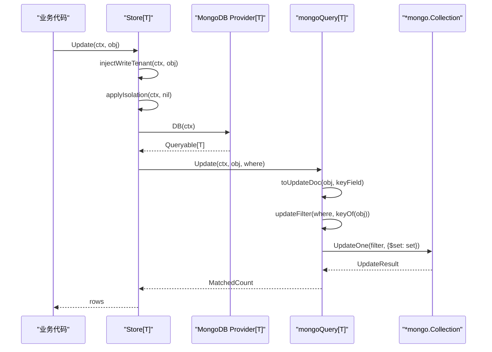
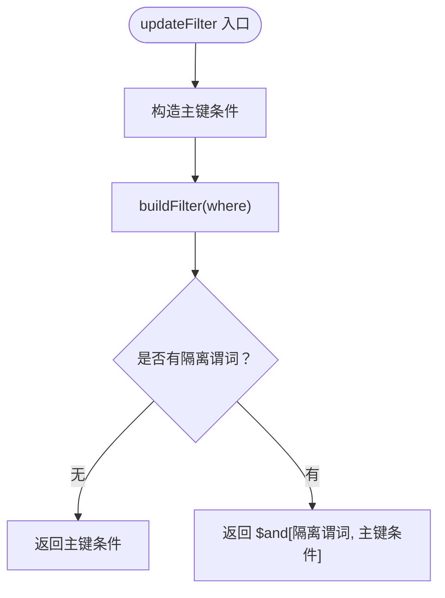
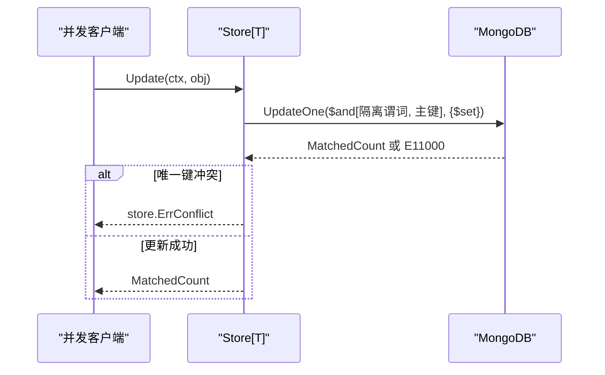

# MongoDB 更新的匹配计数语义

<cite>
**本文引用的文件**   
- [contrib/store-mongo/mongo.go](file://contrib/store-mongo/mongo.go)
- [contrib/store-mongo/mongo_test.go](file://contrib/store-mongo/mongo_test.go)
- [contrib/store-gorm/gorm.go](file://contrib/store-gorm/gorm.go)
- [pkg/store/store.go](file://pkg/store/store.go)
</cite>

## 目录
1. [引言](#引言)
2. [项目结构定位](#项目结构定位)
3. [核心组件](#核心组件)
4. [架构总览](#架构总览)
5. [更新方法深度分析](#更新方法深度分析)
6. [匹配数与删除数的区别](#匹配数与删除数的区别)
7. [隔离谓词与主键条件组合](#隔离谓词与主键条件组合)
8. [跨后端兼容性：MongoDB 与 GORM](#跨后端兼容性mongodb-与-gorm)
9. [业务代码中的正确判断模式](#业务代码中的正确判断模式)
10. [并发冲突处理最佳实践](#并发冲突处理最佳实践)
11. [故障排查](#故障排查)
12. [结论](#结论)

## 引言
本文聚焦 `contrib/store-mongo` 中 `Update` 方法的实现细节，解释它为何使用 `$set` 更新全部字段并排除主键，剖析 `MatchedCount` 与 `DeletedCount` 的语义差异，说明 `updateFilter` 如何把租户/数据范围隔离谓词和主键条件按 `$and` 组合，并与 GORM 后端的 `RowsAffected` 做对比。最后给出业务层判断更新成功与否的正确方式，以及处理并发冲突的可复用实践。

## 项目结构定位
MongoDB 存储适配位于独立子模块 `contrib/store-mongo`，对外暴露 `Provider[T]`，由框架核心 `pkg/store` 通过泛型 `Store[T]` 调用，从而让业务代码不直接依赖 MongoDB 驱动。该子模块实现 `store.Queryable[T]`，把 `Where`、`FilterExpr` 等抽象查询模型翻译成 BSON 过滤文档，并把 MongoDB 的结果回译为统一的返回值。



**图示来源**
- [pkg/store/store.go:23-43](file://pkg/store/store.go#L23-L43)
- [contrib/store-mongo/mongo.go:31-55](file://contrib/store-mongo/mongo.go#L31-L55)
- [contrib/store-mongo/mongo.go:63-74](file://contrib/store-mongo/mongo.go#L63-L74)

**章节来源**
- [contrib/store-mongo/mongo.go:1-74](file://contrib/store-mongo/mongo.go#L1-L74)
- [pkg/store/store.go:1-43](file://pkg/store/store.go#L1-L43)

## 核心组件
- `Provider[T]`：持有 MongoDB 数据库实例、集合名、实体主键提取函数及 BSON 主键字段名；`DB()` 返回绑定到具体集合的 `mongoQuery[T]`。
- `mongoQuery[T]`：实现 `store.Queryable[T]`，负责 `Create`、`Get`、`List`、`Count`、`Delete`、`Update` 以及 Where 翻译。
- `toUpdateDoc`：反射实体为 BSON 更新文档，剔除主键字段与标记为内存态的字段。
- `updateFilter`：构造 Update 使用的过滤文档，将隔离谓词与主键条件按 `$and` 组合。
- `buildFilter` / `exprFilter` / `condFilter`：通用 Where 翻译器，把 `Filters`、`Expr`、操作符映射为 BSON。

**章节来源**
- [contrib/store-mongo/mongo.go:31-74](file://contrib/store-mongo/mongo.go#L31-L74)
- [contrib/store-mongo/mongo.go:132-165](file://contrib/store-mongo/mongo.go#L132-L165)
- [contrib/store-mongo/mongo.go:214-300](file://contrib/store-mongo/mongo.go#L214-L300)
- [contrib/store-mongo/mongo.go:445-476](file://contrib/store-mongo/mongo.go#L445-L476)

## 架构总览
业务调用链如下：



**图示来源**
- [pkg/store/store.go:153-179](file://pkg/store/store.go#L153-L179)
- [contrib/store-mongo/mongo.go:123-165](file://contrib/store-mongo/mongo.go#L123-L165)

## 更新方法深度分析
`mongoQuery.Update` 的核心流程是三步：

1. **构造更新文档**：调用 `toUpdateDoc(obj, q.keyField)`，遍历实体的导出字段，跳过 `bson:\"-\"` 标记的内存态字段和主键字段，把所有其他字段写入 `$set` 值。
2. **构造过滤条件**：调用 `updateFilter(where, q.keyOf(obj))`，把隔离谓词和主键条件组合成 BSON 过滤文档。
3. **执行更新并返回匹配数**：调用 `q.col.UpdateOne`，传入 `$set` 更新文档，最终返回 `res.MatchedCount`。

### `$set` 更新全部字段（排除主键）的设计动机
`toUpdateDoc` 的行为是“写全量字段，但排除主键”。这样做的目的很明确：

- **幂等更新语义**：业务希望“让这条记录变成目标对象”，而不是只更新非零字段。若只写变更字段，零值字段无法表达“显式清空”的场景。
- **防止主键错位**：MongoDB 的 `_id` 是不可变主键；如果误改主键，可能产生文档错位或唯一索引冲突。排除主键能避免把业务传入的 ID 覆盖底层主键。
- **对齐 GORM 后端**：GORM 的 `Updates(map)` 也采用“写全部列，排除主键列”的策略，二者在字段覆盖语义上保持一致。

需要注意：`bson:\"-\"` 字段不参与持久化，属于内存态字段，不应落入集合文档；测试用例明确断言该字段不会落库。

```mermaid
flowchart TD
    Start(["开始"]) --> Reflect["反射实体导出字段"]
    Reflect --> SkipBsonDash{"是否 bson:\"-\" ?"}
    SkipBsonDash -->|是| Next["跳过"]
    SkipBsonDash -->|否| CheckKey{"是否主键字段？"}
    CheckKey -->|是| Next
    CheckKey -->|否| Append["加入 $set 更新文档"]
    Append --> Next
    Next --> End(["结束"])
```

**图示来源**
- [contrib/store-mongo/mongo.go:445-476](file://contrib/store-mongo/mongo.go#L445-L476)

**章节来源**
- [contrib/store-mongo/mongo.go:123-144](file://contrib/store-mongo/mongo.go#L123-L144)
- [contrib/store-mongo/mongo.go:445-476](file://contrib/store-mongo/mongo.go#L445-L476)
- [contrib/store-mongo/mongo_test.go:120-139](file://contrib/store-mongo/mongo_test.go#L120-L139)

## 匹配数与删除数的区别
MongoDB 更新与删除返回不同指标，不能混用：

| 操作 | 底层调用 | 返回字段 | 含义 | “更新到相同值”时的行为 |
|---|---|---|---|---|
| 单条更新 | `UpdateOne` | `MatchedCount` | 匹配的文档数 | 只要文档存在且被匹配，就返回 1 |
| 批量删除 | `DeleteMany` | `DeletedCount` | 实际删除的文档数 | 删除不存在文档时返回 0 |

这意味着：

- `MatchedCount == 1` 只表示“找到了目标文档”，不代表“值发生了变化”。
- `DeletedCount == 1` 表示“确实删掉了一个文档”；`DeletedCount == 0` 表示“没有删除任何文档”。
- 对 `Update` 而言，`rows == 0` 通常可以当作“目标不存在”的判据；但对 GORM 后端则不能这样判断。

**章节来源**
- [contrib/store-mongo/mongo.go:123-144](file://contrib/store-mongo/mongo.go#L123-L144)
- [contrib/store-mongo/mongo.go:156-165](file://contrib/store-mongo/mongo.go#L156-L165)
- [contrib/store-mongo/mongo_test.go:151-170](file://contrib/store-mongo/mongo_test.go#L151-L170)
- [contrib/store-mongo/mongo_test.go:172-189](file://contrib/store-mongo/mongo_test.go#L172-L189)

## 隔离谓词与主键条件组合
`updateFilter` 的职责是把“谁有权改这条记录”和“改哪一条记录”合在一起：

1. 先构造主键条件：`{keyField: key}`。
2. 再调用 `buildFilter(where)` 生成隔离谓词对应的 BSON 过滤文档。
3. 如果已有隔离谓词，则返回 `{ "$and": [隔离谓词, 主键条件] }`。
4. 如果没有隔离谓词，直接返回主键条件。

这与 `buildFilter` 的行为一致：当多个条件存在时统一用 `$and` 包裹；只有一个条件时直接返回该条件，避免多余包装。



**图示来源**
- [contrib/store-mongo/mongo.go:146-154](file://contrib/store-mongo/mongo.go#L146-L154)
- [contrib/store-mongo/mongo.go:214-228](file://contrib/store-mongo/mongo.go#L214-L228)

这里需要特别注意：**隔离谓词在前，主键条件在后**。虽然 MongoDB 的 `$and` 顺序不影响逻辑结果，但它明确了“先按租户/数据范围筛选，再按主键精确定位”的安全边界——即使主键存在，也不允许越权修改不属于当前租户或数据范围的文档。

**章节来源**
- [contrib/store-mongo/mongo.go:146-154](file://contrib/store-mongo/mongo.go#L146-L154)
- [contrib/store-mongo/mongo.go:214-228](file://contrib/store-mongo/mongo.go#L214-L228)
- [pkg/store/store.go:153-179](file://pkg/store/store.go#L153-L179)

## 跨后端兼容性：MongoDB 与 GORM
MongoDB 与 GORM 后端都遵循“幂等更新”接口约定：找不到目标记录时返回 `(0, nil)`，而不是抛出“不存在”错误。但返回值语义并不等价：

| 后端 | 返回值 | 语义 | “更新到相同值”的典型表现 |
|---|---|---|---|
| MongoDB | `MatchedCount` | 匹配的文档数 | 通常为 1 |
| GORM | `RowsAffected` | 受影响（被改变）的行数 | MySQL 默认常为 0；SQLite 可能为 1 |
| 核心 `Store.Update` | 透传后端返回值 | 不作为“记录是否存在”的统一判据 | 明确注释禁止用 `rows == 0` 推断不存在 |

因此，业务层不能假设：

- `rows == 0` 一定表示记录不存在；
- `rows == 1` 一定表示值发生了变化；
- 所有后端对“未变化更新”的计数行为一致。

仓库文档明确指出，MySQL 下“更新到相同值”返回 0，而 SQLite 返回 1，所以 `rows` 只能用于观测“本次是否真的改变了数据”，不能用于跨后端一致的“存在性判断”。

**章节来源**
- [contrib/store-gorm/gorm.go:100-139](file://contrib/store-gorm/gorm.go#L100-L139)
- [contrib/store-mongo/mongo.go:123-144](file://contrib/store-mongo/mongo.go#L123-L144)
- [pkg/store/store.go:153-179](file://pkg/store/store.go#L153-L179)

## 业务代码中的正确判断模式
根据接口契约，推荐以下模式：

### 判断记录是否存在
不要只看 `Update` 返回值。应该先查存在性，再更新：

1. 调用 `Get` 确认记录存在；
2. 再调用 `Update` 执行业务更新；
3. 如果 `Get` 返回 `ErrNotFound`，才认为目标不存在。

### 判断本次是否真正修改了数据
可以把 `rows` 作为观测值，例如决定是否触发下游副作用，但要接受后端差异：

- MongoDB：`rows == 1` 表示匹配成功，但不保证值发生变化。
- GORM：`rows == 0` 可能是值未变化，也可能是数据库方言差异。
- 如果需要强一致性语义，应回到数据库层解决，而不是依赖计数。

### 必须存在才能更新的写法
```text
if _, err := store.Get(ctx, where); err != nil {
    return ErrNotFound
}
if _, err := store.Update(ctx, obj); err != nil {
    return ErrUpdateFailed
}
```

这种写法与后端选择解耦，也能自然区分“不存在”和“系统错误”。

**章节来源**
- [pkg/store/store.go:153-179](file://pkg/store/store.go#L153-L179)

## 并发冲突处理最佳实践
MongoDB 的 `UpdateOne` 本身不是事务性读-改-写原语，因此仅靠 `MatchedCount` 不足以消除并发竞争。常见风险包括：

- 两个请求同时读取同一条记录；
- 两者都判断“记录存在”；
- 两者都执行更新；
- 后者可能覆盖前者的修改，或命中唯一索引冲突。

推荐策略：

1. **乐观锁**：在实体中加入版本字段，更新条件包含旧版本号，成功后递增。失败时按业务策略重试或提示冲突。
2. **原子比较更新**：使用 MongoDB 的 `findAndModify` 或 `$inc` 等原子操作，把比较和更新放在一次操作中。
3. **行级排他锁**：在支持事务的 MongoDB 副本集中开启事务，或使用“先读锁再写”的两阶段流程。
4. **唯一索引冲突处理**：仓库已把 E11000 转换为 `store.ErrConflict`，业务层应对该错误进行重试、降级或错误提示。



**图示来源**
- [contrib/store-mongo/mongo.go:123-144](file://contrib/store-mongo/mongo.go#L123-L144)
- [contrib/store-mongo/mongo.go:516-526](file://contrib/store-mongo/mongo.go#L516-L526)

**章节来源**
- [contrib/store-mongo/mongo.go:123-144](file://contrib/store-mongo/mongo.go#L123-L144)
- [contrib/store-mongo/mongo.go:516-526](file://contrib/store-mongo/mongo.go#L516-L526)

## 故障排查
| 现象 | 可能原因 | 排查建议 |
|---|---|---|
| `Update` 返回 0 且无错误 | 目标文档不存在，或隔离谓词未匹配 | 检查 `Where` 是否包含租户/数据范围条件；确认主键是否正确 |
| `Update` 返回 1 但值未变化 | MongoDB `MatchedCount` 只反映匹配，不反映值变化 | 不要把它当成“已修改”信号；如需观察变化，自行记录旧值 |
| `Delete` 返回 0 且无错误 | 删除幂等语义：不存在即合法 | 若业务要求“必须存在才能删”，自行判断 `rows == 0` |
| `Create` 报冲突 | 唯一键重复（E11000） | 捕获 `store.ErrConflict`，走重试或冲突分支 |
| 主键被意外写入 | 自定义 `keyField` 配置错误 | 检查 `WithKeyField` 是否与实体 BSON 主键字段一致 |
| 过滤无效 | `Where` 条件为空或被恒真/恒假表达式替代 | 检查 `buildFilter`、`exprFilter` 的空分支行为 |

**章节来源**
- [contrib/store-mongo/mongo.go:123-165](file://contrib/store-mongo/mongo.go#L123-L165)
- [contrib/store-mongo/mongo.go:214-300](file://contrib/store-mongo/mongo.go#L214-L300)
- [contrib/store-mongo/mongo_test.go:151-189](file://contrib/store-mongo/mongo_test.go#L151-L189)

## 结论
`contrib/store-mongo` 的 `Update` 方法以 `$set` 全量更新字段并排除主键，既满足“让记录等于目标对象”的幂等语义，又避免主键被改写带来的数据错位风险。其返回值是 `MatchedCount`，表示“匹配到的文档数”，而不是“实际发生变化的字段数”。相比之下，GORM 后端返回的是 `RowsAffected`，受数据库方言影响更大，二者不能互换解释。

安全更新的完整要点是：

- 用 `Get` 判断存在性，而不是依赖 `rows == 0`。
- 把 `rows` 视为观测值，而不是跨后端一致的“存在性/变更性”判定依据。
- 用 `updateFilter` 的组合语义理解隔离边界：隔离谓词与主键条件按 `$and` 连接，越权访问会被静默拒绝。
- 对并发场景使用乐观锁、原子比较更新或事务，不要只依赖 `MatchedCount`。
- 正确处理 `store.ErrConflict`，因为唯一键冲突是业务可预期的竞争结果。