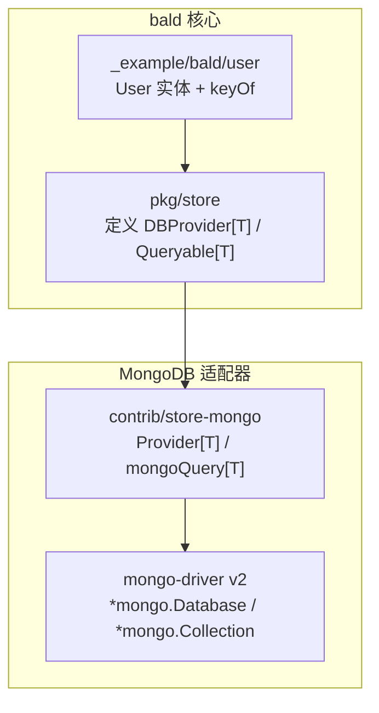
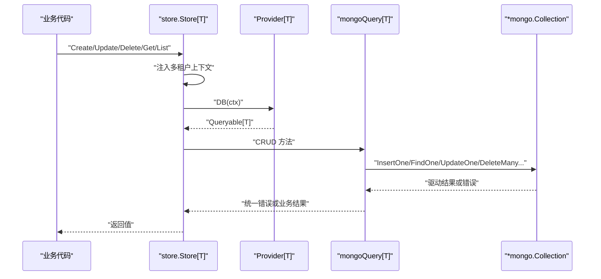
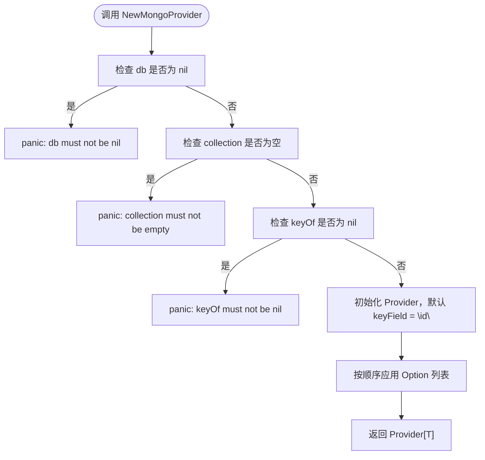
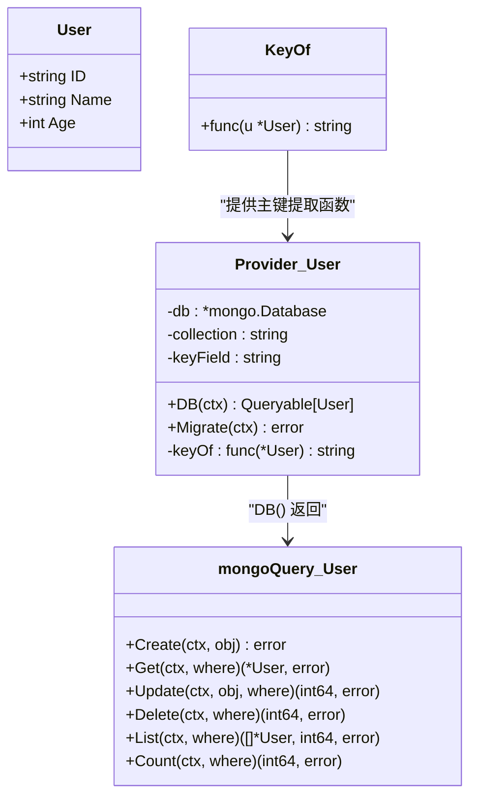
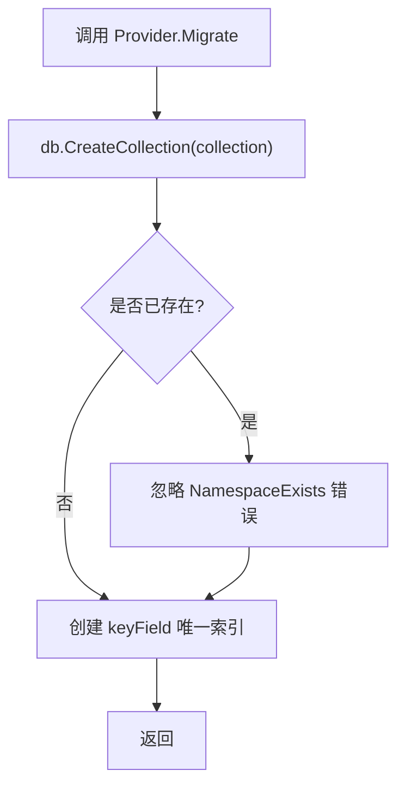
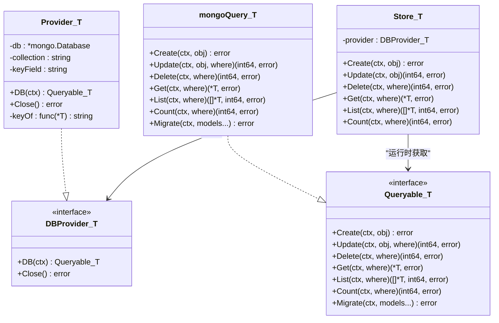
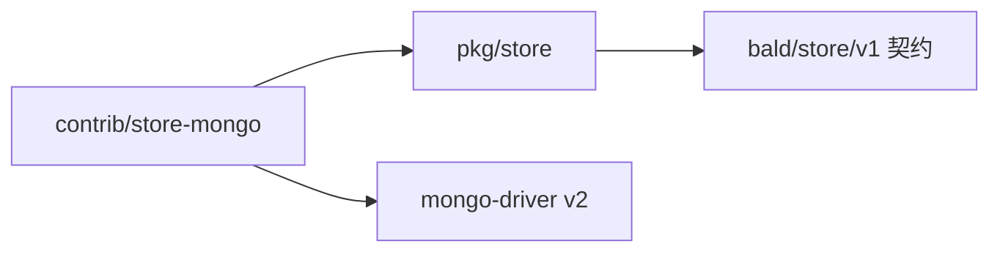

# Provider 初始化与集合配置

<cite>
**本文引用的文件**   
- [contrib/store-mongo/mongo.go](file://contrib/store-mongo/mongo.go)
- [pkg/store/store.go](file://pkg/store/store.go)
- [_example/bald/user/entity.go](file://_example/bald/user/entity.go)
</cite>

## 目录
1. [简介](#简介)
2. [项目结构定位](#项目结构定位)
3. [核心组件总览](#核心组件总览)
4. [架构概览](#架构概览)
5. [详细组件分析](#详细组件分析)
6. [依赖关系分析](#依赖关系分析)
7. [MongoDB 部署连接示例](#mongodb-部署连接示例)
8. [故障排查指南](#故障排查指南)
9. [结论](#结论)

## 简介
本文聚焦 `contrib/store-mongo` 子模块中的 `NewMongoProvider`、`WithKeyField` 选项，以及 `Provider[T]` 如何对接 bald 核心的 `store.DBProvider[T]` + `store.Queryable[T]`。重点说明：
- 参数校验失败时的行为；
- 主键 BSON 字段名 `keyField` 的默认值及自定义方式；
- 集合命名与 `db.Database` 复用策略；
- 单机、副本集、分片集群的连接配置思路；
- 泛型类型参数 `T` 的业务实体要求（BSON 标签、主键提取函数）。

## 项目结构定位
本仓库是 93 个 `go.mod` 的多模块仓库，MongoDB 存储桥接位于独立模块 `contrib/store-mongo`。该模块把 mongo-driver v2 的 `*mongo.Database` 适配为 bald 核心的 DAL 抽象，使业务以统一的 `Store[T]` 访问 MongoDB，而 bald 核心不引入任何 MongoDB 依赖。



**图示来源**
- [pkg/store/store.go:1-80](file://pkg/store/store.go#L1-L80)
- [contrib/store-mongo/mongo.go:1-60](file://contrib/store-mongo/mongo.go#L1-L60)
- [_example/bald/user/entity.go:1-20](file://_example/bald/user/entity.go#L1-L20)

**章节来源**
- [contrib/store-mongo/mongo.go:1-20](file://contrib/store-mongo/mongo.go#L1-L20)

## 核心组件总览
| 组件 | 职责 | 关键行为 |
|---|---|---|
| `Provider[T]` | 持有已连接的 `*mongo.Database`、集合名、主键提取函数和主键 BSON 字段名 | `DB(ctx)` 返回绑定到具体集合的 `Queryable[T]`；`Close()` 为空实现 |
| `Option[T]` | 配置 Provider 的可变选项 | 当前唯一选项为 `WithKeyField` |
| `mongoQuery[T]` | 实现 `store.Queryable[T]` | 把 `Where` 翻译为 BSON 过滤器，执行 Create/Get/Update/Delete/List/Count/Migrate |
| `store.Store[T]` | 引擎无关的 CRUD 门面 | 调用 `provider.DB(ctx)` 获取后端查询句柄，并注入多租户隔离等通用逻辑 |

**章节来源**
- [contrib/store-mongo/mongo.go:24-60](file://contrib/store-mongo/mongo.go#L24-L60)
- [pkg/store/store.go:24-70](file://pkg/store/store.go#L24-L70)

## 架构概览
`Provider[T]` 不是直接暴露给业务层使用的主要入口；业务通常通过 `store.NewStore[T](provider)` 获得 `Store[T]`。`Store[T]` 在每次写操作前会注入多租户上下文，并通过 `provider.DB(ctx)` 拿到一次性的 `Queryable[T]`。



**图示来源**
- [pkg/store/store.go:70-120](file://pkg/store/store.go#L70-L120)
- [contrib/store-mongo/mongo.go:60-90](file://contrib/store-mongo/mongo.go#L60-L90)

**章节来源**
- [pkg/store/store.go:70-120](file://pkg/store/store.go#L70-L120)
- [contrib/store-mongo/mongo.go:60-90](file://contrib/store-mongo/mongo.go#L60-L90)

## 详细组件分析

### NewMongoProvider 的参数验证逻辑
`NewMongoProvider[T]` 接受四个位置参数：
1. `db *mongo.Database`：已连接并可用的数据库对象；
2. `collection string`：集合名；
3. `keyOf func(*T) string`：从实体提取主键值的函数；
4. `opts ...Option[T]`：可选配置，当前只有 `WithKeyField`。

参数校验规则如下：
- 若 `db` 为 `nil`，立即 panic，错误信息指明 `db must not be nil`；
- 若 `collection` 为空字符串，立即 panic，错误信息指明 `collection must not be empty`；
- 若 `keyOf` 为 `nil`，立即 panic，错误信息指明 `keyOf must not be nil`。

这些校验发生在构造阶段，而不是延迟到第一次查询。因此，错误的 Provider 会在应用启动时快速失败，避免运行期出现难以归因的“找不到字段”或空集合问题。



**图示来源**
- [contrib/store-mongo/mongo.go:44-70](file://contrib/store-mongo/mongo.go#L44-L70)

**章节来源**
- [contrib/store-mongo/mongo.go:44-70](file://contrib/store-mongo/mongo.go#L44-L70)

### WithKeyField 选项与 keyField 默认值设计
`WithKeyField[T](field string) Option[T]` 用于设置主键的 BSON 字段名。Provider 构造时默认将 `keyField` 设为 `"id"`，随后再按顺序执行传入的 Option。

默认值为 `"id"` 的设计原因有三点：
1. Go 中常见的主键字段名为 `ID`；
2. 字段名到 BSON 字段的转换函数 `toField` 默认采用 snake_case，`ID` 会被转换为 `id`；
3. 这与 GORM 后端的列名约定保持一致，使同一 `Where` 语义在内存、GORM、Mongo 三后端表现相同。

当实体的主键 BSON 字段名不是 `"id"` 时，必须显式调用 `WithKeyField`。例如，如果实体使用 JSON/BSON tag 把主键映射为 `_id`，则应使用 `WithKeyField("_id")`。

需要注意：`WithKeyField` 影响的是 BSON 字段名，而不是 Go 字段名。Go 字段仍由反射读取，`bson` tag 决定序列化字段名；`keyField` 决定 Get/Update/Delete 定位文档时使用的键。

```mermaid
flowchart TD
    Default["默认 keyField = \"id\""] --> ExampleDefault["实体 ID 字段 -> bson 字段 id"]
    ExampleDefault --> Match["Get/Update/Delete 能命中主键"]

    Custom["调用 WithKeyField(\"_id\")"] --> ExampleCustom["实体 ID 字段 -> bson 字段 _id"]
    ExampleCustom --> Match

    Wrong["未配置且 BSON 字段不是 id"] --> Mismatch["Get/Update/Delete 可能查不到数据"]
```

**图示来源**
- [contrib/store-mongo/mongo.go:34-70](file://contrib/store-mongo/mongo.go#L34-L70)
- [contrib/store-mongo/mongo.go:484-510](file://contrib/store-mongo/mongo.go#L484-L510)

**章节来源**
- [contrib/store-mongo/mongo.go:34-70](file://contrib/store-mongo/mongo.go#L34-L70)
- [contrib/store-mongo/mongo.go:484-510](file://contrib/store-mongo/mongo.go#L484-L510)

### 业务实体 T 的要求
Provider 的泛型类型参数 `T` 是业务实体指针类型的元素类型。它需要满足以下契约：

| 要求 | 说明 |
|---|---|
| `keyOf func(*T) string` | 能从实体中提取主键字符串值 |
| BSON 字段映射 | 实体字段需有合理的 `bson` tag，或由 `toField` 的 snake_case 规则映射 |
| 可导出字段 | 更新文档构建会反射遍历可导出字段，`bson:"-"` 会被跳过 |
| 主键不可被更新覆盖 | Update 使用 `$set` 写入全部字段时会排除 `keyField`，防止主键错位 |

_example 中的 `User` 实体展示了典型用法：`ID` 作为主键，`keyOf` 返回 `u.ID`。MongoDB 适配器会将 Go 字段名转为 snake_case 的 BSON 字段名，因此默认的 `keyField = "id"` 与 `ID` 字段配合很自然。



**图示来源**
- [_example/bald/user/entity.go:1-20](file://_example/bald/user/entity.go#L1-L20)
- [contrib/store-mongo/mongo.go:24-90](file://contrib/store-mongo/mongo.go#L24-L90)

**章节来源**
- [_example/bald/user/entity.go:1-20](file://_example/bald/user/entity.go#L1-L20)
- [contrib/store-mongo/mongo.go:24-90](file://contrib/store-mongo/mongo.go#L24-L90)

### 集合命名规范与 Migrate 行为
`collection` 参数直接用作 `*mongo.Database.Collection(collection)` 的目标集合名。它没有自动加前缀、后缀或大小写转换；调用方应负责保证名称稳定且符合运维命名规范。

`Provider.Migrate` 的行为是：
1. 调用 `db.CreateCollection` 创建集合；
2. 忽略“集合已存在”的错误；
3. 在该集合上创建一个基于 `keyField` 的唯一索引，索引名称为 `keyField_unique`。

由于 MongoDB 是无 schema 的文档数据库，`Migrate` 不会建立类似 SQL 表结构的约束，而是通过唯一索引保证主键唯一性。



**图示来源**
- [contrib/store-mongo/mongo.go:70-90](file://contrib/store-mongo/mongo.go#L70-L90)
- [contrib/store-mongo/mongo.go:460-480](file://contrib/store-mongo/mongo.go#L460-L480)

**章节来源**
- [contrib/store-mongo/mongo.go:70-90](file://contrib/store-mongo/mongo.go#L70-L90)
- [contrib/store-mongo/mongo.go:460-480](file://contrib/store-mongo/mongo.go#L460-L480)

### db.Database 的复用策略
`Provider[T]` 内部只保存 `*mongo.Database`，不持有 `*mongo.Client`。这意味着：
- `*mongo.Client` 的生命周期应由调用方管理；
- 同一个 `*mongo.Database` 可以被多个 Provider 复用；
- 不同集合可以对应不同的 Provider，但共享同一个数据库连接池；
- `Provider.Close()` 是空实现，不负责关闭底层客户端。

推荐模式是：
1. 应用启动时创建 `*mongo.Client`；
2. 用 `client.Database("库名")` 得到 `*mongo.Database`；
3. 为每个业务实体或聚合根创建独立的 `Provider[T]`；
4. 把这些 Provider 注册到 bald 的服务发现或 DI 容器中；
5. 业务层通过 `store.NewStore[T](provider)` 使用。

这种设计让连接池与集合级元数据分离：连接复用降低资源开销，集合名和主键策略保持每类实体独立。

**章节来源**
- [contrib/store-mongo/mongo.go:24-40](file://contrib/store-mongo/mongo.go#L24-L40)
- [contrib/store-mongo/mongo.go:60-70](file://contrib/store-mongo/mongo.go#L60-L70)

### 与 bald 核心 store.DBProvider[T] + store.Queryable[T] 的对接
`Provider[T]` 实现了 bald 核心的两个接口：

| 核心接口 | Provider 的实现方式 |
|---|---|
| `DBProvider[T].DB(ctx)` | 返回一个 `mongoQuery[T]`，绑定到指定集合 |
| `DBProvider[T].Close()` | 空实现，因为客户端生命周期由调用方负责 |
| `Queryable[T].Create` | 调用 `InsertOne`，唯一键冲突映射为 `store.ErrConflict` |
| `Queryable[T].Get` | 调用 `FindOne`，无文档映射为 `store.ErrNotFound` |
| `Queryable[T].Update` | 用 `$set` 更新全部字段并排除主键，返回 `MatchedCount` |
| `Queryable[T].Delete` | 调用 `DeleteMany`，匹配 0 行返回 `(0, nil)` |
| `Queryable[T].List` | 先 CountDocuments 再 Find，支持排序、偏移、限制 |
| `Queryable[T].Count` | 调用 `CountDocuments` |
| `Queryable[T].Migrate` | 会话级空操作，集合创建由 Provider 承担 |

`store.Store[T]` 是面向业务的统一门面。它不关心后端是内存、GORM 还是 MongoDB，只依赖这两个接口。



**图示来源**
- [pkg/store/store.go:24-70](file://pkg/store/store.go#L24-L70)
- [contrib/store-mongo/mongo.go:24-90](file://contrib/store-mongo/mongo.go#L24-L90)

**章节来源**
- [pkg/store/store.go:24-70](file://pkg/store/store.go#L24-L70)
- [contrib/store-mongo/mongo.go:24-90](file://contrib/store-mongo/mongo.go#L24-L90)

## 依赖关系分析
`contrib/store-mongo` 是独立 go.mod 模块，依赖：
- bald 核心的 `pkg/store` 与 `bconf/gen/go/bald/store/v1`；
- mongo-driver v2 的 `mongo`、`bson`、`mongo/options`。

bald 核心包本身不导入 MongoDB 相关包，保持零后端耦合。MongoDB 接入是通过 `contrib/store-mongo` 这个适配器完成的。



**图示来源**
- [contrib/store-mongo/mongo.go:10-22](file://contrib/store-mongo/mongo.go#L10-L22)
- [pkg/store/store.go:1-20](file://pkg/store/store.go#L1-L20)

**章节来源**
- [contrib/store-mongo/mongo.go:10-22](file://contrib/store-mongo/mongo.go#L10-L22)
- [pkg/store/store.go:1-20](file://pkg/store/store.go#L1-L20)

## MongoDB 部署连接示例
以下示例仅说明连接配置的组织方式，不粘贴完整实现代码。所有示例都遵循同一模式：创建 `*mongo.Client` → 取 `client.Database("库名")` → 传给 `NewMongoProvider`。

| 部署场景 | 连接要点 | 注意事项 |
|---|---|---|
| 单机 | URI 指向单个 host:port，如 `mongodb://localhost:27017` | 适合本地开发和最小化演示 |
| 副本集 | URI 包含多个成员地址，或使用 SRV 记录解析 | 必须正确配置副本集名称或认证凭据；连接池由 mongo-driver 管理 |
| 分片集群 | URI 指向 mongos 路由节点，而非直接连 shard 节点 | 业务应连接 mongos，让集群自身处理路由；认证、TLS、服务发现由驱动或上层配置 |

通用步骤：
1. 使用 `mongo.Connect(options.Client().ApplyURI(uri))` 创建客户端；
2. 调用 `client.Database(databaseName)` 选择数据库；
3. 将 `*mongo.Database`、集合名、`keyOf` 函数传给 `NewMongoProvider`；
4. 如需非默认主键 BSON 字段名，追加 `WithKeyField(field)`；
5. 将返回的 `Provider[T]` 交给 `store.NewStore[T](provider)`。

示例中的 `User` 实体展示了业务实体的基本形态：主键字段、JSON tag，以及 `keyOf` 函数。MongoDB 适配器会把 Where 中的字段名经 snake_case 转换后映射到 BSON 字段。

**章节来源**
- [contrib/store-mongo/mongo.go:10-20](file://contrib/store-mongo/mongo.go#L10-L20)
- [_example/bald/user/entity.go:1-20](file://_example/bald/user/entity.go#L1-L20)

## 故障排查指南

| 现象 | 可能原因 | 排查建议 |
|---|---|---|
| 应用启动即 panic | `db`、`collection` 或 `keyOf` 传参为空 | 检查 Provider 构造参数；确认数据库连接已建立、集合名非空、`keyOf` 非闭包 nil |
| Get/Update/Delete 查不到数据 | `keyField` 与实体 BSON 主键字段不一致 | 检查实体 `bson` tag；若非 `id`，使用 `WithKeyField` 显式配置 |
| Update 后主键变化导致文档错位 | 主键被写入更新文档 | 不要修改 `keyField` 为其他字段；默认实现会排除主键字段，但若误配 BSON 字段名可能导致异常行为 |
| 唯一键冲突报错 | 插入重复主键 | 检查 `keyOf` 是否正确；必要时在业务层做幂等或先 Get 判存在 |
| Count/List 结果异常 | Where 条件或 BSON 字段映射不正确 | 检查字段名是否经 snake_case 转换；确认 BSON tag 与实际文档一致 |
| 全文检索无效 | 使用了未实现的 SEARCH 语义 | MongoDB 的 `$text` 需要预先建 text 索引；当前默认返回恒真，不应视为有效过滤 |

值得注意的行为差异：
- `Update` 返回的是 `MatchedCount`（匹配行数），不是 gorm 后端常见的受影响行数；Mongo 下 `rows == 0` 可作为“记录不存在”的判据，但这属于跨后端差异，业务不应强依赖。
- `Delete` 删除不存在记录返回 `(0, nil)`，这是幂等语义；需要“必须存在才能删”的调用方应自行判断返回行数。
- `store.Store.Update` 对 MySQL 等后端返回的是受影响行数，注释明确警告不能简单用 `rows == 0` 推断不存在；Mongo 后端的语义不同，更需谨慎。

**章节来源**
- [contrib/store-mongo/mongo.go:90-160](file://contrib/store-mongo/mongo.go#L90-L160)
- [pkg/store/store.go:120-170](file://pkg/store/store.go#L120-L170)

## 结论
`NewMongoProvider` 是一个轻量但关键的桥接点：它在构造阶段严格校验必需参数，默认把主键 BSON 字段设为 `"id"`，并通过 `WithKeyField` 允许覆盖非 ID 主键场景。`Provider[T]` 把 mongo-driver 的 `*mongo.Database` 适配为 bald 核心的 `DBProvider[T]`，再由 `store.Store[T]` 提供引擎无关的 CRUD 门面。

最佳实践是：
- 由调用方管理 `*mongo.Client` 生命周期；
- 复用 `*mongo.Database`，为不同实体创建独立 Provider；
- 确保 `keyOf` 与 `keyField` 指向实体的真实主键 BSON 字段；
- 集合名由调用方命名并保持稳定；
- 业务逻辑通过 `store.Store[T]` 访问，而不直接耦合 MongoDB 驱动。

这样既能复用连接资源，又能保持存储后端可替换，符合 bald 核心“零后端耦合”的设计目标。