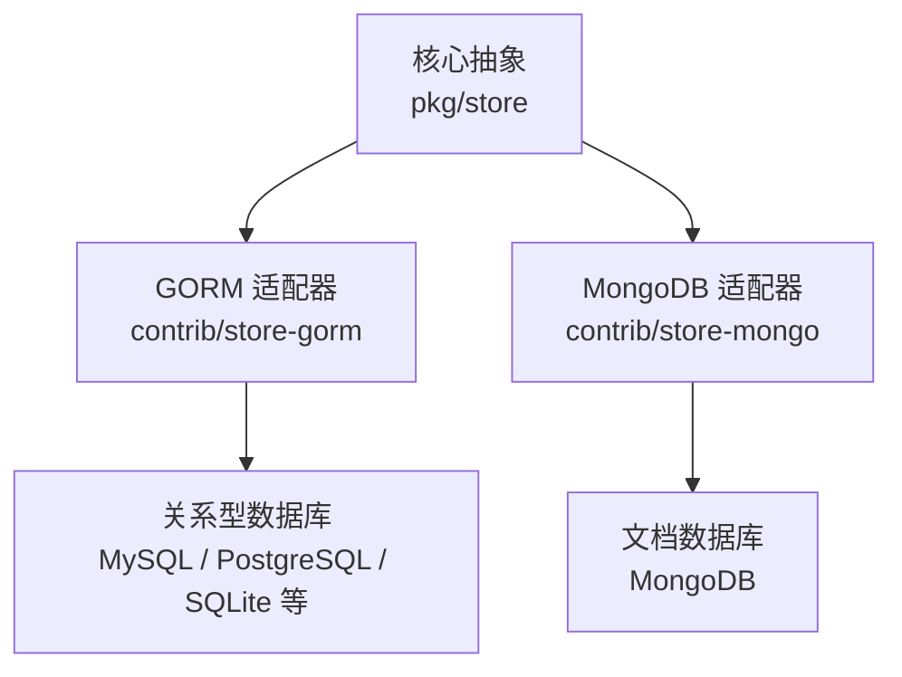
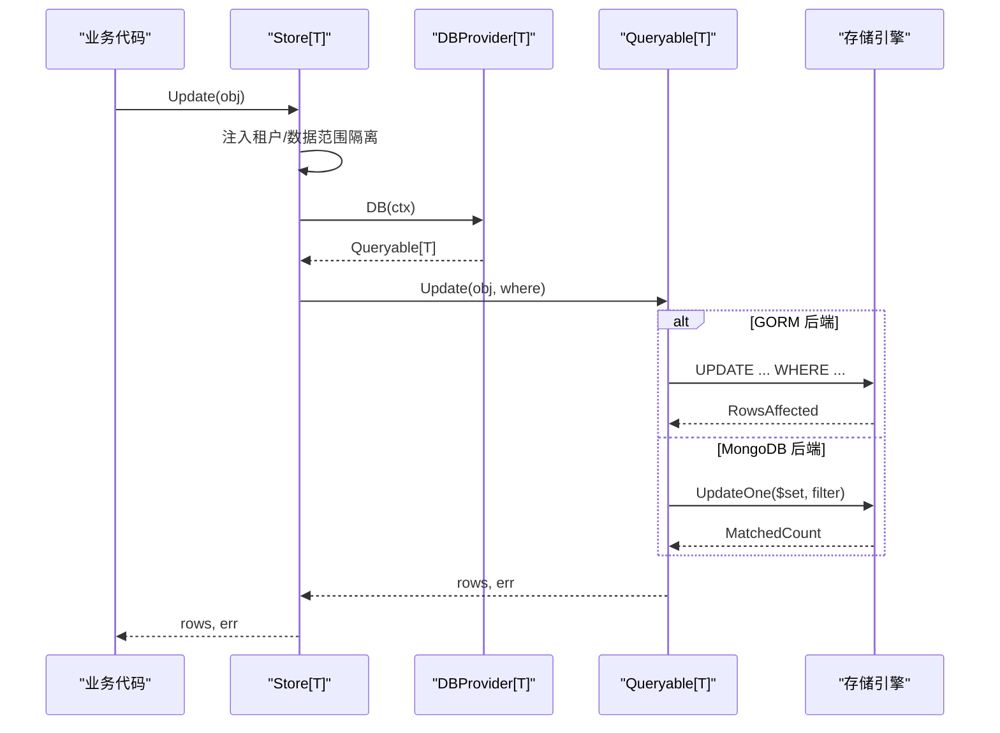
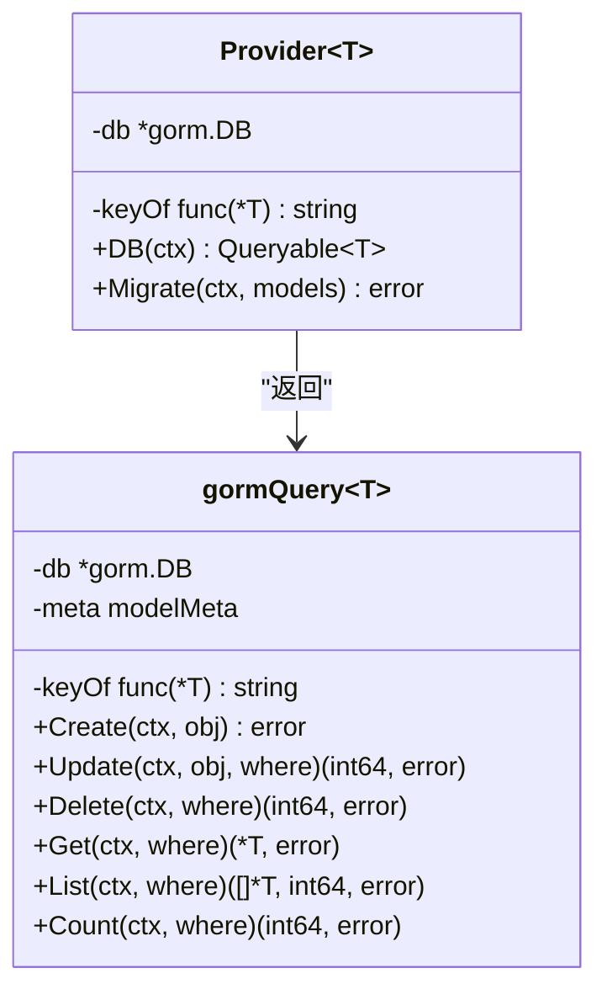
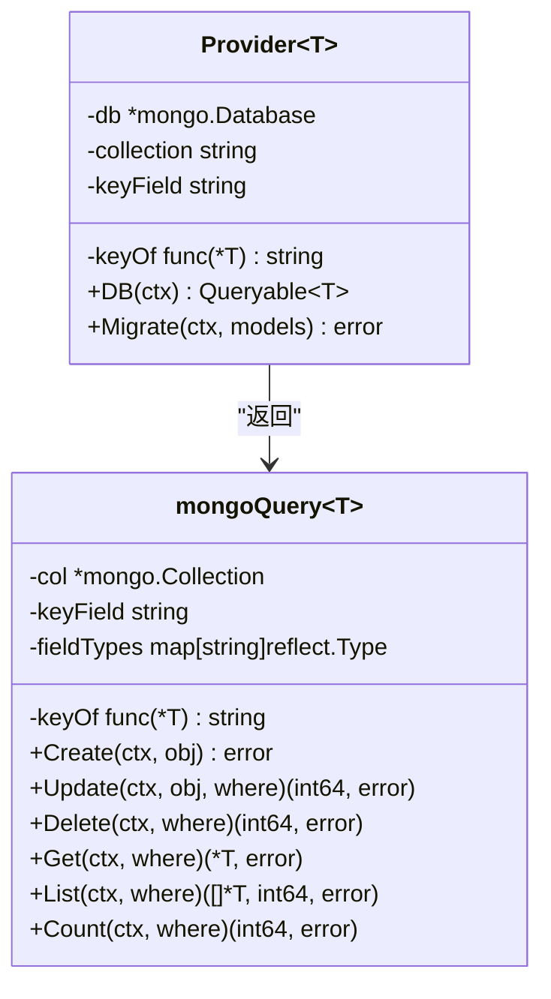
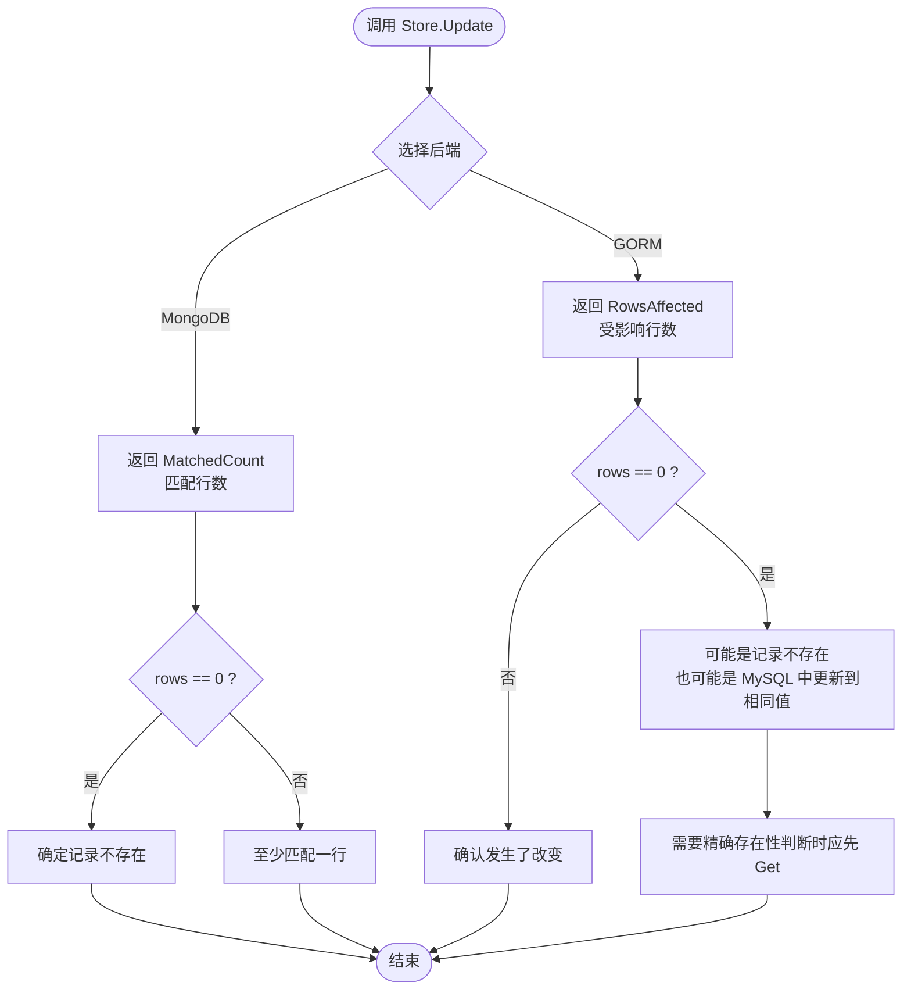
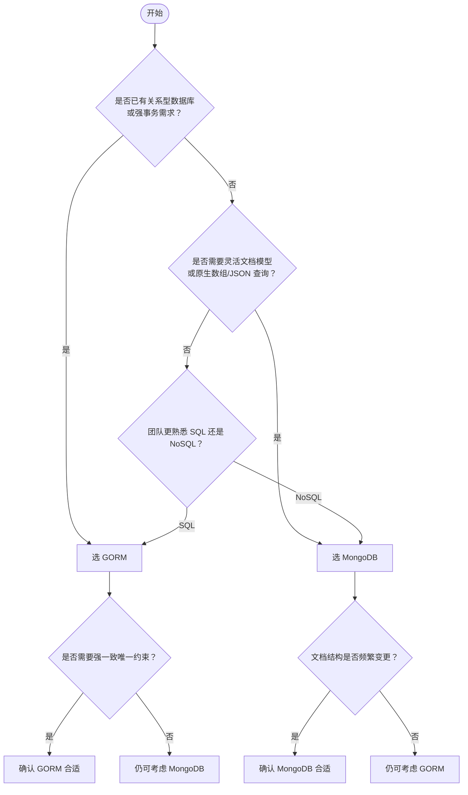

# 存储后端对比与选型指南

<cite>
**本文引用的文件**   
- [contrib/store-gorm/gorm.go](file://contrib/store-gorm/gorm.go)
- [contrib/store-mongo/mongo.go](file://contrib/store-mongo/mongo.go)
- [pkg/store/store.go](file://pkg/store/store.go)
- [pkg/store/scope.go](file://pkg/store/scope.go)
- [contrib/store-gorm/gorm_test.go](file://contrib/store-gorm/gorm_test.go)
- [contrib/store-mongo/mongo_test.go](file://contrib/store-mongo/mongo_test.go)
</cite>

## 目录
1. [引言](#引言)
2. [项目结构与定位](#项目结构与定位)
3. [核心组件总览](#核心组件总览)
4. [架构概览](#架构概览)
5. [详细组件分析](#详细组件分析)
6. [GORM 与 MongoDB 横向对比](#gorm-与-mongodb-横向对比)
7. [跨后端开发关键差异](#跨后端开发关键差异)
8. [事务支持说明](#事务支持说明)
9. [性能特点](#性能特点)
10. [适用场景与选型决策树](#适用场景与选型决策树)
11. [迁移路径与双写策略](#迁移路径与双写策略)
12. [故障排查](#故障排查)
13. [结论](#结论)

## 引言
本仓在 `contrib` 下提供两套独立的存储适配器：`store-gorm` 把 GORM 适配为框架统一的 `store.DBProvider[T] + store.Queryable[T]`，`store-mongo` 把 MongoDB driver v2 做同样适配。两者面向同一套泛型 CRUD 门面，但底层数据模型、字段映射、更新返回值语义、查询操作符能力不同。本文聚焦这两条实现，给出特性对比、跨后端注意事项、选型建议以及迁移方案。

## 项目结构与定位
仓库是 Go 多模块集合；`contrib/store-gorm` 和 `contrib/store-mongo` 各自拥有独立 `go.mod`，核心包 `pkg/store` 不引入任何具体数据库依赖，只定义接口契约。业务通过 `store.NewStore[Entity](provider)` 获得引擎无关的 CRUD 入口。

**图示来源**
- [pkg/store/store.go:1-60](file://pkg/store/store.go#L1-L60)
- [contrib/store-gorm/gorm.go:1-40](file://contrib/store-gorm/gorm.go#L1-L40)
- [contrib/store-mongo/mongo.go:1-40](file://contrib/store-mongo/mongo.go#L1-L40)

**章节来源**
- [pkg/store/store.go:1-60](file://pkg/store/store.go#L1-L60)

## 核心组件总览
- `Queryable[T]`：后端实现的 CRUD 契约，包含 `Create/Update/Delete/Get/List/Count/Migrate`。
- `DBProvider[T]`：负责提供 `Queryable[T]` 并管理连接生命周期。
- `Store[T]`：面向业务的泛型门面，统一处理分页、租户隔离、数据范围隔离等横切逻辑。
- `baldgorm.Provider[T]`：持有 `*gorm.DB` 和主键提取函数，返回绑定到实体表的 `gormQuery[T]`。
- `baldmongo.Provider[T]`：持有 `*mongo.Database`、集合名和主键提取函数，返回绑定到集合的 `mongoQuery[T]`。

**章节来源**
- [pkg/store/store.go:28-60](file://pkg/store/store.go#L28-L60)
- [contrib/store-gorm/gorm.go:24-68](file://contrib/store-gorm/gorm.go#L24-L68)
- [contrib/store-mongo/mongo.go:24-78](file://contrib/store-mongo/mongo.go#L24-L78)

## 架构概览
下图展示调用方经 `Store[T]` 访问后端时的控制流，以及两个适配器如何把统一条件对象翻译成 SQL 或 BSON。

**图示来源**
- [pkg/store/store.go:120-175](file://pkg/store/store.go#L120-L175)
- [contrib/store-gorm/gorm.go:89-138](file://contrib/store-gorm/gorm.go#L89-L138)
- [contrib/store-mongo/mongo.go:120-172](file://contrib/store-mongo/mongo.go#L120-L172)

## 详细组件分析

### GORM 适配器
- 使用结构体标签解析列名，优先 `gorm:\"column:...\"`，其次 snake_case 约定。
- 支持嵌入结构体展开、复合主键、`gorm:\"-\"` 忽略字段。
- `Update` 用反射构造 map 调用 `Updates`，显式排除主键列，保证零值字段也被写入且主键不可变。
- 唯一约束冲突被识别并转为 `store.ErrConflict`。
- `Where.Filters` 与布尔表达式 `Expr` 都翻译为参数化 SQL 片段。
- 未命中记录时 `Get` 返回 `store.ErrNotFound`。

**图示来源**
- [contrib/store-gorm/gorm.go:24-68](file://contrib/store-gorm/gorm.go#L24-L68)
- [contrib/store-gorm/gorm.go:70-138](file://contrib/store-gorm/gorm.go#L70-L138)

**章节来源**
- [contrib/store-gorm/gorm.go:1-40](file://contrib/store-gorm/gorm.go#L1-L40)
- [contrib/store-gorm/gorm.go:70-138](file://contrib/store-gorm/gorm.go#L70-L138)
- [contrib/store-gorm/gorm.go:201-270](file://contrib/store-gorm/gorm.go#L201-L270)
- [contrib/store-gorm/gorm.go:270-572](file://contrib/store-gorm/gorm.go#L270-L572)

### MongoDB 适配器
- 使用 BSON 标签，默认主键字段名为 `id`，可通过 `WithKeyField` 覆盖。
- `Migrate` 创建集合并为 keyField 建立唯一索引；传入的模型参数被忽略。
- `Update` 用 `$set` 更新全部导出字段（排除主键），返回 `MatchedCount`。
- 过滤条件按字段类型进行强类型转换，避免字符串 `"25"` 无法匹配整数字段。
- 原生支持数组包含、JSON 点号路径、`$exists` 等 MongoDB 能力。
- 唯一键冲突通过错误码 `E11000` 识别并转为 `store.ErrConflict`。

**图示来源**
- [contrib/store-mongo/mongo.go:24-78](file://contrib/store-mongo/mongo.go#L24-L78)
- [contrib/store-mongo/mongo.go:80-172](file://contrib/store-mongo/mongo.go#L80-L172)
- [contrib/store-mongo/mongo.go:201-526](file://contrib/store-mongo/mongo.go#L201-L526)

**章节来源**
- [contrib/store-mongo/mongo.go:1-40](file://contrib/store-mongo/mongo.go#L1-L40)
- [contrib/store-mongo/mongo.go:80-172](file://contrib/store-mongo/mongo.go#L80-L172)
- [contrib/store-mongo/mongo.go:201-526](file://contrib/store-mongo/mongo.go#L201-L526)

## GORM 与 MongoDB 横向对比

| 维度 | GORM | MongoDB |
|---|---|---|
| 数据模型 | 关系型表，结构体映射列 | 文档集合，BSON 文档 |
| 主键定位 | 优先 `gorm:\"primaryKey\"`，否则 `ID` 字段，再退化为 `id` 列；复合主键走多列 Where | 默认 BSON 字段 `id`，可用 `WithKeyField` 指定其他字段 |
| 字段命名 | `gorm:\"column:...\"` 优先，否则 snake_case | BSON 字段名由 `toField` 按 snake_case 生成，可被 `bson` 标签覆盖 |
| 更新写法 | 反射 map 调用 `Updates`，排除主键列 | `$set` 文档更新，排除主键字段 |
| 更新返回值 | `RowsAffected`（受影响行数） | `MatchedCount`（匹配行数） |
| 幂等语义 | 目标不存在返回 `(0, nil)`；相同值可能返回 0（MySQL）或 1（SQLite） | 目标不存在返回 `(0, nil)`；相同值仍返回 1（已匹配） |
| 删除返回值 | `RowsAffected` | `DeletedCount` |
| 获取未命中 | 返回 `store.ErrNotFound` | 返回 `store.ErrNotFound` |
| 列表统计 | 先 `Count`，再 `Find` 分页 | `CountDocuments` 后 `Find` |
| 过滤语法 | 转 SQL，部分操作符方言相关 | 转 BSON，原生支持数组、JSON 路径、`$exists` 等 |
| 全文检索 | 通用桥接不猜测方言，默认恒真 | `SEARCH` 保守恒真，需业务显式建 text 索引 |
| 唯一冲突 | 通过错误消息关键字识别 | 通过 `E11000` 错误码识别 |
| 事务 | 由调用方通过 `*gorm.DB` 管理 | 无内置事务封装，依赖上层驱动或业务补偿 |

**章节来源**
- [contrib/store-gorm/gorm.go:70-138](file://contrib/store-gorm/gorm.go#L70-L138)
- [contrib/store-gorm/gorm.go:201-270](file://contrib/store-gorm/gorm.go#L201-L270)
- [contrib/store-gorm/gorm.go:300-420](file://contrib/store-gorm/gorm.go#L300-L420)
- [contrib/store-mongo/mongo.go:80-172](file://contrib/store-mongo/mongo.go#L80-L172)
- [contrib/store-mongo/mongo.go:201-526](file://contrib/store-mongo/mongo.go#L201-L526)

## 跨后端开发关键差异

### 1. 数据模型差异
- GORM 使用表结构，字段必须映射到物理列；内存态字段需用 `gorm:\"-\"` 标记，否则会报列不存在。
- MongoDB 使用文档结构，字段缺失表示空值；`bson:\"-\"` 字段不落库，但文档本身更灵活。

### 2. 字段映射策略
- GORM 的列名解析优先级高于 snake_case：先 `gorm column tag`，再 Go 字段名翻译。
- MongoDB 的 BSON 字段名默认 snake_case，可通过 `bson` 标签自定义；同时保留字段类型映射以做值转换。

### 3. 更新返回值判断逻辑
这是跨后端最容易踩坑的地方。

**图示来源**
- [pkg/store/store.go:120-175](file://pkg/store/store.go#L120-L175)
- [contrib/store-gorm/gorm.go:89-138](file://contrib/store-gorm/gorm.go#L89-L138)
- [contrib/store-mongo/mongo.go:120-172](file://contrib/store-mongo/mongo.go#L120-L172)

关键点：
- 不要统一用 `if rows == 0` 判断“记录不存在”。
- MongoDB 下该判据可靠，因为 `MatchedCount == 0` 就是没匹配到文档。
- GORM 下不可靠：MySQL 默认对“更新到相同值”返回 0，SQLite 可能返回 1。
- 需要“必须先存在才能更新”的语义时，应先 `Get` 判存在，再 `Update`。

**章节来源**
- [pkg/store/store.go:120-175](file://pkg/store/store.go#L120-L175)
- [contrib/store-gorm/gorm_test.go:35-80](file://contrib/store-gorm/gorm_test.go#L35-L80)
- [contrib/store-mongo/mongo_test.go:145-189](file://contrib/store-mongo/mongo_test.go#L145-L189)

### 4. 查询操作符差异
- GORM 的过滤最终生成 SQL，某些操作符（如 `REGEXP`、`ILIKE`）依赖驱动方言。
- MongoDB 原生支持数组元素匹配、JSON 点号路径匹配、`$exists`，但 `SEARCH` 全文检索被保守跳过，需要业务显式建 text 索引。

**章节来源**
- [contrib/store-gorm/gorm.go:300-420](file://contrib/store-gorm/gorm.go#L300-L420)
- [contrib/store-mongo/mongo.go:201-420](file://contrib/store-mongo/mongo.go#L201-L420)

## 事务支持说明
从源码看，`pkg/store` 没有暴露事务 API，`Queryable[T]` 也不包含事务方法。事务边界应由调用方管理：
- GORM 侧可通过传入的 `*gorm.DB` 开启事务，再由 `Provider.DB(ctx)` 返回的 `Queryable` 继承上下文会话。
- MongoDB 侧没有对应事务封装，应使用驱动级事务或业务补偿逻辑。

因此，跨后端事务不是统一契约的一部分，不能假设两个后端具有相同的事务行为。

**章节来源**
- [pkg/store/store.go:28-60](file://pkg/store/store.go#L28-L60)
- [contrib/store-gorm/gorm.go:24-68](file://contrib/store-gorm/gorm.go#L24-L68)
- [contrib/store-mongo/mongo.go:24-78](file://contrib/store-mongo/mongo.go#L24-L78)

## 性能特点
- **GORM**：适合已有关系型数据库、强一致性要求、复杂关联查询的场景；性能受 SQL 优化、索引、驱动方言影响。
- **MongoDB**：适合文档结构变化频繁、读写热点集中、需要原生数组/JSON 查询能力的场景；强类型字段值转换避免了隐式类型不一致导致的误匹配。
- 两者的 `List` 都是先统计总数再分页查询，大表分页成本取决于数据库统计能力和索引设计。
- 仓库测试主要覆盖功能正确性和幂等语义，未提供两后端压测基准，因此不应据此断言某一方绝对更快。

**章节来源**
- [contrib/store-gorm/gorm.go:360-420](file://contrib/store-gorm/gorm.go#L360-L420)
- [contrib/store-mongo/mongo.go:201-260](file://contrib/store-mongo/mongo.go#L201-L260)

## 适用场景与选型决策树

### 选型决策树

### 推荐规则
- 优先 GORM：已有关系型基础设施、强事务、严格外键/唯一约束、报表类查询。
- 优先 MongoDB：文档结构多变、需要原生数组/JSON/$exists 查询、快速迭代原型。
- 混合架构合理：核心交易用 GORM，日志/事件/配置文档用 MongoDB。
- 不要把 `rows == 0` 当成跨后端“记录不存在”的统一判据。

**图示来源**
- [pkg/store/store.go:120-175](file://pkg/store/store.go#L120-L175)
- [contrib/store-gorm/gorm.go:89-138](file://contrib/store-gorm/gorm.go#L89-L138)
- [contrib/store-mongo/mongo.go:120-172](file://contrib/store-mongo/mongo.go#L120-L172)

## 迁移路径与双写策略

### 从 GORM 迁移到 MongoDB
1. 将结构体标签从 `gorm` 改为 `bson`，确保主键字段名与 `WithKeyField` 一致。
2. 检查 `Where` 中使用的操作符：MongoDB 不支持的全文检索会被保守忽略，需要显式建索引或使用原生查询。
3. 重写依赖 `rows == 0` 的存在性判断：MongoDB 下该判据成立，GORM 下不成立。
4. 校验唯一约束：MongoDB 通过 `Migrate` 创建 keyField 唯一索引，冲突错误码为 `E11000`。
5. 验证幂等更新：MongoDB 对相同值仍返回 1，GORM 在不同数据库上行为不同。

### 从 MongoDB 迁移到 GORM
1. 将 `bson` 标签改为 `gorm`，必要时加 `primaryKey`、`column`。
2. 将集合概念映射为表结构，补充缺失列。
3. 修正更新返回值判断：不要依赖 `rows == 0` 判断不存在。
4. 注意 SQL 方言差异：正则、大小写不敏感匹配等行为因数据库而异。
5. 确认事务边界由调用方管理，不能假设后端自动提供事务。

### 双写实施要点
- 以业务 ID 作为跨后端稳定标识。
- 写入顺序建议：先写新后端，再写旧后端；失败时重试或补偿。
- 读取阶段允许短暂不一致，但最终要收敛到主数据源。
- 新增字段时先双写，再切换读，最后下线旧后端。
- 监控双写延迟、冲突率、错误率，设置告警阈值。
- 回滚路径提前演练：如果新后端不可用，应能降级到旧后端。

## 故障排查

### 更新返回值异常
- 现象：`rows == 0` 被当作“记录不存在”，但在 MySQL 上可能是“更新到相同值”。
- 根因：GORM 返回的是受影响行数，不是匹配行数。
- 处理：先 `Get` 判断存在，再 `Update`；或用 `SELECT ... FOR UPDATE` 配合更新。

**章节来源**
- [pkg/store/store.go:120-175](file://pkg/store/store.go#L120-L175)

### 唯一约束冲突
- GORM：错误消息包含 `unique`/`duplicate`/`constraint` 时转为 `ErrConflict`。
- MongoDB：错误码 `E11000` 时转为 `ErrConflict`。
- 处理：捕获 `store.ErrConflict`，向上返回业务冲突响应，而不是直接透传底层错误。

**章节来源**
- [contrib/store-gorm/gorm.go:480-572](file://contrib/store-gorm/gorm.go#L480-L572)
- [contrib/store-mongo/mongo.go:480-526](file://contrib/store-mongo/mongo.go#L480-L526)

### 查询条件无效
- GORM：未知操作符默认返回恒真条件，不会报错。
- MongoDB：未知操作符返回空过滤器，也可能导致静默不生效。
- 处理：审查 `FilterExpr`，对全文检索等需要特殊索引的操作显式处理。

**章节来源**
- [contrib/store-gorm/gorm.go:300-420](file://contrib/store-gorm/gorm.go#L300-L420)
- [contrib/store-mongo/mongo.go:201-420](file://contrib/store-mongo/mongo.go#L201-L420)

### 多租户隔离异常
- 现象：查不到数据或删除不到数据。
- 原因：`applyIsolation` 自动注入租户和数据范围条件；平台级实体需显式声明豁免。
- 处理：确认实体是否应用了 `WithPlatformLevel`，确认请求上下文是否携带租户值。

**章节来源**
- [pkg/store/store.go:280-360](file://pkg/store/store.go#L280-L360)
- [pkg/store/scope.go:1-172](file://pkg/store/scope.go#L1-L172)

## 结论
GORM 与 MongoDB 在本仓中通过统一的 `Queryable[T]` 契约暴露相似的 CRUD 外观，但底层语义并不等价。最关键差异在于更新返回值：GORM 返回受影响行数，MongoDB 返回匹配行数；跨后端不能用同一个 `rows == 0` 判定记录是否存在。此外，字段映射、操作符能力、事务支持和唯一冲突识别方式也存在后端差异。

选型时应优先考虑业务模型稳定性、事务一致性要求、现有基础设施和团队技能栈。对于高不确定性场景，MongoDB 的文档模型更有弹性；对于强一致、强约束场景，GORM 更稳妥。若采用双后端或多后端，应在接口层封装存在性判断、冲突处理和事务边界，避免业务代码直接耦合底层语义。