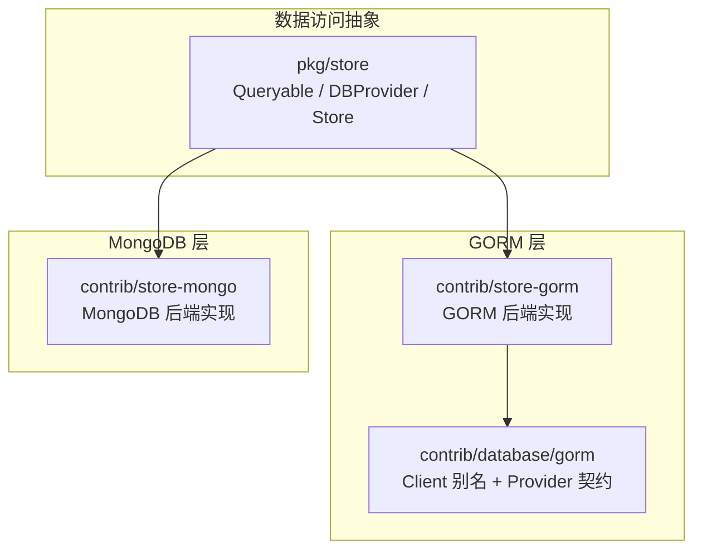
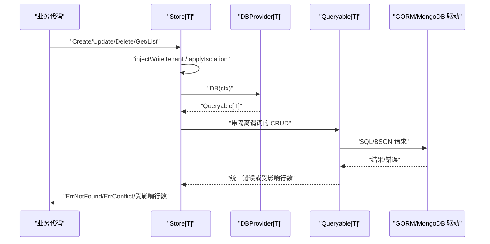
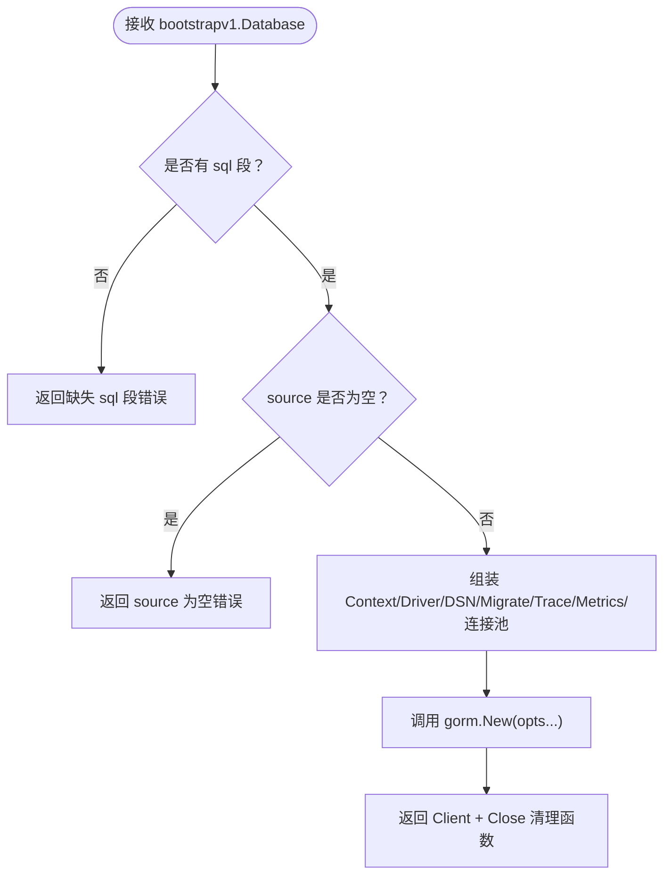
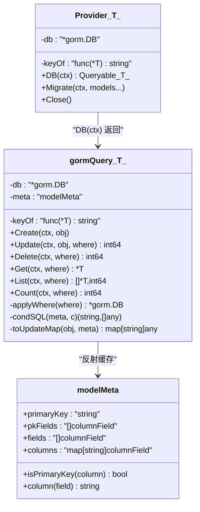
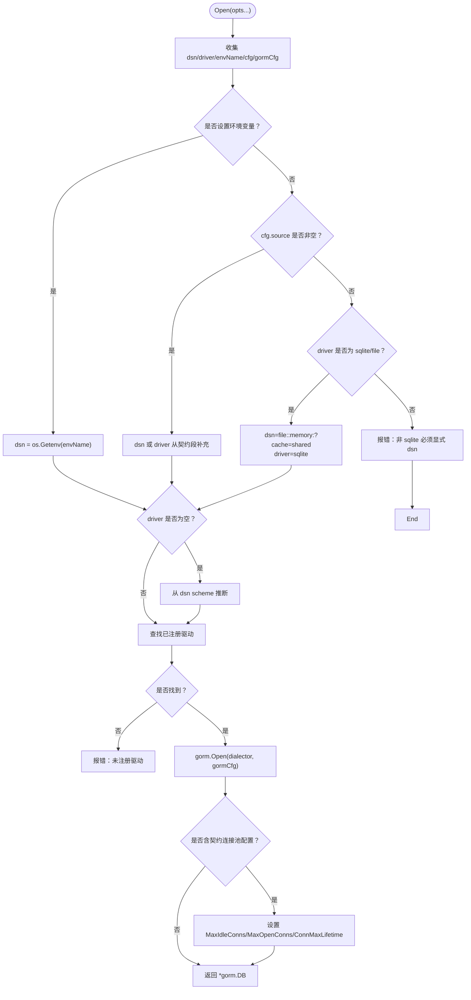
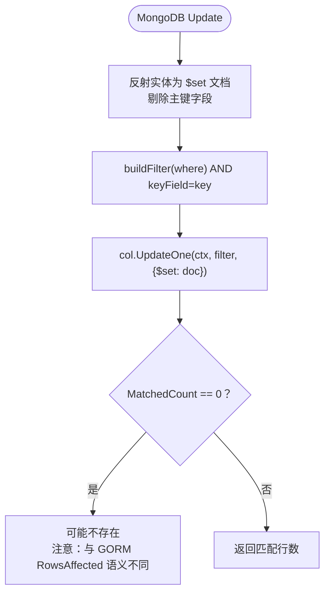
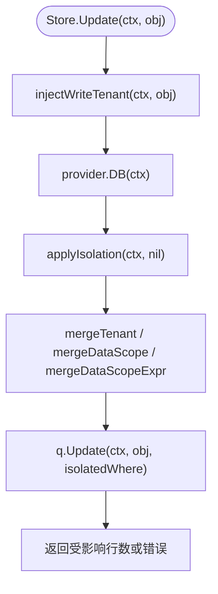
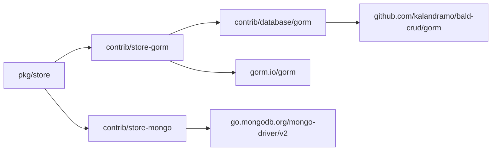

# 数据库与存储扩展包

<cite>
**本文引用的文件 **
- [contrib/database/gorm/client.go](file://contrib/database/gorm/client.go)
- [contrib/database/gorm/contract/contract.go](file://contrib/database/gorm/contract/contract.go)
- [contrib/store-gorm/gorm.go](file://contrib/store-gorm/gorm.go)
- [contrib/store-gorm/conn.go](file://contrib/store-gorm/conn.go)
- [contrib/store-mongo/mongo.go](file://contrib/store-mongo/mongo.go)
- [pkg/store/store.go](file://pkg/store/store.go)
</cite>

## 目录
1. [引言](#引言)
2. [项目结构](#项目结构)
3. [核心组件](#核心组件)
4. [架构总览](#架构总览)
5. [详细组件分析](#详细组件分析)
6. [依赖关系分析](#依赖关系分析)
7. [性能与连接池特性](#性能与连接池特性)
8. [故障恢复与迁移建议](#故障恢复与迁移建议)
9. [疑难排查](#疑难排查)
10. [结论](#结论)

## 引言
本仓库的数据库与存储扩展包围绕三个层次组织：  
- `contrib/database/gorm`：对通用 SQL 客户端（bald-crud/gorm）的直连封装，提供按契约装配 GORM 客户端、关闭连接池等能力。  
- `contrib/store-gorm`：把 GORM 适配为框架 `store.DBProvider[T]` / `store.Queryable[T]`，实现实体映射、查询构建器、批量操作和并发安全。  
- `contrib/store-mongo`：基于 MongoDB v2 驱动实现同一 `store` 接口，补齐文档映射、聚合式过滤、更新操作符支持。  

三者共同面向 `pkg/store` 的统一泛型 CRUD 门面，使业务代码以引擎无关方式访问 MySQL、PostgreSQL、SQLite 或 MongoDB。

## 项目结构
与本主题直接相关的模块分布如下：

**图表来源**
- [pkg/store/store.go:1-200](file://pkg/store/store.go#L1-L200)
- [contrib/store-gorm/gorm.go:1-200](file://contrib/store-gorm/gorm.go#L1-L200)
- [contrib/store-mongo/mongo.go:1-200](file://contrib/store-mongo/mongo.go#L1-L200)
- [contrib/database/gorm/client.go:1-33](file://contrib/database/gorm/client.go#L1-L33)

**章节来源**
- [pkg/store/store.go:1-200](file://pkg/store/store.go#L1-L200)
- [contrib/database/gorm/client.go:1-33](file://contrib/database/gorm/client.go#L1-L33)
- [contrib/store-gorm/gorm.go:1-200](file://contrib/store-gorm/gorm.go#L1-L200)
- [contrib/store-mongo/mongo.go:1-200](file://contrib/store-mongo/mongo.go#L1-L200)

## 核心组件
| 组件 | 职责 | 关键入口 |
|---|---|---|
| `database/gorm.Client` | bald-crud/gorm 客户端的类型别名与生命周期封装 | `New`、`Close` |
| `database/gorm.contract.Provider` | 将 `bootstrapv1.Database.sql` 契约段映射为 GORM 客户端与清理函数 | `Provider(ctx, cfg)` |
| `store-gorm.Provider[T]` | GORM 版 `DBProvider[T]`，绑定表、主键提取函数与会话上下文 | `NewGormProvider`、`DB(ctx)`、`Migrate` |
| `store-gorm.gormQuery[T]` | GORM 版 `Queryable[T]`，实现 Create/Update/Delete/Get/List/Count | `applyWhere`、`condSQL`、`toUpdateMap` |
| `store-gorm.Open` | 注册驱动、解析 DSN/环境变量/契约配置、设置连接池并返回 `*gorm.DB` | `Open(opts...)` |
| `store-mongo.Provider[T]` | MongoDB 版 `DBProvider[T]`，绑定集合、主键字段名与主键提取函数 | `NewMongoProvider`、`DB(ctx)` |
| `store-mongo.mongoQuery[T]` | MongoDB 版 `Queryable[T]`，把 Where 翻译为 BSON filter | `buildFilter`、`condFilter`、`toUpdateDoc` |
| `pkg/store.Store[T]` | 引擎无关 CRUD 门面，注入多租户隔离、分页、平台级豁免 | `Create/Update/Delete/Get/List/ListWithPaging` |

**章节来源**
- [contrib/database/gorm/client.go:1-33](file://contrib/database/gorm/client.go#L1-L33)
- [contrib/database/gorm/contract/contract.go:1-70](file://contrib/database/gorm/contract/contract.go#L1-L70)
- [contrib/store-gorm/gorm.go:1-200](file://contrib/store-gorm/gorm.go#L1-L200)
- [contrib/store-gorm/conn.go:1-203](file://contrib/store-gorm/conn.go#L1-L203)
- [contrib/store-mongo/mongo.go:1-200](file://contrib/store-mongo/mongo.go#L1-L200)
- [pkg/store/store.go:1-200](file://pkg/store/store.go#L1-L200)

## 架构总览
下图展示从业务调用到具体存储后端的完整路径，以及多租户隔离、事务上下文、错误归一化等横切逻辑。

**图表来源**
- [pkg/store/store.go:1-200](file://pkg/store/store.go#L1-L200)
- [pkg/store/store.go:201-512](file://pkg/store/store.go#L201-L512)
- [contrib/store-gorm/gorm.go:1-200](file://contrib/store-gorm/gorm.go#L1-L200)
- [contrib/store-mongo/mongo.go:1-200](file://contrib/store-mongo/mongo.go#L1-L200)

## 详细组件分析

### database/gorm：GORM 客户端封装与契约装配
该包不引入框架契约，仅暴露类型别名和构造透传；真正把 `bootstrapv1.Database.sql` 映射到 GORM 选项的是其 `contract` 子包。

- `client.go` 定义 `Client = gormcrud.Client`、`Option = gormcrud.Option`，并通过 `New` 转发构造，通过 `Close` 获取底层 `sql.DB` 并关闭连接池。
- `contract/contract.go` 中 `Provider` 负责校验 `sql.source`、拼装上下文、驱动名、DSN、迁移开关、追踪与指标开关，并按值设置最大空闲连接、最大打开连接、连接最大存活时间。
- 未建模能力明确标注：模型迁移由代码声明而非契约承载；读写分离暂不支持；Prometheus push 与 tracing 细节走 observability 面。

**图表来源**
- [contrib/database/gorm/contract/contract.go:1-70](file://contrib/database/gorm/contract/contract.go#L1-L70)

**章节来源**
- [contrib/database/gorm/client.go:1-33](file://contrib/database/gorm/client.go#L1-L33)
- [contrib/database/gorm/contract/contract.go:1-70](file://contrib/database/gorm/contract/contract.go#L1-L70)

### store-gorm：GORM 后端实现
`store-gorm` 把 GORM 的 `*gorm.DB` 适配为框架 `DBProvider[T]` 与 `Queryable[T]`，核心设计如下：

#### Provider 与会话
- `NewGormProvider[T](db, keyOf)` 要求非 nil 的数据库句柄与主键提取函数。
- `DB(ctx)` 返回 `gormQuery[T]`，使用 `db.WithContext(ctx)` 把请求上下文绑定到会话，使后续 Create/Get/List 等操作继承取消与超时。
- `Migrate` 默认迁移实体 T；若显式传入模型则迁移指定模型。

#### 实体映射与列名解析
- `modelMeta` 缓存 Go 结构体反射信息：Go 字段名 → 列名、主键列名、全部可持久化字段。
- 列名优先取 `gorm:"column:..."`；未命中时按 snake_case 约定转换；支持嵌入结构体展开。
- 复合主键通过 `gorm:"primaryKey"` 识别；若无主键标记且存在 `ID` 字段，则用 `ID` 对应列；否则回退到 `id` 列。
- `gorm:"-","-:migration","-:all"` 等以 `-` 开头的 tag 被视作忽略写入。

#### 查询构建器
- `applyWhere` 将 `Where.Filters` 与 `Where.Expr` 按 AND 组合；布尔树递归生成参数化 SQL 片段。
- `condSQL` 把比较操作符翻译成占位符 SQL，包括 EQ/NEQ/GT/GTE/LT/LTE/LIKE/ILIKE/NOT LIKE/IN/NIN/IS NULL/IS NOT NULL/CONTAINS/STARTS_WITH/ENDS_WITH/I* 变体/BETWEEN/REGEXP。
- JSON_CONTAINS、ARRAY_CONTAINS、EXISTS、SEARCH 在 GORM 后端默认恒真，保持方言无关；MongoDB 后端单独实现了前三种。

#### 更新语义与幂等性
- Update 使用 map 形式更新，排除全部主键列，确保零值字段也能写入且主键不可变。
- 单列主键沿用 `keyOf`；复合主键通过反射逐个主键列构造条件。
- 返回值是 `RowsAffected`，不是匹配行数；MySQL 默认「更新到相同值」返回 0，因此 `rows == 0` 不能作为「记录不存在」判据。
- 唯一约束冲突会转换为 `store.ErrConflict`。

#### Delete/Get/List/Count
- Delete 幂等：0 行匹配返回 `(0, nil)`。
- Get 未命中返回 `store.ErrNotFound`。
- List 先 Count 再 Find，并应用排序与偏移/限制分页。
- Count 直接委托 GORM Count。

**图表来源**
- [contrib/store-gorm/gorm.go:1-200](file://contrib/store-gorm/gorm.go#L1-L200)
- [contrib/store-gorm/gorm.go:201-400](file://contrib/store-gorm/gorm.go#L201-L400)
- [contrib/store-gorm/gorm.go:401-572](file://contrib/store-gorm/gorm.go#L401-L572)

**章节来源**
- [contrib/store-gorm/gorm.go:1-200](file://contrib/store-gorm/gorm.go#L1-L200)
- [contrib/store-gorm/gorm.go:201-400](file://contrib/store-gorm/gorm.go#L201-L400)
- [contrib/store-gorm/gorm.go:401-572](file://contrib/store-gorm/gorm.go#L401-L572)

### store-gorm 连接装配与驱动注册
`conn.go` 提供 `Open` 与驱动注册表，目标是“快速开发不引入真实依赖”：

- SQLite 预注册别名 `sqlite`、`sqlite3`、`file`。
- Postgres、MySQL 等需业务侧 import 对应驱动并调用 `RegisterDialector`。
- 未注册驱动立即失败，不会静默降级。
- DSN 解析优先级：环境变量 > 显式 `WithDSN` > 契约 `Database_SQL.Source` > 缺省 SQLite 共享内存库。
- 驱动解析优先级：显式 `WithDriver` > 契约 Driver > DSN scheme 推断。
- 连接池仅在契约段提供且值大于 0 时才设置空闲连接数、最大打开连接数、连接最大存活时间。

**图表来源**
- [contrib/store-gorm/conn.go:1-203](file://contrib/store-gorm/conn.go#L1-L203)

**章节来源**
- [contrib/store-gorm/conn.go:1-203](file://contrib/store-gorm/conn.go#L1-L203)

### store-mongo：MongoDB 存储实现
MongoDB 后端同样实现 `DBProvider[T]` 与 `Queryable[T]`，但行为与 GORM 后端存在若干重要差异：

#### 提供者与会话
- `NewMongoProvider[T](db, collection, keyOf, opts...)` 接受 `mongo.Database`、集合名与主键提取函数。
- 可通过 `WithKeyField` 覆盖主键 BSON 字段名（默认 `id`）。
- `DB(ctx)` 返回 `mongoQuery[T]`，会话绑定到集合，不再传播请求上下文。
- `Migrate` 创建集合，并为 `keyField` 创建唯一索引；传入的 models 参数被忽略。

#### 文档映射与字段名
- 字段名默认 snake_case，与 GORM 后端的 `toColumn` 一致。
- `bson:"-"` 字段不参与更新。
- 更新使用 `$set` 写入全部导出字段，剔除主键字段，避免文档错位。

#### 过滤与操作符
- `buildFilter` 把 Where 转为 BSON 文档，Filters 与 Expr 按 `$and` 组合。
- `exprFilter` 支持 `$and`/$or；空 OR 恒假（`$expr:false`），空 AND 恒真。
- `condFilter` 支持相等、不等、范围、IN/NIN、LIKE/ILIKE、正则、数组包含、JSON 路径包含、存在性、BETWEEN；全文检索 SEARCH 保守返回恒真，因为 MongoDB `$text` 需要预先建 text 索引。

#### 更新与删除语义
- Update 返回 `MatchedCount`，即匹配文档数，不是实际修改数；对“更新到相同值”仍返回 1，因此 Mongo 后端下 `rows == 0` 反而可以作为“记录不存在”的判据。这是跨后端差异，业务不应假设 `rows == 0` 在所有后端都表示不存在。
- Delete 返回 `DeletedCount`，幂等：0 行匹配返回 `(0, nil)`。

#### 分页与统计
- Count 使用 `CountDocuments`。
- List 先 Count 再 Find，并根据 Sorting/Offset/Limit 设置 find options。

**图表来源**
- [contrib/store-mongo/mongo.go:1-200](file://contrib/store-mongo/mongo.go#L1-L200)
- [contrib/store-mongo/mongo.go:201-400](file://contrib/store-mongo/mongo.go#L201-L400)
- [contrib/store-mongo/mongo.go:401-526](file://contrib/store-mongo/mongo.go#L401-L526)

**章节来源**
- [contrib/store-mongo/mongo.go:1-200](file://contrib/store-mongo/mongo.go#L1-L200)
- [contrib/store-mongo/mongo.go:201-400](file://contrib/store-mongo/mongo.go#L201-L400)
- [contrib/store-mongo/mongo.go:401-526](file://contrib/store-mongo/mongo.go#L401-L526)

### pkg/store：统一门面与多租户隔离
`pkg/store` 是 DAL 抽象层，核心原则是“只定最小接口，不绑定任何存储引擎”。

- `Queryable[T]` 定义 Create/Update/Delete/Get/List/Count/Migrate。
- `DBProvider[T]` 提供 `DB(ctx)` 与可选 `Close()`。
- `Store[T]` 提供泛型 CRUD 门面，并自动注入写路径多租户字段、读路径多租户与数据范围隔离。
- `WithPlatformLevel` 用于菜单、语言、权限点、角色等无租户维度的平台级实体；默认 fail-closed，必须显式声明才豁免隔离。
- `ListWithPaging` 把 `PagingRequest` 翻译成 Where 与分页元数据，支持 NoPaging/Page/Offset/Token 策略。

**图表来源**
- [pkg/store/store.go:1-200](file://pkg/store/store.go#L1-L200)
- [pkg/store/store.go:201-512](file://pkg/store/store.go#L201-L512)

**章节来源**
- [pkg/store/store.go:1-200](file://pkg/store/store.go#L1-L200)
- [pkg/store/store.go:201-512](file://pkg/store/store.go#L201-L512)

## 依赖关系分析
本主题的依赖方向是单向的：框架核心不感知后端，后端通过 Provider 桥接核心。

**图表来源**
- [contrib/store-gorm/go.mod:1-193](file://contrib/store-gorm/go.mod#L1-L193)
- [contrib/store-mongo/go.mod:1-29](file://contrib/store-mongo/go.mod#L1-L29)
- [contrib/database/gorm/go.mod:1-129](file://contrib/database/gorm/go.mod#L1-L129)

**章节来源**
- [contrib/store-gorm/go.mod:1-193](file://contrib/store-gorm/go.mod#L1-L193)
- [contrib/store-mongo/go.mod:1-29](file://contrib/store-mongo/go.mod#L1-L29)
- [contrib/database/gorm/go.mod:1-129](file://contrib/database/gorm/go.mod#L1-L129)

## 性能与连接池特性

### GORM 连接池
- 连接池由底层 `sql.DB` 管理；`database/gorm.Close` 最终调用 `sqlDB.Close()` 释放连接池。
- `store-gorm.conn.go` 的 `applyPool` 仅在契约字段大于 0 时设置：
  - `MaxIdleConnections`
  - `MaxOpenConnections`
  - `ConnectionMaxLifetimeSeconds`
- `database/gorm.contract.buildOptions` 也按同样口径把契约段映射为 bald-crud/gorm 的 `WithMaxIdleConns`、`WithMaxOpenConns`、`WithConnMaxLifetime`。

### 查询性能要点
- GORM 后端每次 List 都先执行 Count，再执行 Find；大表上应避免全表扫描，合理设置 Where 过滤与索引。
- Mongo 后端 List 同样先 CountDocuments 再 Find；对于大数据集，尽量使用已有索引字段过滤。
- 正则类查询（GORM 的 REGEXP、Mongo 的 `$regex`）通常无法走索引，应谨慎使用。
- 排序字段应建立索引，尤其是 DESC 排序与大分页场景。

### 事务管理
- 当前仓库的 GORM 与 MongoDB 后端均没有封装独立的事务 API；事务边界应由调用方使用 GORM 原生事务或 MongoDB Session 控制。
- `store-gorm.gormQuery` 的 `WithContext` 会把请求 ctx 绑定到会话，但不会改变事务语义；若上层使用 GORM `Begin/Commit/Rollback`，事务连接仍由 GORM 管理。
- `store-mongo` 的 Provider 持有 `*mongo.Database`，事务应由业务侧通过 mongo-driver 的 session 或 transaction API 控制。

**章节来源**
- [contrib/database/gorm/client.go:1-33](file://contrib/database/gorm/client.go#L1-L33)
- [contrib/store-gorm/conn.go:1-203](file://contrib/store-gorm/conn.go#L1-L203)
- [contrib/database/gorm/contract/contract.go:1-70](file://contrib/database/gorm/contract/contract.go#L1-L70)
- [contrib/store-gorm/gorm.go:1-200](file://contrib/store-gorm/gorm.go#L1-L200)
- [contrib/store-mongo/mongo.go:1-200](file://contrib/store-mongo/mongo.go#L1-L200)

## 故障恢复与迁移建议

### 连接故障恢复
- GORM 后端：连接池由 `sql.DB` 管理；断连后重试应由上层重试策略处理。`store-gorm.Open` 在驱动未注册或 DSN 为空时会立即失败，便于启动期发现装配问题。
- MongoDB 后端：连接由业务提供的 `*mongo.Database` 管理；`store-mongo.Provider` 本身不做重连逻辑，应在业务层配置 mongo-driver 的重试策略。
- `database/gorm.Close` 对 nil client 或 nil `DB` 返回 nil，属于幂等清理；但调用后客户端不可再用。

### 数据迁移
- GORM：
  - 推荐在 bootstrap 阶段调用 `provider.Migrate` 或 `query.Migrate`。
  - 模型定义通过结构体与 `gorm` tag 表达；契约中的 migrate 开关只影响 bald-crud/gorm 的迁移启用，不替代业务对模型清单的管理。
  - 复合主键需显式标记 `gorm:"primaryKey"`。
- MongoDB：
  - `Migrate` 会创建集合并为 `keyField` 创建唯一索引；重复创建集合的错误会被忽略。
  - 若主键字段不是默认 `id`，必须通过 `WithKeyField` 指定，否则 Get/Update/Delete 会定位不到文档。

### 索引优化建议
- 高频过滤字段：如租户 ID、状态、创建时间。
- 排序字段：尤其是分页列表使用的排序列。
- 唯一约束字段：如业务编号、邮箱、手机号。
- MongoDB 全文检索：若未来启用 SEARCH，需要显式创建 text 索引；当前实现保守地忽略 SEARCH，避免无索引时报错。
- GORM 正则与 ILIKE：尽量改用数据库原生不区分大小写匹配或前缀索引，避免全表扫描。

### 跨后端一致性注意事项
- `Update` 返回值语义不同：
  - GORM：`RowsAffected`，表示实际改变的行数；MySQL 默认「更新到相同值」返回 0。
  - MongoDB：`MatchedCount`，表示匹配的文档数；「更新到相同值」仍返回 1。
- 因此，不要把 `rows == 0` 作为统一的“记录不存在”判断；需要精确存在性检查时应先调用 `Get`。
- `Delete` 两端都是幂等：0 行匹配返回 `(0, nil)`。
- `Get` 两端未命中都返回 `store.ErrNotFound`。

**章节来源**
- [contrib/database/gorm/client.go:1-33](file://contrib/database/gorm/client.go#L1-L33)
- [contrib/store-gorm/gorm.go:1-200](file://contrib/store-gorm/gorm.go#L1-L200)
- [contrib/store-gorm/gorm.go:401-572](file://contrib/store-gorm/gorm.go#L401-L572)
- [contrib/store-mongo/mongo.go:1-200](file://contrib/store-mongo/mongo.go#L1-L200)
- [contrib/store-mongo/mongo.go:401-526](file://contrib/store-mongo/mongo.go#L401-L526)
- [pkg/store/store.go:1-200](file://pkg/store/store.go#L1-L200)

## 疑难排查

### GORM 后端常见问题
| 现象 | 可能原因 | 排查建议 |
|---|---|---|
| `no such column` | 实体字段未映射到正确列，或未声明 `gorm:"column:..."` | 检查 `gorm` tag 与 `modelMeta.column` 解析路径 |
| 更新到相同值返回 0 | MySQL 默认行为；`RowsAffected` 不等于匹配行数 | 不要以 `rows == 0` 判定不存在；先 `Get` 判存在 |
| 复合主键更新失败 | 未显式标记多个主键字段 | 使用 `gorm:"primaryKey"` 标记所有主键列 |
| `gorm:"-..."` 字段写入报错 | 这些字段被解析为忽略写入，但 map 更新仍可能尝试写入 | 确认 tag 语义，或使用非表字段加 `gorm:"-"` |
| 驱动未注册 | 未 import 对应驱动或未调用 `RegisterDialector` | 启动期注册驱动，或改用预注册的 sqlite |
| 非 sqlite 驱动但未给 DSN | `Open` 显式报错 | 显式传入 `WithDSN` 或契约 source |

**章节来源**
- [contrib/store-gorm/gorm.go:201-400](file://contrib/store-gorm/gorm.go#L201-L400)
- [contrib/store-gorm/gorm.go:401-572](file://contrib/store-gorm/gorm.go#L401-L572)
- [contrib/store-gorm/conn.go:1-203](file://contrib/store-gorm/conn.go#L1-L203)

### MongoDB 后端常见问题
| 现象 | 可能原因 | 排查建议 |
|---|---|---|
| Get 找不到文档 | 主键字段名不是默认 `id` | 使用 `WithKeyField` 指定 BSON 主键字段名 |
| 更新后 rows 不为 0 但数据没变 | `MatchedCount` 是匹配数，不是修改数 | 不要用 `rows == 0` 反推不存在；需要存在性时用 `Get` |
| 正则查询慢或无效 | `$regex` 通常不走索引 | 为过滤字段建立合适索引，或改用前缀匹配 |
| SEARCH 查询不生效 | 当前实现保守返回恒真，全文检索需预建 text 索引 | 如需全文检索，显式建索引并使用原生查询 |
| 集合不存在 | 未调用 `Migrate` | 在 bootstrap 阶段调用 provider 或 query 的 `Migrate` |

**章节来源**
- [contrib/store-mongo/mongo.go:1-200](file://contrib/store-mongo/mongo.go#L1-L200)
- [contrib/store-mongo/mongo.go:201-400](file://contrib/store-mongo/mongo.go#L201-L400)
- [contrib/store-mongo/mongo.go:401-526](file://contrib/store-mongo/mongo.go#L401-L526)

### Store 门面常见问题
| 现象 | 说明 | 建议 |
|---|---|---|
| 平台级实体报 `no such column: tenant_id` | 实体无租户维度，但 Store 未声明平台级 | 使用 `WithPlatformLevel[T]()` |
| 更新成功但业务认为不存在 | 后端 `rows == 0` 语义不一致 | 显式 `Get` 判断存在性 |
| 分页最后一页出现空翻页 | NextToken 填充逻辑依赖 total 与 limit | 使用 `ListWithPaging`，避免自行拼 token |
| 读查询泄露其他租户数据 | 忘记注入隔离条件 | 不要绕过 Store；让 `applyIsolation` 自动注入 |

**章节来源**
- [pkg/store/store.go:1-200](file://pkg/store/store.go#L1-L200)
- [pkg/store/store.go:201-512](file://pkg/store/store.go#L201-L512)

## 结论
本仓库的数据库与存储扩展包以 `pkg/store` 为核心抽象，通过 `contrib/store-gorm` 与 `contrib/store-mongo` 提供两种后端实现，并以 `contrib/database/gorm` 作为 GORM 客户端与契约装配层。整体设计强调：

- 核心零后端耦合，具体引擎通过 Provider 注入。
- 多租户隔离与数据范围下沉到 DAL，减少业务遗漏风险。
- GORM 与 MongoDB 后端在 CRUD 语义上尽量对齐，但 Update 返回值、操作符支持和索引行为存在必要差异。
- 连接池、驱动注册、迁移、索引、事务等基础设施责任清晰：连接池由底层驱动管理，事务由调用方控制，迁移由业务在 bootstrap 阶段显式执行。

在实际工程中，选择 GORM 还是 MongoDB 应依据数据模型稳定性、查询复杂度、团队技术栈与运维能力综合决定；无论选择哪种后端，都应遵循本包定义的幂等语义、隔离语义与错误语义，避免因 `rows == 0` 等细节导致跨后端行为不一致。