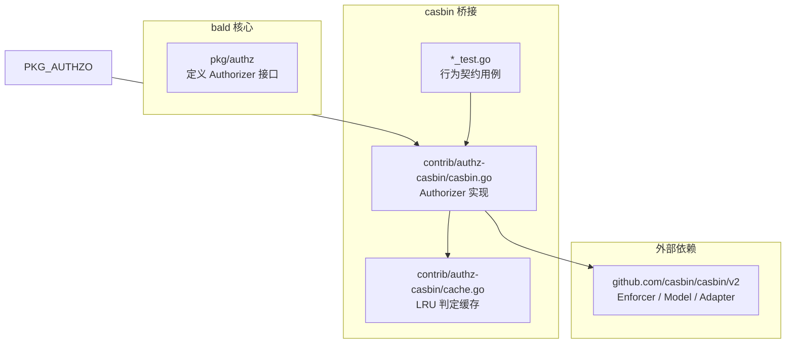
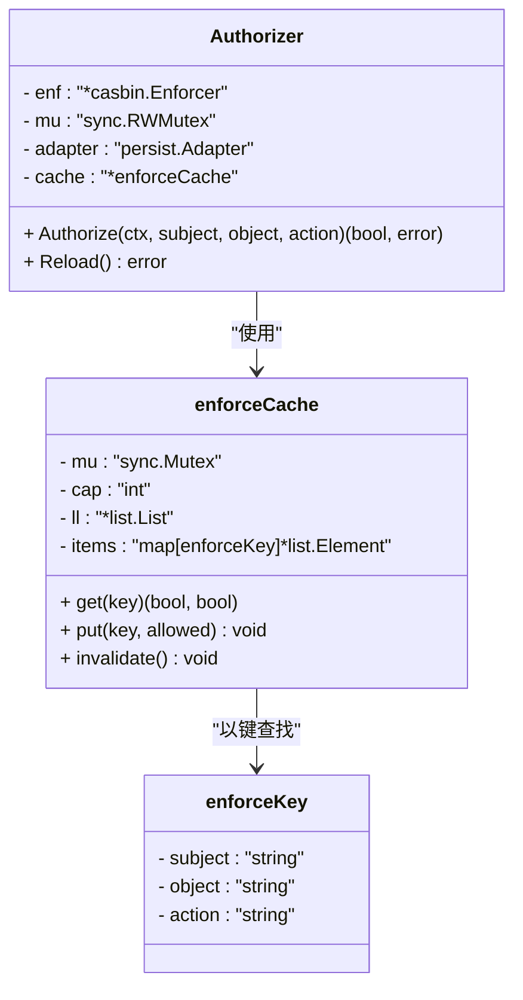
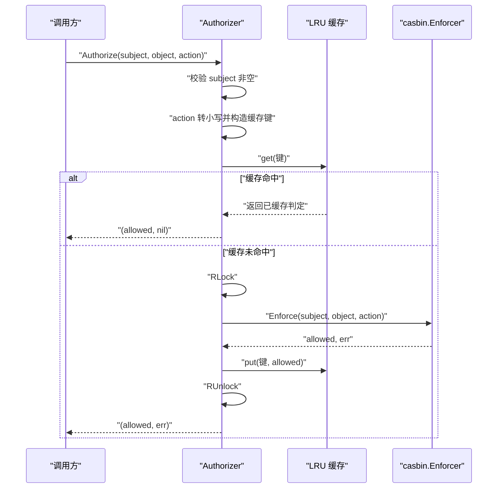
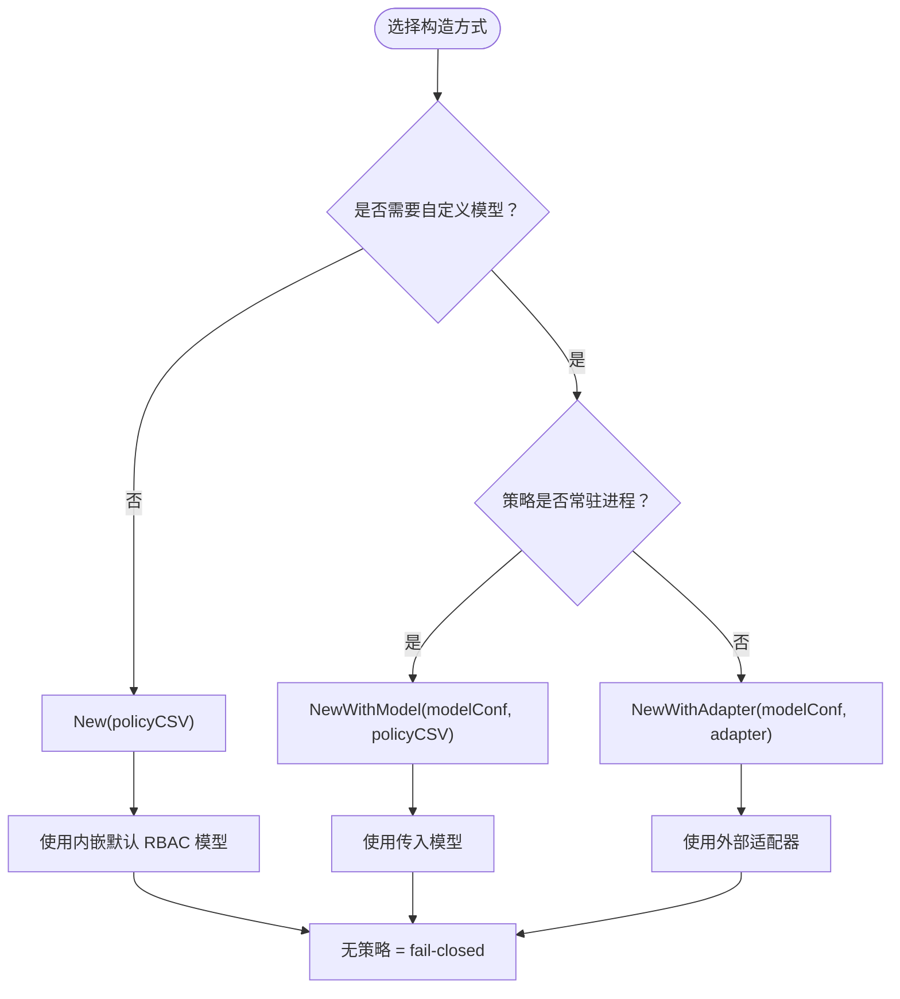
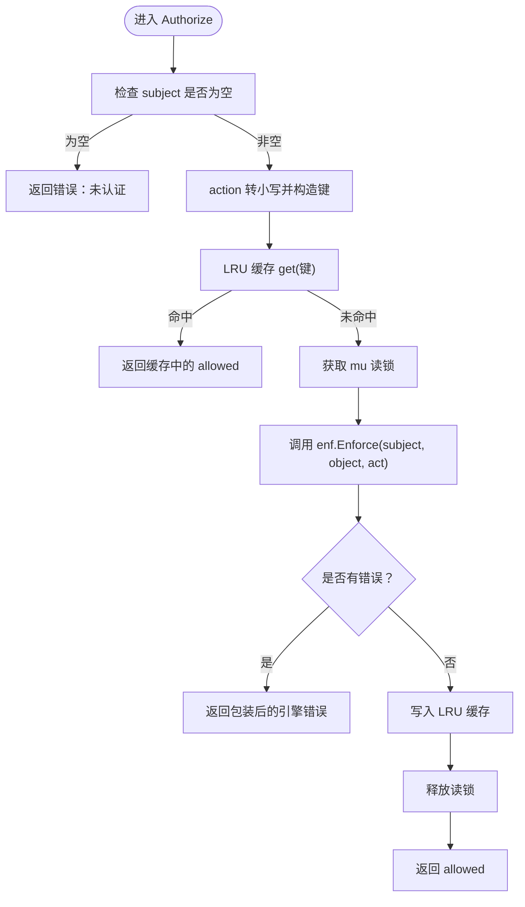
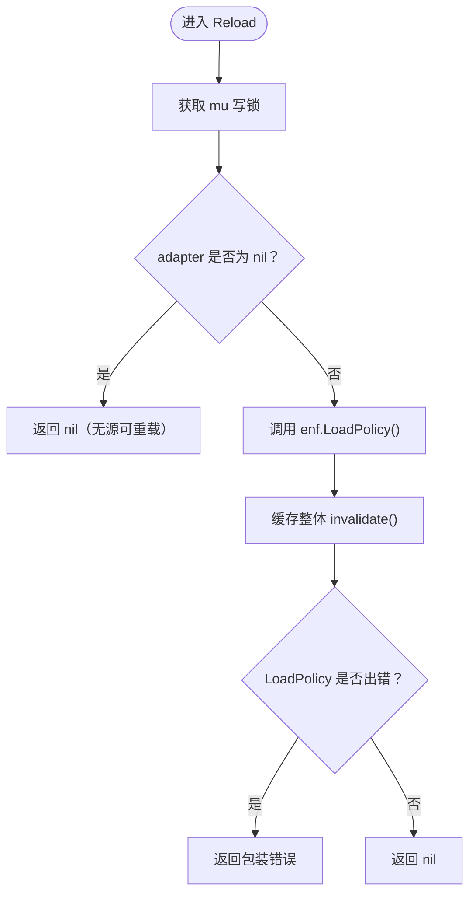
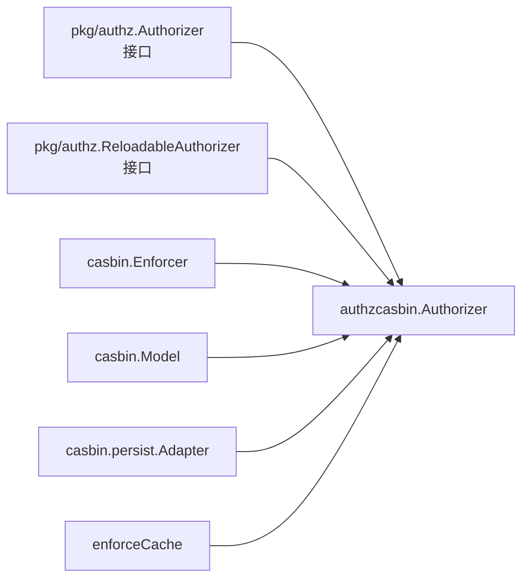
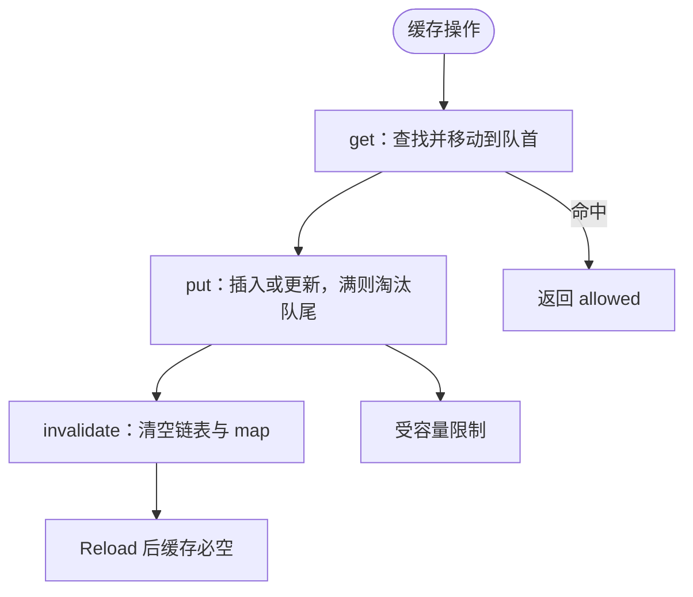

# Authorizer 核心实现

<cite>
**本文引用的文件**   
- [contrib/authz-casbin/casbin.go](file://contrib/authz-casbin/casbin.go)
- [contrib/authz-casbin/cache.go](file://contrib/authz-casbin/cache.go)
- [contrib/authz-casbin/casbin_test.go](file://contrib/authz-casbin/casbin_test.go)
- [contrib/authz-casbin/reload_test.go](file://contrib/authz-casbin/reload_test.go)
- [pkg/authz/authz.go](file://pkg/authz/authz.go)
</cite>

## 目录
1. [简介](#简介)
2. [项目结构](#项目结构)
3. [核心组件](#核心组件)
4. [架构总览](#架构总览)
5. [详细组件分析](#详细组件分析)
6. [依赖关系分析](#依赖关系分析)
7. [性能与缓存语义](#性能与缓存语义)
8. [故障排查指南](#故障排查指南)
9. [结论](#结论)

## 简介
本文件围绕 `authzcasbin.Authorizer` 的结构、构造器、授权判定流程与运行期重载语义，给出面向业务侧的完整技术文档。该实现位于 `contrib/authz-casbin` 模块，桥接核心包 `pkg/authz` 定义的零引擎授权接口，具体策略引擎为 casbin。

设计要点：
- 框架核心不耦合 casbin；casbin 仅存在于本桥接子模块。
- 归一化 `(subject, object, action)` 由核心拦截器完成，Authorizer 只做纯 Enforce。
- 默认采用 fail-closed（无策略即拒绝）；支持通过适配器在运行期重载策略。
- 提供有界 LRU 结果缓存，命中路径零分配、零调用 Enforce。

**章节来源**
- [contrib/authz-casbin/casbin.go:1-20](file://contrib/authz-casbin/casbin.go#L1-L20)
- [pkg/authz/authz.go:1-20](file://pkg/authz/authz.go#L1-L20)

## 项目结构
`contrib/authz-casbin` 是 bald 的可插拔授权桥接模块，核心文件职责如下：

| 文件 | 职责 |
|---|---|
| `casbin.go` | `Authorizer` 结构体、三个构造函数、`Authorize`、`Reload`、接口断言 |
| `cache.go` | 基于双向链表 + map 的有界 LRU 判定缓存 |
| `casbin_test.go` | 空策略、RBAC 语义、动作大小写不敏感、自定义模型等用例 |
| `reload_test.go` | 文件适配器下的运行期策略重载、并发安全、空策略 Reload 无操作 |
| `policy_test.go` | 通过 `NewRows`/`Grant` 构建策略集的辅助测试（非本文主结构体） |
| `rbac_model.conf` | 内嵌默认 RBAC 模型（由 `go:embed` 注入） |

**图表来源**
- [contrib/authz-casbin/casbin.go:21-60](file://contrib/authz-casbin/casbin.go#L21-L60)
- [contrib/authz-casbin/cache.go:1-30](file://contrib/authz-casbin/cache.go#L1-L30)
- [pkg/authz/authz.go:10-20](file://pkg/authz/authz.go#L10-L20)

**章节来源**
- [contrib/authz-casbin/casbin.go:1-60](file://contrib/authz-casbin/casbin.go#L1-L60)
- [contrib/authz-casbin/cache.go:1-30](file://contrib/authz-casbin/cache.go#L1-L30)
- [pkg/authz/authz.go:1-20](file://pkg/authz/authz.go#L1-L20)

## 核心组件
`Authorizer` 是 casbin 授权器的薄封装，同时实现核心包的 `authz.Authorizer` 与 `authz.ReloadableAuthorizer`。

### 字段设计

| 字段 | 类型 | 含义与设计约束 |
|---|---|---|
| `enf` | `*casbin.Enforcer` | 底层策略引擎实例；所有 `Authorize` 判定经此执行 |
| `mu` | `sync.RWMutex` | 串行化 `Reload` 与 `Authorize`：判定走读锁，重载走写锁；避免 `LoadPolicy` 重建内部状态与并发 `Enforce` 发生数据竞争 |
| `adapter` | `persist.Adapter` | 策略源；`nil` 表示构造时没有策略文本或适配器，属于合法初始态（fail-closed），此时 `Reload` 为无操作 |
| `cache` | `*enforceCache` | `(subject, object, action) → 是否允许` 的有界 LRU 缓存；命中路径零分配、零调用 Enforce；错误从不入缓存；`Reload` 后整体失效 |

**图表来源**
- [contrib/authz-casbin/casbin.go:21-60](file://contrib/authz-casbin/casbin.go#L21-L60)
- [contrib/authz-casbin/cache.go:18-40](file://contrib/authz-casbin/cache.go#L18-L40)

**章节来源**
- [contrib/authz-casbin/casbin.go:21-60](file://contrib/authz-casbin/casbin.go#L21-L60)
- [contrib/authz-casbin/cache.go:1-40](file://contrib/authz-casbin/cache.go#L1-L40)

## 架构总览
`Authorizer` 处于核心授权抽象与 casbin 引擎之间：上游拦截器把请求归一化为 `(object, action)`，下游由 casbin 按 RBAC/ABAC 模型判定。

**图表来源**
- [contrib/authz-casbin/casbin.go:88-124](file://contrib/authz-casbin/casbin.go#L88-L124)
- [contrib/authz-casbin/cache.go:62-90](file://contrib/authz-casbin/cache.go#L62-L90)

**章节来源**
- [contrib/authz-casbin/casbin.go:88-124](file://contrib/authz-casbin/casbin.go#L88-L124)
- [contrib/authz-casbin/cache.go:50-90](file://contrib/authz-casbin/cache.go#L50-L90)

## 详细组件分析

### 构造函数对比与适用场景

| 构造函数 | 输入 | 策略源 | 重载语义 | 典型场景 |
|---|---|---|---|---|
| `New(policyCSV string)` | 策略文本 | 内嵌默认 RBAC 模型 + 字符串适配器 | 合法但内容不变（快照文本） | 快速启动、策略随二进制发布 |
| `NewWithModel(modelConf, policyCSV string)` | 自定义模型 + 策略文本 | 字符串适配器或无适配器（空文本） | 合法但内容不变 | ABAC、域模型、需要替换 `.conf` |
| `NewWithAdapter(modelConf, adapter)` | 自定义模型 + 任意 `persist.Adapter` | 可变的文件/数据库/自定义适配器 | **真实重载语义**：从同一适配器重新读取 | 运行期新增角色绑定、动态策略源 |

关键差异：
- `New` 等价于 `NewWithModel(defaultModel, policyCSV)`，默认模型由包内嵌。
- 三种构造器都接受“无策略”初始态：`policyCSV` 为空或 `adapter` 为 `nil` 时，仍会成功构造，但判定一律拒绝。
- 只有 `NewWithAdapter` 配合可变适配器（如文件适配器、数据库适配器）时，`Reload` 才有实际生效意义。

**图表来源**
- [contrib/authz-casbin/casbin.go:62-87](file://contrib/authz-casbin/casbin.go#L62-L87)
- [contrib/authz-casbin/casbin.go:160-187](file://contrib/authz-casbin/casbin.go#L160-L187)

**章节来源**
- [contrib/authz-casbin/casbin.go:62-87](file://contrib/authz-casbin/casbin.go#L62-L87)
- [contrib/authz-casbin/casbin.go:160-187](file://contrib/authz-casbin/casbin.go#L160-L187)

### Authorize 方法的线程安全实现

`Authorize(ctx, subject, object, action)` 的处理顺序如下：

1. **主体校验**：`subject` 为空直接拒绝并返回错误，用于表达“未认证”。
2. **键规范化**：将 `action` 转为小写，再与 `subject`、`object` 组成缓存键。
3. **缓存查询**：先查 LRU 缓存，命中则直接返回已缓存判定。
4. **读锁保护**：未命中时获取 `mu` 的读锁，调用 `enf.Enforce`。
5. **错误处理**：引擎错误原样包装返回，错误结果不入缓存。
6. **写回缓存**：成功判定写入缓存，随后释放读锁。

线程安全关键点：
- `mu.RLock` 保证并发 `Authorize` 不会阻塞彼此；`Reload` 独占写锁，两者互斥。
- 缓存自身还有独立 `sync.Mutex`，与 `mu` 不在同一次临界区嵌套，且锁序固定：先 `a.mu`，后 `cache.mu`，不存在反向嵌套。

**图表来源**
- [contrib/authz-casbin/casbin.go:88-124](file://contrib/authz-casbin/casbin.go#L88-L124)
- [contrib/authz-casbin/cache.go:62-90](file://contrib/authz-casbin/cache.go#L62-L90)

**章节来源**
- [contrib/authz-casbin/casbin.go:88-124](file://contrib/authz-casbin/casbin.go#L88-L124)
- [contrib/authz-casbin/cache.go:50-90](file://contrib/authz-casbin/cache.go#L50-L90)

### Reload 方法的重载语义

`Reload()` 的核心语义不是简单刷新，而是保证“策略变更路径不泄漏旧判定”：

| 情形 | 行为 |
|---|---|
| `adapter` 为 `nil` | 合法无操作，返回 `nil`；这是空策略初始态的正常情况 |
| `LoadPolicy` 成功 | 新策略生效，缓存整体失效 |
| `LoadPolicy` 失败 | 旧策略保留（fail-safe），但缓存仍整体失效；错误包装后返回给调用方 |
| 并发 `Authorize` | 被写锁独占隔离，直到 `Reload` 完成 |

重要不变量：
- 无论 `LoadPolicy` 成败，`cache.invalidate()` 都会执行。
- 失败时不改变 casbin 内部已加载策略，但多一次冷启动只是性能损失，不构成正确性风险。
- “Reload 后缓存必空”是安全红线：任何策略变更路径都不能让旧判定继续越过重载生效。

**图表来源**
- [contrib/authz-casbin/casbin.go:126-159](file://contrib/authz-casbin/casbin.go#L126-L159)
- [contrib/authz-casbin/cache.go:96-108](file://contrib/authz-casbin/cache.go#L96-L108)

**章节来源**
- [contrib/authz-casbin/casbin.go:126-159](file://contrib/authz-casbin/casbin.go#L126-L159)
- [contrib/authz-casbin/cache.go:90-108](file://contrib/authz-casbin/cache.go#L90-L108)

### 运行期策略重载示例说明

以下示例描述如何使用三种构造方式以及运行期重载，不直接粘贴源码：

#### 示例一：使用默认模型与策略文本

1. 调用 `New(policyCSV)` 创建授权器。
2. 首次 `Authorize` 会触发引擎评估并写入缓存。
3. 如果后续策略变化只发生在二进制内，需重建授权器；因为字符串适配器是构造时的文本快照。

参考用例：
- [casbin_test.go:16-40](file://contrib/authz-casbin/casbin_test.go#L16-L40)
- [casbin_test.go:42-113](file://contrib/authz-casbin/casbin_test.go#L42-L113)

#### 示例二：使用自定义模型

1. 准备 ABAC 或域模型的 `.conf` 文本。
2. 调用 `NewWithModel(modelConf, policyCSV)`。
3. 若 `policyCSV` 为空，授权器仍可构造，但所有请求默认拒绝。

参考用例：
- [casbin_test.go:100-113](file://contrib/authz-casbin/casbin_test.go#L100-L113)

#### 示例三：使用文件适配器并运行期重载

1. 将策略写入临时 CSV。
2. 调用 `NewWithAdapter(modelConf, fileadapter.NewAdapter(path))`。
3. 初始判定中，已有绑定的用户放行，未绑定用户拒绝。
4. 修改 CSV，追加新的 `g` 行（例如新用户绑定到管理员角色）。
5. 再次 `Authorize` 前调用 `Reload()`。
6. `Reload` 后，新用户立即获得权限，旧用户不受影响。

参考用例：
- [reload_test.go:20-120](file://contrib/authz-casbin/reload_test.go#L20-L120)

#### 示例四：错误处理模式

- `subject` 为空：`Authorize` 返回错误，通常由上层映射为“未认证”。
- `Enforce` 出错：返回引擎错误，通常映射为“服务不可用/内部错误”。
- `Reload` 失败：返回包装后的错误，应由调用方记录并重试，但不改变当前已加载策略。

参考用例：
- [casbin_test.go:68-99](file://contrib/authz-casbin/casbin_test.go#L68-L99)
- [reload_test.go:122-175](file://contrib/authz-casbin/reload_test.go#L122-L175)

**章节来源**
- [contrib/authz-casbin/casbin_test.go:16-113](file://contrib/authz-casbin/casbin_test.go#L16-L113)
- [contrib/authz-casbin/reload_test.go:20-175](file://contrib/authz-casbin/reload_test.go#L20-L175)

## 依赖关系分析
`Authorizer` 依赖三类对象：
- 核心接口：`pkg/authz.Authorizer`、`pkg/authz.ReloadableAuthorizer`。
- 外部引擎：`github.com/casbin/casbin/v2` 的 `Enforcer`、`model.Model`、`persist.Adapter`。
- 内部缓存：包内 `enforceCache`，使用 Go 标准库 `container/list` 和 `sync.Mutex`。

**图表来源**
- [pkg/authz/authz.go:10-38](file://pkg/authz/authz.go#L10-L38)
- [contrib/authz-casbin/casbin.go:21-60](file://contrib/authz-casbin/casbin.go#L21-L60)
- [contrib/authz-casbin/casbin.go:160-187](file://contrib/authz-casbin/casbin.go#L160-L187)

**章节来源**
- [pkg/authz/authz.go:10-38](file://pkg/authz/authz.go#L10-L38)
- [contrib/authz-casbin/casbin.go:21-60](file://contrib/authz-casbin/casbin.go#L21-L60)

## 性能与缓存语义

### 缓存动机
casbin 每次 `Enforce` 存在函数表、参数装箱等逐请求分配成本；在高重入流量下，同一 `(subject, object, action)` 反复出现很常见。LRU 缓存命中路径不经引擎，也不分配。

### 容量与淘汰
- 默认容量为 1024。
- 超过容量时淘汰最久未使用的条目。
- 使用双向链表维护最近使用顺序，map 存储节点指针以便删除。

### 安全语义
- 只缓存成功且无错误的判定。
- 错误永不入缓存，引擎故障逐次如实上报。
- `Reload` 后缓存整体清空，防止旧判定绕过策略变更。
- 并发安全由单锁保护；未分片是 YAGNI 取舍，必要时可按 key 哈希分片而不改语义。

**图表来源**
- [contrib/authz-casbin/cache.go:32-108](file://contrib/authz-casbin/cache.go#L32-L108)

**章节来源**
- [contrib/authz-casbin/cache.go:1-108](file://contrib/authz-casbin/cache.go#L1-L108)

## 故障排查指南

| 现象 | 可能原因 | 排查建议 |
|---|---|---|
| 所有请求被拒绝 | 使用了空策略或无适配器的初始态 | 确认是否传入了策略文本或适配器；空策略是合法 fail-closed |
| 新注册用户无法立即访问 | 未调用 `Reload` | 使用 `NewWithAdapter` 并在新策略写入后调用 `Reload` |
| `Reload` 报错但旧权限仍在 | `LoadPolicy` 失败但 casbin 保留旧策略 | 检查策略文件/数据库连接；记录错误并重试 |
| 并发下出现数据竞争 | 误以为 `Authorize` 内部不需要锁 | 确认实现已通过 `RWMutex` 串行化 `Reload` 与 `Authorize` |
| 动作大小写不一致导致命中异常 | 上层未统一动作大小写 | 本实现会将 `action` 转小写后再入键 |
| 缓存命中率低 | 工作集远大于容量或请求高度发散 | 观察实际活跃 `(subject, object, action)` 分布，调整业务归一化或缓存容量 |

参考用例：
- [casbin_test.go:16-40](file://contrib/authz-casbin/casbin_test.go#L16-L40)
- [reload_test.go:122-175](file://contrib/authz-casbin/reload_test.go#L122-L175)

**章节来源**
- [contrib/authz-casbin/casbin_test.go:16-113](file://contrib/authz-casbin/casbin_test.go#L16-L113)
- [contrib/authz-casbin/reload_test.go:122-175](file://contrib/authz-casbin/reload_test.go#L122-L175)

## 结论
`authzcasbin.Authorizer` 以最小侵入方式把 casbin 接入 bald 的授权抽象：  
- 构造阶段支持默认模型、自定义模型与任意适配器三条路径。  
- 运行时通过 `Authorize` 提供带缓存、线程安全的 `(subject, object, action)` 判定。  
- 通过 `Reload` 支持运行期策略重载，并以“缓存整体失效”的安全不变量确保新旧策略边界清晰。  

对于生产使用，推荐：
- 使用 `NewWithAdapter` 接入文件、数据库或自定义策略源。
- 在策略变更后显式调用 `Reload`。
- 将 `subject` 缺失视为认证失败，把引擎错误作为系统错误处理。
- 监控缓存命中率与 `Reload` 失败率，持续优化策略结构与归一化路径。