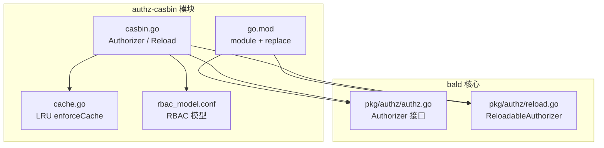
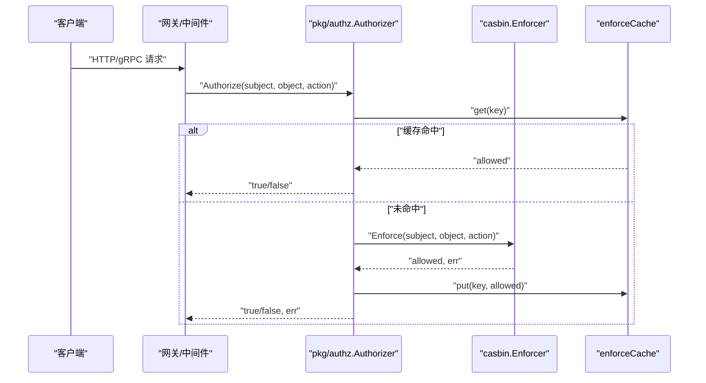
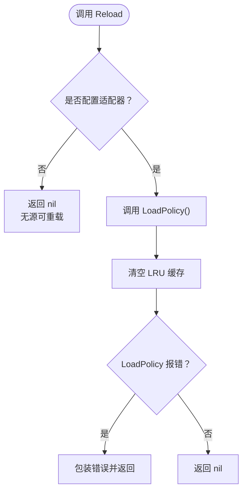
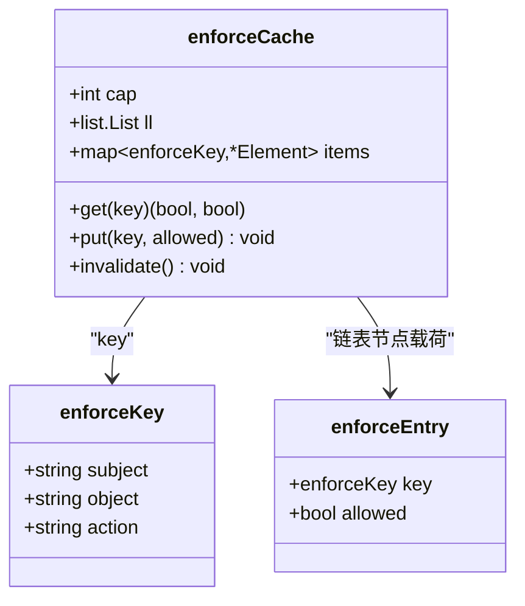
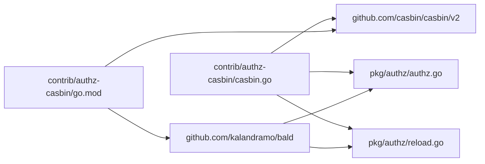
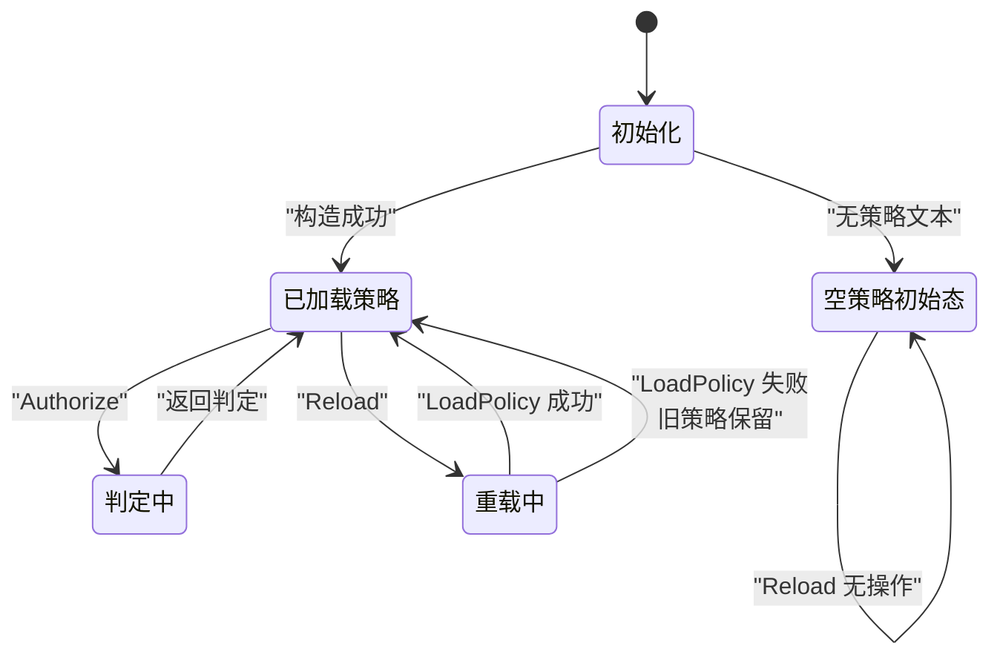

# Casbin 授权扩展包

<cite>
**本文引用的文件**   
- [casbin.go](file://contrib/authz-casbin/casbin.go)
- [cache.go](file://contrib/authz-casbin/cache.go)
- [rbac_model.conf](file://contrib/authz-casbin/rbac_model.conf)
- [go.mod](file://contrib/authz-casbin/go.mod)
- [authz.go](file://pkg/authz/authz.go)
- [reload.go](file://pkg/authz/reload.go)
- [casbin_test.go](file://contrib/authz-casbin/casbin_test.go)
- [cache_test.go](file://contrib/authz-casbin/cache_test.go)
- [policy_test.go](file://contrib/authz-casbin/policy_test.go)
- [reload_test.go](file://contrib/authz-casbin/reload_test.go)
- [alias_test.go](file://contrib/authz-casbin/alias_test.go)
</cite>

## 目录
1. [简介](#简介)
2. [项目结构](#项目结构)
3. [核心组件](#核心组件)
4. [架构总览](#架构总览)
5. [详细组件分析](#详细组件分析)
6. [依赖关系分析](#依赖关系分析)
7. [性能与容量调优](#性能与容量调优)
8. [故障恢复与一致性语义](#故障恢复与一致性语义)
9. [策略文件编写指南](#策略文件编写指南)
10. [疑难排障](#疑难排障)
11. [结论](#结论)

## 简介
`contrib/authz-casbin` 是 bald 框架的可选授权桥接模块，实现基于 Casbin 的 RBAC 授权。它把框架抽象 `pkg/authz.Authorizer` 与具体策略引擎 Casbin 解耦：核心框架不引入 casbin，业务侧在子模块内装配模型、策略和适配器，并可选择运行期重载。

本包默认提供 RBAC 模型定义；策略文本由调用方注入（通常通过 `go:embed` 嵌入业务 CSV）。归一化后的权限点约定已在框架拦截器层完成，本包只负责纯 `Enforce` 判定。

## 项目结构
该模块是一个独立的 Go module，仅依赖 casbin 与 bald 核心接口，并通过 `replace` 指向仓库根作为 `bald` 包来源。

**图示来源**
- [go.mod:1-18](file://contrib/authz-casbin/go.mod#L1-L18)
- [casbin.go:1-40](file://contrib/authz-casbin/casbin.go#L1-L40)
- [authz.go:1-38](file://pkg/authz/authz.go#L1-L38)
- [reload.go:1-54](file://pkg/authz/reload.go#L1-L54)

**章节来源**
- [go.mod:1-18](file://contrib/authz-casbin/go.mod#L1-L18)

## 核心组件
- **RBAC 模型**：`rbac_model.conf` 定义请求、策略、角色、效果和匹配器，采用 `g(sub, role)` 角色继承与 `obj == p.obj && act == p.act` 的资源动作匹配。
- **Authorizer**：实现 `authz.Authorizer`，并在构造时持有 casbin Enforcer、可选策略适配器和 LRU 结果缓存。
- **enforceCache**：以 `(subject, object, action)` 为键的有界 LRU 缓存，命中路径零分配、绕过 casbin 引擎。
- **ReloadableAuthorizer**：通过 `Reload()` 从同一适配器重新加载策略，失败保留旧策略，且整体失效缓存。

**章节来源**
- [rbac_model.conf:1-14](file://contrib/authz-casbin/rbac_model.conf#L1-L14)
- [casbin.go:41-187](file://contrib/authz-casbin/casbin.go#L41-L187)
- [cache.go:1-108](file://contrib/authz-casbin/cache.go#L1-L108)

## 架构总览
授权判定流程如下：

**图示来源**
- [casbin.go:82-141](file://contrib/authz-casbin/casbin.go#L82-L141)
- [cache.go:57-108](file://contrib/authz-casbin/cache.go#L57-L108)

## 详细组件分析

### 默认 RBAC 模型
模型声明了五段：
- 请求定义：`r = sub, obj, act`
- 策略定义：`p = sub, obj, act`
- 角色定义：`g = _, _`
- 效果：任一匹配放行
- 匹配器：角色继承 + 资源名与动作完全匹配

这意味着策略中必须显式写出受允许的资源对象和动作；没有匹配项一律拒绝。

**章节来源**
- [rbac_model.conf:1-14](file://contrib/authz-casbin/rbac_model.conf#L1-L14)

### Authorizer 结构与构造函数

| 构造方式 | 适用场景 | 策略源 | 运行期重载语义 |
|---|---|---|---|
| `New(policyCSV string)` | 快速接入，使用内置 RBAC 模型 | 字符串适配器（构造时快照） | 可调用但内容不变 |
| `NewWithModel(modelConf, policyCSV string)` | 自定义模型或空策略初始态 | 字符串适配器或无适配器 | 同上 |
| `NewWithAdapter(modelConf, adapter)` | 真实可变策略源（文件/数据库/自定义） | 任意 `persist.Adapter` | 真正从源重读，变更生效 |

关键差异：
- 空策略文本会退化为「无策略 Enforcer」，避免字符串适配器对空文本报错；此时仍是 fail-closed。
- 只有传入非 nil 适配器时，`Reload` 才有实际意义；否则返回 `nil` 表示无源可重载。
- 所有构造都会创建容量为 1024 的 LRU 缓存。

**章节来源**
- [casbin.go:59-118](file://contrib/authz-casbin/casbin.go#L59-L118)
- [casbin.go:161-187](file://contrib/authz-casbin/casbin.go#L161-L187)

### 运行期策略重载机制
`Authorizer` 实现 `authz.ReloadableAuthorizer`，其 `Reload` 方法具有以下保证：

1. **并发安全**：写锁独占，与 `Authorize` 的读锁互斥，避免 `LoadPolicy` 重建内部状态与并发 `Enforce` 竞争。
2. **空策略无操作**：当构造时无适配器，`Reload` 直接返回 `nil`。
3. **错误处理**：`LoadPolicy` 失败时透传错误；casbin 本身保留已加载策略，因此旧策略继续可用。
4. **缓存失效**：无论成功还是失败，`Reload` 都会清空 LRU 缓存，确保后续判定重新评估。
5. **能力发现**：可通过 `authz.Reload(authorizer)` 统一调用；不支持重载的实现返回 `(false, nil)`。

**图示来源**
- [casbin.go:120-159](file://contrib/authz-casbin/casbin.go#L120-L159)
- [reload.go:35-54](file://pkg/authz/reload.go#L35-L54)

**章节来源**
- [casbin.go:120-159](file://contrib/authz-casbin/casbin.go#L120-L159)
- [reload.go:1-54](file://pkg/authz/reload.go#L1-L54)
- [reload_test.go:1-175](file://contrib/authz-casbin/reload_test.go#L1-L175)

### 内置 LRU 缓存 `enforceCache`
缓存用于加速高频重复判定，避免每次都进入 casbin 引擎。

- **缓存键**：结构体 `enforceKey{subject, object, action}`，其中 `action` 先转小写，使 `GET` 与 `get` 共享判定。
- **容量控制**：默认容量 1024；小于 1 时退化到 1；超过容量逐出最久未用条目。
- **并发安全**：单把互斥锁保护链表与映射；临界区只做 map 查找与指针改链，无额外分配。
- **安全语义**：
  - 只缓存无错误的判定结果。
  - 引擎错误永不入缓存，逐次如实上报。
  - `Reload` 后整体失效，杜绝陈旧放行。
  - 容量有界，防止 subject 基数爆炸。

**图示来源**
- [cache.go:13-108](file://contrib/authz-casbin/cache.go#L13-L108)

**章节来源**
- [cache.go:1-108](file://contrib/authz-casbin/cache.go#L1-L108)
- [cache_test.go:1-264](file://contrib/authz-casbin/cache_test.go#L1-L264)

### 与框架 `authz.Authorizer` 的集成
- 本包 `Authorizer` 直接实现 `pkg/authz.Authorizer` 接口，并可被 gin/grpc 中间件直接消费。
- 框架负责把 HTTP 方法和 gRPC 方法归一化为统一的 `object` 与 `action`，例如：
  - `GET /v1/secret/123` → `object="secret", action="get"`
  - `SecretService.GetSecret` → `object="secret", action="get"`
- 本包不再做二次归一化，只执行 `Enforce(subject, object, action)`。

**章节来源**
- [casbin.go:1-40](file://contrib/authz-casbin/casbin.go#L1-L40)
- [authz.go:1-38](file://pkg/authz/authz.go#L1-L38)
- [casbin_test.go:35-113](file://contrib/authz-casbin/casbin_test.go#L35-L113)

### 别名映射能力
测试中还展示了别名装饰器的用法：将 HTTP 资源名映射到 gRPC 资源名（或反向），以便策略只维护一组命名空间。

要点：
- 别名不会放大放行面；目标名仍需命中底层策略。
- 内层引擎错误原样透传且不重试。
- 自引用或空串别名被跳过。
- 如果内层支持重载，别名装饰器转发 `Reload`。

**章节来源**
- [alias_test.go:1-198](file://contrib/authz-casbin/alias_test.go#L1-L198)

## 依赖关系分析

**图示来源**
- [go.mod:1-18](file://contrib/authz-casbin/go.mod#L1-L18)
- [casbin.go:23-40](file://contrib/authz-casbin/casbin.go#L23-L40)
- [authz.go:1-38](file://pkg/authz/authz.go#L1-L38)
- [reload.go:1-54](file://pkg/authz/reload.go#L1-L54)

**章节来源**
- [go.mod:1-18](file://contrib/authz-casbin/go.mod#L1-L18)

## 性能与容量调优

### 缓存容量
- 默认容量为 1024，适用于“百级资源 × 千级 subject”的工作集。
- 若服务存在大量不同用户访问不同资源的长尾流量，可适当提高容量；若内存敏感，可降低容量，但命中率会下降。
- 容量过小会导致频繁淘汰，但不会破坏正确性，只会增加冷启动评估次数。

### 策略文件组织
- 建议按资源维度分组：`p, role, resource, action` 行集中表达某角色的资源权限。
- 角色绑定 `g, user, role` 行集中在用户注册或角色管理完成后批量写入。
- 使用持久化适配器（如文件适配器或数据库适配器）配合外部配置中心更新策略文件，再通过 `Reload` 热生效。

### 并发访问模式
- `Authorize` 走读锁，高并发下判定几乎无串行开销。
- `Reload` 走写锁，应尽量避免高频重载；建议合并配置变更事件，或使用幂等策略哈希去抖。
- 命中缓存的路径零分配，适合 Web 服务的高频重复访问场景。

**章节来源**
- [cache.go:13-56](file://contrib/authz-casbin/cache.go#L13-L56)
- [casbin.go:82-118](file://contrib/authz-casbin/casbin.go#L82-L118)

## 故障恢复与一致性语义

### 初始态：fail-closed
- 空策略或无匹配策略时，所有判定均拒绝。
- 构造阶段若传入空策略文本，会退化为无策略 Enforcer，避免字符串适配器报错。

### 重载失败：保留旧策略
- `LoadPolicy` 失败时，casbin 保留上次成功加载的策略。
- 本包仍会清空缓存，因此后续判定会重新评估，结果与旧策略一致。
- `Reload` 返回错误，调用方可记录日志并决定是否重试。

### 一致性红线
- 任何策略变更路径都必须让缓存失效。
- 引擎错误不得被缓存或别名逻辑吞掉。
- 大小写变体的 action 共享判定键，避免同一权限出现多份缓存条目。

**图示来源**
- [casbin.go:59-159](file://contrib/authz-casbin/casbin.go#L59-L159)
- [casbin_test.go:18-34](file://contrib/authz-casbin/casbin_test.go#L18-L34)
- [reload_test.go:105-175](file://contrib/authz-casbin/reload_test.go#L105-L175)

**章节来源**
- [casbin.go:59-159](file://contrib/authz-casbin/casbin.go#L59-L159)
- [cache_test.go:135-200](file://contrib/authz-casbin/cache_test.go#L135-L200)
- [reload_test.go:105-175](file://contrib/authz-casbin/reload_test.go#L105-L175)

## 策略文件编写指南

### 模型语义
默认 RBAC 模型要求：
- 策略行格式：`p=subject,object,action`
- 角色绑定格式：`g=subject,role`
- 匹配规则：`g(r.sub, p.sub) && r.obj == p.obj && r.act == p.act`

因此，仅有 `p` 行不足以放行；必须有对应的 `g` 行把用户绑定到角色。

### 示例策略说明
- 管理员拥有 `secret` 资源的 `get`、`delete`、`list` 权限。
- 普通用户 `u-alice` 绑定 `viewer` 角色，只能 `get` 和 `list`，不能 `delete`。
- 未知用户或未绑定的用户一律拒绝。

这些语义由测试用例覆盖：
- 管理员放行多种动作。
- 普通用户拒绝删除。
- 未知用户拒绝。
- 空 subject 返回错误。

**章节来源**
- [rbac_model.conf:1-14](file://contrib/authz-casbin/rbac_model.conf#L1-L14)
- [casbin_test.go:35-113](file://contrib/authz-casbin/casbin_test.go#L35-L113)
- [policy_test.go:1-125](file://contrib/authz-casbin/policy_test.go#L1-L125)

### 角色分配
- 通过 `g, user-id, role-name` 为用户分配角色。
- 新增角色绑定后，需调用 `Reload` 才能对后续判定生效。
- 删除角色绑定同样需要 `Reload`，并且会使缓存失效，避免陈旧放行。

### 资源权限定义
- `object` 应为归一化后的资源名，例如 `secret`、`auth`。
- `action` 应为归一化后的动作，例如 `get`、`delete`、`list`。
- 大小写在判定时会被统一为小写，但建议在策略中保持小写。

### 别名映射
- 当 HTTP 资源和 gRPC 资源命名不一致时，可使用别名装饰器把一方映射到另一方。
- 别名只是换名再问，不是放行通道；目标名仍需有对应策略。
- 若内层授权器支持重载，别名装饰器会转发 `Reload`。

**章节来源**
- [alias_test.go:1-198](file://contrib/authz-casbin/alias_test.go#L1-L198)

## 疑难排障

### 问题：策略变更后立即访问仍返回拒绝
**原因**：仅修改策略文件不会自动生效，必须调用 `Reload`。  
**解决**：在策略写入成功后调用 `authorizer.Reload()`，或通过 `authz.Reload(authorizer)` 统一入口。

**章节来源**
- [reload_test.go:45-104](file://contrib/authz-casbin/reload_test.go#L45-L104)

### 问题：Reload 报错但服务仍可用
**原因**：casbin 在 `LoadPolicy` 失败时保留旧策略；本包也保留了这一行为，只是清空缓存。  
**影响**：服务继续按旧策略运行，但下一次判定会重新评估。  
**解决**：检查策略文件格式，修复非法行后再次 `Reload`。

**章节来源**
- [casbin.go:120-159](file://contrib/authz-casbin/casbin.go#L120-L159)
- [cache_test.go:160-200](file://contrib/authz-casbin/cache_test.go#L160-L200)

### 问题：空策略导致所有请求被拒绝
**原因**：这是预期的 fail-closed 行为。  
**解决**：注入至少一条 `p` 行和对应的 `g` 行，或通过 `AllowAll`/`DenyAll` 等辅助实现替换授权器。

**章节来源**
- [casbin_test.go:18-34](file://contrib/authz-casbin/casbin_test.go#L18-L34)
- [authz.go:23-38](file://pkg/authz/authz.go#L23-L38)

### 问题：缓存导致权限看似不生效
**原因**：缓存只在 `Reload` 后失效；如果策略变更没有触发 `Reload`，旧判定可能仍在缓存中。  
**解决**：确认策略变更后调用了 `Reload`；调试时可观察缓存条目数变化。

**章节来源**
- [cache.go:57-108](file://contrib/authz-casbin/cache.go#L57-L108)
- [cache_test.go:101-159](file://contrib/authz-casbin/cache_test.go#L101-L159)

### 问题：大小写动作命中不符合预期
**现象**：传入 `GET` 仍能命中策略中的 `get`。  
**解释**：这是设计行为——action 在进入缓存前会转为小写，避免同一权限出现多个缓存键。  
**建议**：策略文件中统一使用小写动作。

**章节来源**
- [casbin.go:82-118](file://contrib/authz-casbin/casbin.go#L82-L118)
- [casbin_test.go:97-113](file://contrib/authz-casbin/casbin_test.go#L97-L113)

## 结论
`contrib/authz-casbin` 提供了与 bald 框架解耦的 Casbin RBAC 授权实现。它以默认 RBAC 模型为基础，支持运行时策略重载、有界 LRU 缓存、失败关闭语义和适配器可扩展性。正确使用方式是：

- 启动时用默认或自定义模型构造授权器。
- 通过字符串或持久化适配器注入策略。
- 对高频重复判定利用内置缓存提升性能。
- 策略变更后调用 `Reload` 使新策略生效。
- 重载失败时保留旧策略并记录错误。
- 如需跨 HTTP/gRPC 命名空间对齐，使用别名装饰器而非放宽策略。