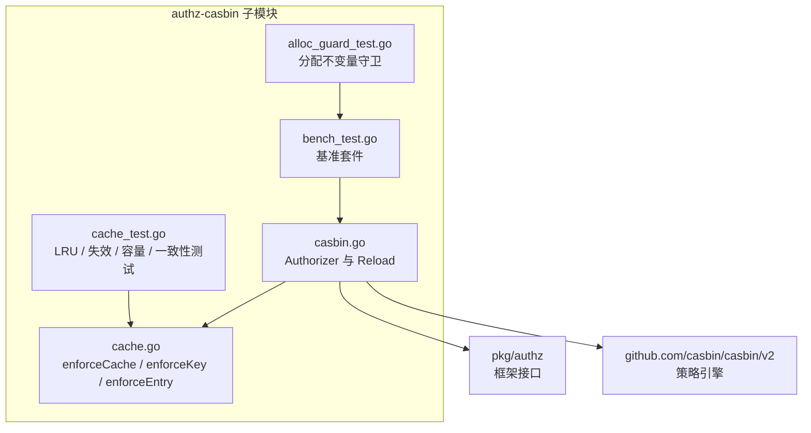
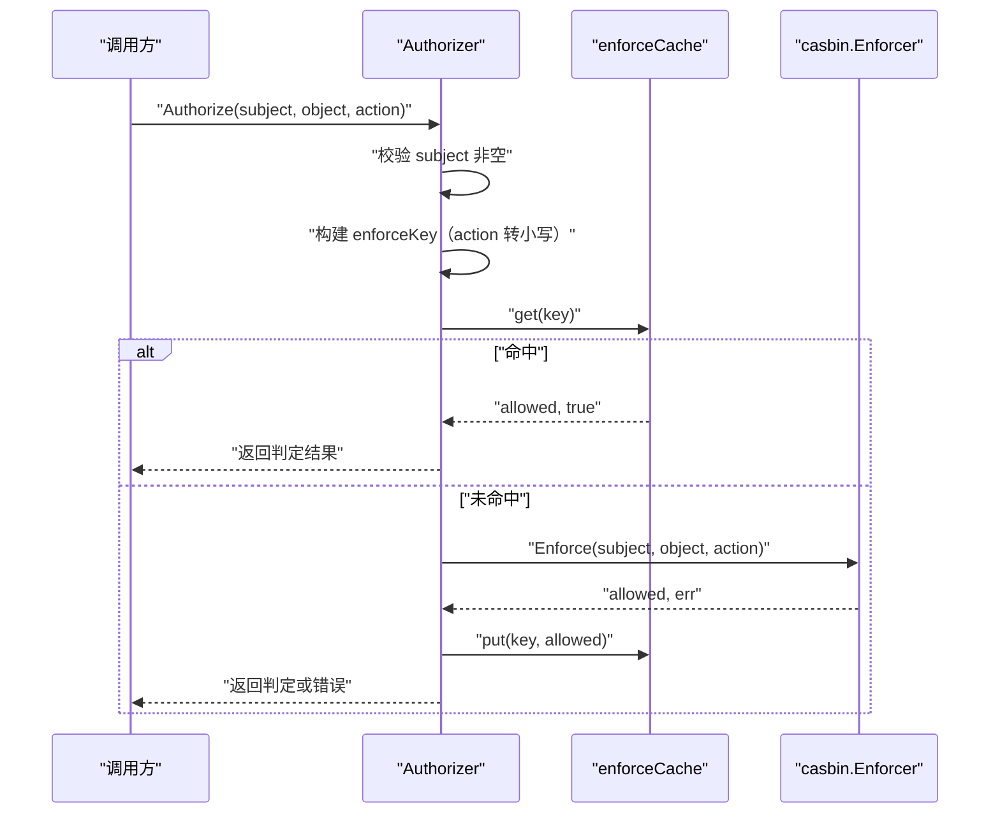
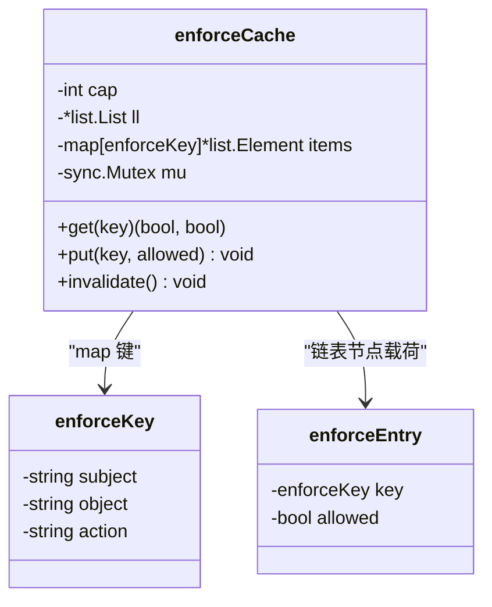
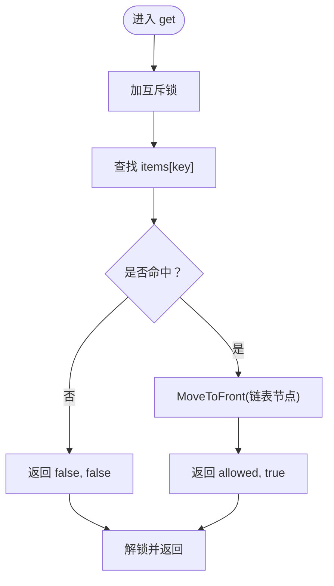
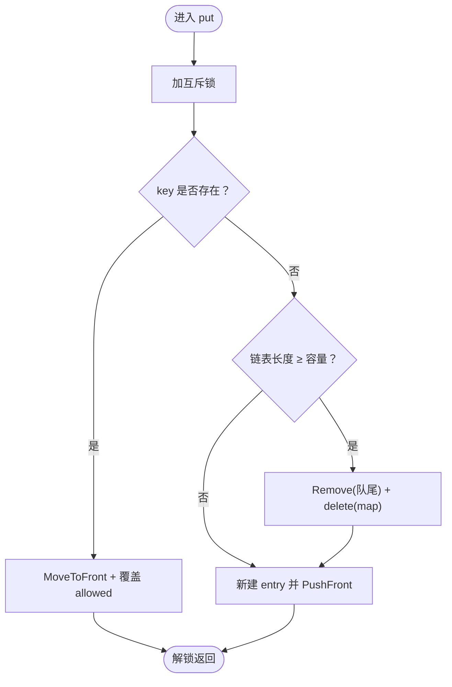
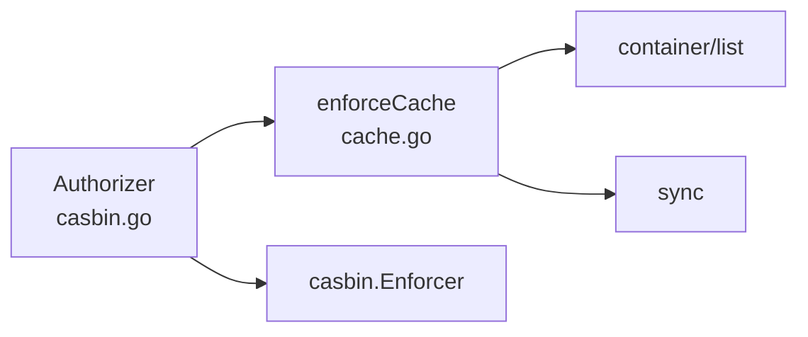

# 授权判定结果缓存

<cite>
**本文引用的文件**   
- [contrib/authz-casbin/cache.go](file://contrib/authz-casbin/cache.go)
- [contrib/authz-casbin/cache_test.go](file://contrib/authz-casbin/cache_test.go)
- [contrib/authz-casbin/bench_test.go](file://contrib/authz-casbin/bench_test.go)
- [contrib/authz-casbin/alloc_guard_test.go](file://contrib/authz-casbin/alloc_guard_test.go)
- [contrib/authz-casbin/casbin.go](file://contrib/authz-casbin/casbin.go)
</cite>

## 目录
1. [引言](#引言)
2. [项目结构](#项目结构)
3. [核心组件](#核心组件)
4. [架构总览](#架构总览)
5. [详细组件分析](#详细组件分析)
6. [依赖关系分析](#依赖关系分析)
7. [性能特性与基准](#性能特性与基准)
8. [故障排查指南](#故障排查指南)
9. [结论](#结论)
10. [附录：调优与监控](#附录：调优与监控)

## 引言
本仓在 `contrib/authz-casbin` 子模块中实现了一个面向 casbin 引擎的授权桥接器，并内嵌一个有界 LRU 结果缓存，用于缓存 `(subject, object, action)` 三元组的授权判定结果。其设计动机来自实测数据：casbin 引擎每次 `Enforce` 约产生 206 次分配、消耗约 8.6KB 内存；而 Web 服务授权流量高度重入——同一用户反复访问同一资源是常态。缓存命中路径绕过引擎，做到零分配，从而显著降低热点请求的成本。

该缓存不是通用 KV 缓存，而是**只缓存无错误判定结果的有界 LRU**，并配合包级 `Authorizer` 的 Reload 语义保证策略变更后缓存必空。它采用单把互斥锁保护全部内部状态，未做分片——这是 YAGNI 取舍，若后续并发画像显示争用，可按 key 哈希分片而不改变外部语义。

## 项目结构
与 enforce 缓存直接相关的代码集中在 `contrib/authz-casbin` 子模块：

**图表来源**
- [contrib/authz-casbin/casbin.go:1-187](file://contrib/authz-casbin/casbin.go#L1-L187)
- [contrib/authz-casbin/cache.go:1-108](file://contrib/authz-casbin/cache.go#L1-L108)

**章节来源**
- [contrib/authz-casbin/casbin.go:1-187](file://contrib/authz-casbin/casbin.go#L1-L187)
- [contrib/authz-casbin/cache.go:1-108](file://contrib/authz-casbin/cache.go#L1-L108)

## 核心组件
本缓存由三个紧密耦合的结构体组成：

| 类型 | 职责 | 关键语义 |
|---|---|---|
| `enforceCache` | 有界 LRU 结果缓存 | 单锁保护、容量有界、Reload 后整体清空 |
| `enforceKey` | 缓存键 | 三个 string 字段原样存储，action 取小写，避免字符串拼接分配 |
| `enforceEntry` | 双向链表节点载荷 | 回存 key 以支持淘汰时反删 map |

默认容量为 1024 条判定结果。构造时不预分配 map，稳态尺寸由实际工作集驱动，但上界仍受 `cap` 约束。

**章节来源**
- [contrib/authz-casbin/cache.go:1-108](file://contrib/authz-casbin/cache.go#L1-L108)

## 架构总览
`Authorizer.Authorize` 的完整调用链如下：

**图表来源**
- [contrib/authz-casbin/casbin.go:100-150](file://contrib/authz-casbin/casbin.go#L100-L150)
- [contrib/authz-casbin/cache.go:65-95](file://contrib/authz-casbin/cache.go#L65-L95)

### 关键语义红线
- **只缓存无错误判定**：`Enforce` 返回错误时不会写入缓存，错误逐次如实上报。
- **Reload 后缓存必空**：无论 `LoadPolicy` 成功还是失败，都会调用 `invalidate()`，确保陈旧放行不会越过重载生效。
- **容量有界**：超过容量时淘汰最久未用条目，map 尺寸不会随 subject 基数爆炸。
- **命中不放宽放行面**：命中返回的是缓存时策略算出的结果；未命中走 fail-closed 评估，语义不变。
- **大小写归一**：action 统一取小写后再成键，`GET` 与 `get` 共享同一判定。

**章节来源**
- [contrib/authz-casbin/casbin.go:75-160](file://contrib/authz-casbin/casbin.go#L75-L160)
- [contrib/authz-casbin/cache.go:12-60](file://contrib/authz-casbin/cache.go#L12-L60)

## 详细组件分析

### 数据结构设计
`enforceCache` 同时维护双向链表和 map：

- **map**：`enforceKey → *list.Element`，提供 O(1) 查找。
- **双向链表**：队首为最近使用，队尾为最久未用；用于 LRU 顺序维护。
- **键设计**：`enforceKey` 是结构体而非字符串，避免 `strings.Builder` 或 fmt 拼接带来的分配。
- **entry 设计**：`enforceEntry` 回存 key，使淘汰链表尾部节点时可以反向删除 map 条目。

时间复杂度：
- `get`：O(1) 查找 + O(1) 移动链表节点。
- `put`：平均 O(1) 插入或更新；淘汰时 O(1) 移除队尾。
- `invalidate`：O(1) 重建链表和 map。

空间上界：
- 最多容纳 `cap` 个 `enforceEntry`，每个 entry 包含三个 string 引用和一个指针，不含额外字符串副本。

**图表来源**
- [contrib/authz-casbin/cache.go:27-55](file://contrib/authz-casbin/cache.go#L27-L55)

**章节来源**
- [contrib/authz-casbin/cache.go:1-108](file://contrib/authz-casbin/cache.go#L1-L108)

### 并发安全机制
`enforceCache` 使用单把 `sync.Mutex` 保护所有读写操作。临界区仅包含 map 查找、链表指针改链和元素赋值，不包含任何分配逻辑，因此命中路径在锁内零分配。

`Authorizer` 自身还有一把 `sync.RWMutex`，用于串行化 `Reload` 与 `Authorize`：读锁保护并发 `Enforce`，写锁独占 `LoadPolicy`，避免 casbin 内部状态重建与并发判定交叉。两把锁的嵌套顺序固定为“先 `Authorizer.mu`，再 `cache.mu`”，不存在反序嵌套。

未分片是有意取舍：当前实现简单、语义清晰；若压测发现锁争用成为瓶颈，可按 `enforceKey` 的哈希值分片，每片独立锁和 map，但不改变对外行为。

**章节来源**
- [contrib/authz-casbin/casbin.go:40-70](file://contrib/authz-casbin/casbin.go#L40-L70)
- [contrib/authz-casbin/cache.go:20-40](file://contrib/authz-casbin/cache.go#L20-L40)

### get：命中即移到队首
`get(key)` 在持锁期间执行三步：

1. 从 `items` 查找 key。
2. 未命中则返回 `(false, false)`。
3. 命中则调用 `ll.MoveToFront(el)`，将对应节点移到队首，然后返回 `(allowed, true)`。

这一步保证 LRU 语义：被访问的条目立即变为“最近使用”。

**图表来源**
- [contrib/authz-casbin/cache.go:65-75](file://contrib/authz-casbin/cache.go#L65-L75)

**章节来源**
- [contrib/authz-casbin/cache.go:65-75](file://contrib/authz-casbin/cache.go#L65-L75)

### put：插入、更新与淘汰
`put(key, allowed)` 的逻辑如下：

- 若 key 已存在：移动到队首，并更新 `allowed` 值。
- 若 key 不存在且链表长度已达容量：移除队尾节点，并从 map 删除对应条目。
- 最后创建新 `enforceEntry`，插入队首并记录到 map。

这保证了 LRU 顺序和容量上界不变式。

**图表来源**
- [contrib/authz-casbin/cache.go:77-95](file://contrib/authz-casbin/cache.go#L77-L95)

**章节来源**
- [contrib/authz-casbin/cache.go:77-95](file://contrib/authz-casbin/cache.go#L77-L95)

### invalidate：整体清空
`invalidate()` 仅在策略 Reload 路径调用。它在持锁状态下：

1. 重置双向链表。
2. 用新 map 替换旧 map。

这使 Reload 后的缓存彻底为空，满足“策略变更必须整体失效”的安全语义。即使 `LoadPolicy` 失败，旧策略仍在 casbin 内部，但缓存仍需失效——否则陈旧判定可能继续命中，构成正确性风险。

**章节来源**
- [contrib/authz-casbin/cache.go:97-108](file://contrib/authz-casbin/cache.go#L97-L108)
- [contrib/authz-casbin/casbin.go:140-170](file://contrib/authz-casbin/casbin.go#L140-L170)

## 依赖关系分析
`enforceCache` 只依赖标准库 `container/list` 与 `sync`，不依赖 casbin、网络、序列化或其他业务组件。它的耦合点只在包内的 `Authorizer`：

- `Authorizer.Authorize` 调用 `cache.get` 和 `cache.put`。
- `Authorizer.Reload` 调用 `cache.invalidate`。
- 容量通过构造函数注入，默认值为 1024。

**图表来源**
- [contrib/authz-casbin/casbin.go:20-35](file://contrib/authz-casbin/casbin.go#L20-L35)
- [contrib/authz-casbin/cache.go:3-10](file://contrib/authz-casbin/cache.go#L3-L10)

**章节来源**
- [contrib/authz-casbin/casbin.go:1-187](file://contrib/authz-casbin/casbin.go#L1-L187)
- [contrib/authz-casbin/cache.go:1-108](file://contrib/authz-casbin/cache.go#L1-L108)

## 性能特性与基准

### 设计动机与收益
- casbin 引擎每次 `Enforce` 约 206 次分配、约 8.6KB 内存，主要成本来自函数表、参数装箱等逐请求重建。
- Web 授权流量对同一 `(subject, object, action)` 高度重入，缓存命中路径跳过引擎，零分配。
- 拒绝路径也可能很高（约 1,270 次分配、101 行全扫），因此缓存不仅优化放行路径，也显著减少拒绝路径中的重复计算。

### 命中路径分配
命中路径零分配由基准和分配守卫共同保障：

- `BenchmarkAliasAuthorizer_Direct`、`_Hit`、`_Miss` 三条路径的分配守卫断言 `AllocsPerOp == 0`，说明装饰器和热路径没有引入逐请求分配。
- 缓存命中本身只做 map 查找和链表指针移动，不构造字符串、切片或临时对象。

**章节来源**
- [contrib/authz-casbin/cache.go:12-30](file://contrib/authz-casbin/cache.go#L12-L30)
- [contrib/authz-casbin/alloc_guard_test.go:1-52](file://contrib/authz-casbin/alloc_guard_test.go#L1-L52)

### 容量与工作集
默认容量 1024 是针对 gen 产物默认策略集规模设计的：百级资源 × 千级 subject 的工作集内，足以覆盖常态流量。当键空间远超容量时，基准 `BenchmarkAuthorizer_NoReuse` 模拟了 8,192 个 subject 的场景，验证 miss 路径会触发插入与淘汰，但仍保持正确性。

**章节来源**
- [contrib/authz-casbin/cache.go:57-64](file://contrib/authz-casbin/cache.go#L57-L64)
- [contrib/authz-casbin/bench_test.go:90-136](file://contrib/authz-casbin/bench_test.go#L90-L136)

### 与官方 CachedEnforcer 的对比
仓库注释明确指出，官方 `CachedEnforcer` 的键构造走可变参数装箱与 `strings.Builder`，每次查询本身就会带来若干分配。本实现的 `enforceKey` 直接使用三个 string 字段作为结构体键，避免拼接，从而在缓存层进一步消除分配。

需要注意：本仓文档不应宣称已对官方 `CachedEnforcer` 做端到端压测对比；上述比较基于仓库注释与键构造差异的分析。

**章节来源**
- [contrib/authz-casbin/cache.go:12-30](file://contrib/authz-casbin/cache.go#L12-L30)

## 故障排查指南

### 症状：Reload 后仍然命中旧放行结果
检查是否误以为 `LoadPolicy` 失败可以保留缓存。实现要求：**任何策略变更路径都必须整体失效缓存**，包括装载失败路径。如果自定义 `Reload` 包装修改了这个语义，需要回归到“先 LoadPolicy，再 invalidate”的顺序。

**章节来源**
- [contrib/authz-casbin/casbin.go:140-170](file://contrib/authz-casbin/casbin.go#L140-L170)
- [contrib/authz-casbin/cache.go:97-108](file://contrib/authz-casbin/cache.go#L97-L108)

### 症状：缓存条目数超过容量
确认传入的 capacity 是否小于 1。实现会防御性地退化为至少 1；若业务侧传入了异常值，应修正配置而不是放宽容量上界。

**章节来源**
- [contrib/authz-casbin/cache.go:57-64](file://contrib/authz-casbin/cache.go#L57-L64)

### 症状：并发下出现数据竞争
检查是否绕过了 `Authorizer` 直接并发调用底层 casbin Enforcer，或者是否改变了 `Authorizer.mu` 与 `cache.mu` 的嵌套顺序。正常路径中，判定时持有读锁，Reload 持有写锁，二者不会反序嵌套。

**章节来源**
- [contrib/authz-casbin/casbin.go:40-70](file://contrib/authz-casbin/casbin.go#L40-L70)

### 症状：大小写动作导致重复缓存
确认 action 是否在调用前统一转为小写。`Authorizer` 内部已经执行 `strings.ToLower(action)`，但若业务侧自行构造 `enforceKey` 或使用其他入口，需保持一致。

**章节来源**
- [contrib/authz-casbin/cache.go:32-40](file://contrib/authz-casbin/cache.go#L32-L40)
- [contrib/authz-casbin/casbin.go:120-140](file://contrib/authz-casbin/casbin.go#L120-L140)

## 结论
`enforceCache` 是一个针对 casbin 授权热点请求定制的轻量 LRU 缓存。它以结构体键避免字符串分配，以双向链表维护 LRU 顺序，以 map 提供 O(1) 查找，并以单把互斥锁保证并发安全。其最重要的价值不是“加速所有授权”，而是**在 Web 服务高度重入的授权流量中，把命中路径降到零分配**，同时严格遵循 fail-closed、Reload 整体失效、容量有界、错误不入缓存四条安全红线。

对于大多数场景，默认容量 1024 已足够；只有当观测到命中率低且工作集明显更大时，才应调整容量。若未来压测表明单锁成为瓶颈，可按 key 哈希分片扩展，而不破坏现有语义。

## 附录：调优与监控

### 容量配置建议
- 默认 1024：适合百级资源、千级 subject 的常规工作集。
- 工作集估算：统计单位时间内不同 `(subject, object, action)` 三元组数量；若稳定工作集接近或超过 1024，可适当增大容量。
- 上限原则：不要无限放大。缓存目的是吸收热点，不是替代策略引擎；过大容量会增加内存占用和无效淘汰。
- 最小值防护：小于 1 的值会被防御为 1，但业务配置应显式设置合理正整数。

### 监控指标
建议在 `Authorizer` 层暴露以下指标：
- `authorize_total`：按 result 分桶的授权总次数。
- `authorize_cache_hit_total`：缓存命中次数。
- `authorize_engine_enforce_total`：真正调用 casbin 引擎的次数。
- `authorize_error_total`：引擎错误次数。
- `enforce_cache_size`：当前缓存条目数。
- `enforce_cache_capacity`：当前容量配置。

通过这些指标可判断命中率、miss 路径压力、错误率以及是否需要调整容量。

### 与 casbin 官方 CachedEnforcer 的选择
- 如果只需简单缓存且不在意键构造分配，官方 `CachedEnforcer` 更省事。
- 如果关注命中路径零分配、希望与 bald 的 `Authorizer` 抽象对齐，并需要与 Reload 语义强绑定，本仓的 `enforceCache` 更合适。
- 本仓并未宣称已对官方实现做端到端压测对比；选择应结合业务流量特征和部署成本。

**章节来源**
- [contrib/authz-casbin/cache.go:57-64](file://contrib/authz-casbin/cache.go#L57-L64)
- [contrib/authz-casbin/casbin.go:75-160](file://contrib/authz-casbin/casbin.go#L75-L160)