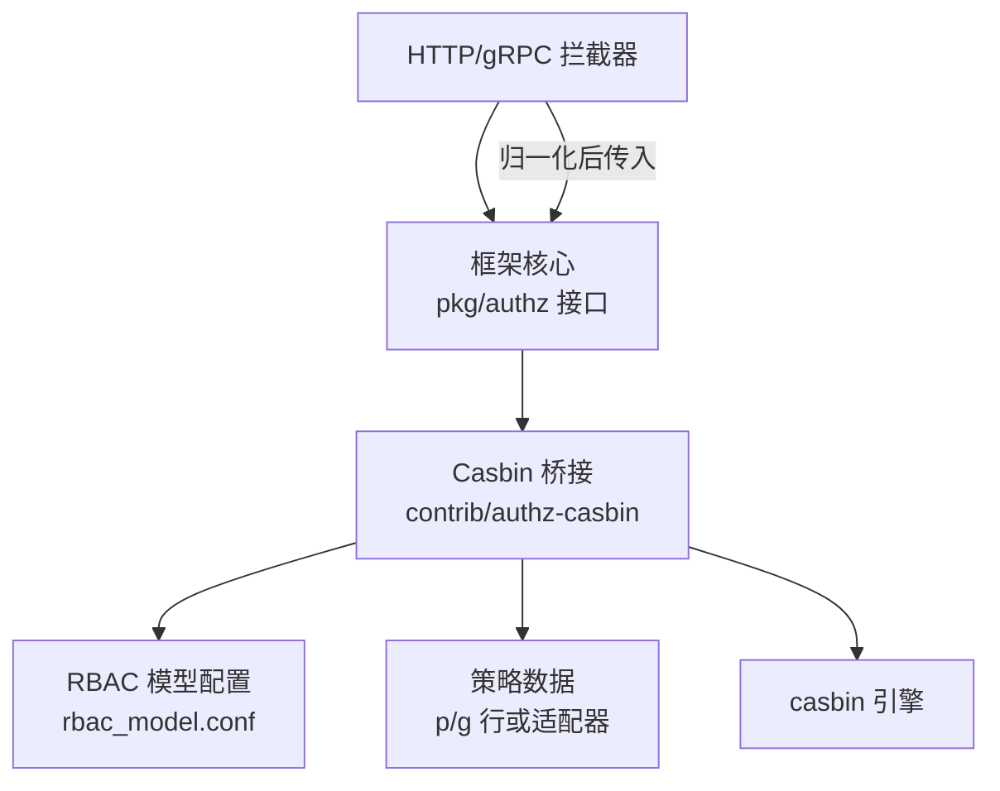
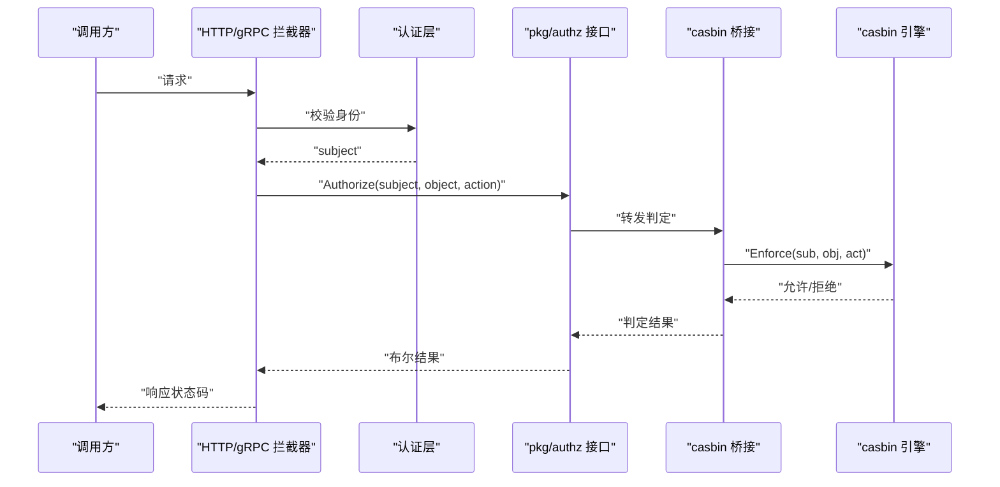
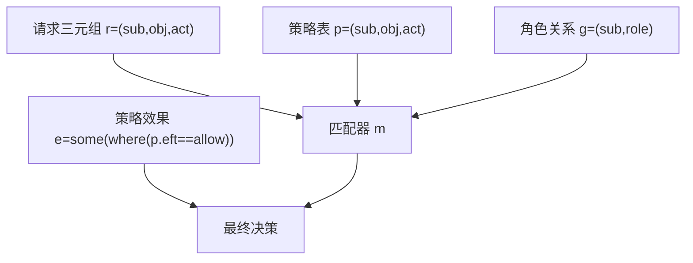
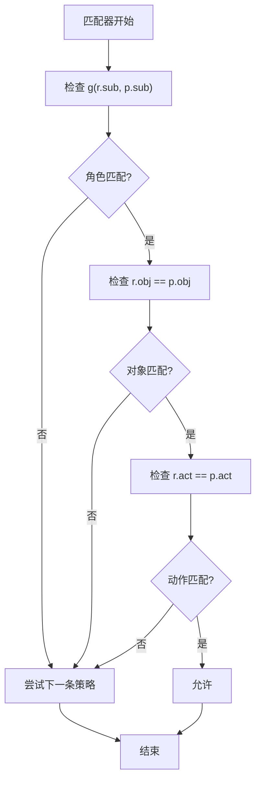
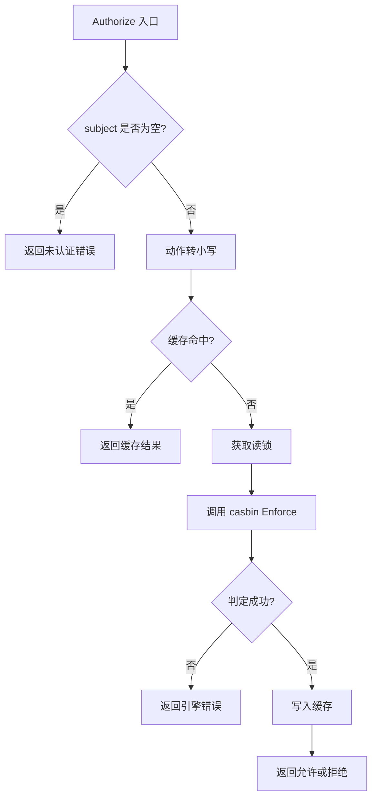
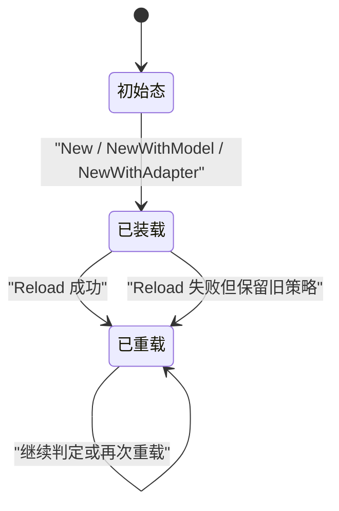
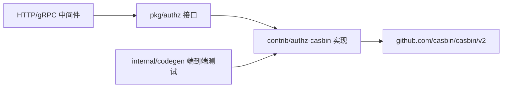
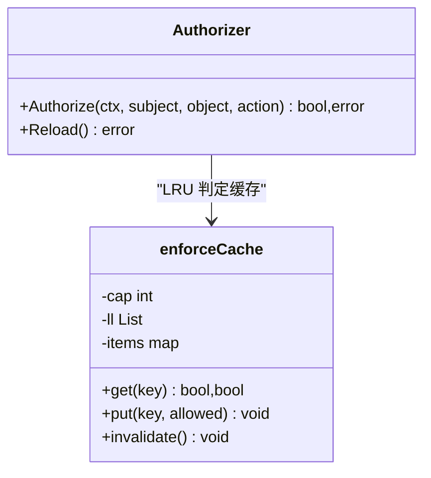

# RBAC 模型定义

<cite>
**本文引用的文件**   
- [contrib/authz-casbin/rbac_model.conf](file://contrib/authz-casbin/rbac_model.conf)
- [contrib/authz-casbin/casbin.go](file://contrib/authz-casbin/casbin.go)
- [contrib/authz-casbin/cache.go](file://contrib/authz-casbin/cache.go)
- [contrib/authz-casbin/casbin_test.go](file://contrib/authz-casbin/casbin_test.go)
- [contrib/authz-casbin/policy_test.go](file://contrib/authz-casbin/policy_test.go)
- [contrib/authz-casbin/reload_test.go](file://contrib/authz-casbin/reload_test.go)
- [contrib/authz-casbin/alias_test.go](file://contrib/authz-casbin/alias_test.go)
- [pkg/authz/authz.go](file://pkg/authz/authz.go)
- [internal/codegen/appspec_authz_e2e_test.go](file://internal/codegen/appspec_authz_e2e_test.go)
</cite>

## 目录
1. [引言](#引言)
2. [项目结构](#项目结构)
3. [核心组件](#核心组件)
4. [架构总览](#架构总览)
5. [详细组件分析](#详细组件分析)
6. [依赖关系分析](#依赖关系分析)
7. [性能与缓存](#性能与缓存)
8. [策略文件格式规范](#策略文件格式规范)
9. [扩展指南](#扩展指南)
10. [常见误区与排查](#常见误区与排查)
11. [最佳实践](#最佳实践)
12. [故障排查](#故障排查)
13. [结论](#结论)

## 引言
本文聚焦本仓库中基于 Casbin 的 RBAC 授权模型配置文件 `contrib/authz-casbin/rbac_model.conf`，逐段解释其语法、语义与在 Bald 框架中的实际作用。RBAC 模型是“框架性声明”，由 casbin 引擎解析；真正的“权限数据”（角色→资源→动作、主体→角色）由业务侧以策略文件或 CSV 注入，两者职责分离。

本仓中该模型通过 Go 内嵌加载，并由 `contrib/authz-casbin` 包实现 `pkg/authz.Authorizer` 接口，从而让框架核心保持零策略引擎耦合：核心只认识 `(subject, object, action)` 三元组，不直接 import casbin。

## 项目结构
RBAC 相关代码集中在两个层次：
- 抽象层：`pkg/authz` 定义授权接口，不绑定任何具体引擎。
- 实现层：`contrib/authz-casbin` 把 casbin 的 RBAC 模型与策略桥接到该接口，并提供运行期重载、结果缓存、HTTP/gRPC 命名别名等能力。

**图示来源**
- [pkg/authz/authz.go:1-38](file://pkg/authz/authz.go#L1-L38)
- [contrib/authz-casbin/casbin.go:1-60](file://contrib/authz-casbin/casbin.go#L1-L60)
- [contrib/authz-casbin/rbac_model.conf:1-14](file://contrib/authz-casbin/rbac_model.conf#L1-L14)

**章节来源**
- [pkg/authz/authz.go:1-38](file://pkg/authz/authz.go#L1-L38)
- [contrib/authz-casbin/casbin.go:1-60](file://contrib/authz-casbin/casbin.go#L1-L60)

## 核心组件
- **RBAC 模型配置**：`[request_definition]`、`[policy_definition]`、`[role_definition]`、`[policy_effect]`、`[matchers]` 五段。
- **授权器实现**：`Authorizer` 封装 casbin Enforcer，提供 `Authorize` 判定和 `Reload` 重载。
- **策略装载**：支持字符串策略文本、可替换的持久化适配器（如文件）。
- **结果缓存**：有界 LRU 缓存 `(subject, object, action)` 判定结果，命中路径零 casbin 分配。
- **命名别名**：包装内部 Authorizer，在 HTTP 与 gRPC 资源名之间做双向等价映射。

**章节来源**
- [contrib/authz-casbin/casbin.go:1-187](file://contrib/authz-casbin/casbin.go#L1-L187)
- [contrib/authz-casbin/cache.go:1-108](file://contrib/authz-casbin/cache.go#L1-L108)
- [contrib/authz-casbin/alias_test.go:1-198](file://contrib/authz-casbin/alias_test.go#L1-L198)

## 架构总览
请求进入框架后，先经认证与授权中间件：认证阶段从 token 提取 `subject`，授权阶段把请求归一化为 `(object, action)`，再交给 `authz.Authorizer`。默认实现走 casbin RBAC 模型，按匹配器把 `r.sub` 通过 `g` 函数展开到所有继承角色，再与 `p` 规则精确比对 `obj` 与 `act`。

**图示来源**
- [pkg/authz/authz.go:14-26](file://pkg/authz/authz.go#L14-L26)
- [contrib/authz-casbin/casbin.go:85-140](file://contrib/authz-casbin/casbin.go#L85-L140)

## 详细组件分析

### RBAC 模型配置逐项解读
配置文件位于 `contrib/authz-casbin/rbac_model.conf`，共五段：

| 段落 | 含义 | 在本仓中的作用 |
|---|---|---|
| `[request_definition]` | 定义一次授权判定的输入三元组 | 固定为 `sub, obj, act`，即主体、资源对象、动作 |
| `[policy_definition]` | 定义策略表列 | 固定为 `sub, obj, act`，对应 `p=subject,object,action` |
| `[role_definition]` | 定义角色继承关系 | `g = _, _` 表示两元关系：主体到角色 |
| `[policy_effect]` | 定义多条规则如何合并成最终结果 | `some(where (p.eft == allow))` 表示只要有一条规则允许就放行 |
| `[matchers]` | 定义匹配逻辑 | 把请求三元组映射到策略表和角色继承图进行判断 |

**图示来源**
- [contrib/authz-casbin/rbac_model.conf:1-14](file://contrib/authz-casbin/rbac_model.conf#L1-L14)

#### request_definition
- 值 `r = sub, obj, act` 表示每次授权调用都传入三个字段。
- 在实现层，`Authorize(ctx, subject, object, action)` 直接作为 `(sub, obj, act)` 传给 casbin。
- 这决定了模型后续所有引用变量：`r.sub`、`r.obj`、`r.act`。

#### policy_definition
- 值 `p = sub, obj, act` 表示每条策略行是一组三元组。
- 注意：这里只有三列，不是四列。Casbin 默认给每行追加一个 `eft` 字段（allow/deny），但当前模型没有显式写出第四列。
- 因此策略行通常写作 `p=subject,object,action`，其中隐式 `eft=allow`。

#### role_definition
- 值 `g = _, _` 表示角色继承是二元关系：`(subject, role)`。
- 这里的 `_` 是通配符占位，表示这两列都是字符串类型。
- 典型用法：`g=u-admin,admin` 表示用户 `u-admin` 属于角色 `admin`。
- 该定义支撑匹配器中的 `g(r.sub, p.sub)`，用于递归查找主体的继承链。

#### policy_effect
- 值 `e = some(where (p.eft == allow))` 是“至少一条允许即放行”的语义。
- 若某条规则明确标记 `deny`，则它会影响聚合结果；但当前模型没有使用显式 deny 策略行时，整体行为接近“fail-closed”：无匹配则拒绝。
- 这也是为什么未绑定角色的主体会一律被拒绝：既没有匹配的 `p` 行，也没有能触发允许的 `g` 关系。

#### matchers
- 值 `m = g(r.sub, p.sub) && r.obj == p.obj && r.act == p.act` 是本次文档的核心。
- 它要求同时满足三部分：
  1. `g(r.sub, p.sub)`：请求主体能通过角色关系到达策略行的主体。
  2. `r.obj == p.obj`：资源名必须完全相等。
  3. `r.act == p.act`：动作必须完全相等。
- 如果任一条件失败，该策略行不参与“允许”。

**章节来源**
- [contrib/authz-casbin/rbac_model.conf:1-14](file://contrib/authz-casbin/rbac_model.conf#L1-L14)
- [contrib/authz-casbin/casbin.go:12-35](file://contrib/authz-casbin/casbin.go#L12-L35)

### 匹配器工作原理
匹配器表达式可以拆成三段理解：

1. **角色继承查找 `g(r.sub, p.sub)`**
   - `r.sub` 是当前请求的主体，例如 `u-alice`。
   - `p.sub` 是策略表中写明的主体，例如 `admin`。
   - `g` 函数会在 `role_definition` 定义的 `g` 关系表中查找：是否可以从 `r.sub` 通过一层或多层继承到达 `p.sub`。
   - 例如 `g(u-admin, admin)` 存在时，`g("u-admin", "admin")` 返回真。
   - 这是 RBAC 的核心：用户不需要直接出现在 `p` 行中，只需通过角色间接获得权限。

2. **资源精确匹配 `r.obj == p.obj`**
   - 对象名区分大小写，必须完全一致。
   - 在 Bald 中，HTTP 和 gRPC 的请求会被拦截器归一化为统一资源名，例如 `/v1/secret/123` → `secret`，`SecretService/GetSecret` → `get`。
   - 如果生成物中 HTTP 路由用 `greets`，而策略行写的是 gRPC 资源名 `greet`，需要通过别名机制或策略调整对齐。

3. **动作精确匹配 `r.act == p.act`**
   - 动作也必须完全一致。
   - 桥接实现会把传入动作转为小写，因此外部传入 `GET`、`Get`、`get` 都会归一化为 `get` 再参与比较。
   - 这也意味着策略中的动作应保持一致的小写风格，避免歧义。

**图示来源**
- [contrib/authz-casbin/rbac_model.conf:12-14](file://contrib/authz-casbin/rbac_model.conf#L12-L14)
- [contrib/authz-casbin/casbin.go:100-120](file://contrib/authz-casbin/casbin.go#L100-L120)

**章节来源**
- [contrib/authz-casbin/rbac_model.conf:12-14](file://contrib/authz-casbin/rbac_model.conf#L12-L14)
- [contrib/authz-casbin/casbin.go:85-120](file://contrib/authz-casbin/casbin.go#L85-L120)

### 授权判定流程
`Authorizer.Authorize` 的执行路径如下：

1. 检查 `subject` 是否为空；为空则返回错误，表示未认证。
2. 将动作转小写。
3. 构造缓存键 `(subject, object, toLower(action))`。
4. 查询 LRU 缓存；命中则直接返回缓存结果。
5. 加读锁，调用 casbin Enforcer 执行 `Enforce`。
6. 将无错误的判定结果写入缓存。
7. 返回允许或拒绝。

**图示来源**
- [contrib/authz-casbin/casbin.go:85-140](file://contrib/authz-casbin/casbin.go#L85-L140)

**章节来源**
- [contrib/authz-casbin/casbin.go:85-140](file://contrib/authz-casbin/casbin.go#L85-L140)

### 策略装载与重载
- `New(policyCSV)` 使用内嵌默认模型和策略文本。
- `NewWithModel(modelConf, policyCSV)` 允许自定义模型。
- `NewWithAdapter(modelConf, adapter)` 使用任意 casbin 适配器，适合文件、数据库等可变策略源。
- `Reload()` 通过写锁串行化，调用底层 `LoadPolicy`，并清空缓存；即使重载失败，也保证旧策略仍在，只是缓存失效。

**图示来源**
- [contrib/authz-casbin/casbin.go:60-187](file://contrib/authz-casbin/casbin.go#L60-L187)
- [contrib/authz-casbin/reload_test.go:1-175](file://contrib/authz-casbin/reload_test.go#L1-L175)

**章节来源**
- [contrib/authz-casbin/casbin.go:60-187](file://contrib/authz-casbin/casbin.go#L60-L187)
- [contrib/authz-casbin/reload_test.go:1-175](file://contrib/authz-casbin/reload_test.go#L1-L175)

## 依赖关系分析
- `pkg/authz` 是抽象接口，不依赖 casbin。
- `contrib/authz-casbin` 依赖 casbin 和 `pkg/authz`。
- 框架核心通过中间件消费 `authz.Authorizer`，但不关心具体实现。
- 生成端测试端到端验证了 authn → authz → 策略 → 状态码的闭环。

**图示来源**
- [pkg/authz/authz.go:1-38](file://pkg/authz/authz.go#L1-L38)
- [contrib/authz-casbin/casbin.go:1-40](file://contrib/authz-casbin/casbin.go#L1-L40)
- [internal/codegen/appspec_authz_e2e_test.go:1-192](file://internal/codegen/appspec_authz_e2e_test.go#L1-L192)

**章节来源**
- [pkg/authz/authz.go:1-38](file://pkg/authz/authz.go#L1-L38)
- [internal/codegen/appspec_authz_e2e_test.go:1-192](file://internal/codegen/appspec_authz_e2e_test.go#L1-L192)

## 性能与缓存
- casbin 引擎每次判定可能产生多次内存分配。
- 本实现维护有界 LRU 缓存，键为 `(subject, object, action)`，容量默认 1024。
- 命中路径不经过 casbin 引擎，也不分配新对象。
- 策略重载会整体清空缓存，保证安全不变量：策略变更后不能继续使用旧判定结果。
- 并发下，判定走读锁，重载走写锁，避免 Enforce 与 LoadPolicy 交叉造成数据竞争。

**图示来源**
- [contrib/authz-casbin/casbin.go:20-45](file://contrib/authz-casbin/casbin.go#L20-L45)
- [contrib/authz-casbin/cache.go:1-108](file://contrib/authz-casbin/cache.go#L1-L108)

**章节来源**
- [contrib/authz-casbin/cache.go:1-108](file://contrib/authz-casbin/cache.go#L1-L108)
- [contrib/authz-casbin/casbin.go:20-45](file://contrib/authz-casbin/casbin.go#L20-L45)

## 策略文件格式规范
策略数据由业务侧注入，可以是字符串、Go 结构体行集合，或通过适配器加载的外部文件。无论来源如何，最终都进入 casbin 的策略表。

### p 行：资源权限
- 格式：`p=subject,object,action`
- 示例语义：`p=admin,secret,get` 表示主体 `admin` 对资源 `secret` 有动作 `get` 的权限。
- 每个 `p` 行是一条独立的授权规则。
- 同一主体可以对多个资源、多个动作有多条 `p` 行。
- 重复 `p` 行不会放大权限：幂等装载是测试断言过的行为。

### g 行：角色归属
- 格式：`g=subject,role`
- 示例语义：`g=u-admin,admin` 表示主体 `u-admin` 属于角色 `admin`。
- 没有 `g` 行时，即使存在 `p` 行，主体也无法匹配到策略，因为匹配器要求 `g(r.sub, p.sub)` 为真。
- 这体现“仅声明权限不够，还需要主体归属”的安全语义。

### 注释与空白
- 模型配置文件中可以使用注释和空白行；Casbin 解析时会忽略无效行。
- 策略装载层对包含逗号或换行的字段会拒绝，防止 CSV 注入。
- 空策略文本是合法输入，表现为 fail-closed：无任何 `p` 或 `g` 行时一律拒绝。

### 推荐策略书写方式
- 资源名使用有意义的业务名称，例如 `secret`、`greet`、`auth`。
- 动作使用小写动词，例如 `get`、`post`、`delete`、`list`。
- 主体使用稳定标识，例如 `u-admin`、`u-alice`。
- 角色使用领域语义名称，例如 `admin`、`viewer`、`operator`。
- 不要把 HTTP URL 片段直接当资源名，除非拦截器已经归一化。

**章节来源**
- [contrib/authz-casbin/policy_test.go:1-125](file://contrib/authz-casbin/policy_test.go#L1-L125)
- [contrib/authz-casbin/casbin_test.go:1-113](file://contrib/authz-casbin/casbin_test.go#L1-L113)

## 扩展指南

### 添加更多 matcher 条件
当前匹配器是三段合取：
`g(r.sub, p.sub) && r.obj == p.obj && r.act == p.act`

如果需要增加维度，可以在 `matchers` 中追加条件，例如：
- 多租户：`&& r.tenant == p.tenant`
- 时间窗口：`&& now() >= p.start && now() <= p.end`
- 环境标签：`&& r.env == p.env`

注意：
- 新增条件后，`request_definition` 需要增加对应字段。
- `policy_definition` 需要同步增加列。
- 策略数据也需要补齐这些字段。
- 不要盲目把所有字段都塞进匹配器；否则策略扫描成本上升。

### 支持 ABAC 属性判断
ABAC 的核心是把请求或资源的属性暴露给匹配器，而不是只靠静态主体-角色-资源三元组。
- 在 `request_definition` 中加入属性字段，例如 `r.res_type`、`r.owner`。
- 在 `policy_definition` 中加入对应策略列。
- 在 `matchers` 中加入属性比较，例如 `&& r.res_type == p.res_type`。
- 本仓的 `NewWithModel` 允许传入自定义模型，正是为这种非标准 RBAC 场景预留入口。

### 添加新的 request 字段
步骤：
1. 修改 `request_definition`，加入新字段。
2. 修改 `policy_definition`，加入对应列。
3. 修改 `matchers`，加入对新字段的约束。
4. 更新策略数据，确保每条 `p` 行都有新列值。
5. 更新拦截器归一化逻辑，确保调用 `Authorize` 时传入新字段。
6. 补充单元测试覆盖边界情况。

本仓中 `NewWithModel` 就是为“默认模型不满足时使用，如 ABAC/域模型”设计的扩展点。

**章节来源**
- [contrib/authz-casbin/casbin.go:55-65](file://contrib/authz-casbin/casbin.go#L55-L65)

## 常见误区与排查

### 对象名大小写敏感
- `r.obj == p.obj` 是精确字符串比较。
- `secret` 和 `Secret` 不会匹配。
- 如果 HTTP 路由归一化后是 `greets`，而策略行写 `greet`，需要别名或策略调整。

### 动作名必须小写
- 实现层会对动作调用小写转换，所以外部传入 `GET` 也能命中 `get`。
- 但策略中仍建议统一用小写动作名，避免阅读和维护歧义。

### 角色继承深度限制
- 当前模型使用 `g = _, _`，没有显式限制继承深度。
- 但 Casbin 的 `g` 函数在深层继承链上可能存在性能或栈限制风险。
- 实践中应避免过深、过复杂的角色继承图。
- 更安全的做法是按业务域划分角色，减少跨层继承。

### 只有 p 行没有 g 行
- 如果没有 `g` 行把真实主体关联到策略中的 `p.sub`，匹配器永远无法命中。
- 测试明确断言：只有 `p` 行、没有授予关系时，所有主体都被拒绝。

### 未认证主体
- 空 `subject` 会直接返回错误，而不是简单拒绝。
- 这意味着上层拦截器需要区分“未认证”和“已认证但无权限”。

**章节来源**
- [contrib/authz-casbin/casbin.go:95-120](file://contrib/authz-casbin/casbin.go#L95-L120)
- [contrib/authz-casbin/policy_test.go:60-95](file://contrib/authz-casbin/policy_test.go#L60-L95)
- [contrib/authz-casbin/casbin_test.go:60-113](file://contrib/authz-casbin/casbin_test.go#L60-L113)

## 最佳实践

### 按业务域组织策略文件
- 不同模块的资源名、动作名、角色名应围绕业务域命名。
- 例如用户域、密钥域、审计域分别维护自己的策略子集。
- 避免把所有资源混在一个超大策略文件中。

### 使用有意义的资源命名约定
- 资源名应表达业务实体，而不是 URL 原始片段。
- 推荐使用名词或动宾组合的稳定标识，例如 `secret`、`greet`、`auth`。
- 如果 HTTP 与 gRPC 命名不一致，使用别名机制或统一归一化。

### 定期审计策略冗余
- 重复 `p` 行不会放大权限，但会增加策略体积。
- 长期运行后应清理不再使用的主体、角色、资源、动作组合。
- 结合访问日志和策略命中率分析，识别从未命中的策略。

### 谨慎使用动态重载
- `Reload` 会清空缓存，频繁重载会影响性能。
- 应通过策略变更事件批量刷新，而不是每次注册都 Reload。
- 重载失败不应静默吞掉错误，应由调用方记录并决定重试。

### 将策略与模型解耦
- 模型是框架级声明，不宜频繁改动。
- 策略是业务数据，应允许运行期更新。
- 本仓通过 `rbac_model.conf` 内嵌默认模型、策略由调用方注入的方式实现这一解耦。

**章节来源**
- [contrib/authz-casbin/casbin.go:12-35](file://contrib/authz-casbin/casbin.go#L12-L35)
- [contrib/authz-casbin/casbin.go:140-187](file://contrib/authz-casbin/casbin.go#L140-L187)

## 故障排查

### 所有请求都被拒绝
可能原因：
- 没有 `g` 行把主体关联到策略中的角色。
- 资源名大小写不一致。
- 动作名大小写不一致。
- 策略文件未正确加载。
- 使用的是空策略初始态，符合 fail-closed 语义。

排查步骤：
1. 确认 `subject` 不为空。
2. 确认策略中存在对应的 `g` 行。
3. 确认 `object` 与 `p.obj` 完全一致。
4. 确认 `action` 与 `p.act` 完全一致。
5. 检查策略文件是否被正确读取。

### 重载后仍然旧行为
可能原因：
- 使用了字符串适配器而非可变持久化适配器。
- 重载前没有等待服务就绪。
- 缓存未失效（实现保证 Reload 后必空，但若自行封装需检查）。
- 策略文件写入成功但未被重新读取。

### 并发判定出现数据竞争
- 正常实现通过 RWMutex 保护 Enforce 与 LoadPolicy。
- 如果自行封装 Authorizer，要避免在写锁外修改底层策略状态。
- 测试已在 race 模式下验证并发安全性。

**章节来源**
- [contrib/authz-casbin/casbin.go:20-45](file://contrib/authz-casbin/casbin.go#L20-L45)
- [contrib/authz-casbin/reload_test.go:100-175](file://contrib/authz-casbin/reload_test.go#L100-L175)

## 结论
`rbac_model.conf` 定义了本仓 RBAC 授权的骨架：三元组请求、三元组策略、二元角色关系、允许优先的效果、以及基于角色继承与精确匹配的判断逻辑。配合 `contrib/authz-casbin` 的实现，Bald 框架在不耦合具体策略引擎的前提下，提供了可重载、可缓存、可别名的授权能力。

在实际使用中，应把模型视为稳定的框架声明，把策略视为可演化的业务数据；通过规范命名、分层组织、定期审计和可靠重载，使 RBAC 模型既能表达清晰的权限边界，又能适应业务变化。