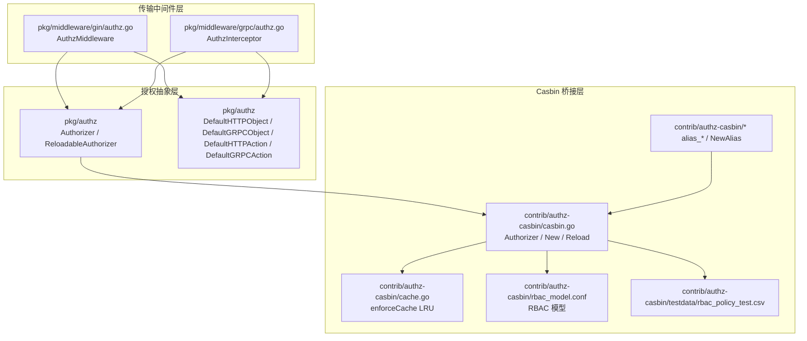
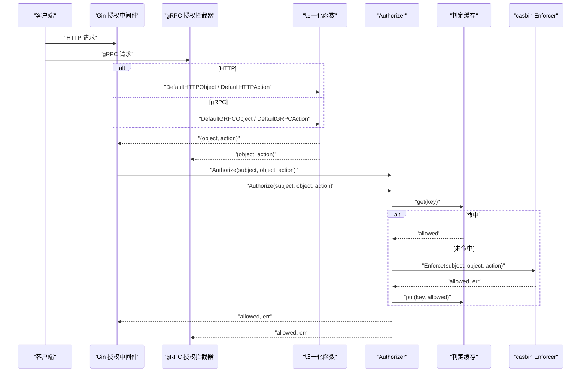
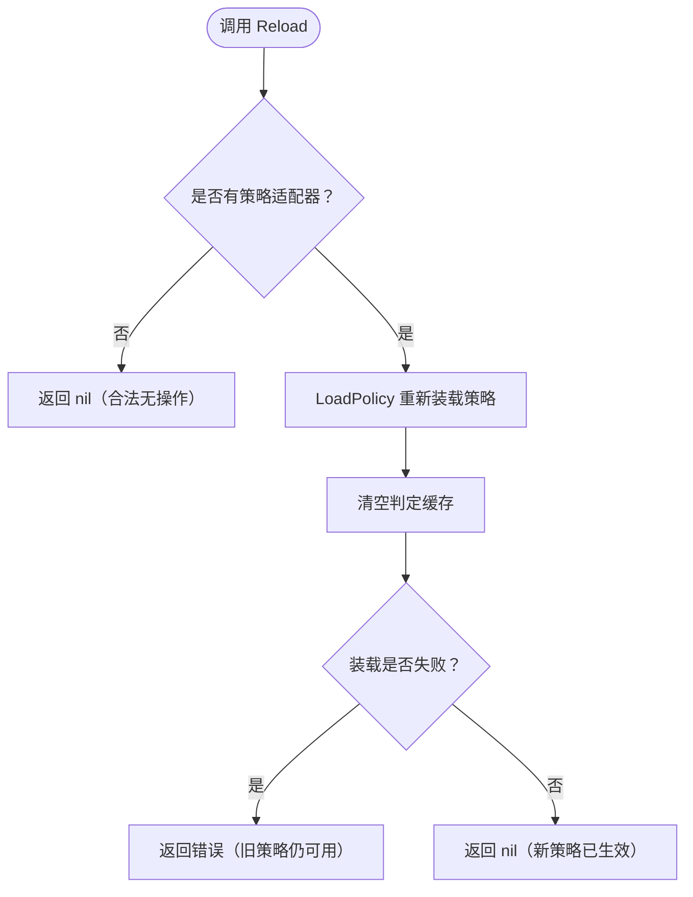
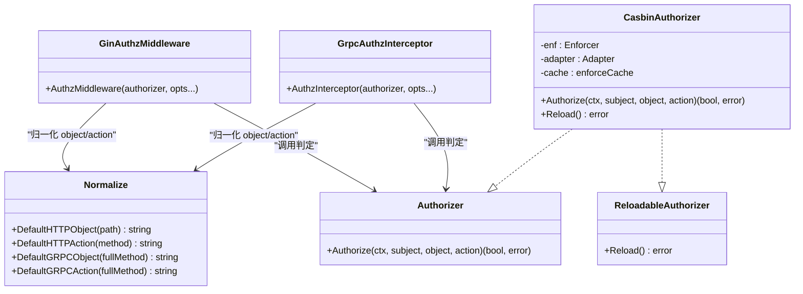
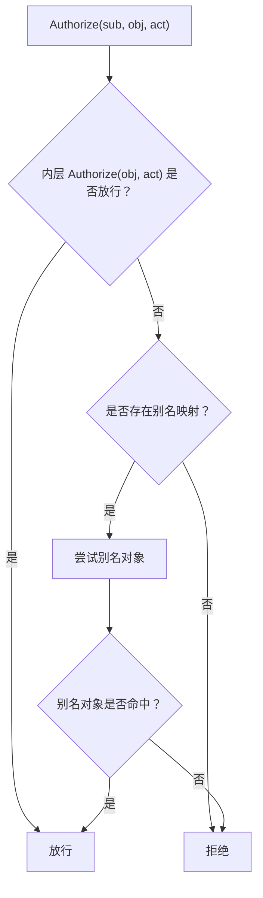
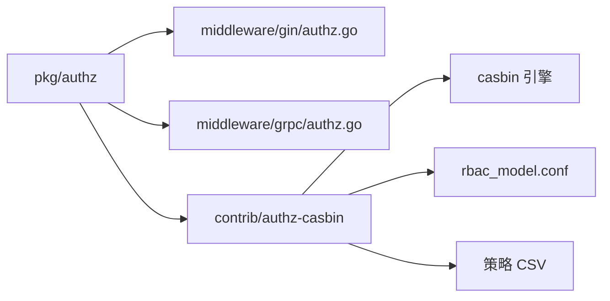

# 策略管理与集成

<cite>
**本文引用的文件**   
- [casbin.go](file://contrib/authz-casbin/casbin.go)
- [cache.go](file://contrib/authz-casbin/cache.go)
- [rbac_model.conf](file://contrib/authz-casbin/rbac_model.conf)
- [policy_test.go](file://contrib/authz-casbin/policy_test.go)
- [reload_test.go](file://contrib/authz-casbin/reload_test.go)
- [alias_test.go](file://contrib/authz-casbin/alias_test.go)
- [casbin_test.go](file://contrib/authz-casbin/casbin_test.go)
- [rbac_policy_test.csv](file://contrib/authz-casbin/testdata/rbac_policy_test.csv)
- [authz.go](file://pkg/authz/authz.go)
- [reload.go](file://pkg/authz/reload.go)
- [normalize.go](file://pkg/authz/normalize.go)
- [gin_authz.go](file://pkg/middleware/gin/authz.go)
- [grpc_authz.go](file://pkg/middleware/grpc/authz.go)
</cite>

## 目录
1. [简介](#简介)
2. [项目结构](#项目结构)
3. [核心组件](#核心组件)
4. [架构总览](#架构总览)
5. [详细组件分析](#详细组件分析)
6. [依赖关系分析](#依赖关系分析)
7. [性能考量](#性能考量)
8. [故障排查指南](#故障排查指南)
9. [结论](#结论)
10. [附录：实战与生产建议](#附录实战与生产建议)

## 简介
本文围绕 Casbin 策略管理在该项目中的实现与集成展开，覆盖以下主题：
- 策略文件编写规范：`p` 行（subject, object, action）与 `g` 行（subject, role），以及批量注入、角色继承链。
- 运行期策略重载机制：`ReloadableAuthorizer` 接口、`Reload` 调用时机、错误处理与并发安全语义。
- 框架授权抽象层集成：`Authorizer` 如何作为 Provider 使用，HTTP/gRPC 中间件如何将请求归一化为 `(object, action)`，身份上下文如何注入 `subject`。
- 别名映射功能：如何在策略侧桥接 gRPC/HTTP 命名差异；通配符与正则表达式需由模型层决定，本包默认 RBAC 模型不使用通配或正则。
- 实战示例：从业务 CSV 加载策略、配合配置中心热更新、单元测试注入策略。
- 故障排查：策略不生效、性能问题、并发冲突检测。
- 生产部署：策略版本管理、灰度发布与回滚机制设计。

## 项目结构
与策略管理直接相关的代码分布在三个层次：
- 授权抽象层：`pkg/authz`，定义 `Authorizer`、可选的 `ReloadableAuthorizer`、传输中立归一化原语。
- 传输中间件层：`pkg/middleware/gin/authz.go`、`pkg/middleware/grpc/authz.go`，负责把 HTTP/gRPC 请求归一化为 `(subject, object, action)`。
- Casbin 桥接层：`contrib/authz-casbin`，实现基于 casbin 的 `Authorizer`、LRU 判定缓存、别名装饰器、RBAC 模型与测试策略数据。

**图表来源**
- [authz.go:1-38](file://pkg/authz/authz.go#L1-L38)
- [reload.go:1-54](file://pkg/authz/reload.go#L1-L54)
- [normalize.go:1-94](file://pkg/authz/normalize.go#L1-L94)
- [gin_authz.go:1-102](file://pkg/middleware/gin/authz.go#L1-L102)
- [grpc_authz.go:1-105](file://pkg/middleware/grpc/authz.go#L1-L105)
- [casbin.go:1-187](file://contrib/authz-casbin/casbin.go#L1-L187)
- [cache.go:1-108](file://contrib/authz-casbin/cache.go#L1-L108)
- [rbac_model.conf:1-14](file://contrib/authz-casbin/rbac_model.conf#L1-L14)
- [rbac_policy_test.csv:1-10](file://contrib/authz-casbin/testdata/rbac_policy_test.csv#L1-L10)

**章节来源**
- [authz.go:1-38](file://pkg/authz/authz.go#L1-L38)
- [reload.go:1-54](file://pkg/authz/reload.go#L1-L54)
- [normalize.go:1-94](file://pkg/authz/normalize.go#L1-L94)
- [casbin.go:1-187](file://contrib/authz-casbin/casbin.go#L1-L187)

## 核心组件
本节聚焦三类核心构件：授权抽象接口、Casbin 授权器、策略与模型。

### 授权抽象接口
- `Authorizer`：统一判定接口，输入 `(subject, object, action)`，返回 `(allowed, error)`。`false` 表示明确拒绝，`error` 表示引擎异常。
- `ReloadableAuthorizer`：可选扩展接口，提供 `Reload()` 以重新装载策略；不支持该接口的实现被 `authz.Reload` 静默跳过。
- `Func`、`AllowAll`、`DenyAll`：便于测试和开放接口快速接入。

**章节来源**
- [authz.go:1-38](file://pkg/authz/authz.go#L1-L38)
- [reload.go:1-54](file://pkg/authz/reload.go#L1-L54)

### Casbin 授权器
- `Authorizer` 结构体封装 casbin `Enforcer`、可选 `persist.Adapter`、有界 LRU 判定缓存。
- 构造方式：
  - `New(policyCSV)`：内嵌默认 RBAC 模型 + 策略文本。
  - `NewWithModel(modelConf, policyCSV)`：自定义模型。
  - `NewWithAdapter(modelConf, adapter)`：任意 casbin 适配器（如文件适配器），使 `Reload` 具备真实语义。
- 判定语义：空 `subject` 报错拒绝；`Enforce` 返回 `false` 为拒绝；引擎错误透传；action 转为小写后缓存键共享。
- 重载语义：写锁独占，避免与并发 `Authorize` 竞争；空策略初始态下 `Reload` 是合法无操作；装载失败时保留旧策略并返回错误；无论成败都清空判定缓存。

**章节来源**
- [casbin.go:1-187](file://contrib/authz-casbin/casbin.go#L1-L187)

### 判定缓存
- `enforceCache` 维护 `(subject, object, action)` → 判定结果的有界 LRU。
- 安全红线：只缓存无错误的成功判定；Reload 整体失效；容量有界；并发安全但不分片。
- 命中路径零分配，避免重复触发 casbin 引擎逐请求分配成本。

**章节来源**
- [cache.go:1-108](file://contrib/authz-casbin/cache.go#L1-L108)

### RBAC 模型与策略数据
- 默认模型定义 `r = sub, obj, act`、`p = sub, obj, act`、`g = _, _`，匹配规则要求角色继承与对象动作完全相等。
- 测试策略 CSV 包含 p 行权限声明与 g 行角色绑定，用于端到端验证 admin/viewer 行为。

**章节来源**
- [rbac_model.conf:1-14](file://contrib/authz-casbin/rbac_model.conf#L1-L14)
- [rbac_policy_test.csv:1-10](file://contrib/authz-casbin/testdata/rbac_policy_test.csv#L1-L10)

## 架构总览
请求进入服务后，先经认证阶段注入身份上下文，再经授权中间件提取 `(subject, object, action)`，最终交由 `Authorizer` 判定。

**图表来源**
- [gin_authz.go:1-102](file://pkg/middleware/gin/authz.go#L1-L102)
- [grpc_authz.go:1-105](file://pkg/middleware/grpc/authz.go#L1-L105)
- [normalize.go:1-94](file://pkg/authz/normalize.go#L1-L94)
- [casbin.go:1-187](file://contrib/authz-casbin/casbin.go#L1-L187)
- [cache.go:1-108](file://contrib/authz-casbin/cache.go#L1-L108)

## 详细组件分析

### 策略文件编写规范
#### `p` 行：subject, object, action
- `p` 行声明“角色对某资源执行某动作”的权限点。
- 例如测试 CSV 中 `p, admin, secret, get` 表示 admin 角色可对 secret 资源执行 get 动作。
- 只有 `p` 行不足以放行任何用户：必须搭配 `g` 行将 subject 绑定到角色。

#### `g` 行：subject, role
- `g` 行建立“用户→角色”的继承链。
- 新增 `g` 行后，需要调用 `Reload` 才会生效；仅写入策略源而不重载不会立即改变判定结果。
- 批量操作可通过一次性载入多行 p/g 完成；但运行期增量变更通常通过替换策略源并调用 `Reload`。

#### 通配符与正则表达式
- 默认 RBAC 模型的 matcher 使用精确相等比较 `r.obj == p.obj && r.act == p.act`，因此默认不启用通配符或正则。
- 若需要在策略中使用通配符或正则，应修改 `.conf` 中的 matcher 并使用支持相应匹配能力的模型或适配层；当前包默认不提供此类能力。

**章节来源**
- [rbac_model.conf:1-14](file://contrib/authz-casbin/rbac_model.conf#L1-L14)
- [policy_test.go:1-125](file://contrib/authz-casbin/policy_test.go#L1-L125)
- [rbac_policy_test.csv:1-10](file://contrib/authz-casbin/testdata/rbac_policy_test.csv#L1-L10)

### 运行期策略重载机制
#### `ReloadableAuthorizer` 接口
- 接口定义在 `pkg/authz/reload.go`，扩展 `Authorizer` 并提供 `Reload() error`。
- 调用方可通过 `authz.Reload(authorizer)` 发现能力：不支持重载时返回 `(false, nil)`，支持时返回 `(true, err)`。

#### `Authorizer.Reload` 的实现语义
- 使用写锁独占，确保与并发 `Authorize` 互斥。
- 空策略初始态（无适配器）下，`Reload` 返回 `nil`，视为合法无操作。
- 装载失败时，保留旧策略并返回错误；同时清空判定缓存，避免陈旧放行继续生效。
- 成功装载后也清空缓存，保证后续判定依据新策略重新评估。

#### 调用时机
- 常见触发点包括：
  - 配置文件变更回调：当配置中心推送新的策略文件或模型配置时，调用 `Reload`。
  - 用户角色变更事件：注册新用户、授予或撤销角色后，调用 `Reload` 使新绑定立即生效。
- 推荐通过 `authz.Reload` 助手统一入口，避免直接类型断言散落各模块。

**图表来源**
- [casbin.go:1-187](file://contrib/authz-casbin/casbin.go#L1-L187)
- [reload.go:1-54](file://pkg/authz/reload.go#L1-L54)

**章节来源**
- [reload.go:1-54](file://pkg/authz/reload.go#L1-L54)
- [reload_test.go:1-175](file://contrib/authz-casbin/reload_test.go#L1-L175)

### 与框架 authz 抽象层的集成
#### Authorizer 作为 Provider
- 框架核心只持有 `Authorizer` 接口，不关心底层是 casbin、内存表还是硬编码规则。
- 业务侧构造具体 `Authorizer`（如 casbin 桥），并注入到中间件或自定义 Provider 中。

#### 传输层中间件归一化
- Gin 中间件默认取 `URL.Path` 为 object、`Method` 为 action；可通过 `WithObjectResolver`、`WithActionResolver` 改为 `authz.DefaultHTTPObject`、`authz.DefaultHTTPAction`。
- gRPC 中间件默认取 `FullMethod` 为 object、`CALL` 为 action；推荐改用 `DefaultGRPCObject`、`DefaultGRPCAction`，使 REST 与 gRPC 共用同一份策略。
- subject 默认从认证阶段注入的 `AuthClaims.Subject` 中提取，也可通过自定义 resolver 覆盖。

#### 身份上下文注入
- 认证中间件在请求上下文中写入 `AuthClaims`。
- 授权中间件读取 `AuthClaims.Subject` 作为 subject；未认证时为空白字符串，随后由 `Authorizer.Authorize` 显式报错拒绝。

**图表来源**
- [authz.go:1-38](file://pkg/authz/authz.go#L1-L38)
- [reload.go:1-54](file://pkg/authz/reload.go#L1-L54)
- [normalize.go:1-94](file://pkg/authz/normalize.go#L1-L94)
- [gin_authz.go:1-102](file://pkg/middleware/gin/authz.go#L1-L102)
- [grpc_authz.go:1-105](file://pkg/middleware/grpc/authz.go#L1-L105)
- [casbin.go:1-187](file://contrib/authz-casbin/casbin.go#L1-L187)

**章节来源**
- [gin_authz.go:1-102](file://pkg/middleware/gin/authz.go#L1-L102)
- [grpc_authz.go:1-105](file://pkg/middleware/grpc/authz.go#L1-L105)
- [normalize.go:1-94](file://pkg/authz/normalize.go#L1-L94)

### 别名映射功能
别名映射用于桥接不同传输面使用的资源名差异，例如 gRPC 使用 `greet`，HTTP 面使用 `greets`。

- 正向查找：策略使用 gRPC 命名时，HTTP 请求的 object 未命中可反查等价名。
- 反向查找：策略使用 HTTP 命名时，gRPC 请求的 object 未命中可正查等价名。
- 别名只是换名重试，不是放行通道；目标名字仍需命中策略。
- 内层引擎错误或内层放行会短路，不再触发别名重试。
- 空或 nil 别名表退化为纯委托。
- 自引用或空串别名会被跳过，防止自旋。
- 如果内层实现了 `ReloadableAuthorizer`，别名装饰器会转发 `Reload`；否则 `Reload` 是合法无操作。

**图表来源**
- [alias_test.go:1-198](file://contrib/authz-casbin/alias_test.go#L1-L198)

**章节来源**
- [alias_test.go:1-198](file://contrib/authz-casbin/alias_test.go#L1-L198)

### 资源路径参数提取与动作映射
本项目提供的归一化工具并不做 URL 路径参数提取（如 `/v1/users/{id}` → `obj="users"`），而是按既定规则提取资源段或方法名：
- `DefaultHTTPObject`：去掉 `/v1` 等前缀后取第一个资源段。
- `DefaultHTTPAction`：将 HTTP 方法转小写。
- `DefaultGRPCObject`：取 FullMethod 的 Service 段，去除 `Service` 后缀并转小写。
- `DefaultGRPCAction`：根据方法前缀映射为 `delete/list/write/get`。

因此，若业务希望从 URL 路径中提取参数或进行更复杂的资源路由解析，应在自定义 `ObjectResolver` 中实现；不要假设默认工具已提取 `{id}` 这类参数。

**章节来源**
- [normalize.go:1-94](file://pkg/authz/normalize.go#L1-L94)

## 依赖关系分析
- `pkg/authz` 是零耦合的核心接口层，不引入 casbin。
- `contrib/authz-casbin` 是唯一依赖 casbin 的桥接模块，对外暴露 `Authorizer` 及可选 `ReloadableAuthorizer`。
- 中间件层依赖 `pkg/authz` 提供的接口与归一化工具，不直接依赖 casbin。
- 策略数据（CSV）与模型（`.conf`）由业务侧提供，并通过 `New`、`NewWithModel`、`NewWithAdapter` 注入。

**图表来源**
- [authz.go:1-38](file://pkg/authz/authz.go#L1-L38)
- [casbin.go:1-187](file://contrib/authz-casbin/casbin.go#L1-L187)
- [gin_authz.go:1-102](file://pkg/middleware/gin/authz.go#L1-L102)
- [grpc_authz.go:1-105](file://pkg/middleware/grpc/authz.go#L1-L105)

**章节来源**
- [authz.go:1-38](file://pkg/authz/authz.go#L1-L38)
- [casbin.go:1-187](file://contrib/authz-casbin/casbin.go#L1-L187)

## 性能考量
- 判定缓存显著降低高重入流量下的引擎分配压力。实测 casbin 引擎每次 Enforce 存在较多分配，而 Web 场景同一用户反复访问同资源很常见。
- 缓存容量默认有界，避免 subject 基数爆炸导致内存增长。
- `Reload` 走写锁，`Authorize` 走读锁，常态判定无额外串行；但频繁 Reload 会增加缓存失效与冷启动成本。
- 建议：
  - 合理设置策略变更频率，避免热点路径因 Reload 频繁失效。
  - 监控策略变更事件与判定延迟指标，观察缓存命中率与引擎负载。
  - 对于超大策略集，优先优化策略粒度与角色划分，而非无限扩大缓存。

**章节来源**
- [cache.go:1-108](file://contrib/authz-casbin/cache.go#L1-L108)
- [casbin.go:1-187](file://contrib/authz-casbin/casbin.go#L1-L187)

## 故障排查指南
### 策略不生效的常见原因
- 只写了 `p` 行但没有 `g` 行绑定 subject：matcher 无法命中角色继承，所有 subject 恒拒绝。
- 没有调用 `Reload`：新增 g 行后，必须先重载策略源，否则新绑定不会立即生效。
- 使用了字符串适配器构造的 `Authorizer`：其策略源是构造时的文本快照，`Reload` 合法但内容不变；应改用 `NewWithAdapter` 指向可变策略源。
- 资源名不一致：HTTP 与 gRPC 未使用相同的归一化工具，导致 object 命名空间分裂。
- 别名映射未配置或配置方向错误：别名只是换名重试，不能绕过策略校验。

### 性能问题诊断
- 观察判定缓存命中率：若命中率低，检查 subject/object/action 工作集是否过大、Reload 是否过于频繁。
- 关注 Reload 失败次数：失败会清空缓存并返回错误，可能导致后续请求全部走引擎冷路径。
- 检查策略行数与角色层级：过宽的策略或过深的继承链可能增加匹配成本。

### 并发冲突检测
- `Authorize` 与 `Reload` 并发安全：实现使用读写锁保护；建议在 `-race` 模式下运行测试。
- 并发测试用例覆盖了多次 Reload 与高频 Authorize 共存场景，确保既有绑定不被丢失。

**章节来源**
- [policy_test.go:1-125](file://contrib/authz-casbin/policy_test.go#L1-L125)
- [reload_test.go:1-175](file://contrib/authz-casbin/reload_test.go#L1-L175)
- [cache_test.go:1-264](file://contrib/authz-casbin/cache_test.go#L1-L264)

## 结论
该项目的策略管理以 `pkg/authz` 为核心抽象，Casbin 作为可选桥接模块外置，中间件层负责将 HTTP/gRPC 请求归一化为统一的 `(subject, object, action)`，再由 `Authorizer` 执行判定。策略文件遵循 `p` 行声明权限、`g` 行绑定角色的 RBAC 范式；运行期重载通过 `ReloadableAuthorizer` 提供最小侵入扩展。默认模型不使用通配符或正则，别名映射仅用于桥接命名差异。生产环境中应结合配置中心与事件驱动，谨慎设计策略版本管理、灰度发布与回滚机制，并通过测试与监控保障正确性与性能。

## 附录：实战与生产建议
### 从业务 CSV 加载策略
- 使用 `NewWithModel` 或 `New` 传入策略文本；若策略来自文件，建议使用 go:embed 打包并在启动时注入。
- 若策略需要运行期更新，使用 `NewWithAdapter` 配合文件适配器或数据库适配器，使 `Reload` 真正从外部源读取。

### 配合配置中心实现热更新
- 在配置中心回调中调用 `authz.Reload(authorizer)`。
- 如果内部实现支持重载，`Reload` 返回 `(true, err)`；否则返回 `(false, nil)`，调用方可静默跳过。
- 记录 Reload 错误，保留旧策略，避免一次失败导致全量降级。

### 在单元测试中注入测试策略
- 使用 `NewRows` 构造 p 行与 g 行，或直接嵌入测试 CSV。
- 使用 `NewWithAdapter` 配合临时文件适配器，验证 Reload 前后行为变化。
- 针对空策略、重复行、字段注入、并发 Reload 等边界用例编写断言。

### 策略文件版本管理
- 将策略文件纳入版本控制，每次变更附带变更说明与影响范围。
- 采用“预编译 + 灰度”模式：先在灰度实例加载新版本策略，确认判定符合预期后再全量推广。

### 灰度发布策略变更
- 通过配置中心分批次推送新策略。
- 每批变更后调用 `Reload`，并观察错误率、拒绝率、缓存命中率。
- 若出现异常，立即回滚到上一版本策略并再次 Reload。

### 回滚机制设计
- 保持至少一个已知可用的历史策略快照。
- 回滚时切换回历史策略文件并调用 `Reload`。
- 回滚过程应幂等，重复加载不应放大权限或破坏既有状态。

**章节来源**
- [casbin_test.go:1-113](file://contrib/authz-casbin/casbin_test.go#L1-L113)
- [reload_test.go:1-175](file://contrib/authz-casbin/reload_test.go#L1-L175)
- [policy_test.go:1-125](file://contrib/authz-casbin/policy_test.go#L1-L125)
- [rbac_policy_test.csv:1-10](file://contrib/authz-casbin/testdata/rbac_policy_test.csv#L1-L10)