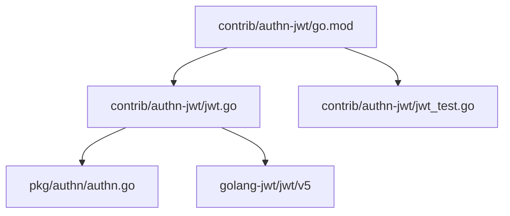
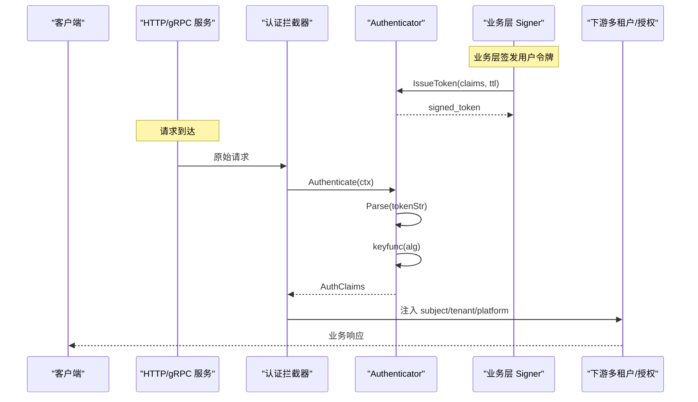
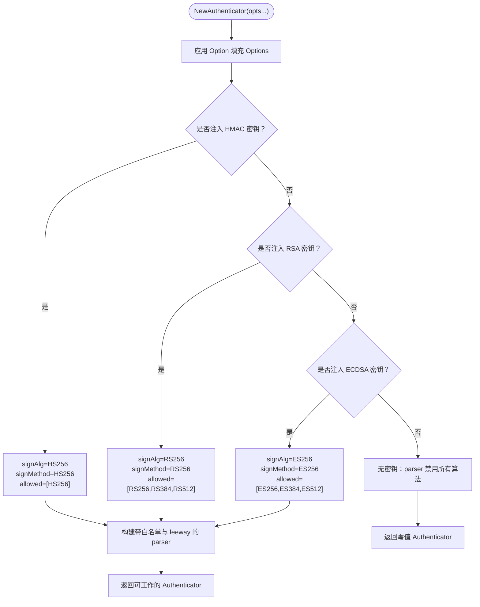
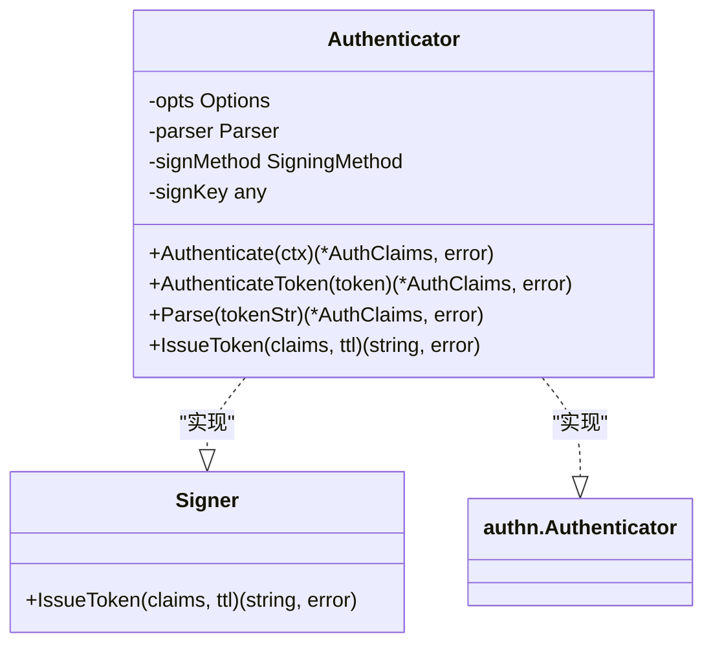
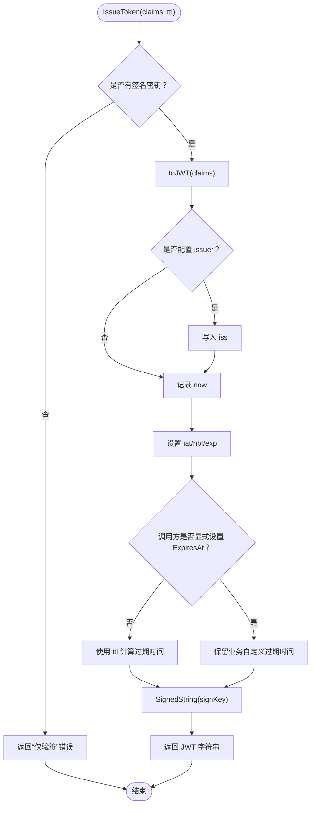
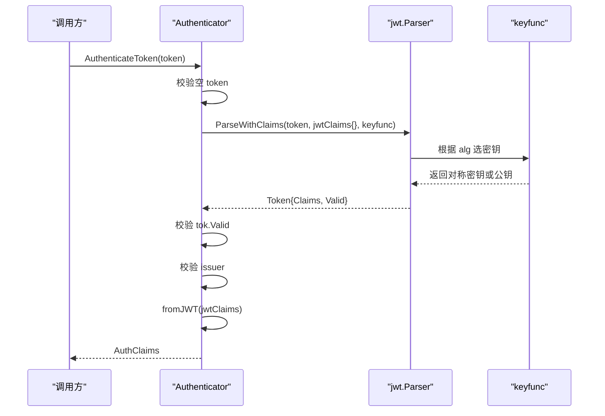
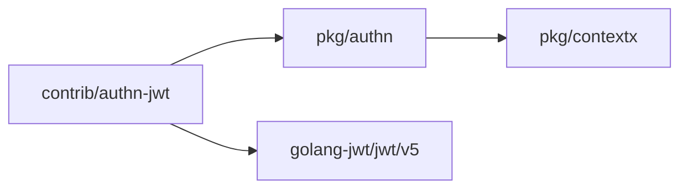

# JWT 认证扩展包

<cite>
**本文引用的文件**   
- [jwt.go](file://contrib/authn-jwt/jwt.go)
- [jwt_test.go](file://contrib/authn-jwt/jwt_test.go)
- [go.mod](file://contrib/authn-jwt/go.mod)
- [authn.go](file://pkg/authn/authn.go)
</cite>

## 目录
1. [引言](#引言)
2. [项目结构](#项目结构)
3. [核心组件](#核心组件)
4. [架构总览](#架构总览)
5. [详细组件分析](#详细组件分析)
6. [依赖关系分析](#依赖关系分析)
7. [性能与安全特性](#性能与安全特性)
8. [集成指南](#集成指南)
9. [故障排查](#故障排查)
10. [结论](#结论)

## 引言
`contrib/authn-jwt` 是 bald 框架的 JWT 认证扩展，基于 `github.com/golang-jwt/jwt/v5` 实现 `pkg/authn.Authenticator` 接口，同时暴露 `Signer` 接口供业务层签发令牌。它支持两类密钥配置：

- **对称（HMAC/HS256）**：签发与验签共用同一把密钥，适合单体或演示环境。
- **非对称（RSA RS256、ECDSA ES256 及其同族算法）**：签发方持有私钥，验证方只持有公钥，实现签发权与验签权解耦，便于对接企业 OIDC / JWKS 生态。

本包的核心设计是把“业务身份声明”和“JWT 编解码”隔离：`pkg/authn.AuthClaims` 作为强类型身份模型，不直接依赖 jwt 库；`authn-jwt` 通过内部桥接结构在两者之间双向映射。

## 项目结构
该扩展是一个独立 Go module，位于 `contrib/authn-jwt`，仅包含两个源文件和测试文件：

**图表来源**
- [go.mod:1-15](file://contrib/authn-jwt/go.mod#L1-L15)
- [jwt.go:1-25](file://contrib/authn-jwt/jwt.go#L1-L25)
- [authn.go:1-20](file://pkg/authn/authn.go#L1-L20)

**章节来源**
- [go.mod:1-15](file://contrib/authn-jwt/go.mod#L1-L15)

## 核心组件
| 组件 | 职责 | 关键行为 |
|---|---|---|
| `Options` | 控制密钥、算法、签发者与时钟漂移容忍 | 提供 `WithHMACSecret`、`WithRSAKeys`、`WithECDSAKeys`、`WithSigningAlg`、`WithAllowedAlgs`、`WithIssuer`、`WithLeeway` |
| `Authenticator` | 实现 `authn.Authenticator` 与 `Signer` | 签发令牌、解析校验、从上下文提取 token |
| `Signer` | 业务层依赖的签发接口 | 暴露 `IssueToken(claims, ttl)` |
| `jwtClaims` | `authn.AuthClaims` 与 `jwt.RegisteredClaims` 的桥接结构 | 负责字段双向映射、jti 唯一性、过期时间处理 |
| `keyfunc` | 按 token 头中的 `alg` 选择对应公钥或对称密钥 | 防止 `alg=none` 与密钥错位 |

**章节来源**
- [jwt.go:26-120](file://contrib/authn-jwt/jwt.go#L26-L120)
- [jwt.go:121-180](file://contrib/authn-jwt/jwt.go#L121-L180)
- [authn.go:21-147](file://pkg/authn/authn.go#L21-L147)

## 架构总览
`authn-jwt` 处于 bald 框架的认证桥接层：业务代码依赖 `Signer` 签发令牌，传输层中间件注入 `Authenticator` 完成请求认证。

**图表来源**
- [jwt.go:121-367](file://contrib/authn-jwt/jwt.go#L121-L367)
- [authn.go:57-147](file://pkg/authn/authn.go#L57-L147)

## 详细组件分析

### Options 配置体系
`Options` 是构造 `Authenticator` 的唯一配置入口。所有选项都是可选的，但至少要提供一组密钥：对称 HMAC，或非对称 RSA 或 ECDSA。

| 选项函数 | 参数 | 作用 | 典型场景 |
|---|---|---|---|
| `WithHMACSecret(secret []byte)` | 对称密钥字节切片 | 启用 HS256；自动设置签名方法与允许算法 | 单体服务、本地开发、简单鉴权 |
| `WithRSAKeys(priv *rsa.PrivateKey, pub *rsa.PublicKey)` | RSA 私钥、公钥 | 启用 RS256；允许 RS256/RS384/RS512 | 签发与验签分离、跨服务共享公钥 |
| `WithECDSAKeys(priv *ecdsa.PrivateKey, pub *ecdsa.PublicKey)` | ECDSA 私钥、公钥 | 启用 ES256；允许 ES256/ES384/ES512 | 高性能非对称签名、现代曲线 |
| `WithSigningAlg(alg string)` | 算法字符串 | 覆盖自动推断的签名算法 | 明确指定 HS256/RS256/ES256 |
| `WithAllowedAlgs(algs ...string)` | 多个算法名 | 覆盖自动展开的验签白名单 | 对接外部 IdP 时显式限制算法 |
| `WithIssuer(issuer string)` | 签发者标识 | 签发写入 `iss`，验签强制匹配 | 防越权、区分不同签发主体 |
| `WithLeeway(d time.Duration)` | 时钟漂移容忍时长 | 传给 jwt 解析器的 leeway | 分布式服务中处理时钟偏差 |

构造流程如下：

**图表来源**
- [jwt.go:26-120](file://contrib/authn-jwt/jwt.go#L26-L120)

**章节来源**
- [jwt.go:26-120](file://contrib/authn-jwt/jwt.go#L26-L120)

### Signer 与 Authenticator 的职责分离
`Signer` 是业务层依赖的最小签发端口：

这种设计的收益是：

- 业务逻辑只依赖 `Signer`，不感知具体认证实现。
- 单测可以注入伪造的 `Signer`。
- 拦截器只依赖 `authn.Authenticator`，用于验证传入凭证。
- 同一个 `*Authenticator` 实例可同时充当签发者与验证者；仅验签侧可通过不传私钥实现“不可签发”。

**图表来源**
- [jwt.go:100-180](file://contrib/authn-jwt/jwt.go#L100-L180)
- [authn.go:57-89](file://pkg/authn/authn.go#L57-L89)

**章节来源**
- [jwt.go:100-180](file://contrib/authn-jwt/jwt.go#L100-L180)
- [authn.go:57-89](file://pkg/authn/authn.go#L57-L89)

### 令牌签发流程 IssueToken
签发流程的核心步骤：

1. 检查是否持有签名密钥；未注入私钥时返回“仅验签”错误。
2. 将 `authn.AuthClaims` 映射为内部 `jwtClaims`。
3. 如果配置了 `issuer`，则强制写入 `iss`。
4. 设置 `iat`、`nbf` 为当前时间。
5. 若调用方未显式设置 `ExpiresAt`，则用 `ttl` 计算过期时间；否则保留业务自定义过期时间。
6. 使用配置的 `signMethod` 和 `signKey` 生成签名。
7. 返回序列化后的 JWT 字符串。

其中有两个重要安全细节：

- **jti 唯一性**：`toJWT` 会向 `RegisteredClaims.ID` 写入随机 16 字节 base64url 字符串。这是为了防止同一秒内对相同 claims 签发完全相同的 token，避免刷新 token 重复、refresh token 一次性语义失效。
- **默认 TTL**：未传入 `ttl` 时使用 `defaultTTL = 2h`。

**图表来源**
- [jwt.go:201-367](file://contrib/authn-jwt/jwt.go#L201-L367)

**章节来源**
- [jwt.go:201-367](file://contrib/authn-jwt/jwt.go#L201-L367)

### 解析与验证流程
解析由 `Parse` 统一实现，`AuthenticateToken` 和 `Authenticate` 都委托给它。

解析链路：

1. 空 token 直接拒绝。
2. 调用 `a.parser.ParseWithClaims`，传入内部 `jwtClaims` 和 `keyfunc`。
3. 检查 `tok.Valid`。
4. 断言 Claims 类型是 `*jwtClaims`。
5. 如果配置了 `issuer`，必须与 token 中的 `iss` 一致。
6. 调用 `fromJWT` 转换回 `authn.AuthClaims`。

**图表来源**
- [jwt.go:201-367](file://contrib/authn-jwt/jwt.go#L201-L367)

#### keyfunc 算法白名单与密钥选择
`keyfunc` 会根据 token 头中的 `alg` 前缀选择密钥：

| `alg` 前缀 | 条件 | 返回密钥 |
|---|---|---|
| `HS` | 注入了 HMAC 密钥 | 对称密钥 |
| `RS` | 注入了 RSA 公钥 | RSA 公钥 |
| `ES` | 注入了 ECDSA 公钥 | ECDSA 公钥 |
| 其他 | 不匹配 | 返回错误 |

配合 `WithValidMethods`，`alg=none` 以及不在白名单中的算法都会被拒绝。

**章节来源**
- [jwt.go:141-180](file://contrib/authn-jwt/jwt.go#L141-L180)
- [jwt.go:232-280](file://contrib/authn-jwt/jwt.go#L232-L280)

#### Issuer 防越权
当 `WithIssuer` 非空时：

- 签发阶段会把 `iss` 写入 token。
- 验签阶段如果发现 `iss` 与配置不一致，直接拒绝。

这用于防止一个服务的 token 被误用或恶意替换到另一个服务。

**章节来源**
- [jwt.go:36-44](file://contrib/authn-jwt/jwt.go#L36-L44)
- [jwt.go:256-268](file://contrib/authn-jwt/jwt.go#L256-L268)

#### Leeway 时钟漂移容忍
`WithLeeway` 会传递给 `jwt.NewParser` 的 `WithLeeway`，用于处理分布式系统中签发时间与验证时间的微小差异。默认值为 0，即严格比较。

**章节来源**
- [jwt.go:45-52](file://contrib/authn-jwt/jwt.go#L45-L52)
- [jwt.go:106-120](file://contrib/authn-jwt/jwt.go#L106-L120)

### 主题与多租户方案
`authn.AuthClaims` 本身已经承载多租户与平台身份语义：

| 字段 | 含义 | 多租户影响 |
|---|---|---|
| `Subject` | 主体 ID（用户或服务账号） | 审计与日志归属 |
| `TenantID` | 租户标识 | 经 `pkg/store` 进行数据隔离 |
| `Platform` | 平台级身份标记 | 置位后跳过租户隔离，实现跨租户视图 |
| `Scopes` | 细粒度权限范围 | 与 `authz` 结合做能力判定 |
| `Roles` | 粗粒度角色 | 与策略引擎结合做角色判定 |

`ContextWithAuthClaims` 会把 `Subject`、`Name`、`TenantID`、`Platform` 同步写入 `contextx`，供下游 store、授权、审计读取。

在多租户 JWT 场景中，建议：

- 每个租户的访问令牌包含其 `TenantID`。
- 平台管理员令牌设置 `Platform=true`，并谨慎授予跨租户权限。
- 不同租户不应复用同一份签发密钥；若使用非对称密钥，应通过不同的 issuer 或外部 IdP 区分。

**章节来源**
- [authn.go:21-116](file://pkg/authn/authn.go#L21-L116)
- [jwt.go:201-245](file://contrib/authn-jwt/jwt.go#L201-L245)

## 依赖关系分析
`contrib/authn-jwt` 对外依赖较少，耦合集中在两条线上：

1. 依赖 `pkg/authn` 的身份抽象。
2. 依赖 `github.com/golang-jwt/jwt/v5` 完成 JWT 编解码。

**图表来源**
- [go.mod:1-15](file://contrib/authn-jwt/go.mod#L1-L15)
- [authn.go:1-20](file://pkg/authn/authn.go#L1-L20)

模块版本事实：

- Go 版本：1.27.1
- golang-jwt/jwt/v5：v5.2.2
- testify：v1.12.1
- 通过 `replace github.com/kalandramo/bald => ../..` 指向仓库根，使子模块能消费 core 包

**章节来源**
- [go.mod:1-15](file://contrib/authn-jwt/go.mod#L1-L15)

## 性能与安全特性

### 性能特性
- 解析器与签名方法在构造期缓存，避免每次请求重建。
- jti 使用 `crypto/rand` 生成 16 字节随机串，base64url 编码后约 22 字符，开销很小。
- 非对称模式下，验签方只需公钥，降低密钥管理成本。

### 安全最佳实践
| 风险点 | 推荐做法 |
|---|---|
| 密钥管理 | 生产环境不要硬编码 HMAC secret；通过密钥管理服务注入；非对称模式优先让验签方只持公钥 |
| 算法白名单 | 显式使用 `WithAllowedAlgs` 限定允许算法，不要接受任意 `alg` |
| `alg=none` | 白名单机制已拒绝该攻击面；不要把空集合交给解析器 |
| issuer 校验 | 始终设置 `WithIssuer`，并在不同服务间保持差异化 |
| 过期时间 | 使用合理的 `ttl`；必要时让业务显式设置 `ExpiresAt`，避免无脑覆盖 |
| 时钟漂移 | 分布式部署适当设置 `WithLeeway`，但不要过大 |
| 多租户 | 凭据中包含 `TenantID`；平台身份显式设置 `Platform=true`，fail-closed |
| 刷新 token | 利用 jti 唯一性保证刷新后不会与原 token 重复 |

**章节来源**
- [jwt.go:26-120](file://contrib/authn-jwt/jwt.go#L26-L120)
- [jwt.go:201-367](file://contrib/authn-jwt/jwt.go#L201-L367)

## 集成指南

### 在 HTTP/gRPC 服务中注册认证中间件
整体思路：

1. 构造 `Authenticator`，注入密钥与 issuer。
2. 将 `Authenticator` 注入到 `middleware/gin.AuthnMiddleware` 或 `middleware/grpc.AuthnInterceptor`。
3. 业务 handler 通过 `authn.AuthClaimsFromContext` 读取已认证的身份。

注意：`pkg/authn` 文档明确指出，认证器属于业务策略，不进 appkit 通用 Registry；因此不存在 `registry.RegisterAuthenticator`。

**章节来源**
- [authn.go:57-89](file://pkg/authn/authn.go#L57-L89)

### 在业务层签发用户令牌
业务层应依赖 `Signer` 而非裸密钥：

1. 构造 `Authenticator`，注入签发密钥与 issuer。
2. 组装 `authn.AuthClaims`，填写 `Subject`、`TenantID`、`Scopes`、`Roles` 等。
3. 调用 `IssueToken(claims, ttl)` 获得 JWT。
4. 将 token 返回给客户端，或通过登录流程下发。

示例要点（以路径引用代替代码内容）：

- 构造对称密钥认证器：[jwt_test.go:24-33](file://contrib/authn-jwt/jwt_test.go#L24-L33)
- 构造 RSA 签发者与验签者：[jwt_test.go:55-76](file://contrib/authn-jwt/jwt_test.go#L55-L76)
- 构造 ECDSA 签发者与验签者：[jwt_test.go:97-111](file://contrib/authn-jwt/jwt_test.go#L97-L111)

**章节来源**
- [jwt_test.go:24-111](file://contrib/authn-jwt/jwt_test.go#L24-L111)

### 与框架 Provider 机制的关系
`authn-jwt` 没有定义自己的 Provider。它实现的是 `pkg/authn.Authenticator` 接口，而 `pkg/authn` 的设计原则是“核心不 import 任何具体验签库”，认证实现全部外置为桥接子模块。

因此，`authn-jwt` 不是通过 `appkit.Provider` 注册的插件，而是由应用装配到传输层中间件中。

**章节来源**
- [authn.go:1-20](file://pkg/authn/authn.go#L1-L20)
- [authn.go:57-89](file://pkg/authn/authn.go#L57-L89)

## 故障排查

| 现象 | 可能原因 | 排查建议 |
|---|---|---|
| 构造 `NewAuthenticator` 后无法签发 | 未注入任何密钥，或验签侧只传了公钥 | 检查是否调用 `WithHMACSecret`、`WithRSAKeys` 或 `WithECDSAKeys` |
| 验签报不支持算法 | token 的 `alg` 不在白名单或未注入对应公钥 | 检查 `WithAllowedAlgs` 与 `keyfunc` 分支 |
| 验签报 `alg=none` 或未知算法 | 白名单未正确限制 | 显式配置允许算法 |
| 同一秒内刷新 token 仍相同 | jti 缺失或生成失败 | 确认使用的是 `authn-jwt` 的 `IssueToken`，不要手动拼装 claims |
| issuer 校验失败 | token 的 `iss` 与服务期望不一致 | 检查 `WithIssuer` 配置与签发方是否一致 |
| 过期判断异常 | `ExpiresAt` 被业务覆盖或时钟漂移 | 检查 `ttl`、`AuthClaims.ExpiresAt`、`WithLeeway` |
| Platform 字段丢失 | 桥接映射不一致或业务未显式设置 | 对照 `toJWT` 与 `fromJWT` 的双向映射 |
| 多租户数据未隔离 | 未设置 `TenantID`，或平台身份意外置位 | 检查 claims 内容与 `ContextWithAuthClaims` 的行为 |

**章节来源**
- [jwt.go:121-180](file://contrib/authn-jwt/jwt.go#L121-L180)
- [jwt.go:201-367](file://contrib/authn-jwt/jwt.go#L201-L367)
- [jwt_test.go:35-111](file://contrib/authn-jwt/jwt_test.go#L35-L111)

## 结论
`contrib/authn-jwt` 在 bald 框架中承担了 JWT 认证的实现职责，同时保持对核心 `pkg/authn` 的零耦合。它的核心价值在于：

- 通过 `Options` 统一表达对称与非对称密钥配置。
- 通过 `Signer` 与 `Authenticator` 的职责分离，让业务签发与请求认证各自有清晰边界。
- 通过 `keyfunc`、算法白名单、issuer 校验、leeway 与 jti 唯一性，覆盖常见 JWT 安全风险。
- 通过 `AuthClaims` 的多租户与平台身份语义，支撑 SaaS 与平台型系统。

在生产集成中，应优先采用非对称密钥、显式算法白名单、固定 issuer、合理过期策略，并把 `TenantID` 与 `Platform` 作为多租户与跨租户视图的显式契约。