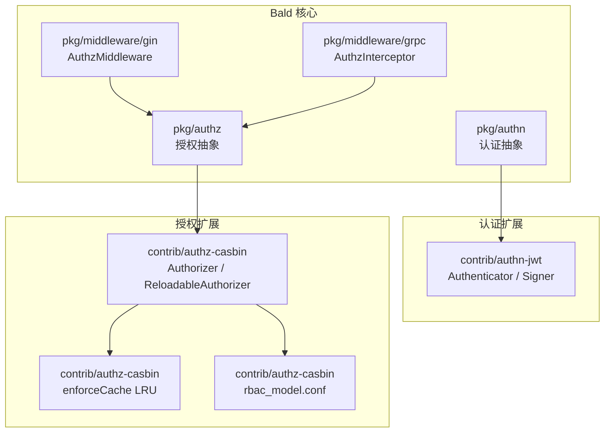
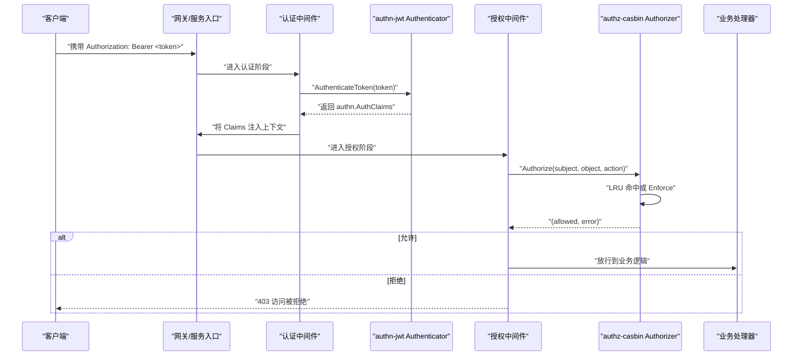
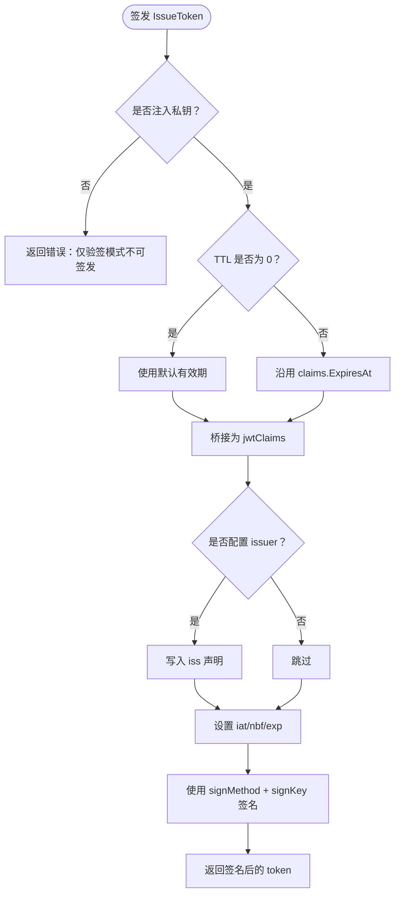
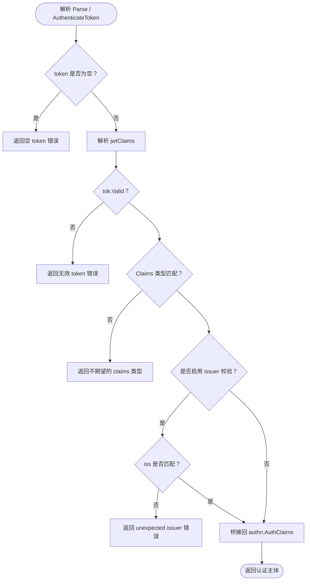
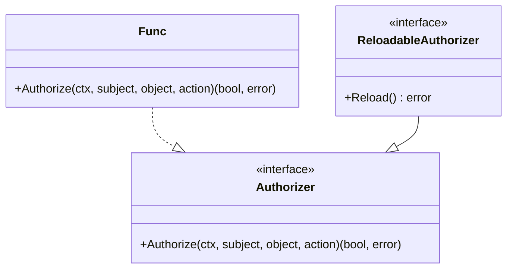
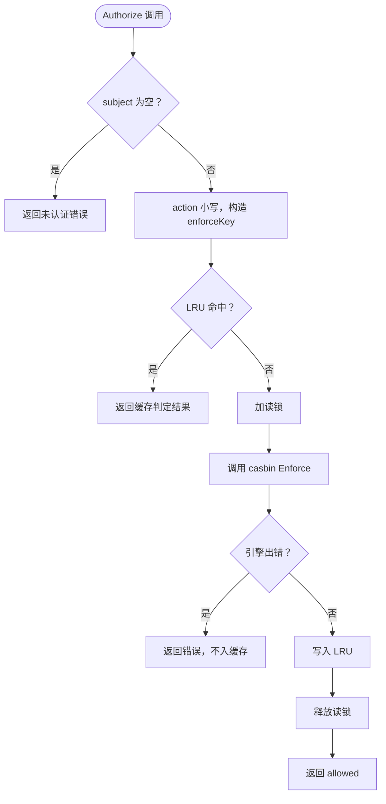
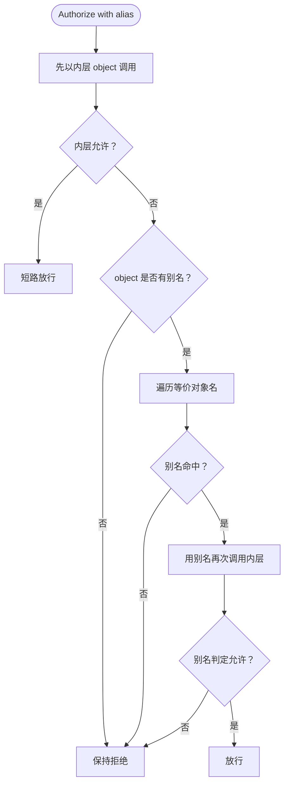
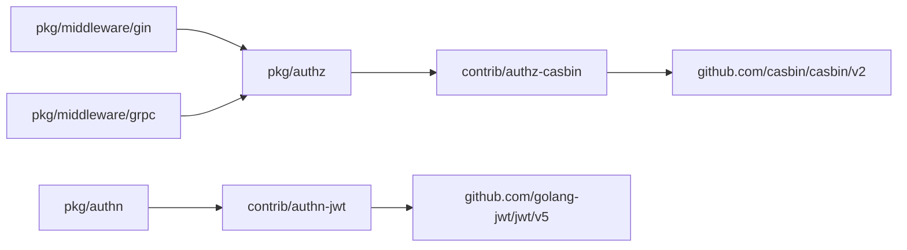

# 认证与授权扩展包

<cite>
**本文引用的文件**   
- [contrib/authn-jwt/jwt.go](file://contrib/authn-jwt/jwt.go)
- [contrib/authn-jwt/go.mod](file://contrib/authn-jwt/go.mod)
- [contrib/authz-casbin/casbin.go](file://contrib/authz-casbin/casbin.go)
- [contrib/authz-casbin/cache.go](file://contrib/authz-casbin/cache.go)
- [contrib/authz-casbin/rbac_model.conf](file://contrib/authz-casbin/rbac_model.conf)
- [contrib/authz-casbin/alias_test.go](file://contrib/authz-casbin/alias_test.go)
- [contrib/authz-casbin/reload_test.go](file://contrib/authz-casbin/reload_test.go)
- [pkg/authz/authz.go](file://pkg/authz/authz.go)
- [pkg/authz/reload.go](file://pkg/authz/reload.go)
- [pkg/middleware/gin/authz.go](file://pkg/middleware/gin/authz.go)
- [pkg/middleware/grpc/authz.go](file://pkg/middleware/grpc/authz.go)
</cite>

## 目录
1. [引言](#引言)
2. [项目结构](#项目结构)
3. [核心组件](#核心组件)
4. [架构总览](#架构总览)
5. [详细组件分析](#详细组件分析)
6. [依赖关系分析](#依赖关系分析)
7. [性能考虑](#性能考虑)
8. [故障排查指南](#故障排查指南)
9. [结论](#结论)
10. [附录：配置与集成示例](#附录配置与集成示例)

## 引言
本文件面向 Bald 的认证与授权扩展包，聚焦两个子模块：

- **authn-jwt**：基于 golang-jwt 的 JWT 认证器，支持 HMAC、RSA、ECDSA 密钥与算法白名单，实现 `authn.Authenticator` 与业务侧的 `Signer` 接口。
- **authz-casbin**：基于 Casbin 的 RBAC 授权桥接，提供策略模型、运行期策略重载、LRU 判定缓存、以及 HTTP/gRPC 命名别名映射。

文档覆盖以下主题：JWT 签发与验证流程、中间件集成方式、Casbin 策略模型与动态重载、别名映射、配置示例、HTTP/gRPC 服务集成、策略文件编写、性能优化与安全加固，以及与框架 Provider 机制的关系和多租户权限隔离思路。

## 项目结构
认证与授权能力由“核心抽象 + 可选扩展”构成：

**图表来源**
- [contrib/authn-jwt/jwt.go:1-60](file://contrib/authn-jwt/jwt.go#L1-L60)
- [pkg/authz/authz.go:1-38](file://pkg/authz/authz.go#L1-L38)
- [pkg/middleware/gin/authz.go:1-102](file://pkg/middleware/gin/authz.go#L1-L102)
- [pkg/middleware/grpc/authz.go:1-105](file://pkg/middleware/grpc/authz.go#L1-L105)
- [contrib/authz-casbin/casbin.go:1-60](file://contrib/authz-casbin/casbin.go#L1-L60)
- [contrib/authz-casbin/cache.go:1-40](file://contrib/authz-casbin/cache.go#L1-L40)
- [contrib/authz-casbin/rbac_model.conf:1-14](file://contrib/authz-casbin/rbac_model.conf#L1-L14)

**章节来源**
- [contrib/authn-jwt/go.mod:1-15](file://contrib/authn-jwt/go.mod#L1-L15)
- [pkg/authz/authz.go:1-38](file://pkg/authz/authz.go#L1-L38)
- [pkg/middleware/gin/authz.go:1-102](file://pkg/middleware/gin/authz.go#L1-L102)
- [pkg/middleware/grpc/authz.go:1-105](file://pkg/middleware/grpc/authz.go#L1-L105)

## 核心组件
本节先给出各组件职责边界，再在后续章节深入实现细节。

| 组件 | 包路径 | 职责 | 关键类型 |
|---|---|---|---|
| JWT 认证器 | `contrib/authn-jwt` | 校验 Bearer Token，签发 JWT；实现 `authn.Authenticator` 与业务 `Signer` | `Options`、`Authenticator`、`Signer` |
| 授权抽象 | `pkg/authz` | 定义传输中立的 `(subject, object, action)` 授权接口与可选重载能力 | `Authorizer`、`ReloadableAuthorizer` |
| Casbin 授权器 | `contrib/authz-casbin` | 基于内嵌 RBAC 模型加载策略、并发安全 Enforce、运行期策略重载 | `Authorizer`、适配器构造函数 |
| 判定缓存 | `contrib/authz-casbin` | `(subject, object, action)` → 布尔结果的有界 LRU 缓存 | `enforceCache` |
| HTTP 授权中间件 | `pkg/middleware/gin` | 从 HTTP 请求推导三元组并调用 Authorizer | `AuthzMiddleware` |
| gRPC 授权拦截器 | `pkg/middleware/grpc` | 从 FullMethod 推导三元组并调用 Authorizer | `AuthzInterceptor` |

**章节来源**
- [contrib/authn-jwt/jwt.go:60-160](file://contrib/authn-jwt/jwt.go#L60-L160)
- [pkg/authz/authz.go:1-38](file://pkg/authz/authz.go#L1-L38)
- [contrib/authz-casbin/casbin.go:1-187](file://contrib/authz-casbin/casbin.go#L1-L187)
- [contrib/authz-casbin/cache.go:1-108](file://contrib/authz-casbin/cache.go#L1-L108)
- [pkg/middleware/gin/authz.go:1-102](file://pkg/middleware/gin/authz.go#L1-L102)
- [pkg/middleware/grpc/authz.go:1-105](file://pkg/middleware/grpc/authz.go#L1-L105)

## 架构总览
认证与授权在请求链路中的位置如下：

**图表来源**
- [contrib/authn-jwt/jwt.go:260-367](file://contrib/authn-jwt/jwt.go#L260-L367)
- [pkg/middleware/gin/authz.go:40-102](file://pkg/middleware/gin/authz.go#L40-L102)
- [pkg/middleware/grpc/authz.go:60-105](file://pkg/middleware/grpc/authz.go#L60-L105)
- [contrib/authz-casbin/casbin.go:100-187](file://contrib/authz-casbin/casbin.go#L100-L187)

## 详细组件分析

### JWT 认证组件（authn-jwt）

#### 设计要点
- 实现 `authn.Authenticator`：既可从上下文取 token 解析，也可直接解析字符串。
- 同时实现业务侧 `Signer`：通过 `IssueToken(claims, ttl)` 签发令牌。
- 密钥与算法通过 `Options` 注入，支持对称与非对称两类方案。
- 核心声明 `authn.AuthClaims` 与 jwt 库解耦，使用内部桥接结构双向转换。

#### 配置选项
`Options` 控制认证器的密钥、算法、签发者标识与时钟漂移容忍：

| 配置项 | 说明 | 默认行为 |
|---|---|---|
| `hmacSecret` | 对称 HS256 密钥 | 未设置则不走对称分支 |
| `rsaPrivate` / `rsaPublic` | RSA 私钥与公钥 | 仅验签方可只传公钥 |
| `ecdsaPrivate` / `ecdsaPublic` | ECDSA 私钥与公钥 | 仅验签方可只传公钥 |
| `signingAlg` | 显式签发算法 | 按密钥自动推断：HMAC→HS256、RSA→RS256、ECDSA→ES256 |
| `allowedAlgs` | 验签算法白名单 | 按密钥自动展开，防止 alg 混淆攻击 |
| `issuer` | 签发者标识 | 非空时签发写入 iss，验签强制匹配 |
| `leeway` | 时钟漂移容忍 | 默认 0 |

构造函数 `NewAuthenticator(opts...)` 会根据注入密钥选择解析器、签名方法与密钥；若未注入任何密钥，会返回一个“仅解析但无有效方法”的认证器，确保调用方必须正确注入。

#### 令牌签发流程
签发入口为 `IssueToken(claims, ttl)`：

**图表来源**
- [contrib/authn-jwt/jwt.go:300-367](file://contrib/authn-jwt/jwt.go#L300-L367)

需要注意的关键约束：
- jti 必须唯一；实现使用随机值兜底纳秒时间戳，避免同一秒内重复 token。
- 若 claims 已带 `ExpiresAt`，不会用 ttl 覆盖。
- 未注入私钥时只能做验签，不能签发。

#### 令牌验证流程
解析入口包括 `Parse` 与 `AuthenticateToken`，最终都走 `parser.ParseWithClaims`，并通过自定义 `keyfunc` 根据 token 头中的 `alg` 选择对应公钥或对称密钥：

**图表来源**
- [contrib/authn-jwt/jwt.go:230-300](file://contrib/authn-jwt/jwt.go#L230-L300)

安全相关实现要点：
- `keyfunc` 根据 `alg` 前缀区分 HS/RS/ES，否则返回“不支持算法或缺少公钥”错误，防止 `alg=none` 与密钥错位。
- `allowedAlgs` 作为解析器白名单，进一步限制可接受的算法集合。
- `issuer` 非空时强制匹配，避免跨签发者越权。
- 桥接结构 `jwtClaims` 是 `authn.AuthClaims` 的全量镜像，新增字段必须同步 `toJWT` 与 `fromJWT`，否则会静默丢弃或无法恢复。

#### 中间件集成方式
authn-jwt 提供的是认证能力，而不是直接绑定某个 HTTP 框架。典型集成方式是：

1. 应用启动时构造 `Authenticator`，注入密钥、算法、issuer。
2. 在认证中间件中调用 `Authenticate(ctx)` 或 `AuthenticateToken(token)`。
3. 认证成功后将 `authn.AuthClaims` 存入上下文。
4. 授权中间件从上下文中读取 `Subject`，并调用授权器。

具体中间件位于 `pkg/middleware/gin` 与 `pkg/middleware/grpc`，它们消费 `authn.AuthClaims`，并将 `(subject, object, action)` 交给 `authz.Authorizer`。

**章节来源**
- [contrib/authn-jwt/jwt.go:1-60](file://contrib/authn-jwt/jwt.go#L1-L60)
- [contrib/authn-jwt/jwt.go:60-160](file://contrib/authn-jwt/jwt.go#L60-L160)
- [contrib/authn-jwt/jwt.go:201-367](file://contrib/authn-jwt/jwt.go#L201-L367)
- [pkg/middleware/gin/authz.go:40-102](file://pkg/middleware/gin/authz.go#L40-L102)
- [pkg/middleware/grpc/authz.go:60-105](file://pkg/middleware/grpc/authz.go#L60-L105)

### 授权抽象与中间件

#### 授权接口
核心 `pkg/authz` 定义最小授权契约：

**图表来源**
- [pkg/authz/authz.go:1-38](file://pkg/authz/authz.go#L1-L38)
- [pkg/authz/reload.go:1-54](file://pkg/authz/reload.go#L1-L54)

关键点：
- `Authorizer` 是纯判定接口，返回 `(allowed, error)`。
- `Func` 是把普通函数适配成 `Authorizer` 的工具。
- `AllowAll`、`DenyAll` 用于开放接口或默认拒绝场景。
- `ReloadableAuthorizer` 是可选扩展，表示支持运行期重载策略。

#### HTTP 授权中间件
`pkg/middleware/gin.AuthzMiddleware` 默认：
- subject：从 `authn.AuthClaims.Subject` 提取。
- object：HTTP URL path。
- action：HTTP method。

可通过 Option 替换 object/action/subject 推导逻辑，推荐配合 `authz.DefaultHTTPObject` 与 `authz.DefaultHTTPAction` 做传输中立归一化。

错误处理：
- 引擎错误：返回 500 类内部错误。
- 明确拒绝：返回 403 访问被拒绝。

#### gRPC 授权拦截器
`pkg/middleware/grpc.AuthzInterceptor` 默认：
- subject：从 `authn.AuthClaims.Subject` 提取。
- object：FullMethod。
- action：CALL。

推荐配合 `authz.DefaultGRPCObject` 与 `authz.DefaultGRPCAction`，使 REST 与 gRPC 共享同一份 RBAC 策略。

**章节来源**
- [pkg/authz/authz.go:1-38](file://pkg/authz/authz.go#L1-L38)
- [pkg/authz/reload.go:1-54](file://pkg/authz/reload.go#L1-L54)
- [pkg/middleware/gin/authz.go:1-102](file://pkg/middleware/gin/authz.go#L1-L102)
- [pkg/middleware/grpc/authz.go:1-105](file://pkg/middleware/grpc/authz.go#L1-L105)

### Casbin 授权组件（authz-casbin）

#### 角色与模型
默认模型文件 `rbac_model.conf` 是标准 RBAC：

| 段落 | 含义 |
|---|---|
| `[request_definition]` | 请求三元组 `sub, obj, act` |
| `[policy_definition]` | 策略行 `p = sub, obj, act` |
| `[role_definition]` | 角色绑定 `g = _, _` |
| `[policy_effect]` | 任一 allow 即放行 |
| `[matchers]` | 通过角色表匹配 subject，并比较 object、action |

该模型是框架性声明，而策略数据（`.csv`）属于业务数据，应由调用方注入。

#### Authorizer 生命周期
`casbin.Authorizer` 封装 casbin `Enforcer`，并提供：

| 方法 | 语义 |
|---|---|
| `New(policyCSV)` | 使用内嵌 RBAC 模型与策略文本构造 |
| `NewWithModel(modelConf, policyCSV)` | 使用自定义模型构造 |
| `NewWithAdapter(modelConf, adapter)` | 使用任意 casbin 适配器构造，适合文件、数据库等可变源 |
| `Authorize(ctx, subject, object, action)` | 执行授权判定 |
| `Reload()` | 从同一适配器重新装载策略 |

构造时的策略语义：
- 空策略文本等价于 fail-closed：无任何 p/g 行时一律拒绝。
- 传入 nil 适配器等价于空策略初始态，Reload 是合法无操作。

#### 并发与缓存
`Authorize` 内部使用 RWMutex：读锁保护并发判定，写锁独占 Reload。判定时先查 LRU 缓存，命中直接返回；未命中才调用 casbin Enforce。

`enforceCache` 是有界 LRU：
- 键为 `(subject, object, action)`，其中 action 已小写。
- 容量默认 1024。
- 只缓存无错误的判定结果。
- Reload 后整体失效。

**图表来源**
- [contrib/authz-casbin/casbin.go:100-160](file://contrib/authz-casbin/casbin.go#L100-L160)
- [contrib/authz-casbin/cache.go:40-108](file://contrib/authz-casbin/cache.go#L40-L108)

#### 动态策略重载
`Reload` 的语义非常严格：

- 写锁独占，与并发 `Authorize` 互斥。
- 空策略初始态下为合法无操作。
- 重载失败时保留旧策略（fail-safe），并返回错误。
- 无论成功还是失败，都会使判定缓存整体失效。
- 只有传入真实可变适配器时，Reload 才有实际策略更新语义。

测试用例覆盖了：
- 新注册用户的角色绑定经 Reload 立即生效。
- 通过 `authz.Reload` 助手发现并重载。
- 空策略初始态 Reload 无错。
- 并发判定与并发重载不构成数据竞争。

**章节来源**
- [contrib/authz-casbin/rbac_model.conf:1-14](file://contrib/authz-casbin/rbac_model.conf#L1-L14)
- [contrib/authz-casbin/casbin.go:1-187](file://contrib/authz-casbin/casbin.go#L1-L187)
- [contrib/authz-casbin/cache.go:1-108](file://contrib/authz-casbin/cache.go#L1-L108)
- [contrib/authz-casbin/reload_test.go:1-175](file://contrib/authz-casbin/reload_test.go#L1-L175)

### 别名映射功能
别名装饰器用于在 gRPC 命名空间与 HTTP 命名空间之间建立等价关系。它本身不改变授权策略，而是对 object 进行换名重试。

典型语义：
- 如果内层授权器已经放行，不再触发别名重试。
- 如果内层返回错误，原样透传且不重试。
- 没有等价名的 object 保持拒绝语义。
- 别名只是换名后再问一次，不是放行通道。
- 反向键冲突时，候选按键序逐一尝试，任一命中即放行。
- 自引用或空串别名会被跳过，避免死循环。
- 若内层实现 `ReloadableAuthorizer`，别名装饰器转发 Reload；否则为合法无操作。

**图表来源**
- [contrib/authz-casbin/alias_test.go:1-198](file://contrib/authz-casbin/alias_test.go#L1-L198)

**章节来源**
- [contrib/authz-casbin/alias_test.go:1-198](file://contrib/authz-casbin/alias_test.go#L1-L198)

## 依赖关系分析
authn-jwt 依赖核心认证抽象与 golang-jwt；authz-casbin 依赖核心授权抽象与 casbin。核心不依赖具体扩展包，符合“扩展外置、核心零耦合”的设计。

**图表来源**
- [contrib/authn-jwt/go.mod:1-15](file://contrib/authn-jwt/go.mod#L1-L15)
- [pkg/authz/authz.go:1-38](file://pkg/authz/authz.go#L1-L38)
- [pkg/middleware/gin/authz.go:1-30](file://pkg/middleware/gin/authz.go#L1-L30)
- [pkg/middleware/grpc/authz.go:1-30](file://pkg/middleware/grpc/authz.go#L1-L30)

**章节来源**
- [contrib/authn-jwt/go.mod:1-15](file://contrib/authn-jwt/go.mod#L1-L15)
- [pkg/authz/authz.go:1-38](file://pkg/authz/authz.go#L1-L38)

## 性能考虑

### JWT 签发与解析
- 解析器与签名方法在构造时缓存，避免每次请求重建。
- 算法白名单和 leeway 在解析器初始化时确定。
- jti 使用随机值生成，避免连续刷新产生相同 token。
- 桥接结构在签发与解析时做双向映射，注意字段一致性。

### 授权判定
- Casbin 引擎逐请求存在分配成本，LRU 缓存显著降低高重入流量下的分配。
- 默认缓存容量 1024，适用于常见工作集规模。
- 缓存键直接使用 string 字段，避免拼接分配。
- 判定路径在缓存命中时无额外分配。
- 策略重载串行化，正常判定走读锁，不阻塞热路径。

### 建议
- 在高并发场景下优先使用 LRU 命中路径，尽量复用稳定的 `(subject, object, action)`。
- 不要频繁调用 Reload；应结合配置中心或事件总线聚合变更。
- 对于超大 subject 基数，评估缓存淘汰压力；必要时调优容量或引入分片。
- 对敏感资源可缩小 action 粒度，提高策略命中率分布均匀性。

**章节来源**
- [contrib/authn-jwt/jwt.go:120-160](file://contrib/authn-jwt/jwt.go#L120-L160)
- [contrib/authn-jwt/jwt.go:230-367](file://contrib/authn-jwt/jwt.go#L230-L367)
- [contrib/authz-casbin/cache.go:1-108](file://contrib/authz-casbin/cache.go#L1-L108)
- [contrib/authz-casbin/casbin.go:100-187](file://contrib/authz-casbin/casbin.go#L100-L187)

## 故障排查指南

### JWT 相关
| 现象 | 可能原因 | 排查方向 |
|---|---|---|
| 解析时报 unsupported alg 或缺少公钥 | alg 与注入密钥不匹配 | 检查 `allowedAlgs` 与 `signingAlg` |
| 报 unexpected issuer | 请求 token 的 iss 与配置不一致 | 检查签发方 issuer 与验签方 issuer 配置 |
| 刷新 token 仍过期 | jti 重复或 exp 未更新 | 确认签发逻辑是否每次都生成新 jti 并计算新 exp |
| 平台身份丢失 | 桥接结构字段不同步 | 检查 `toJWT` 与 `fromJWT` 是否一致 |
| 仅验签时报 no signing key | 调用 `IssueToken` 但未注入私钥 | 仅验签端不应签发，或补全私钥 |

### 授权相关
| 现象 | 可能原因 | 排查方向 |
|---|---|---|
| 所有请求 403 | 空策略或策略未匹配 | 确认 p/g 行是否正确嵌入或加载 |
| 运行时新增用户仍被拒 | 未调用 Reload | 确认策略变更后触发了 `Reload` |
| 引擎报错返回 500 | casbin 内部异常或适配器问题 | 查看授权引擎错误日志 |
| gRPC 与 HTTP 策略不一致 | 未使用传输中立归一化 | 检查 `DefaultHTTPObject/Action` 与 `DefaultGRPCObject/Action` |
| 别名命中后仍拒绝 | 别名目标未命中策略 | 检查别名映射与策略 object 是否一致 |

### 并发与重载
- Reload 与 Authorize 并发是安全的，但重载期间会加写锁，应避免高频重载。
- 重载失败不会清空旧策略，但会使缓存失效，下一次判定会冷启动。
- 空策略初始态下 Reload 是合法无操作，不会抛出错误。

**章节来源**
- [contrib/authn-jwt/jwt.go:201-367](file://contrib/authn-jwt/jwt.go#L201-L367)
- [contrib/authz-casbin/casbin.go:100-187](file://contrib/authz-casbin/casbin.go#L100-L187)
- [contrib/authz-casbin/reload_test.go:1-175](file://contrib/authz-casbin/reload_test.go#L1-L175)

## 结论
authn-jwt 与 authz-casbin 共同构成了 Bald 可扩展的认证与授权方案：前者负责主体身份签发与校验，后者负责基于角色的访问控制。两者均遵循“核心抽象 + 可选扩展”原则，既保证框架稳定性，又允许业务按需接入具体实现。

在实际工程中，推荐：
- 使用 HMAC 做单体演示，使用 RSA/ECDSA 做分布式生产环境。
- 开启 issuer 校验与算法白名单。
- 使用传输中立归一化让 REST 与 gRPC 共享策略。
- 将策略放入可重载的数据源，并在注册、角色变更时调用 Reload。
- 通过 LRU 缓存提升高并发授权性能，同时避免频繁重载。

## 附录：配置与集成示例

### JWT 配置建议
- 对称场景：注入 HS256 密钥，适合单体或服务间可信调用。
- 非对称场景：签发方持有私钥，验签方只持有公钥，适合对接企业 OIDC/JWKS。
- 始终设置 issuer，防止跨签发者越权。
- 显式配置 allowedAlgs，避免接受危险算法。
- 合理设置 leeway，以容忍轻微时钟漂移。

参考实现路径：
- [contrib/authn-jwt/jwt.go:60-160](file://contrib/authn-jwt/jwt.go#L60-L160)
- [contrib/authn-jwt/jwt.go:230-367](file://contrib/authn-jwt/jwt.go#L230-L367)

### Casbin 策略文件编写指南
- 模型：使用内嵌 `rbac_model.conf`，满足 RBAC 需求。
- 策略行：
  - `p` 行定义角色对资源的动作权限。
  - `g` 行定义主体到角色的绑定。
- 示例语义：
  - 管理员拥有 secret 的 get/post/delete。
  - 普通用户仅拥有 get。
- 多租户建议：
  - 在 `subject` 中体现租户信息，或在策略 object 中加入租户维度。
  - 也可在 `authn.AuthClaims.TenantID` 中记录租户，并在上层做数据范围过滤。

参考实现路径：
- [contrib/authz-casbin/rbac_model.conf:1-14](file://contrib/authz-casbin/rbac_model.conf#L1-L14)
- [contrib/authz-casbin/casbin.go:60-120](file://contrib/authz-casbin/casbin.go#L60-L120)

### HTTP 服务集成步骤
1. 构造 JWT `Authenticator`，注入密钥与 issuer。
2. 在认证中间件中解析 token，把 `AuthClaims` 注入上下文。
3. 构造 Casbin `Authorizer`，注入策略或适配器。
4. 注册 `gin.AuthzMiddleware`，推荐使用 `DefaultHTTPObject` 与 `DefaultHTTPAction`。
5. 需要运行期策略更新时，调用 `authz.Reload` 或 `Authorizer.Reload`。

参考实现路径：
- [pkg/middleware/gin/authz.go:40-102](file://pkg/middleware/gin/authz.go#L40-L102)

### gRPC 服务集成步骤
1. 同 HTTP 服务，先完成 JWT 认证并把 `AuthClaims` 注入上下文。
2. 构造 Casbin `Authorizer`。
3. 注册 `grpc.AuthzInterceptor`，推荐使用 `DefaultGRPCObject` 与 `DefaultGRPCAction`。
4. 对可重载策略源调用 `Reload`。

参考实现路径：
- [pkg/middleware/grpc/authz.go:60-105](file://pkg/middleware/grpc/authz.go#L60-L105)

### 与框架 Provider 机制的关系
当前代码中，认证与授权的实现集中在扩展包与中间件层：
- `authn-jwt` 实现 `authn.Authenticator` 与业务 `Signer`。
- `authz-casbin` 实现 `authz.Authorizer` 与可选的 `ReloadableAuthorizer`。
- 中间件消费这些接口，不关心具体实现。

因此，Provider 装配的职责主要在业务启动阶段：构造扩展实例，并将其传给认证与授权中间件。核心框架并不持有 Authorizer 实例，授权器属于业务策略，不进通用 Registry。

参考实现路径：
- [pkg/authz/authz.go:1-38](file://pkg/authz/authz.go#L1-L38)
- [pkg/middleware/gin/authz.go:1-30](file://pkg/middleware/gin/authz.go#L1-L30)
- [pkg/middleware/grpc/authz.go:1-30](file://pkg/middleware/grpc/authz.go#L1-L30)

### 多租户权限隔离方案
由于鉴权三元组是 `(subject, object, action)`，多租户隔离可在以下层面实现：
- 在 `subject` 中包含租户标识，例如 `tenant:user-id`。
- 在策略 object 中加入租户维度，如 `tenant-1:secret`。
- 利用 `authn.AuthClaims.TenantID` 在上层做数据范围过滤，与授权层的 RBAC 解耦。
- 若使用 Casbin ABAC 模型，可将 tenant 作为策略匹配条件之一。

安全注意事项：
- 不要把租户 ID 暴露给未认证主体。
- 不要在别名映射中扩大租户可见面。
- 对跨租户访问应默认拒绝，除非策略显式允许。

**章节来源**
- [contrib/authn-jwt/jwt.go:201-367](file://contrib/authn-jwt/jwt.go#L201-L367)
- [contrib/authz-casbin/casbin.go:1-187](file://contrib/authz-casbin/casbin.go#L1-L187)
- [pkg/authz/authz.go:1-38](file://pkg/authz/authz.go#L1-L38)
- [pkg/middleware/gin/authz.go:1-102](file://pkg/middleware/gin/authz.go#L1-L102)
- [pkg/middleware/grpc/authz.go:1-105](file://pkg/middleware/grpc/authz.go#L1-L105)