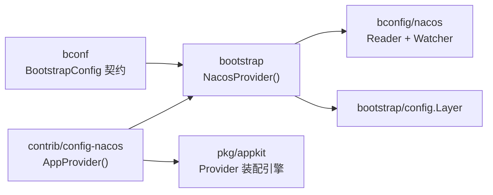
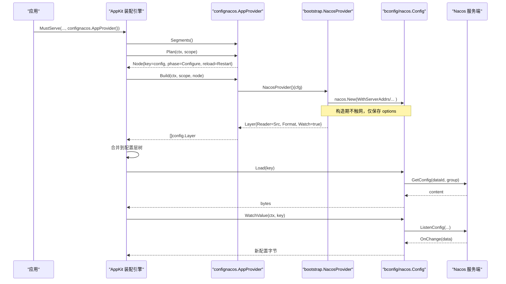
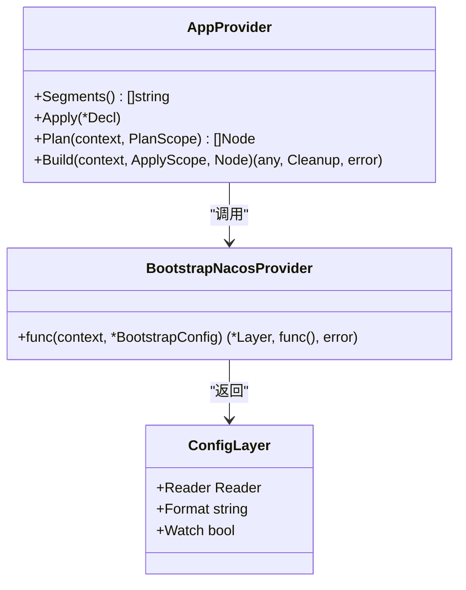
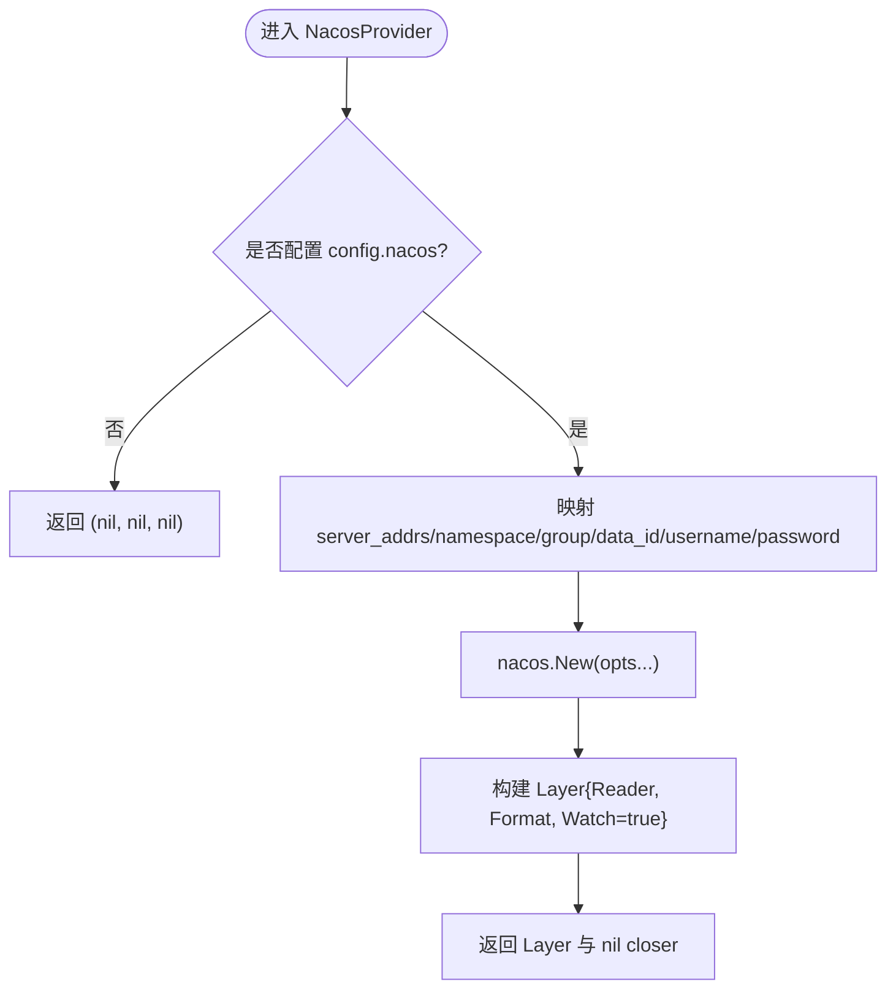
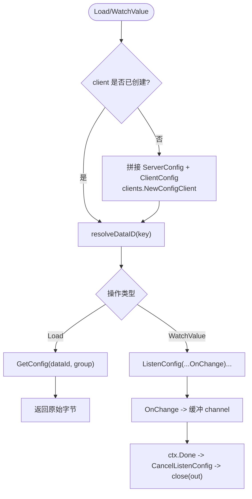
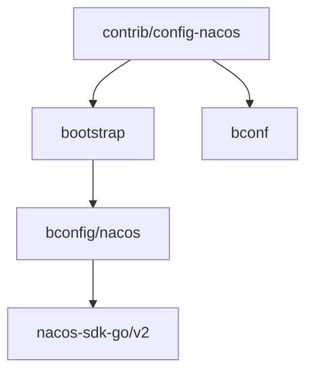

# 配置与其他扩展包

<cite>
**本文引用的文件**   
- [provider.go](file://contrib/config-nacos/provider.go)
- [provider_test.go](file://contrib/config-nacos/provider_test.go)
- [go.mod](file://contrib/config-nacos/go.mod)
- [config.go](file://bconfig/nacos/config.go)
- [options.go](file://bconfig/nacos/options.go)
- [config_test.go](file://bconfig/nacos/config_test.go)
- [nacos.go](file://bootstrap/nacos.go)
- [providers_remote_test.go](file://bootstrap/providers_remote_test.go)
- [bootstrap.go](file://bconf/bootstrap.go)
- [Bald 配置契约设计.md](file://docs/devel/zh-CN/Bald 配置契约设计.md)
- [provider.go](file://pkg/appkit/provider.go)
- [list-modules.sh](file://scripts/list-modules.sh)
</cite>

## 目录
1. [引言](#引言)
2. [项目结构](#项目结构)
3. [核心组件](#核心组件)
4. [架构总览](#架构总览)
5. [详细组件分析](#详细组件分析)
6. [依赖分析](#依赖分析)
7. [性能与可靠性考虑](#性能与可靠性考虑)
8. [故障排查指南](#故障排查指南)
9. [扩展包开发规范与模板](#扩展包开发规范与模板)
10. [发布、版本兼容性与向后兼容保证](#发布版本兼容性与向后兼容保证)
11. [结论](#结论)

## 引言
本仓库是一个由 93 个 `go.mod` 组成的多模块 Go 工程，没有 `go.work`。扩展包通过相对 `replace` 拼成可编译闭包；`scripts/list-modules.sh` 是 CI 与本地任务共同消费的唯一模块清单（排除 `_example/bald`）。本文聚焦“配置与其他扩展包”，以 `contrib/config-nacos` 为主线，说明它如何把 Nacos 配置中心接入 Bald 框架的配置系统，并总结其他扩展包的类型、Provider 集成方式、生命周期、测试与发布规范。

## 项目结构
围绕配置系统的代码分布在四层：

| 层次 | 职责 | 关键路径 |
|---|---|---|
| 契约层 `bconf` | 用 Protobuf 声明 `BootstrapConfig`，提供默认值、合并、校验与 flag 绑定 | [bootstrap.go](file://bconf/bootstrap.go) |
| 源层 `bconfig/*` | 实现 `Reader` / `ValueWatcher` / `Decoder` 等配置源后端 | [config.go](file://bconfig/nacos/config.go)、[options.go](file://bconfig/nacos/options.go) |
| 装配桥接 `bootstrap/*` | 把契约字段映射为具体源，返回带 `Watch`、`Format` 的 `Layer` | [nacos.go](file://bootstrap/nacos.go) |
| 段驱动扩展 `contrib/config-nacos` | 暴露 `appkit.Provider`，把 `config.nacos` 接入 AppKit 计划 | [provider.go](file://contrib/config-nacos/provider.go) |



**图示来源**
- [provider.go:1-59](file://contrib/config-nacos/provider.go#L1-L59)
- [nacos.go:1-56](file://bootstrap/nacos.go#L1-L56)
- [config.go:1-160](file://bconfig/nacos/config.go#L1-L160)
- [bootstrap.go:1-200](file://bconf/bootstrap.go#L1-L200)

**章节来源**
- [list-modules.sh:1-24](file://scripts/list-modules.sh#L1-L24)
- [Bald 配置契约设计.md:1-179](file://docs/devel/zh-CN/Bald 配置契约设计.md#L1-L179)

## 核心组件
本节只列出与配置扩展直接相关的核心对象，不展开业务领域组件。

| 组件 | 位置 | 作用 | 重要语义 |
|---|---|---|---|
| `confignacos.AppProvider` | `contrib/config-nacos/provider.go` | 注册 `config` 段的 Provider | Plan 节点 Key=`config`、Phase=`Configure`、Reload=`Restart` |
| `bootstrap.NacosProvider` | `bootstrap/nacos.go` | 契约字段 → `nacos.New` 选项 → `config.Layer` | 未配置时返回 `(nil, nil, nil)`；`Watch=true`；`Format` 透传 |
| `bconfig/nacos.Config` | `bconfig/nacos/config.go` | Nacos 配置源实现 | 支持 `Load` 与 `WatchValue`；自建模式惰性建连 |
| `bconfig/nacos.Option` | `bconfig/nacos/options.go` | 连接参数构造器 | `serverAddrs`、`namespace`、`group`、`dataID`、`username`、`password` |
| `appkit.Provider` | `pkg/appkit/provider.go` | 段驱动的 Provider 抽象 | Plan 纯函数、Build 唯一副作用入口、Cleanup 停机钩子 |

**章节来源**
- [provider.go:1-59](file://contrib/config-nacos/provider.go#L1-L59)
- [nacos.go:1-56](file://bootstrap/nacos.go#L1-L56)
- [config.go:1-160](file://bconfig/nacos/config.go#L1-L160)
- [options.go:1-56](file://bconfig/nacos/options.go#L1-L56)
- [provider.go:5-120](file://pkg/appkit/provider.go#L5-L120)

## 架构总览
Nacos 配置在 Bald 中的装配链是“契约 → 适配桥 → 源实现 → 层合并”。



**图示来源**
- [provider.go:24-59](file://contrib/config-nacos/provider.go#L24-L59)
- [nacos.go:21-56](file://bootstrap/nacos.go#L21-L56)
- [config.go:45-160](file://bconfig/nacos/config.go#L45-L160)

## 详细组件分析

### 1. `contrib/config-nacos`：契约装配 Provider
该包只做“契约映射”：把 `bootstrapv1.Config_Nacos` 字段交给 `bootstrap.NacosProvider()`，再把返回的 `Layer` 包装成 `[]config.Layer` 供 AppKit 配置管线使用。包注释明确写出拆分原因——`bootstrap` 与 `bconfig` 都被 `appkit` 依赖，若把需要 `appkit` 的 Provider 放回任一者会形成模块环。

关键点：
- `Segments()` 返回 `["config"]`，表示消费顶层 `config` 段。
- `Plan()` 返回一个节点：Key=`config`，Phase=`PhaseConfigure`，Reload=`ReloadRestart`。这意味着换源必须重启进程，远端层在构造期已订阅，不能原地替换。
- `Build()` 调用 `bootstrap.NacosProvider()`；如果未配置则返回空层列表；如果返回了 `closer` 则包装为 `appkit.Cleanup`。
- 产物形状是 `[]baldconfig.Layer`，由 `pkg/appkit/provider.go` 对 config 段约定。



**图示来源**
- [provider.go:1-59](file://contrib/config-nacos/provider.go#L1-L59)
- [provider_test.go:1-73](file://contrib/config-nacos/provider_test.go#L1-L73)

**章节来源**
- [provider.go:1-59](file://contrib/config-nacos/provider.go#L1-L59)
- [provider_test.go:1-73](file://contrib/config-nacos/provider_test.go#L1-L73)

### 2. `bootstrap/nacos.go`：契约字段到源的映射
`NacosProvider()` 读取 `cfg.GetConfig().GetNacos()`，逐项映射到 `nacos.Option`：`server_addrs`、`namespace`、`group`、`data_id`、`username`、`password`，再传给 `nacos.New`。它还负责：
- 未配置时返回 `(nil, nil, nil)`，即跳过该源。
- 将契约 `format` 字段透传为 `Layer.Format`。
- 设置 `Layer.Watch=true`，因为 Nacos 自带推送监听。
- 由于 `nacos-sdk-go` 无显式关闭接口，cleanup 为 `nil`。



**图示来源**
- [nacos.go:12-56](file://bootstrap/nacos.go#L12-L56)

**章节来源**
- [nacos.go:1-56](file://bootstrap/nacos.go#L1-L56)
- [providers_remote_test.go:149-191](file://bootstrap/providers_remote_test.go#L149-L191)

### 3. `bconfig/nacos`：Nacos 配置源实现
该包实现 `bconfig.Reader` 与 `bconfig.ValueWatcher`，对外暴露两个构造入口：

| 构造方式 | 用途 | 责任边界 |
|---|---|---|
| `New(...Option)` | 框架契约装配路径 | 自建 `IConfigClient`，首次 `Load` 或 `WatchValue` 才惰性建连 |
| `NewWithClient(client, ...Option)` | 测试注入与外部复用 | 不拥有 client，不负责关闭 |

#### 连接与参数
- 必填项：`serverAddrs`（自建模式）、`dataID`。
- 可选项：`namespace`、`group`（默认 `DEFAULT_GROUP`）、`username`、`password`。
- 默认端口：`DefaultPort = 8848`。
- 地址解析：支持 `host:port`；端口非法时回退默认端口。

#### 拉取与热更新
- `Load(ctx, key)`：`key` 非空时覆盖默认 `dataID`，按 `group` 拉取原始内容。
- `WatchValue(ctx, key)`：注册 `ListenConfig`，变更回调中按 `DataId` 与 `Group` 过滤后推送到缓冲通道；上下文取消后反注册监听并关闭通道。



**图示来源**
- [config.go:28-160](file://bconfig/nacos/config.go#L28-L160)

**章节来源**
- [config.go:1-160](file://bconfig/nacos/config.go#L1-L160)
- [options.go:1-56](file://bconfig/nacos/options.go#L1-L56)
- [config_test.go:1-138](file://bconfig/nacos/config_test.go#L1-L138)

### 4. 与 AppKit Provider 机制的集成
`pkg/appkit/provider.go` 定义 v2 Provider 模型：`Segments`、`Plan`、`Build`。装配引擎的职责包括：
- 按精确段路径做末者胜。
- 对每个 Provider 执行一次 `Plan`，校验恰好返回一个节点。
- 按阶段、拓扑、优先级排序后逐项 `Build`。
- 收集 `Cleanup` 作为停机钩子。

config 段被归入构造期阶段，且无条件构建——即使契约里没出现 `config.nacos`，Provider 仍会被构建，只是返回空层列表。这是为了允许“配置源独立于契约段存在”。

```mermaid
classDiagram
    class Provider {
        <<interface>>
        +Segments() []string
        +Plan(ctx, PlanScope) []Node
        +Build(ctx, ApplyScope, Node) (any, Cleanup, error)
    }
    class AppProvider {
        +Segments() ["config"]
        +Plan() Node{configure, restart}
        +Build() []Layer
    }
    class Engine {
        +解析声明()
        +排序节点()
        +执行 Build()
        +管理 Cleanup()
    }

    AppProvider ..|> Provider
    Engine --> Provider : "Plan + Build"
```

**图示来源**
- [provider.go:5-120](file://pkg/appkit/provider.go#L5-L120)
- [provider.go:325-504](file://pkg/appkit/provider.go#L325-L504)

**章节来源**
- [provider.go:5-120](file://pkg/appkit/provider.go#L5-L120)
- [provider.go:325-504](file://pkg/appkit/provider.go#L325-L504)

## 依赖分析
`contrib/config-nacos` 的模块依赖体现了解耦意图：

| 依赖 | 角色 |
|---|---|
| `github.com/kalandramo/bald` | 根 module（被 replace 指向仓库根） |
| `github.com/kalandramo/bald/bootstrap` | 获取 `NacosProvider()` 与 `config.Layer` |
| `github.com/kalandramo/bald/bconf` | 获取 protobuf 生成的 `bootstrapv1` 契约 |
| `github.com/kalandramo/bald/bconfig` | 间接依赖，通过 bootstrap 引入 |

`go.mod` 中大量 `indirect` 依赖来自 `bootstrap` 和底层 SDK，而非 `config-nacos` 直接 import。包注释强调：本包只做契约映射，后端细节仍在 `bconfig/nacos`，从而避免把适配器画成根的依赖。



**图示来源**
- [go.mod:1-181](file://contrib/config-nacos/go.mod#L1-L181)
- [provider.go:13-23](file://contrib/config-nacos/provider.go#L13-L23)

**章节来源**
- [go.mod:1-181](file://contrib/config-nacos/go.mod#L1-L181)
- [provider.go:1-23](file://contrib/config-nacos/provider.go#L1-L23)

## 性能与可靠性考虑
- **惰性建连**：`bconfig/nacos.Config.init()` 只在首次 `Load` 或 `WatchValue` 时创建 `IConfigClient`，构造 Provider 本身不触网。
- **默认超时与日志级别**：客户端 `TimeoutMs=5000`、`LogLevel="warn"`，适合启动期快速失败但不刷屏。
- **热更新通道容量**：`WatchValue` 返回缓冲大小为 1 的 channel，单条变更可暂存；若消费阻塞，后续变更可能被丢弃，应确保上层及时消费。
- **无显式关闭**：`nacos-sdk-go` 无显式关闭接口，因此 `bootstrap.NacosProvider` 返回的 closer 为 `nil`，`config-nacos` 的 cleanup 也通常为 `nil`。
- **不可替换性**：Plan 标记 `ReloadRestart`，意味着运行期不能原地替换远端层；换源需重启进程。
- **模块环约束**：`contrib/config-nacos` 不直接 require 任何适配器，而是通过 `bootstrap` 间接获得能力，避免根 module 依赖适配器导致的环。

[本节为通用指导，不直接分析具体代码行]

## 故障排查指南

### 常见问题与定位

| 现象 | 可能原因 | 排查要点 |
|---|---|---|
| 启动时报“server addrs is required” | `config.nacos.server_addrs` 为空 | 检查 `bootstrap.NacosProvider` 映射后的 `nacos.WithServerAddrs` |
| 启动时报“data id is required” | `config.nacos.data_id` 为空 | 确认 Nacos 控制台 Data ID 与契约一致 |
| 拉取不到配置 | Data ID/Group/Namespace 不匹配 | 核对 `group`（默认 `DEFAULT_GROUP`）、`namespace`、`dataID` |
| 鉴权失败 | 未配置用户名密码或凭证错误 | 检查 `username`、`password` 及 Nacos 鉴权开关 |
| 热更新不生效 | 上层未消费 `WatchValue` 通道 | 确认配置层启用 `Watch=true` 且消费者及时读 channel |
| 清理泄漏 | 误以为有更细粒度资源关闭 | `nacos-sdk-go` 无显式关闭接口，行为是预期 |
| 模块编译报环 | 在根或 `bootstrap` 中直接 import 适配器 | 保持 `contrib/config-nacos` 仅做契约映射 |

**章节来源**
- [config.go:38-44](file://bconfig/nacos/config.go#L38-L44)
- [config.go:45-160](file://bconfig/nacos/config.go#L45-L160)
- [provider_test.go:28-73](file://contrib/config-nacos/provider_test.go#L28-L73)
- [providers_remote_test.go:149-191](file://bootstrap/providers_remote_test.go#L149-L191)

## 扩展包开发规范与模板

### 扩展包分类
仓库中的扩展包大致分为以下几类：
1. **配置中心适配器**：如 `contrib/config-nacos`，实现 `appkit.Provider` 把远程配置源接入 AppKit。
2. **存储后端适配器**：如 `contrib/store-gorm`、`contrib/store-mongo`。
3. **观测性适配器**：如 `contrib/observability-otlp`。
4. **认证授权适配器**：如 `contrib/authn-jwt`、`contrib/authz-casbin`。
5. **审计适配器**：如 `contrib/audit-gorm`、`contrib/audit-stream`。
6. **AI 后端实现**：如 `ai/openai`、`ai/langchaingo`、`ai/eino`。
7. **传输与中间件扩展**：位于 `transport/*`、`encoding/*`、`metrics/*`、`ratelimit/*`、`circuitbreaker/*`。

### 开发模板（以配置中心为例）
新增一个配置中心扩展包时，建议遵循以下文件布局：

| 文件 | 内容 |
|---|---|
| `provider.go` | 实现 `appkit.Provider`，声明 `Segments()`、`Plan()`、`Build()` |
| `provider_test.go` | 测试 Plan 节点属性、未配置行为、配置齐全时的 Layer 产出 |
| `go.mod` | 仅 require `bootstrap`、`bconf`、`appkit`，不直接 require 适配器 |
| `internal/impl`（可选） | 后端实现（类似 `bconfig/nacos`），实现 `Reader` / `Watcher` |

推荐的最小实现步骤：
1. 在 `bconfig/<backend>` 实现 `Reader` + `ValueWatcher`。
2. 在 `bootstrap/<backend>.go` 写 `XxxProvider()`，完成契约字段映射。
3. 在 `contrib/config-<backend>` 写 `AppProvider()`，注册 `config` 段。
4. 补充单元测试：未配置、参数校验、契约字段映射、Watch 语义。
5. 在 `scripts/list-modules.sh` 派生范围内（有独立 `go.mod`）自动纳入 CI。

**章节来源**
- [provider.go:1-59](file://contrib/config-nacos/provider.go#L1-L59)
- [provider_test.go:1-73](file://contrib/config-nacos/provider_test.go#L1-L73)
- [list-modules.sh:1-24](file://scripts/list-modules.sh#L1-L24)

### 测试规范
- **契约装配测试**：验证 `Segments`、`Plan` 的 Key/Phase/Reload，以及 `Build` 在未配置和已配置两种分支。
- **源实现测试**：使用桩实现 `IConfigClient`，覆盖 `Load`、`WatchValue`、上下文取消、默认 Group/DataID。
- **Provider 桥接测试**：在 `bootstrap/providers_remote_test.go` 中按相同模式覆盖 Unconfigured、ParameterFail、ContractMapping。
- **禁止断言随机统计量阈值**：概率式组件应构造有界前置状态再断言，而非直接断言并发下的放行比例。

**章节来源**
- [provider_test.go:1-73](file://contrib/config-nacos/provider_test.go#L1-L73)
- [config_test.go:1-138](file://bconfig/nacos/config_test.go#L1-L138)
- [providers_remote_test.go:149-191](file://bootstrap/providers_remote_test.go#L149-L191)

### 文档标准
- 包注释应说明：契约段名、Provider 行为、与 `bootstrap` 的关系、是否参与热更新。
- 公开 API 应附带使用示例，例如 `appkit.MustServe(ctx, std.Standard(), confignacos.AppProvider())`。
- 对已知限制要如实声明：例如 Nacos 源无法原地替换、SDK 无显式关闭接口。
- 契约相关文档参考 `docs/devel/zh-CN/Bald 配置契约设计.md`，强调 proto 是单一真相源。

**章节来源**
- [provider.go:1-23](file://contrib/config-nacos/provider.go#L1-L23)
- [Bald 配置契约设计.md:1-179](file://docs/devel/zh-CN/Bald 配置契约设计.md#L1-L179)

## 发布、版本兼容性与向后兼容保证

### 模块与清单
- 仓库是 93 个 `go.mod` 的多模块仓库，无 `go.work`。
- `scripts/list-modules.sh` 是唯一模块清单派生点，CI 与 Taskfile 都消费它；不要按“一个 module”叙事。
- `contrib/config-nacos` 是独立 module，通过相对 `replace` 指向仓库内对应目录。

### 版本策略
- `contrib/config-nacos/go.mod` 当前 pin 到 `github.com/kalandramo/bald v0.34.1` 及其子模块版本，表明扩展包与框架版本耦合发布。
- 根模块与子模块之间靠相对 `replace` 组成可编译闭包；正式发布时由发布流程解 replace 并发布到远端索引。

### 向后兼容保证
- **契约稳定**：`bconf` 用 Protobuf 描述 BootstrapConfig，新增字段优先用 optional 子消息或保留旧字段号迁移，避免静默失效。
- **Provider 接口稳定**：`appkit.Provider` 的 `Segments`/`Plan`/`Build` 是扩展点，新增 Provider 不应破坏既有语义。
- **配置合并语义**：`UnmarshalMap` 对 repeated 字段采用替换语义，由 `clearPresentLists` 保证；新增配置项需同时维护默认值与校验。
- **键名容错边界**：未知键名经 `DiscardUnknown` 静默落默认值，但已知键的类型错误、取值越域、枚举名非法会在启动期报错。
- **禁用模式**：不要在 GitHub workflow services 中写 `args`，应改用同名环境变量；不在根 module 中 require 适配器；不对概率组件做无界统计断言。

**章节来源**
- [list-modules.sh:1-24](file://scripts/list-modules.sh#L1-L24)
- [go.mod:1-181](file://contrib/config-nacos/go.mod#L1-L181)
- [bootstrap.go:1-200](file://bconf/bootstrap.go#L1-L200)
- [Bald 配置契约设计.md:1-179](file://docs/devel/zh-CN/Bald 配置契约设计.md#L1-L179)

## 结论
`contrib/config-nacos` 是 Bald 扩展包体系的一个典型样本：它不直接持有 Nacos SDK，也不直接依赖适配器生态，而是通过 `bootstrap.NacosProvider` 把契约字段映射为 `bconfig/nacos.Config`，再由 AppKit 的 Provider 装配机制把它作为 `config` 段注入配置层。其核心价值在于三点：

1. **解耦契约与实现**：`bconf` 管形状，`bconfig` 管源，`bootstrap` 管映射，`contrib/config-nacos` 管段装配。
2. **可插拔生命周期**：通过 `appkit.Provider` 的 Plan/Build/Cleanup 统一控制构造时机、热更新策略与停机清理。
3. **可测试的扩展点**：每个后端都有独立的 `Reader`/`Watcher` 测试与 Provider 装配测试，便于新增 Apollo、Consul、Etcd、Vault、Kubernetes 等同构扩展。

新增扩展包时，应优先判断它属于配置源、存储后端、观测性还是协议传输，然后按现有 `contrib` 或 `bconfig` 模式落地，并保持契约先行、测试兜底、清单派生的纪律。

[本节为总结性内容，不直接分析具体代码行]