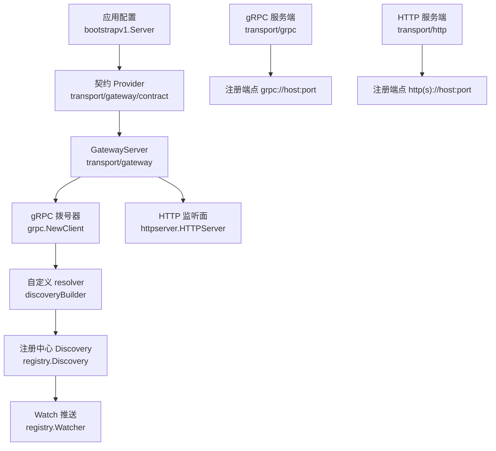
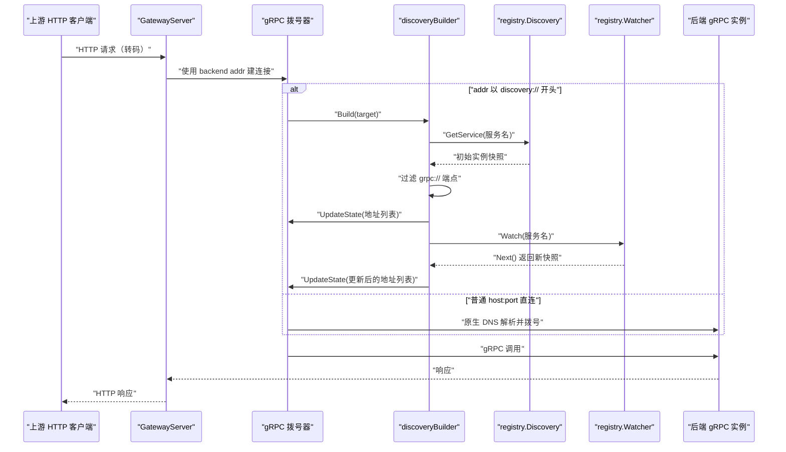
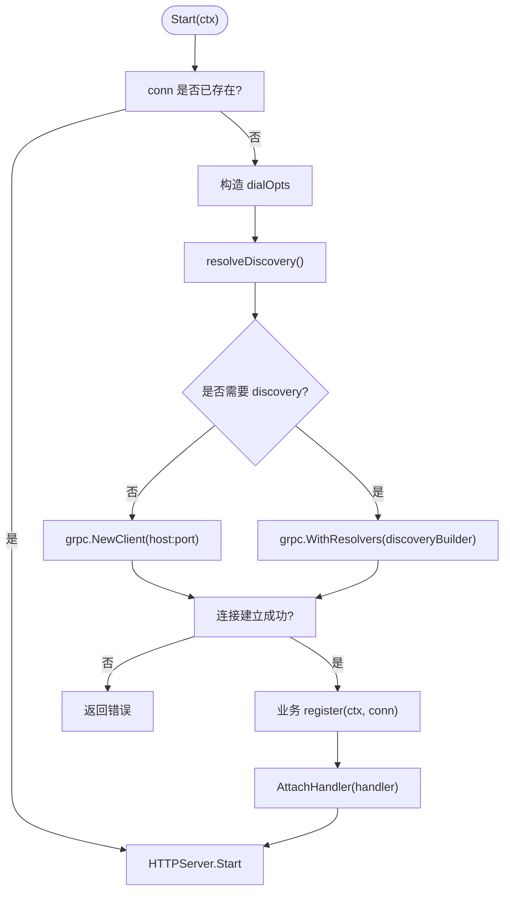
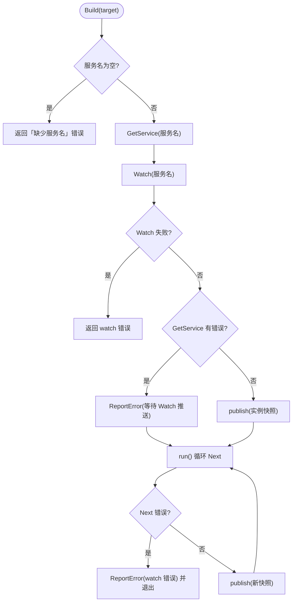
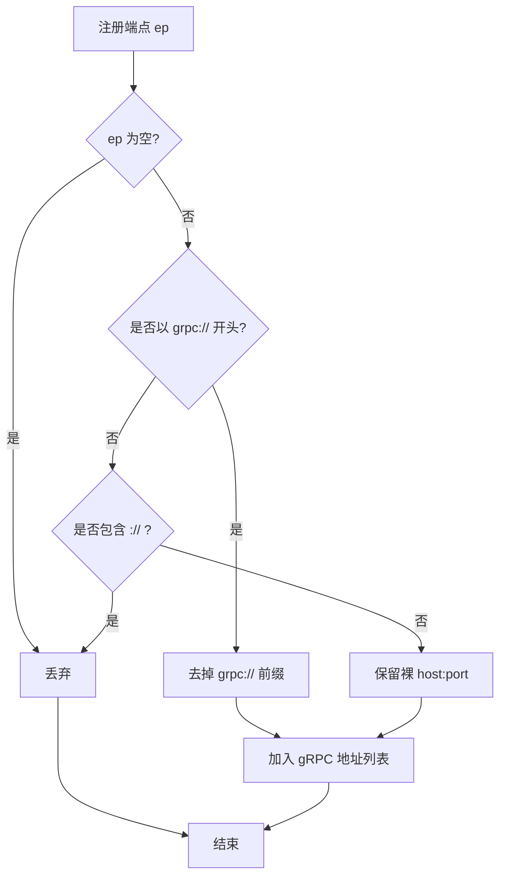
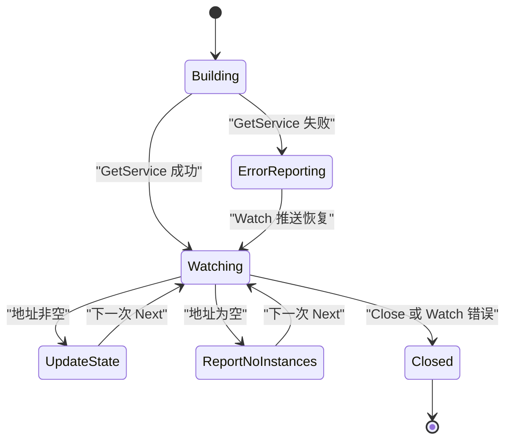
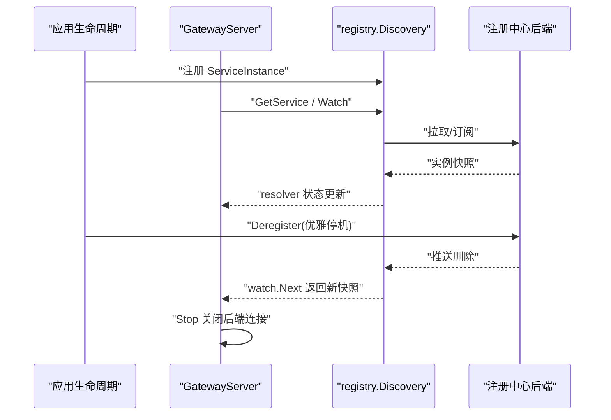
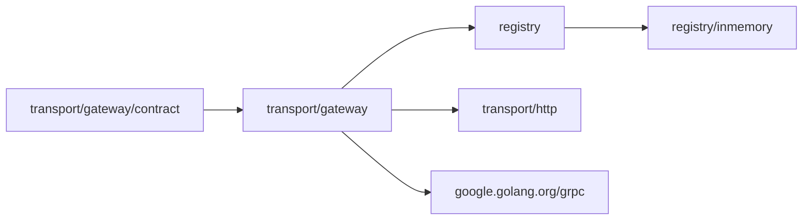

# Gateway 出站路由与服务发现集成

<cite>
**本文引用的文件**   
- [gateway_server.go](file://transport/gateway/gateway_server.go)
- [discovery.go](file://transport/gateway/discovery.go)
- [contract.go](file://transport/gateway/contract/contract.go)
- [discovery_test.go](file://transport/gateway/discovery_test.go)
- [registry.go](file://registry/registry.go)
- [inmemory.go](file://registry/inmemory/inmemory.go)
- [grpc_server.go](file://transport/grpc/grpc_server.go)
- [http_server.go](file://transport/http/http_server.go)
- [list-modules.sh](file://scripts/list-modules.sh)
</cite>

## 目录
1. [引言](#引言)
2. [项目结构](#项目结构)
3. [核心组件](#核心组件)
4. [架构总览](#架构总览)
5. [详细组件分析](#详细组件分析)
6. [依赖关系分析](#依赖关系分析)
7. [性能与容量规划](#性能与容量规划)
8. [故障排查指南](#故障排查指南)
9. [验证范围与发布状态](#验证范围与发布状态)
10. [结论](#结论)

## 引言
本文聚焦 Bald 框架中 `transport/gateway` 的出站路由与服务发现集成，解释它如何把上游 HTTP 请求转码为 gRPC 调用并转发到下游服务实例。文档覆盖三个主题：

- **服务发现与网关出站**：`discovery:///<服务名>` 目标如何解析、过滤端点、建立连接、处理 Watch 增量；直连模式与注册中心模式的切换条件与行为差异。
- **CI 质量闸门**：五个作业的职责、短测与集成测试边界、GitHub Actions 注入真后端的约束。
- **Broker 订阅者生命周期**：致命退出后 `SubscriberSyncMap` 条目清理责任与观测口径。

此外，本文给出配置示例模板、常见故障定位路径，以及连接池、TTL 与并发限制方面的调优建议。

## 项目结构
Gateway 相关代码集中在 `transport/gateway`，契约装配单独放在同包的 `contract` 子包，避免核心传输层直接依赖 grpc-gateway。服务发现抽象位于 `registry`，内存实现位于 `registry/inmemory`。后端服务通过 `transport/grpc` 和 `transport/http` 暴露带 scheme 的 `Endpoint()`，供注册中心统一注册。

**图表来源**
- [contract.go:1-94](file://transport/gateway/contract/contract.go#L1-L94)
- [gateway_server.go:1-204](file://transport/gateway/gateway_server.go#L1-L204)
- [discovery.go:1-174](file://transport/gateway/discovery.go#L1-L174)
- [registry.go:1-81](file://registry/registry.go#L1-L81)
- [grpc_server.go:131-147](file://transport/grpc/grpc_server.go#L131-L147)
- [http_server.go:101-120](file://transport/http/http_server.go#L101-L120)

**章节来源**
- [contract.go:1-94](file://transport/gateway/contract/contract.go#L1-L94)
- [gateway_server.go:1-204](file://transport/gateway/gateway_server.go#L1-L204)
- [discovery.go:1-174](file://transport/gateway/discovery.go#L1-L174)
- [registry.go:1-81](file://registry/registry.go#L1-L81)

## 核心组件
- **GatewayServer**：承载 HTTP 转码面，延迟建立到后端 gRPC 的连接，支持直连地址或 `discovery://` 目标。
- **discoveryBuilder / discoveryResolver**：把 `registry.Discovery` 适配成 gRPC 的 resolver，负责拉取快照、过滤 `grpc://` 端点、推送 `UpdateState`、处理 Watch 增量。
- **Registry 契约**：`Registrar`、`Discovery`、`Watcher` 三件套，屏蔽 etcd、consul、nacos、kubernetes 等后端差异。
- **内存实现**：`registry/inmemory` 提供线程安全快照与按服务名订阅，用于开发和本地调试。

关键职责划分：
- `transport/gateway` 不 import 具体后端适配器，只消费 `registry.Discovery`。
- `transport/gateway/contract` 是契约装配入口，负责把 `bootstrapv1.Server.gateway` 段转换成 `GatewayServer`。
- `transport/grpc` 和 `transport/http` 在启动后暴露带 scheme 的端点，由注册中心聚合。

**章节来源**
- [gateway_server.go:1-100](file://transport/gateway/gateway_server.go#L1-L100)
- [discovery.go:1-60](file://transport/gateway/discovery.go#L1-L60)
- [registry.go:1-81](file://registry/registry.go#L1-L81)
- [inmemory.go:1-60](file://registry/inmemory/inmemory.go#L1-L60)

## 架构总览
Gateway 的出站流程可以拆成三个阶段：**目标解析 → 连接建立 → Watch 推进**。

**图表来源**
- [gateway_server.go:115-180](file://transport/gateway/gateway_server.go#L115-L180)
- [discovery.go:57-174](file://transport/gateway/discovery.go#L57-L174)

### 三种 target 语义
Gateway 对后端地址采用「字符串表达语义」：

| target 写法 | 解析方式 | 行为说明 |
|---|---|---|
| `host:port` | gRPC 原生 dns resolver | 默认直连，不受注入 Discovery 影响 |
| `discovery:///<服务名>` | `discoveryBuilder` | 从注册中心拉快照、过滤 `grpc://`、`UpdateState` |
| 其他含 scheme 的地址 | 非 `discovery://` 前缀时仍走原生解析 | 若 scheme 不是 gRPC 原生支持的 scheme，会失败；不应用来伪装注册中心目标 |

**章节来源**
- [discovery.go:14-34](file://transport/gateway/discovery.go#L14-L34)
- [discovery_test.go:400-424](file://transport/gateway/discovery_test.go#L400-L424)

## 详细组件分析

### GatewayServer：出站转发与生命周期
GatewayServer 封装了 HTTP 监听面和到后端 gRPC 的连接。构造期不建立连接，`Start` 时才读取真实 `backend.addr`，从而允许环境变量或命令行 flag 覆盖默认值。

关键点：
- `dialOpts` 根据 `Server_Grpc.tls` 选择明文或 TLS 凭据。
- `resolveDiscovery` 决定本次拨号是否注册自定义 resolver：显式注入 Discovery 优先；否则仅当 `backend.addr` 以 `discovery://` 开头才尝试从 `discoverySource` 获取。
- `Start` 先构建连接和 handler，再交给底层 HTTPServer 阻塞运行；`Stop` 关闭后端连接并调用 HTTPServer 的优雅停机。
- 多实例负载均衡策略由 gRPC 默认 balancer 决定；当前注释明确为 `pick_first`，即主备故障转移，不是流量分摊。

**图表来源**
- [gateway_server.go:100-180](file://transport/gateway/gateway_server.go#L100-L180)

**章节来源**
- [gateway_server.go:1-100](file://transport/gateway/gateway_server.go#L1-L100)
- [gateway_server.go:100-204](file://transport/gateway/gateway_server.go#L100-L204)

### discovery:// 解析流程
`discoveryBuilder.Build` 是服务发现解析的核心入口。它同步做一次 `GetService`，并立即启动 `Watch`。两条路径：

1. **GetService 成功**：调用 `publish`，把实例端点映射为 gRPC 地址列表；空列表不调用 `UpdateState`，改为 `ReportError`。
2. **GetService 失败**：同样不上报地址，而是 `ReportError` 并继续等待 Watch 推送恢复。

**图表来源**
- [discovery.go:57-174](file://transport/gateway/discovery.go#L57-L174)

#### 端点过滤与 scheme 处理
注册中心的端点通常带 scheme：`transport/grpc` 注册 `grpc://host:port`，`transport/http` 注册 `http(s)://host:port`。gRPC 拨号器只接受裸 `host:port`，因此 `grpcAddressOf` 只保留以 `grpc://` 开头的端点并去掉 scheme，丢弃其他 scheme 的端点。

这意味着：
- 同一实例同时暴露 HTTP 和 gRPC 面时，只有 gRPC 面进入拨号地址列表。
- 如果某个实例所有端点都不是 gRPC 面，该实例整体出局，不会让 gRPC 去试错一个必然失败的地址。
- 第三方注册中心里手写裸 `host:port` 的端点仍可被使用。

**图表来源**
- [discovery.go:120-174](file://transport/gateway/discovery.go#L120-L174)

**章节来源**
- [discovery.go:14-174](file://transport/gateway/discovery.go#L14-L174)
- [discovery_test.go:201-251](file://transport/gateway/discovery_test.go#L201-L251)

### 注册中心快照与 Watch 语义
- **初始快照**：`Build` 立刻拉一次 `GetService`。即使快照报错，也不返回 `Build` 错误，而是上报原因并保持订阅，等待 Watch 推送恢复。这是为了兼容 nacos 在“服务未注册”场景下 `GetService` 直接报错的行为。
- **空快照**：不推 `UpdateState`，因为 gRPC 对空地址集会返回 `ErrBadResolverState` 并清掉已有健康地址。此时应 `ReportError("no instances")`，保持订阅。
- **增量更新**：`run` 循环消费 `Watch.Next`，每次拿到全量快照后重新 `publish`。
- **Close 语义**：`Close` 取消上下文并停止 watcher；`run` 检测到 closed 后不再上报错误，避免把优雅停机误判为故障。

**图表来源**
- [discovery.go:57-174](file://transport/gateway/discovery.go#L57-L174)
- [discovery_test.go:181-251](file://transport/gateway/discovery_test.go#L181-L251)

**章节来源**
- [discovery.go:57-174](file://transport/gateway/discovery.go#L57-L174)
- [discovery_test.go:181-251](file://transport/gateway/discovery_test.go#L181-L251)

### 直连模式与注册中心模式对比
| 维度 | 直连 `host:port` | 注册中心 `discovery:///<服务名>` |
|---|---|---|
| 解析方 | gRPC 原生 dns resolver | `discoveryBuilder` |
| 是否需要 `WithDiscovery` | 不需要 | 需要显式注入或可派生的 `discoverySource` |
| 地址来源 | 配置字段 | 注册中心快照 + Watch |
| 多实例行为 | 取决于后端 DNS 结果 | gRPC 默认 `pick_first`，主备故障转移 |
| 端点过滤 | 无 | 只取 `grpc://`，剥前缀，丢弃其他 scheme |
| 启动期无实例 | 直接拨号失败 | 上报错误但保持订阅，实例上线后自动生效 |
| 优雅下线 | 依赖后端连接关闭 | Watch 推送删除实例，连接池逐步失效 |

**章节来源**
- [discovery.go:14-34](file://transport/gateway/discovery.go#L14-L34)
- [gateway_server.go:115-180](file://transport/gateway/gateway_server.go#L115-L180)
- [discovery_test.go:400-424](file://transport/gateway/discovery_test.go#L400-L424)

### 与 Registry 的生命周期绑定
Gateway 本身不持有注册中心连接，而是持有 `registry.Discovery`。真正与后端 SDK 绑定的生命周期属于各 registry 后端实现；Gateway 只消费其接口。

- `NewGatewayServer` 接收 `WithDiscovery` 或 `WithDiscoverySource`。
- `Start` 在连接建立前决定是否需要自定义 resolver。
- `Stop` 关闭后端 gRPC 连接，但不直接操作注册中心；注销由调用方在应用优雅停机时调用 `Registrar.Deregister` 完成。
- 内存实现的 `Watcher.Stop` 会移除订阅并关闭通道，`Next` 返回特定闭错误，供调用方判断退出。

**图表来源**
- [gateway_server.go:115-204](file://transport/gateway/gateway_server.go#L115-L204)
- [registry.go:1-81](file://registry/registry.go#L1-L81)
- [inmemory.go:60-169](file://registry/inmemory/inmemory.go#L60-L169)

**章节来源**
- [gateway_server.go:115-204](file://transport/gateway/gateway_server.go#L115-L204)
- [registry.go:1-81](file://registry/registry.go#L1-L81)
- [inmemory.go:60-169](file://registry/inmemory/inmemory.go#L60-L169)

## 依赖关系分析
Gateway 模块依赖关系遵循「契约层不 import 具体后端」原则：

- `transport/gateway` 不 import `registry/etcd`、`registry/consul`、`registry/nacos`、`registry/kubernetes`。
- `transport/gateway/contract` 是唯一引入 `bconf` 和 `transport/gateway` 的契约装配入口。
- 根 module 不得 require 任何适配器，避免模块环。

**图表来源**
- [contract.go:1-94](file://transport/gateway/contract/contract.go#L1-L94)
- [gateway_server.go:1-40](file://transport/gateway/gateway_server.go#L1-L40)
- [registry.go:1-20](file://registry/registry.go#L1-L20)

**章节来源**
- [contract.go:1-94](file://transport/gateway/contract/contract.go#L1-L94)
- [gateway_server.go:1-40](file://transport/gateway/gateway_server.go#L1-L40)

## 性能与容量规划

### 连接池与负载均衡
- Gateway 到后端 gRPC 的连接由 `grpc.NewClient` 管理，内部维护连接池。
- 当前 Gateway 注释明确：多实例由 gRPC 默认 balancer `pick_first` 处理，属于主备故障转移，不是负载均衡。
- 如需多副本分摊流量，应在拨号侧另配 round_robin 服务配置，而不是期望 Gateway 自行分流。

### 缓存与 TTL
- 本仓库的 `cache/local`、`cache/redis` 提供通用缓存抽象，但 Gateway 的 discovery 解析不走 `cache/loadable`，而是直接消费 `registry.Discovery`。
- 缓存 TTL 优化应落在 registry 后端或上层缓存层，而非 Gateway resolver 内部；resolver 的职责是尽量实时反映 Watch 推送。

### 并发与资源
- `discoveryResolver.run` 是单 goroutine 消费 Watch；每次 `Next` 后重新构造地址列表并 `UpdateState`。
- 大量实例频繁上下线会导致多次 `UpdateState`，可能引发 gRPC 连接重建抖动。应结合注册中心限流、实例滚动发布策略控制变更频率。

### 配置示例模板
以下示例为配置字段模板，实际键名与嵌套层级应以项目使用的 `bootstrapv1.Server` 配置为准：

- **网关监听端口**
  - `server.gateway.addr`: 网关 HTTP 监听地址，例如 `0.0.0.0:8080`。
  - `server.gateway.tls.enabled`: 是否启用 TLS。
- **下游服务列表**
  - `server.gateway.backend_grpc_addr`: 后端 gRPC 地址。
    - 直连模式：`host:port`。
    - 注册中心模式：`discovery:///<服务名>`。
- **重试策略**
  - 由 gRPC 客户端选项配置，不在 Gateway 内硬编码；可通过 `WithDiscovery` 注入 Discovery 后，在更上层组装 `grpc.DialOption`。
- **超时配置**
  - 由 gRPC 客户端选项配置，例如上下文超时、调用超时、连接超时等。
- **TLS 配置**
  - `server.gateway.backend_grpc_addr` 对应的 TLS 由 `Server_Grpc.tls` 决定；Gateway 复用相同配置判断明文或 TLS。

部署注意事项：
- 如果使用 nacos，服务名必须带 scheme 后缀，例如 `discovery:///<服务名>.grpc`，否则解析到的通常是 HTTP 面或空集。
- 内存与 etcd 使用注册时填写的 `ServiceInstance.Name` 原样作为服务名。

**章节来源**
- [gateway_server.go:1-60](file://transport/gateway/gateway_server.go#L1-L60)
- [discovery.go:14-34](file://transport/gateway/discovery.go#L14-L34)

## 故障排查指南

### 目标解析为空
**现象**：`discovery:///<服务名>` 没有产生地址，连接不进入 Ready。  
**可能原因**：
- 服务尚未注册。
- 服务名写错。
- nacos 忘记 `.grpc` 后缀，解析到 HTTP 面或空集。
- 注册中心返回空集且 Watch 未推送。

**定位步骤**：
1. 检查 `discovery:///<服务名>` 中的服务名是否与注册中心一致。
2. 确认 `registry.Discovery.GetService` 返回的实例数量。
3. 检查 `discoveryResolver.publish` 是否因空地址集合调用了 `ReportError`。
4. 观察 Watch 是否持续推送；若首次快照失败，应依赖 Watch 恢复。

**章节来源**
- [discovery.go:57-90](file://transport/gateway/discovery.go#L57-L90)
- [discovery_test.go:181-251](file://transport/gateway/discovery_test.go#L181-L251)

### 端点 scheme 不匹配
**现象**：注册中心有实例，但 gRPC 连接无法建立，日志出现 unsupported scheme 或始终不 Ready。  
**可能原因**：
- 实例端点是 `http://host:port`，被 `grpcAddressOf` 丢弃。
- 多个端点混在一起，gRPC 拨号器只吃 `grpc://`。

**定位步骤**：
1. 查看 `ServiceInstance.Endpoints`。
2. 确认至少有一个端点以 `grpc://` 开头。
3. 检查 `addressesOf` 过滤后的地址列表。
4. 如果是多面实例，确保 gRPC 面排在可用位置；虽然 `pick_first` 是主备，但非 gRPC 端点会被提前丢弃。

**章节来源**
- [discovery.go:120-174](file://transport/gateway/discovery.go#L120-L174)
- [discovery_test.go:201-251](file://transport/gateway/discovery_test.go#L201-L251)
- [grpc_server.go:131-147](file://transport/grpc/grpc_server.go#L131-L147)
- [http_server.go:101-120](file://transport/http/http_server.go#L101-L120)

### Watch 未推进
**现象**：初始快照正常，之后实例变化不生效；或进程退出时反复上报错误。  
**可能原因**：
- registry 后端 Watch 阻塞但未推送。
- `Close` 后 `Next` 返回错误，被误判为故障。
- Watch 建立失败导致 `Build` 直接返回错误。

**定位步骤**：
1. 区分 `Build` 阶段 Watch 失败与 `run` 阶段 Watch 错误。
2. 检查 `discoveryResolver.Close` 是否已调用。
3. 对于内存实现，确认 `Watcher.Stop` 后 `Next` 返回闭错误，不应上报给 `ClientConn`。
4. 若 Watch 一直阻塞，需检查 registry 后端是否存活、网络是否可达。

**章节来源**
- [discovery.go:90-174](file://transport/gateway/discovery.go#L90-L174)
- [discovery_test.go:333-400](file://transport/gateway/discovery_test.go#L333-L400)
- [inmemory.go:120-169](file://registry/inmemory/inmemory.go#L120-L169)

### 下游实例频繁上下线导致连接抖动
**现象**：连接状态在 READY 与 TRANSIENT_FAILURE 之间波动。  
**可能原因**：
- 实例滚动发布或扩缩容频繁。
- 注册中心推送过密，每次快照都触发 `UpdateState`。
- gRPC 默认 balancer 主备切换。

**缓解建议**：
- 控制注册中心变更频率，使用滚动发布和就绪探针。
- 在上层增加熔断、重试退避、连接池复用。
- 如需要稳定流量分发，考虑在拨号侧配置 round_robin，而不是依赖 Gateway 自身分流。

**章节来源**
- [gateway_server.go:25-60](file://transport/gateway/gateway_server.go#L25-L60)
- [discovery.go:90-120](file://transport/gateway/discovery.go#L90-L120)

## 验证范围与发布状态

本页前面描述的是**检出态行为**。这一节把「代码已实现」与「已被执行过」分开，避免按本页写生产配置时踩到没有证据的路径。

### 判据分别在哪一层被执行

| 判据面 | 用例 | 真实执行环境 |
|---|---|---|
| resolver 语义：初始快照、Watch 推进、空集只上报不推 `UpdateState`、端点 scheme 归一、目标必须带服务名、`Build` 的两类错误、快照失败后靠 Watch 恢复、`Close` 不误报 | `transport/gateway` 的 `TestDiscoveryResolver*`、`TestCloseDoesNotReportError`、`TestPublishFailureIsReported` | CI `test` 与 `race` 作业（内存注册中心 + 真 gRPC 服务端，不需要外部进程） |
| 端到端拨号、注入优先级（显式实例 > 延迟来源 > 无来源即 `Start` 失败）、直连地址不受注入影响 | `TestDiscoveryTargetResolvesAndConnects`、`TestPlainAddressUnaffectedByInjectedDiscovery`、`TestDeadEndpointDoesNotConnect`、`TestGatewayServer*` 八条 | 同上 |
| 装配侧按作用域派生来源、无来源时 fail-fast、转码面不派生 | `transport/gateway/contract` 的六条 `TestAppProvider*` 与 `TestHTTPProviderDoesNotAutoDeriveDiscovery` | 同上 |
| 真注册中心端到端：etcd 一轮、nacos 一轮，外加「nacos 服务名必须带 `.grpc`」这条命名事实 | `_example/bald` 的 `TestGatewayDiscoveryEtcdWatchPush`、`TestGatewayDiscoveryNacosWatchPush`、`TestNacosDiscoveryNameCarriesSchemeSuffix` | **不在 CI**：三条都经 `etcdDiscovery`/`nacosDiscovery` 前置，`testing.Short()` 跳过且地址不可达即 `t.Skip`；而 `_example*` 本身就不进 `scripts/list-modules.sh` 派生的模块清单。执行入口是本地 `task example-e2e`（不带 `-short`），地址用 `BALD_E2E_ETCD_ADDR` / `BALD_E2E_NACOS_ADDR` 覆盖 |
| 内存注册中心下的网关转码一轮 | `TestGatewayBackendViaDiscovery`（默认构建） | 同样不在 CI：模块不在清单里，本地由 `task example-e2e` 跑 |
| 真 etcd 被注入跑注册中心套件 | `registry/etcd` 套件 | CI `integration` 作业点名 `registry/etcd`、`contrib/store-mongo`、`transport/asynq` 三个 module——**不含 `transport/gateway`** |

也就是说：`discovery:///` 的解析语义与装配派生有 CI 证据；「网关转码 → 注册中心解析 → 真后端」这条完整链路只有本地 opt-in 证据。

### 三条刻意不做的边界

- `HTTPProvider`（转码面接管 `server.http`）**不派生来源**：它的上游是本进程 gRPC 面自己的绑定地址，填 `discovery:///` 属配置错误，由 `TestHTTPProviderDoesNotAutoDeriveDiscovery` 钉住。
- 裸工厂 `contract.Provider` **不自动派生**：它没有装配作用域，看不到 scope，用它的人显式传 `gateway.WithDiscovery`。
- **来源只在 `Start` 取一次**，不做「注册中心被换掉后重取」：resolver 的生命周期跟 `ClientConn` 而不是跟装配，`Start` 之后再换注册中心实例，已建连接仍指向旧实例。现契约下这条路是闭合的——registry 段既没有 `ReloadReconcile` 也没有 reconciler（reconciler 只由 domain 节点与组件注册），热更新真重建的只有 logger 段，所以换注册中心本来就要重启进程。

### 发布状态（外部消费者必读）

`discovery:///<服务名>` 目前**不在任何已发布的模块 tag 里**：`transport/gateway` 的最新 tag `v0.4.2` 早于带来该能力的两个提交。外部消费方现在只能把依赖 `replace` 到仓库检出后使用，按版本号拉取要等下一批 tag 发布。

**章节来源**
- [discovery_test.go](file://transport/gateway/discovery_test.go)
- [contract/discovery_test.go](file://transport/gateway/contract/discovery_test.go)
- [discovery_registry_e2e_test.go](file://_example/bald/internal/bootstrap/discovery_registry_e2e_test.go)
- [ci.yml](file://.github/workflows/ci.yml)
- [list-modules.sh](file://scripts/list-modules.sh)
- [Taskfile.yml](file://Taskfile.yml)

## 结论
Gateway 的出站路由以「配置驱动地址语义」为核心：普通 `host:port` 直连，`discovery:///<服务名>` 走注册中心。解析流程严格遵循三条既定语义：`Build` 返回错误时 gRPC 不重试、空快照不推 `UpdateState`、只取 `grpc://` 端点。与 registry 的生命周期解耦于 Gateway 本身，Gateway 只消费 `Discovery` 接口，并在 `Stop` 时关闭后端连接。

在生产部署中，应重点校验服务名、端点 scheme、Watch 推送稳定性，并结合 gRPC 客户端的重试、超时、负载均衡策略进行容量与韧性设计。