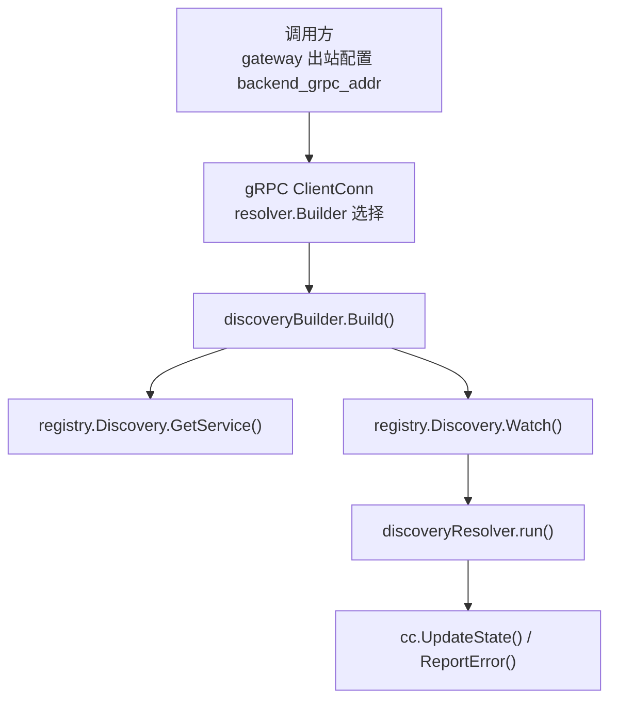
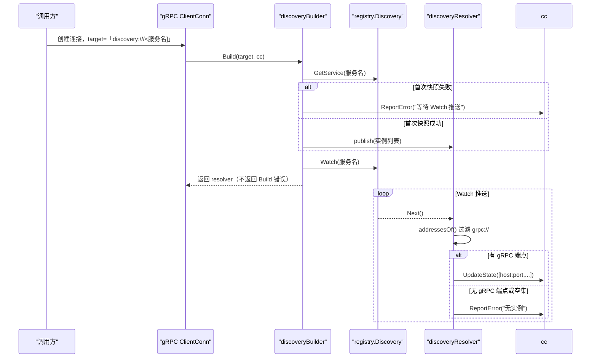
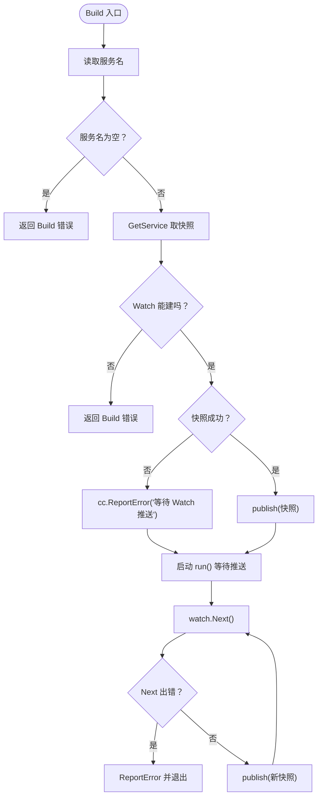
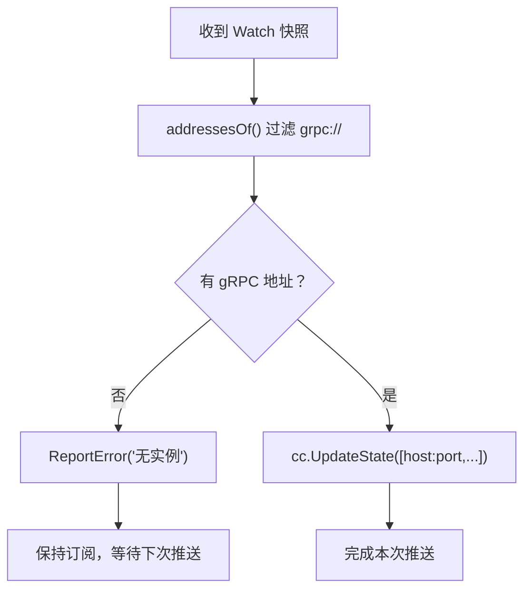
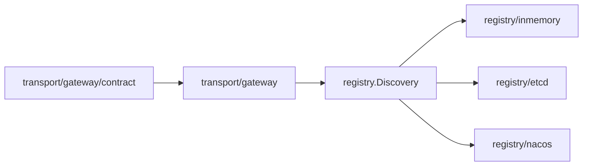

# discovery:// URL 解析语义

<cite>
**本文引用的文件**   
- [transport/gateway/discovery.go](file://transport/gateway/discovery.go)
- [transport/gateway/discovery_test.go](file://transport/gateway/discovery_test.go)
- [transport/gateway/contract/discovery.go](file://transport/gateway/contract/discovery.go)
</cite>

## 目录
1. [引言](#引言)
2. [项目结构](#项目结构)
3. [核心组件](#核心组件)
4. [架构总览](#架构总览)
5. [详细规则与实现分析](#详细规则与实现分析)
6. [依赖关系分析](#依赖关系分析)
7. [性能与可观测性](#性能与可观测性)
8. [故障排查指南](#故障排查指南)
9. [结论](#结论)

## 引言
本文聚焦 `discovery:///<服务名>` 在 gRPC 出站中的三条既定解析语义，并给出每条规则对应的代码路径、行为影响和可复现用例。这三条规则分别约束了：

1. `Build` 返回错误时的重试语义；
2. 空快照不推送 `UpdateState` 的初始连接行为；
3. 仅接受 `grpc://` 端点，以及 nacos 下必须追加 `.grpc` 后缀的原因。

同时补充默认行为：当 `target` 不以 `discovery://` 开头时，不走注册中心，由 gRPC 原生 resolver 处理直连地址。

## 项目结构
与本文相关的代码集中在传输层网关的发现适配中：

**图示来源**
- [transport/gateway/discovery.go:57-108](file://transport/gateway/discovery.go#L57-L108)
- [transport/gateway/discovery.go:110-174](file://transport/gateway/discovery.go#L110-L174)

**章节来源**
- [transport/gateway/discovery.go:1-174](file://transport/gateway/discovery.go#L1-L174)

## 核心组件
| 名称 | 职责 | 关键行为 |
|---|---|---|
| `DiscoveryScheme` | 定义发现 scheme 为 `discovery` | 通过前缀判定是否走注册中心 |
| `usesDiscoveryTarget` | 判断 target 是否以 `discovery://` 开头 | 决定使用自定义 resolver |
| `discoveryBuilder` | 把 `registry.Discovery` 适配成 gRPC resolver builder | `Build` 同步拉一次快照、启动 Watch |
| `discoveryResolver` | 把 Watch 推送转成 gRPC 地址状态 | 过滤非 `grpc://` 端点、空集只上报错误 |
| `grpcAddressOf` | 从端点字符串提取 gRPC 地址 | 剥 `grpc://`、丢弃其它 scheme、保留裸 host:port |

**章节来源**
- [transport/gateway/discovery.go:1-56](file://transport/gateway/discovery.go#L1-L56)
- [transport/gateway/discovery.go:57-108](file://transport/gateway/discovery.go#L57-L108)
- [transport/gateway/discovery.go:110-174](file://transport/gateway/discovery.go#L110-L174)

## 架构总览
下图展示一条从配置到拨号的完整链路，并标注三条规则落地的位置。

**图示来源**
- [transport/gateway/discovery.go:57-108](file://transport/gateway/discovery.go#L57-L108)
- [transport/gateway/discovery.go:110-174](file://transport/gateway/discovery.go#L110-L174)

## 详细规则与实现分析

### 规则一：`Build` 返回错误时 gRPC 不会重试该请求，只会 `ReportError`，后续靠 `Watch` 推进

#### 语义
- `Build` 的错误必须是不可恢复的初始化错误，例如目标没有服务名、无法建立 Watch。
- 首次快照失败不能变成 `Build` 错误，因为 gRPC 的 resolver 重建只在重连退避到期时才触发，期间实例注册上来也接不住。因此实现改为先 `ReportError`，再保留订阅，等下一次 Watch 推送带出实例。
- 一旦 `Build` 成功返回 resolver，当前请求不会再被这个 resolver 重新解析；后续地址变更完全依赖 `Watch.Next()` 推送。

#### 错误传播路径
1. `discoveryBuilder.Build` 调用 `GetService` 得到 `getErr`。
2. 如果 `getErr != nil`，调用 `cc.ReportError`，但继续创建 resolver 并启动 goroutine。
3. `run` 循环中 `watch.Next` 出错时再次 `ReportError`，然后退出循环，让 gRPC 按 `TransientFailure` 重建 resolver。
4. `Close` 后 `Next` 返回的上下文取消错误不应视为故障，`closed` 标志会阻止再次上报。

#### 关键代码位置
- 首次快照错误只上报不返回：[transport/gateway/discovery.go:79-97](file://transport/gateway/discovery.go#L79-L97)
- Watch 错误上报并退出：[transport/gateway/discovery.go:154-166](file://transport/gateway/discovery.go#L154-L166)
- Close 不再上报错误：[transport/gateway/discovery.go:168-174](file://transport/gateway/discovery.go#L168-L174)

#### 可复现用例与预期输出
- 用例名：`TestDiscoveryResolverBuildErrors`  
  行为：构造一个 `Watch` 返回错误的 `stubDiscovery`，`Build` 应返回错误且 resolver 为 nil。  
  预期：错误包含 watch 失败原因，且未创建 resolver。
- 用例名：`TestDiscoveryResolverRecoversAfterSnapshotError`  
  行为：模拟 nacos 首次 `GetService` 直接报错、但 `Watch` 可用；随后注册实例。  
  预期：`Build` 成功；第一次 `ReportError` 数量为 1、`UpdateState` 数量为 0；实例推送后进入 READY。

**图示来源**
- [transport/gateway/discovery.go:57-108](file://transport/gateway/discovery.go#L57-L108)
- [transport/gateway/discovery.go:154-174](file://transport/gateway/discovery.go#L154-L174)

**章节来源**
- [transport/gateway/discovery.go:57-108](file://transport/gateway/discovery.go#L57-L108)
- [transport/gateway/discovery.go:154-174](file://transport/gateway/discovery.go#L154-L174)
- [transport/gateway/discovery_test.go:289-348](file://transport/gateway/discovery_test.go#L289-L348)

### 规则二：空快照不推 `UpdateState`，首次连接为空时必须通过 Watch 轮询或超时兜底

#### 语义
- 当注册表为空，或所有实例的端点都不是 gRPC 面时，`addressesOf` 返回空切片，`publish` 不调用 `UpdateState`，而是调用 `ReportError` 报告“无实例”。
- 不调用 `UpdateState` 的原因是 gRPC 对空地址集会回 `ErrBadResolverState`，并可能清理已有健康地址；因此空集走错误通道，但订阅仍然保持。
- 这意味着：如果注册中心一开始为空，客户端不会收到任何 `UpdateState` 通知；上层必须通过 Watch 推送、状态观察或超时机制兜底，不能假设首次连接就拿到地址。

#### 关键代码位置
- 空集不推 `UpdateState`：[transport/gateway/discovery.go:119-134](file://transport/gateway/discovery.go#L119-L134)
- 全为非 gRPC 端点时等价走“无实例”路径：[transport/gateway/discovery.go:136-147](file://transport/gateway/discovery.go#L136-L147)

#### 调试断言建议
在实际集成测试中，建议至少断言以下三点：

| 断言项 | 说明 |
|---|---|
| `UpdateState` 次数为 0 | 空快照不得更新 gRPC 地址状态 |
| `ReportError` 次数大于 0 | 空快照必须上报“无实例”原因 |
| 之后注册实例能进入 READY | 证明订阅未被中断，仍可由 Watch 推进 |

#### 可复现用例与预期输出
- 用例名：`TestDiscoveryResolverEmptySetReportsErrorAndKeepsWatching`  
  预期：立即出现至少一次 `ReportError`，`UpdateState` 次数为 0；随后注册实例后出现一次 `UpdateState`。
- 用例名：`TestDiscoveryResolverAllNonGRPCEndpointsReportsNoInstances`  
  预期：同服务的所有端点都是 HTTP 等非 gRPC scheme 时，行为与空集一致——不上报地址，只上报“无实例”。

**图示来源**
- [transport/gateway/discovery.go:119-147](file://transport/gateway/discovery.go#L119-L147)

**章节来源**
- [transport/gateway/discovery.go:119-147](file://transport/gateway/discovery.go#L119-L147)
- [transport/gateway/discovery_test.go:201-240](file://transport/gateway/discovery_test.go#L201-L240)
- [transport/gateway/discovery_test.go:242-260](file://transport/gateway/discovery_test.go#L242-L260)

### 规则三：只取 `grpc://` 端点；nacos 下必须写 `discovery:///<服务名>.grpc`

#### 语义
- `grpcAddressOf` 只接受裸 `host:port` 或以 `grpc://` 开头的端点。
- 其他带 scheme 的端点会被丢弃，包括 `http://`、`https://`、`ws://`、`wss://`、`tcp://`、`webrtc://` 等。
- 一个实例只要混入非 gRPC 端点，整个实例就不会贡献 gRPC 地址；这是有意设计，避免把必然拨不通的地址交给 gRPC。
- 对于 nacos，后端会把一个实例的多个端点拆成 `<Name>.<scheme>` 形式的服务，因此目标必须写 `discovery:///<服务名>.grpc`。少写 `.grpc` 通常会解析到 HTTP 面或空集。
- 内存与 etcd 则直接使用注册时填写的 `ServiceInstance.Name`，不需要额外 scheme 后缀。

#### 关键代码位置
- 仅接受 `grpc://` 与裸地址：[transport/gateway/discovery.go:149-174](file://transport/gateway/discovery.go#L149-L174)
- nacos 多端点拆服务的文档注释：[transport/gateway/discovery.go:13-27](file://transport/gateway/discovery.go#L13-L27)

#### 三种 target 写法对比

| target 写法 | 是否走注册中心 | 行为 |
|---|---:|---|
| `discovery:///<服务名>` | 是 | 通过 `registry.Discovery.GetService` 和 `Watch` 解析 |
| `discovery:///<服务名>.grpc` | 是 | nacos 场景下用于匹配拆分后的 gRPC 服务名 |
| `host:port` 或其他直连地址 | 否 | 由 gRPC 原生 resolver 处理，注入的 Discovery 不会被调用 |

#### 可复现用例与预期输出
- 用例名：`TestDiscoveryResolverNormalizesSchemedEndpoints`  
  行为：同一实例同时注册 HTTP 面、`grpc://` 面和裸 host:port；另一个实例只有 HTTPS 面。  
  预期：最终地址列表只包含 gRPC 面及裸 host:port，不包含 HTTP/HTTPS 面。
- 用例名：`TestPlainAddressUnaffectedByInjectedDiscovery`  
  行为：给 gRPC ClientConn 注入 discovery resolver，但 target 是普通直连地址。  
  预期：连接成功，且 Discovery 没有被调用。
- 用例名：`TestGatewayServerDialsRealSchemedRegistration`  
  行为：模拟真实注册形态，HTTP 面排在 gRPC 面前。  
  预期：gRPC 仍能拨通，说明 HTTP 面被正确过滤，不是靠 gRPC 自行试错。

**图示来源**
- [transport/gateway/discovery.go:149-174](file://transport/gateway/discovery.go#L149-L174)

**章节来源**
- [transport/gateway/discovery.go:13-27](file://transport/gateway/discovery.go#L13-L27)
- [transport/gateway/discovery.go:136-174](file://transport/gateway/discovery.go#L136-L174)
- [transport/gateway/discovery_test.go:242-260](file://transport/gateway/discovery_test.go#L242-L260)
- [transport/gateway/discovery_test.go:370-386](file://transport/gateway/discovery_test.go#L370-L386)
- [transport/gateway/discovery_test.go:434-458](file://transport/gateway/discovery_test.go#L434-L458)

## 依赖关系分析
discovery 适配层位于 transport 层，依赖 registry 抽象，但不直接依赖具体后端实现。契约装配层负责把已装配的注册中心暴露为 `registry.Discovery`。

**图示来源**
- [transport/gateway/discovery.go:1-12](file://transport/gateway/discovery.go#L1-L12)
- [transport/gateway/contract/discovery.go:1-62](file://transport/gateway/contract/discovery.go#L1-L62)

**章节来源**
- [transport/gateway/discovery.go:1-12](file://transport/gateway/discovery.go#L1-L12)
- [transport/gateway/contract/discovery.go:1-62](file://transport/gateway/contract/discovery.go#L1-L62)

## 性能与可观测性
- `ResolveNow` 是空操作，刷新依赖 Watch 推送，不存在被动刷新热点。
- `run` 是单 goroutine 消费 Watch，每次推送只做一次 `addressesOf` 和一次可能的 `UpdateState`。
- 空快照和全非 gRPC 端点都会触发 `ReportError`，可作为诊断信号；但不要把它误读为“没有后端”，因为可能是正常启动期。
- `Close` 路径显式跳过错误上报，避免停机阶段污染 `ClientConn` 状态。

**章节来源**
- [transport/gateway/discovery.go:154-174](file://transport/gateway/discovery.go#L154-L174)

## 故障排查指南

| 现象 | 可能原因 | 检查点 | 对应用例 |
|---|---|---|---|
| 连接始终不 READY，且没有 `UpdateState` | 注册中心为空，或所有端点都不是 gRPC | 查看是否出现“无实例”错误；确认实例端点是否带 `grpc://` | [transport/gateway/discovery_test.go:201-240](file://transport/gateway/discovery_test.go#L201-L240) |
| 首次启动报错但后来自动恢复 | 首次 `GetService` 返回错误，但 Watch 可用 | 确认是否只出现一次 `ReportError`，随后实例推送生效 | [transport/gateway/discovery_test.go:314-348](file://transport/gateway/discovery_test.go#L314-L348) |
| 注入 Discovery 后直连地址也失败 | 使用了非直连 target，或 discovery source 返回 nil | 直连地址不应调用 discovery；source 返回 nil 应快速失败 | [transport/gateway/discovery_test.go:370-386](file://transport/gateway/discovery_test.go#L370-L386), [transport/gateway/discovery_test.go:500-512](file://transport/gateway/discovery_test.go#L500-L512) |
| nacos 上解析不到 gRPC 面 | 目标少了 `.grpc` 后缀 | 改用 `discovery:///<服务名>.grpc` | [transport/gateway/discovery.go:13-27](file://transport/gateway/discovery.go#L13-L27) |
| 关闭后出现异常错误日志 | 关闭导致 `Next` 返回上下文取消，但被当作故障 | 检查是否误用旧实现；当前实现已通过 `closed` 标志保护 | [transport/gateway/discovery.go:168-174](file://transport/gateway/discovery.go#L168-L174) |

**章节来源**
- [transport/gateway/discovery_test.go:201-240](file://transport/gateway/discovery_test.go#L201-L240)
- [transport/gateway/discovery_test.go:314-348](file://transport/gateway/discovery_test.go#L314-L348)
- [transport/gateway/discovery_test.go:370-386](file://transport/gateway/discovery_test.go#L370-L386)
- [transport/gateway/discovery_test.go:500-512](file://transport/gateway/discovery_test.go#L500-L512)
- [transport/gateway/discovery.go:13-27](file://transport/gateway/discovery.go#L13-L27)
- [transport/gateway/discovery.go:168-174](file://transport/gateway/discovery.go#L168-L174)

## 结论
`discovery:///<服务名>` 的语义可以浓缩为三句话：

1. `Build` 的成功意味着 resolver 已启动并持有 Watch；其错误仅限不可恢复的初始化问题，瞬时网络抖动应留在 `ReportError` 和 Watch 重试路径中处理。
2. 空快照和全非 gRPC 端点都不推送 `UpdateState`，首次连接为空时必须依赖 Watch 推送、状态观察或超时兜底。
3. 只消费 `grpc://` 端点和裸 host:port；nacos 下因一个实例的多端点拆成 `<Name>.<scheme>` 服务，必须写 `discovery:///<服务名>.grpc`。直连地址则完全绕过注册中心。

这些语义由 `transport/gateway/discovery.go` 中的 `discoveryBuilder` 和 `discoveryResolver` 钉住，并由 `discovery_test.go` 中的多条用例覆盖。