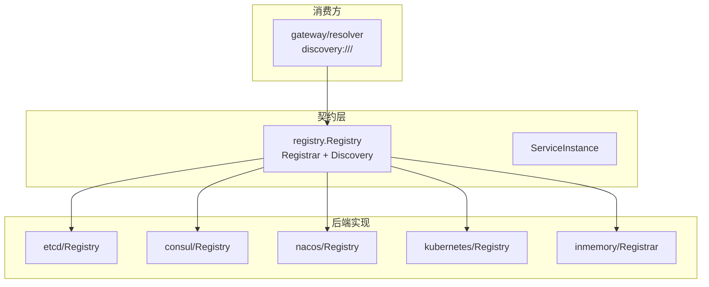
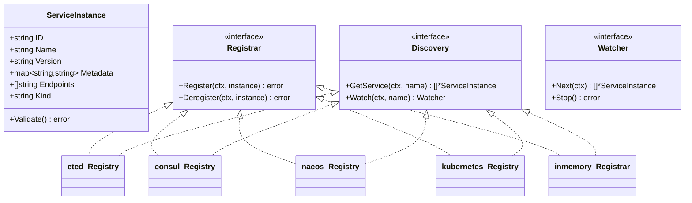
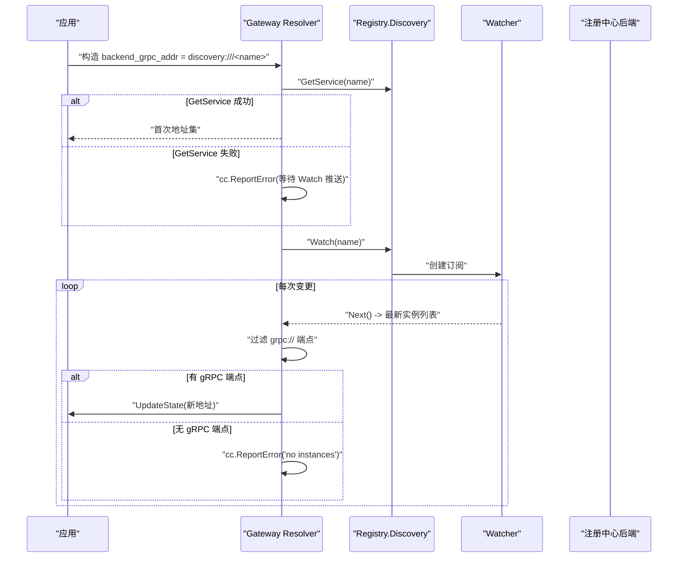
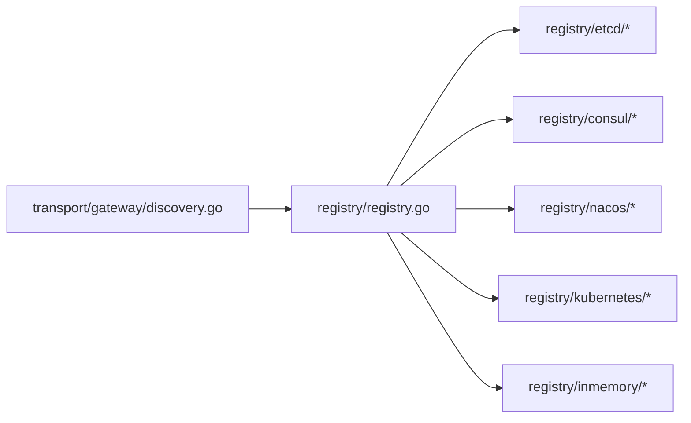

# 多后端实现对比

<cite>
**本文引用的文件**   
- [registry/registry.go](file://registry/registry.go)
- [registry/etcd/options.go](file://registry/etcd/options.go)
- [registry/etcd/registry.go](file://registry/etcd/registry.go)
- [registry/etcd/watcher.go](file://registry/etcd/watcher.go)
- [registry/etcd/service.go](file://registry/etcd/service.go)
- [registry/consul/options.go](file://registry/consul/options.go)
- [registry/consul/client.go](file://registry/consul/client.go)
- [registry/consul/registry.go](file://registry/consul/registry.go)
- [registry/consul/watcher.go](file://registry/consul/watcher.go)
- [registry/consul/service.go](file://registry/consul/service.go)
- [registry/nacos/options.go](file://registry/nacos/options.go)
- [registry/nacos/registry.go](file://registry/nacos/registry.go)
- [registry/nacos/watcher.go](file://registry/nacos/watcher.go)
- [registry/inmemory/inmemory.go](file://registry/inmemory/inmemory.go)
- [registry/kubernetes/options.go](file://registry/kubernetes/options.go)
- [registry/kubernetes/registry.go](file://registry/kubernetes/registry.go)
- [transport/gateway/discovery.go](file://transport/gateway/discovery.go)
- [transport/gateway/discovery_test.go](file://transport/gateway/discovery_test.go)
</cite>

## 目录
1. [引言](#引言)
2. [项目结构](#项目结构)
3. [核心组件](#核心组件)
4. [架构总览](#架构总览)
5. [各后端详细对比](#各后端详细对比)
6. [依赖关系分析](#依赖关系分析)
7. [性能与容量特征](#性能与容量特征)
8. [故障排查指南](#故障排查指南)
9. [结论](#结论)

## 引言
本文面向 Bald 框架中服务注册/发现的多后端实现，逐一说明 etcd、consul、nacos、kubernetes、inmemory 五个实现的配置参数、连接方式、认证机制、会话管理与故障恢复策略，并重点记录每个后端对 `ServiceInstance.Name` 的处理差异。文档还给出 YAML 配置示例与 Go 初始化代码路径，以及连接失败、鉴权失败、命名空间不匹配等常见问题的排查步骤。

需要特别注意：
- 本仓是 93 个 go.mod 的多模块仓库（无 go.work），子模块靠相对 replace 组成可编译闭包；`scripts/list-modules.sh` 是全仓唯一模块清单派生（排除 `_example/bald`）。因此不能把仓库当作「一个 module」来描述。
- 网关出站只有 target 写成 `discovery:///<服务名>` 才走注册中心，直连仍是默认。解析器三条既定语义必须遵守：`Build` 返回错误时 gRPC 不会重试，所以只 `cc.ReportError`、靠 `Watch` 推进；空快照不推 `UpdateState`；只取 `grpc://` 端点。
- nacos 把一个实例的多个端点拆成 `<Name>.<scheme>` 形式的多个服务，目标必须写 `discovery:///<服务名>.grpc`；内存与 etcd 用注册时填的 `ServiceInstance.Name` 原样匹配。少 `.grpc` 后缀通常解析到 HTTP 面或空集。
- consul 与 kubernetes 的后端实现状态在本文如实标注为「未覆盖」——即代码存在，但当前仓库没有端到端验证证据。

## 项目结构
服务注册/发现契约位于 `registry` 包，具体后端以独立模块放在 `registry/<backend>` 下。`contract` 包只放契约装配、不 import 具体后端；根 module 不得 require 任何适配器。

**图表来源**
- [registry/registry.go:1-81](file://registry/registry.go#L1-L81)
- [transport/gateway/discovery.go:1-174](file://transport/gateway/discovery.go#L1-L174)

**章节来源**
- [registry/registry.go:1-81](file://registry/registry.go#L1-L81)
- [scripts/list-modules.sh:1-24](file://scripts/list-modules.sh#L1-L24)

## 核心组件
`registry` 包定义最小契约：
- `ServiceInstance`：包含 ID、Name、Version、Metadata、Endpoints、Kind。
- `Registrar`：Register、Deregister。
- `Discovery`：GetService、Watch。
- `Watcher`：Next、Stop。

所有后端都实现 `Registrar` 和 `Discovery`，并通过 `Validate()` 做前置闸门：Name 和 ID 为空会直接报错，避免注册到畸形 key。

**图表来源**
- [registry/registry.go:1-81](file://registry/registry.go#L1-L81)

**章节来源**
- [registry/registry.go:1-81](file://registry/registry.go#L1-L81)

## 架构总览
Bald 的网关出站通过 `discovery:///<服务名>` 接入注册中心。解析器 `Build` 会同步调用一次 `GetService`，然后启动 `Watch` 推送后续快照；空快照不调用 `UpdateState`，而是 `ReportError` 保持订阅。

**图表来源**
- [transport/gateway/discovery.go:1-174](file://transport/gateway/discovery.go#L1-L174)

**章节来源**
- [transport/gateway/discovery.go:1-174](file://transport/gateway/discovery.go#L1-L174)
- [transport/gateway/discovery_test.go:1-200](file://transport/gateway/discovery_test.go#L1-L200)

## 各后端详细对比

### 总体对照表

| 后端 | 配置参数 | 连接方式 | 认证机制 | 会话管理 | 故障恢复 | Name 匹配规则 | 适用场景 | 已知限制 |
|---|---|---|---|---|---|---|---|---|
| etcd | endpoints、namespace、ttl、maxRetry、dialTimeout、username、password | 自建 clientv3.Client；或注入既有 Client | 用户名+密码 | 租约 TTL + 后台心跳续约；断链指数退避重注册 | 心跳取消、旧 lease 关闭；Close 幂等 | 使用 `ServiceInstance.Name` 原样作为 key 中间段 | 生产级 KV 注册中心 | 需外部 etcd；空 Name/ID 被 Validate 拦截 |
| consul | address、scheme、token、healthcheck、heartbeat、datacenter、service resolver | 自建 hashicorp/consul/api.Client；或注入 | ACL Token | 健康检查 + 可选 TTL 心跳；每实例独立心跳 | Close 取消订阅 ctx；SDK Client 无需关闭 | 使用 `ServiceInstance.Name` 原样 | 多云/多数据中心 | 未覆盖端到端验证；TaggedAddress 解析依赖约定 |
| nacos | serverAddrs、namespace、prefix、weight、cluster、group、kind、timeout、username、password | 自建 nacos-sdk-go v2 naming client；或注入 | username + password | 短实例 + 服务端保活；按 endpoint 逐个注册 | Close 仅关闭 owned client；订阅回调缓冲 1 | 实际服务名是 `Name.scheme`，如 `service.grpc` | 阿里生态/Nacos 用户 | 目标必须带 `.grpc` 后缀；否则可能解析到 HTTP 面 |
| kubernetes | namespace | 集群内 InClusterConfig；或注入 clientset | 由 Kubernetes RBAC / ServiceAccount 决定 | Pod Informer；Label 驱动 | Start/Close 控制 informer；Close 后 Next 报 ErrIteratorClosed | 使用 Label `bald-service-app` 中的 Name | 云原生/K8s 环境 | 未覆盖生产验证；只能更新当前 Pod 元数据 |
| inmemory | 无 | 纯内存 map | 无 | 本地 watcher 广播 | Stop 关闭 watcher；进程退出即丢失 | 使用 `ServiceInstance.Name` 原样 | 开发/测试/单实例调试 | 非持久化；不适合跨进程服务发现 |

### etcd 后端

#### 配置参数
- `WithEndpoints(endpoints...)`：自建 client 必填。
- `WithNamespace(ns)`：key 前缀，默认 `/microservices`。
- `WithRegisterTTL(ttl)`：租约 TTL，默认 15 秒。
- `WithMaxRetry(maxRetry)`：断链后重试重注册次数上限，默认 5。
- `WithDialTimeout(d)`：拨号超时，默认 5 秒。
- `WithUsername(u)` / `WithPassword(p)`：认证凭据。

#### 连接方式
- `New(opts...)`：按 options 自建 `clientv3.Client`，拥有其生命周期，`Close` 时关闭。
- `NewWithClient(c, opts...)`：注入既有 client，不负责关闭。

#### 认证机制
- 通过 `clientv3.Config.Username` / `Password` 传入。
- 若未传 endpoints，`New` 直接返回错误。

#### 会话管理
- Register 先 Grant 租约，再 Put KV；后台 goroutine 续租。
- Deregister 删除 KV、停止心跳、关闭旧 lease。
- Close 幂等：取消 registry 级 ctx、cancel 心跳、关闭 owned client。

#### 故障恢复
- heartBeat 断链后按 maxRetry 指数退避重试重注册。
- Watcher 首次全量拉取，之后阻塞 watchChan；断链时 sleep 1 秒后重建 watcher。

#### Name 处理
- 注册 key 形如 `<namespace>/<Name>/<ID>`。
- `GetService` 按 `<namespace>/<Name>` 前缀扫描。
- Name 必须与注册时一致，否则无法匹配。

#### YAML 与 Go 初始化参考
- YAML 字段映射见 `bootstrap/etcd.go` 与 `bconf/gen/go/bootstrap/v1/server.pb.go` 中 `server.etcd` 段。
- Go 初始化路径：`registry/etcd.New`、`registry/etcd.NewWithClient`、`registry/etcd.With*`。

**章节来源**
- [registry/etcd/options.go:1-76](file://registry/etcd/options.go#L1-L76)
- [registry/etcd/registry.go:1-200](file://registry/etcd/registry.go#L1-L200)
- [registry/etcd/watcher.go:1-100](file://registry/etcd/watcher.go#L1-L100)
- [registry/etcd/service.go:1-22](file://registry/etcd/service.go#L1-L22)

### consul 后端

#### 配置参数
- `WithAddress(addr)`：Consul 地址，空则走 `api.DefaultConfig()`。
- `WithScheme(scheme)`：http 或 https。
- `WithToken(token)`：ACL Token。
- `WithDatacenter(dc)`：SINGLE 或 MULTI。
- `WithHealthCheck(enable)`、`WithHeartbeat(enable)`、`WithServiceCheck(...)`。
- `WithHealthCheckInterval(interval)`、`WithDeregisterCriticalServiceAfter(interval)`。
- `WithServiceResolver(fn)`：自定义 endpoint 解析函数。

#### 连接方式
- `New(opts...)`：按 options 自建 `hashicorp/consul/api.Client`，Close 停心跳/订阅 ctx。
- `NewWithClient(apiClient, opts...)`：注入既有 client，不负责关闭。

#### 认证机制
- 通过 Consul ACL Token。
- 也可通过环境变量 `CONSUL_HTTP_ADDR` 等加载默认配置。

#### 会话管理
- Register 将 `ServiceInstance.Endpoints` 解析为 TaggedAddresses；可选 TCP 健康检查。
- 心跳为每实例独立 context，Deregister 只停该实例心跳。
- Close 仅取消内部 ctx，Consul SDK Client 无需关闭。

#### 故障恢复
- Watch 通过 serviceSet 广播；首次若无值则远程 resolve。
- Multi-datacenter 模式遍历 Datacenters 聚合实例。

#### Name 处理
- 使用 `ServiceInstance.Name` 原样作为 Consul Service Name。
- `defaultResolver` 从 TaggedAddresses 提取 endpoint，version 来自 tag `version=...`。

#### 状态标注
- **未覆盖**：仓库中没有针对 consul 后端的端到端集成测试证据。

#### YAML 与 Go 初始化参考
- YAML 字段映射见 `bootstrap/consul.go` 与 `bconf/gen/go/bootstrap/v1/server.pb.go` 中 `server.consul` 段。
- Go 初始化路径：`registry/consul.New`、`registry/consul.NewWithClient`、`registry/consul.With*`。

**章节来源**
- [registry/consul/options.go:1-86](file://registry/consul/options.go#L1-L86)
- [registry/consul/registry.go:1-200](file://registry/consul/registry.go#L1-L200)
- [registry/consul/watcher.go:1-42](file://registry/consul/watcher.go#L1-L42)
- [registry/consul/service.go:1-27](file://registry/consul/service.go#L1-L27)
- [registry/consul/client.go:1-200](file://registry/consul/client.go#L1-L200)

### nacos 后端

#### 配置参数
- `WithServerAddrs(addrs...)`：Nacos server host:port 列表，自建 client 必填。
- `WithNamespace(ns)`：命名空间。
- `WithPrefix(prefix)`：预留前缀，对齐契约 prefix 字段。
- `WithWeight(weight)`：默认权重，默认 100。
- `WithCluster(cluster)`：集群名，默认 DEFAULT。
- `WithGroup(group)`：分组名，默认 DEFAULT_GROUP。
- `WithDefaultKind(kind)`：默认协议类型，默认 grpc。
- `WithTimeout(d)`：请求超时，默认 10 秒。
- `WithUsername(username)` / `WithPassword(password)`：鉴权凭据。

#### 连接方式
- `New(opts...)`：自建 nacos-sdk-go v2 `INamingClient`，Close 关闭 owned client。
- `NewWithClient(cli, opts...)`：注入既有 client，不负责关闭。

#### 认证机制
- 通过 `ClientConfig.Username` / `Password` 传递。
- serverAddrs 为空时 `New` 直接报错。

#### 会话管理
- Register 对每个 endpoint 分别注册，服务名为 `Name.scheme`。
- Metadata 写入 kind、version、可选 weight。
- Deregister 同样按 endpoint 逐个注销。

#### 故障恢复
- Close 幂等，仅关闭 owned client。
- Watcher 通过 Subscribe 回调推送信号，Next 拉取最新实例。

#### Name 处理
- **关键差异**：nacos 把一个实例的多个端点拆成 `<Name>.<scheme>` 形式的多个服务。
- 例如 gRPC 端点 `grpc://host:port` 会注册为 `service.grpc`。
- 消费方目标必须写 `discovery:///<服务名>.grpc`，少 `.grpc` 后缀通常解析到 HTTP 面或空集。

#### YAML 与 Go 初始化参考
- YAML 字段映射见 `bootstrap/nacos.go` 与 `bconf/gen/go/bootstrap/v1/server.pb.go` 中 `server.nacos` 段。
- Go 初始化路径：`registry/nacos.New`、`registry/nacos.NewWithClient`、`registry/nacos.With*`。

**章节来源**
- [registry/nacos/options.go:1-84](file://registry/nacos/options.go#L1-L84)
- [registry/nacos/registry.go:1-200](file://registry/nacos/registry.go#L1-L200)
- [registry/nacos/watcher.go:1-98](file://registry/nacos/watcher.go#L1-L98)

### kubernetes 后端

#### 配置参数
- `WithNamespace(ns)`：Informer 监听 namespace，空表示全部。

#### 连接方式
- `New(opts...)`：加载 `rest.InClusterConfig()` 构建 clientset；不在集群内会报错并提示改用 `NewWithClient`。
- `NewWithClient(clientSet, opts...)`：注入既有 clientset，不负责关闭。

#### 认证机制
- 由 Kubernetes RBAC / ServiceAccount 决定，Bald 侧不直接传 token。

#### 会话管理
- 基于 `SharedInformerFactory` 监听 Pod 变更。
- Register 不是传统“注册到外部系统”，而是 Patch 当前 Pod 的 Labels/Annotations，写入：
  - `bald-service-id`
  - `bald-service-app`
  - `bald-service-version`
  - `bald-service-metadata`
  - `bald-service-protocols`
- Deregister 清空 metadata annotation。

#### 故障恢复
- Start 启动 informer，WaitForCacheSync 失败则提前返回。
- Close 关闭 informer stopCh；Iterator.Next 在 stopCh 关闭后返回 `ErrIteratorClosed`。

#### Name 处理
- 通过 Label `bald-service-app` 中的值作为服务名。
- 与 `ServiceInstance.Name` 保持一致。

#### 状态标注
- **未覆盖**：源码注释明确声明“未在生产环境验证，目前仅作参考”。

#### YAML 与 Go 初始化参考
- YAML 字段映射见 `bootstrap/kubernetes.go` 与 `bconf/gen/go/bootstrap/v1/server.pb.go` 中 `server.kubernetes` 段。
- Go 初始化路径：`registry/kubernetes.New`、`registry/kubernetes.NewWithClient`、`registry/kubernetes.WithNamespace`。

**章节来源**
- [registry/kubernetes/options.go:1-22](file://registry/kubernetes/options.go#L1-L22)
- [registry/kubernetes/registry.go:1-200](file://registry/kubernetes/registry.go#L1-L200)
- [registry/kubernetes/registry.go:201-444](file://registry/kubernetes/registry.go#L201-L444)

### inmemory 后端

#### 配置参数
- 无外部依赖，`New()` 直接返回线程安全的内存 Registrar。

#### 连接方式
- 纯内存 map，无网络 IO。

#### 认证机制
- 无。

#### 会话管理
- Register/Deregister 按 ID 覆盖或删除实例。
- Watch 返回 watcher，立刻携带当前快照，之后每次变更推送最新列表。
- snapshot 按 ID 排序，保证顺序稳定。

#### 故障恢复
- Stop 关闭 watcher，重复调用安全。
- Next 在 closed 状态下返回 `errWatcherClosed`。

#### Name 处理
- 使用 `ServiceInstance.Name` 原样匹配。

#### 适用场景
- 开发、测试、本地调试。

**章节来源**
- [registry/inmemory/inmemory.go:1-169](file://registry/inmemory/inmemory.go#L1-L169)

## 依赖关系分析
`registry` 包是契约层，各后端以独立 module 形式提供实现。网关 resolver 通过 `WithDiscovery` 注入 `registry.Discovery`，仅在 target 以 `discovery://` 开头时启用。

**图表来源**
- [transport/gateway/discovery.go:1-174](file://transport/gateway/discovery.go#L1-L174)
- [registry/registry.go:1-81](file://registry/registry.go#L1-L81)

**章节来源**
- [transport/gateway/discovery.go:1-174](file://transport/gateway/discovery.go#L1-L174)
- [registry/registry.go:1-81](file://registry/registry.go#L1-L81)

## 性能与容量特征
- etcd：基于 KV 前缀扫描与 watch 事件，适合中等规模服务；TTL 心跳带来额外写放大，需合理设置 ttl 与 maxRetry。
- consul：依赖 SDK Health.Service 查询与长轮询，支持多数据中心；健康检查会增加 Consul Agent 负载。
- nacos：按 endpoint 逐个注册，多端点实例会产生多个服务条目；订阅回调缓冲为 1，保证最新状态但不保证中间态。
- kubernetes：基于 Informer，延迟受 cache sync 影响；只适合 Pod 自描述场景。
- inmemory：零网络开销，适合单元测试；进程外不可见。

[本节为一般性讨论，不直接分析具体文件]

## 故障排查指南

### 连接失败
1. 确认后端地址正确：
   - etcd：`WithEndpoints` 是否传入；`WithDialTimeout` 是否过短。
   - consul：`WithAddress` / `WithScheme` 是否正确；环境变量 `CONSUL_HTTP_ADDR` 是否冲突。
   - nacos：`WithServerAddrs` 是否为 `host:port` 格式。
   - kubernetes：是否在集群内运行，或是否通过 `NewWithClient` 注入 clientset。
2. 检查网络连通性与防火墙。
3. 查看日志中是否出现客户端创建错误（如 `etcd: endpoints is required`、`nacos: create naming client`、`kubernetes: load in-cluster config`）。

**章节来源**
- [registry/etcd/registry.go:60-120](file://registry/etcd/registry.go#L60-L120)
- [registry/consul/registry.go:40-80](file://registry/consul/registry.go#L40-L80)
- [registry/nacos/registry.go:60-120](file://registry/nacos/registry.go#L60-L120)
- [registry/kubernetes/registry.go:100-140](file://registry/kubernetes/registry.go#L100-L140)

### 鉴权失败
1. etcd：检查 `WithUsername` / `WithPassword` 是否与 etcd 配置一致。
2. consul：检查 `WithToken` 是否具有读取服务的权限。
3. nacos：检查 `WithUsername` / `WithPassword` 是否在服务端开启 auth 时填写。
4. kubernetes：检查 ServiceAccount 是否具备 Pod List/Patch 权限。

**章节来源**
- [registry/etcd/options.go:40-76](file://registry/etcd/options.go#L40-L76)
- [registry/consul/options.go:60-86](file://registry/consul/options.go#L60-L86)
- [registry/nacos/options.go:60-84](file://registry/nacos/options.go#L60-L84)

### 命名空间不匹配
1. etcd：确认 `WithNamespace` 与注册时使用的 namespace 一致。
2. nacos：确认 `WithNamespace` 与 Nacos 控制台命名空间一致。
3. kubernetes：确认 `WithNamespace` 与 Pod 所在 namespace 一致。
4. 如果只配了默认 namespace，而服务注册到了其他命名空间，GetService 将无法命中。

**章节来源**
- [registry/etcd/options.go:20-40](file://registry/etcd/options.go#L20-L40)
- [registry/nacos/options.go:20-40](file://registry/nacos/options.go#L20-L40)
- [registry/kubernetes/options.go:1-22](file://registry/kubernetes/options.go#L1-L22)

### 服务名解析失败
1. 如果使用 nacos，确认目标写成 `discovery:///<服务名>.grpc`，而不是裸 `discovery:///<服务名>`。
2. 如果使用 etcd 或 inmemory，确认 `ServiceInstance.Name` 与消费方 target 完全一致。
3. 确认 gateway 已注入 `WithDiscovery`，否则 `discovery://` 不会生效。
4. 确认实例至少有一个 `grpc://` 端点；非 grpc 端点会被过滤掉。

**章节来源**
- [transport/gateway/discovery.go:1-174](file://transport/gateway/discovery.go#L1-L174)
- [registry/nacos/registry.go:140-200](file://registry/nacos/registry.go#L140-L200)

### 空实例或订阅异常
1. 空实例：resolver 会 `ReportError("no instances")`，不 `UpdateState`，保持订阅等待后续注册。
2. 订阅错误：resolver 上报错误并退出 run 循环，让 gRPC 重建 resolver。
3. 检查后端 Watcher 是否正常返回；etcd 会在断链后重建 watcher。

**章节来源**
- [transport/gateway/discovery_test.go:120-200](file://transport/gateway/discovery_test.go#L120-L200)
- [registry/etcd/watcher.go:40-100](file://registry/etcd/watcher.go#L40-L100)

## 结论
- etcd、consul、nacos、inmemory 均实现完整的 Registrar + Discovery 契约，且通过 `ServiceInstance.Validate` 统一校验 Name/ID。
- nacos 是唯一对 `ServiceInstance.Name` 做转换的后端：它按 endpoint scheme 拆分服务名，消费方必须使用 `discovery:///<服务名>.grpc`。
- consul 与 kubernetes 的代码存在，但当前仓库没有端到端验证证据，应视为「未覆盖」。
- 网关 resolver 严格遵循三条语义：Build 返回错误不重试、空快照不推 UpdateState、只取 grpc:// 端点。
- 选择后端时应综合考虑部署成本、认证模型、命名空间隔离、性能特征以及团队已有基础设施。

[本节为总结性内容，不直接分析具体文件]