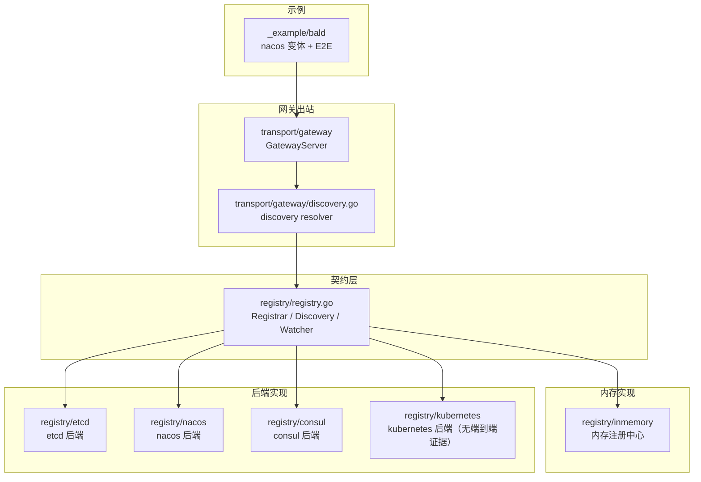
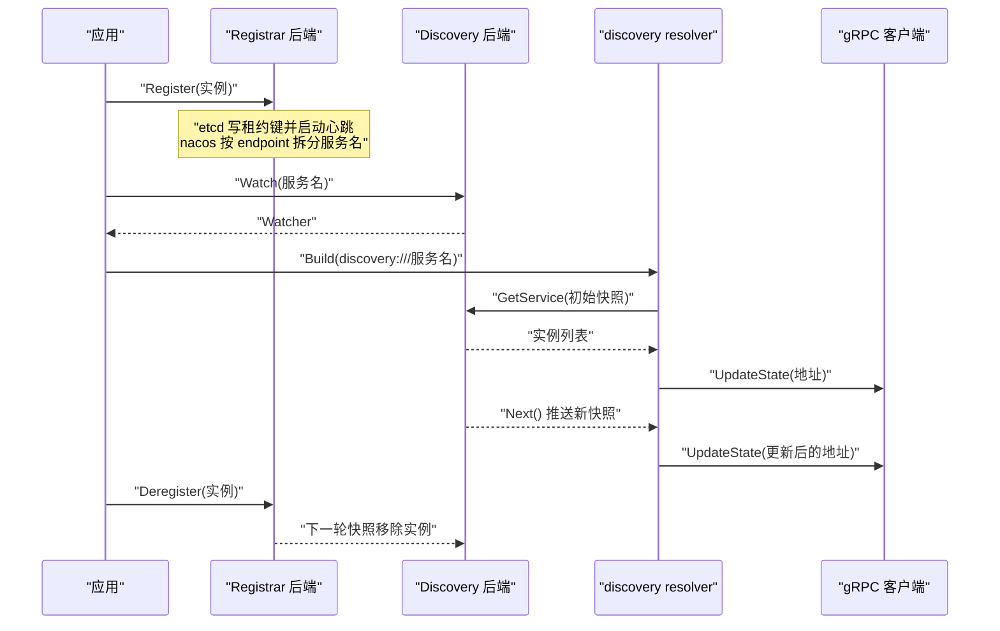
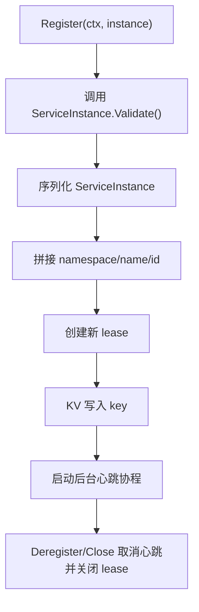
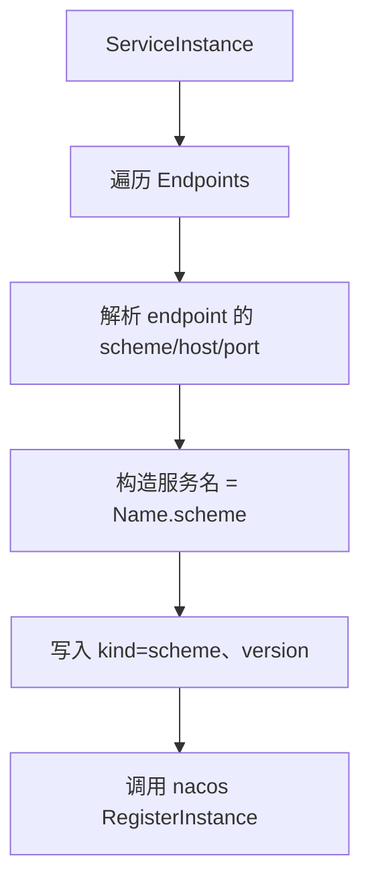
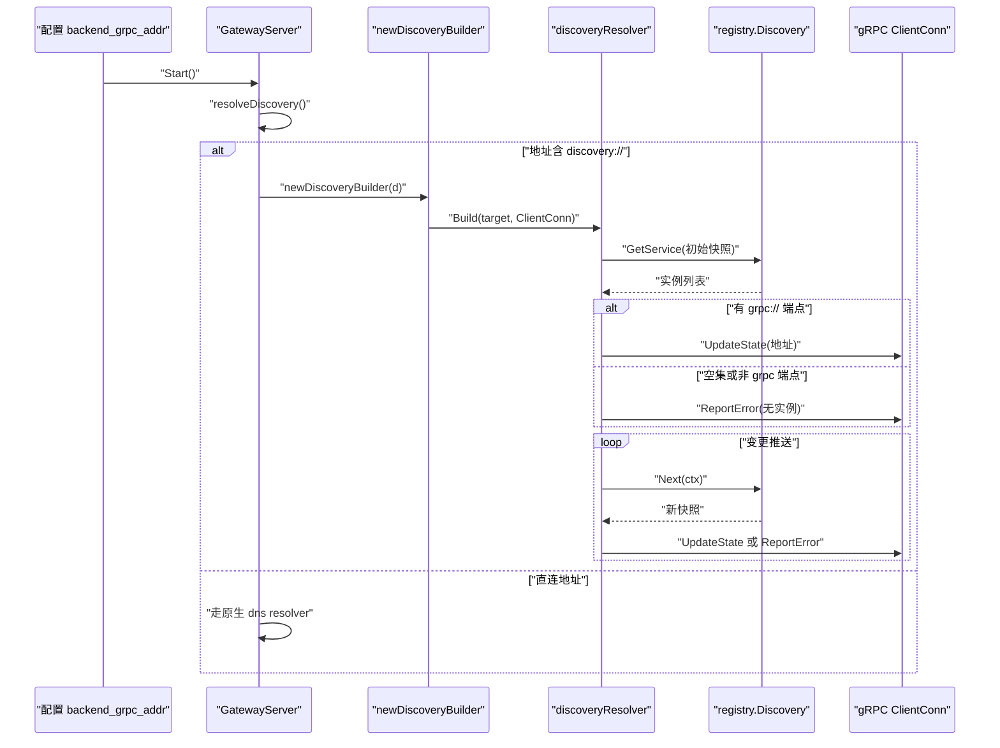
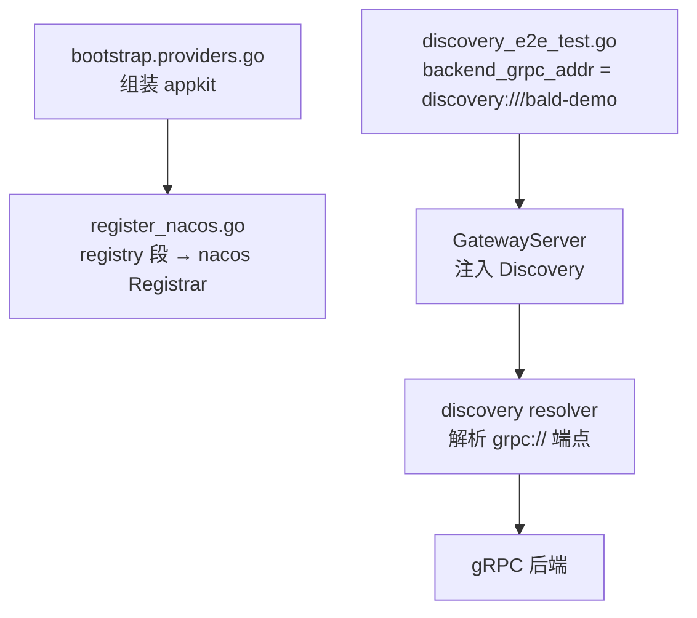
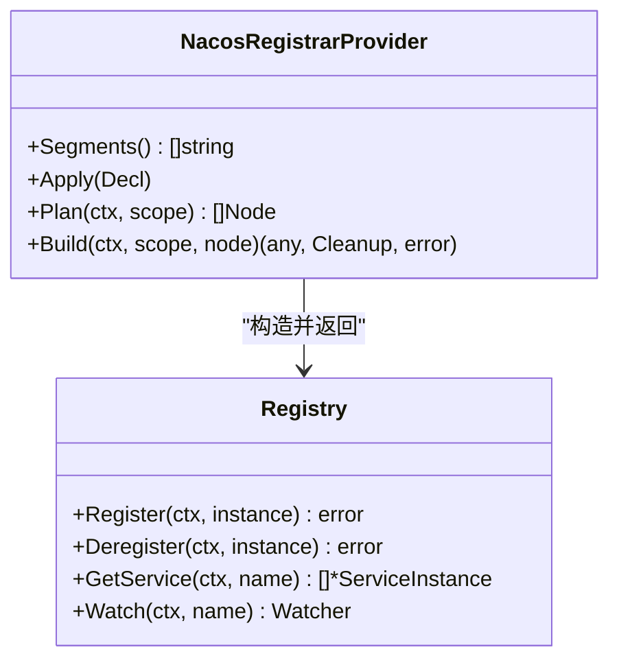
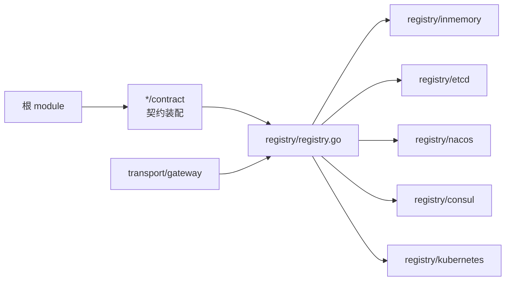

# 服务发现契约与核心模型

<cite>
**本文引用的文件**   
- [registry.go](file://registry/registry.go)
- [inmemory.go](file://registry/inmemory/inmemory.go)
- [discovery_test.go](file://transport/gateway/discovery_test.go)
- [gateway_server.go](file://transport/gateway/gateway_server.go)
- [discovery.go](file://transport/gateway/discovery.go)
- [register_nacos.go](file://_example/bald/internal/bootstrap/register_nacos.go)
- [discovery_e2e_test.go](file://_example/bald/internal/bootstrap/discovery_e2e_test.go)
- [providers.go](file://_example/bald/internal/bootstrap/providers.go)
- [go.mod](file://_example/bald/go.mod)
- [registry.go](file://registry/etcd/registry.go)
- [registry.go](file://registry/nacos/registry.go)
- [registry.go](file://registry/consul/registry.go)
</cite>

## 目录

1. [引言](#引言)
2. [项目结构](#项目结构)
3. [核心接口与数据模型](#核心接口与数据模型)
4. [架构总览](#架构总览)
5. [详细组件分析](#详细组件分析)
6. [依赖关系分析](#依赖关系分析)
7. [性能特性](#性能特性)
8. [故障排查指南](#故障排查指南)
9. [结论](#结论)

## 引言

本仓是 Bald 框架中“服务发现”能力的契约层与多后端实现集合。它不绑定任何具体注册中心，而是通过 `Registrar`、`Discovery`、`Watcher` 三个最小接口定义注册方与消费方的边界；etcd、nacos、consul、kubernetes、inmemory 等后端各自作为独立模块放在 `registry/<backend>` 下，由段驱动 Provider 或显式构造装配进应用。

本文聚焦三件事：

- 契约语义：三个接口和三个数据结构的职责、字段含义与不变量。
- 生命周期：Provider 注册 → 心跳保活 → Watcher 推送 → 客户端消费，以及网关把 `discovery:///服务名` 解析成 gRPC 端点的完整链路。
- 可操作约束：空快照行为、gRPC scheme 过滤、错误上报策略、重连与重订阅语义、常见陷阱及排查方法。

## 项目结构

从服务发现视角看，仓库可分为四层：

| 层次 | 位置 | 职责 |
| --- | --- | --- |
| 契约层 | `registry/registry.go` | 定义 `ServiceInstance`、`Registrar`、`Discovery`、`Watcher` |
| 内存实现 | `registry/inmemory/inmemory.go` | 无外部依赖的本地注册中心，用于开发、单元测试 |
| 后端实现 | `registry/{etcd,nacos,consul,kubernetes,inmemory}` | 对接真实注册中心的 Registrar + Discovery |
| 网关出站 | `transport/gateway/discovery.go`、`gateway_server.go` | 把 `discovery:///服务名` 转成 gRPC resolver，驱动拨号侧消费 |
| 示例装配 | `_example/bald/internal/bootstrap/*` | 展示 nacos 变体、段驱动 Provider、Gateway 通过 discovery 消费后端 |



**图表来源**

- [registry.go:1-81](file://registry/registry.go#L1-L81)
- [inmemory.go:1-169](file://registry/inmemory/inmemory.go#L1-L169)
- [gateway_server.go:1-200](file://transport/gateway/gateway_server.go#L1-L200)
- [discovery.go:14-86](file://transport/gateway/discovery.go#L14-L86)
- [register_nacos.go:1-101](file://_example/bald/internal/bootstrap/register_nacos.go#L1-L101)

**章节来源**

- [registry.go:1-81](file://registry/registry.go#L1-L81)
- [inmemory.go:1-169](file://registry/inmemory/inmemory.go#L1-L169)
- [gateway_server.go:1-200](file://transport/gateway/gateway_server.go#L1-L200)

## 核心接口与数据模型

### ServiceInstance

`ServiceInstance` 描述一个已注册的应用实例，是注册与发现的统一数据结构。

| 字段 | 类型 | 含义 | 约束 |
| --- | --- | --- | --- |
| `ID` | `string` | 实例唯一 ID，通常形如 `主机名+uuid` | 必填；`Validate()` 拒绝空值，因为它是注册 key 的最后一段 |
| `Name` | `string` | 逻辑服务名，例如 `bald-demo` | 必填；空值会拼出 `<namespace>//<id>` 这类畸形 key |
| `Version` | `string` | 服务版本 | 可选，nacos 后端写入元数据 |
| `Metadata` | `map[string]string` | 附加元数据，例如 `scheme`、`region`、`weight` | 可选；nacos 会把 `kind`、`version` 补入 |
| `Endpoints` | `[]string` | 实际可访问地址列表，来自 `Server.Endpoint()`，支持动态端口 | 允许为空（例如 MQ 子模块没有监听端点） |
| `Kind` | `string` | 实例类型，例如 `grpc`、`http`、`mixed` | 契约层不做强制校验，但后端与网关会按端点 scheme 判断用途 |

`Validate()` 是注册前置闸门：

- 空指针直接报错。
- `Name` 为空时，说明注册 key 中间段缺失。
- `ID` 为空时，说明注册 key 末尾段缺失。
- 四个后端（etcd、consul、nacos、kubernetes）都复用同一份校验，避免每个后端各自重复实现同一不变量。

**章节来源**

- [registry.go:12-63](file://registry/registry.go#L12-L63)
- [registry.go:65-81](file://registry/registry.go#L65-L81)

### Registrar

`Registrar` 只负责写路径：

| 方法 | 参数 | 返回值 | 语义 |
| --- | --- | --- | --- |
| `Register` | `(ctx, *ServiceInstance)` | `error` | 在注册中心持久化实例；失败时应 fail-fast，不应吞掉空 Name/ID |
| `Deregister` | `(ctx, *ServiceInstance)` | `error` | 优雅停机时调用，防止流量继续打到已停实例 |

Registrar 不包含查询与订阅能力；读路径交给 `Discovery`。

**章节来源**

- [registry.go:65-75](file://registry/registry.go#L65-L75)

### Discovery

`Discovery` 面向消费者，提供一次性查询与增量订阅两种读取方式：

| 方法 | 参数 | 返回值 | 语义 |
| --- | --- | --- | --- |
| `GetService` | `(ctx, name)` | `([]*ServiceInstance, error)` | 返回某服务名下的全部实例；首次快照可能为空集，也可能因后端未就绪返回错误 |
| `Watch` | `(ctx, name)` | `(Watcher, error)` | 订阅该服务的实例变更；Watch 失败才应让构建阶段失败 |

关键约定：

- `GetService` 的错误不是“无实例”，而是“无法获取快照”。
- `Watch` 成功后，`Next` 会阻塞返回最新全量列表。
- 订阅关闭后，`Next` 必须返回错误，以便调用方退出轮询循环。

**章节来源**

- [registry.go:77-81](file://registry/registry.go#L77-L81)

### Watcher

`Watcher` 是 Go context 驱动的增量订阅句柄：

| 方法 | 参数 | 返回值 | 语义 |
| --- | --- | --- | --- |
| `Next` | `(ctx)` | `([]*ServiceInstance, error)` | 阻塞等待该服务名的变更，返回最新全量实例列表；context 取消或 watcher 关闭时报错 |
| `Stop` | `()` | `error` | 释放订阅资源；重复调用必须安全 |

`Next` 的设计决定了整个订阅循环：

1. 调用方在 goroutine 中循环调用 `Next`。
2. 每次返回后处理全量快照。
3. 收到 context 错误或 watcher 关闭错误时退出循环。
4. 不再调用 `Stop` 以外的额外清理；摘除内部状态是调用方责任。

**章节来源**

- [registry.go:77-81](file://registry/registry.go#L77-L81)

## 架构总览

服务发现的生命周期可以拆成四段：



**图表来源**

- [registry.go:12-81](file://registry/registry.go#L12-L81)
- [inmemory.go:40-169](file://registry/inmemory/inmemory.go#L40-L169)
- [gateway_server.go:95-193](file://transport/gateway/gateway_server.go#L95-L193)
- [discovery_test.go:120-200](file://transport/gateway/discovery_test.go#L120-L200)

## 详细组件分析

### 内存注册中心：inmemory

内存实现同时实现 `Registrar` 与 `Discovery`，用于单进程测试和开发调试。它用读写锁保护实例表，并按服务名维护 watcher 集合。

```mermaid
classDiagram
    class Registrar {
        +Register(ctx, instance) error
        +Deregister(ctx, instance) error
        +GetService(ctx, name) []*ServiceInstance
        +Watch(ctx, name) Watcher
        -instances map[string]*ServiceInstance
        -watchers map[string]map[*watcher]struct{}
        -snapshotLocked(name) []*ServiceInstance
        -notifyLocked(name) void
    }

    class Watcher {
        +Next(ctx) ([]*ServiceInstance, error)
        +Stop() error
        -updates chan []*ServiceInstance
        -closed chan struct{}
        -pushLocked(snap) void
    }

    Registrar "1" o-- "*" Watcher : "按服务名订阅"
```

**图表来源**

- [inmemory.go:20-169](file://registry/inmemory/inmemory.go#L20-L169)

#### 关键行为

| 场景 | 行为 |
| --- | --- |
| 首次 `Watch` | 立即投递当前快照到带缓冲通道，保证调用方不会永远阻塞 |
| 多次 `Register/Deregister` | 只保留最新快照，丢弃积压旧快照 |
| `Next` 被取消 | 返回 context 错误 |
| `Stop` 后被 `Next` | 返回 `errWatcherClosed` |
| 重复 `Stop` | 幂等，不会二次删除 |
| 空服务名查询 | 返回全部实例，等价于 `List` |

#### 复杂度

- `Register`：`O(1)` 写入实例表，再遍历该服务名下的 watcher 推送快照。
- `Deregister`：`O(1)` 删除实例表项，再推送快照。
- `GetService`：`O(n)` 扫描全部实例并按名称过滤。
- `snapshotLocked`：`O(n log n)`，因为需要按 `ID` 排序以保证顺序稳定。
- `notifyLocked`：`O(w)`，w 为该服务名下的 watcher 数量。

**章节来源**

- [inmemory.go:1-169](file://registry/inmemory/inmemory.go#L1-L169)

### etcd 后端

etcd 后端使用 lease 机制实现心跳保活：

1. `Register` 创建新 lease，并把实例 JSON 写入命名空间前缀下的 key。
2. 后台协程周期性续约；Registry 级 context 取消时停止心跳。
3. `Close` 或 `Deregister` 时取消心跳并关闭 lease。
4. `GetService` 使用前缀扫描，`Watch` 由后端 watcher 实现增量推送。



**图表来源**

- [registry.go:120-200](file://registry/etcd/registry.go#L120-L200)

#### 重连与错误处理

- 心跳断链会自动重试，采用指数退避，上限受 `maxRetry` 控制。
- `Close` 幂等，可安全在优雅停机 Effect 回放中使用。
- Register 失败时会回滚旧 lease，避免泄露。

**章节来源**

- [registry.go:1-200](file://registry/etcd/registry.go#L1-L200)

### nacos 后端

nacos 后端有两个重要语义：

1. **每个 endpoint 单独注册**。
2. **服务名后缀协议 scheme**，形如 `服务名.grpc`、`服务名.http`。

这是因为 nacos SDK 的命名服务以 host+port 为单元，而 Bald 的 `ServiceInstance` 可能包含多个协议面。后端把 `http://host:port` 中的 `http` 提取出来，追加到服务名，并把原始 scheme 和版本写入 metadata。



**图表来源**

- [registry.go:130-241](file://registry/nacos/registry.go#L130-L241)

#### 对消费方的影响

- 如果后端只有一个 gRPC 端点，目标必须写成 `discovery:///服务名.grpc`。
- 如果漏掉 `.grpc`，解析到的通常是 HTTP 面或空集。
- etcd 与 inmemory 不会改写服务名，它们直接使用 `ServiceInstance.Name`。

**章节来源**

- [registry.go:1-241](file://registry/nacos/registry.go#L1-L241)

### consul 与 kubernetes 后端

代码存在，但文档明确标记为**未被覆盖**：

- consul 后端有 `Registry`、`Config`、`New`、`NewWithClient`、`Register`、`Deregister`、`GetService`、`Watch`。
- kubernetes 后端位于 `registry/kubernetes`，但作者提示“consul 与 kubernetes 注册中心后端”未被覆盖，不得写成“已支持/已验证”。

因此，本文不把这两个后端描述为经过完整生命周期验证的实现。

**章节来源**

- [registry.go:1-233](file://registry/consul/registry.go#L1-L233)

### 网关出站：discovery resolver

网关出站是服务发现最重要的消费面之一。当 `backend_grpc_addr` 写成 `discovery:///服务名` 时，`GatewayServer` 把 `registry.Discovery` 注入 gRPC 的 resolver，而不是直连 host:port。



**图表来源**

- [gateway_server.go:95-193](file://transport/gateway/gateway_server.go#L95-L193)
- [discovery.go:14-86](file://transport/gateway/discovery.go#L14-L86)
- [discovery_test.go:120-200](file://transport/gateway/discovery_test.go#L120-L200)

#### 三种 target 语义

| 目标写法 | 行为 | 用例参考 |
| --- | --- | --- |
| `discovery:///服务名` | 走注册中心，由 resolver 拉取并推送端点 | `TestDiscoveryResolverPublishesInitialSnapshot` |
| `host:port` | 走 gRPC 原生 dns resolver，不消费 Discovery | `TestPlainAddressUnaffectedByInjectedDiscovery` |
| `discovery:///` | 缺少服务名，Build 直接返回错误 | `TestDiscoveryResolverTargetMustCarryServiceName` |

#### 端点过滤规则

resolver 只接受 `grpc://` 开头的端点：

- 剥掉 `grpc://` 前缀后传给 gRPC 拨号器。
- `http://`、`https://` 等非 gRPC 端点会被丢弃。
- 裸 `host:port` 保留，兼容第三方注册中心里手写过的地址。
- 如果所有端点都不是 gRPC，视为“无实例”，不上报地址，改调 `ReportError`。

这个规则很重要：如果把 HTTP 面当成 gRPC 后端，`pick_first` 会先拨 HTTP 面，必然失败。

**章节来源**

- [discovery_test.go:200-236](file://transport/gateway/discovery_test.go#L200-L236)
- [discovery.go:14-86](file://transport/gateway/discovery.go#L14-L86)

### 最小可运行示例：注册与发现

仓库提供了可编译的最小示例，但要注意：**`_example/bald` 不进 CI 的模块清单**——`scripts/list-modules.sh` 排除 `_example*`，而它的 `go.mod` 又把两个 kratos contrib 模块 `replace` 到仓库外的同级检出（`../../../kratos/contrib/...`）。因此不能仅凭仓库源码断定它能在干净环境里直接 `go test ./...`：示例的可装载性属未验证面。

不过，示例确实展示了 Provider 如何注入并使用 Discovery：

1. nacos 变体通过 `nacosRegistrarProvider` 把 `registry` 段装配成 nacos 后端。
2. 示例 E2E 测试把 `server.gateway.backend_grpc_addr` 改成 `discovery:///bald-demo`。
3. 同一次装配中的内存注册中心 gRPC 端点被 gateway 的 resolver 解析出来。
4. REST 请求经 grpc-gateway 转码后打到 gRPC 服务。



**图表来源**

- [providers.go:1-73](file://_example/bald/internal/bootstrap/providers.go#L1-L73)
- [register_nacos.go:1-101](file://_example/bald/internal/bootstrap/register_nacos.go#L1-L101)
- [discovery_e2e_test.go:1-145](file://_example/bald/internal/bootstrap/discovery_e2e_test.go#L1-L145)

#### 如何在 Provider 中注入并使用 Discovery

推荐做法：

1. 在 Provider 的 `Plan` 中声明 `registry` 段，优先级为 `PriorityRegistry`。
2. 在 `Build` 中根据 `s.Config.GetRegistry().GetType()` 选择具体后端。
3. 返回 `Registrar` 与 cleanup 函数。
4. 如果业务组件需要 `Discovery`，可直接返回同一个实现（内存后端与部分后端同时实现两者）。
5. 对 gateway 组件，使用 `gateway.WithDiscovery(registrar)` 或 `gateway.WithDiscoverySource` 延迟取值。

对于 nacos 变体，示例已经展示了段驱动装配：



**图表来源**

- [register_nacos.go:29-91](file://_example/bald/internal/bootstrap/register_nacos.go#L29-L91)
- [registry.go:1-130](file://registry/nacos/registry.go#L1-L130)

**章节来源**

- [providers.go:1-73](file://_example/bald/internal/bootstrap/providers.go#L1-L73)
- [register_nacos.go:1-101](file://_example/bald/internal/bootstrap/register_nacos.go#L1-L101)
- [discovery_e2e_test.go:1-145](file://_example/bald/internal/bootstrap/discovery_e2e_test.go#L1-L145)
- [go.mod:1-20](file://_example/bald/go.mod#L1-L20)

## 依赖关系分析

根 module 不得 require 任何适配器，以避免模块环；`*/contract` 包只放契约装配，不 import 具体后端；具体后端在适配器包。



**图表来源**

- [registry.go:1-20](file://registry/registry.go#L1-L20)
- [gateway_server.go:1-40](file://transport/gateway/gateway_server.go#L1-L40)

**章节来源**

- [registry.go:1-20](file://registry/registry.go#L1-L20)
- [gateway_server.go:1-40](file://transport/gateway/gateway_server.go#L1-L40)

## 性能特性

- 内存注册中心使用 `sync.RWMutex`，读多写少场景下 `GetService` 与 `Watch` 不阻塞彼此。
- watcher 输出通道容量为 1，且 `pushLocked` 会 drain 旧快照，保证下游读到的是最新全量状态，而不是中间态。
- 端点列表按 `ID` 排序，避免 map 遍历无序导致的抖动。
- gateway 的 `start` 阶段建立 gRPC 连接后再释放锁，避免 `Stop` 与 `Start` 死锁。
- 心跳保活在 etcd 后端是独立协程，使用 Registry 级 context，随 `Close` 退出。

这些设计适合“最终一致的全量快照”模型：订阅者不需要逐条 diff，而是每次拿到完整端点集合并重建连接池。

[本节为通用性能讨论，不直接分析具体代码行]

## 故障排查指南

### 1. 忘记注销实例

**现象**：服务优雅停机后仍出现在注册中心，流量继续打向已停实例。

**原因**：`Deregister` 必须由优雅停机路径调用；etcd 后端还会停止心跳并关闭 lease。

**排查**

- 确认应用 shutdown 流程是否调用 `Registrar.Deregister`。
- etcd 后端检查 key 是否仍存在、lease 是否仍在续期。
- nacos 后端检查 `服务名.scheme` 实例是否还在。

**章节来源**

- [registry.go:160-200](file://registry/etcd/registry.go#L160-L200)
- [registry.go:180-241](file://registry/nacos/registry.go#L180-L241)

### 2. 未处理 Watcher 关闭

**现象**：订阅 goroutine 泄漏，或 `Next` 长期阻塞。

**原因**：`Next` 在 context 取消或 watcher 关闭后返回错误；调用方必须据此退出循环并调用 `Stop`。

**排查**

- 在循环外层包裹 context，context 取消时 break。
- 捕获 `errWatcherClosed`，区分“订阅被关闭”和“网络错误”。
- 确保退出后调用 `Watcher.Stop`。

**章节来源**

- [inmemory.go:110-169](file://registry/inmemory/inmemory.go#L110-L169)
- [discovery_test.go:300-360](file://transport/gateway/discovery_test.go#L300-L360)

### 3. 错误码误用：Build 错误 vs ReportError

**现象**：后端尚未注册时，gRPC 客户端进入不可恢复的失败状态。

**正确语义**：

- `Build` 失败：只有真正无法建立 resolver 时才返回错误，例如 `Watch` 本身失败。
- 初始快照为空：不上报 `UpdateState`，改调 `ReportError("no instances")`，并保持订阅。
- 后续推送恢复：实例出现后自动 `UpdateState`。

**排查**

- 检查是否对空快照调用了 `UpdateState`。
- 检查是否把 `Next` 返回的 context 取消错误上报给 gRPC。
- 检查 `Build` 失败路径是否把正常订阅错误暴露为 Build 错误。

**章节来源**

- [discovery_test.go:180-200](file://transport/gateway/discovery_test.go#L180-L200)
- [discovery_test.go:300-360](file://transport/gateway/discovery_test.go#L300-L360)

### 4. nacos 服务名缺少 `.grpc` 后缀

**现象**：目标写成 `discovery:///bald-demo`，但解析不到 gRPC 端点。

**原因**：nacos 把一个实例的多个端点拆成 `<Name>.<scheme>` 形式的多个服务，目标必须写 `discovery:///bald-demo.grpc`。

**排查**

- 查看 nacos 控制台服务列表，确认注册名是否为 `bald-demo.grpc`。
- 对比 etcd 与 inmemory：它们使用原样 `ServiceInstance.Name`，不需要 `.grpc`。
- 检查 endpoint 是否确实是 `grpc://host:port`。

**章节来源**

- [registry.go:130-241](file://registry/nacos/registry.go#L130-L241)

### 5. 非 gRPC 端点混入 gRPC 后端

**现象**：gateway 拨号失败，日志出现 “unsupported scheme” 或一直尝试拨 HTTP 面。

**原因**：resolver 会丢弃非 `grpc://` 端点；如果只剩 HTTP 面，整体视为无实例。

**排查**

- 检查 `ServiceInstance.Endpoints` 是否混入 `http://`、`https://`。
- 确认后端只把 gRPC 面暴露给 gateway 后端。
- 使用 `TestDiscoveryResolverNormalizesSchemedEndpoints` 的行为对照。

**章节来源**

- [discovery_test.go:200-236](file://transport/gateway/discovery_test.go#L200-L236)

### 6. 忘记关闭 Registry

**现象**：etcd/nacos client 长连接、心跳协程、订阅协程泄漏。

**原因**：etcd 自建模式下 `Close` 关闭 client；nacos 自建模式下 `Close` 关闭 naming client。

**排查**

- 检查 Provider 返回的 cleanup 是否调用 `Registry.Close`。
- 注入模式的 caller 必须自己管理 client 生命周期。
- 重复 `Close` 必须是幂等的。

**章节来源**

- [registry.go:80-120](file://registry/etcd/registry.go#L80-L120)
- [registry.go:100-130](file://registry/nacos/registry.go#L100-L130)

### 7. 订阅者致命退出后未摘除 SubscriberSyncMap 条目

虽然这条主要出现在 broker 订阅者生命周期中，但它与服务发现订阅模型密切相关：

- 订阅者致命退出后，框架不会自动摘除 `SubscriberSyncMap` 条目。
- 摘除是调用方或 `Disconnect` 的责任。
- 重订阅是覆盖而非累积。
- 代价：`Topics()/Len()/Has()` 会高报死订阅者数量。

这个口径由 `broker/kafka/subscriber_test.go` 钉住，不能假设“退出即清理”。

**章节来源**

- [broker/kafka/subscriber_test.go:1-200](file://broker/kafka/subscriber_test.go#L1-L200)

## 结论

Bald 的服务发现契约把“注册”“发现”“订阅”拆成三个最小接口，使后端实现与消费方解耦。核心约束包括：

- `ServiceInstance` 的 `Name` 与 `ID` 必须非空。
- `Registrar` 只负责写，`Discovery` 负责读，`Watcher` 是 context 驱动的增量订阅。
- gateway 出站只对 `grpc://` 端点生效，非 gRPC 端点必须丢弃。
- 空快照必须 `ReportError` 并保持订阅，不能 `UpdateState` 空地址。
- nacos 后端要求目标包含协议后缀，例如 `discovery:///服务名.grpc`。
- 优雅停机必须调用 `Deregister`，并正确处理 `Watcher.Stop`。
- consul 与 kubernetes 后端、_example 可装载性、外部消费方 bald-admin 的实际采用面，不在本文“已支持/已验证”范围内。

掌握这些语义后，可以在 Provider 中安全装配后端，在网关中以 `discovery:///服务名` 消费 gRPC 服务，并在后端启动先后序不确定、实例增减频繁的环境中保持稳定的连接行为。