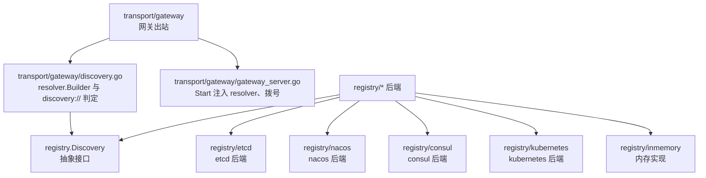
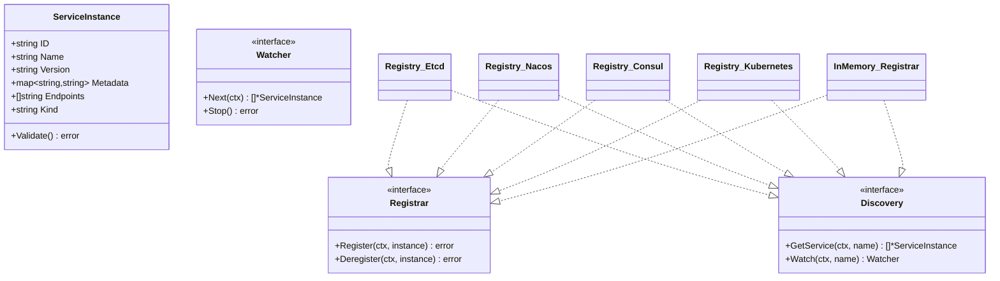
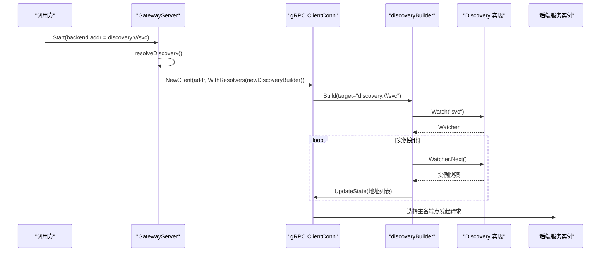
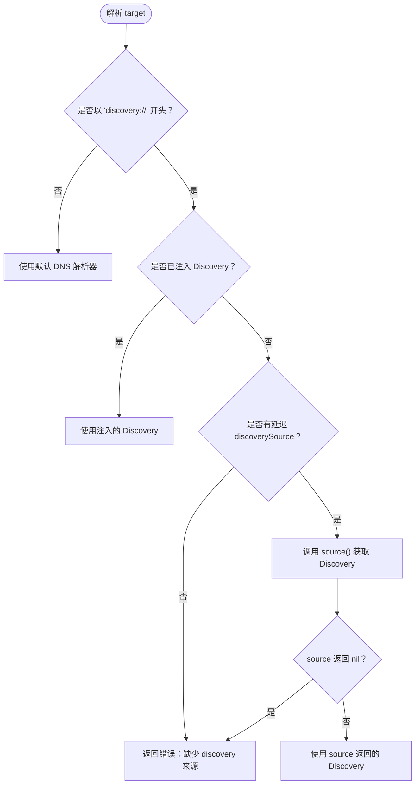
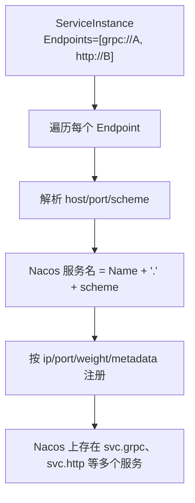
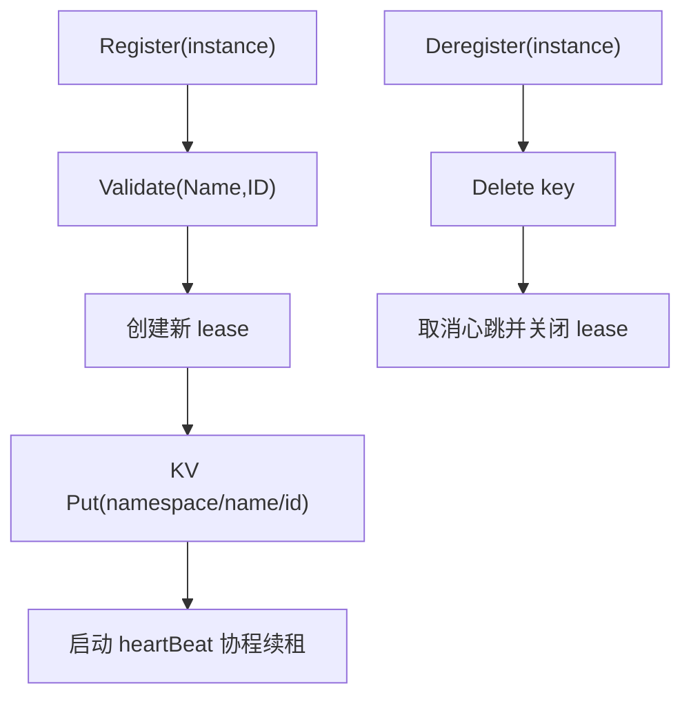
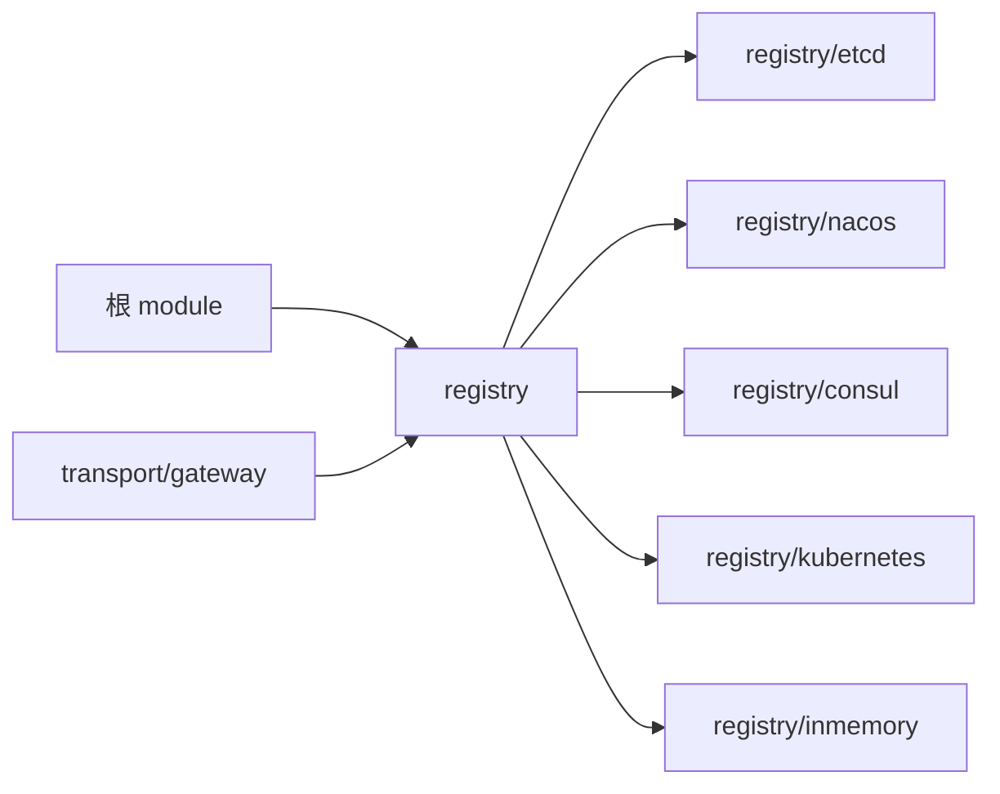

# 服务注册与发现

<cite>
**本文引用的文件**   
- [registry/registry.go](file://registry/registry.go)
- [transport/gateway/discovery.go](file://transport/gateway/discovery.go)
- [transport/gateway/discovery_test.go](file://transport/gateway/discovery_test.go)
- [transport/gateway/gateway_server.go](file://transport/gateway/gateway_server.go)
- [registry/etcd/registry.go](file://registry/etcd/registry.go)
- [registry/etcd/watcher.go](file://registry/etcd/watcher.go)
- [registry/nacos/registry.go](file://registry/nacos/registry.go)
- [registry/nacos/watcher.go](file://registry/nacos/watcher.go)
- [registry/consul/registry.go](file://registry/consul/registry.go)
- [registry/kubernetes/registry.go](file://registry/kubernetes/registry.go)
- [registry/inmemory/inmemory.go](file://registry/inmemory/inmemory.go)
- [scripts/list-modules.sh](file://scripts/list-modules.sh)
</cite>

## 目录
1. [简介](#简介)
2. [项目结构](#项目结构)
3. [核心契约：Registrar、Discovery、Watcher](#核心契约registrardiscoverywatcher)
4. [架构总览](#架构总览)
5. [详细组件分析](#详细组件分析)
6. [依赖关系分析](#依赖关系分析)
7. [性能与连接池](#性能与连接池)
8. [故障排查](#故障排查)
9. [结论](#结论)
10. [附录：配置与最佳实践](#附录配置与最佳实践)

## 简介
本文聚焦 Bald 框架中的服务注册与发现能力，以及网关出站如何把 gRPC 后端地址从直连切换到注册中心解析。仓库是九十三个 Go module 的多模块工程，`registry` 提供 Registrar/Discovery/Watcher 抽象和 etcd/consul/nacos/kubernetes/inmemory 多后端实现；`transport/gateway` 通过自定义 gRPC resolver 把 `discovery:///<服务名>` 目标接入该抽象。

作者约束强调三条必须写清的解析语义：Build 返回错误时 gRPC 不会重试（只 cc.ReportError，靠 Watch 推进）、空快照不推 UpdateState、只取 grpc:// 端点。nacos 还有一条特殊语义：把一个实例的多个端点拆成 `<Name>.<scheme>` 形式的多个服务，因此调用方目标必须写 `discovery:///<服务名>.grpc`；内存与 etcd 则用注册时的 ServiceInstance.Name 原样匹配。

## 项目结构
围绕本主题的相关代码分布在两个主区域：

**图表来源**
- [transport/gateway/gateway_server.go:1-L200](file://transport/gateway/gateway_server.go#L1-L200)
- [transport/gateway/discovery.go:1-L80](file://transport/gateway/discovery.go#L1-L80)
- [registry/registry.go:1-L81](file://registry/registry.go#L1-L81)

仓库根模块通过相对 replace 组合子模块；`scripts/list-modules.sh` 是 CI 与 Taskfile 消费的模块清单派生来源，排除 `_example*`。这意味着文档不应把整个仓库当成「一个 module」，也不应断言 `_example/bald` 在 CI 可装载——其 go.mod 把 kratos contrib 模块 replace 到仓库外同级检出，不在清单谓词内。

**章节来源**
- [scripts/list-modules.sh:1-L24](file://scripts/list-modules.sh#L1-L24)

## 核心契约：Registrar、Discovery、Watcher
`registry` 包定义最小契约，不绑定任何具体注册中心：

| 类型 | 职责 | 关键方法 |
|---|---|---|
| ServiceInstance | 描述一个应用实例：ID、Name、Version、Metadata、Endpoints、Kind | Validate 前置校验 Name 与 ID |
| Registrar | 服务注册与注销 | Register、Deregister |
| Discovery | 一次性拉取或订阅实例变更 | GetService、Watch |
| Watcher | 阻塞返回最新全量实例列表 | Next、Stop |

ServiceInstance.Validate 是四个后端的统一前置闸门：Name 和 ID 为空会直接报错，避免静默注册到畸形 key（例如 `<ns>//<id>` 或 `<ns>/<name>/`）。Endpoints 允许为空，以兼容无监听端点的组件。

**图表来源**
- [registry/registry.go:1-L81](file://registry/registry.go#L1-L81)

**章节来源**
- [registry/registry.go:1-L81](file://registry/registry.go#L1-L81)

## 架构总览
Gateway 出站链路分两层：

1. **网关启动层**：`GatewayServer.Start` 读取被代理 gRPC 段的 addr；如果它以 `discovery://` 开头，就构造带 discovery resolver 的 grpc.ClientConn。
2. **gRPC 解析层**：`discoveryBuilder.Build` 把 target 传给 Discovery.Watch，Watcher.Next 返回实例快照，resolver 再向 gRPC 客户端推送地址。

**图表来源**
- [transport/gateway/gateway_server.go:1-L200](file://transport/gateway/gateway_server.go#L1-L200)
- [transport/gateway/discovery.go:1-L80](file://transport/gateway/discovery.go#L1-L80)

**章节来源**
- [transport/gateway/gateway_server.go:1-L200](file://transport/gateway/gateway_server.go#L1-L200)

## 详细组件分析

### discovery:// 解析语义与三条既定规则
`discovery://` 是 gateway 侧定义的 scheme；只有当 backend addr 以该前缀开头时才启用 discovery resolver。若未注入 Discovery 却写了该 scheme，`resolveDiscovery` 会在 Start 阶段直接失败，而不是让 gRPC 把它当成普通主机名。

**图表来源**
- [transport/gateway/gateway_server.go:120-L180](file://transport/gateway/gateway_server.go#L120-L180)
- [transport/gateway/discovery.go:20-L80](file://transport/gateway/discovery.go#L20-L80)

#### 规则一：Build 返回错误时 gRPC 不会重试，只 ReportError
resolver 的 Build 若遇到无效 target（例如没有服务名），应直接返回错误。此时 gRPC 不会自动重试解析，而是由调用方通过 cc.ReportError 上报状态，再由 Watch 推进后续更新。测试中通过 fakeClientConn 断言：正常解析不应上报错误，而“零实例”场景会先 ReportError，随后实例出现时再 UpdateState。

**章节来源**
- [transport/gateway/discovery_test.go:1-L120](file://transport/gateway/discovery_test.go#L1-L120)
- [transport/gateway/discovery_test.go:170-L230](file://transport/gateway/discovery_test.go#L170-L230)

#### 规则二：空快照不推 UpdateState
当某个服务尚未注册、实例集合为空时，不能调用 UpdateState。原因是 gRPC 收到空地址集后会回 ErrBadResolverState 并可能清空已有健康地址。正确做法是先 ReportError 保持订阅，等下一次 Watch 有实例后再 UpdateState。

**章节来源**
- [transport/gateway/discovery_test.go:180-L230](file://transport/gateway/discovery_test.go#L180-L230)

#### 规则三：只取 grpc:// 端点
resolver 应过滤出以 `grpc://` 开头的 endpoint。这是为了区分 HTTP 面和其他协议面；少写 `.grpc` 后缀时，解析到的通常是 HTTP 端点或空集。对 nacos 而言，因为每个端点会被拆成 `<Name>.<scheme>`，所以目标必须显式写 `discovery:///<服务名>.grpc`。

**章节来源**
- [transport/gateway/discovery_test.go:140-L230](file://transport/gateway/discovery_test.go#L140-L230)

### nacos 的特殊行为
nacos 后端在 Register 时对 ServiceInstance.Endpoints 逐个解析，并以 `si.Name + "." + u.Scheme` 作为 Nacos 服务名。也就是说，同一个实例上的 grpc 与 http 端点会分别注册为 `svc.grpc` 和 `svc.http`。

对应地，Watcher.Next 会把实例重新组装为 `scheme://host:port` 的 endpoint，并把 kind 写入 metadata。因此：

- 调用方查询时必须写 `discovery:///<服务名>.grpc`。
- 如果只写 `discovery:///<服务名>`，通常只能看到 HTTP 面或空集。
- 权重、版本、集群、分组等由 options 控制，kind 默认是 `grpc`。

**图表来源**
- [registry/nacos/registry.go:1-L200](file://registry/nacos/registry.go#L1-L200)
- [registry/nacos/watcher.go:1-L98](file://registry/nacos/watcher.go#L1-L98)
- [registry/nacos/options.go:1-L84](file://registry/nacos/options.go#L1-L84)

**章节来源**
- [registry/nacos/registry.go:1-L241](file://registry/nacos/registry.go#L1-L241)
- [registry/nacos/watcher.go:1-L98](file://registry/nacos/watcher.go#L1-L98)
- [registry/nacos/options.go:1-L84](file://registry/nacos/options.go#L1-L84)

### etcd 后端
etcd 后端同时实现 Registrar 和 Discovery。Register 使用 lease + KV Put，并通过后台 heartBeat 续约；Deregister 删除 key、取消心跳并关闭租约。GetService 使用前缀扫描，Watcher 首次 Next 全量拉取，之后通过 watchChan 事件驱动，断链时重连并重拉。

- 键空间：`namespace/name/id`。
- 值：JSON 序列化的 ServiceInstance。
- 生命周期：New 自建 client 并在 Close 时关闭；NewWithClient 复用外部 client。
- 健康性：心跳断链指数退避重试（由 registry 段装配驱动）。

**图表来源**
- [registry/etcd/registry.go:1-L200](file://registry/etcd/registry.go#L1-L200)
- [registry/etcd/watcher.go:1-L100](file://registry/etcd/watcher.go#L1-L100)

**章节来源**
- [registry/etcd/registry.go:1-L200](file://registry/etcd/registry.go#L1-L200)
- [registry/etcd/watcher.go:1-L100](file://registry/etcd/watcher.go#L1-L100)

### consul 后端
consul 后端也实现 Registrar 与 Discovery。Register/Deregister 委托内部 Client，GetService 先查本地缓存，不存在或为空时再远程拉取；Watch 使用 serviceSet 管理 watcher 列表，初次若有值会立刻推送信号，避免初始数据阻塞。

- 支持健康检查、心跳、deregister-critical-service-after 等选项。
- 可注入 Consul API Client，也可通过 address/scheme/token 构建。
- 当前文档不得宣称生产验证结果；实现细节以源码为准。

**章节来源**
- [registry/consul/registry.go:1-L233](file://registry/consul/registry.go#L1-L233)
- [registry/consul/options.go:1-L86](file://registry/consul/options.go#L1-L86)

### kubernetes 后端
kubernetes 后端基于 Pod informer，将服务信息写入当前 Pod 的 labels 与 annotations：

- 标签：bald-service-id、bald-service-app、bald-service-version。
- 注解：bald-service-metadata、bald-service-protocols。
- Register 实际是对当前 Pod 做 Patch，不是独立注册中心；Deregister 清除这些字段。
- 源码注释明确说明目前仅参考实现，未在真实环境验证。

**章节来源**
- [registry/kubernetes/registry.go:1-L200](file://registry/kubernetes/registry.go#L1-L200)
- [registry/kubernetes/options.go:1-L22](file://registry/kubernetes/options.go#L1-L22)

### inmemory 后端
inmemory 提供单进程内存实现，适用于开发、测试和本地调试：

- Register 按 ID 覆盖保存，并按 Name 通知所有 watcher。
- snapshotLocked 按 ID 排序，避免 map 遍历无序导致每次变更抖动。
- Watcher 队列容量为 1，丢弃中间旧快照，保证消费者读到最新状态。
- Stop 后 Next 返回 errWatcherClosed，调用方可据此退出循环。

**章节来源**
- [registry/inmemory/inmemory.go:1-L169](file://registry/inmemory/inmemory.go#L1-L169)

### 网关出站与故障转移
GatewayServer 默认使用 gRPC 的 pick_first 负载均衡策略，因此 discovery 解析出的多实例用于主备故障转移，而不是流量分摊。需要多副本分摊时应由拨号侧配置 round_robin 服务。

Start 流程要点：

1. 根据 backend TLS 配置决定传输凭据。
2. 判断 backend addr 是否走 discovery。
3. 若走 discovery 且未注入 Discovery，直接报错。
4. 将 newDiscoveryBuilder 附加到 grpc.WithResolvers。
5. 建立 conn 后注册业务 handler，再进入 HTTP Serve。

**章节来源**
- [transport/gateway/gateway_server.go:1-L200](file://transport/gateway/gateway_server.go#L1-L200)

## 依赖关系分析
`registry` 包的各后端都是独立 module，通过相对 replace 组成可编译闭包。根 module 不得 require 任何适配器，以避免模块环；契约装配走段驱动 Provider 或 appkit.Registrar 显式接管。

**图表来源**
- [go.mod:1-L60](file://go.mod#L1-L60)

**章节来源**
- [go.mod:1-L60](file://go.mod#L1-L60)

## 性能与连接池
本节给出通用指导，不绑定具体实现：

- **etcd**：心跳与 watch 是长连接；合理设置 dialTimeout、lease TTL 和重试上限，避免频繁重连。
- **nacos**：NamingClient 自带 gRPC 长连接与心跳订阅；Close 会释放资源，注入模式由调用方负责生命周期。
- **consul**：API Client 无需显式关闭，但内部 healthcheck 与 heartbeat 受 ctx 控制；可根据服务规模调整超时与健康检查间隔。
- **kubernetes**：SharedInformerFactory 默认 10 分钟 resync，适合稳定集群；大规模集群下应关注 informer 同步延迟。
- **inmemory**：适合单进程测试；snapshot 每变更拷贝一次，注意实例数量增长后的复制成本。
- **gateway**：conn 在 Start 时建立，Stop 时关闭；handler 与 mux 由业务提供，避免重复依赖 grpc-gateway。
- **balancer**：默认 pick_first 是主备；需要多副本分摊时由 gRPC 拨号侧配置 round_robin。

[本节为通用性能建议，不直接分析具体文件，故无章节来源]

## 故障排查

| 现象 | 可能原因 | 排查步骤 |
|---|---|---|
| 启动时报错“缺少 discovery 来源” | backend.addr 使用 discovery scheme，但未注入 Discovery 或 discoverySource | 检查 GatewayServer 构造参数，确认 WithDiscovery 或 WithDiscoverySource |
| 解析成功但一直无地址 | 服务尚未注册，或实例集合为空 | 确认服务已注册；不要对空快照 UpdateState，应 ReportError 并保持订阅 |
| 解析到 HTTP 端点而非 gRPC | nacos 目标没写 `.grpc` 后缀，或 endpoint 不是 grpc:// | nacos 必须写 `discovery:///<服务名>.grpc`；其他后端确保 endpoint 以 grpc:// 开头 |
| 多次变更抖动 | 实例顺序不稳定 | inmemory 已按 ID 排序；检查自定义 Watcher 是否保证稳定顺序 |
| 停止后 Watcher.Next 阻塞 | watcher 未 Stop 或调用方未处理 errWatcherClosed | 在 Stop 后退出循环，或捕获 closed 通道 |
| 集成测试全部 SKIP | 真后端不可达 | 集成作业应先 TCP 探活，再逐条断言用例输出 PASS；SKIP 不代表成功 |
| 并发放行数不确定 | 概率式 breaker 测试直接断言统计阈值 | 应先构造有界前置状态，再断言单次拒绝率满足理论上界 |

**章节来源**
- [transport/gateway/discovery_test.go:170-L230](file://transport/gateway/discovery_test.go#L170-L230)
- [registry/inmemory/inmemory.go:120-L169](file://registry/inmemory/inmemory.go#L120-L169)

## 结论
Bald 的服务注册与发现以 Registrar/Discovery/Watcher 三个接口为核心，将 etcd、consul、nacos、kubernetes 和 inmemory 解耦为可选后端；gateway 通过 discoveryBuilder 把 `discovery:///<服务名>` 接入 gRPC 解析层。使用中最关键的三条规则是：Build 错误不重试只 ReportError、空快照不推 UpdateState、只取 grpc:// 端点。nacos 还需要特别注意“一个实例多个端点拆成多个服务”的行为，调用方必须显式指定 `.grpc`。

**章节来源**
- [registry/registry.go:1-L81](file://registry/registry.go#L1-L81)
- [transport/gateway/discovery.go:20-L80](file://transport/gateway/discovery.go#L20-L80)
- [transport/gateway/discovery_test.go:140-L230](file://transport/gateway/discovery_test.go#L140-L230)
- [registry/nacos/registry.go:1-L200](file://registry/nacos/registry.go#L1-L200)

## 附录：配置与最佳实践

### 各后端配置要点
- **etcd**
  - endpoints 必填；支持 username/password。
  - 支持 New 与 NewWithClient；Close 幂等。
  - 命名空间：namespace/name/id。
- **nacos**
  - serverAddrs 必填；支持 namespace、group、cluster、weight、kind、timeout、username、password。
  - Register 对每个 endpoint 注册 `<Name>.<scheme>`；target 必须写 `discovery:///<服务名>.grpc`。
- **consul**
  - 支持 address/scheme/token；可注入 api.Client。
  - 支持健康检查、心跳、deregister-critical-service-after、service check 等选项。
- **kubernetes**
  - 通过 Pod labels 与 annotations 同步元数据。
  - 源码标注为参考实现，未在真实环境验证。
- **inmemory**
  - 单进程线程安全；按 ID 覆盖，按 Name 推送快照。

**章节来源**
- [registry/etcd/options.go](file://registry/etcd/options.go)
- [registry/nacos/options.go:1-L84](file://registry/nacos/options.go#L1-L84)
- [registry/consul/options.go:1-L86](file://registry/consul/options.go#L1-L86)
- [registry/kubernetes/options.go:1-L22](file://registry/kubernetes/options.go#L1-L22)

### 最佳实践清单
1. 始终先调用 ServiceInstance.Validate，避免空 Name/ID 造成畸形 key。
2. nacos 调用方目标必须写 `discovery:///<服务名>.grpc`，否则解析不到 gRPC 端点。
3. 空实例快照不推 UpdateState，先 ReportError，等 Watch 推进。
4. 只取 grpc:// 端点；HTTP 面与其他协议面需区分。
5. gateway 默认 pick_first 是主备，不是负载均衡；多副本分摊需额外配置。
6. 集成测试必须兜底不可达后端：先探活，再断言 PASS；跳过不等于通过。
7. 概率式组件测试不要直接断言统计阈值，应构造有界前置状态再断言。
8. 多模块仓库以 `scripts/list-modules.sh` 为唯一清单来源，不要自行 find 推断覆盖范围。

[本节为实践总结，不直接分析具体文件，故无章节来源]