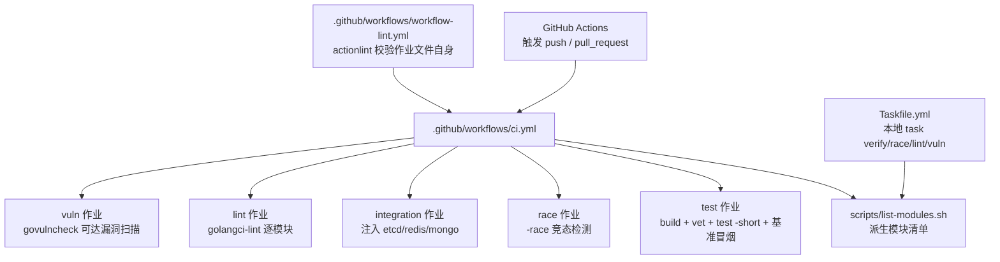
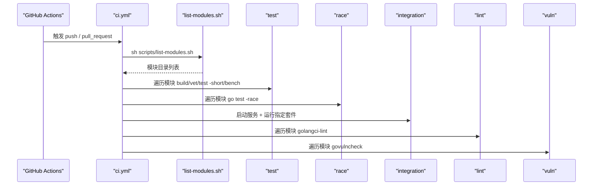
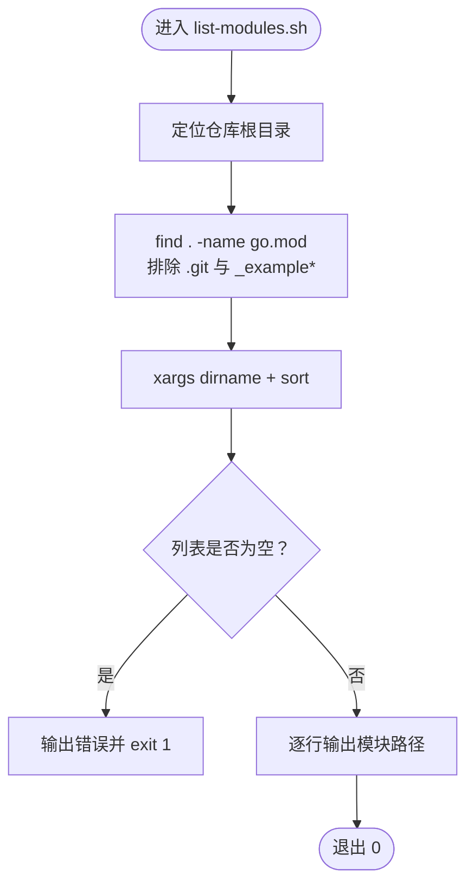
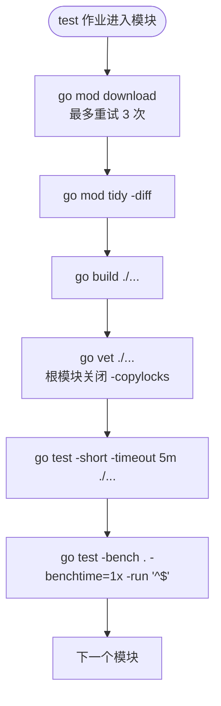
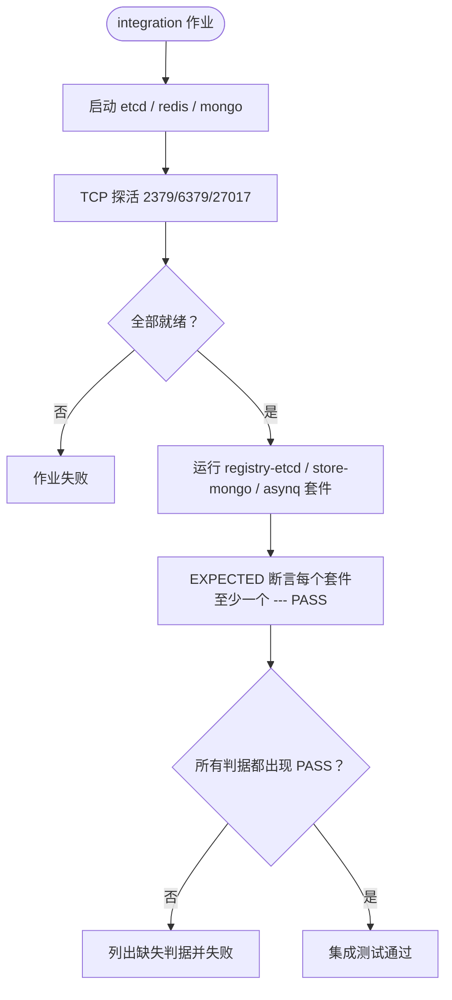
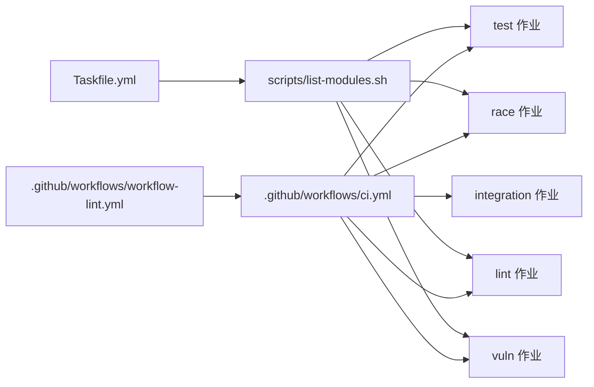

# CI 流水线与质量闸门

<cite>
**本文引用的文件**   
- [ci.yml](file://.github/workflows/ci.yml)
- [workflow-lint.yml](file://.github/workflows/workflow-lint.yml)
- [list-modules.sh](file://scripts/list-modules.sh)
- [Taskfile.yml](file://Taskfile.yml)
</cite>

## 目录
1. [引言](#引言)
2. [项目结构](#项目结构)
3. [核心组件](#核心组件)
4. [架构总览](#架构总览)
5. [详细组件分析](#详细组件分析)
6. [依赖关系分析](#依赖关系分析)
7. [性能与稳定性考量](#性能与稳定性考量)
8. [故障排查指南](#故障排查指南)
9. [结论](#结论)

## 引言
本仓库是一个由 93 个 Go module 组成的多模块工程（无 `go.work`），CI 通过五个作业完成从构建、测试、竞态检测、集成验证到静态检查与安全扫描的完整质量闭环。其设计目标是：新增模块时不维护第二份清单、主循环快速可靠、真实后端只在集成作业中启动，且任何“静默跳过”都能被显式判据拦截。

## 项目结构
与 CI 直接相关的文件集中在两个位置：

- `.github/workflows/`：GitHub Actions 工作流定义；
- `scripts/list-modules.sh`：全仓模块清单的唯一派生脚本；
- `Taskfile.yml`：本地任务入口，复用同一份模块清单并固定工具链版本。

**图表来源**
- [ci.yml:1-298](file://.github/workflows/ci.yml#L1-L298)
- [workflow-lint.yml:1-46](file://.github/workflows/workflow-lint.yml#L1-L46)
- [list-modules.sh:1-24](file://scripts/list-modules.sh#L1-L24)
- [Taskfile.yml:1-60](file://Taskfile.yml#L1-L60)

**章节来源**
- [ci.yml:1-298](file://.github/workflows/ci.yml#L1-L298)
- [workflow-lint.yml:1-46](file://.github/workflows/workflow-lint.yml#L1-L46)
- [list-modules.sh:1-24](file://scripts/list-modules.sh#L1-L24)
- [Taskfile.yml:1-60](file://Taskfile.yml#L1-L60)

## 核心组件
CI 的核心由「单一模块清单」和「五类作业」组成。

| 组件 | 职责 | 关键行为 | 触发条件 |
|---|---|---|---|
| `scripts/list-modules.sh` | 全仓唯一模块清单派生 | 查找所有 `go.mod`，排除 `.git` 与 `_example*`，按字典序输出；为空则非零退出 | CI 与 Taskfile 共同消费 |
| `test` | 快速主循环 | 每模块 build → vet → `go test -short -timeout 5m` → 基准冒烟；根模块 vet 关闭 `-copylocks` | push main / pull_request |
| `race` | 并发竞态检测 | 对清单减去 `.github/race-skip.txt` 后的模块跑 `-race` | push main / pull_request |
| `integration` | 真实后端集成测试 | 启动 etcd/redis/mongo，仅点名运行 registry/store/asynq 套件，末尾断言日志中出现 `--- PASS` | push main / pull_request |
| `lint` | 静态代码检查 | golangci-lint 逐模块运行 | push main / pull_request |
| `vuln` | 安全漏洞扫描 | govulncheck 逐模块扫描可达代码 | push main / pull_request |

**章节来源**
- [list-modules.sh:1-24](file://scripts/list-modules.sh#L1-L24)
- [ci.yml:1-298](file://.github/workflows/ci.yml#L1-L298)
- [Taskfile.yml:1-60](file://Taskfile.yml#L1-L60)

## 架构总览
下图展示 CI 执行路径：工作流统一从 `scripts/list-modules.sh` 获取模块列表，再分发到五个作业；`Taskfile.yml` 在本地复现相同派生逻辑，避免“本地绿、CI 红”。

**图表来源**
- [ci.yml:1-298](file://.github/workflows/ci.yml#L1-L298)
- [list-modules.sh:1-24](file://scripts/list-modules.sh#L1-L24)

**章节来源**
- [ci.yml:1-298](file://.github/workflows/ci.yml#L1-L298)

## 详细组件分析

### 模块清单派生：`scripts/list-modules.sh`
该脚本是仓库中模块覆盖范围的单一真相源。它使用 `find` 查找所有 `go.mod`，排除 `.git` 目录与 `_example*` 前缀，并按行输出相对路径；当没有匹配结果时直接以非零状态码退出，防止“空清单导致闸门静默失效”。

| 规则 | 说明 |
|---|---|
| 根模块表示为 `.` | 根 `go.mod` 所在目录即为 `.` |
| 排除 `.git/*` | 防止 worktree/stash 残留的临时 `go.mod` 污染清单 |
| 排除 `_example*` | `_example/bald` 是独立示例模块，由 Taskfile 的 `example-*` 任务单独处理 |
| 空清单失败 | 输出错误信息并以非零退出，强制 CI 暴露谓词问题 |

**图表来源**
- [list-modules.sh:1-24](file://scripts/list-modules.sh#L1-L24)

**章节来源**
- [list-modules.sh:1-24](file://scripts/list-modules.sh#L1-L24)

### `test` 作业：主循环与 `-short` 约束
`test` 作业是 CI 的第一道闸门，逐模块执行以下流程：

1. 预下载依赖，最多重试 3 次，屏蔽 proxy.golang.org 偶发 HTTP/2 中流错误；
2. 执行 `go mod tidy -diff`，把 `go.mod`/`go.sum` 与 import 图漂移变成红色；
3. 执行 `go build ./...` 与 `go vet ./...`；
4. 执行 `go test -short -timeout 5m ./...`；
5. 执行基准冒烟：`go test -bench . -benchtime=1x -run '^$'`，只编译并单迭代运行基准，拦截基准回归而不解析耗时输出；
6. 根模块额外关闭 `vet -copylocks`，因为 `appkit` 热重载中对 proto 顶层指针字段浅拷贝属于既定设计。

#### 为什么必须保留 `-short`
`transport/{redis,kafka,rabbitmq,rocketmq,tcp,webrtc}` 中的 `TestServer`/`TestClient` 是等信号的手动用例。它们在没有外部信号的情况下会阻塞等待，因此如果去掉 `-short`，主循环会被这些用例挂到 timeout，整个 job 失去意义。集成测试不是通过扩大 `-short` 来覆盖，而是由独立的 `integration` 作业按套件点名注入真实后端。

**图表来源**
- [ci.yml:1-298](file://.github/workflows/ci.yml#L1-L298)

**章节来源**
- [ci.yml:1-298](file://.github/workflows/ci.yml#L1-L298)

### `race` 作业：竞态检测范围
`race` 作业对 `scripts/list-modules.sh` 派生的全部模块执行 `go test -short -race -timeout 10m`，但会减去 `.github/race-skip.txt` 中列出的模块。其设计要点：

- 默认值是“跑”，新增模块无需手动加入 race 清单；
- 与 `test`、`lint`、`vuln` 同源同一份模块派生；
- 对无测试文件的模块，`go test` 会打 `no test files`，代价仅为一次竞态化构建；
- 注释明确说明：普通 test 不启用 race detector，session manager、热重载、计划缓存、限流器等并发路径的竞争只能在这里发现。

**章节来源**
- [ci.yml:1-298](file://.github/workflows/ci.yml#L1-L298)

### `integration` 作业：真实后端与三档防静默失效
`integration` 作业是 CI 中最容易自欺的部分，因此实现上用了三层防护：

| 层级 | 作用 |
|---|---|
| 服务探活 | 通过 TCP 探测 2379、6379、27017，任一不可达即失败，不让“服务没起来”伪装成测试通过 |
| 套件点名 | 只运行 `registry/etcd`、`contrib/store-mongo`、`transport/asynq` 三个套件，不泛化扫描 |
| 判据断言 | 末尾用 EXPECTED 表逐项 grep 日志中的 `--- PASS: <测试名>`，Skip、改名、未编译都会报错 |

#### 注入的后端
- etcd：镜像 `quay.io/coreos/etcd:v3.5.14`，端口 `2379`；
- redis：镜像 `redis:7-alpine`，端口 `6379`；
- mongo：镜像 `mongo:7`，端口 `27017`。

环境变量显式传入：
- `BALD_E2E_ETCD_ADDR=127.0.0.1:2379`
- `BALD_TEST_REDIS_URI=redis://127.0.0.1:6379`
- `BALD_MONGO_URI=mongodb://127.0.0.1:27017`

#### 为什么 `_example/bald` 不在集成作业中
`_example/bald/go.mod` 把两个 kratos contrib 模块 replace 到仓库外的同级检出路径。干净检出下这两个路径不存在，模块图无法装载，因此示例的端到端能力只在本地可复制命令中运行，而不是 CI 集成作业的一部分。

**图表来源**
- [ci.yml:1-298](file://.github/workflows/ci.yml#L1-L298)

**章节来源**
- [ci.yml:1-298](file://.github/workflows/ci.yml#L1-L298)

### `lint` 作业：静态代码检查
`lint` 作业安装 pinned 版本的 golangci-lint，然后对 `scripts/list-modules.sh` 输出的每个模块执行 `golangci-lint run ./...`。配置位于根目录的 `.golangci.yml`，子模块目录会自动向上发现该配置，因此新增模块不需要修改 job。

**章节来源**
- [ci.yml:1-298](file://.github/workflows/ci.yml#L1-L298)

### `vuln` 作业：可达安全漏洞扫描
`vuln` 作业安装 pinned 版本的 govulncheck，并对每个模块执行 `govulncheck ./...`。其语义是报告“代码真正可达”的漏洞，而不是单纯扫描依赖清单；标准库漏洞可通过 setup-go 的补丁版本修复，依赖漏洞则升级到 fixed 版本。

**章节来源**
- [ci.yml:1-298](file://.github/workflows/ci.yml#L1-L298)

### `workflow-lint` 作业：作业文件自身的质量闸门
`.github/workflows/workflow-lint.yml` 使用 actionlint 校验 `.github/workflows/*.yml`。它之所以独立于 `ci.yml`，是因为 GitHub 在工作流 YAML 编译期解析作业定义，若出现未登记键（例如 `services.args`），整个文件会被拒绝，表现为“0 个 job、瞬间失败、API 中只留下 workflow file issue”。通用 YAML 解析器（如 Psych/PyYAML）不会发现这个问题，因此需要一个独立的 lint 作业先自检。

**章节来源**
- [workflow-lint.yml:1-46](file://.github/workflows/workflow-lint.yml#L1-L46)
- [ci.yml:1-298](file://.github/workflows/ci.yml#L1-L298)

## 依赖关系分析
CI 内部各组件之间的依赖如下：

**图表来源**
- [ci.yml:1-298](file://.github/workflows/ci.yml#L1-L298)
- [workflow-lint.yml:1-46](file://.github/workflows/workflow-lint.yml#L1-L46)
- [list-modules.sh:1-24](file://scripts/list-modules.sh#L1-L24)
- [Taskfile.yml:1-60](file://Taskfile.yml#L1-L60)

**章节来源**
- [ci.yml:1-298](file://.github/workflows/ci.yml#L1-L298)
- [workflow-lint.yml:1-46](file://.github/workflows/workflow-lint.yml#L1-L46)
- [list-modules.sh:1-24](file://scripts/list-modules.sh#L1-L24)
- [Taskfile.yml:1-60](file://Taskfile.yml#L1-L60)

## 性能与稳定性考量
- **依赖下载重试**：test、race、lint、vuln 四个作业都对 `go mod download` 做最多 3 次重试，缓解 proxy.golang.org 在 Azure US runner 上的 HTTP/2 中流错误。
- **GOPROXY 主备源**：主源 `goproxy.io`，备源 `proxy.golang.org`，直连作为兜底；sumdb 校验不受 proxy 切换影响。
- **超时保护**：主循环 test 使用 `-timeout 5m`，race 使用 `-timeout 10m`，集成作业整体超时 30 分钟，避免单个模块或某个后端卡死拖垮整条流水线。
- **基准冒烟而非性能回归**：基准测试只执行一次迭代，主要拦截基准编译失败、基准 panic 等回归，不依赖性能基线比较。
- **Windows 适配**：Taskfile 使用 `cmd:` 与平台检测区分 Windows PowerShell 与 bash，避免 `cd` 在不同 shell 下的行为差异。

[本节为通用指导，不直接分析具体代码片段]

## 故障排查指南

### 现象一：提交后 GitHub 显示“0 个 job”，只有一个 workflow file issue
**原因**：`services` 字段下写了 `args`。GitHub 的作业文件在编译期解析，`services` 只接受 `credentials`、`env`、`image`、`options`、`ports`、`volumes`；多出任意键会让整个工作流文件被拒。

**修复步骤**：
1. 把容器参数改为同名环境变量，例如 etcd 使用 `ETCD_LISTEN_CLIENT_URLS` 与 `ETCD_ADVERTISE_CLIENT_URLS`；
2. 本地先执行 `task ci-workflow-lint`；
3. 确认 actionlint 通过后再次提交。

**章节来源**
- [ci.yml:1-298](file://.github/workflows/ci.yml#L1-L298)
- [workflow-lint.yml:1-46](file://.github/workflows/workflow-lint.yml#L1-L46)

### 现象二：本地 `task verify` 绿色，CI 却报模块未覆盖
**原因**：模块清单不是各自内联 find，而是统一来自 `scripts/list-modules.sh`。若本地和 CI 的行为不一致，通常是脚本谓词被改坏、在错误目录下执行，或 `_example/bald` 被错误纳入核心模块扫描。

**修复步骤**：
1. 确认 `sh scripts/list-modules.sh` 在本机输出正常；
2. 检查是否意外排除了目标模块；
3. `_example/bald` 应由 Taskfile 的 `example-*` 任务单独覆盖，不应出现在核心模块主循环中。

**章节来源**
- [list-modules.sh:1-24](file://scripts/list-modules.sh#L1-L24)
- [Taskfile.yml:1-60](file://Taskfile.yml#L1-L60)

### 现象三：去掉 `-short` 后 CI 长时间无输出并最终 timeout
**原因**：`transport/{redis,kafka,rabbitmq,rocketmq,tcp,webrtc}` 的 `TestServer`/`TestClient` 是等信号的手动用例。去掉 `-short` 后，主循环会尝试运行这些用例并一直等待信号。

**修复步骤**：
1. 不要移除主循环的 `-short`；
2. 需要覆盖真实后端场景时，应在 `integration` 作业中以套件点名方式运行；
3. 新增加速或稳定性的手段应是缩短超时、减少假数据量，而不是扩大测试范围。

**章节来源**
- [ci.yml:1-298](file://.github/workflows/ci.yml#L1-L298)

### 现象四：集成作业看起来“全部 SKIP”但仍显示通过
**原因**：集成测试的写法是“不可达即 Skip”，如果服务没起起来、端口探测缺失或 EXPECTED 判据未更新，可能出现 23 条 SKIP 但 job 仍然 green 的假象。

**修复步骤**：
1. 确保服务探活 step 通过；
2. 检查 EXPECTED 列表中是否包含新增或重命名的测试；
3. 查看 `/tmp/int/*.log` 中是否真的出现对应 `--- PASS: <测试名>`；
4. 若只是改了套件名，必须同时更新 EXPECTED 断言。

**章节来源**
- [ci.yml:1-298](file://.github/workflows/ci.yml#L1-L298)

### 现象五：依赖下载失败或网络波动
**表现**：`go mod download` 间歇性失败，尤其是 proxy.golang.org 的中流 HTTP/2 错误。

**修复步骤**：
1. 确认 GOPROXY 已设置为 `https://goproxy.io|https://proxy.golang.org,direct`；
2. 等待自动重试机制生效；
3. 若持续失败，检查网络代理、DNS、GitHub Actions runner 所在区域；
4. 不要在 job 中自行删除重试逻辑，这是针对已知网络问题的稳定化措施。

**章节来源**
- [ci.yml:1-298](file://.github/workflows/ci.yml#L1-L298)

### 现象六：新增模块后 lint 或 vuln 不执行
**原因**：模块未被 `scripts/list-modules.sh` 派生出来，通常是因为 `go.mod` 不在预期位置，或被 `_example*` 谓词误伤。

**修复步骤**：
1. 在仓库根执行 `sh scripts/list-modules.sh`，确认目标模块路径在输出中；
2. 确认模块路径不以 `_example` 开头；
3. 确认 `go.mod` 存在且可被 `find` 访问；
4. 重新提交触发 CI。

**章节来源**
- [list-modules.sh:1-24](file://scripts/list-modules.sh#L1-L24)

### 现象七：本地工具链找不到 golangci-lint、govulncheck、actionlint
**原因**：这些工具安装在 `$(go env GOPATH)/bin`，版本 pin 的唯一真相源是 `Taskfile.yml` 的 `vars`。

**修复步骤**：
1. 执行 `task tools-golangci-lint`、`task tools-govulncheck`、`task tools-actionlint`；
2. 确认 `$(go env GOPATH)/bin` 已在 PATH 中；
3. 如需升级，应显式修改 `Taskfile.yml` 中的版本号，而不是直接 `go install` 最新；
4. 同步更新 `workflow-lint.yml` 中的 actionlint 版本 pin，保持 CI 与本地一致。

**章节来源**
- [Taskfile.yml:1-60](file://Taskfile.yml#L1-L60)
- [workflow-lint.yml:1-46](file://.github/workflows/workflow-lint.yml#L1-L46)

## 结论
Bald 项目的 CI 流水线以 `scripts/list-modules.sh` 为中心，将 92 个核心模块的构建、短测、竞态检测、集成验证、静态检查和漏洞扫描统一到五个作业中。其关键设计原则是：

- 主循环必须保留 `-short`，避免 transport 层手动用例阻塞；
- 真实后端只在 `integration` 作业中启动，并通过服务探活与 EXPECTED 判据双重拦截静默跳过；
- GitHub 作业文件中的 `services.args` 是禁用模式，必须改用同名环境变量；
- 修改作业文件前先跑 `task ci-workflow-lint`，让 actionlint 在通用 YAML 解析器之前发现问题；
- 模块清单只有一份派生，CI 与本地 Taskfile 共享，避免本地与 CI 覆盖范围漂移。

这套设计使新增模块时只需保证模块本身可编译、可测试，而无需重复维护 CI 清单；同时也保留了足够的显式断言，让“静默通过”不再成为 CI 的盲区。