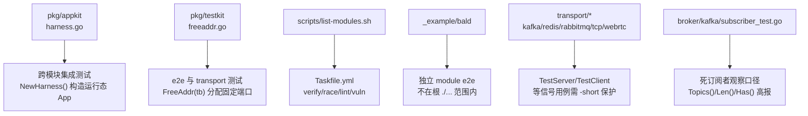
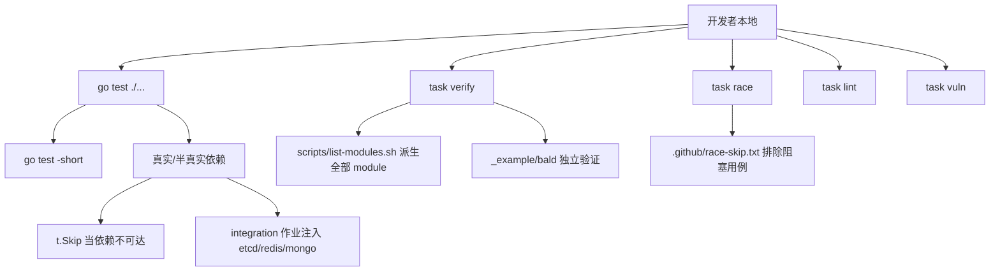
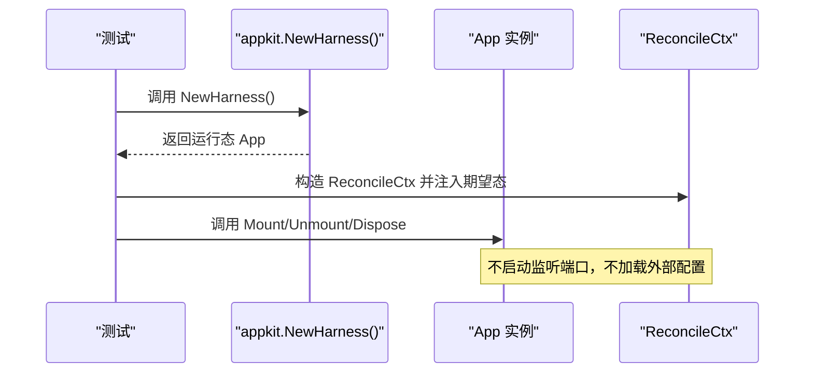
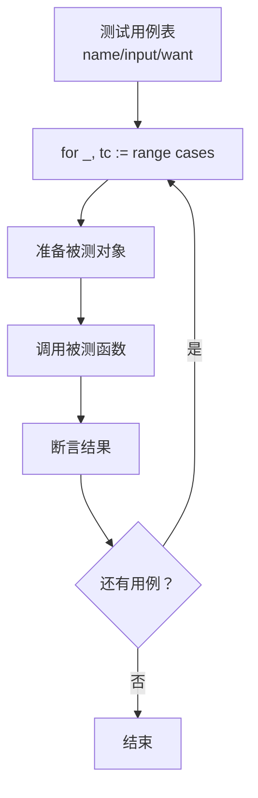
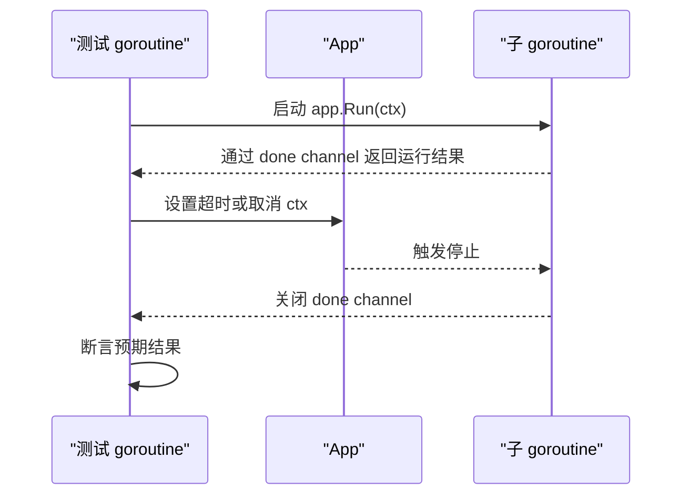
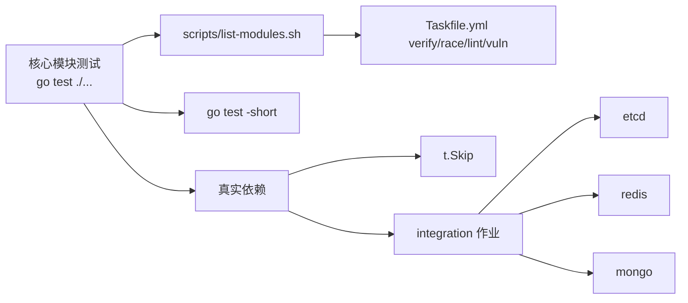

# 单元测试最佳实践

<cite>
**本文引用的文件**
- [pkg/testkit/freeaddr.go](file://pkg/testkit/freeaddr.go)
- [pkg/testkit/freeaddr_test.go](file://pkg/testkit/freeaddr_test.go)
- [pkg/appkit/harness.go](file://pkg/appkit/harness.go)
- [scripts/list-modules.sh](file://scripts/list-modules.sh)
- [Taskfile.yml](file://Taskfile.yml)
- [broker/kafka/subscriber_test.go](file://broker/kafka/subscriber_test.go)
- [circuitbreaker/sres/sres_test.go](file://circuitbreaker/sres/sres_test.go)
- [transport/kafka/server_test.go](file://transport/kafka/server_test.go)
- [transport/tcp/server_test.go](file://transport/tcp/server_test.go)
- [transport/redis/server_test.go](file://transport/redis/server_test.go)
- [bconfig/kubernetes/watcher_test.go](file://bconfig/kubernetes/watcher_test.go)
- [pkg/appkit/bootstrap_test.go](file://pkg/appkit/bootstrap_test.go)
- [pkg/appkit/drift_test.go](file://pkg/appkit/drift_test.go)
</cite>

## 目录
1. [引言](#引言)
2. [项目结构](#项目结构)
3. [核心组件](#核心组件)
4. [架构总览](#架构总览)
5. [详细组件分析](#详细组件分析)
6. [依赖关系分析](#依赖关系分析)
7. [性能考量](#性能考量)
8. [故障排查指南](#故障排查指南)
9. [结论](#结论)
10. [附录](#附录)

## 引言
本仓库是 93 个 go.mod 多模块组合，没有 go.work。子模块通过相对 replace 组成可编译闭包，`scripts/list-modules.sh` 是全仓唯一模块清单派生入口；CI 与 Taskfile 都消费它。因此，“测试最佳实践”不能只围绕单个 module 展开，而必须同时覆盖：

- 服务发现与网关出站测试
- CI 质量闸门（test / race / integration / lint / vuln）
- Broker 订阅者生命周期测试

本文从“AppKit harness 使用模式、端口分配工具、Mock 策略、测试数据管理、表驱动测试、并发安全测试、错误与边界条件、基准测试、覆盖率与质量门禁”十个方面给出可落地的规范。

## 项目结构
测试相关的关键位置如下：

**图示来源**
- [pkg/appkit/harness.go:1-19](file://pkg/appkit/harness.go#L1-L19)
- [pkg/testkit/freeaddr.go:1-30](file://pkg/testkit/freeaddr.go#L1-L30)
- [scripts/list-modules.sh:1-24](file://scripts/list-modules.sh#L1-L24)
- [Taskfile.yml:257-360](file://Taskfile.yml#L257-L360)

**章节来源**
- [scripts/list-modules.sh:1-24](file://scripts/list-modules.sh#L1-L24)
- [Taskfile.yml:1-200](file://Taskfile.yml#L1-L200)

## 核心组件
本节聚焦三类与测试直接相关的核心构件：AppKit harness、FreeAddr 端口分配器、以及 CI 任务管线。

| 组件 | 职责 | 关键行为 | 适用场景 |
|---|---|---|---|
| `appkit.NewHarness()` | 为协调器逻辑提供测试装置 | 跳过配置加载与服务器监听，把 App 标记为 running，MountComponent/ReconcileCtx.Mount 可用 | 跨 module 的集成测试驱动 Reconcile 流程 |
| `testkit.FreeAddr(tb)` | 分配当前空闲 TCP 地址 | 监听 `127.0.0.1:0`，取端口后立刻关闭，返回带 IPv4 前缀地址 | GatewayServer 后端 gRPC 等需要确定端口的 e2e |
| `Taskfile.yml` 中的 verify/race/lint/vuln | 统一 CI 质量闸门 | 基于 `list-modules.sh` 派生模块列表，逐模块执行 | 本地与 CI 保持一致覆盖范围 |

**章节来源**
- [pkg/appkit/harness.go:1-19](file://pkg/appkit/harness.go#L1-L19)
- [pkg/testkit/freeaddr.go:1-30](file://pkg/testkit/freeaddr.go#L1-L30)
- [Taskfile.yml:257-360](file://Taskfile.yml#L257-L360)

## 架构总览
Bald 项目的测试架构由三层组成：

1. **单元层**：每个模块内部的 `*_test.go`，走 `go test ./...`。
2. **集成层**：依赖真实或半真实后端（etcd、redis、mongo、kafka、rabbitmq、rocketmq、tcp、webrtc），通常以“不可达即跳过”的方式实现。
3. **验收层**：Taskfile 的 `acceptance`、`example-e2e` 以及 `_example/bald` 下的端到端回归。

**图示来源**
- [Taskfile.yml:257-360](file://Taskfile.yml#L257-L360)
- [scripts/list-modules.sh:1-24](file://scripts/list-modules.sh#L1-L24)

## 详细组件分析

### AppKit Harness 使用模式
`pkg/appkit/harness.go` 导出的 `NewHarness()` 不是生产 API，而是为独立 Go module 的集成测试提供的运行态 App 装配器。它的语义是：

- 调用 `NewApp()`。
- 将 App 内部 running 状态置为 true。
- 不监听端口。
- 不加载配置仓库。
- MountComponent、ReconcileCtx.Mount、Dispose 等生命周期语义与真实 App 一致。

典型用法是：在跨 module 的集成测试中，用 `NewHarness()` 拿到一个已处于运行态的 App，再配合 `NewReconcileCtx` 注入期望快照并手动调用协调函数，从而验证 Provider 装配与 Reconcile 逻辑，而不启动 HTTP/gRPC 服务。

**图示来源**
- [pkg/appkit/harness.go:1-19](file://pkg/appkit/harness.go#L1-L19)

实际测试中，`drift_test.go`、`bootstrap_test.go` 等会直接传入 `NewHarness()` 作为 App 参数，驱动热重载、漂移检测、Provider 组装等逻辑。

**章节来源**
- [pkg/appkit/harness.go:1-19](file://pkg/appkit/harness.go#L1-L19)
- [pkg/appkit/drift_test.go:122-184](file://pkg/appkit/drift_test.go#L122-L184)
- [pkg/appkit/bootstrap_test.go:634-748](file://pkg/appkit/bootstrap_test.go#L634-L748)

### FreeAddr 端口分配工具与并行测试
`pkg/testkit/freeaddr.go` 的 `FreeAddr(tb testing.TB) string` 用于“先拿地址、再启动监听”的 e2e 场景。其设计要点包括：

1. 通过 `net.Listen("tcp", "127.0.0.1:0")` 让内核分配端口。
2. 立即关闭监听句柄，返回该地址。
3. 返回地址始终带 `127.0.0.1:` 前缀，避免 gRPC 客户端把裸 `:port` 解析成 `[::1]:port`，造成 IPv6/IPv4 不匹配。
4. 不是绝对无竞争：两次调用之间端口可能被抢占，但对测试足够可靠，且远优于硬编码端口。

在并行测试中，它的重要性体现在：

- 多个 goroutine 可以各自调用 `FreeAddr(tb)`，互不干扰。
- 避免全局共享端口变量导致的 flaky 测试。
- 与 `t.Parallel()` 配合时，不需要显式维护端口池。

需要注意：文档注释明确说明这不是 100% 可靠——如果两个测试极短时间内连续分配同一端口，可能冲突。因此对端口独占性要求极高的测试仍需额外隔离手段，例如使用不同进程或使用更严格的端口校验。

**章节来源**
- [pkg/testkit/freeaddr.go:1-30](file://pkg/testkit/freeaddr.go#L1-L30)
- [pkg/testkit/freeaddr_test.go:1-40](file://pkg/testkit/freeaddr_test.go#L1-L40)

### Mock 策略：接口、真实实现与依赖注入
仓库的测试策略遵循以下原则：

| 依赖类型 | 推荐方式 | 理由 |
|---|---|---|
| 定义清晰的业务接口 | 使用接口 Mock | 便于断言调用次数、入参、返回值，且不引入外部副作用 |
| 第三方库对象（如数据库连接、消息队列客户端） | 优先真实实现或容器化依赖 | 避免 Mock 过度抽象导致“测试通过但集成失败” |
| 配置、日志、观测链路 | 通过依赖注入传入可控实现 | 方便替换为空实现、内存实现或收集器 |
| 注册中心、配置中心 | 短路径用 inmemory/mock，长路径用真实服务 + `t.Skip` | 保证快速回归与真实连通性两类测试并存 |

在本项目中，`pkg/appkit/harness.go` 本身就是“依赖注入 + 生命周期控制”的体现：测试通过传入 App、ReconcileCtx、Provider 等参数装配被测组件，而不是通过全局变量。

对于 Broker 订阅者这类有状态组件，更应谨慎 Mock：因为 `SubscriberSyncMap` 中致命退出后的订阅者条目不会自动摘除，直接 Mock 可能掩盖死订阅者累积问题。正确做法是用真实或内存实现，并在清理阶段显式 `Disconnect`。

**章节来源**
- [pkg/appkit/harness.go:1-19](file://pkg/appkit/harness.go#L1-L19)

### 测试数据管理：内联夹具、外部 fixtures 与数据隔离
本项目测试数据管理建议采用分层策略：

1. **小型常量、请求响应、配置片段**：放在测试文件内联，减少 fixture 目录膨胀。
2. **大型 JSON/YAML/Proto 数据**：放入同包或专用 `testdata` 目录，避免污染源码阅读。
3. **数据库测试**：
   - 使用事务级隔离或临时 schema。
   - 每条测试初始化最小必要数据。
   - 使用 `defer` 或 `t.Cleanup` 确保回滚/清理。
4. **Broker 与注册中心测试**：
   - 使用独立命名空间、随机 key 前缀。
   - 不要复用全局持久状态。
5. **外部 fixtures**：
   - 仅用于契约一致性、生成代码比对、参考工程验收。
   - `_example/bald` 是独立 module，不在根模块 `./...` 范围内，应由 Taskfile 显式任务覆盖。

仓库中大量表驱动测试已将小数据内联到测试函数中，这是值得延续的模式。

### 表驱动测试（table-driven tests）的应用
Go 社区约定俗成的表驱动测试在本仓库广泛存在，典型形态包括：

- 用 `[]struct{ name, input, want }` 表达输入输出组合。
- 外层循环遍历用例，内层函数执行断言。
- 新增用例只需追加结构体，不需复制测试函数。

仓库中的典型位置包括：

- `pkg/store/facade_test.go`
- `pkg/validation/validation_test.go`
- `pkg/appkit/domain_declare_test.go`
- `pkg/appkit/bootstrap_test.go`
- `pkg/appkit/variant_test.go`
- `internal/codegen/appspec_test.go`
- `transport/gateway/discovery_test.go`
- `_example/bald/internal/bootstrap/greet_e2e_test.go`

表驱动测试在多配置组合场景中特别有价值：例如 Provider 选项、变体（variant）、路由规则、配置合并、错误码映射等，都可以用一组结构体描述所有分支。

**图示来源**
- [pkg/store/facade_test.go:159-242](file://pkg/store/facade_test.go#L159-L242)
- [pkg/appkit/variant_test.go:157-195](file://pkg/appkit/variant_test.go#L157-L195)
- [transport/gateway/discovery_test.go:307](file://transport/gateway/discovery_test.go#L307)

**章节来源**
- [pkg/store/facade_test.go:159-242](file://pkg/store/facade_test.go#L159-L242)
- [pkg/appkit/variant_test.go:157-195](file://pkg/appkit/variant_test.go#L157-L195)
- [transport/gateway/discovery_test.go:307](file://transport/gateway/discovery_test.go#L307)
- [_example/bald/internal/bootstrap/greet_e2e_test.go:91](file://_example/bald/internal/bootstrap/greet_e2e_test.go#L91)

### 并发安全测试技巧
本项目并发测试常见模式包括：

| 技巧 | 用途 | 注意事项 |
|---|---|---|
| `t.Parallel()` | 提升并行测试吞吐 | 共享资源需隔离，端口用 `FreeAddr` |
| `sync.WaitGroup` | 等待多个 goroutine 完成 | 必须在 goroutine 中 defer 调用 `Done()` |
| `context.WithTimeout` | 防止阻塞测试挂起 | 对网络、I/O、信号等待类用例尤其重要 |
| `done` channel | 通知主 goroutine 子 goroutine 退出 | 常用于 `app.Run(ctx)` 回调 |
| 泄漏检测 | 使用 `-race` 和长时间运行捕获 goroutine 泄漏 | 避免无限循环 goroutine |

仓库中大量 App 测试使用 `go func() { done <- a.Run(ctx) }()` 模式，结合 `t.Cleanup` 或 context 取消来保证 App 退出。

**图示来源**
- [pkg/appkit/bootstrap_test.go:339-936](file://pkg/appkit/bootstrap_test.go#L339-L936)

特别注意：`transport/{redis,kafka,rabbitmq,rocketmq,tcp,webrtc}` 的 `TestServer`/`TestClient` 是等信号的手动用例，主循环必须保留 `go test -short`，否则 CI 会在非 `-short` 模式下挂到 timeout。

**章节来源**
- [pkg/appkit/bootstrap_test.go:339-936](file://pkg/appkit/bootstrap_test.go#L339-L936)
- [transport/kafka/server_test.go:56-108](file://transport/kafka/server_test.go#L56-L108)
- [transport/tcp/server_test.go:42](file://transport/tcp/server_test.go#L42)
- [transport/redis/server_test.go:33-82](file://transport/redis/server_test.go#L33-L82)

### 错误路径测试、边界条件测试与性能敏感代码
#### 错误路径
- 对 Provider 初始化失败、配置缺失、依赖不可达等路径，优先用真实或半真实依赖 + `t.Skip`。
- 对纯函数或确定性逻辑，用表驱动用例覆盖 nil、空 slice、非法字段、越界索引。
- 对 gRPC/HTTP 错误码转换，应分别断言错误码与消息。

#### 边界条件
- 空快照、空端点、空订阅者集合。
- 单条消息、大批量消息、重复消息。
- 并发写、并发读、读写交错。
- 注册中心空服务名、无 grpc 端点。

#### 性能敏感代码
- 对热点路径添加 `Benchmark*` 函数。
- 使用 `-benchmem` 关注内存分配。
- 避免在基准中启动完整服务；尽量隔离热点算法。

仓库中已有若干基准测试，例如 `bconf/bench_test.go`、`contrib/authz-casbin/bench_test.go`、`pkg/appkit/bench_test.go`。

**章节来源**
- [bconf/bench_test.go:1](file://bconf/bench_test.go#L1)
- [contrib/authz-casbin/bench_test.go:1](file://contrib/authz-casbin/bench_test.go#L1)
- [pkg/appkit/bench_test.go:1](file://pkg/appkit/bench_test.go#L1)

### 概率式组件测试的注意事项
概率式组件不应直接对统计量断言阈值。仓库中 `circuitbreaker/sres` 是唯一使用随机源的 breaker，其 `accept = requests/(requests+1)` 中的 `requests` 是已 MarkSuccess 条数，并发下放行数取决于 Allow 与 Mark 的交错顺序。

正确测试方式是：

1. 构造有界前置状态：灌满窗口使单次拒绝率 ≤ 1/(requests+1)。
2. 控制并发顺序，使 Allow 与 Mark 的交错可预测。
3. 断言放行数满足上界或等价约束，而不是断言精确值。

**章节来源**
- [circuitbreaker/sres/sres_test.go:244-285](file://circuitbreaker/sres/sres_test.go#L244-L285)

## 依赖关系分析
测试依赖可以分为三类：

**图示来源**
- [scripts/list-modules.sh:1-24](file://scripts/list-modules.sh#L1-L24)
- [Taskfile.yml:257-360](file://Taskfile.yml#L257-L360)

### 模块清单与 CI 覆盖范围
`scripts/list-modules.sh` 是仓库唯一模块清单派生脚本：

- 查找根目录下所有 `go.mod`。
- 排除 `.git` 与 `_example*`。
- 按字典序输出模块目录。
- 若结果为空，脚本报错退出，避免闸门静默失效。

Taskfile 的 `verify-modules`、`race`、`lint`、`vuln` 都消费这个派生结果，从而保证本地与 CI 的覆盖范围一致。

**章节来源**
- [scripts/list-modules.sh:1-24](file://scripts/list-modules.sh#L1-L24)
- [Taskfile.yml:257-360](file://Taskfile.yml#L257-L360)

## 性能考量
测试性能优化的核心原则是：

1. **快速回归优先**：默认跑 `go test -short`。
2. **真实依赖后置**：只有 CI 的 integration 作业才注入真实 etcd/redis/mongo。
3. **端口隔离**：并行测试使用 `FreeAddr`，避免端口冲突。
4. **避免全局状态**：不要依赖全局 logger、全局 registry、全局端口。
5. **基准测试隔离**：`Benchmark*` 不应启动完整应用，只测量热点逻辑。
6. **Race 检测单独运行**：`task race` 走 cgo + `-race`，默认不进 `verify`。

**章节来源**
- [Taskfile.yml:350-360](file://Taskfile.yml#L350-L360)
- [pkg/testkit/freeaddr.go:1-30](file://pkg/testkit/freeaddr.go#L1-L30)

## 故障排查指南

### 常见问题与对策

| 现象 | 可能原因 | 处理方案 |
|---|---|---|
| 本地 `go test` 全绿，CI 失败 | 使用了未覆盖的 module | 检查是否通过 `scripts/list-modules.sh` 派生，不要用手写清单 |
| 端口被占用 | 硬编码端口或共享全局端口 | 改用 `testkit.FreeAddr(tb)` |
| gRPC 客户端连接被拒绝 | 地址是 `:port` 被解析为 IPv6 | 使用带 `127.0.0.1:` 的地址 |
| 集成测试静默通过 | 依赖不可达且写了 `t.Skip` | CI 应先 TCP 探活，再断言 `--- PASS` |
| 非 `-short` 测试挂住 | 等信号用例缺少 `-short` 保护 | 主循环保留 `go test -short` |
| 订阅者数量异常 | 致命退出后未 `Disconnect` | 由调用方负责摘除，重订阅是覆盖而非累积 |
| 概率组件测试不稳定 | 直接断言随机统计量 | 构造有界前置状态后再断言 |
| GitHub Workflow 编译失败 | workflow YAML 中误用 `services.args` | 改用同名环境变量，先跑 `task ci-workflow-lint` |

### 订阅者生命周期陷阱
broker 订阅者在致命退出后不会自行从 `SubscriberSyncMap` 中摘除条目。摘除是调用方或 `Disconnect` 的责任，重订阅是覆盖而非累积。这意味着：

- `Topics()`、`Len()`、`Has()` 会高报死订阅者数量。
- 这个口径由 `broker/kafka/subscriber_test.go` 钉住。
- 测试中若断言订阅者计数，必须显式清理或接受高报口径。

**章节来源**
- [broker/kafka/subscriber_test.go:1-9](file://broker/kafka/subscriber_test.go#L1-L9)

### 集成测试兜底策略
注入真后端的用例一律写成“不可达即 `t.Skip`”。因此 integration 作业必须两档兜底：

1. 先用 TCP 探活判断依赖是否可达。
2. 末尾逐条断言判据真的出现 `--- PASS`。
3. 只跑套件那一步会静默绿：实测 exit=0、23 条 SKIP。

仓库中 kubernetes watcher 测试展示了典型模式：通过环境变量控制是否运行集成测试，并在缺失环境时 `t.Skip`。

**章节来源**
- [bconfig/kubernetes/watcher_test.go:22-26](file://bconfig/kubernetes/watcher_test.go#L22-L26)

## 结论
Bald 项目的单元测试最佳实践可以概括为：

1. **以模块为中心**：所有 CI 命令基于 `scripts/list-modules.sh` 派生，不要手写模块清单。
2. **以 harness 为装配入口**：跨 module 集成测试使用 `appkit.NewHarness()`，避免启动真实服务。
3. **以 FreeAddr 为端口分配标准**：并行测试不共享端口，避免 flaky。
4. **以接口 Mock 为主，真实依赖为辅**：外部依赖走 `t.Skip` + integration 作业。
5. **以表驱动测试表达多配置组合**。
6. **以 context 超时与 WaitGroup 管理并发**。
7. **以 `-short` 保护等信号用例**。
8. **以 CI 五道闸门守住质量**：test、race、integration、lint、vuln。

这套实践既能保证本地快速回归，又能通过 CI 暴露真实环境下的集成问题。

## 附录

### CI 质量闸门速查
| 作业 | 命令入口 | 说明 |
|---|---|---|
| test | `go test ./...` | 根模块快速测试 |
| race | `task race` | 逐模块 `-short -race -timeout 10m` |
| integration | CI 作业注入真实 etcd/redis/mongo | 依赖不可达用例 `t.Skip` |
| lint | `task lint` | golangci-lint，版本 pin 在 Taskfile |
| vuln | `task vuln` | govulncheck 扫描可达漏洞 |

**章节来源**
- [Taskfile.yml:257-360](file://Taskfile.yml#L257-L360)

### 工具链事实
- 本地 Go 1.27.1，CI Go 1.27.3。
- task、golangci-lint、govulncheck、buf、actionlint 安装在 `$(go env GOPATH)/bin`。
- 工具版本 pin 的唯一真相源是 Taskfile 的 `vars`。

**章节来源**
- [Taskfile.yml:21-30](file://Taskfile.yml#L21-L30)