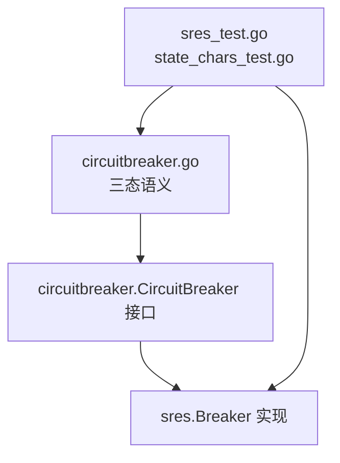
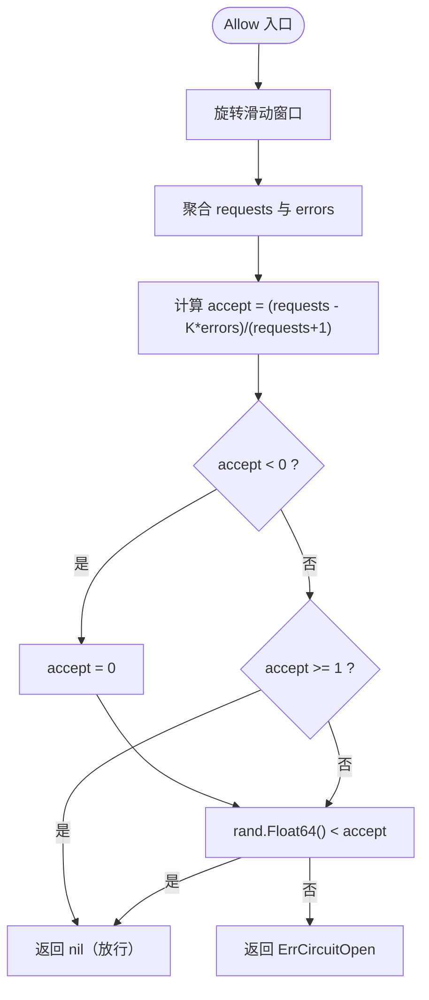
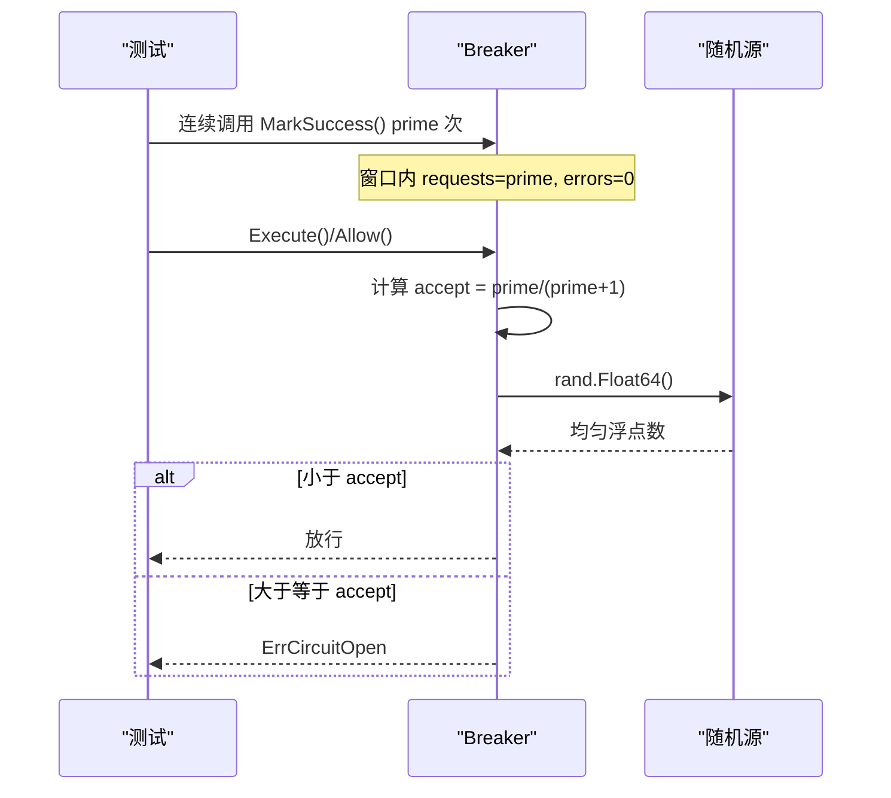

# 概率式组件测试

<cite>
**本文引用的文件**   
- [circuitbreaker/sres/sres.go](file://circuitbreaker/sres/sres.go)
- [circuitbreaker/sres/sres_test.go](file://circuitbreaker/sres/sres_test.go)
- [circuitbreaker/sres/state_chars_test.go](file://circuitbreaker/sres/state_chars_test.go)
- [circuitbreaker/circuitbreaker.go](file://circuitbreaker/circuitbreaker.go)
- [retry/retry.go](file://retry/retry.go)
- [broker/kafka/subscriber.go](file://broker/kafka/subscriber.go)
</cite>

## 目录
1. [引言](#引言)
2. [项目结构定位](#项目结构定位)
3. [核心问题：为什么不能对统计量断言阈值](#核心问题为什么不能对统计量断言阈值)
4. [正确测试模式：构造有界前置状态](#正确测试模式构造有界前置状态)
5. [确定性测试技巧清单](#确定性测试技巧清单)
6. [其他随机源与时间相关组件的测试模式](#其他随机源与时间相关组件的测试模式)
7. [外部不确定性因素的模拟与隔离](#外部不确定性因素的模拟与隔离)
8. [故障排查指南](#故障排查指南)
9. [结论](#结论)

## 引言
本指导面向 Bald 项目中包含概率式或时间相关逻辑的组件，以 `circuitbreaker/sres` 为典型案例，说明如何编写可重复、可验证且不易退化的单元测试。SRE 熔断器不是“开/关”二态，而是基于滑动窗口统计量的概率放行组件；其 `Allow()` 返回结果既取决于窗口内的请求与错误计数，也取决于 `rand.Float64()` 的一次抽样。因此，测试不能把并发下放行条数当成固定期望值来断言，而应通过控制前置状态、限制并发、验证边界性质和错误类型，把不确定性约束在已知范围内。

## 项目结构定位
`circuitbreaker` 是框架层抽象，定义 `CircuitBreaker` 接口及 `StateClosed` / `StateOpen` / `StateHalfOpen` 三态语义；`sres` 是 Google SRE 风格的具体实现，使用滑动桶 + 接受率公式实现优雅降级。`state_chars_test.go` 的职责不是改变算法行为，而是把“一旦产生请求就不可达 `StateClosed`”这一既有性质钉住为特征化测试，防止后续修改破坏调用方对三态的使用假设。

**图表来源**
- [circuitbreaker/circuitbreaker.go:1-84](file://circuitbreaker/circuitbreaker.go#L1-L84)
- [circuitbreaker/sres/sres.go:1-200](file://circuitbreaker/sres/sres.go#L1-L200)
- [circuitbreaker/sres/state_chars_test.go:1-92](file://circuitbreaker/sres/state_chars_test.go#L1-L92)

**章节来源**
- [circuitbreaker/circuitbreaker.go:1-84](file://circuitbreaker/circuitbreaker.go#L1-L84)
- [circuitbreaker/sres/sres.go:1-200](file://circuitbreaker/sres/sres.go#L1-L200)
- [circuitbreaker/sres/state_chars_test.go:1-92](file://circuitbreaker/sres/state_chars_test.go#L1-L92)

## 核心问题：为什么不能对统计量断言阈值
`sres.Breaker.Allow()` 的核心流程如下：

1. 加锁并旋转滑动窗口。
2. 聚合当前窗口内所有桶的 `requests` 与 `errors`。
3. 计算接受率 `accept = max(0, (requests - K * errors) / (requests + 1))`。
4. 若 `accept >= 1` 直接放行；否则用 `rand.Float64() < accept` 做概率放行。
5. 被拒绝时返回 `ErrCircuitOpen`。

关键陷阱在于：**`requests` 不是总调用次数，而是已通过 `MarkSuccess()` 累计的成功次数**。如果测试一开始直接循环调用 `Execute`，早期多次 `Allow()` 会落在 `requests=0..N` 的小数值区间，单次拒绝率可能高达 `1/(requests+1)`，例如 `requests=1` 时拒绝率为 `1/2`。此时并发执行中，哪些 goroutine 先拿到 `Allow`、哪些先拿到 `MarkSuccess`，会直接影响最终放行数量。

**图表来源**
- [circuitbreaker/sres/sres.go:101-163](file://circuitbreaker/sres/sres.go#L101-L163)

因此，像旧版 `TestExecute_AllSuccessNotThrottled` 那样直接断言“至少 90% 放行”，在未灌满窗口的情况下是不可靠的：当 `requests` 很小时，`accept` 天然很小，失败次数完全由随机数和调度顺序决定。仓库中该用例的注释已明确记录过 CI 上因 `-count` 放大并发导致的间歇性失败。

**章节来源**
- [circuitbreaker/sres/sres.go:101-163](file://circuitbreaker/sres/sres.go#L101-L163)
- [circuitbreaker/sres/sres_test.go:140-173](file://circuitbreaker/sres/sres_test.go#L140-L173)

## 正确测试模式：构造有界前置状态
`sres_test.go` 中的 `TestConcurrentExecute` 和 `TestHealthyWindowAcceptanceNearOne` 展示了正确做法：先通过多次 `b.MarkSuccess()` 把窗口灌满，使 `requests` 达到一个较大的固定值，再并发执行测试用例。

这样做的数学含义是：

- 健康窗口全成功时，`errors=0`，接受率变为 `requests/(requests+1)`。
- 若预先灌入 `prime` 次成功，则单次拒绝概率恰好是 `1/(prime+1)`。
- 并发下每次 `Allow()` 的概率判断近似独立伯努利试验，拒绝总数服从二项分布或泊松近似。
- 测试不再断言“一定放行 X 次”，而是断言“拒绝次数不超过某个小尾概率可忽略的阈值”。

**图表来源**
- [circuitbreaker/sres/sres_test.go:224-282](file://circuitbreaker/sres/sres_test.go#L224-L282)
- [circuitbreaker/sres/sres.go:133-163](file://circuitbreaker/sres/sres.go#L133-L163)

另一个重要特征是：即使全成功，SRE 实现也不会进入 `StateClosed`。因为分母比分子大 1，只要 `requests>0`，`accept` 恒小于 1，所以 `State()` 只会落到 `StateHalfOpen` 或 `StateOpen`。`state_chars_test.go` 正是用这种“特征化测试”把不可达分支钉死，而不是依赖运行时统计。

**章节来源**
- [circuitbreaker/sres/sres_test.go:201-331](file://circuitbreaker/sres/sres_test.go#L201-L331)
- [circuitbreaker/sres/state_chars_test.go:1-92](file://circuitbreaker/sres/state_chars_test.go#L1-L92)
- [circuitbreaker/sres/sres.go:201-235](file://circuitbreaker/sres/sres.go#L201-L235)

## 确定性测试技巧清单
针对概率式和时间相关组件，建议按以下优先级设计测试：

1. **优先断言边界行为，而非期望值**  
   断言“必然被拒的状态下只返回 `ErrCircuitOpen`”“零请求时返回 `StateClosed`”“持续失败后不会回到 `StateClosed`”等确定性边界，比断言“放行 95%”更稳定。

2. **构造有界前置状态**  
   对滑动窗口组件，先显式填充足够多的成功或失败样本，使单次拒绝率上限已知，例如 `1/(prime+1)`。

3. **限制并发度并观察分布范围**  
   不要只跑一次；配合 `t.Logf` 输出放行/拒绝计数，同时保留最小通过率阈值，避免回归到无界随机结果。

4. **分离“概率放行”和“错误类型”两类断言**  
   让“是否可能被拒”走概率分支，让“必然被拒”走另一条路径断言错误类型，避免一条用例里两种不确定性互相干扰。

5. **控制随机种子**  
   对于全局随机源，可通过设置 `math/rand` 的种子或注入可替换随机源的方式固定输出。仓库中 `sres` 直接使用 `rand.Float64()`，因此更适合通过前置状态把拒绝率压到极小值，而不是强求每次运行结果相同。

6. **固定时间源或推进时间**  
   对滑动窗口、超时、重试退避等逻辑，尽量注入时间接口或使用可控制的时钟；必要时在测试中推进虚拟时间，避免依赖真实 `time.Now()`。

7. **对统计量只做尾部概率断言**  
   若必须断言比例，应说明分布假设（如二项分布、泊松分布），并选择足够小的显著性水平，确保失败概率远低于代码退化带来的风险。

8. **用“不可达性测试”保护不变量**  
   对算法推导出的不可达分支，写“特征化测试”锁定事实，而不是把它当作偶发 bug 去修。

**章节来源**
- [circuitbreaker/sres/sres_test.go:224-331](file://circuitbreaker/sres/sres_test.go#L224-L331)
- [circuitbreaker/sres/state_chars_test.go:1-92](file://circuitbreaker/sres/state_chars_test.go#L1-L92)

## 其他随机源与时间相关组件的测试模式
### 重试组件
`retry/retry.go` 的重试逻辑同样涉及随机源：在无自定义随机源时使用全局 `rand.Float64()`，并通过互斥串行访问随机源。这类组件的测试应避免直接断言“第 N 次重试成功”，而应关注：

- 重试次数是否在配置上限之内。
- 退避间隔是否随尝试次数递增。
- 指定随机源时可复现实验序列。
- 网络或下游错误与业务错误的区分。

**章节来源**
- [retry/retry.go:54-54](file://retry/retry.go#L54-L54)
- [retry/retry.go:240-249](file://retry/retry.go#L240-L249)

### Broker 订阅者退避
`broker/kafka/subscriber.go` 使用带随机偏移的退避延迟。测试重点应是：

- 最大退避不超过配置上限。
- 重试次数受限于预期上限。
- 订阅者致命退出后的生命周期行为符合约定。
- 不要在单测中对具体退避毫秒数做精确断言，除非能控制随机源和时间。

**章节来源**
- [broker/kafka/subscriber.go:337-337](file://broker/kafka/subscriber.go#L337-L337)

### 传输层集成测试中的随机负载
多个 `transport/*` 测试使用 `rand.Intn` 生成湿度、温度等负载字段。这些随机值通常只是驱动消息通道或序列化路径，不应成为断言目标；断言应放在消息结构完整性、反序列化结果和业务语义上。

**章节来源**
- [transport/rabbitmq/server_test.go:94-95](file://transport/rabbitmq/server_test.go#L94-L95)
- [transport/redis/server_test.go:90-91](file://transport/redis/server_test.go#L90-L91)
- [transport/http3/server_test.go:34-35](file://transport/http3/server_test.go#L34-L35)
- [transport/http3/server_test.go:98-99](file://transport/http3/server_test.go#L98-L99)
- [transport/rocketmq/server_test.go:93-94](file://transport/rocketmq/server_test.go#L93-L94)
- [transport/rocketmq/server_test.go:182-183](file://transport/rocketmq/server_test.go#L182-L183)

## 外部不确定性因素的模拟与隔离
单元测试中遇到外部不确定性时，应按不确定性的来源分层处理：

| 不确定性来源 | 推荐策略 | 示例对应 |
|---|---|---|
| 全局随机数 | 注入可替换随机源；若无法注入，则缩小接受率、提高前置样本量、只对尾部概率断言 | `circuitbreaker/sres` 使用 `rand.Float64()` |
| 系统时间 | 注入时间接口或使用可推进的虚拟时钟；避免依赖 `time.Now()` 绝对值 | 滑动窗口、退避、超时测试 |
| 网络/外部服务 | 使用内存实现、桩对象或本地服务容器；不可达时 `t.Skip` | 注册中心、Broker、缓存后端 |
| 调度顺序 | 限制并发度、使用同步屏障或 channel 控制执行顺序 | 并发熔断测试、订阅者生命周期 |
| 文件系统/端口 | 使用临时目录、动态空闲端口 | TLS、HTTP、gRPC 测试 |

对 `circuitbreaker/sres`，由于 `Allow()` 内部直接使用全局随机源，最佳实践是**不要求每次运行放行数量完全一致**，而是：

1. 先灌满 `prime` 次成功，使单次拒绝率上限为 `1/(prime+1)`。
2. 运行 `calls` 次 `Allow()`，统计放行数。
3. 断言放行数不低于一个根据分布尾概率计算出的阈值。
4. 用日志输出实际放行数，便于调试和回归分析。

这比“固定种子 + 精确断言”更符合组件语义，也更不容易掩盖实现回归。

**章节来源**
- [circuitbreaker/sres/sres.go:133-163](file://circuitbreaker/sres/sres.go#L133-L163)
- [circuitbreaker/sres/sres_test.go:224-331](file://circuitbreaker/sres/sres_test.go#L224-L331)

## 故障排查指南
### 现象：并发放行数偶尔低于阈值
**原因**：未充分灌满窗口，早期 `requests` 很小，单次拒绝率高；并发下 `Allow` 与 `MarkSuccess` 交错顺序影响结果。  
**修复方向**：先调用 `MarkSuccess()` 填充窗口，再并发执行；或对拒绝总数做尾部概率断言而非精确值。

**章节来源**
- [circuitbreaker/sres/sres_test.go:224-282](file://circuitbreaker/sres/sres_test.go#L224-L282)

### 现象：`StateClosed` 在已有请求后出现
**原因**：误以为 SRE 熔断器是传统三态开关。实际上只要 `requests>0`，`accept < 1`，`StateClosed` 不可达。  
**修复方向**：检查实现是否仍遵循 `accept = (requests - K*errors)/(requests+1)`；若需要真正三态语义，应改用阈值式熔断实现。

**章节来源**
- [circuitbreaker/sres/state_chars_test.go:1-92](file://circuitbreaker/sres/state_chars_test.go#L1-L92)
- [circuitbreaker/sres/sres.go:201-235](file://circuitbreaker/sres/sres.go#L201-L235)

### 现象：必然被拒路径返回非预期错误
**原因**：用例混入了健康窗口的概率放行逻辑，导致并发下不一定触发拒绝。  
**修复方向**：将“必然被拒”的断言放到单独用例，先用 `MarkFailure()` 把窗口灌成 `StateOpen`，再断言每个 `Execute` 都返回 `ErrCircuitOpen`。

**章节来源**
- [circuitbreaker/sres/sres_test.go:284-312](file://circuitbreaker/sres/sres_test.go#L284-L312)

### 现象：重试或退避测试不稳定
**原因**：依赖真实时间、全局随机数或外部服务响应。  
**修复方向**：注入固定时间源与随机源；对外部依赖使用桩对象；对时间相关属性断言范围而非精确值。

**章节来源**
- [retry/retry.go:54-54](file://retry/retry.go#L54-L54)
- [retry/retry.go:240-249](file://retry/retry.go#L240-L249)
- [broker/kafka/subscriber.go:337-337](file://broker/kafka/subscriber.go#L337-L337)

## 结论
概率式组件测试的核心不是消灭随机性，而是把随机性约束在可分析的数学边界内。对 `circuitbreaker/sres`，最关键的一条经验是：**`requests` 是已成功的统计量，不是总调用量；并发下放行数取决于 `Allow` 与 `MarkSuccess` 的交错顺序**。因此，正确的测试写法是先构造有界前置状态，再断言拒绝率的尾部概率、错误类型和状态不变量。对其他含随机源或时间相关逻辑的组件，也应遵循同一原则：控制不确定性来源、限制并发、验证边界行为，并保持测试可重复、可诊断、可回归。