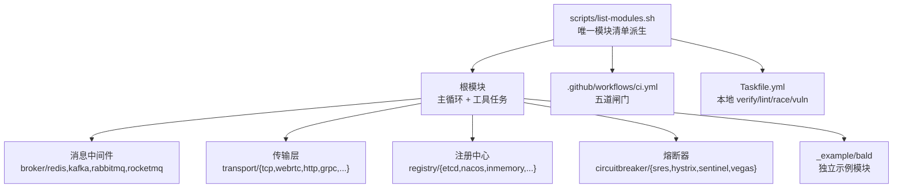
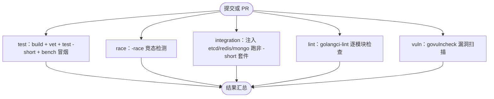
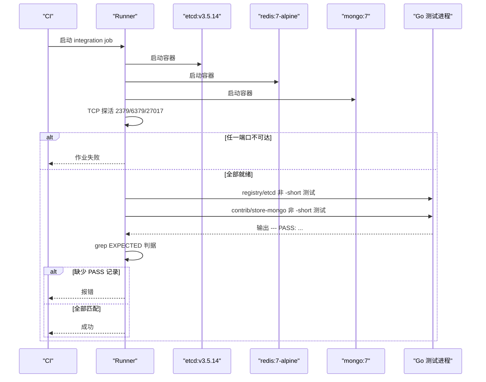
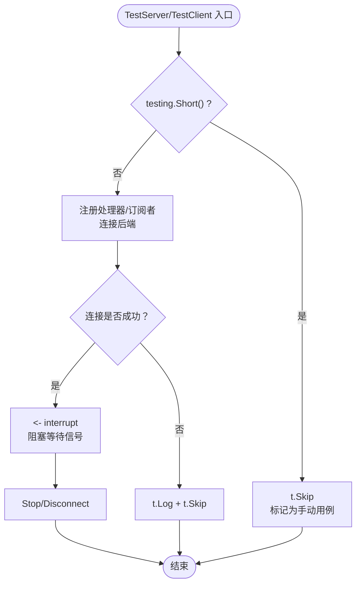
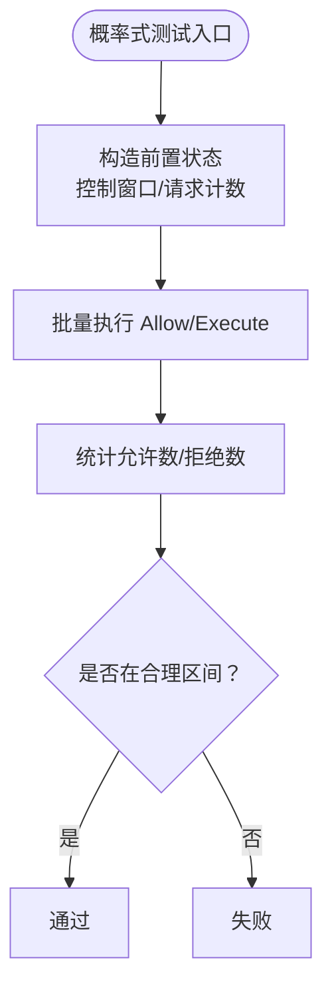

# 测试策略

<cite>
**本文引用的文件**   
- [ci.yml](file://.github/workflows/ci.yml)
- [Taskfile.yml](file://Taskfile.yml)
- [list-modules.sh](file://scripts/list-modules.sh)
- [server_test.go（transport/redis）](file://transport/redis/server_test.go)
- [server_test.go（transport/kafka）](file://transport/kafka/server_test.go)
- [server_test.go（transport/rabbitmq）](file://transport/rabbitmq/server_test.go)
- [server_test.go（transport/rocketmq）](file://transport/rocketmq/server_test.go)
- [server_test.go（transport/tcp）](file://transport/tcp/server_test.go)
- [server_test.go（transport/webrtc）](file://transport/webrtc/server_test.go)
- [sres_test.go（circuitbreaker/sres）](file://circuitbreaker/sres/sres_test.go)
</cite>

## 目录
1. [引言](#引言)
2. [项目结构与测试范围](#项目结构与测试范围)
3. [核心组件与分层策略](#核心组件与分层策略)
4. [架构总览：CI 流水线](#架构总览ci-流水线)
5. [详细作业分析](#详细作业分析)
6. [集成测试设计模式](#集成测试设计模式)
7. [概率式组件测试方法](#概率式组件测试方法)
8. [依赖关系与模块边界](#依赖关系与模块边界)
9. [性能、压力与混沌测试指南](#性能压力与混沌测试指南)
10. [覆盖率与质量门禁](#覆盖率与质量门禁)
11. [故障排查](#故障排查)
12. [结论](#结论)

## 引言
本仓库是 93 个 Go module 的多模块工程，没有 `go.work`；子模块通过相对 replace 组成可编译闭包。所有模块清单由 `scripts/list-modules.sh` 唯一派生，CI 的 test/race/integration/lint/vuln 与本地 Taskfile 都消费它，从而保证本地“全量验证”和 CI 覆盖范围不漂移。

本文聚焦测试策略，覆盖三个主题：
- 服务发现与网关出站侧的集成观察点
- CI 质量闸门分工
- Broker 订阅者生命周期与等信号手动用例

## 项目结构与测试范围
仓库按功能域划分模块，例如 `broker/*`、`transport/*`、`registry/*`、`circuitbreaker/*`、`cache/*`、`bconf/*`、`pkg/appkit/*` 等。每个业务或基础设施层都可能拥有自己的 go.mod，因此测试不能只跑根模块。



**图表来源**
- [list-modules.sh:1-24](file://scripts/list-modules.sh#L1-L24)
- [ci.yml:1-20](file://.github/workflows/ci.yml#L1-L20)
- [Taskfile.yml:201-452](file://Taskfile.yml#L201-L452)

**章节来源**
- [list-modules.sh:1-24](file://scripts/list-modules.sh#L1-L24)
- [ci.yml:1-20](file://.github/workflows/ci.yml#L1-L20)

## 核心组件与分层策略
测试分层应遵循以下口径：

| 层级 | 目标 | 典型范围 | 运行条件 |
|---|---|---|---|
| 单元测试 | 验证纯函数、状态机、数据结构、错误分支 | 无外部依赖的包内部逻辑 | `-short`，默认全部运行 |
| 集成测试 | 验证与真实后端的协作 | etcd、Redis、MongoDB、Kafka、RabbitMQ、RocketMQ、TCP、WebRTC | 非 `-short`，由 integration 作业点名注入 |
| 端到端测试 | 验证完整装配链路 | `_example/bald`、codegen 的 `TestTree_EndToEndTimed` / `TestTree_AuthzClosedLoop` | 单独 step，不在 `-short` 主循环内 |
| 性能基准 | 拦截基准编译与单迭代 panic | 各模块 `go test -bench . -benchtime=1x -run '^$'` | 主循环附加步骤 |
| 竞态检测 | 暴露并发路径竞争 | 除 `.github/race-skip.txt` 外的全部模块 | race job |
| 安全扫描 | 检测可达漏洞 | 全部模块 | vuln job |

单元测试与集成测试的分界线是 `testing.Short()`：主循环统一加 `-short`，所有需要外部资源、阻塞等待信号、连接真实后端或启动长期服务的测试都应在此处跳过。

**章节来源**
- [ci.yml:10-20](file://.github/workflows/ci.yml#L10-L20)
- [ci.yml:80-90](file://.github/workflows/ci.yml#L80-L90)

## 架构总览：CI 流水线
CI 由五个作业构成，彼此职责分离且共享同一份模块清单派生：



**图表来源**
- [ci.yml:1-20](file://.github/workflows/ci.yml#L1-L20)
- [ci.yml:60-230](file://.github/workflows/ci.yml#L60-L230)
- [Taskfile.yml:201-452](file://Taskfile.yml#L201-L452)

**章节来源**
- [ci.yml:1-20](file://.github/workflows/ci.yml#L1-L20)
- [ci.yml:60-230](file://.github/workflows/ci.yml#L60-L230)

## 详细作业分析

### test 作业：快速主循环
- 遍历 `scripts/list-modules.sh` 派生的全部模块。
- 每模块先 `go mod download`（带三次重试），再 `go mod tidy -diff` 检查依赖面漂移。
- 根模块执行 `go build ./... && go vet -copylocks=false ./... && go test -short -timeout 5m ./...`，其他模块去掉 `-copylocks=false`。
- 追加 `go test -bench . -benchtime=1x -run '^$' ./...`，仅编译并跑一轮基准，用于拦截基准代码回归，而不收集完整基准报告。
- 在 `-short` 之外，单独运行 `internal/codegen` 中的 `TestTree_EndToEndTimed` 与 `TestTree_AuthzClosedLoop`，这两个端到端计时用例会起真实服务，不适合放入主循环。

关键约束：
- 主循环必须保留 `-short`，否则 `transport/{redis,kafka,rabbitmq,rocketmq,tcp,webrtc}` 的 `TestServer`/`TestClient` 会进入等信号阻塞流程，最终超时拖垮整个 job。
- `-timeout 5m` 防止单个模块挂死。
- 基准使用 `-benchtime=1x` 而不是完整压测，避免把主循环变成耗时基准流水线。

**章节来源**
- [ci.yml:60-95](file://.github/workflows/ci.yml#L60-L95)
- [ci.yml:100-110](file://.github/workflows/ci.yml#L100-L110)
- [server_test.go（transport/redis）:45-102](file://transport/redis/server_test.go#L45-L102)
- [server_test.go（transport/kafka）:65-145](file://transport/kafka/server_test.go#L65-L145)
- [server_test.go（transport/rabbitmq）:45-106](file://transport/rabbitmq/server_test.go#L45-L106)
- [server_test.go（transport/rocketmq）:45-140](file://transport/rocketmq/server_test.go#L45-L140)
- [server_test.go（transport/tcp）:40-71](file://transport/tcp/server_test.go#L40-L71)
- [server_test.go（transport/webrtc）:40-85](file://transport/webrtc/server_test.go#L40-L85)

### race 作业：竞态检测
- 同样基于 `scripts/list-modules.sh`，但过滤掉 `.github/race-skip.txt`。
- 使用 `go test -short -race -timeout 10m`。
- race 检测更慢且需要 cgo，所以独立于普通 test 作业。
- 如果派生结果为空，作业显式失败，防止排除规则写错导致静默失效。

注意：普通 test 不启用 race detector，因此文档中“-race 可检出”这类注释不是保险，必须靠 race job 覆盖。

**章节来源**
- [ci.yml:110-125](file://.github/workflows/ci.yml#L110-L125)
- [Taskfile.yml:300-340](file://Taskfile.yml#L300-L340)

### integration 作业：真后端集成
这是最关键的差异化闸门。它不做全仓非 `-short` 测试，而是：
1. 启动 etcd v3.5.14、Redis 7-alpine、MongoDB 7。
2. 设置环境变量 `BALD_E2E_ETCD_ADDR`、`BALD_TEST_REDIS_URI`、`BALD_MONGO_URI`。
3. 用 TCP 探活脚本等待三端口就绪，任一未就绪即失败。
4. 分别进入 `registry/etcd` 与 `contrib/store-mongo` 执行非 `-short` 测试，并将输出写入 `/tmp/int/*.log`。
5. 对 EXPECTED 列表中的套件名逐一 grep `--- PASS: <name>`，缺失则报错。

重要原则：
- 集成用例采用“不可达即 `t.Skip`”，因此仅靠作业退出码不够；必须有“判据出现 PASS”的兜底断言。
- 刻意不包含 `_example/bald`，因为其 go.mod 将两个 kratos contrib 模块 replace 到仓库外同级检出，干净 CI 环境无法装载。
- 不要给 GitHub services 传 `args`；GitHub 会在编译期拒绝未知键，整份工作流退化为“0 个 job”。etcd 配置改用同名环境变量 `ETCD_LISTEN_CLIENT_URLS` 与 `ETCD_ADVERTISE_CLIENT_URLS`。



**图表来源**
- [ci.yml:126-230](file://.github/workflows/ci.yml#L126-L230)

**章节来源**
- [ci.yml:126-230](file://.github/workflows/ci.yml#L126-L230)

### lint 作业：静态检查
- 通过 Taskfile 的 `tools-golangci-lint` 安装 pin 版本的 golangci-lint。
- 使用 `scripts/list-modules.sh` 派生的全部模块。
- 调用 `golangci-lint run ./...`，规则集中在根 `.golangci.yml`。
- 风格交给 `gofmt`，lint 主要拦截正确性与死代码。
- 派生为空时显式失败，防止 Windows shell 或谓词变更造成静默跳过。

**章节来源**
- [Taskfile.yml:220-260](file://Taskfile.yml#L220-L260)

### vuln 作业：漏洞扫描
- 通过 Taskfile 的 `tools-govulncheck` 安装 pin 版本 govulncheck。
- 扫描全部模块的代码可达漏洞。
- 依赖预下载与 GOPROXY 主备源保障稳定性。
- 派生为空时显式失败。

**章节来源**
- [Taskfile.yml:260-290](file://Taskfile.yml#L260-L290)
- [ci.yml:1-20](file://.github/workflows/ci.yml#L1-L20)

## 集成测试设计模式

### “不可达即 t.Skip”
Broker 与传输层的 `TestServer`/`TestClient` 普遍采用以下模式：
1. 若 `testing.Short()` 为真，直接 `t.Skip("manual test: blocks on signal, requires live broker")`。
2. 创建信号通道，监听 SIGHUP/SIGINT/SIGTERM/SIGQUIT。
3. 启动服务或连接 broker。
4. 阻塞在 `<-interrupt`，直到收到终止信号。
5. 客户端在连接失败时 `t.Log` 并 `t.Skip()`。

这意味着这些用例只能由开发者手动运行，或由 integration 作业在“已确认服务可用”的前提下触发。



**图表来源**
- [server_test.go（transport/redis）:45-102](file://transport/redis/server_test.go#L45-L102)
- [server_test.go（transport/kafka）:65-145](file://transport/kafka/server_test.go#L65-L145)
- [server_test.go（transport/rabbitmq）:45-106](file://transport/rabbitmq/server_test.go#L45-L106)
- [server_test.go（transport/rocketmq）:45-140](file://transport/rocketmq/server_test.go#L45-L140)
- [server_test.go（transport/tcp）:40-71](file://transport/tcp/server_test.go#L40-L71)
- [server_test.go（transport/webrtc）:40-85](file://transport/webrtc/server_test.go#L40-L85)

**章节来源**
- [server_test.go（transport/redis）:45-102](file://transport/redis/server_test.go#L45-L102)
- [server_test.go（transport/kafka）:65-145](file://transport/kafka/server_test.go#L65-L145)
- [server_test.go（transport/rabbitmq）:45-106](file://transport/rabbitmq/server_test.go#L45-L106)
- [server_test.go（transport/rocketmq）:45-140](file://transport/rocketmq/server_test.go#L45-L140)
- [server_test.go（transport/tcp）:40-71](file://transport/tcp/server_test.go#L40-L71)
- [server_test.go（transport/webrtc）:40-85](file://transport/webrtc/server_test.go#L40-L85)

### TCP 探活检测
integration 作业使用 shell 函数 `wait_tcp host port name tries=60`，每 2 秒尝试一次，最多 60 次。任一后端未就绪立即返回失败，不让后续 `t.Skip` 掩盖服务未启动的问题。

最佳实践：
- 新集成后端必须同时实现“测试内不可达即 skip”和“CI 前 TCP/HTTP 探活”。
- 探活地址必须通过环境变量显式传入，不能依赖测试默认值。
- 探活失败日志要包含服务名称和端口，便于定位。

**章节来源**
- [ci.yml:160-190](file://.github/workflows/ci.yml#L160-L190)

### 真后端注入
当前 integration 作业注入三类后端：
- etcd：`quay.io/coreos/etcd:v3.5.14`，端口 2379，通过 `ETCD_LISTEN_CLIENT_URLS` 与 `ETCD_ADVERTISE_CLIENT_URLS` 配置。
- Redis：`redis:7-alpine`，端口 6379。
- MongoDB：`mongo:7`，端口 27017。

测试套件：
- `registry/etcd`：验证服务发现与注册中心集成。
- `contrib/store-mongo`：验证存储层集成。

新增后端时，应按“命名套件 + EXPECTED 条目”的方式扩展，而不能只加一个 `go test ./...`。

**章节来源**
- [ci.yml:126-230](file://.github/workflows/ci.yml#L126-L230)

## 概率式组件测试方法

### 为什么不能直接断言统计阈值
`circuitbreaker/sres` 是唯一使用随机源的 breaker。其放行公式为 `accept = requests/(requests+1)`，其中 `requests` 是已 MarkSuccess 的次数。在并发场景下，Allow 与 Mark 交错执行，实际放行数不仅取决于窗口统计，还取决于调度顺序。

因此，测试不得直接断言某个精确阈值，而应采用以下两种正确方式之一：

1. **构造有界前置状态**：先灌满窗口，使单次拒绝率满足 `≤ 1/(requests+1)`，再断言允许请求的比例落在合理区间。
2. **使用宽松比例而非精确值**：例如断言大量成功请求下至少 90% 被允许，而不是断言恰好放行 X 条。

当前 `sres_test.go` 中：
- `TestExecute_AllSuccessNotThrottled` 使用 200 次请求，断言允许数大于等于总数的 9/10。
- `TestExecute_HighFailureRateThrottles` 断言持续失败时至少有一条被拒绝，而不是断言具体拒绝数量。



**图表来源**
- [sres_test.go:1-200](file://circuitbreaker/sres/sres_test.go#L1-L200)

**章节来源**
- [sres_test.go:1-200](file://circuitbreaker/sres/sres_test.go#L1-L200)

## 依赖关系与模块边界
多模块仓库的测试边界必须与 import 边界一致：
- `*/contract` 包只放契约装配，不 import 具体后端；具体后端放在适配器包。
- 根 module 不得 require 任何适配器，否则会形成模块环。
- `_example/bald` 是独立 module，不以 `_example*` 形式进入 `scripts/list-modules.sh` 派生，由 Taskfile 的 `example-*` 任务单独处理。
- 清单为空时，`list-modules.sh` 返回非零退出码，确保闸门不会静默失效。

```mermaid
graph LR
    Contract["契约包<br/>不含后端实现"] --> Adapter["适配器包<br/>具体后端"]
    RootModule["根模块"] --> Contracts["contract 层"]
    RootModule -.×-> Adapters["禁止直接 require 适配器"]
    Example["_example/bald"] -- "独立 module" --> RootModule
    List["scripts/list-modules.sh"] --> CI
    List --> Tasks
```

**图表来源**
- [list-modules.sh:1-24](file://scripts/list-modules.sh#L1-L24)
- [Taskfile.yml:100-170](file://Taskfile.yml#L100-L170)

**章节来源**
- [list-modules.sh:1-24](file://scripts/list-modules.sh#L1-L24)
- [Taskfile.yml:100-170](file://Taskfile.yml#L100-L170)

## 性能、压力与混沌测试指南

### 性能测试
- 主循环已通过 `go test -bench . -benchtime=1x -run '^$'` 拦截基准编译和单迭代 panic。
- 不应把完整压测放进 test 作业；如需稳定性能回归，应新建专用 benchmark job，固定负载、预热轮数和上报指标。
- 分配回归由 `alloc_guard_test.go` 随 `-short` 守卫，属于轻量级内存分配检查。

### 压力测试
- 针对 broker 与 transport 的长连接场景，不建议在主循环压测。
- 推荐做法：
  - 使用独立 `task stress-*` 或 CI job。
  - 使用 Docker Compose 拉起后端。
  - 控制并发度、持续时间、采样间隔。
  - 输出 Prometheus 指标或结构化日志，供外部看板采集。
  - 明确失败条件：错误率、延迟分位、内存增长、goroutine 泄漏。

### 混沌测试
- 当前仓库未见正式混沌框架集成。建议优先从以下低侵入方式开始：
  - 网络抖动：通过 iptables/firewalld/docker network 模拟丢包。
  - 后端重启：在集成测试中 kill -9 etcd/redis/mongo，验证重连与降级。
  - 熔断注入：利用 `circuitbreaker` 接口切换不同实现，验证下游失败时的保护行为。
  - 资源耗尽：限制 CPU/memory，验证优雅停机与告警。
- 混沌测试必须与集成测试解耦，因为后者已有明确的“服务探活 + 判据断言”基线。

[本节为通用实践指导，不直接分析具体文件]

## 覆盖率与质量门禁

### 覆盖率要求
当前仓库未在 CI 中强制覆盖率阈值。建议：
- 新增模块默认开启覆盖率收集。
- 按包设定最低覆盖率门槛，例如核心 domain、broker 协议解析、熔断器状态机不低于 80%。
- 对纯适配层可放宽，但必须覆盖错误分支与边界条件。
- 覆盖率报告应作为 artifact 留存，并接入历史趋势监控。

### 质量门禁
当前已存在的质量门：
| 门 | 工具 | 作用 |
|---|---|---|
| 构建门 | `go build ./...` | 拦截编译失败 |
| 静态检查门 | `go vet` | 拦截明显错误 |
| 代码检查门 | golangci-lint | 拦截正确性、死代码 |
| 单元测试门 | `go test -short` | 阻断常规回归 |
| 竞态门 | `-race` | 捕获并发竞争 |
| 基准冒烟门 | `-bench . -benchtime=1x -run '^$'` | 拦截基准代码回归 |
| 依赖面门 | `go mod tidy -diff` | 阻止依赖漂移 |
| 漏洞门 | govulncheck | 扫描可达漏洞 |
| 集成门 | TCP 探活 + EXPECTED PASS | 阻断静默 skip |

**章节来源**
- [ci.yml:60-125](file://.github/workflows/ci.yml#L60-L125)
- [Taskfile.yml:201-340](file://Taskfile.yml#L201-L340)

## 故障排查

### 问题：CI 显示 0 个 job
可能原因：
- 修改了 `.github/workflows/*.yml`，使用了未登记的字段，例如在 `services` 下写了 `args`。
- GitHub 在编译期解析作业文件，未登记键会导致整份文件被拒。
- 本地 YAML 解析器看不出该问题。

修复方式：
- 容器参数改用同名环境变量，如 etcd 的 `ETCD_LISTEN_CLIENT_URLS` 与 `ETCD_ADVERTISE_CLIENT_URLS`。
- 改作业文件前先运行 `task ci-workflow-lint`。

**章节来源**
- [ci.yml:140-170](file://.github/workflows/ci.yml#L140-L170)

### 问题：集成测试静默绿
可能原因：
- 后端未启动，测试进入 `t.Skip`。
- EXPECTED 列表未更新，或缺少对应套件名。
- 套件改名、删除或未被 integration job 点名。

修复方式：
- 先确认 TCP 探活通过。
- 查看 `/tmp/int/*.log` 中的 `--- SKIP` 与 `--- PASS`。
- 确保 EXPECTED 中包含非 `-short` 套件的真实 PASS 判据。

**章节来源**
- [ci.yml:126-230](file://.github/workflows/ci.yml#L126-L230)

### 问题：主循环长时间不结束
可能原因：
- 误删 `-short`，导致 `transport/{redis,kafka,rabbitmq,rocketmq,tcp,webrtc}` 的 `TestServer`/`TestClient` 进入信号阻塞。
- 测试未正确处理超时。

修复方式：
- 恢复 `-short`。
- 需要外部资源的测试继续走 `testing.Short()` 跳过。
- 确需阻塞的用例放入 integration 或专门 manual job。

**章节来源**
- [ci.yml:10-20](file://.github/workflows/ci.yml#L10-L20)
- [server_test.go（transport/redis）:45-102](file://transport/redis/server_test.go#L45-L102)
- [server_test.go（transport/kafka）:65-145](file://transport/kafka/server_test.go#L65-L145)
- [server_test.go（transport/rabbitmq）:45-106](file://transport/rabbitmq/server_test.go#L45-L106)
- [server_test.go（transport/rocketmq）:45-140](file://transport/rocketmq/server_test.go#L45-L140)
- [server_test.go（transport/tcp）:40-71](file://transport/tcp/server_test.go#L40-L71)
- [server_test.go（transport/webrtc）:40-85](file://transport/webrtc/server_test.go#L40-L85)

### 问题：概率式测试不稳定
可能原因：
- 直接断言随机源输出的统计量阈值。
- 并发下 Allow 与 Mark 交错导致放行数不确定。

修复方式：
- 构造有界前置状态。
- 使用宽松区间断言，例如“绝大多数允许”或“至少一条被拒绝”。

**章节来源**
- [sres_test.go:1-200](file://circuitbreaker/sres/sres_test.go#L1-L200)

## 结论
Bald 项目的测试体系以“多模块 + 唯一派生清单”为基础，通过五道 CI 闸门完成分层防护：
- test 负责快速主循环与基准冒烟；
- race 负责并发竞争；
- integration 负责真后端协作；
- lint 负责静态质量；
- vuln 负责安全漏洞。

核心纪律是：主循环永远 `-short`，所有阻塞、等信号、连真实后端的用例必须明确标注为手动测试并通过 integration 作业覆盖；概率式组件测试不能断言精确统计阈值，只能通过有界前置状态和宽松区间验证行为。新增模块应优先继承现有模式，而不是绕过清单派生或弱化 EXPECTED 判据。