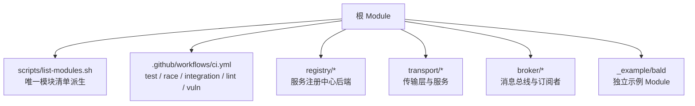
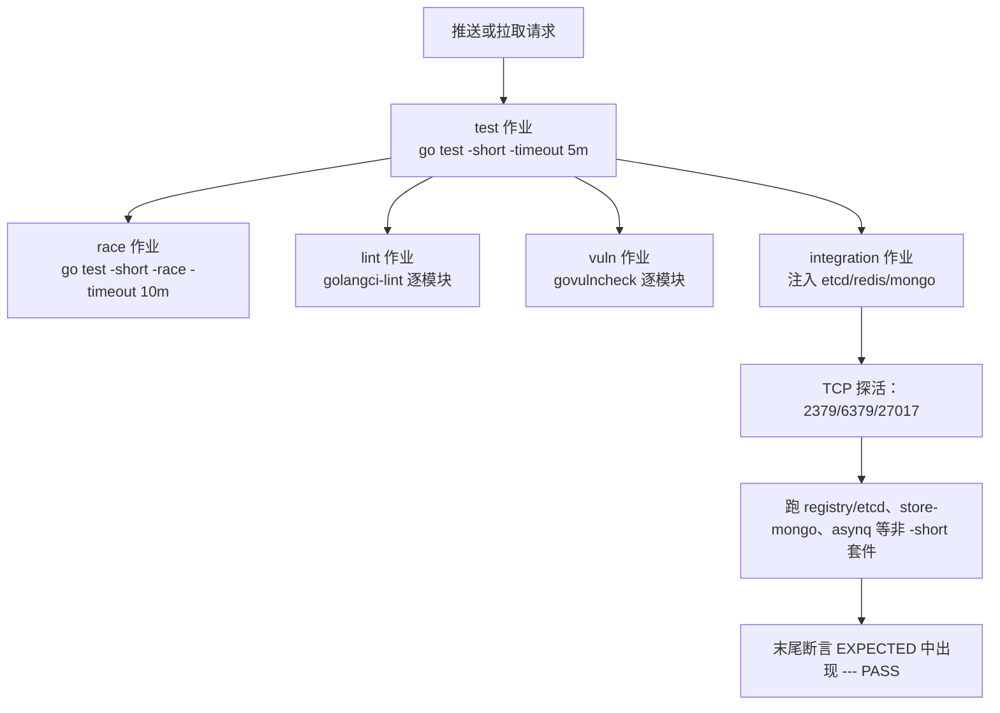
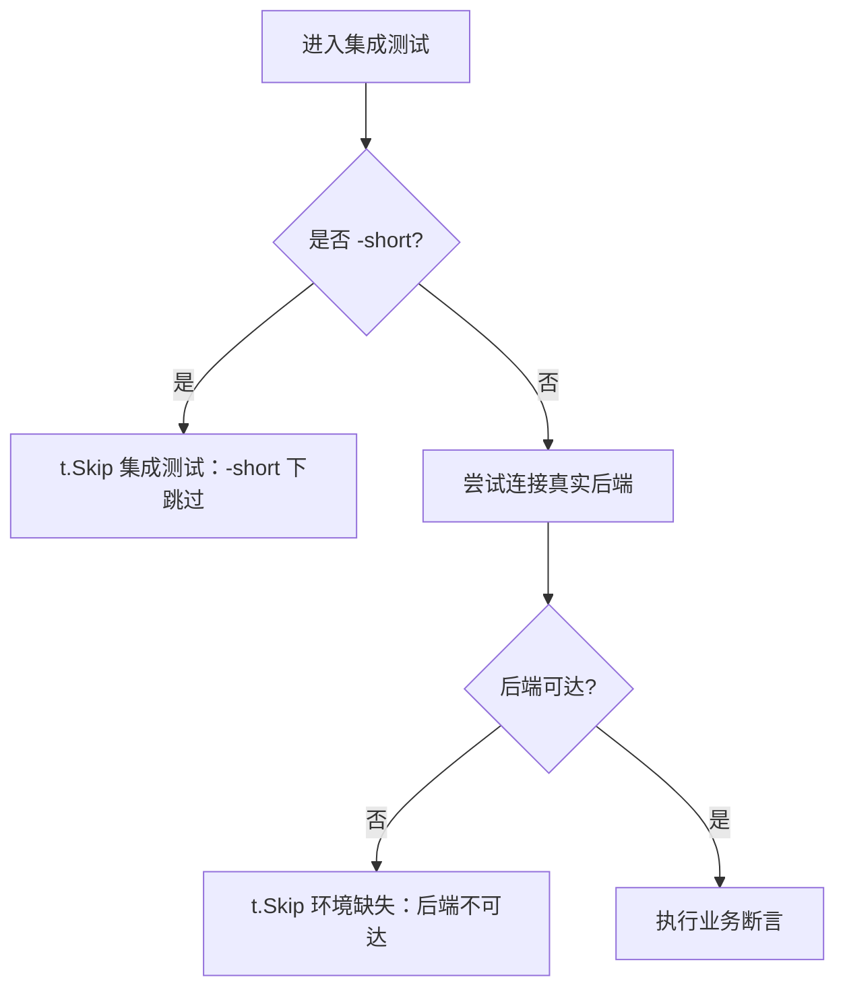
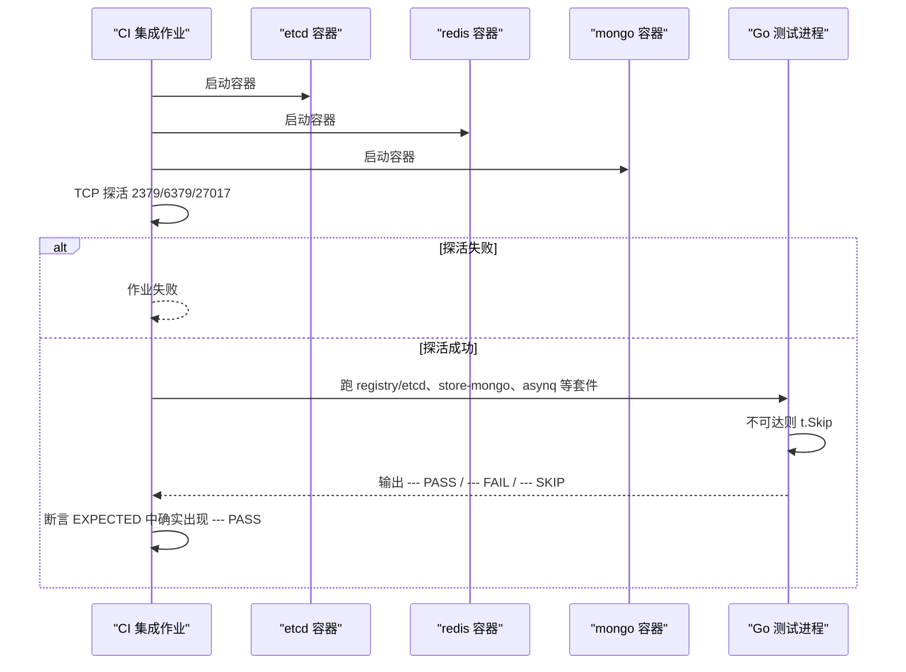
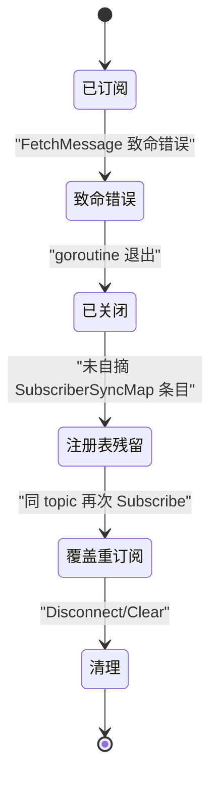
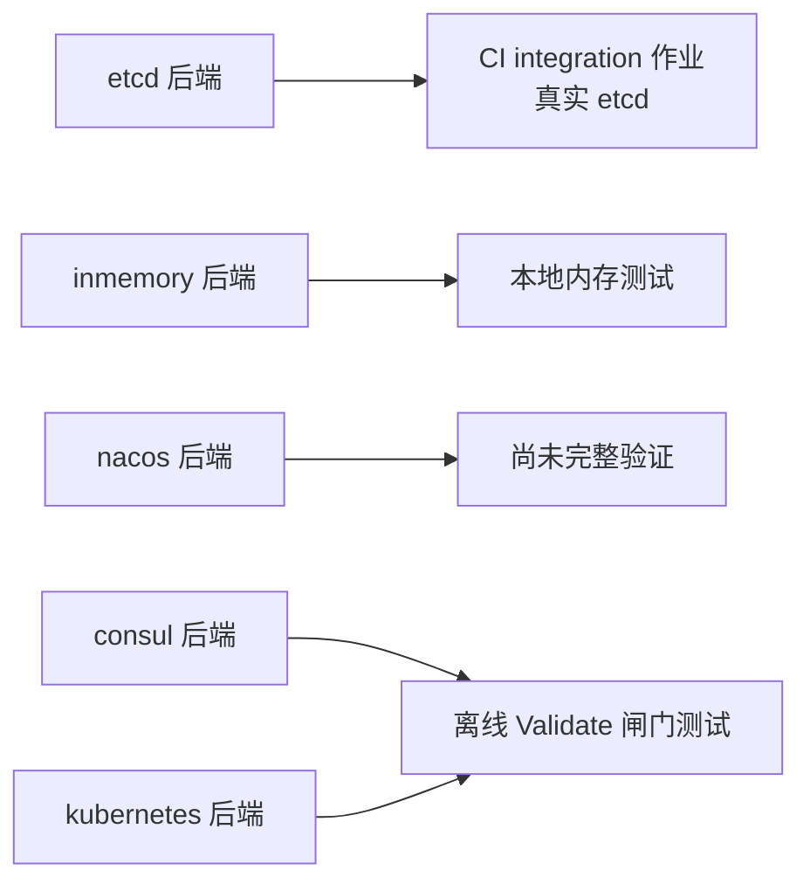
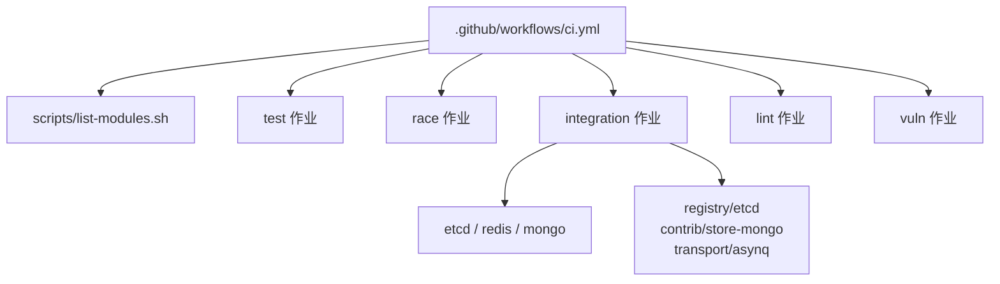

# 集成测试设计模式

<cite>
**本文引用的文件**   
- [ci.yml](file://.github/workflows/ci.yml)
- [workflow-lint.yml](file://.github/workflows/workflow-lint.yml)
- [list-modules.sh](file://scripts/list-modules.sh)
- [subscriber_test.go](file://broker/kafka/subscriber_test.go)
- [kafka.go](file://broker/kafka/kafka.go)
- [subscriber.go](file://broker/kafka/subscriber.go)
- [register_validate_test.go](file://registry/consul/register_validate_test.go)
- [register_validate_test.go](file://registry/kubernetes/register_validate_test.go)
- [registry_test.go](file://registry/etcd/registry_test.go)
- [contract_test.go](file://registry/etcd/contract/contract_test.go)
</cite>

## 目录
1. [引言](#引言)
2. [项目结构](#项目结构)
3. [核心组件](#核心组件)
4. [架构总览](#架构总览)
5. [详细组件分析](#详细组件分析)
6. [依赖关系分析](#依赖关系分析)
7. [性能考量](#性能考量)
8. [故障排查指南](#故障排查指南)
9. [结论](#结论)

## 引言
本文面向 Bald 多模块仓库中的集成测试，聚焦三条主题：服务发现与网关出站、CI 质量闸门、Broker 订阅者生命周期。核心目标是把“不可达即 `t.Skip`”的集成测试策略写清，并解释为什么仅运行测试套件那一步会静默绿；同时梳理 Broker 订阅者在致命退出后的注册表行为，以及各服务注册中心后端在集成测试上的差异与尚未验证项。

## 项目结构
Bald 是 93 个 Go module 的多模块仓库，没有 `go.work`；子模块通过相对 `replace` 组成可编译闭包。模块清单由 `scripts/list-modules.sh` 唯一派生，CI 和 Taskfile 都消费它——因此不能按“一个 module”叙事理解仓库。根 module 不得 require 任何适配器（曾构成模块环），`*/contract` 包只放契约装配，不 import 具体后端；具体后端放在各自适配器包中。

**图示来源**
- [ci.yml:1-36](file://.github/workflows/ci.yml#L1-L36)
- [list-modules.sh](file://scripts/list-modules.sh)

**章节来源**
- [ci.yml:1-36](file://.github/workflows/ci.yml#L1-L36)
- [list-modules.sh](file://scripts/list-modules.sh)

## 核心组件
- **CI 作业**：包含 `test`、`race`、`integration`、`lint`、`vuln` 五个作业。主循环必须保留 `go test -short`，因为 `transport/{redis,kafka,rabbitmq,rocketmq,tcp,webrtc}` 下的 `TestServer`/`TestClient` 是等信号的手动用例，去掉 `-short` 会挂到超时。非 `-short` 的集成覆盖由 `integration` 作业按套件点名注入真 etcd、redis、mongo。
- **服务注册中心后端**：仓库实现 etcd、consul、nacos、kubernetes、inmemory 五类后端；其中 consul 与 kubernetes 注册中心后端尚未被完整集成验证。
- **Broker 订阅者**：kafka 订阅者在 fatal error 后退出，但不会自行从 `SubscriberSyncMap` 摘除条目；重订阅是覆盖而非累积；`Topics()`/`Len()`/`Has()` 会把死订阅者高报为当前订阅，口径由 `broker/kafka/subscriber_test.go` 钉住。

**章节来源**
- [ci.yml:83-127](file://.github/workflows/ci.yml#L83-L127)
- [register_validate_test.go](file://registry/consul/register_validate_test.go#L1-L34)
- [register_validate_test.go](file://registry/kubernetes/register_validate_test.go#L1-L31)
- [subscriber_test.go:368-422](file://broker/kafka/subscriber_test.go#L368-L422)

## 架构总览
CI 的质量闸门不是单条命令，而是分层组合：短测主循环负责快速回归，竞态检测用 `-race`，集成测试单独 job 注入真实服务，静态检查用 golangci-lint，漏洞扫描用 govulncheck。

**图示来源**
- [ci.yml:83-127](file://.github/workflows/ci.yml#L83-L127)
- [ci.yml:141-201](file://.github/workflows/ci.yml#L141-L201)

**章节来源**
- [ci.yml:83-127](file://.github/workflows/ci.yml#L83-L127)
- [ci.yml:141-201](file://.github/workflows/ci.yml#L141-L201)

## 详细组件分析

### 一、集成测试“不可达即 `t.Skip`”策略
所有注入真后端的用例都应遵循同一语义：**如果后端不可达，就跳过该用例**。典型写法是先探测连接，失败时调用 `t.Skip`；成功后再执行真正断言。这样 `go test -short` 的主循环可以安全跳过这些用例，而 `integration` 作业则提供真实环境。

以 etcd 注册中心为例，测试注释明确说明它是真实 etcd 依赖的集成测试，`-short` 下跳过；非 `-short` 且 etcd 不可达时也跳过，并把错误信息写入 Skip。

**图示来源**
- [registry_test.go:7-9](file://registry/etcd/registry_test.go#L7-L9)
- [registry_test.go:35-48](file://registry/etcd/registry_test.go#L35-L48)
- [contract_test.go:12-16](file://registry/etcd/contract/contract_test.go#L12-L16)
- [contract_test.go:54-73](file://registry/etcd/contract/contract_test.go#L54-L73)

#### 静默绿风险
仅运行 `integration` 作业的“集成套件”那一步会存在**静默绿**风险：如果所有注入真后端的用例都因不可达而 `t.Skip`，Go 测试框架仍可能返回退出码 0，日志里全是 SKIP，看起来像绿色，但实际上没有任何真实后端判据被验证。本地实测的反证：把三个地址都指向死端口，跑套件这一步仍然 exit=0，日志里 23 条全是 SKIP。

因此 CI 的 `integration` 作业做了两档兜底：
1. **服务探活失败即作业失败**：先用 TCP 探活 etcd:2379、redis:6379、mongo:27017，探不到直接报错，不放行成 Skip。
2. **末尾逐条断言判据真的出现 `--- PASS`**：每个套件 `-v` 全量输出留档，然后用 EXPECTED 列表逐项检查，确保真正的集成断言被执行过。

**图示来源**
- [ci.yml:150-194](file://.github/workflows/ci.yml#L150-L194)
- [ci.yml:194-201](file://.github/workflows/ci.yml#L194-L201)

**章节来源**
- [ci.yml:122-127](file://.github/workflows/ci.yml#L122-L127)
- [ci.yml:150-201](file://.github/workflows/ci.yml#L150-L201)
- [registry_test.go:35-48](file://registry/etcd/registry_test.go#L35-L48)
- [contract_test.go:54-73](file://registry/etcd/contract/contract_test.go#L54-L73)

### 二、Broker 订阅者生命周期
Kafka 订阅者的生命周期有一条重要约定：**订阅 goroutine 因致命错误退出后，不会自行从 `SubscriberSyncMap` 摘除条目**。摘除责任在调用方（例如显式取消）或 `Disconnect` 的清理路径。

这条行为有设计理由：
- 注册表按 topic 键且 `Add` 是覆盖式；致命退出的订阅者无法判断表里那条记录还是不是自己。
- kafka、rabbitmq、redis pubsub、redis stream、rocketmq 多个 broker 保持相同形态，避免不同后端给出不同清理语义。
- 残留条目对清理路径无害：`Disconnect` 会走 `Clear` → `Unsubscribe(false)`，而且 close 已幂等。

代价也必须如实记录：**`broker.SubscriberSyncMap` 的 `Topics()`/`Len()`/`Has()` 是公开 API，会把已死的订阅算进“当前订阅”上报**。仓内目前无人读这个统计口径；要判断订阅者是否存活，应看返回的订阅者本身（例如 kafka 的 `IsClosed()`，但它不在通用 `broker.Subscriber` 接口上）。

**图示来源**
- [subscriber.go:186-243](file://broker/kafka/subscriber.go#L186-L243)
- [subscriber_test.go:368-422](file://broker/kafka/subscriber_test.go#L368-L422)
- [kafka.go:42-66](file://broker/kafka/kafka.go#L42-L66)

#### 关键断言点
- 致命退出后，`Has(topic)` 仍为真。
- `Len()` 仍计为 1，而不是 0。
- 同 topic 重订阅后，`Len()` 仍为 1，而不是 2，说明是覆盖。
- `Get(topic)` 返回的是新订阅者。
- `Disconnect()` 能清理掉残留死订阅者且不报错。

**章节来源**
- [subscriber_test.go:368-422](file://broker/kafka/subscriber_test.go#L368-L422)
- [kafka.go:42-66](file://broker/kafka/kafka.go#L42-L66)
- [subscriber.go:186-243](file://broker/kafka/subscriber.go#L186-L243)

### 三、服务注册中心后端集成测试差异
仓库实现了五种服务注册中心后端：etcd、consul、nacos、kubernetes、inmemory。它们的集成测试能力并不对称：

| 后端 | 状态 | 集成测试要点 |
|---|---|---|
| etcd | 已纳入 CI 集成作业 | `registry/etcd` 的测试注释明确标注真实 etcd 依赖、`-short` 下跳过；非 `-short` 且不可达时 `t.Skip`；CI 的 `integration` 作业注入 etcd 并断言 PASS。 |
| inmemory | 本地内存实现 | 通常用于单元测试，不需要外部服务。 |
| nacos | 有实现，且有真机端到端证据（不在 CI） | 本模块内是离线用例（`TestClose_*` 等生命周期断言）；真 nacos 上的一轮在 `_example/bald`：`TestGatewayDiscoveryNacosWatchPush`、`TestNacosDiscoveryNameCarriesSchemeSuffix`，`-short` 跳过、地址不可达即 `t.Skip`，本地由 `task example-e2e` 跑。命名口径：nacos 按 `<Name>.<scheme>` 建服务，目标得写 `discovery:///<服务名>.grpc`。 |
| consul | 有离线校验测试 | `register_validate_test.go` 用零值 client 构造，只验证 `Validate` 闸门；不是完整端到端集成。 |
| kubernetes | 有离线校验测试 | 同样只验证 `ServiceInstance.Validate` 闸门；不是完整端到端集成。 |

证据边界要说清：consul 与 kubernetes 只有那条离线校验，**没有任何端到端执行证据**；nacos 有真机一轮但不在 CI。按这三个后端写生产方案前，得自己把后端起来跑一轮，不能拿本页当「已验证」。

**图示来源**
- [registry_test.go:7-9](file://registry/etcd/registry_test.go#L7-L9)
- [registry_test.go:35-48](file://registry/etcd/registry_test.go#L35-L48)
- [register_validate_test.go](file://registry/consul/register_validate_test.go#L1-L34)
- [register_validate_test.go](file://registry/kubernetes/register_validate_test.go#L1-L31)

**章节来源**
- [registry_test.go:7-9](file://registry/etcd/registry_test.go#L7-L9)
- [registry_test.go:35-48](file://registry/etcd/registry_test.go#L35-L48)
- [register_validate_test.go](file://registry/consul/register_validate_test.go#L1-L34)
- [register_validate_test.go](file://registry/kubernetes/register_validate_test.go#L1-L31)

### 四、测试环境准备、清理与超时最佳实践
基于仓库现有实现，建议如下：

1. **优先使用 `t.Skip` 表达环境缺失**  
   所有需要真实后端的测试都应先探测连通性，不可达时 `t.Skip`，不要把它当失败。这样才能让本地开发、无依赖环境和 CI 的非集成阶段保持一致语义。

2. **区分 `-short` 与集成阶段**  
   主循环保留 `go test -short`；只有 `integration` 作业才跑非 `-short` 的真实后端用例。不要把 `transport/{redis,kafka,rabbitmq,rocketmq,tcp,webrtc}` 的等信号 `TestServer`/`TestClient` 放进主循环。

3. **探活先行，再跑套件**  
   对 etcd、redis、mongo 等外部服务，先用 TCP 探活；探活失败直接结束作业，不要让全部用例变成 SKIP。

4. **用 EXPECTED 断言 PASS 出现**  
   只对“非真服务不可证”的判据维护 EXPECTED 列表，普通单测交给 `-short` 主循环。每套套件单独输出日志，并在末尾断言对应 PASS 确实出现过。

5. **清理策略**  
   - 对外部容器：由 CI services 管理生命周期，作业结束后回收。  
   - 对内部资源：使用 `t.Cleanup` 或 defer 保证断开连接、停止服务器、关闭通道。  
   - 对 Broker 订阅者：不要假设订阅者退出后会自摘注册表条目；显式调用取消或 `Disconnect`。

6. **超时配置**  
   - 主循环使用 `-timeout 5m`，防止单个模块拖垮整个 job。  
   - 竞态检测使用 `-timeout 10m`。  
   - 集成套件使用 `-timeout 10m`，并由外层 `integration` job 设置 `timeout-minutes: 30`。  
   - 长耗时端到端用例（如 `TestTree_EndToEndTimed`/`TestTree_AuthzClosedLoop`）单独 step，使用更大超时。

**章节来源**
- [ci.yml:83-127](file://.github/workflows/ci.yml#L83-L127)
- [ci.yml:141-201](file://.github/workflows/ci.yml#L141-L201)
- [subscriber_test.go:368-422](file://broker/kafka/subscriber_test.go#L368-L422)

## 依赖关系分析
CI 工作流与仓库结构的依赖关系如下：

**图示来源**
- [ci.yml:83-127](file://.github/workflows/ci.yml#L83-L127)
- [ci.yml:141-201](file://.github/workflows/ci.yml#L141-L201)
- [list-modules.sh](file://scripts/list-modules.sh)

**章节来源**
- [ci.yml:83-127](file://.github/workflows/ci.yml#L83-L127)
- [ci.yml:141-201](file://.github/workflows/ci.yml#L141-L201)
- [list-modules.sh](file://scripts/list-modules.sh)

## 性能考量
- 主循环使用 `-short` 和 `-timeout`，适合快速回归和频繁提交。
- `-race` 单独作业，覆盖 session manager、热重载、计划缓存等并发路径，但不要求每个模块都能稳定跑通竞态检测。
- 基准冒烟使用 `go test -bench . -benchtime=1x -run '^$'`，只做编译和一轮基准，避免长时间基准回归拖慢主循环。
- 集成作业最重，限定在少数套件，并通过服务探活和 PASS 断言控制整体稳定性。

[本节为一般性指导，不直接分析具体文件]

## 故障排查指南

### 现象：集成作业绿色但没有真实断言
**原因**：所有注入真后端的用例都走了 `t.Skip`，Go 测试返回 exit=0，但 EXPECTED 中没有对应的 `--- PASS`。  
**排查步骤**：
1. 查看集成作业的服务探活步骤是否通过。
2. 查看 `/tmp/int/registry-etcd.log`、`/tmp/int/store-mongo.log`、`/tmp/int/asynq.log` 是否全是 SKIP。
3. 确认 EXPECTED 列表是否漏加新套件。
4. 如果是新增测试，先确认它是否正确处理不可达情况。

**章节来源**
- [ci.yml:122-127](file://.github/workflows/ci.yml#L122-L127)
- [ci.yml:194-201](file://.github/workflows/ci.yml#L194-L201)

### 现象：主循环挂死
**原因**：误把等信号的 `TestServer`/`TestClient` 放入非 `-short` 主循环。  
**排查步骤**：
1. 检查是否去掉了 `-short`。
2. 检查是否新增了 transport 层的等信号测试。
3. 这类用例应只在手动运行或特定集成场景中执行。

**章节来源**
- [ci.yml:122-127](file://.github/workflows/ci.yml#L122-L127)

### 现象：Broker 订阅者计数异常
**原因**：订阅者 fatal 退出后未自摘 `SubscriberSyncMap` 条目，`Len()`/`Has()` 高报死订阅者。  
**排查步骤**：
1. 不要只看 `Len()` 或 `Has()`。
2. 使用订阅者自身的关闭状态判断（如 kafka 的 `IsClosed()`）。
3. 确保最终调用 `Disconnect` 完成清理。

**章节来源**
- [subscriber_test.go:368-422](file://broker/kafka/subscriber_test.go#L368-L422)
- [kafka.go:42-66](file://broker/kafka/kafka.go#L42-L66)

### 现象：修改 GitHub 作业文件后 jobs 数量为 0
**原因**：在 `services` 下写了 `args` 等未登记键，GitHub 在编译期拒绝整个 workflow 文件。  
**排查步骤**：
1. 先运行 `task ci-workflow-lint`。
2. 检查 `actionlint` 报告。
3. 容器参数改用同名环境变量（例如 etcd 的 `ETCD_LISTEN_CLIENT_URLS`/`ETCD_ADVERTISE_CLIENT_URLS`）。

**章节来源**
- [workflow-lint.yml:1-10](file://.github/workflows/workflow-lint.yml#L1-L10)
- [ci.yml:154-166](file://.github/workflows/ci.yml#L154-L166)

## 结论
Bald 的集成测试体系围绕三个事实组织：
1. **主循环必须是 `-short`**，避免等信号、长耗时、真实后端用例拖垮快速回归。
2. **集成测试必须“不可达即 `t.Skip`”**，并用服务探活 + EXPECTED PASS 断言兜住静默绿风险。
3. **Broker 订阅者致命退出不自行摘除注册表条目**，`Topics()`/`Len()`/`Has()` 的高报口径由 `broker/kafka/subscriber_test.go` 钉住，调用方或 `Disconnect` 承担清理责任。

对于服务注册中心后端，etcd 是当前集成验证的主要接入面；consul 与 kubernetes 后端仅有离线 `Validate` 闸门测试，不应宣称已完整验证。nacos 注册中心后端同样属于尚未完整验证的范围。新增集成测试时应遵循统一模式：短测跳过、真实环境探活、不可达 Skip、真实断言留档。