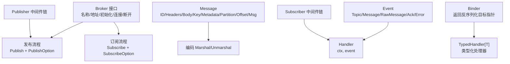
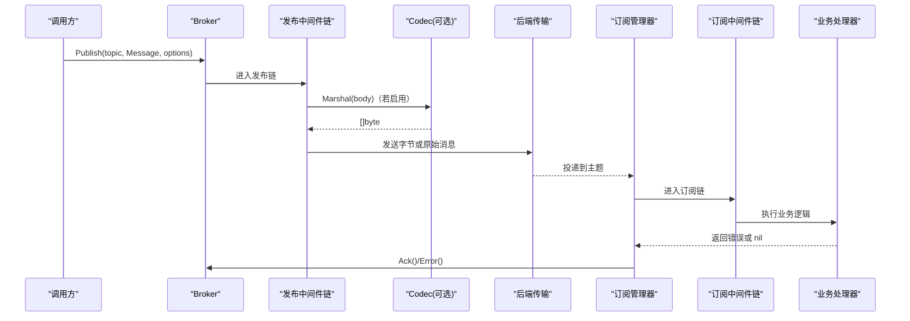
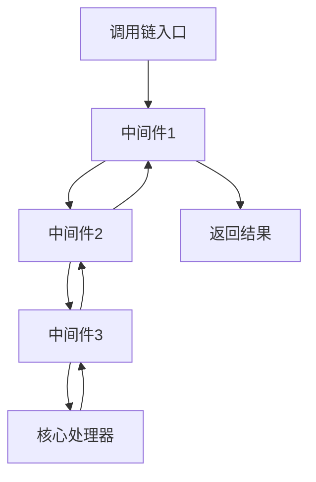
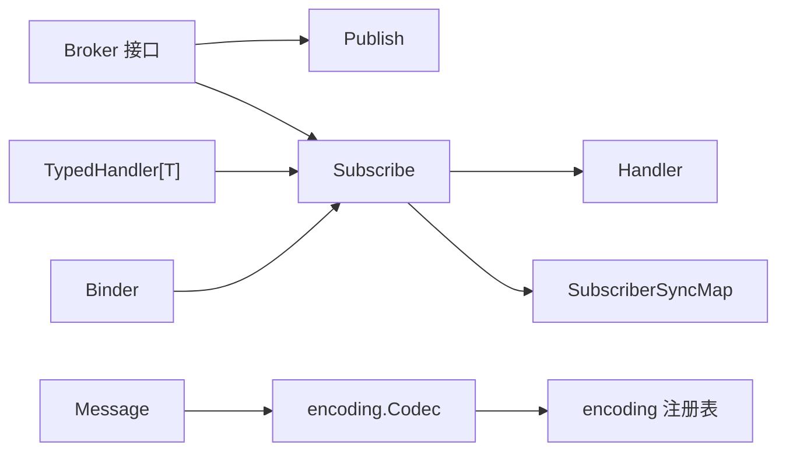

# Broker 抽象与数据模型

<cite>
**本文引用的文件**   
- [broker.go](file://broker/broker.go)
- [message.go](file://broker/message.go)
- [event.go](file://broker/event.go)
- [encoding.go](file://broker/encoding.go)
- [publish_options.go](file://broker/publish_options.go)
- [subscribe_options.go](file://broker/subscribe_options.go)
- [typed_handler.go](file://broker/typed_handler.go)
- [subscriber.go](file://broker/subscriber.go)
- [publish.go](file://broker/publish.go)
- [encoding_test.go](file://broker/encoding_test.go)
- [message_test.go](file://broker/message_test.go)
- [event_test.go](file://broker/event_test.go)
- [typed_handler_test.go](file://broker/typed_handler_test.go)
</cite>

## 目录
1. [引言](#引言)
2. [项目结构](#项目结构)
3. [核心组件](#核心组件)
4. [架构总览](#架构总览)
5. [详细组件分析](#详细组件分析)
6. [依赖关系分析](#依赖关系分析)
7. [性能考虑](#性能考虑)
8. [故障排查指南](#故障排查指南)
9. [结论](#结论)

## 引言
本文件聚焦 `broker` 包中的抽象层与数据模型，覆盖消息代理接口、消息体、事件、类型化订阅、编码序列化以及发布/订阅中间件。目标是帮助读者理解：
- 如何定义和实现一个 Broker；
- Message 字段与各辅助方法的语义；
- Event 与 Handler 的生命周期契约；
- Binder 与泛型 `Subscribe[T]` 的类型推导机制；
- Marshal / Unmarshal 的 fail-fast 行为与透传场景；
- PublishMiddleware 与 SubscriberMiddleware 的链式调用顺序。

## 项目结构
`broker` 包围绕“协议无关的消息桥”组织代码：
- 接口层：Broker、Subscriber、Event、Handler、Binder；
- 数据层：Message、Headers、Metadata；
- 类型化辅助：TypedHandler、Creator、Subscribe[T]；
- 选项层：PublishOptions、SubscribeOptions；
- 中间件层：PublishMiddleware、SubscriberMiddleware；
- 编码层：Marshal、Unmarshal、errNoCodec、derefAnyPointer。

图表来源
- [broker.go:10-37](file://broker/broker.go#L10-L37)
- [message.go:19-45](file://broker/message.go#L19-L45)
- [event.go:8-24](file://broker/event.go#L8-L24)
- [publish_options.go:8-29](file://broker/publish_options.go#L8-L29)
- [subscribe_options.go:8-29](file://broker/subscribe_options.go#L8-L29)
- [typed_handler.go:10-33](file://broker/typed_handler.go#L10-L33)
- [publish.go:6-37](file://broker/publish.go#L6-L37)
- [encoding.go:14-95](file://broker/encoding.go#L14-L95)

章节来源
- [broker.go:10-37](file://broker/broker.go#L10-L37)
- [message.go:19-45](file://broker/message.go#L19-L45)
- [event.go:8-24](file://broker/event.go#L8-L24)

## 核心组件
本节按职责梳理关键类型与方法。

### Broker 接口
Broker 是消息代理的统一抽象，提供：
- 标识与配置：Name、Options、Address；
- 生命周期：Init、Connect、Disconnect；
- 发布：Publish(ctx, topic, msg, opts...)；
- 订阅：Subscribe(topic, handler, binder, opts...)。

实现者应维护底层连接与主题路由，并遵守以下约定：
- Init 接收可变 Option；
- Connect 负责建立网络或进程间通道；
- Disconnect 释放资源；
- Publish 把 Message 投递到指定 topic；
- Subscribe 用 Handler 处理消息，并用 Binder 创建反序列化目标。

章节来源
- [broker.go:10-37](file://broker/broker.go#L10-L37)

### Message 数据模型
Message 承载一次消息的全部上下文：
- ID：消息唯一标识；
- Headers：字符串键值头；
- Body：任意负载；
- Key：Kafka Key、RocketMQ Key、RabbitMQ RoutingKey 等路由键；
- Metadata：扩展元数据，类型为 string→any；
- Partition、Offset：分区与偏移量，常用于有状态队列；
- Msg：后端原始对象（如 kafka.Message、amqp.Delivery）。

常用方法包括：
- SetHeader、WithHeader、GetHeader、HeadersCopy、MergeHeaders；
- SetMetadata、WithMetadata、GetMetadata、MetadataCopy；
- AckSuccess；
- BodyBytes；
- WithBody、WithKey、SetDelay；
- Clone；
- ExtractContext、InjectContext、ExtractToContext；
- NewMessage、NewMessageWithContext 及各类 WithXxx 构造选项。

Clone 对 Headers 与 Metadata 做深拷贝，对 Body 与 Msg 保持浅拷贝。

章节来源
- [message.go:19-45](file://broker/message.go#L19-L45)
- [message.go:47-118](file://broker/message.go#L47-L118)
- [message.go:120-169](file://broker/message.go#L120-L169)
- [message.go:171-200](file://broker/message.go#L171-L200)
- [message.go:201-329](file://broker/message.go#L201-L329)

### Event 与 Handler
Event 封装一次投递事件，对外暴露：
- Topic()：事件所属主题；
- Message()：关联的 Message；
- RawMessage()：后端原始消息；
- Ack()：确认消费；
- Error()：当前错误。

Handler 是消费者入口函数，签名包含 ctx 与 Event。

章节来源
- [event.go:8-24](file://broker/event.go#L8-L24)

### Binder 与 TypedHandler
Binder 是一个工厂函数，返回用于反序列化的目标指针。它由 Subscribe 调用，以决定 Body 反序列化成什么具体类型。

TypedHandler[T] 是类型化处理器，参数为 (ctx, topic, headers, *T)。

章节来源
- [message.go:12-17](file://broker/message.go#L12-L17)
- [typed_handler.go:10-12](file://broker/typed_handler.go#L10-L12)

### 发布与订阅选项
- PublishOptions：Context、Timeout、Retries、Async、Callback、RequiredAcks、BodyCodec；
- PublishOption：函数式选项，配套 WithPublish*、PublishContextWithValue 等；
- SubscribeOptions：Context、AutoAck、Queue、Concurrency、MaxRetries、RetryDelay、Middlewares；
- SubscribeOption：函数式选项，配套 WithSubscribe*、DisableAutoAck、WithSubscribeMiddlewares 等。

章节来源
- [publish_options.go:8-113](file://broker/publish_options.go#L8-L113)
- [subscribe_options.go:8-138](file://broker/subscribe_options.go#L8-L138)

### 中间件链
- PublishMiddleware：包装 PublishHandler；
- SubscriberMiddleware：包装 Handler；
- ChainPublishMiddleware、ChainSubscriberMiddleware：从右到左包裹，形成调用链。

章节来源
- [publish.go:6-37](file://broker/publish.go#L6-L37)
- [event.go:26-42](file://broker/event.go#L26-L42)

## 架构总览
下图展示 Broker 在发布与订阅路径中的位置，以及中间件、选项、编码器之间的关系。

图表来源
- [broker.go:24-37](file://broker/broker.go#L24-L37)
- [publish.go:6-37](file://broker/publish.go#L6-L37)
- [encoding.go:36-95](file://broker/encoding.go#L36-L95)
- [event.go:26-42](file://broker/event.go#L26-L42)

## 详细组件分析

### Broker 接口方法与语义
- Name：返回代理名，便于监控与日志区分。
- Options：返回当前已配置的 Options。
- Address：返回连接地址，供外部观察或诊断。
- Init：使用一组 Option 完成内部初始化。
- Connect：建立连接；失败时直接返回错误。
- Disconnect：断开连接并清理资源；失败时返回错误。
- Publish：异步或同步地将消息发送到主题，支持重试、超时、回调、必要确认数等。
- Subscribe：注册主题订阅，返回可管理的 Subscriber。

章节来源
- [broker.go:10-37](file://broker/broker.go#L10-L37)

### Message 字段与方法详解
- ID：无默认值，需显式设置或通过构造选项注入。
- Headers：nil-safe 读写；WithHeader 支持链式调用；MergeHeaders 会覆盖同名 key。
- Body：任意类型，由 Binder 决定最终类型。
- Key：用作跨后端统一的路由键。
- Metadata：string→any，适合携带追踪、租户、优先级等扩展信息。
- Partition、Offset：读取后端写入时的定位信息，默认 -1。
- Msg：透传后端原始对象，例如 Kafka delivery 或 RabbitMQ message。

典型操作：
- 构造：NewMessage(body, WithID(...), WithKey(...), WithHeaders(...))。
- 上下文透传：InjectContext(ctx, keys...) 把 context 中值写入 Headers；ExtractContext 把 Metadata 放回 context。
- 克隆：Clone 复制 Headers 与 Metadata 副本，Body 与 Msg 共享引用。

章节来源
- [message.go:19-45](file://broker/message.go#L19-L45)
- [message.go:47-118](file://broker/message.go#L47-L118)
- [message.go:120-169](file://broker/message.go#L120-L169)
- [message.go:201-329](file://broker/message.go#L201-L329)

### Event 与 Handler 语义
- Topic()：表示消息来源主题。
- Message()：返回标准 Message，可用于取 Headers、Body、Key、Metadata。
- RawMessage()：返回后端原生对象，适用于需要低层控制的后端实现。
- Ack()：成功消费后确认；未实现 Ack 能力时可安全返回 nil。
- Error()：若本次事件由错误触发，可通过此方法获取错误。

Handler 应在必要时调用 Ack() 或 Error()；当 AutoAck 开启时，框架可能自动 ack。

章节来源
- [event.go:8-24](file://broker/event.go#L8-L24)

### Binder 与 Subscribe[T] 类型推导
Binder 的作用是在反序列化阶段告诉系统“目标是什么类型”。Subscribe[T] 作为泛型辅助函数，内部做了三件事：
1. 校验 event、Message、Message.Body 非 nil；
2. 根据 T 计算期望类型（指针形式），并对 Body 进行类型分支：
   - 若 Body 已经是 *T，则直接传给 TypedHandler；
   - 若 Body 是 T，则取其地址再传给 TypedHandler；
   - 否则返回“不支持类型”的错误；
3. 构造 Binder，每次返回 &T 的零值指针，交给底层反序列化器填充。

这使调用方可以只写 `Subscribe[MyPayload](broker, topic, handler)`，无需手写 Binder。

章节来源
- [broker.go:39-70](file://broker/broker.go#L39-L70)
- [typed_handler.go:10-33](file://broker/typed_handler.go#L10-L33)

### 编码系统：Marshal、Unmarshal 与 errNoCodec
编码系统的核心设计原则是“显式注册、快速失败”：
- Marshal(codec, msg)：
  - 若 codec 非 nil，委托 codec.Marshal(msg)；
  - 若 codec 为 nil，且 msg 是 []byte 或 string，则原样透传；
  - 其他情况立即返回 errNoCodec，提示通过 encoding.MustRegister 注册 codec。
- Unmarshal(codec, inputData, outValue)：
  - 先校验输入与 outValue 非 nil；
  - 若 outValue 是 `*any` 且 any 内已装入指针，则通过 derefAnyPointer 解出该指针，避免 map/slice 覆盖原有类型；
  - 若 codec 非 nil，委托 codec.Unmarshal；
  - 若 codec 为 nil，仅支持 `*[]byte` 与 `*string` 透传；
  - 其他情况立即返回 errNoCodec。

这个设计确保：
- 未注册 codec 不会静默退化为 gob 或其他隐式格式；
- 透传场景下，二进制或字符串可直接穿越 broker；
- 类型化订阅中的 binder 能保留目标类型指针。

章节来源
- [encoding.go:14-95](file://broker/encoding.go#L14-L95)
- [encoding_test.go:10-77](file://broker/encoding_test.go#L10-L77)

#### derefAnyPointer 的特殊处理
当 outValue 是指向 any 的指针，且 any 中已经装着非空指针时，derefAnyPointer 返回该内部指针。这样标准反序列化器会把解码结果写入实际类型指针，而不是用 map/slice 替换掉 any 中的值。

章节来源
- [encoding.go:14-35](file://broker/encoding.go#L14-L35)

### 中间件链式调用模式
- PublishMiddleware：
  - 接收 PublishHandler，返回新的 PublishHandler；
  - ChainPublishMiddleware 从右到左包裹，形成外层→内层的执行顺序；
  - WrapLegacyPublishHandler 把旧版 `msg any` 适配到新版 `*Message`。
- SubscriberMiddleware：
  - 接收 Handler，返回新的 Handler；
  - ChainSubscriberMiddleware 从右到左包裹，测试验证顺序为第一个中间件最先执行；
  - 允许传入 nil 中间件并跳过。

图表来源
- [publish.go:6-37](file://broker/publish.go#L6-L37)
- [event.go:26-42](file://broker/event.go#L26-L42)
- [event_test.go:20-78](file://broker/event_test.go#L20-L78)

章节来源
- [publish.go:6-37](file://broker/publish.go#L6-L37)
- [event.go:26-42](file://broker/event.go#L26-L42)
- [event_test.go:20-78](file://broker/event_test.go#L20-L78)

### 完整示例流程
以下为“创建消息 → 序列化 → 发布 → 订阅 → 反序列化”的标准流程说明（不含具体代码内容）：

1. 创建消息：
   - 使用 NewMessage 构造 Body，并通过 WithID、WithKey、WithHeaders、WithMetadataKV 等选项附加元信息；
   - 也可使用 NewMessageWithContext 将 context 值注入 Headers。
2. 序列化：
   - 若启用 BodyCodec，则在发布前通过 Marshal 将 Body 编码为 []byte；
   - 若未注册 codec 且 Body 不是 []byte/string，Marshal 会快速返回 errNoCodec。
3. 发布：
   - 调用 broker.Publish，传入主题、Message 与 PublishOption；
   - 可选择超时、重试次数、异步回调、必要确认数；
   - 通过 PublishMiddleware 增加日志、限流、追踪等横切逻辑。
4. 订阅：
   - 调用 broker.Subscribe 或使用 Subscribe[T]；
   - 提供 Handler 与 Binder；
   - 通过 SubscribeOption 配置队列名、并发度、最大重试、自动确认、中间件。
5. 反序列化：
   - 若使用 Subscribe[T]，框架根据 T 推断 Binder，并在收到消息时对 Body 进行类型检查与转换；
   - 若未注册 codec 且目标不是 `*[]byte`/`*string`，Unmarshal 会快速返回 errNoCodec。
6. 确认：
   - 在 Handler 中成功处理消息后调用 Event.Ack()；
   - 发生错误时通过 Event.Error() 上报，交由上层重试或死信策略。

章节来源
- [message.go:201-329](file://broker/message.go#L201-L329)
- [encoding.go:36-95](file://broker/encoding.go#L36-L95)
- [broker.go:24-70](file://broker/broker.go#L24-L70)
- [publish_options.go:8-113](file://broker/publish_options.go#L8-L113)
- [subscribe_options.go:8-138](file://broker/subscribe_options.go#L8-L138)

## 依赖关系分析
- broker 包不依赖具体后端；具体后端位于各适配器模块。
- broker 包的编码能力依赖 external `encoding` 包提供的 Codec 接口与注册表；
- Marshal/Unmarshal 在未注册 codec 时主动失败，避免隐式 gob；
- Subscribe[T] 与 TypedHandler[T] 共同构成类型化订阅语义；
- SubscriberSyncMap 管理订阅者集合，但致命退出不会自动摘除条目，属于调用方责任。

图表来源
- [broker.go:10-70](file://broker/broker.go#L10-L70)
- [message.go:12-45](file://broker/message.go#L12-L45)
- [encoding.go:36-95](file://broker/encoding.go#L36-L95)
- [subscriber.go:11-38](file://broker/subscriber.go#L11-L38)

章节来源
- [broker.go:10-70](file://broker/broker.go#L10-L70)
- [encoding.go:36-95](file://broker/encoding.go#L36-L95)
- [subscriber.go:11-38](file://broker/subscriber.go#L11-L38)

## 性能考虑
- Message.Clone 对 Headers 与 Metadata 进行 map 级拷贝，适合需要隔离上下文的场景；Body 与 Msg 浅拷贝，避免重复序列化大对象。
- Subscribe[T] 的类型分支只在首次匹配时运行，开销很小；但 Body 类型必须与 T 兼容，否则会返回错误。
- ChainSubscriberMiddleware 从右向左包裹，避免不必要的中间层嵌套；nil 中间件会被跳过。
- 编码路径在 codec 为 nil 时走最短透传分支；仅在需要时才委托给外部 Codec。

[本节为通用指导，不直接分析具体文件]

## 故障排查指南
常见错误与处理方式：

| 现象 | 原因 | 建议 |
|---|---|---|
| Marshal 返回注册提示错误 | 未注册 codec 且 Body 不是 []byte/string | 调用 encoding.MustRegister 注册 JSON、proto 等 codec |
| Unmarshal 返回注册提示错误 | 未注册 codec 且 outValue 不是 `*[]byte`/`*string` | 注册 codec，或改为透传 `*[]byte`/`*string` |
| Subscribe[T] 报不支持类型 | Message.Body 类型与 T 不匹配 | 确保 Binder 与上游编码器输出一致 |
| Handler 中 Event 或 Message 为空 | 上游事件构造不完整 | 在 Subscribe[T] 或 TypedToEventHandler 中已有前置校验 |
| 订阅者在异常退出后仍被查询到 | 致命退出不会自动摘除 SubscriberSyncMap 条目 | 由调用方在重订阅或 Disconnect 时显式 Remove |

章节来源
- [encoding_test.go:10-77](file://broker/encoding_test.go#L10-L77)
- [typed_handler_test.go:19-119](file://broker/typed_handler_test.go#L19-L119)
- [subscriber.go:11-38](file://broker/subscriber.go#L11-L38)

## 结论
`broker` 包通过 Broker、Message、Event、Binder、TypedHandler 等抽象，把消息发布与订阅从具体后端中解耦出来。其编码系统采用显式注册与快速失败策略，避免隐式 gob 导致的跨语言错配；中间件链提供横切能力；泛型 Subscribe[T] 让类型化订阅更直观。使用时应：
- 始终注册所需 codec；
- 在 Handler 中正确调用 Ack 或 Error；
- 注意 Subscribe[T] 对 Body 类型的约束；
- 管理好 SubscriberSyncMap 的生命周期，不要假定致命退出会自动摘除条目。

[本节为总结性内容，不直接分析具体文件]