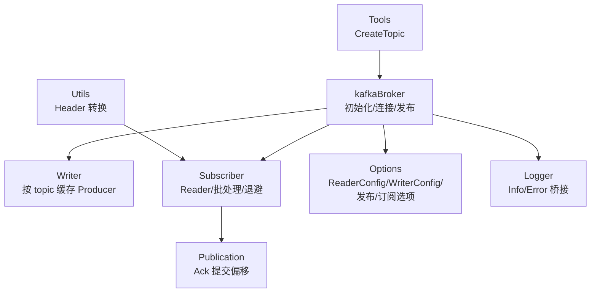
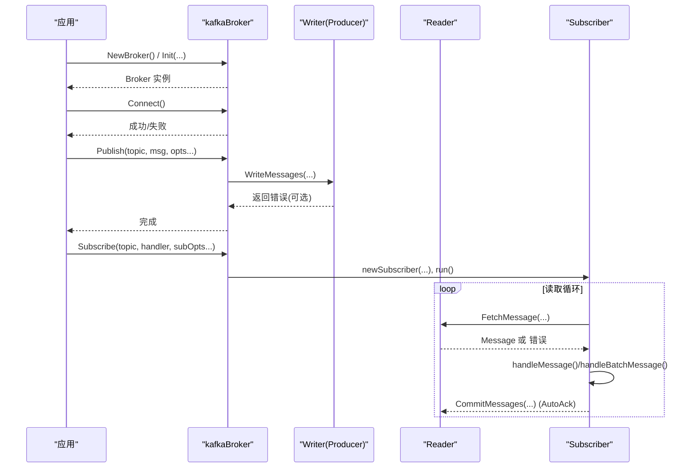
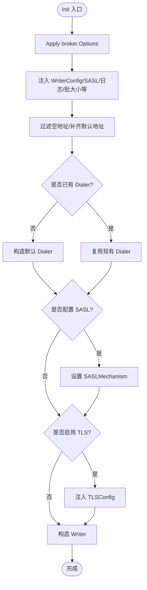
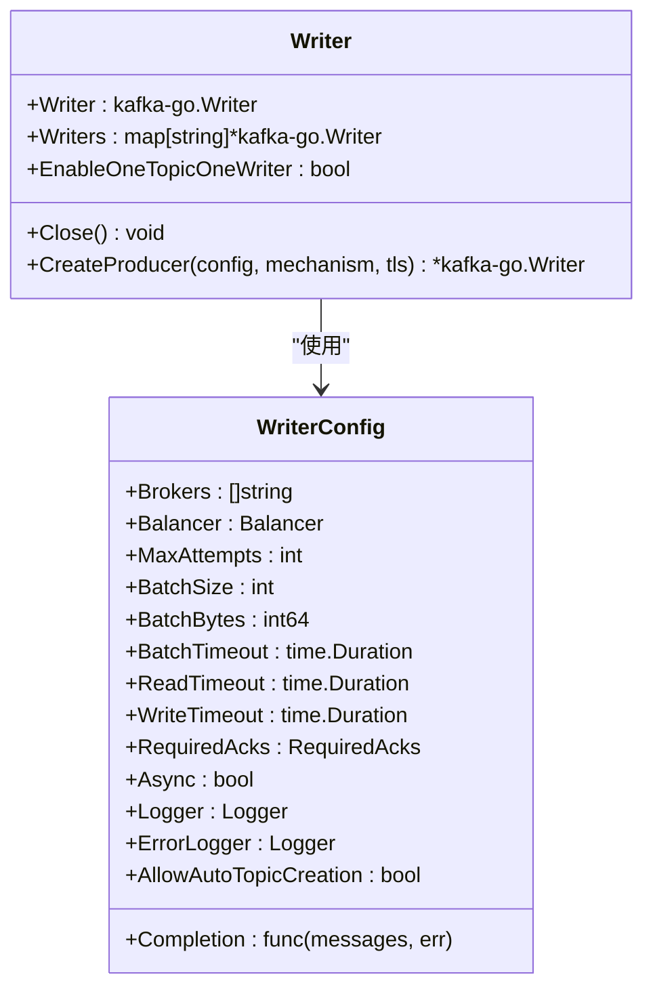
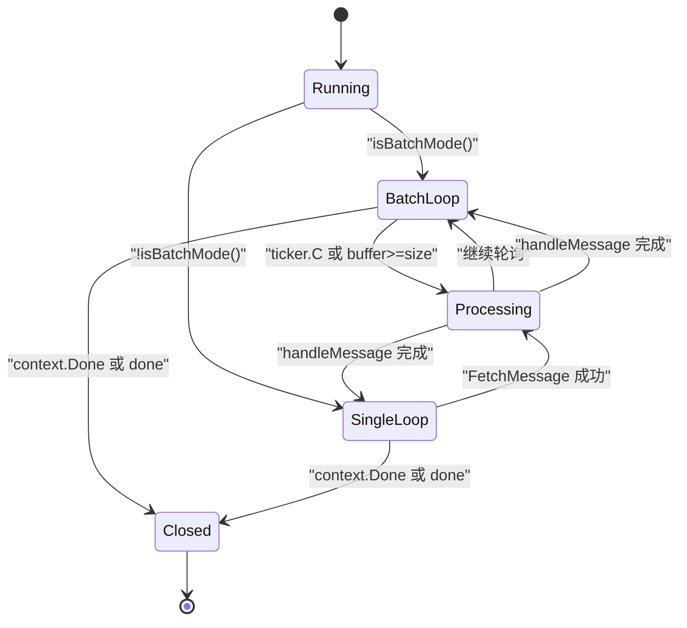
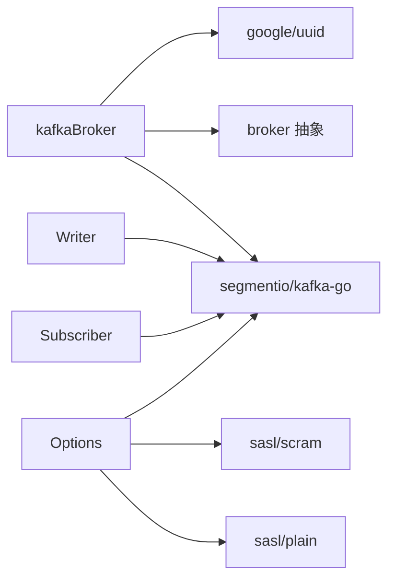

# Kafka 后端实现

<cite>
**本文引用的文件**   
- [kafka.go](file://broker/kafka/kafka.go)
- [options.go](file://broker/kafka/options.go)
- [subscriber.go](file://broker/kafka/subscriber.go)
- [writer.go](file://broker/kafka/writer.go)
- [publication.go](file://broker/kafka/publication.go)
- [tools.go](file://broker/kafka/tools.go)
- [utils.go](file://broker/kafka/utils.go)
- [logger.go](file://broker/kafka/logger.go)
</cite>

## 目录
1. [简介](#简介)
2. [项目结构](#项目结构)
3. [核心组件](#核心组件)
4. [架构总览](#架构总览)
5. [详细组件分析](#详细组件分析)
6. [依赖关系分析](#依赖关系分析)
7. [性能与调优](#性能与调优)
8. [故障排查指南](#故障排查指南)
9. [结论](#结论)

## 简介
本文聚焦 broker/kafka 模块，系统性说明 Kafka 后端的客户端初始化、连接与会话管理、发布端 Writer 与订阅端 Subscriber 的实现机制。重点覆盖：
- kafkaBroker 的结构设计与初始化流程
- Reader 配置、单消息与批量处理模式
- 退避算法参数（deadlineMin/Max、errorMin/Max、maxAttempts）的作用机制
- isFatalError 的错误分类与 context.DeadlineExceeded 特殊处理
- 批量处理 processBatchMessage 的 messageBuffer 与 ticker 触发机制
- Writer 异步发送、重试与错误处理
- 连接失败、分区不可用、消费者组偏移量管理等场景的处理方案
- 配置示例与监控指标建议

## 项目结构
kafka 模块由以下文件组成，职责清晰分离：
- kafka.go：kafkaBroker 定义、初始化、Connect/Disconnect、发布主路径、SASL/TLS/Dialer 装配
- options.go：ReaderConfig/WriterConfig/PublishOption/SubscribeOption 等所有选项注入器
- subscriber.go：订阅者生命周期、读取循环、批处理、退避与致命错误判断
- writer.go：Writer 封装、按 topic 缓存 producer、创建底层 kafka-go.Writer
- publication.go：消息 Ack 封装
- tools.go：工具方法，含 CreateTopic
- utils.go：Header 转换
- logger.go：适配 kafka-go.Logger 的日志桥接

**图表来源**
- [kafka.go:1-200](file://broker/kafka/kafka.go#L1-L200)
- [writer.go:1-136](file://broker/kafka/writer.go#L1-L136)
- [subscriber.go:1-200](file://broker/kafka/subscriber.go#L1-L200)
- [options.go:1-200](file://broker/kafka/options.go#L1-L200)

**章节来源**
- [kafka.go:1-200](file://broker/kafka/kafka.go#L1-L200)
- [options.go:1-200](file://broker/kafka/options.go#L1-L200)

## 核心组件
- kafkaBroker：对外暴露 Broker 接口，负责地址解析、ReaderConfig/WriterConfig 装配、Writer 管理、订阅者集合、连接状态。
- Writer：封装 kafka-go.Writer，支持“一主题一生产者”或共享生产者两种模式，支持 SASL/TLS、负载均衡器、批大小、超时、自动建 Topic、Completion 回调。
- Subscriber：基于 kafka-go.Reader 的订阅循环，支持单条处理和批量处理；内置指数退避 + 抖动；区分致命错误与非致命错误。
- Publication：封装原始消息与 Ack 语义，提交消费者组偏移。
- Options：集中暴露 ReaderConfig、WriterConfig、PublishOption、SubscribeOption 的配置注入点。
- Tools/Utils/Logger：辅助工具、Header 转换、日志适配器。

**章节来源**
- [kafka.go:1-200](file://broker/kafka/kafka.go#L1-L200)
- [writer.go:1-136](file://broker/kafka/writer.go#L1-L136)
- [subscriber.go:1-200](file://broker/kafka/subscriber.go#L1-L200)
- [publication.go:1-57](file://broker/kafka/publication.go#L1-L57)
- [options.go:1-200](file://broker/kafka/options.go#L1-L200)
- [tools.go:1-58](file://broker/kafka/tools.go#L1-L58)
- [utils.go:1-15](file://broker/kafka/utils.go#L1-L15)
- [logger.go:1-31](file://broker/kafka/logger.go#L1-L31)

## 架构总览
Kafka 后端采用“Broker 中心协调 + Reader/Writer 双通道”的架构：
- 初始化阶段：根据 broker.Options 与 Context 中的 key/value 注入 ReaderConfig、WriterConfig、SASL Mechanism、TLS、日志器、重试次数等。
- 连接阶段：Connect 校验可用 broker 列表并标记 connected；Disconnect 关闭 Writer 和订阅者集合。
- 发布阶段：internalPublish 选择 one-writer 或多 writer 路径；按 topic 缓存 kafka-go.Writer；支持负载均衡器与重试策略。
- 订阅阶段：newSubscriber 创建 Reader；run 决定单条或批量处理；批量模式使用 ticker 定时 flush buffer；退避控制 FetchMessage 失败时的重试间隔。

**图表来源**
- [kafka.go:1-200](file://broker/kafka/kafka.go#L1-L200)
- [writer.go:1-136](file://broker/kafka/writer.go#L1-L136)
- [subscriber.go:1-200](file://broker/kafka/subscriber.go#L1-L200)

## 详细组件分析

### kafkaBroker 结构与初始化
kafkaBroker 字段包含：
- readerConfig：kafka-go ReaderConfig，默认开启 WatchPartitionChanges、MaxWait=500ms、ErrorLogger=ErrorLogger{}
- writerConfig：WriterConfig，默认 LeastBytes 均衡器、BatchTimeout=10ms、Async=false
- saslMechanism：SASL 认证机制
- writer：Writer 管理器
- connected：连接标志
- options：通用 broker.Options
- retriesCount：重试次数
- subscribers：订阅者同步映射表

初始化关键步骤：
- 从 broker.Options.Apply 加载 Addrs、Secure、TLSConfig
- 从 Context 注入 WriterConfig、SASL Mechanism、readerConfig、completion、enableOneTopicOneWriter、batchSize/batchTimeout/batchBytes/async/maxAttempts/readTimeout/writeTimeout/allowPublishAutoTopicCreation、日志开关
- 若未显式设置 Dialer，则构建默认 Dialer，并在启用 SASL/TLS 时注入对应机制
- 清理空地址，确保至少一个 broker 地址；同步到 readerConfig.Brokers 与 writerConfig.Brokers
- 构造 Writer（可配置 one-topic-one-writer）

**图表来源**
- [kafka.go:1-200](file://broker/kafka/kafka.go#L1-L200)
- [options.go:1-200](file://broker/kafka/options.go#L1-L200)

**章节来源**
- [kafka.go:1-200](file://broker/kafka/kafka.go#L1-L200)
- [options.go:1-200](file://broker/kafka/options.go#L1-L200)

### 客户端配置与连接管理
- Address：优先返回 options.Addrs[0]，否则默认 127.0.0.1:9092
- Connect：校验 addrs 非空，记录 connected=true，并刷新 readerConfig.Brokers
- Disconnect：关闭 writer、清空 subscribers、connected=false
- 连接池：Writer 内部维护 map[string]*kafkaGo.Writer；当 EnableOneTopicOneWriter=true 时按 topic 隔离；Close 会逐个关闭并复位为空的 map，避免 nil map panic

**章节来源**
- [kafka.go:1-200](file://broker/kafka/kafka.go#L1-L200)
- [writer.go:1-136](file://broker/kafka/writer.go#L1-L136)

### 认证与 TLS
- SASL：支持 PLAIN 与 SCRAM(SHA256/SHA512)，通过 WithPlainMechanism/WithScramMechanism 注入 Context，Init 中装配到 readerConfig.Dialer.SASLMechanism
- TLS：当 Secure 且 TLSConfig 非空时，注入 readerConfig.Dialer.TLS
- 日志：支持注入 kafka-go.Logger 与 ErrorLogger，或通过 enable 开关统一开启/关闭

**章节来源**
- [kafka.go:1-200](file://broker/kafka/kafka.go#L1-L200)
- [options.go:1-200](file://broker/kafka/options.go#L1-L200)
- [logger.go:1-31](file://broker/kafka/logger.go#L1-L31)

### 发布路径与 Writer 行为
internalPublish 主流程：
- 序列化 body；Clone 消息体
- 根据 enableOneTopicOneWriter 选择 publishMultipleWriter 或 publishOneWriter
- 构造 kafkaGo.Message，拷贝 Headers
- 在 one-topic-one-writer 模式下，按 topic 缓存 Writer；首次缺失则调用 Writer.CreateProducer
- initPublishOption 将发布级负载均衡器注入 Writer

Writer 能力：
- 支持 MaxAttempts、BatchSize、BatchBytes、BatchTimeout、ReadTimeout、WriteTimeout、RequiredAcks、Async、AllowAutoTopicCreation、Completion
- CreateProducer 共用 Transport(SASL/TLS)；Addr 使用 TCP(brokers...)
- Close 安全地关闭所有 Writer 并复位 Writers map

**图表来源**
- [writer.go:1-136](file://broker/kafka/writer.go#L1-L136)

**章节来源**
- [kafka.go:201-400](file://broker/kafka/kafka.go#L201-L400)
- [writer.go:1-136](file://broker/kafka/writer.go#L1-L136)

### 订阅者 Subscriber 与 Reader 配置
newSubscriber：
- 保存 broker/topic/options/handler/binder
- 使用传入 readerConfig 构造 kafka-go.Reader
- done channel 用于退出信号
- 默认退避参数：deadlineMin=50ms、deadlineMax=500ms、errorMin=500ms、errorMax=5s、maxAttempts=6
- batchSize/batchInterval 来自订阅选项，决定批量模式

Reader 配置可通过 WithXxx 系列 SubscribeOption 注入，包括：
- queueCapacity/minBytes/maxBytes/maxWait/readLagInterval/heartbeatInterval/commitInterval/partitionWatchInterval/watchPartitionChanges/sessionTimeout/rebalanceTimeout/retentionTime/startOffset/dialer/dialerTimeout
- readBatchTimeout/readBackoffMin/readBackoffMax
- subscribeBatchSize/subscribeBatchInterval

生命周期：
- run：isBatchMode 决定走 processBatchMessage 或 processSingleMessage
- Unsubscribe：closeLocked 关闭 reader 与 done channel；可选择从 subscribers 移除
- closeLocked：二次 close 被 closed 标志保护；done 保持关闭不置 nil，供 select 持续退出

**图表来源**
- [subscriber.go:1-200](file://broker/kafka/subscriber.go#L1-L200)

**章节来源**
- [subscriber.go:1-200](file://broker/kafka/subscriber.go#L1-L200)
- [options.go:200-394](file://broker/kafka/options.go#L200-L394)

### 单消息与批量处理模式
- 单消息模式 processSingleMessage：
  - 每次从 reader.FetchMessage(s.options.Context) 取一条
  - 失败时调用 backoffSleep(errorAttempt, errorMin, errorMax)，errorAttempt 上限 6
  - 成功后重置 errorAttempt，调用 handleMessage
- 批量模式 processBatchMessage：
  - 维护 messageBuffer，容量为 batchSize
  - 使用 time.NewTicker(batchInterval) 定期 flush buffer
  - 每次 FetchMessage 使用 1s 短超时 ctx，避免阻塞；失败时区分 deadline 与非 deadline：
    - context.DeadlineExceeded：按 deadlineMin/Max 退避，deadlineAttempt 上限 6
    - 其他错误：按 errorMin/Max 退避，errorAttempt 上限 6
  - 成功读取后追加到 buffer，达到 batchSize 立即处理
  - handleBatchMessage 逐条 handleMessage，记录失败 offset

差异要点：
- 单条模式对业务延迟敏感，适合低吞吐、强实时
- 批量模式提升吞吐，但引入 batchInterval 与 buffer 带来的额外延迟
- 批量模式对短超时退避更精细，避免频繁轮询造成的 CPU 抖动

**章节来源**
- [subscriber.go:200-362](file://broker/kafka/subscriber.go#L200-L362)

### 退避算法与致命错误
backoffDuration(attempt, min, max, rand63n)：
- 指数增长基数为 2：d = min << attempt
- 截断到 [min, max]
- 叠加抖动：d/2 + rand(0..d/2)，结果落在 [d/2, d]
- backoffSleep 使用 math/rand 全局函数（因为每个 subscriber goroutine 独立，rand.Int63n 并发安全）

isFatalError(s, err) 判断逻辑：
- nil 错误：非致命
- 外部上下文取消或截止：立即退出
- 订阅者已关闭：立即退出
- net.Error 且非 Timeout：视为致命（如永久连接失败）
- io.EOF：不是致命（kafka-go Reader 会自动重建连接），按临时错误退避重试
- 其余错误：均视为可重试临时错误

context.DeadlineExceeded 的特殊处理：
- 仅在批量模式的短超时分支中识别
- 使用 deadlineMin/Max 进行较小幅度的退避，避免频繁轮询
- deadlineAttempt 上限 6，防止无限退避

**章节来源**
- [subscriber.go:200-362](file://broker/kafka/subscriber.go#L200-L362)

### 批量处理 processBatchMessage 详解
messageBuffer 管理：
- 初始化为容量为 batchSize 的 slice
- 成功读取追加至尾部
- 达到 batchSize 或 ticker 触发时调用 handleBatchMessage，并重新分配新 buffer

ticker 触发机制：
- time.NewTicker(batchInterval)
- 每次 ticker.C 到达，如果 buffer 非空即 flush
- default 分支执行带超时的 FetchMessage，避免阻塞

批量提交策略：
- 当前实现逐条 handleMessage，再逐条 AutoAck
- 尚未实现真正的“整批 CommitMessages”，因此并非严格意义上的事务性批量提交
- 如需严格批量提交，应在 buffer 满或 tick 时收集一批 offset 后一次性提交

**章节来源**
- [subscriber.go:200-362](file://broker/kafka/subscriber.go#L200-L362)

### 消息处理与 Ack
handleMessage：
- 以 context.Background() 作为基上下文，隔离每条消息处理
- 若 binder 非空，反序列化 km.Value 到 bm.Body；否则直接赋值 Value
- 构造 publication，调用 handler(ctx, pub)
- 若 AutoAck=true，调用 pub.Ack() 提交偏移

publication.Ack：
- 若 reader 为 nil 返回错误
- 否则调用 reader.CommitMessages(ctx, km) 提交该消息偏移

**章节来源**
- [subscriber.go:200-362](file://broker/kafka/subscriber.go#L200-L362)
- [publication.go:1-57](file://broker/kafka/publication.go#L1-L57)

### 工具方法与 Topic 管理
tools.go 提供：
- createConnection：建立到 broker 的连接并获取 controller，返回连接与清理函数
- CreateTopic：创建 Topic，忽略 AlreadyExists 错误

**章节来源**
- [tools.go:1-58](file://broker/kafka/tools.go#L1-L58)

### Header 转换
utils.go：
- kafkaHeaderToMap：将 kafka-go.Header 转换为 broker.Headers（map[string]string）

**章节来源**
- [utils.go:1-15](file://broker/kafka/utils.go#L1-L15)

## 依赖关系分析
- kafkaBroker 依赖：
  - broker 抽象（Options、Handler、Binder、Publisher）
  - segmentio/kafka-go（ReaderConfig、Writer、Message、Header、Transport、sasl）
  - google/uuid（可能用于标识，具体引用见文件头）
- Writer 依赖：
  - kafka-go.Writer、Transport、sasl.Mechanism
- Subscriber 依赖：
  - kafka-go.Reader、net、math/rand、time、errors
- Options 依赖：
  - kafka-go、sasl/plain、sasl/scram、broker.Option/PublishOption/SubscribeOption

**图表来源**
- [kafka.go:1-200](file://broker/kafka/kafka.go#L1-L200)
- [writer.go:1-136](file://broker/kafka/writer.go#L1-L136)
- [subscriber.go:1-200](file://broker/kafka/subscriber.go#L1-L200)
- [options.go:1-200](file://broker/kafka/options.go#L1-L200)

**章节来源**
- [kafka.go:1-200](file://broker/kafka/kafka.go#L1-L200)
- [writer.go:1-136](file://broker/kafka/writer.go#L1-L136)
- [subscriber.go:1-200](file://broker/kafka/subscriber.go#L1-L200)
- [options.go:1-200](file://broker/kafka/options.go#L1-L200)

## 性能与调优

### 批大小与批间隔
- batchSize（发布侧 WriterConfig.BatchSize）：影响写吞吐与内存占用。过大增加单次请求体积与延迟，过小降低吞吐。
- batchInterval（订阅侧 subscriber.batchInterval）：批量拉取的 flush 周期。过小导致频繁处理，过大引入尾延迟。
- batchBytes（WriterConfig.BatchBytes）：限制批次最大字节数，避免超限请求被拒绝。

建议：
- 高吞吐场景：增大 batchSize、batchBytes，适度提高 batchInterval
- 低延迟场景：减小 batchSize，缩短 batchInterval，启用 AutoAck=false 以避免提交开销
- 注意：当前批量模式尚未整批提交偏移，需关注 offset 提交粒度

### ReaderConfig 参数
- MinBytes/MaxBytes：控制 fetch.min.bytes/fetch.max.bytes，影响拉取批量的下限与上限
- MaxWait：控制 fetch.max.wait.ms，配合 MaxBytes 提升吞吐
- ReadLagInterval/HeartbeatInterval/CommitInterval：影响消费者组心跳与 lag 观测频率
- SessionTimeout/RebalanceTimeout：影响会话与重平衡容忍度
- StartOffset：控制消费起始位置（绝对偏移或时间）

建议：
- 高吞吐：提高 MaxBytes/MaxWait，适度提高 HeartbeatInterval
- 稳定消费：合理设置 SessionTimeout/RebalanceTimeout，避免频繁 rebalance
- 精确回溯：StartOffset 设置为历史时间点或特定 offset

### Writer 参数
- MaxAttempts：重试次数，建议结合业务幂等性设置
- Async：仅在对丢消息可接受且追求吞吐时使用；默认 false 保证调用方可感知失败
- RequiredAcks：建议 >=1 以增强可靠性；-1 等待全部副本确认（最慢但最可靠）
- AllowAutoTopicCreation：谨慎开启，生产环境建议预创建 Topic
- Completion：可用于统计发送耗时与失败率

**章节来源**
- [options.go:1-200](file://broker/kafka/options.go#L1-L200)
- [options.go:200-394](file://broker/kafka/options.go#L200-L394)
- [writer.go:1-136](file://broker/kafka/writer.go#L1-L136)
- [subscriber.go:200-362](file://broker/kafka/subscriber.go#L200-L362)

## 故障排查指南

### 连接失败
现象：
- Connect 报错“no available brokers”
- Reader/Writer 无法建立连接

排查：
- 检查 broker.Options.Addrs 是否正确、非空
- 检查 SASL/TLS 配置是否匹配服务端
- 查看 ErrorLogger 输出，确认网络连通性与认证信息

处理：
- 修正 Addrs、用户名/密码、TLS 证书
- 启用日志开关 WithEnableLogger/WithEnableErrorLogger 观察底层错误

**章节来源**
- [kafka.go:1-200](file://broker/kafka/kafka.go#L1-L200)
- [options.go:1-200](file://broker/kafka/options.go#L1-L200)
- [logger.go:1-31](file://broker/kafka/logger.go#L1-L31)

### 分区不可用
现象：
- FetchMessage 返回 net.Error 且非 Timeout
- isFatalError 判定为致命错误，订阅者退出

排查：
- 检查目标 Topic 分区状态、Leader 选举
- 查看消费者组是否处于 Rebalancing

处理：
- 恢复分区可用性后，重新订阅或重启消费者
- 调整 SessionTimeout/RebalanceTimeout 以适应集群波动

**章节来源**
- [subscriber.go:200-362](file://broker/kafka/subscriber.go#L200-L362)

### 消费者组偏移量管理
现象：
- AutoAck=true 时未能正确提交偏移
- 重复消费或丢失消费

排查：
- 确认 readerConfig 是否正确配置消费者组相关参数
- 检查 CommitMessages 是否返回错误
- 验证 AutoAck 与业务幂等性

处理：
- 合理设置 CommitInterval、HeartbeatInterval
- 对于强一致需求，可在业务层自行维护 offset 并提交
- 注意当前批量模式逐条提交，非整批提交

**章节来源**
- [publication.go:1-57](file://broker/kafka/publication.go#L1-L57)
- [subscriber.go:200-362](file://broker/kafka/subscriber.go#L200-L362)
- [options.go:200-394](file://broker/kafka/options.go#L200-L394)

### 发布失败与重试
现象：
- Publish 返回错误
- 异步模式下无法感知失败

排查：
- 检查 Writer.MaxAttempts、Async、RequiredAcks
- 查看 Completion 回调是否记录错误
- 确认负载均衡器是否与 Key/Partition 策略匹配

处理：
- 适当提高 MaxAttempts，结合业务幂等
- 谨慎开启 Async，必要时使用 Completion 回调统计失败
- 调整 RequiredAcks 平衡性能与可靠性

**章节来源**
- [writer.go:1-136](file://broker/kafka/writer.go#L1-L136)
- [kafka.go:201-400](file://broker/kafka/kafka.go#L201-L400)

### 配置示例与监控指标

配置示例（概念性描述）：
- 基础连接：Set Addrs=[broker1:9092,broker2:9092]，启用 Secure 与 TLSConfig
- 认证：使用 WithPlainMechanism("user","pass") 或 WithScramMechanism(ScramAlgorithmSHA256,"user","pass")
- 发布：WithBatchSize(100)、WithBatchTimeout(10ms)、WithBatchBytes(1048576)、WithAsync(false)、WithMaxAttempts(3)、WithRequiredAcks(-1)
- 订阅：WithMinBytes(1024)、WithMaxBytes(1048576)、WithMaxWait(500ms)、WithHeartbeatInterval(3s)、WithCommitInterval(1s)、WithSessionTimeout(10s)、WithRebalanceTimeout(10s)、WithStartOffset(0)、WithSubscribeBatchSize(100)、WithSubscribeBatchInterval(100ms)

监控指标建议：
- 发布侧：
  - 发送成功率/失败率（基于 Completion 回调）
  - 平均/分位延迟（Completion 回调计时）
  - 批大小分布（BatchSize/BatchBytes 实际值）
  - 重试次数（MaxAttempts 命中情况）
- 订阅侧：
  - 拉取延迟（FetchMessage 耗时）
  - 处理延迟（handleMessage 耗时）
  - 提交延迟（CommitMessages 耗时）
  - 消费滞后（ReadLagInterval 观测）
  - 错误率（FetchMessage 错误分类：DeadlineExceeded/net.Error/io.EOF）

**章节来源**
- [options.go:1-200](file://broker/kafka/options.go#L1-L200)
- [options.go:200-394](file://broker/kafka/options.go#L200-L394)
- [writer.go:1-136](file://broker/kafka/writer.go#L1-L136)
- [subscriber.go:200-362](file://broker/kafka/subscriber.go#L200-L362)

## 结论
Kafka 后端以 kafkaBroker 为中心，组合 ReaderConfig/WriterConfig 与 SASL/TLS 认证，提供稳定的发布与订阅能力。其优势在于：
- 清晰的配置注入体系，支持细粒度的 Reader/Writer/发布/订阅选项
- 完善的错误分类与退避机制，兼顾稳定性与资源利用
- 灵活的批处理模式，满足吞吐与延迟的不同需求

需注意的边界：
- 批量模式尚未实现整批偏移提交，需在业务层权衡
- 异步发送不返回错误，需谨慎评估丢消息风险
- 致命错误（如非超时 net.Error）会立即退出订阅者，需要上层监控与自愈

建议在部署前充分压测 batchSize/batchInterval/ReaderConfig 参数，并结合 Completion 回调与日志系统建立完整可观测性。