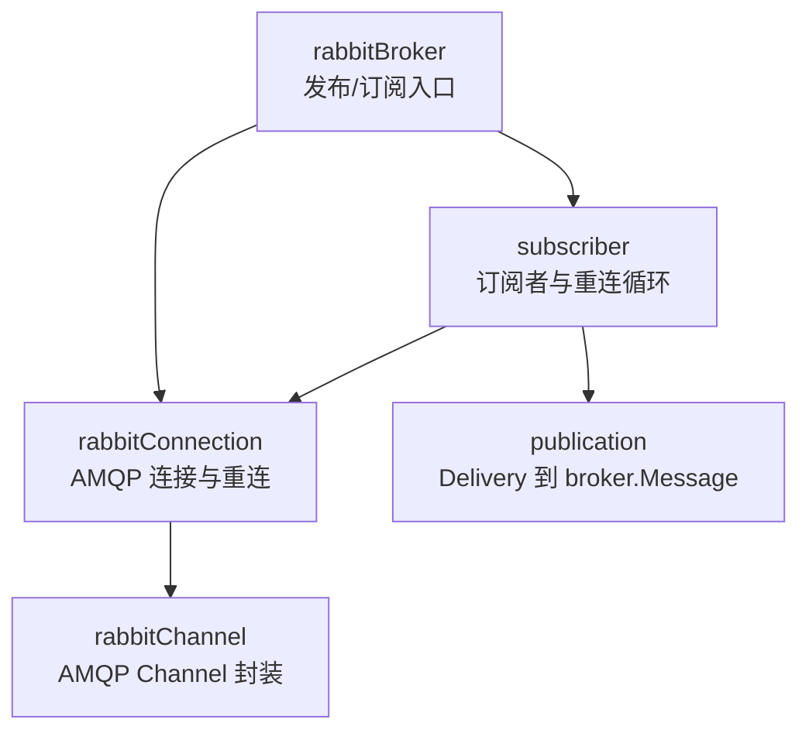
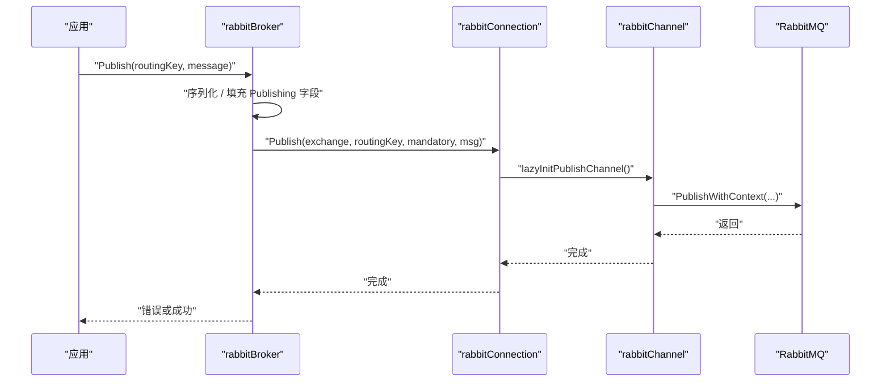
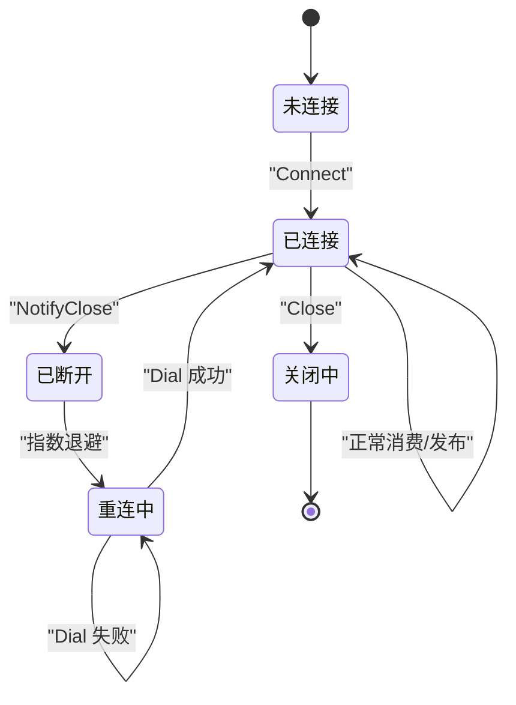
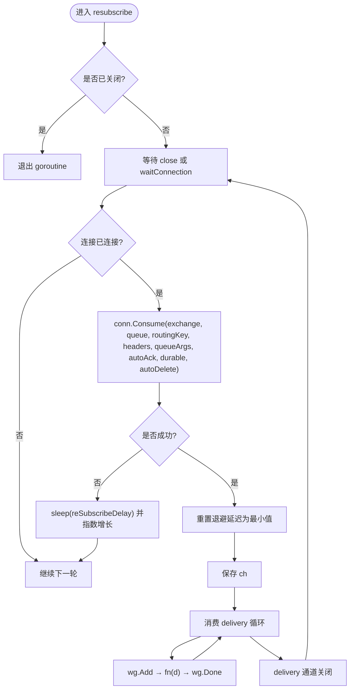
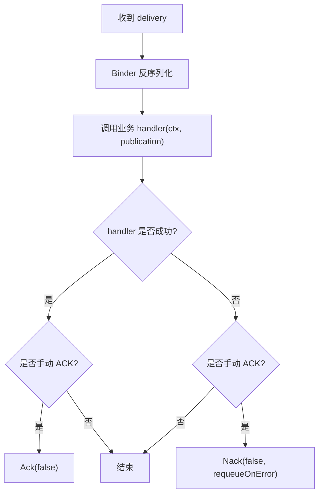
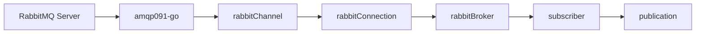

# RabbitMQ 后端实现

<cite>
**本文引用的文件**   
- [rabbitmq.go](file://broker/rabbitmq/rabbitmq.go)
- [subscriber.go](file://broker/rabbitmq/subscriber.go)
- [connection.go](file://broker/rabbitmq/connection.go)
- [channel.go](file://broker/rabbitmq/channel.go)
- [options.go](file://broker/rabbitmq/options.go)
- [consts.go](file://broker/rabbitmq/consts.go)
- [publication.go](file://broker/rabbitmq/publication.go)
</cite>

## 目录
1. [简介](#简介)
2. [项目结构](#项目结构)
3. [核心组件](#核心组件)
4. [架构总览](#架构总览)
5. [详细组件分析](#详细组件分析)
6. [依赖关系分析](#依赖关系分析)
7. [性能与资源特性](#性能与资源特性)
8. [常见问题排查](#常见问题排查)
9. [结论](#结论)

## 简介
本文面向本仓库中的 RabbitMQ 后端实现，围绕以下目标展开：连接与 channel 复用、exchange/queue/binding 声明策略、topic 到 routing key 的映射、订阅者重连循环、队列参数配置、AMQP 0.9.1 的 Ack/Nack/Reject 语义、以及连接池与优雅关闭。该实现位于 `broker/rabbitmq` 子模块，通过 `amqp091-go` 驱动与 RabbitMQ 交互，并在上层 Broker 抽象下提供发布与订阅能力。

## 项目结构
RabbitMQ 后端由一组职责清晰的 Go 包组成：

| 文件 | 职责 |
|---|---|
| `rabbitmq.go` | `rabbitBroker` 生命周期、发布主流程、订阅入口；解析 Publish/Subscribe 选项并委派给连接层 |
| `connection.go` | `rabbitConnection`：单 AMQP 连接、自动重连、交换器注册、QoS、发布通道懒初始化、Confirm/Return 回调 |
| `channel.go` | `rabbitChannel`：包装 `amqp.Channel`，封装 Exchange/Queue/Bind/Consume/Publish/Confirm/NotifyReturn |
| `subscriber.go` | `subscriber`：订阅元数据、消费 goroutine、指数退避 resubscribe 循环 |
| `options.go` | 所有 Broker/Subscribe/Publish 选项键与构造器 |
| `consts.go` | 常量（例如默认重连延迟、退避因子） |
| `publication.go` | 订阅侧消息包装，承载 AMQP Delivery 与业务 Message |

**图表来源**
- [rabbitmq.go:1-200](file://broker/rabbitmq/rabbitmq.go#L1-L200)
- [connection.go:1-120](file://broker/rabbitmq/connection.go#L1-L120)
- [channel.go:1-122](file://broker/rabbitmq/channel.go#L1-L122)
- [subscriber.go:1-126](file://broker/rabbitmq/subscriber.go#L1-L126)
- [publication.go:1-120](file://broker/rabbitmq/publication.go#L1-L120)

**章节来源**
- [rabbitmq.go:1-330](file://broker/rabbitmq/rabbitmq.go#L1-L330)
- [connection.go:1-425](file://broker/rabbitmq/connection.go#L1-L425)
- [channel.go:1-122](file://broker/rabbitmq/channel.go#L1-L122)
- [subscriber.go:1-126](file://broker/rabbitmq/subscriber.go#L1-L126)
- [options.go:1-272](file://broker/rabbitmq/options.go#L1-L272)

## 核心组件
- `rabbitBroker`：对外暴露 Broker 接口，管理一个 `rabbitConnection`、全局订阅者表，并把发布和订阅请求转交给连接层。
- `rabbitConnection`：持有单个 `*amqp.Connection`，维护已注册的 exchange 列表、默认 exchange、QoS、publisher confirms、return 回调；具备自动重连与等待信号机制。
- `rabbitChannel`：对 `amqp.Channel` 的轻量封装，负责 Qos、ExchangeDeclare、QueueDeclare、QueueBind、Consume、Publish、Confirm、NotifyReturn。
- `subscriber`：保存订阅元数据（topic、exchange、durable/autoDelete、queueArgs、headers），启动独立 goroutine 执行 resubscribe 循环。
- `publication`：把 AMQP Delivery 包装为 broker.Message，便于 Binder 反序列化和业务 handler 处理。

**章节来源**
- [rabbitmq.go:1-120](file://broker/rabbitmq/rabbitmq.go#L1-L120)
- [connection.go:1-120](file://broker/rabbitmq/connection.go#L1-L120)
- [channel.go:1-60](file://broker/rabbitmq/channel.go#L1-L60)
- [subscriber.go:1-40](file://broker/rabbitmq/subscriber.go#L1-L40)
- [publication.go:1-80](file://broker/rabbitmq/publication.go#L1-L80)

## 架构总览
RabbitMQ 后端的运行期关键路径分为两条：

1. 发布路径：`rabbitBroker.Publish` → 序列化 → 构建 `amqp.Publishing` → 选择 exchange → 可选声明 queue → 调用 `rabbitConnection.Publish` → 使用 publish channel 发送。
2. 订阅路径：`rabbitBroker.Subscribe` → 创建 `subscriber` → 启动 `resubscribe` → 通过 `rabbitConnection.Consume` 建立消费 channel、声明 queue、绑定 queue、消费 delivery → 投递到业务 handler。

**图表来源**
- [rabbitmq.go:120-230](file://broker/rabbitmq/rabbitmq.go#L120-L230)
- [connection.go:330-400](file://broker/rabbitmq/connection.go#L330-L400)
- [channel.go:40-80](file://broker/rabbitmq/channel.go#L40-L80)

**章节来源**
- [rabbitmq.go:120-330](file://broker/rabbitmq/rabbitmq.go#L120-L330)
- [connection.go:300-425](file://broker/rabbitmq/connection.go#L300-L425)
- [channel.go:40-122](file://broker/rabbitmq/channel.go#L40-L122)

## 详细组件分析

### 连接管理与 channel 复用
- 单连接模型：每个 `rabbitBroker` 最多持有 1 个 `rabbitConnection`，其内部仅有一个 `*amqp.Connection`。
- channel 复用：
  - 订阅消费 channel：每次 `Consume` 都会新建 `rabbitChannel`，用于隔离消费者实例。
  - 发布 channel：默认启用懒初始化 `EnableLazyInitPublishChannel = true`，首次发布时创建并缓存到 `ExchangeChannel`；也可通过 `WithPrefetchCount/Size/Global` 设置 QoS。
- 自动重连：`connect` 成功后开启 `reconnect` goroutine，监听 `NotifyClose`；断开后按指数退避重试，直到进程退出或主动 Close。
- 交换器声明：连接建立时遍历 `exchanges` 列表，逐个 `DeclareExchange`；默认 exchange 为 `amq.topic`，类型 topic、持久化。
- 优雅关闭：`Close` 关闭底层连接，`rabbitBroker.Disconnect` 还会清空订阅者表并等待消费 goroutine 结束。

**图表来源**
- [connection.go:120-220](file://broker/rabbitmq/connection.go#L120-L220)
- [connection.go:220-320](file://broker/rabbitmq/connection.go#L220-L320)

**章节来源**
- [connection.go:1-220](file://broker/rabbitmq/connection.go#L1-L220)
- [connection.go:300-425](file://broker/rabbitmq/connection.go#L300-L425)

### Exchange、Queue、Binding 声明与管理策略
- Exchange：
  - 支持通过 `WithExchanges` 注册多个 exchange；若未显式指定 default exchange name，则取列表第一个。
  - 支持遗留方式 `WithExchangeName`、`WithExchangeType`、`WithDurableExchange` 覆盖默认 exchange。
  - 连接初始化时对每个已注册 exchange 执行 `DeclareExchange(name, type, durable, false)`。
- Queue：
  - 订阅端通过 `DeclareQueue(queueName, queueArgs, durableQueue, autoDelete)` 声明。
  - 发布端可通过 `WithPublishDeclareQueue` 在发布前声明 queue 并完成 binding。
- Binding：
  - 订阅端消费前执行 `QueueBind(queueName, routingKey, exchange, bindArgs)`。
  - 发布端声明 queue 时也同步绑定。

| 场景 | 行为 |
|---|---|
| 订阅创建 | 声明 exchange、声明 queue、消费 delivery、绑定 queue |
| 发布时声明 queue | 懒初始化 publish channel、声明 exchange、声明 queue、绑定 queue |
| 普通发布 | 直接发送到当前 exchange + routing key |

**章节来源**
- [connection.go:120-220](file://broker/rabbitmq/connection.go#L120-L220)
- [connection.go:330-400](file://broker/rabbitmq/connection.go#L330-L400)
- [channel.go:60-122](file://broker/rabbitmq/channel.go#L60-L122)
- [rabbitmq.go:200-230](file://broker/rabbitmq/rabbitmq.go#L200-L230)
- [options.go:100-170](file://broker/rabbitmq/options.go#L100-L170)

### Topic 到 Routing Key 的映射
在本实现中，`routingKey` 就是 AMQP 的 routing key，没有额外转换层：
- 发布：`routingKey` 原样传入 `Publish(exchangeName, routingKey, ...)`。
- 订阅：`consumerChannel.ConsumeQueue(queueName, autoAck)` 返回 delivery 后，`publication.topic` 使用 `msg.RoutingKey`；binding 时使用 `s.topic`。
- 如果订阅时未传 topic，则回落到 `WithDefaultQueue`；仍为空会报错。

因此，topic 与 routing key 是同一概念：路由匹配完全由 exchange 类型决定。

**章节来源**
- [rabbitmq.go:230-330](file://broker/rabbitmq/rabbitmq.go#L230-L330)
- [publication.go:1-80](file://broker/rabbitmq/publication.go#L1-L80)

### Subscriber 的 Resubscribe 循环
`subscriber.resubscribe` 是订阅者的核心控制流：

关键点：
- 退避参数：最小延迟、最大延迟、退避倍数来自常量（例如 `defaultMinResubscribeDelay`、`defaultMaxResubscribeDelay`、`defaultExpFactor`）。
- 重连触发：连接断开、`waitConnection` 通知、`Consume` 失败都会导致重新尝试。
- 成功后的 delivery 消费：每条 delivery 都通过 `wg.Add`/`Done` 保护，确保 `Disconnect` 能等待全部处理完成。
- 关闭语义：`Unsubscribe(removeFromManager=true)` 会关闭 channel 并从 `SubscriberSyncMap` 移除；若 `removeFromManager=false`，则只关闭 channel。

**图表来源**
- [subscriber.go:40-126](file://broker/rabbitmq/subscriber.go#L40-L126)
- [connection.go:120-220](file://broker/rabbitmq/connection.go#L120-L220)

**章节来源**
- [subscriber.go:1-126](file://broker/rabbitmq/subscriber.go#L1-L126)
- [consts.go:1-120](file://broker/rabbitmq/consts.go#L1-L120)

### QueueArguments 与高级队列特性
订阅时可传入 `queueArgs`，对应 AMQP 队列参数表。常见用途：

| 参数 | 含义 | 建议 |
|---|---|---|
| `x-dead-letter-exchange` | 死信交换机名 | 配合 `x-dead-letter-routing-key` 使用，用于失败消息兜底 |
| `x-message-ttl` | 消息存活时间（毫秒） | 适合有生命周期的任务或临时事件 |
| `x-max-length` | 队列最大长度 | 防止积压无限增长 |
| `x-max-length-bytes` | 队列最大字节数 | 结合 TTL 控制内存占用 |
| `x-single-active-consumer` | 单活消费者 | 需要严格顺序或幂等消费的场景 |

这些参数通过 `DeclareQueue(queueName, qArgs, durable, autoDelete)` 传递到底层 `amqp.QueueDeclare`。

此外，订阅元数据还包含：
- `durableQueue`：持久化队列。
- `autoDelete`：消费者全部取消后删除队列。
- `headers`：作为 binding arguments 传给 `QueueBind`。
- `queueArgs`：作为 queue arguments 传给 `QueueDeclare`。

**章节来源**
- [subscriber.go:1-40](file://broker/rabbitmq/subscriber.go#L1-L40)
- [connection.go:330-400](file://broker/rabbitmq/connection.go#L330-L400)
- [channel.go:80-122](file://broker/rabbitmq/channel.go#L80-L122)
- [options.go:160-200](file://broker/rabbitmq/options.go#L160-L200)

### AMQP 0.9.1 的 Ack/Nack/Reject 与 AutoAck
订阅侧的消息确认逻辑如下：

| 条件 | 行为 |
|---|---|
| `AutoAck=true` | 不手动 ack/nack，由 AMQP 层自动确认 |
| `AutoAck=false` 且 handler 成功 | 若启用 `WithAckOnSuccess()`，则调用 `Ack(false)` |
| `AutoAck=false` 且 handler 失败 | 调用 `Nack(false, requeueOnError)` |
| `requeueOnError=true` | Nack 时允许 broker 重新入队 |

注意：
- `Reject` 在本实现中没有直接使用，主要通过 `Nack` 控制是否 requeue。
- 当同时启用 `WithAckOnSuccess()` 和 `AutoAck=true` 时，不会执行手动 ack，因为分支要求 `!options.AutoAck`。
- 业务 handler 的错误语义由调用方设计：例如重试、写入死信队列、告警等。

**图表来源**
- [rabbitmq.go:260-330](file://broker/rabbitmq/rabbitmq.go#L260-L330)

**章节来源**
- [rabbitmq.go:230-330](file://broker/rabbitmq/rabbitmq.go#L230-L330)
- [options.go:160-200](file://broker/rabbitmq/options.go#L160-L200)

### 发布选项与 Exchange 选择
发布时 exchange 的选择优先级：
1. 发布选项中显式指定 `publishExchangeKey`。
2. 否则使用连接层的 `defaultExchangeName`。

发布还支持：
- `mandatory`：无法路由时触发 return。
- `WithPublishDeclareQueue`：在发布前声明 queue 并绑定。
- 所有标准 `amqp.Publishing` 字段：DeliveryMode、Priority、ContentType、ContentEncoding、CorrelationId、ReplyTo、Expiration、MessageId、Timestamp、Type、UserId、AppId、Headers。

**章节来源**
- [rabbitmq.go:120-230](file://broker/rabbitmq/rabbitmq.go#L120-L230)
- [options.go:200-272](file://broker/rabbitmq/options.go#L200-L272)

### 交换机类型选择指导
| 类型 | 适用场景 | 注意事项 |
|---|---|---|
| direct | 精确 routing key 匹配 | 适合点对点或固定路由键 |
| fanout | 广播到所有绑定队列 | 忽略 routing key |
| topic | 基于通配符的路由 | `*` 匹配一段，`#` 匹配多段 |
| headers | 基于 header 匹配 | 性能较差，慎用 |

默认 exchange 为 `amq.topic`，类型 topic。若业务需要直连或广播，应通过 `WithExchangeType` 或 `WithExchanges` 注册新 exchange，并用 `WithDefaultExchange` 或 `WithPublishExchange`/`WithSubscribeExchange` 明确指定。

**章节来源**
- [connection.go:20-120](file://broker/rabbitmq/connection.go#L20-L120)
- [options.go:1-100](file://broker/rabbitmq/options.go#L1-L100)

## 依赖关系分析

- `rabbitBroker` 依赖 `rabbitConnection` 进行网络 I/O。
- `rabbitConnection` 依赖 `rabbitChannel` 完成 AMQP 操作。
- `subscriber` 反向依赖 `rabbitConnection` 以重建消费 channel。
- `publication` 是订阅消费链路中的数据载体。

**图表来源**
- [rabbitmq.go:1-120](file://broker/rabbitmq/rabbitmq.go#L1-L120)
- [connection.go:1-120](file://broker/rabbitmq/connection.go#L1-L120)
- [channel.go:1-60](file://broker/rabbitmq/channel.go#L1-L60)
- [subscriber.go:1-40](file://broker/rabbitmq/subscriber.go#L1-L40)
- [publication.go:1-80](file://broker/rabbitmq/publication.go#L1-L80)

**章节来源**
- [rabbitmq.go:1-330](file://broker/rabbitmq/rabbitmq.go#L1-L330)
- [connection.go:1-425](file://broker/rabbitmq/connection.go#L1-L425)
- [channel.go:1-122](file://broker/rabbitmq/channel.go#L1-L122)
- [subscriber.go:1-126](file://broker/rabbitmq/subscriber.go#L1-L126)
- [publication.go:1-120](file://broker/rabbitmq/publication.go#L1-L120)

## 性能与资源特性
- 连接共享：所有订阅者和发布者共享同一个 `*amqp.Connection`，减少 TCP/TLS 握手开销。
- channel 隔离：
  - 订阅消费 channel 每次 resubscribe 都会重建，避免跨消费者状态污染。
  - 发布 channel 可懒初始化并复用，除非显式关闭或连接重建。
- QoS：通过 `prefetchCount/prefetchSize/prefetchGlobal` 控制预取数量，避免消费者被压垮。
- Publisher confirms：通过 `WithConfirmMode()` 开启，可在后台 goroutine 处理 confirm 回调。
- Return 处理：通过 `WithOnReturn` 捕获因 `mandatory=true` 且无匹配队列导致的退回消息。
- 优雅关闭：`Disconnect` 清空订阅者、关闭连接、等待所有消费 goroutine 完成。

优化建议：
- 合理设置 prefetch，避免消费者内存堆积。
- 对高频发布场景启用 publisher confirms，并结合落盘或补偿逻辑。
- 使用 `x-dead-letter-exchange` 收集失败消息，避免阻塞主队列。
- 对临时任务使用 TTL + 非持久化队列，降低重启成本。
- 对广播场景优先 fanout，避免复杂 topic 路由带来的匹配开销。

**章节来源**
- [connection.go:1-120](file://broker/rabbitmq/connection.go#L1-L120)
- [connection.go:300-425](file://broker/rabbitmq/connection.go#L300-L425)
- [channel.go:1-60](file://broker/rabbitmq/channel.go#L1-L60)
- [options.go:1-170](file://broker/rabbitmq/options.go#L1-L170)

## 常见问题排查

| 问题 | 可能原因 | 排查与修复 |
|---|---|---|
| 队列积压 | 消费者处理慢、prefetch 过大、TTL 过短、死信未配置 | 检查消费者耗时；调整 prefetch；设置 `x-dead-letter-exchange`；监控队列长度 |
| 连接频繁断开 | 网络抖动、服务端重启、心跳不匹配 | 查看 `notifyClose` 日志；检查网络；确认 heartbeat 与服务器一致 |
| 权限不足 | 用户缺少 exchange/queue/bind/consume 权限 | 在 RabbitMQ 控制台检查 vhost 权限；为服务账号授权 |
| 消息未被消费 | routing key 不匹配、exchange 类型不对、queue 未绑定 | 核对 exchange 类型；确认 binding key；使用 topic 时检查通配符 |
| 发布成功但无消费者 | 未声明 queue 或未绑定 | 使用 `WithPublishDeclareQueue` 或在订阅侧保证 queue 存在并绑定 |
| 消费者崩溃后重复消费 | Nack 时 requeue 或无手动 ack | 根据业务语义设置 `requeueOnError`；必要时使用幂等键或去重 |
| 消息丢失风险 | 非持久化队列、非持久化 exchange、未开启 confirms | 启用持久化；对关键消息开启 publisher confirms；合理配置 TTL |
| 订阅者未从管理器移除 | 调用 `Unsubscribe(false)` 或致命退出后未清理 | 调用方在退出路径显式 `RemoveOnly`；或通过 `Disconnect` 清理 |

补充说明：
- 当订阅者发生致命退出时，`SubscriberSyncMap` 中的条目不会自动摘除；这是调用方或 `Disconnect` 的责任。重订阅是覆盖而非累积，但 `Topics()/Len()/Has()` 可能高报“死亡”订阅者数量。
- 若 `AutoAck=true`，业务 handler 的错误不会触发 nack；如需手动确认，必须禁用 AutoAck 并配合 `WithAckOnSuccess()`。

**章节来源**
- [subscriber.go:40-126](file://broker/rabbitmq/subscriber.go#L40-L126)
- [rabbitmq.go:230-330](file://broker/rabbitmq/rabbitmq.go#L230-L330)
- [connection.go:200-425](file://broker/rabbitmq/connection.go#L200-L425)

## 结论
本 RabbitMQ 后端以单连接多 channel 的方式实现发布与订阅：连接层负责重连、交换器注册、QoS 与发布确认；channel 层封装 AMQP 操作；订阅者通过独立的 resubscribe 循环实现指数退避重连。发布与订阅均通过 context 选项灵活控制 exchange、queue 参数、binding 参数、确认语义与 QoS。对于生产环境，建议结合 dead letter、TTL、publisher confirms 和合理的 prefetch，以平衡可靠性、吞吐与资源消耗。