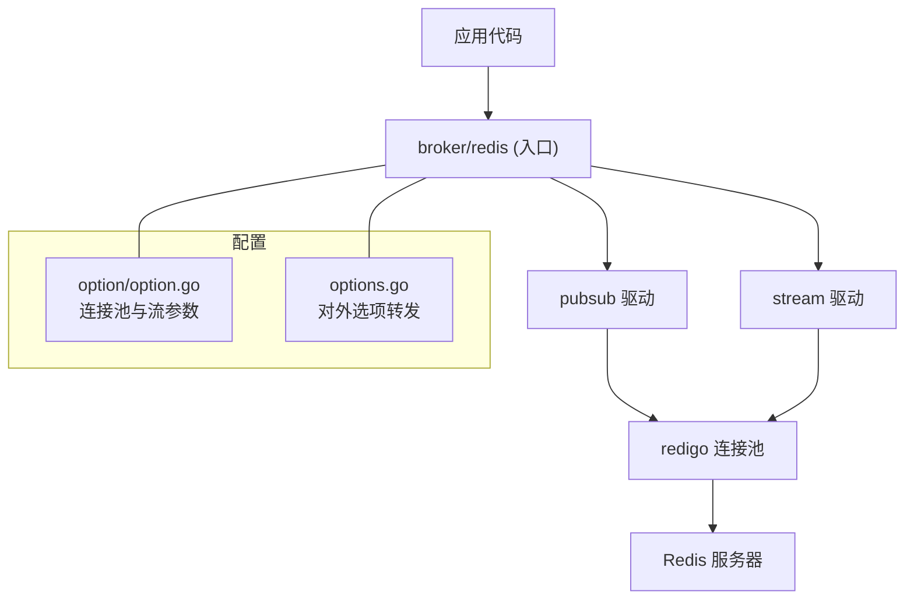
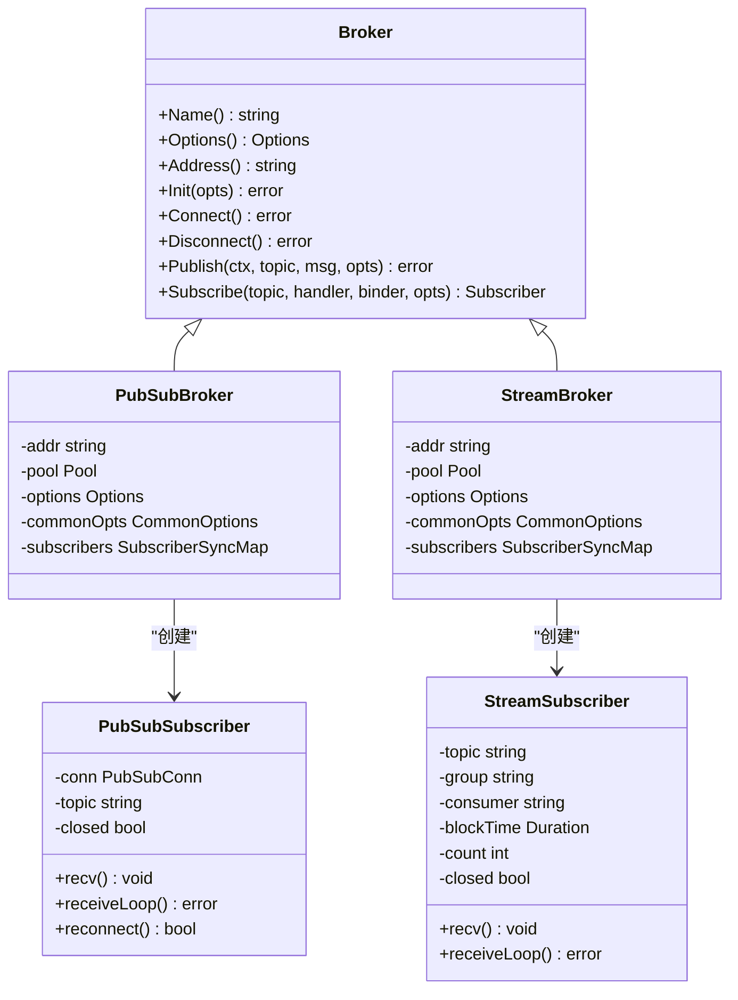
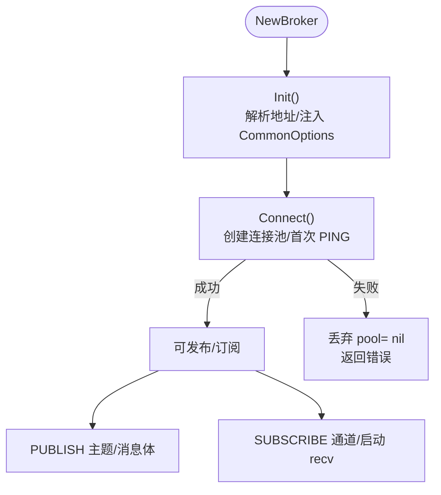
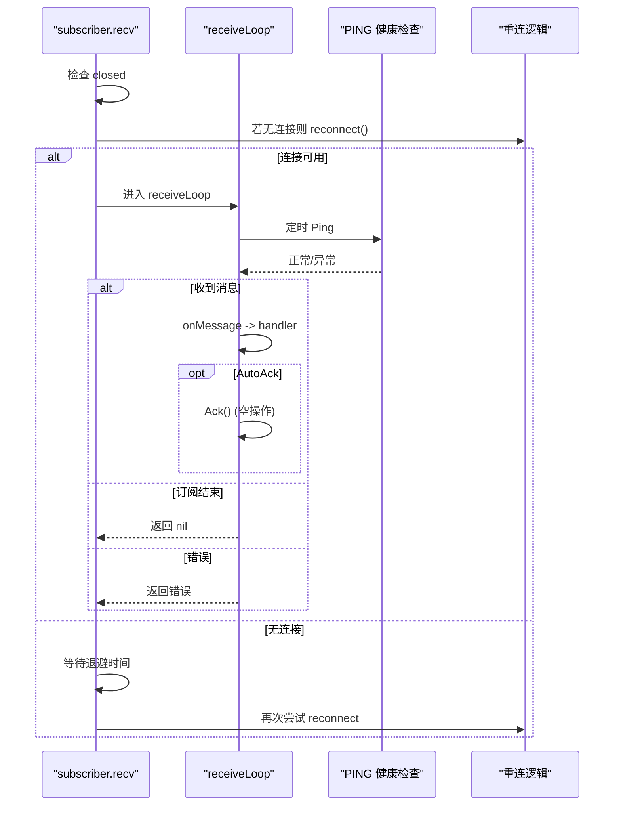
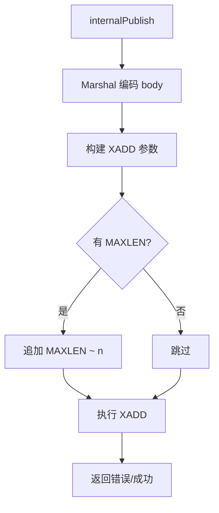
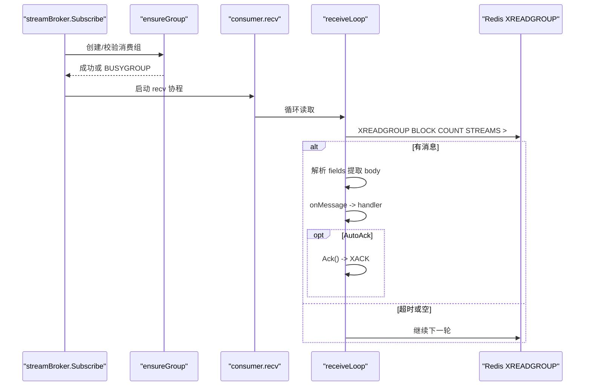
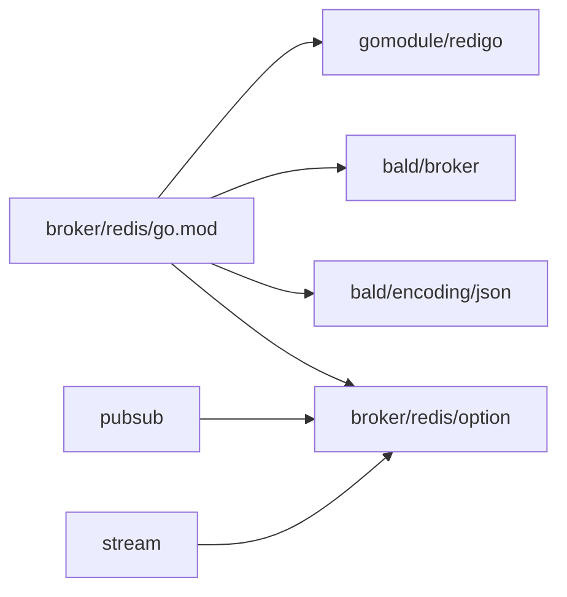
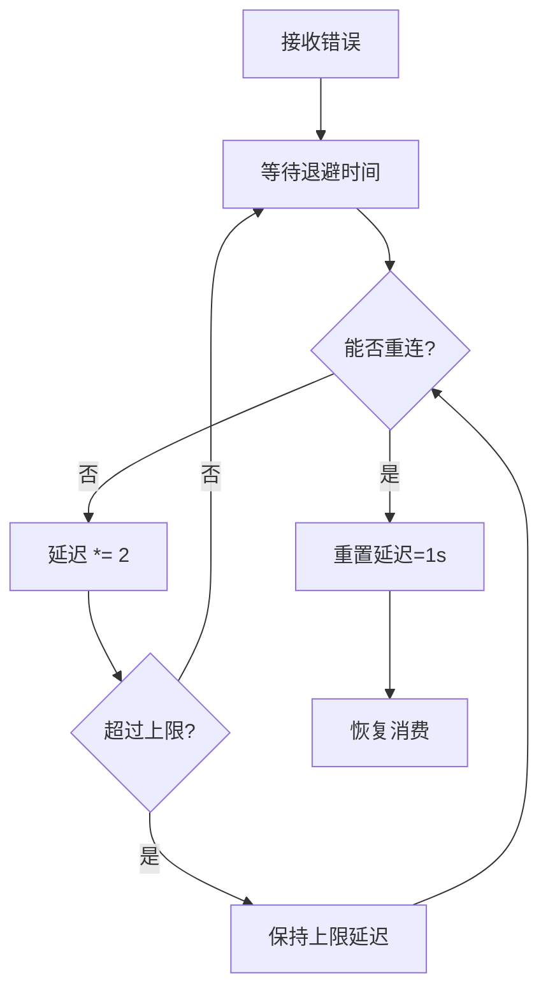

# Redis 后端实现

<cite>
**本文引用的文件**   
- [broker/redis/options.go](file://broker/redis/options.go)
- [broker/redis/redis.go](file://broker/redis/redis.go)
- [broker/redis/go.mod](file://broker/redis/go.mod)
- [broker/redis/option/option.go](file://broker/redis/option/option.go)
- [broker/redis/pubsub/redis.go](file://broker/redis/pubsub/redis.go)
- [broker/redis/pubsub/subscriber.go](file://broker/redis/pubsub/subscriber.go)
- [broker/redis/pubsub/publication.go](file://broker/redis/pubsub/publication.go)
- [broker/redis/stream/redis.go](file://broker/redis/stream/redis.go)
- [broker/redis/stream/subscriber.go](file://broker/redis/stream/subscriber.go)
- [broker/redis/stream/publication.go](file://broker/redis/stream/publication.go)
</cite>

## 目录
1. [引言](#引言)
2. [项目结构](#项目结构)
3. [核心组件](#核心组件)
4. [架构总览](#架构总览)
5. [详细组件分析](#详细组件分析)
6. [依赖关系分析](#依赖关系分析)
7. [性能与容量规划](#性能与容量规划)
8. [故障处理与排障指南](#故障处理与排障指南)
9. [结论](#结论)

## 引言
本技术文档聚焦于 broker 的 Redis 后端实现，覆盖两种消息模式：pubsub 与 stream。文档说明两者的实现差异、适用场景、连接池管理、自动重连与健康检查、流式消费语义、重连策略、Redis 集群注意事项、AutoAck 确认语义与风险、连接池参数调优，以及主从切换、网络分区、内存溢出等故障应对和监控指标建议。

该模块基于 redigo 连接池封装，提供统一的 Broker 接口；默认驱动为 pubsub，也可显式选择 stream。

**章节来源**
- [broker/redis/redis.go:1-20](file://broker/redis/redis.go#L1-L20)
- [broker/redis/go.mod:1-10](file://broker/redis/go.mod#L1-L10)

## 项目结构
Redis 后端位于 `broker/redis`，按模式拆分为两个子包：
- `pubsub`：基于 Redis Pub/Sub 的发布订阅模式
- `stream`：基于 Redis Stream + XREADGROUP 的消息队列模式
- `option`：共享的连接池与流专属配置常量及选项
- 顶层 `options.go`、`redis.go` 暴露统一入口与选项转发

**图表来源**
- [broker/redis/redis.go:1-20](file://broker/redis/redis.go#L1-L20)
- [broker/redis/option/option.go:1-195](file://broker/redis/option/option.go#L1-L195)
- [broker/redis/options.go:1-84](file://broker/redis/options.go#L1-L84)

**章节来源**
- [broker/redis/redis.go:1-20](file://broker/redis/redis.go#L1-L20)
- [broker/redis/options.go:1-84](file://broker/redis/options.go#L1-L84)
- [broker/redis/option/option.go:1-195](file://broker/redis/option/option.go#L1-L195)

## 核心组件
- **Broker 工厂**：根据驱动类型返回 pubsub 或 stream 实例；未指定时默认为 pubsub。
- **pubsub 驱动**：基于 `PUBLISH/SUBSCRIBE`，无持久化、无消费组；适合低延迟广播。
- **stream 驱动**：基于 `XADD/XREADGROUP/XACK`，支持消费者组、持久化与重试；适合可靠队列。
- **连接池**：使用 redigo `Pool`，带拨号超时、读写超时、空闲回收与借出时 PING 健康检查。
- **订阅者生命周期**：每个订阅者在独立协程中运行接收循环；失败后指数退避重连；stream 模式下还会确保消费组存在。
- **确认机制**：pubsub 的 Ack 为空操作；stream 在 AutoAck 下调用 `XACK` 确认。

**章节来源**
- [broker/redis/redis.go:1-20](file://broker/redis/redis.go#L1-L20)
- [broker/redis/pubsub/redis.go:1-200](file://broker/redis/pubsub/redis.go#L1-L200)
- [broker/redis/stream/redis.go:1-285](file://broker/redis/stream/redis.go#L1-L285)

## 架构总览
Redis 后端以“驱动”为单位抽象，对外暴露一致的 `broker.Broker` 接口。pubsub 与 stream 各自维护一个连接池和订阅者注册表，订阅者内部再持有独立的 Redis 连接（pubsub 用 `PubSubConn`，stream 用普通连接执行 `XREADGROUP`）。

**图表来源**
- [broker/redis/pubsub/redis.go:1-200](file://broker/redis/pubsub/redis.go#L1-L200)
- [broker/redis/stream/redis.go:1-285](file://broker/redis/stream/redis.go#L1-L285)
- [broker/redis/pubsub/subscriber.go:1-247](file://broker/redis/pubsub/subscriber.go#L1-L247)
- [broker/redis/stream/subscriber.go:1-226](file://broker/redis/stream/subscriber.go#L1-L226)

## 详细组件分析

### pubsub 模式
#### 连接池与初始化
- 地址解析：若未提供地址则回退到本地默认地址；非 `redis://` 前缀会补全。
- 连接池参数：最大空闲、最大活跃、空闲超时、连接超时、读超时、写超时均通过 `CommonOptions` 注入。
- 健康检查：连接借出时执行 `PING`；`Connect()` 主动取一条连接并 `PING`，把不可达提前暴露为错误。
- 生命周期：`Init` 校验已连接状态，`Connect` 懒建连后立即探活，`Disconnect` 关闭连接池并清理订阅者。

**图表来源**
- [broker/redis/pubsub/redis.go:1-200](file://broker/redis/pubsub/redis.go#L1-L200)

**章节来源**
- [broker/redis/pubsub/redis.go:1-200](file://broker/redis/pubsub/redis.go#L1-L200)

#### 订阅者：连接、自动重连与健康检查
- 连接模型：订阅者持有 `redis.PubSubConn`，在独立协程 `recv` 中运行 `receiveLoop`。
- 自动重连：
  - 初始重连延迟 1 秒，上限 30 秒，每次失败翻倍。
  - 重连成功后重置延迟，重新 `Subscribe`。
  - 订阅失败记录日志并重试。
- 健康检查：
  - 每 `DefaultHealthCheckPeriod`（默认 1 分钟）对当前连接执行 `Ping("")`。
  - 健康检查失败会中断接收循环，触发外层重连。
- 消息处理：
  - 可选 Binder 反序列化 body，否则直接传原始字节。
  - 调用业务 Handler；如开启 `AutoAck`，pubsub 的 `Ack()` 为空操作。
- 取消订阅：`Unsubscribe` 设置 closed 标志并调用 `Unsubscribe`；是否从管理器移除由参数控制。

**图表来源**
- [broker/redis/pubsub/subscriber.go:1-247](file://broker/redis/pubsub/subscriber.go#L1-L247)
- [broker/redis/pubsub/publication.go:1-29](file://broker/redis/pubsub/publication.go#L1-L29)

**章节来源**
- [broker/redis/pubsub/subscriber.go:1-247](file://broker/redis/pubsub/subscriber.go#L1-L247)
- [broker/redis/pubsub/publication.go:1-29](file://broker/redis/pubsub/publication.go#L1-L29)

### stream 模式
#### 发布：XADD 与 MAXLEN
- 写入命令：`XADD stream * body <bytes>`。
- 长度限制：可通过发布选项 `WithStreamMaxLen` 设置 `MAXLEN ~ n`，近似裁剪历史长度。
- 消息头：所有 header 值转为字符串作为字段写入。
- 连接防护：未连接时返回明确错误，避免 `(*Pool)(nil).Get()` panic。

**图表来源**
- [broker/redis/stream/redis.go:1-285](file://broker/redis/stream/redis.go#L1-L285)

**章节来源**
- [broker/redis/stream/redis.go:1-285](file://broker/redis/stream/redis.go#L1-L285)

#### 订阅：XREADGROUP 与消费者组
- 消费组与消费者：
  - 通过订阅选项 `WithStreamGroup`、`WithStreamConsumer` 设置。
  - 默认组名与消费者名定义在 `option/option.go`。
- 阻塞读取：
  - `XREADGROUP GROUP group consumer BLOCK timeout COUNT count STREAMS stream >`
  - `BLOCK` 与 `COUNT` 分别通过 `WithStreamBlockTime`、`WithStreamCount` 配置。
- 消费者组保障：
  - 订阅前先 `XGROUP CREATE stream group $ MKSTREAM`，忽略 `BUSYGROUP` 表示已存在。
  - 重连失败后再次 ensureGroup，保证组可用。
- 消息解析：
  - 从 field-value 列表中提取 `body` 字段，反序列化为消息体。
  - 将 `msgID`、topic、group 传递给 publication，用于后续 `XACK`。

**图表来源**
- [broker/redis/stream/redis.go:201-285](file://broker/redis/stream/redis.go#L201-L285)
- [broker/redis/stream/subscriber.go:1-226](file://broker/redis/stream/subscriber.go#L1-L226)
- [broker/redis/stream/publication.go:1-56](file://broker/redis/stream/publication.go#L1-L56)

**章节来源**
- [broker/redis/stream/redis.go:201-285](file://broker/redis/stream/redis.go#L201-L285)
- [broker/redis/stream/subscriber.go:1-226](file://broker/redis/stream/subscriber.go#L1-L226)
- [broker/redis/stream/publication.go:1-56](file://broker/redis/stream/publication.go#L1-L56)

### 两种模式的对比与选型
| 维度 | pubsub | stream |
|---|---|---|
| 语义 | 实时广播，无持久化、无消费确认 | 持久化流，支持消费者组与手动确认 |
| 可靠性 | 客户端断开即丢消息 | 未 ACK 的消息保留，可重试 |
| 顺序性 | 单通道内有序，跨消费者不保证 | 单 stream 内有序，组内按提交顺序消费 |
| 适用场景 | 事件通知、实时告警、轻量广播 | 任务队列、离线批处理、需要重试与审计 |
| 确认语义 | Ack 为空操作 | AutoAck 下调用 XACK，否则需业务自行 ACK |
| 资源占用 | 较低 | 较高（持久化与待确认消息） |

**章节来源**
- [broker/redis/pubsub/redis.go:1-200](file://broker/redis/pubsub/redis.go#L1-L200)
- [broker/redis/stream/redis.go:1-285](file://broker/redis/stream/redis.go#L1-L285)

## 依赖关系分析
- 外部依赖：redigo 连接池、bald broker 抽象、encoding/json 编解码。
- 内部依赖：option 提供连接池与流参数；顶层 redis.go 仅做驱动分发，不 import 具体适配器。

**图表来源**
- [broker/redis/go.mod:1-195](file://broker/redis/go.mod#L1-L195)
- [broker/redis/option/option.go:1-195](file://broker/redis/option/option.go#L1-L195)

**章节来源**
- [broker/redis/go.mod:1-195](file://broker/redis/go.mod#L1-L195)

## 性能与容量规划

### 连接池参数调优
| 参数 | 含义 | 默认值/行为 | 调优建议 |
|---|---|---|---|
| MaxIdle | 最大空闲连接数 | 256 | 按并发订阅者数量估算，避免频繁建连；高吞吐可适当提高 |
| MaxActive | 最大活跃连接数 | 0（不限制） | 生产建议设置上限，防止连接泄漏导致 Redis 连接耗尽 |
| IdleTimeout | 空闲连接回收间隔 | 0（不回收） | 建议设置为略小于服务端 idle 超时，减少僵尸连接 |
| ConnectTimeout | 拨号超时 | 30s | 网络不稳定环境适当降低，快速失败 |
| ReadTimeout | 读超时 | 30s | 结合业务处理耗时设置，避免长阻塞 |
| WriteTimeout | 写超时 | 30s | 写路径要短平快；批量写入场景需评估 |
| HealthCheckPeriod | 连接借出时 PING 周期 | 1min | 保持默认即可；若网络抖动严重可缩短上层心跳 |

- pubsub 与 stream 共用上述 `CommonOptions`，因此一次配置影响两类驱动。
- 连接池是懒建连：`Connect()` 会主动 PING，以便尽早发现不可达。

**章节来源**
- [broker/redis/option/option.go:1-195](file://broker/redis/option/option.go#L1-L195)
- [broker/redis/pubsub/redis.go:1-200](file://broker/redis/pubsub/redis.go#L1-L200)
- [broker/redis/stream/redis.go:1-200](file://broker/redis/stream/redis.go#L1-L200)

### 流式处理容量规划
- `DefaultStreamBlockTime` 默认 5s，`DefaultStreamCount` 默认 10。
- 增大 `COUNT` 可提升吞吐，但会增加单次处理时长与内存占用。
- 合理设置 `WithStreamMaxLen` 控制 stream 历史长度，避免无限增长。
- 消费者数量应不超过业务处理能力；多消费者共享同一 group 可实现负载均衡。

**章节来源**
- [broker/redis/option/option.go:1-195](file://broker/redis/option/option.go#L1-L195)
- [broker/redis/stream/subscriber.go:1-226](file://broker/redis/stream/subscriber.go#L1-L226)

## 故障处理与排障指南

### 重连策略
- 指数退避：初始延迟 1 秒，每次失败翻倍，上限 30 秒。
- 成功重连后重置延迟。
- 退出条件：订阅者 closed 或 context 取消。
- stream 模式在重连后会再次 ensureGroup，避免因组缺失导致消费失败。

**图表来源**
- [broker/redis/pubsub/subscriber.go:1-247](file://broker/redis/pubsub/subscriber.go#L1-L247)
- [broker/redis/stream/subscriber.go:1-226](file://broker/redis/stream/subscriber.go#L1-L226)

**章节来源**
- [broker/redis/pubsub/subscriber.go:1-247](file://broker/redis/pubsub/subscriber.go#L1-L247)
- [broker/redis/stream/subscriber.go:1-226](file://broker/redis/stream/subscriber.go#L1-L226)

### Redis 集群注意事项
- 当前实现面向单节点 Redis URL；未内置集群拓扑管理与槽路由。
- 若部署在 Redis Cluster 上，URL 需指向稳定入口（如代理或固定节点），并注意：
  - 节点切换与槽迁移期间可能出现 `MOVED/ASK` 等错误；当前代码未捕获并重定向。
  - 一致性方面：stream 的 `XACK` 与 `XREADGROUP` 在同一连接上具备会话语义，但跨连接无法保证事务级一致性。
- 建议在代理层（如 Twemproxy、Codis、云厂商代理）屏蔽集群拓扑变化，并提供稳定连接地址。

[本节为通用部署建议，不直接分析具体源码]

### AutoAck 语义与数据丢失风险
- pubsub：`Ack()` 始终返回 nil，不会向 Redis 发送任何指令。因 Pub/Sub 本身无持久化，断连即丢消息，不适合关键任务。
- stream：AutoAck 模式下会在处理成功后调用 `XACK`。若业务 panic 或进程崩溃，未 ACK 的消息仍保留，可在重启后重试，具备一定可靠性。
- 风险点：
  - 若业务处理成功但未及时 ACK（例如 GC 停顿、网络抖动导致 `XACK` 失败），可能重复投递。
  - 若启用 AutoAck 且业务侧出现幂等问题，需自行保证幂等。
  - 未启用 AutoAck 时，必须确保业务逻辑最终完成 ACK，否则会堆积。

**章节来源**
- [broker/redis/pubsub/publication.go:1-29](file://broker/redis/pubsub/publication.go#L1-L29)
- [broker/redis/stream/publication.go:1-56](file://broker/redis/stream/publication.go#L1-L56)

### 主从切换、网络分区、内存溢出应对
- 主从切换：
  - 连接借出时 PING 可快速检测不可用；连接池重建有助于恢复。
  - 建议在应用层增加重试与熔断，避免瞬时切换风暴。
- 网络分区：
  - 利用指数退避重连；控制最大延迟防止雪崩。
  - 对于 stream，确保 re-ensureGroup 成功后再恢复消费。
- 内存溢出：
  - 使用 `WithStreamMaxLen` 限制 stream 长度，防止 OOM。
  - 调整 `MaxActive` 限制连接数，避免连接过多导致 Redis 或客户端内存压力。
  - 监控 Redis 内存与慢查询，必要时限流或降级。

**章节来源**
- [broker/redis/pubsub/redis.go:1-200](file://broker/redis/pubsub/redis.go#L1-L200)
- [broker/redis/stream/redis.go:1-285](file://broker/redis/stream/redis.go#L1-L285)
- [broker/redis/stream/subscriber.go:1-226](file://broker/redis/stream/subscriber.go#L1-L226)

### 监控指标与观测建议
建议暴露以下指标（可由上层框架统一采集）：
- 连接池：活跃连接数、空闲连接数、借出失败次数、连接创建次数。
- 发布：成功次数、失败次数、编码失败次数、平均延迟。
- 订阅：
  - pubsub：消息处理成功率、处理延迟、重连次数、健康检查失败次数。
  - stream：XREADGROUP 超时次数、ACK 成功/失败次数、未确认消息数（需额外统计）、消费延迟。
- Redis 层：内存使用率、大 key 数量、慢查询数、主从同步延迟。

[本节为通用观测建议，不直接分析具体源码]

## 结论
- 若追求极致简单与低延迟广播，选 pubsub；但需注意其无持久化、无确认语义。
- 若需要可靠队列、重试与审计，选 stream；并通过 AutoAck 与幂等处理保障最终一致性。
- 连接池参数应与业务并发与 Redis 能力匹配，尤其关注 MaxActive、IdleTimeout、读写超时。
- 在 Redis 集群环境中，建议使用代理层屏蔽拓扑变化，并在应用层增加重试与熔断。
- 通过完善的监控指标与容量规划，可有效降低主从切换、网络分区与内存溢出带来的风险。