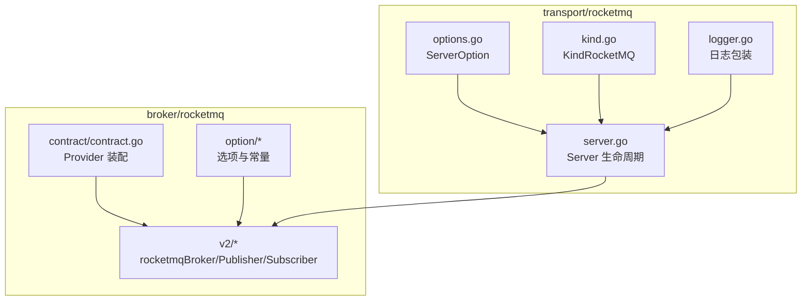
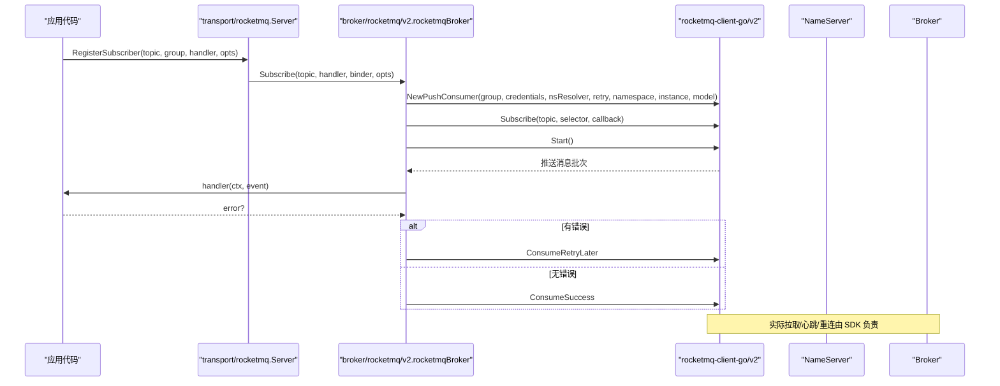
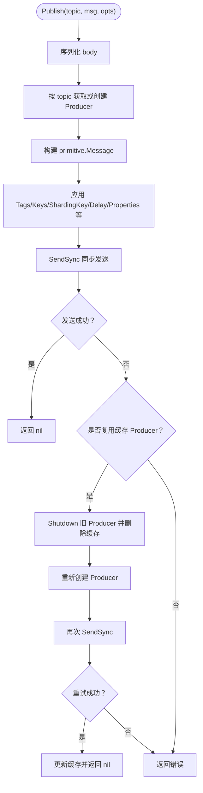
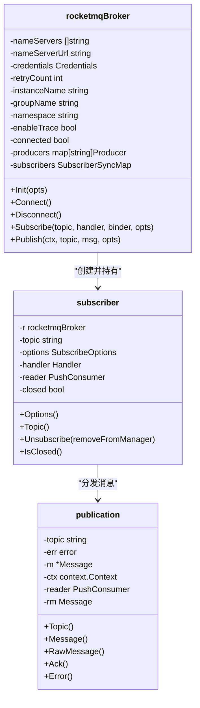
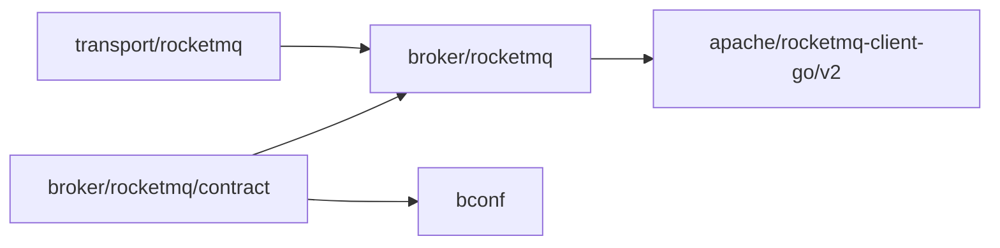
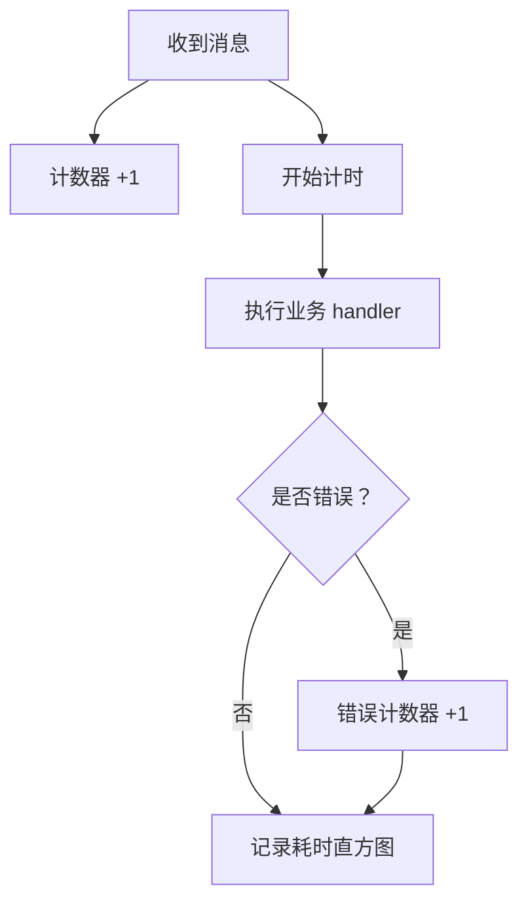

# RocketMQ 后端实现

<cite>
**本文引用的文件**
- [broker/rocketmq/go.mod](file://broker/rocketmq/go.mod)
- [transport/rocketmq/go.mod](file://transport/rocketmq/go.mod)
- [broker/rocketmq/contract/contract.go](file://broker/rocketmq/contract/contract.go)
- [broker/rocketmq/v2/rocketmq.go](file://broker/rocketmq/v2/rocketmq.go)
- [broker/rocketmq/v2/subscriber.go](file://broker/rocketmq/v2/subscriber.go)
- [broker/rocketmq/v2/publication.go](file://broker/rocketmq/v2/publication.go)
- [broker/rocketmq/v2/logger.go](file://broker/rocketmq/v2/logger.go)
- [broker/rocketmq/v2/disconnect_test.go](file://broker/rocketmq/v2/disconnect_test.go)
- [broker/rocketmq/option/options.go](file://broker/rocketmq/option/options.go)
- [broker/rocketmq/option/const.go](file://broker/rocketmq/option/const.go)
- [broker/rocketmq/option/option_key.go](file://broker/rocketmq/option/option_key.go)
- [transport/rocketmq/server.go](file://transport/rocketmq/server.go)
- [transport/rocketmq/options.go](file://transport/rocketmq/options.go)
- [transport/rocketmq/kind.go](file://transport/rocketmq/kind.go)
- [transport/rocketmq/logger.go](file://transport/rocketmq/logger.go)
- [transport/rocketmq/server_test.go](file://transport/rocketmq/server_test.go)
</cite>

## 目录
1. [引言](#引言)
2. [项目结构](#项目结构)
3. [核心组件](#核心组件)
4. [架构总览](#架构总览)
5. [详细组件分析](#详细组件分析)
6. [依赖关系分析](#依赖关系分析)
7. [性能与容量规划](#性能与容量规划)
8. [故障排查指南](#故障排查指南)
9. [监控与告警](#监控与告警)
10. [结论](#结论)

## 引言
本文件聚焦仓库中 RocketMQ 后端的实现，覆盖以下目标：
- v2 SDK 的集成方式：基于 `github.com/apache/rocketmq-client-go/v2`。
- PushConsumer 生命周期管理：创建、订阅、启动、关闭、断连。
- RocketMQ 消息模型：Topic、Tag、Sharding Key 在发布路径中的映射。
- 消费者组负载均衡策略：集群模式与广播模式。
- 客户端配置：NameServer、AccessKey/SecretKey/SecurityToken、InstanceName、GroupName、Namespace、RetryCount。
- 重试机制：客户端发送重试、消费失败重试（含死信队列说明）。
- 与 Broker 的通信协议与心跳保活：由底层 SDK 负责。
- 性能调优：发送端压缩、批量、延迟等级、消费线程池与重试次数等参数影响。
- 故障场景处理：NameServer 不可用、Broker 宕机、消息堆积。
- 监控指标采集与告警建议。

注意：本仓库 RocketMQ 适配器未暴露 PullBatchSize、ConsumeThreadMin/Max 等细粒度参数；这些属于底层 SDK 默认行为或需通过扩展点接入。文档会明确标注哪些能力“已实现”、哪些“未直接暴露”。

## 项目结构
RocketMQ 相关代码分布在两个模块：
- `broker/rocketmq`：面向业务 API 的 broker 适配层，封装 Apache RocketMQ v2 SDK。
- `transport/rocketmq`：面向 transport 框架的服务端装配层，提供 Server、注册订阅者、指标埋点等能力。

图表来源
- [broker/rocketmq/contract/contract.go:1-76](file://broker/rocketmq/contract/contract.go#L1-L76)
- [broker/rocketmq/v2/rocketmq.go:1-200](file://broker/rocketmq/v2/rocketmq.go#L1-L200)
- [broker/rocketmq/option/options.go:1-131](file://broker/rocketmq/option/options.go#L1-L131)
- [transport/rocketmq/server.go:1-219](file://transport/rocketmq/server.go#L1-L219)
- [transport/rocketmq/options.go:1-89](file://transport/rocketmq/options.go#L1-L89)
- [transport/rocketmq/kind.go:1-5](file://transport/rocketmq/kind.go#L1-L5)
- [transport/rocketmq/logger.go:1-35](file://transport/rocketmq/logger.go#L1-L35)

章节来源
- [broker/rocketmq/go.mod:1-52](file://broker/rocketmq/go.mod#L1-L52)
- [transport/rocketmq/go.mod:1-62](file://transport/rocketmq/go.mod#L1-L62)

## 核心组件
- `broker/rocketmq/contract.Provider`：将 `bootstrapv1.Broker` 的 rocketmq 段映射为 `broker.Option`，并构造 v2 Broker，完成 Init 与 Connect。
- `v2.rocketmqBroker`：实现 broker 接口，内部维护 Producer 缓存、PushConsumer 订阅者集合、NameServer 解析器、认证信息、重试次数、实例名、分组名、命名空间等。
- `v2.subscriber`：封装 PushConsumer 和订阅配置，支持 Unsubscribe。
- `v2.publication`：对单条原始消息的包装，供业务 Handler 访问 Topic、Message、RawMessage。
- `transport/rocketmq.Server`：对外暴露 Start/Stop/RegisterSubscriber，内部委托 v2 Broker，并在 handler 外围注入指标。

章节来源
- [broker/rocketmq/contract/contract.go:24-76](file://broker/rocketmq/contract/contract.go#L24-L76)
- [broker/rocketmq/v2/rocketmq.go:1-200](file://broker/rocketmq/v2/rocketmq.go#L1-L200)
- [broker/rocketmq/v2/subscriber.go:1-55](file://broker/rocketmq/v2/subscriber.go#L1-L55)
- [broker/rocketmq/v2/publication.go:1-38](file://broker/rocketmq/v2/publication.go#L1-L38)
- [transport/rocketmq/server.go:1-120](file://transport/rocketmq/server.go#L1-L120)

## 架构总览
RocketMQ 后端采用两层封装：
- 上层 transport 服务层：负责 Server 生命周期、按 topic 注册订阅者、统一指标埋点。
- 下层 broker 适配层：将通用 broker API 映射到 Apache RocketMQ v2 SDK，封装 Producer 创建、消息发送、PushConsumer 订阅与回调分发。

图表来源
- [transport/rocketmq/server.go:120-219](file://transport/rocketmq/server.go#L120-L219)
- [broker/rocketmq/v2/rocketmq.go:201-482](file://broker/rocketmq/v2/rocketmq.go#L201-L482)

## 详细组件分析

### v2 SDK 集成与 Broker 初始化
- 依赖版本：`github.com/apache/rocketmq-client-go/v2 v2.1.2`。
- NameServer 解析：优先使用 IP 列表，其次使用域名解析；若均未配置则回退到默认地址 `127.0.0.1:9876`。
- 认证：AccessKey/SecretKey/SecurityToken 透传到 SDK Credentials。
- 追踪：可开启 Cloud 模式的 tracing，生产者和消费者分别注入 TraceConfig。
- 连接语义：`Connect()` 是幂等的，仅设置 connected 标志；真正的网络连接发生在 Producer.Start 或 PushConsumer.Start。

章节来源
- [broker/rocketmq/v2/rocketmq.go:1-120](file://broker/rocketmq/v2/rocketmq.go#L1-L120)
- [broker/rocketmq/option/const.go:1-20](file://broker/rocketmq/option/const.go#L1-L20)
- [broker/rocketmq/option/options.go:1-80](file://broker/rocketmq/option/options.go#L1-L80)

### 生产者与发布路径
- 生产者缓存：按 topic 缓存 Producer；发送失败且为缓存的生产者时，会 Shutdown 旧实例、重建并再试一次。
- 消息属性映射：Headers → properties；可选 Compress/Batch/DelayTimeLevel/Tags/Keys/ShardingKey/DeliveryTimestamp/MessageGroup/SendAsync/SendWithTransaction。
- 发送模式：当前实现使用同步发送 `SendSync`，没有显式异步发送开关暴露给业务。

图表来源
- [broker/rocketmq/v2/rocketmq.go:201-482](file://broker/rocketmq/v2/rocketmq.go#L201-L482)

章节来源
- [broker/rocketmq/v2/rocketmq.go:201-482](file://broker/rocketmq/v2/rocketmq.go#L201-L482)

### 消费者与订阅生命周期
- 消费者创建：根据 SubscribeOptions 设置 GroupName、AutoAck、Retry、Namespace、Instance、ConsumerModel，并按需要开启 Consumer Tracing。
- 订阅回调：每条消息先反序列化为 broker.Message；若绑定 Binder 则调用 Binder 分配对象并反序列化 body；随后调用业务 handler。
- 确认语义：AutoAck=true 时，handler 成功后调用 Ack；只要任一消息出现反序列化错误或 handler 返回错误，整批返回 `ConsumeRetryLater`，触发 SDK 重试。
- Unsubscribe：标记 closed，可选择从管理器移除条目；但致命退出不会自动摘除 SubscriberSyncMap 条目，重订阅是覆盖而非累积。

图表来源
- [broker/rocketmq/v2/rocketmq.go:1-200](file://broker/rocketmq/v2/rocketmq.go#L1-L200)
- [broker/rocketmq/v2/subscriber.go:1-55](file://broker/rocketmq/v2/subscriber.go#L1-L55)
- [broker/rocketmq/v2/publication.go:1-38](file://broker/rocketmq/v2/publication.go#L1-L38)

章节来源
- [broker/rocketmq/v2/rocketmq.go:201-482](file://broker/rocketmq/v2/rocketmq.go#L201-L482)
- [broker/rocketmq/v2/subscriber.go:1-55](file://broker/rocketmq/v2/subscriber.go#L1-L55)
- [broker/rocketmq/v2/publication.go:1-38](file://broker/rocketmq/v2/publication.go#L1-L38)

### 传输层 Server 与指标
- Server 职责：组合 v2 Broker，管理订阅者注册表，Start 时 Init/Connect/注册预注册订阅者；Stop 时逐条 Unsubscribe 并 Disconnect。
- 指标埋点：收到消息计数、处理耗时直方图、错误计数，标签包含 broker、topic。
- 类型常量：`KindRocketMQ = "rocketmq"`。

章节来源
- [transport/rocketmq/server.go:1-219](file://transport/rocketmq/server.go#L1-L219)
- [transport/rocketmq/kind.go:1-5](file://transport/rocketmq/kind.go#L1-L5)
- [transport/rocketmq/logger.go:1-35](file://transport/rocketmq/logger.go#L1-L35)

## 依赖关系分析
- `broker/rocketmq` 模块依赖 Apache RocketMQ v2 SDK，并通过相对 replace 指向仓库根及子模块，保证本地编译闭环。
- `transport/rocketmq` 模块依赖 `broker/rocketmq`，并提供 ServerOption 把 broker 配置下推到底层。
- contract 包作为唯一导入 bconf 的桥接层，保持 v2 实现零契约依赖。

图表来源
- [broker/rocketmq/go.mod:1-52](file://broker/rocketmq/go.mod#L1-L52)
- [transport/rocketmq/go.mod:1-62](file://transport/rocketmq/go.mod#L1-L62)
- [broker/rocketmq/contract/contract.go:1-23](file://broker/rocketmq/contract/contract.go#L1-L23)

章节来源
- [broker/rocketmq/go.mod:1-52](file://broker/rocketmq/go.mod#L1-L52)
- [transport/rocketmq/go.mod:1-62](file://transport/rocketmq/go.mod#L1-L62)

## 性能与容量规划

### 已实现的调优点
- 发送端压缩与批量：可通过 `WithCompress`、`WithBatch` 控制消息体压缩与批量标记。
- 延迟投递：`WithDelayTimeLevel` 支持 RocketMQ 延迟等级。
- Tag/Keys/ShardingKey：用于过滤、索引与顺序关键键。
- 消费者模式：集群模式与广播模式通过 `WithConsumerModel` 选择。
- 重试次数：全局 `RetryCount` 同时作用于 Producer 与 Consumer。
- 实例标识：InstanceName 有助于区分多实例。
- 命名空间：Namespace 用于租户隔离。

### 未直接暴露的参数
- `PullBatchSize`、`ConsumeThreadMin`、`ConsumeThreadMax` 未在 option 中暴露。如需精细控制，需要在 v2 适配层增加对应 Option 并传入 SDK。
- 发送端并发度、TCP 连接池大小、重试间隔等也受 SDK 默认值控制。

### 参数影响与建议
- RetryCount：增大可提高网络抖动时的成功率，但也可能放大延迟与重复；消费者侧过大重试会导致消息堆积。
- Compress：适合大体积消息，减少带宽；CPU 消耗随负载上升。
- Batch：批量发送可减少 RPC 次数，但会增加端到端延迟；需结合吞吐与实时性权衡。
- DelayTimeLevel：适用于定时任务；大量延迟消息会增加 Broker 存储压力。
- ConsumerModel：
  - 集群模式：同一消费者组内负载均衡，避免重复消费。
  - 广播模式：每个消费者都收到全量消息，适合广播场景，但不具备负载均衡效果。

章节来源
- [broker/rocketmq/option/options.go:80-131](file://broker/rocketmq/option/options.go#L80-L131)
- [broker/rocketmq/option/const.go:1-20](file://broker/rocketmq/option/const.go#L1-L20)
- [broker/rocketmq/v2/rocketmq.go:201-482](file://broker/rocketmq/v2/rocketmq.go#L201-L482)

## 故障排查指南

### NameServer 不可用
- 现象：Init/Connect 阶段报错，或 Producer.Start/PushConsumer.Start 失败。
- 排查要点：
  - 检查 NameServer 地址列表或域名是否正确。
  - 校验 AccessKey/SecretKey/SecurityToken 是否匹配。
  - 确认防火墙/安全组放行 NameServer 端口。
- 相关逻辑：NameServer 解析器根据配置决定 Passthrough 或 HttpResolver，默认回退 `127.0.0.1:9876`。

章节来源
- [broker/rocketmq/v2/rocketmq.go:1-120](file://broker/rocketmq/v2/rocketmq.go#L1-L120)
- [broker/rocketmq/option/const.go:1-20](file://broker/rocketmq/option/const.go#L1-L20)

### Broker 宕机或网络中断
- 现象：SendSync 失败；SDK 会在内部尝试重连。
- 处理策略：
  - 合理设置 RetryCount，避免瞬时失败被无限放大。
  - 观察日志中的发送错误；必要时重启服务以重建 Producer。
  - 当前实现会在发送失败且为缓存 Producer 时重建一次，若仍失败则向上抛出错误。

章节来源
- [broker/rocketmq/v2/rocketmq.go:201-482](file://broker/rocketmq/v2/rocketmq.go#L201-L482)

### 消息堆积
- 常见原因：
  - 消费者处理能力不足。
  - 消费者模式选错导致重复或负载均衡失效。
  - handler 异常频繁，导致整批 `ConsumeRetryLater`，反复重试。
  - 反序列化失败或业务逻辑慢。
- 处理策略：
  - 扩大消费者实例数（集群模式下会自动均衡）。
  - 优化 handler 耗时，确保及时返回成功。
  - 针对反序列化失败单独记录并跳过，避免污染整批。
  - 调整 ConsumerModel：广播模式不会减少负载，集群模式更适合水平扩展。

章节来源
- [broker/rocketmq/v2/rocketmq.go:201-482](file://broker/rocketmq/v2/rocketmq.go#L201-L482)

### 订阅者生命周期问题
- 致命退出后不自行摘除 `SubscriberSyncMap` 条目：摘除是调用方或 `Disconnect` 的责任，重订阅是覆盖而非累积。
- 停机时必须调用 Disconnect：该实现会遍历所有订阅者执行 Unsubscribe 并清空订阅者集合，避免 goroutine 泄漏。
- 测试覆盖：`TestDisconnect_ClosesSubscribers` 与 `TestDisconnect_Idempotent` 验证断开行为。

章节来源
- [broker/rocketmq/v2/disconnect_test.go:1-68](file://broker/rocketmq/v2/disconnect_test.go#L1-L68)
- [broker/rocketmq/v2/rocketmq.go:1-120](file://broker/rocketmq/v2/rocketmq.go#L1-L120)

## 监控与告警

### 内置指标
Server 在消息处理流程中埋入以下指标（需注入 metrics.Metrics）：
- `broker_messages_received_total`：按 broker、topic 标签统计收到的消息数。
- `broker_message_duration_seconds`：按 broker、topic 标签统计处理耗时直方图。
- `broker_messages_errors_total`：按 broker、topic、error=true 统计处理错误数。

图表来源
- [transport/rocketmq/server.go:201-219](file://transport/rocketmq/server.go#L201-L219)

### 告警规则建议
- 接收速率下降：对比历史基线，发现 `broker_messages_received_total` 持续低于阈值。
- 处理延迟升高：`broker_message_duration_seconds` 的分位值（如 p95/p99）超过 SLA。
- 错误率突增：`broker_messages_errors_total` 增速明显或错误占比超过阈值。
- 消费者堆积：结合下游队列长度或消费位移差值，建立堆积告警。

章节来源
- [transport/rocketmq/server.go:201-219](file://transport/rocketmq/server.go#L201-L219)

## 结论
本 RocketMQ 后端以 Apache RocketMQ v2 SDK 为基础，通过 broker 适配层和 transport 服务层实现了稳定的消息收发与订阅管理。其优势在于：
- 清晰的 Provider 装配链路，便于通过 bootstrap 配置驱动。
- 统一的 Publisher/Subscriber 抽象，屏蔽 SDK 细节。
- 基础指标埋点，便于观测消息吞吐与处理延迟。
- 完善的断开与清理逻辑，防止订阅者资源泄漏。

需要注意的限制包括：
- 未暴露 PullBatchSize、ConsumeThreadMin/Max 等细粒度消费参数。
- 当前发送为同步模式，未直接暴露异步发送开关。
- 消费者重试失败统一走 `ConsumeRetryLater`，未区分反序列化错误与业务错误的重试策略。
- 死信队列配置不在本仓库暴露，需依赖 RocketMQ 服务端配置或后续扩展。

在实际部署中，建议：
- 正确配置 NameServer、认证与命名空间。
- 根据业务需求选择集群或广播模式。
- 合理设置 RetryCount、压缩、批量、延迟等级等参数。
- 启用指标采集并配置延迟、错误率、堆积等告警规则。
- 在停机流程中确保调用 Disconnect，避免订阅者泄漏。