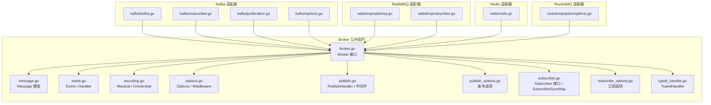
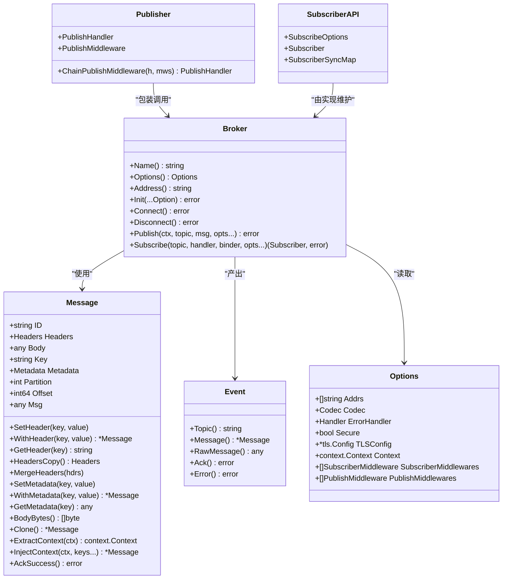
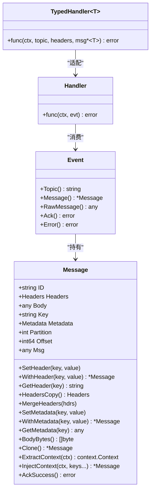
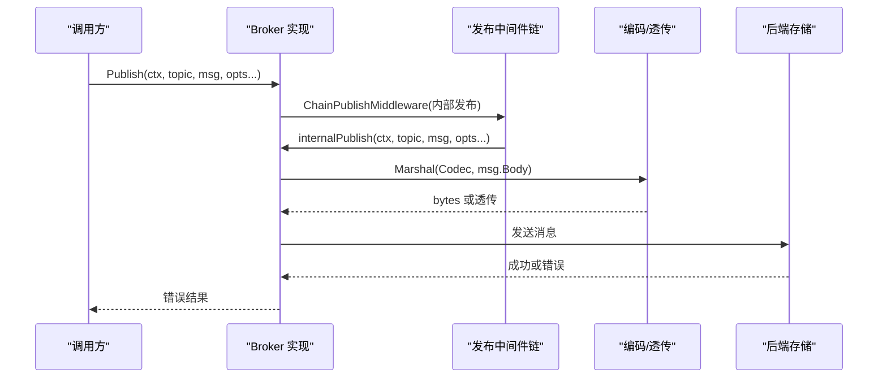
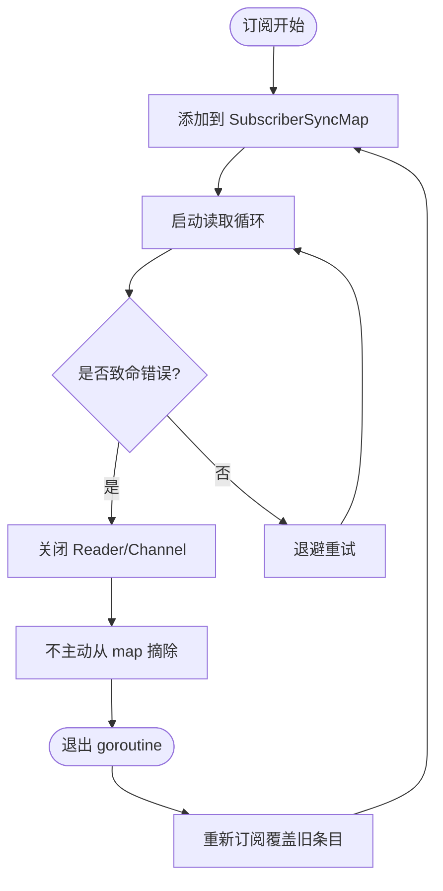
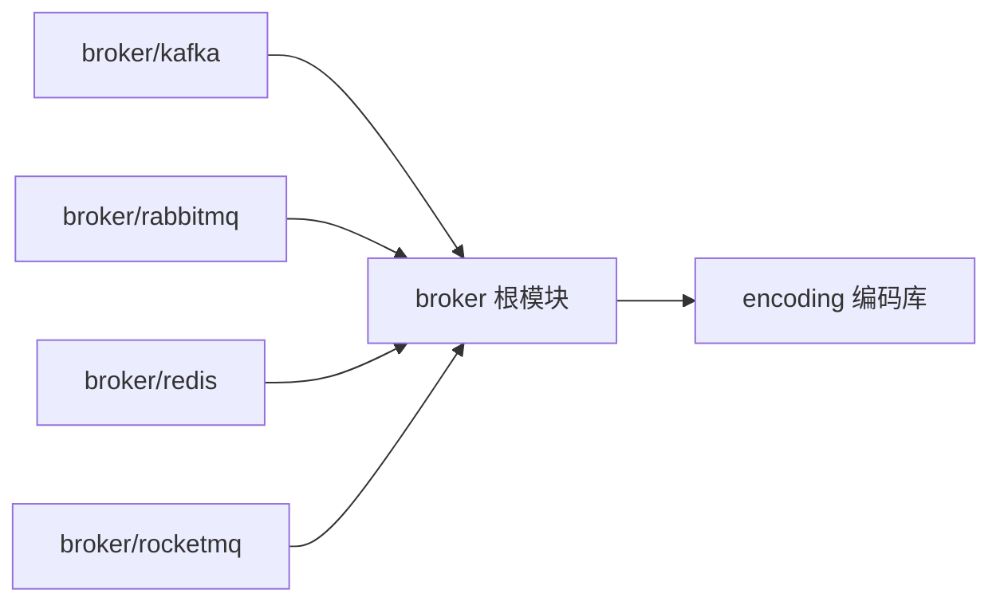

# 消息队列

<cite>
**本文引用的文件**   
- [broker/broker.go](file://broker/broker.go)
- [broker/message.go](file://broker/message.go)
- [broker/event.go](file://broker/event.go)
- [broker/encoding.go](file://broker/encoding.go)
- [broker/options.go](file://broker/options.go)
- [broker/publish.go](file://broker/publish.go)
- [broker/publish_options.go](file://broker/publish_options.go)
- [broker/subscriber.go](file://broker/subscriber.go)
- [broker/subscribe_options.go](file://broker/subscribe_options.go)
- [broker/typed_handler.go](file://broker/typed_handler.go)
- [broker/kafka/kafka.go](file://broker/kafka/kafka.go)
- [broker/kafka/subscriber.go](file://broker/kafka/subscriber.go)
- [broker/kafka/publication.go](file://broker/kafka/publication.go)
- [broker/kafka/options.go](file://broker/kafka/options.go)
- [broker/rabbitmq/rabbitmq.go](file://broker/rabbitmq/rabbitmq.go)
- [broker/rabbitmq/subscriber.go](file://broker/rabbitmq/subscriber.go)
- [broker/redis/redis.go](file://broker/redis/redis.go)
- [broker/rocketmq/option/options.go](file://broker/rocketmq/option/options.go)
</cite>

## 目录
1. [引言](#引言)
2. [项目结构](#项目结构)
3. [核心组件](#核心组件)
4. [架构总览](#架构总览)
5. [详细组件分析](#详细组件分析)
6. [依赖关系分析](#依赖关系分析)
7. [性能与可靠性](#性能与可靠性)
8. [故障排查指南](#故障排查指南)
9. [结论](#结论)
10. [附录：各后端配置要点](#附录各后端配置要点)

## 引言
本仓库的 Broker 子系统为 Bald 应用提供统一的消息发布订阅抽象，并通过 Kafka、RabbitMQ、Redis（Pub/Sub 与 Stream）、RocketMQ 等多个后端实现。文档聚焦三个主题：Broker 抽象设计与统一接口、消息模型与编码序列化机制、订阅者生命周期与已知限制；同时给出连接管理、重试与确认、事务能力等高级特性说明，以及各后端配置、调优和排错建议。

需要特别注意：本项目是 93 个 go.mod 的多模块仓库，Broker 相关代码分布在根 broker module 及其子模块中；适配器包仅由各自模块消费，根 module 不得依赖适配器，以避免模块环。

## 项目结构
Broker 的核心在 `broker/` 目录下，分为“公共契约层”和“后端适配器层”。

图表来源
- [broker/broker.go:1-70](file://broker/broker.go#L1-L70)
- [broker/message.go:1-200](file://broker/message.go#L1-L200)
- [broker/event.go:1-42](file://broker/event.go#L1-L42)
- [broker/encoding.go:1-95](file://broker/encoding.go#L1-L95)
- [broker/options.go:1-187](file://broker/options.go#L1-L187)
- [broker/publish.go:1-38](file://broker/publish.go#L1-L38)
- [broker/publish_options.go:1-113](file://broker/publish_options.go#L1-L113)
- [broker/subscriber.go:1-200](file://broker/subscriber.go#L1-L200)
- [broker/subscribe_options.go:1-138](file://broker/subscribe_options.go#L1-L138)
- [broker/typed_handler.go:1-34](file://broker/typed_handler.go#L1-L34)
- [broker/kafka/kafka.go:1-200](file://broker/kafka/kafka.go#L1-L200)
- [broker/kafka/subscriber.go:1-200](file://broker/kafka/subscriber.go#L1-L200)
- [broker/kafka/publication.go:1-57](file://broker/kafka/publication.go#L1-L57)
- [broker/kafka/options.go:1-200](file://broker/kafka/options.go#L1-L200)
- [broker/rabbitmq/rabbitmq.go:1-200](file://broker/rabbitmq/rabbitmq.go#L1-L200)
- [broker/rabbitmq/subscriber.go:1-126](file://broker/rabbitmq/subscriber.go#L1-L126)
- [broker/redis/redis.go:1-20](file://broker/redis/redis.go#L1-L20)
- [broker/rocketmq/option/options.go:1-131](file://broker/rocketmq/option/options.go#L1-L131)

章节来源
- [broker/broker.go:1-70](file://broker/broker.go#L1-L70)
- [broker/message.go:1-200](file://broker/message.go#L1-L200)
- [broker/event.go:1-42](file://broker/event.go#L1-L42)
- [broker/encoding.go:1-95](file://broker/encoding.go#L1-L95)
- [broker/options.go:1-187](file://broker/options.go#L1-L187)
- [broker/publish.go:1-38](file://broker/publish.go#L1-L38)
- [broker/publish_options.go:1-113](file://broker/publish_options.go#L1-L113)
- [broker/subscriber.go:1-200](file://broker/subscriber.go#L1-L200)
- [broker/subscribe_options.go:1-138](file://broker/subscribe_options.go#L1-L138)
- [broker/typed_handler.go:1-34](file://broker/typed_handler.go#L1-L34)
- [broker/kafka/kafka.go:1-200](file://broker/kafka/kafka.go#L1-L200)
- [broker/kafka/subscriber.go:1-200](file://broker/kafka/subscriber.go#L1-L200)
- [broker/kafka/publication.go:1-57](file://broker/kafka/publication.go#L1-L57)
- [broker/kafka/options.go:1-200](file://broker/kafka/options.go#L1-L200)
- [broker/rabbitmq/rabbitmq.go:1-200](file://broker/rabbitmq/rabbitmq.go#L1-L200)
- [broker/rabbitmq/subscriber.go:1-126](file://broker/rabbitmq/subscriber.go#L1-L126)
- [broker/redis/redis.go:1-20](file://broker/redis/redis.go#L1-L20)
- [broker/rocketmq/option/options.go:1-131](file://broker/rocketmq/option/options.go#L1-L131)

## 核心组件
Broker 抽象围绕以下构件组织：

| 组件 | 职责 | 关键行为 |
|---|---|---|
| Broker 接口 | 统一后端接入点 | Name、Address、Init、Connect、Disconnect、Publish、Subscribe |
| Message | 统一消息体 | ID、Headers、Body、Key、Metadata、Partition、Offset、Msg |
| Event | 消费侧事件封装 | Topic、Message、RawMessage、Ack、Error |
| Binder | 反序列化目标构造器 | 返回空对象指针供 codec 填充 |
| Options | Broker 级配置 | 地址、Codec、TLS、上下文、订阅/发布中间件 |
| PublishOptions | 单次发布配置 | Context、Timeout、Retries、Async、Callback、RequiredAcks、BodyCodec |
| SubscribeOptions | 单次订阅配置 | AutoAck、Queue、Concurrency、MaxRetries、RetryDelay、Middlewares |
| SubscriberSyncMap | 按主题维护订阅者 | Add/Get/Has/Len/Topics/Clear/Remove 及带超时版本 |
| TypedHandler / Subscribe[T] | 类型化订阅入口 | 把 Event.Message.Body 校验并转成指定泛型指针 |

章节来源
- [broker/broker.go:1-70](file://broker/broker.go#L1-L70)
- [broker/message.go:1-200](file://broker/message.go#L1-L200)
- [broker/event.go:1-42](file://broker/event.go#L1-L42)
- [broker/options.go:1-187](file://broker/options.go#L1-L187)
- [broker/publish_options.go:1-113](file://broker/publish_options.go#L1-L113)
- [broker/subscribe_options.go:1-138](file://broker/subscribe_options.go#L1-L138)
- [broker/subscriber.go:1-200](file://broker/subscriber.go#L1-L200)
- [broker/typed_handler.go:1-34](file://broker/typed_handler.go#L1-L34)

## 架构总览
Broker 采用“接口 + 多实现”的分层设计：业务代码只依赖根 broker 的 Broker 接口，具体后端通过各自包实现该接口。

图表来源
- [broker/broker.go:1-70](file://broker/broker.go#L1-L70)
- [broker/message.go:1-200](file://broker/message.go#L1-L200)
- [broker/event.go:1-42](file://broker/event.go#L1-L42)
- [broker/options.go:1-187](file://broker/options.go#L1-L187)
- [broker/publish.go:1-38](file://broker/publish.go#L1-L38)
- [broker/subscriber.go:1-200](file://broker/subscriber.go#L1-L200)

## 详细组件分析

### 消息与事件数据模型
Message 是跨后端的统一载体：ID、Headers、Key、Metadata、Partition、Offset 用于追踪与路由，Body 承载业务负载，Msg 透传底层原始对象（如 Kafka message、AMQP delivery）。它还提供 Header/Metadata 的拷贝、合并、注入上下文、延迟级别标记、浅克隆与 AckSuccess 等方法，便于上层做可观测性、传播和可靠性处理。

Event 是订阅侧的事件视图，包含主题、Message、原始消息、Ack 与错误。Handler 接收 Event 并返回错误；TypedHandler 则把 Body 校验为指定泛型指针后再交给业务处理器。

图表来源
- [broker/message.go:1-200](file://broker/message.go#L1-L200)
- [broker/event.go:1-42](file://broker/event.go#L1-L42)
- [broker/typed_handler.go:1-34](file://broker/typed_handler.go#L1-L34)

章节来源
- [broker/message.go:1-200](file://broker/message.go#L1-L200)
- [broker/event.go:1-42](file://broker/event.go#L1-L42)
- [broker/typed_handler.go:1-34](file://broker/typed_handler.go#L1-L34)

### 编码适配器与序列化机制
Broker 默认使用 JSON 编解码器，但实际查表发生在构造 Options 时，避免包初始化期注册表为空导致的假默认值。若未显式注册任何 Codec，Marshal 与 Unmarshal 会快速失败，并提示通过 encoding.MustRegister 注册编码器。

- Marshal：优先走注册表中的 Codec；当传入消息体是 []byte 或 string 时直接透传；否则若无 Codec 则报错。
- Unmarshal：先解引用 any 指针内的具体指针，保证 Binder 场景的类型语义不被 map/slice 覆盖；无 Codec 时仅支持 *[]byte 与 *string 透传。

这保证了“配了 JSON 心智却误发 gob 字节”的错误不会静默传播到跨语言消费端。

章节来源
- [broker/encoding.go:1-95](file://broker/encoding.go#L1-L95)
- [broker/options.go:1-187](file://broker/options.go#L1-L187)

### 发布流程与中间件
发布入口是 Broker.Publish，参数包括上下文、主题、Message 和发布选项。Broker 层提供 PublishHandler 与 PublishMiddleware，并支持 ChainPublishMiddleware 串联多个中间件；Legacy 兼容函数 WrapLegacyPublishHandler 会把 *Message 或底层 Msg 映射回旧版 any 载荷。

发布选项包括异步模式、回调、重试次数、超时、RequiredAcks、BodyCodec 等。每个后端实现会把这些选项映射到自身协议能力上，例如 RabbitMQ 的 DeliveryMode、Priority、Expiration、CorrelationId、ReplyTo、MessageId、Timestamp、Type、UserId、AppId 等字段。

图表来源
- [broker/publish.go:1-38](file://broker/publish.go#L1-L38)
- [broker/publish_options.go:1-113](file://broker/publish_options.go#L1-L113)
- [broker/rabbitmq/rabbitmq.go:1-200](file://broker/rabbitmq/rabbitmq.go#L1-L200)

章节来源
- [broker/publish.go:1-38](file://broker/publish.go#L1-L38)
- [broker/publish_options.go:1-113](file://broker/publish_options.go#L1-L113)
- [broker/rabbitmq/rabbitmq.go:1-200](file://broker/rabbitmq/rabbitmq.go#L1-L200)

### 订阅者生命周期与资源清理
订阅接口由 Subscriber 定义，包含 Options、Topic、Unsubscribe。根层的 SubscriberSyncMap 负责按主题维护订阅者集合，并提供 Topics、Len、Get、Has、Add、Remove、Clear、ForceClear 等工具方法。

关键点：

- Unsubscribe 会关闭底层 Reader/Channel，并在 removeFromManager 为真时从 SubscriberSyncMap 摘除条目。
- Kafka/RabbitMQ 的 subscriber.Unsubscribe 都调用 RemoveOnly 而非 Remove，因为 SubscriberSyncMap.Remove 还会再调用一次 Unsubscribe(true)，造成重复卸载。
- 致命退出后的清理责任不在 Broker 内部自行摘除 SubscriberSyncMap 条目，而是由调用方或 Disconnect 承担。这意味着死订阅者仍留在 map 中，导致 Topics()/Len()/Has() 高报活跃订阅数。
- 重订阅同一主题是覆盖行为：Add 直接写入相同 key，而不是累积多个订阅者。

图表来源
- [broker/subscriber.go:1-200](file://broker/subscriber.go#L1-L200)
- [broker/kafka/subscriber.go:1-200](file://broker/kafka/subscriber.go#L1-L200)
- [broker/rabbitmq/subscriber.go:1-126](file://broker/rabbitmq/subscriber.go#L1-L126)

章节来源
- [broker/subscriber.go:1-200](file://broker/subscriber.go#L1-L200)
- [broker/kafka/subscriber.go:1-200](file://broker/kafka/subscriber.go#L1-L200)
- [broker/rabbitmq/subscriber.go:1-126](file://broker/rabbitmq/subscriber.go#L1-L126)

### Kafka 后端
Kafka 后端基于 segmentio/kafka-go，维护 reader/writer 配置、SASL 机制、批量写入、日志开关、重试次数，以及一个 per-broker 的 SubscriberSyncMap。

- 连接与认证：支持 PLAIN 与 SCRAM；TLS 通过 Dialer.TLS 注入；Secure/TLSConfig 控制是否启用。
- 写入策略：默认同步写，避免 kafka-go 异步写“永远成功”的隐患；支持 OneTopicOneWriter、Completion 回调、负载均衡器、批量大小、批量超时、异步开关等。
- 订阅逻辑：单条或批量模式，具备指数退避与抖动；区分致命错误与非致命错误；EOF 视为正常 rebalance；context.Canceled 或已关闭订阅者视为致命。
- 确认语义：publication.Ack 调用 reader.CommitMessages 提交偏移。

章节来源
- [broker/kafka/kafka.go:1-200](file://broker/kafka/kafka.go#L1-L200)
- [broker/kafka/subscriber.go:1-200](file://broker/kafka/subscriber.go#L1-L200)
- [broker/kafka/publication.go:1-57](file://broker/kafka/publication.go#L1-L57)
- [broker/kafka/options.go:1-200](file://broker/kafka/options.go#L1-L200)

### RabbitMQ 后端
RabbitMQ 后端维护连接、channel 池与 SubscriberSyncMap，并在 Connect/Disconnect 中协调生命周期。

- 连接管理：自动补全 amqp:// 前缀，支持外部 SASL 与 TLS；Disconnect 先 Clear 所有订阅者，再关闭连接并等待协程结束。
- 发布：内部先把 msg.Body 用 broker.Marshal 序列化，然后映射到 amqp.Publishing 的多种字段。
- 订阅：支持 durable queue、autoDelete、exchange、queue arguments、headers；断线后 resubscribe 使用指数退避重试。

章节来源
- [broker/rabbitmq/rabbitmq.go:1-200](file://broker/rabbitmq/rabbitmq.go#L1-L200)
- [broker/rabbitmq/subscriber.go:1-126](file://broker/rabbitmq/subscriber.go#L1-L126)

### Redis 后端
Redis 适配器通过 DriverType 选择 Pub/Sub 或 Stream 两种驱动，默认走 Pub/Sub。

- DriverTypeStream：适合需要持久化、ACK、消费者组等能力的场景。
- DriverTypePubSub：轻量广播，不提供持久化。

章节来源
- [broker/redis/redis.go:1-20](file://broker/redis/redis.go#L1-L20)

### RocketMQ 后端
RocketMQ 当前可见的实现以 option 为主，暴露 NameServer、Credentials、Namespace、InstanceName、GroupName、DefaultTopic 等配置，以及发布压缩、批量、属性、延时等级、标签、sharding key、投递时间戳、事务发送、异步发送、消息分组，以及订阅消费者模型等选项。

章节来源
- [broker/rocketmq/option/options.go:1-131](file://broker/rocketmq/option/options.go#L1-L131)

### 类型化订阅入口
Subscribe[T] 是面向泛型的便捷入口：它会构造 TypedHandler，校验 Event 与 Message.Body 非空，再根据 Body 实际类型匹配 *T 或 T，最终调用业务 TypedHandler。如果类型不匹配，会返回明确错误，指出期望类型与实际类型。

章节来源
- [broker/broker.go:1-70](file://broker/broker.go#L1-L70)
- [broker/typed_handler.go:1-34](file://broker/typed_handler.go#L1-L34)

## 依赖关系分析
Broker 根模块依赖编码库，但不依赖任何后端适配器；各后端包分别依赖根 broker 接口。这种设计让根模块保持最小耦合，适配器包之间也互不依赖。

图表来源
- [broker/broker.go:1-70](file://broker/broker.go#L1-L70)
- [broker/encoding.go:1-95](file://broker/encoding.go#L1-L95)
- [broker/kafka/kafka.go:1-200](file://broker/kafka/kafka.go#L1-L200)
- [broker/rabbitmq/rabbitmq.go:1-200](file://broker/rabbitmq/rabbitmq.go#L1-L200)
- [broker/redis/redis.go:1-20](file://broker/redis/redis.go#L1-L20)
- [broker/rocketmq/option/options.go:1-131](file://broker/rocketmq/option/options.go#L1-L131)

章节来源
- [broker/broker.go:1-70](file://broker/broker.go#L1-L70)
- [broker/encoding.go:1-95](file://broker/encoding.go#L1-L95)

## 性能与可靠性

### 发布可靠性
- 默认同步写：Kafka 默认 Async=false，使调用方能感知失败，避免“异步写永远成功”的陷阱。
- 重试与超时：PublishOptions 提供 Retries、Timeout、Async、Callback；各后端可将 RequiredAcks 等能力映射到底层协议。
- 中间件扩展：发布中间件可用于重试、指标采集、链路追踪、限流、幂等键生成等横切逻辑。

### 订阅可靠性
- 自动确认：SubscribeOptions.AutoAck 默认开启，适合至少一次语义；关闭后可由业务手动 Ack。
- 并发处理：Concurrency 控制并行 handler 数量；Kafka 支持批量模式，按 batchSize 与 batchInterval 聚合。
- 重试与退避：订阅侧 MaxRetries、RetryDelay 配合后端本地退避；Kafka 对网络超时使用指数增长加抖动，对致命错误立即退出。

### 事务与死信队列
- RocketMQ 提供 SendWithTransaction 发布选项，表明事务发送能力可通过上下文传递。
- 各后端未在本仓库范围内实现统一的“死信队列”抽象；业务通常通过重试上限、错误处理器、独立失败主题或外部监控来建模。

### 连接池与资源
- Kafka：reader/writer 配置集中管理，支持 OneTopicOneWriter、Completion、SASL、TLS、Logger/ErrorLogger。
- RabbitMQ：连接断开后 resubscribe 使用指数退避；Disconnect 会 Clear 订阅者并等待 WaitGroup。
- Redis：Pub/Sub 轻量，Stream 更适合可靠消费；选择 DriverType 决定行为。

章节来源
- [broker/kafka/options.go:1-200](file://broker/kafka/options.go#L1-L200)
- [broker/kafka/subscriber.go:1-200](file://broker/kafka/subscriber.go#L1-L200)
- [broker/rabbitmq/rabbitmq.go:1-200](file://broker/rabbitmq/rabbitmq.go#L1-L200)
- [broker/rabbitmq/subscriber.go:1-126](file://broker/rabbitmq/subscriber.go#L1-L126)
- [broker/redis/redis.go:1-20](file://broker/redis/redis.go#L1-L20)
- [broker/rocketmq/option/options.go:1-131](file://broker/rocketmq/option/options.go#L1-L131)
- [broker/subscribe_options.go:1-138](file://broker/subscribe_options.go#L1-L138)

## 故障排查指南

### 订阅者计数异常
- 现象：Topics()/Len()/Has() 显示存在订阅者，但实际不再消费。
- 原因：Broker 订阅者致命退出后不会自动从 SubscriberSyncMap 摘除条目；只有调用方或 Disconnect 才负责清理。
- 影响：这些查询可能高报活跃订阅者数量。
- 处置：在应用 shutdown 路径显式调用 Disconnect，或在业务层记录订阅者句柄并在异常时主动 Remove；不要把 Has/Len 作为唯一健康检查依据。

章节来源
- [broker/subscriber.go:1-200](file://broker/subscriber.go#L1-L200)

### Kafka 订阅不断重试或频繁退出
- 非致命错误：context.DeadlineExceeded、net.Timeout 等走退避重试。
- 致命错误：context.Canceled、订阅者已关闭、非超时的 net.Error（如 connection refused）会立即退出。
- EOF：被视为正常 rebalance，交由 kafka-go 重连。
- 建议：检查订阅者上下文是否提前取消、Reader 配置是否正确、Kafka 集群是否发生分区 reassign。

章节来源
- [broker/kafka/subscriber.go:1-200](file://broker/kafka/subscriber.go#L1-L200)

### 编码失败或未注册 Codec
- 现象：Marshal/Unmarshal 返回“codec is nil”类错误。
- 原因：未在 main 中调用 encoding.MustRegister 注册编码器。
- 处置：先注册 json/proto 等 Codec，再创建 Broker Options；不要依赖隐式 fallback。

章节来源
- [broker/encoding.go:1-95](file://broker/encoding.go#L1-L95)
- [broker/options.go:1-187](file://broker/options.go#L1-L187)

### RabbitMQ 断线后无法恢复
- 现象：连接断开后订阅不再消费。
- 检查：resubscribe 是否在等待 conn.waitConnection；reSubscribeDelay 是否被指数放大至上限；conn.connected 是否重新置位。
- 处置：确认连接重建逻辑、Exchange/Queue/Binding 是否存在，并确保 Queue 名称与路由键一致。

章节来源
- [broker/rabbitmq/subscriber.go:1-126](file://broker/rabbitmq/subscriber.go#L1-L126)
- [broker/rabbitmq/rabbitmq.go:1-200](file://broker/rabbitmq/rabbitmq.go#L1-L200)

### 类型化订阅类型不匹配
- 现象：Subscribe[T] 或 TypedHandler 报错期望类型与实际 Body 类型不一致。
- 处置：确保发布者设置 Body 为 T 或 *T；Binder 返回正确类型的空指针；必要时使用通用字节或字符串 Body 配合自定义解码。

章节来源
- [broker/broker.go:1-70](file://broker/broker.go#L1-L70)
- [broker/typed_handler.go:1-34](file://broker/typed_handler.go#L1-L34)

## 结论
Broker 子系统通过 Broker 接口统一了多后端消息能力，并以 Message/Event/Binder 抽象解耦业务逻辑与底层协议。Kafka 与 RabbitMQ 提供了较完整的连接、认证、重试、确认与中间件扩展；Redis 提供 Pub/Sub 与 Stream 两种模式；RocketMQ 暴露丰富的发布与订阅选项。

在使用订阅者生命周期时，必须明确：致命退出不会自动清理 SubscriberSyncMap，Topics/Len/Has 可能高报；重订阅是覆盖而非累积。可靠性方面，应结合 AutoAck、重试、中间件与各后端原生能力共同构建幂等、可观测、可恢复的消息处理流水线。

## 附录：各后端配置要点

### Kafka 配置要点
- 地址与认证：Addrs、PLAIN、SCRAM、TLS。
- 写入：默认同步写；可选 OneTopicOneWriter、Completion、负载均衡器、批量大小、批量超时、异步模式。
- 读取：ReaderConfig、日志开关、最大尝试次数、读写超时。
- 注意事项：异步写不返回错误且缓冲区无界，仅在丢消息可接受时开启。

章节来源
- [broker/kafka/kafka.go:1-200](file://broker/kafka/kafka.go#L1-L200)
- [broker/kafka/options.go:1-200](file://broker/kafka/options.go#L1-L200)

### RabbitMQ 配置要点
- 地址：自动补全 amqp://；支持 ExternalAuthentication 与 TLS。
- 发布：DeliveryMode、Priority、ContentType、ContentEncoding、CorrelationId、ReplyTo、Expiration、MessageId、Timestamp、Type、UserId、AppId、Headers。
- 订阅：Exchange、Queue、durableQueue、autoDelete、headers、queueArgs。
- 生命周期：Disconnect 会 Clear 订阅者并等待协程。

章节来源
- [broker/rabbitmq/rabbitmq.go:1-200](file://broker/rabbitmq/rabbitmq.go#L1-L200)
- [broker/rabbitmq/subscriber.go:1-126](file://broker/rabbitmq/subscriber.go#L1-L126)

### Redis 配置要点
- 驱动选择：DriverTypeStream 用于可靠消费；DriverTypePubSub 用于轻量广播。
- 适用场景：Pub/Sub 不适合持久化与 ACK；Stream 适合持久化、消费者组、ACK 与回放。

章节来源
- [broker/redis/redis.go:1-20](file://broker/redis/redis.go#L1-L20)

### RocketMQ 配置要点
- 服务端：NameServer、Namespace、InstanceName、GroupName。
- 认证：AccessKey、SecretKey、SecurityToken、Credentials。
- 发布：Compress、Batch、Properties、DelayTimeLevel、Tags、Keys、ShardingKey、DeliveryTimestamp、SendAsync、SendWithTransaction、MessageGroup。
- 订阅：ConsumerModel。

章节来源
- [broker/rocketmq/option/options.go:1-131](file://broker/rocketmq/option/options.go#L1-L131)